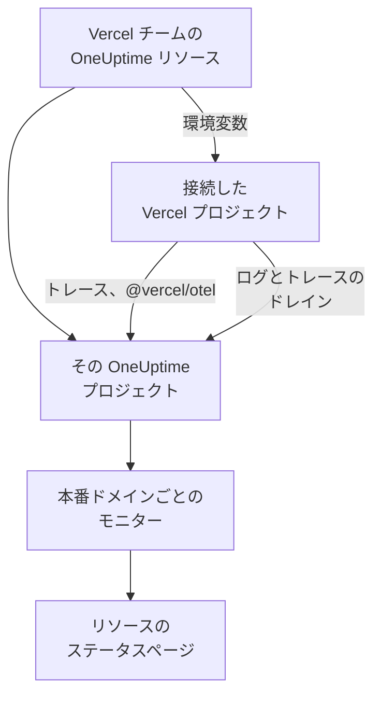

# Vercel

[Vercel Marketplace](https://vercel.com/marketplace) から Vercel チームに OneUptime を追加します。Vercel アカウントでサインインし、料金は Vercel の請求で支払います。Vercel プロジェクトには OneUptime のトレース、ログ、稼働監視、ステータスページが用意され、手作業で設定するものは何もありません。

:::cards
- [Vercel チームに OneUptime を追加する](#vercel-チームに-oneuptime-を追加する): Vercel のダッシュボードで、リソース、プラン、プロジェクトを選びます。
- [@vercel/otel でトレースを送る](#vercelotel-でトレースを送る): 環境変数はすでに設定されています。
- [ドレインでログとトレースを送る](#ドレインでログとトレースを送る): Vercel 自身のログとスパン。Pro と Enterprise で使えます。
- [プランと請求](#プランと請求): OneUptime のプランを Vercel の請求書で支払います。
:::

## 仕組み

Vercel で追加する OneUptime リソースは、それぞれが独立した OneUptime プロジェクトです。リソースに接続したすべての Vercel プロジェクトに、Vercel がリソースの環境変数を渡し、その環境変数によってプロジェクトのトレースが OneUptime に送られます。ドレインは Vercel のログとスパンを送り、接続した各プロジェクトの本番ドメインには、リソースのステータスページに載る稼働監視モニターが作成されます。



このインテグレーションは OneUptime Cloud (`oneuptime.com`) 向けです。セルフホストの OneUptime は Vercel Marketplace から追加できません。[セルフホストの OneUptime](#セルフホストの-oneuptime) を参照してください。

## 始める前に

- **Vercel チーム**。プランは問いません。ログドレインとトレースドレインには Vercel の Pro プランまたは Enterprise プランが必要です。`@vercel/otel` からのトレースはどのプランでも使えます。
- **Vercel アカウントの確認済みのメールアドレス**。OneUptime はこのアドレスを使ってサインインし、OneUptime アカウントがない場合はこのアドレスでアカウントを作成します。
- **Vercel の支払い方法**。どのプランでも必要です。モニターとテレメトリは、Free プランも含めて使用量に応じて課金されます。[プランと請求](#プランと請求) を参照してください。

## Vercel チームに OneUptime を追加する

:::steps
### Vercel Marketplace で OneUptime を開く

Vercel のダッシュボードで **Integrations** を開き、続いて **Browse Marketplace** を開いて、**Observability** の下にある OneUptime を見つけます。**Install** をクリックし、OneUptime の利用規約に同意します。

### プランを選ぶ

**Free**、**Growth**、**Scale** から選びます。これらは OneUptime 独自のプランで、料金は [oneuptime.com/pricing](https://oneuptime.com/pricing) に掲載されているとおりです。

### リソースに名前を付けて設定を選ぶ

リソースには、`storefront` のように監視する対象にちなんだ名前を付けます。リソースの OneUptime プロジェクトとステータスページにも、この名前が付きます。次の 2 つの設定は最初からオンです。

- **Monitor production domains**: 接続する各 Vercel プロジェクトの本番ドメインに、ウェブサイトモニターを作成します。
- **Create a status page**: リソースの公開ステータスページを作成し、それらのモニターを表示します。

### プロジェクトを接続する

このリソースにデータを送る Vercel プロジェクトと、リソースの環境変数を受け取る環境を選びます。接続にカスタムプレフィックスは付けないでください。`@vercel/otel` は変数をそれぞれ本来の名前で読み取ります。
:::

リソースは数秒で準備できます。**Open in OneUptime** をクリックすると、そのプロジェクトが表示されます。

## 各リソースで得られるもの

| 項目 | 確認する場所 |
| --- | --- |
| リソースにちなんだ名前の OneUptime プロジェクト | あなたがオーナーです。チームメイトは、Vercel からプロジェクトを開くと参加します。 |
| `Vercel` という名前の取り込みキー | **プロジェクト設定 → テレメトリと APM → 取り込みキー** |
| 接続した各 Vercel プロジェクトの環境変数 | Vercel でのプロジェクトの **Settings → Environment Variables** |
| 接続した各プロジェクトのウェブサイトモニター | **モニター**。Vercel プロジェクトにちなんだ名前が付きます |
| 公開ステータスページ | **ステータスページ**。リソースにちなんだ名前が付きます |

環境変数は、接続したどのプロジェクトでも同じです。

| 変数 | 値 |
| --- | --- |
| `OTEL_EXPORTER_OTLP_ENDPOINT` | `https://oneuptime.com/otlp` |
| `OTEL_EXPORTER_OTLP_HEADERS` | `x-oneuptime-token=` とリソースの取り込みキー |
| `OTEL_EXPORTER_OTLP_PROTOCOL` | `http/protobuf` |
| `ONEUPTIME_TELEMETRY_INGESTION_KEY` | 取り込みキーそのもの。ドレインがこれを送ります |

デプロイメントは、ビルド時に変数を受け取ります。プロジェクトを接続したら、もう一度デプロイしてください。

## @vercel/otel でトレースを送る

`@vercel/otel` は、Next.js をはじめ Vercel で動くフレームワーク向けの、Vercel 製の OpenTelemetry パッケージです。`OTEL_EXPORTER_OTLP_*` 変数を読み取るため、リソースに接続したプロジェクトに必要なのはこのパッケージだけです。

:::steps
### パッケージをインストールする

```bash
npm install @vercel/otel @opentelemetry/api @opentelemetry/api-logs
```

### 登録する

プロジェクトのルート (プロジェクトに `src` があればその中) に `instrumentation.ts` を作成し、サービスに名前を付けます。

```ts title="instrumentation.ts"
import { registerOTel } from "@vercel/otel";

export function register(): void {
  registerOTel({ serviceName: "storefront" });
}
```

### デプロイする

プロジェクトをデプロイします。そのトレースが、サービス名の下で **トレース** に表示されます。
:::

Vercel の Pro プランと Enterprise プランでは、トレースドレインも追加してください。Vercel が各リクエストについて自身のスパンをアプリケーションのスパンとともに OneUptime に送り、`@vercel/otel` はそれらのスパンをドレインに任せるので、同じものが二重に届くことはありません。

## ドレインでログとトレースを送る

ドレインは、Vercel がプロジェクトについて記録したものを OneUptime に送ります。ログドレインはビルド、関数、エッジ、リクエストのログを、トレースドレインはスパンを送ります。ドレインには Vercel の Pro プランまたは Enterprise プランが必要で、ドレインが送るデータの料金は、Vercel が Vercel の請求に計上します。

:::steps
### ドレインを追加する

Vercel で **Team Settings → Drains** を開き、**Add Drain** をクリックします。**Logs** または **Traces** を選び、続いて **Native Integrations** の下にある OneUptime を選びます。

### プロジェクトを選ぶ

プロジェクトを選び、ログの場合はソースと環境も選びます。ドレインはリソースの取り込みキーで送信するので、入力するものはありません。
:::

各 Vercel プロジェクトは、OneUptime ではプロジェクトにちなんだ名前のサービスになります。ログには時刻、レベル、メッセージがそのまま残り、リクエストの情報は OpenTelemetry の名前で入ります。

| Vercel のフィールド | OneUptime での扱い |
| --- | --- |
| `projectName` | サービス、`service.name` |
| `timestamp`、`level`、`message` | ログの時刻、重大度、本文 |
| `deploymentId`、`environment` | `vercel.deployment.id`、`deployment.environment.name` |
| `proxy.method`、`proxy.path`、`proxy.statusCode` | `http.request.method`、`url.path`、`vercel.proxy.status_code` |
| `traceId`、`spanId` | ログのトレース。**トレース** にあるそのトレースにリンクされます |
| その他のフィールド | `vercel.` の下の属性。たとえば `vercel.source` |

## 稼働監視モニターとステータスページ

Vercel プロジェクトを接続すると、OneUptime はその本番ドメインのウェブサイトモニターを作成し、OneUptime のプローブからチェックして、リソースのステータスページに追加します。最初の本番デプロイより前に接続したプロジェクトにはまだドメインがないため、モニターはそのデプロイの時点で作成されます。プロジェクトの接続を解除すると、そのモニターは削除されます。

各モニターはアクティブなモニターで、ほかのモニターと同じように課金され、自分で作成したモニターと同じように動作します。[Web サイト モニター](/docs/monitor/website-monitor) を参照してください。モニターを作成しないようにするには、Vercel にあるリソースの設定で **Monitor production domains** をオフにします。もう一度オンにすると、まだないモニターが作成されます。

## Vercel から OneUptime を開く

リソースの **Open in OneUptime**、または Vercel にあるリソースのいずれかのリンクをクリックすると、Vercel アカウントのメールアドレスで OneUptime にサインインします。初回にはリソースのプロジェクトに参加します。Vercel チームのオーナーまたはメンバーであれば管理者として、チームの読み取り専用ロールのいずれかを持っていればメンバーとして参加します。

そのメールアドレスの OneUptime アカウントがすでにある場合は、そのアカウントにサインインします。2 要素認証をオンにしているアカウントや、OneUptime の管理者のアカウントは、代わりにパスワードでサインインします。いずれの場合もプロジェクトには参加できます。

## プランと請求

| | 仕組み |
| --- | --- |
| プラン | **Free**、**Growth**、**Scale**。料金は oneuptime.com に掲載されているとおりで、プランのユーザーあたりの料金、モニターあたり月額 $1 のアクティブなモニター、GB あたりのテレメトリです。 |
| 支払う場所 | Vercel の請求書で、月に一度、リソースごとに支払います。Vercel はリソースに当月のここまでの使用量を表示し、1 時間ごとに更新します。 |
| 試用期間 | プランの試用期間中は、ユーザー、モニター、テレメトリのいずれにも料金はかかりません。 |
| プランの変更 | Vercel のリソースで、または OneUptime の **プロジェクト設定 → 請求と請求書 → 請求** で変更します。どちらで変更しても両方に反映されます。 |
| 未払いの請求書 | Vercel は 15 日間、支払いを再試行します。その後は請求書が支払われるまでプロジェクトの提供が停止されます。データは保持され、何も削除されません。 |

請求書には、リソースごとに、ユーザー、アクティブなモニター、テレメトリ、そして残高のチャージ (ある場合) の行があり、金額は 1 単位 $0.01 の使用量単位で記載されます。

## OneUptime を削除する

| 操作 | 結果 |
| --- | --- |
| Vercel でリソースを削除する | それまでの使用量が請求された後、そのプロジェクトが削除されます。接続していた Vercel プロジェクトは、次のデプロイでリソースの環境変数を失います。 |
| チームから OneUptime をアンインストールする | すべてのリソースのプロジェクトが削除され、最後の請求書が送られます。 |
| OneUptime でプロジェクトを削除する | Vercel のリソースも削除されます。 |

> [!CAUTION]
> プロジェクトを削除すると、そのモニター、ステータスページ、インシデント、テレメトリは完全に削除されます。残したいものは先にエクスポートしてください。

## セルフホストの OneUptime

Vercel Marketplace がプロビジョニングするのは OneUptime Cloud だけなので、セルフホストの OneUptime は Vercel Marketplace から追加できません。それでも、Vercel プロジェクトからセルフホストの OneUptime にデータを送ることはできます。

- **トレース**: Vercel プロジェクトの **Settings → Environment Variables** で、[各リソースで得られるもの](#各リソースで得られるもの) にある変数を設定します。エンドポイントには `https://YOUR-ONEUPTIME-HOST/otlp` を、取り込みキーにはプロジェクトのキーを使います。
- **ログ**: **Team Settings → Drains** でカスタムログドレインを追加し、送信先を `https://YOUR-ONEUPTIME-HOST/telemetry/vercel/v1/logs`、形式を JSON または NDJSON にします。取り込みキーを値とする `x-oneuptime-token` ヘッダーを追加し、ドレインの署名シークレットにも同じキーを設定します。OneUptime は、Vercel がこのキーで署名した配信だけを受け入れます。

同じカスタムドレインは、ホストを `oneuptime.com` にすれば OneUptime Cloud でも使えます。

## トラブルシューティング

:::details トレースが届かない
- プロジェクトをもう一度デプロイします。プロジェクトを接続する前にビルドされたデプロイメントには、`OTEL_EXPORTER_OTLP_*` 変数がありません。
- プロジェクトの **Settings → Environment Variables** で変数の名前を確認します。カスタムプレフィックスを付けて接続すると変数の名前が変わり、`@vercel/otel` はそれらを読み取れなくなります。プレフィックスなしでプロジェクトを接続し直してください。
- `instrumentation.ts` が `registerOTel` を呼び出していること、そして Next.js 14 以前では `next.config.js` で `experimental.instrumentationHook` がオンになっていることを確認します。
:::

:::details Vercel でドレインがエラーと表示される
Vercel には、ドレインの配信に対する OneUptime の応答が表示されます。

- メッセージに `x-vercel-signature` を含む `403`: Vercel が、送信しているキーで配信に署名していません。カスタムドレインの場合は、その `x-oneuptime-token` ヘッダーを確認し、署名シークレットに同じキーを設定してください。
- `401`: ドレインが送るキーを持つプロジェクトを OneUptime が見つけられません。キーが削除されたか、両方の場所で入力を誤っています。**プロジェクト設定 → テレメトリと APM → 取り込みキー** にあるキーを使ってください。
- `422`: キーがオフになっています。同じページでもう一度オンにするか、別のキーを使ってください。
:::

:::details 接続したプロジェクトにモニターがない
- Vercel にあるリソースの設定で、**Monitor production domains** がオフになっています。
- プロジェクトにまだ本番ドメインがありません。モニターは最初の本番デプロイの時点で作成されます。
- プロジェクトのアクティブなモニターが、プランで許可される数に達しています。プランをアップグレードしてから、**Monitor production domains** をオフにしてもう一度オンにしてください。
:::

:::details メールアドレスを確認するよう Vercel に求められる
OneUptime には、Vercel が確認済みのメールアドレスが必要です。さらに、そのアドレスの OneUptime アカウントがすでにある場合は、そのアカウントでもアドレスが確認済みである必要があります。アドレスを確認してから、もう一度リソースを追加するか OneUptime を開いてください。
:::

## 次のステップ

:::cards
- [トレースエクスプローラー](/docs/telemetry/traces-explorer): 遅いリクエストとそのスパンを見つけます。
- [ログエクスプローラー](/docs/telemetry/logs-explorer): Vercel のログを検索します。
- [ステータスページ](/docs/status-pages/index): リソースのステータスページにブランドを適用し、購読者を追加します。
- [取り込みキー](/docs/telemetry/ingestion-keys): リソースのキーを入れ替えたり、無効にしたりします。
:::
