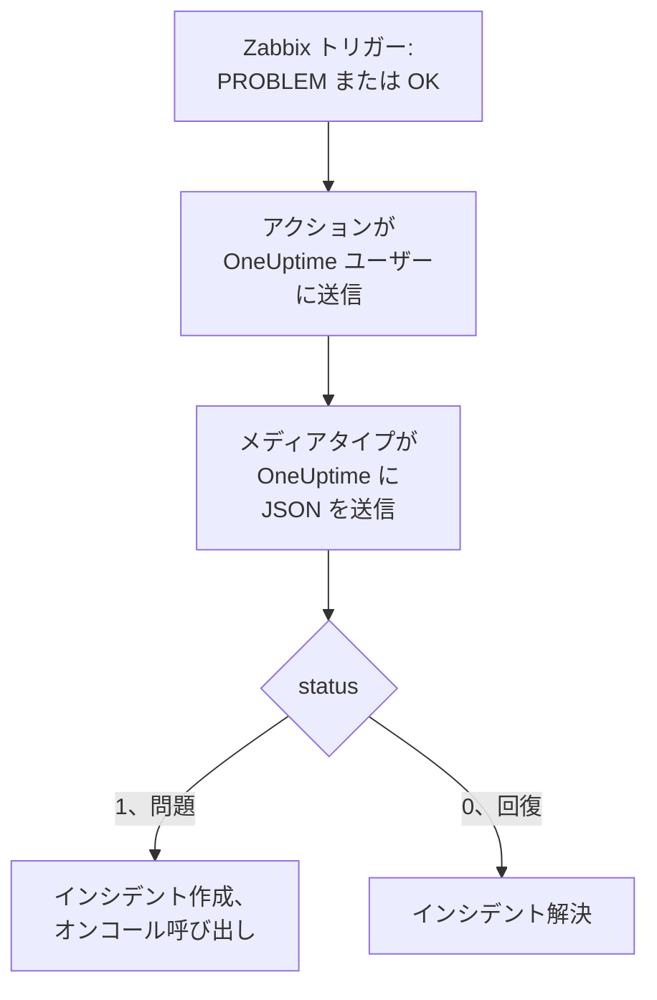

# Zabbix

[Zabbix](https://www.zabbix.com) の問題を OneUptime に送信すると、各問題がオンコールチームを呼び出すインシデントになり、Zabbix が回復すると解決されます。Zabbix は各問題を Webhook のメディアタイプで送信するため、どちら側にもインストールするものはありません。

:::cards
- [OneUptime で問題を受け取る方法を選ぶ](#oneuptime-で問題を受け取る方法を選ぶ): 受信リクエストモニターか、独自のワークフロー。
- [モニターで問題を受け取る](#モニターで問題を受け取る): 問題ごとに 1 件のインシデントを作成し、回復時に解決。
- [Zabbix を設定する](#zabbix-を設定する): メディアタイプ、ユーザー、アクション。
- [トラブルシューティング](#トラブルシューティング): 問題が届かない、またはインシデントが開いたままの場合。
:::

## 仕組み



Zabbix は、ユーザーのメディアを通じてそのユーザーに問題を送信します。ここでのメディアは **OneUptime** という名前の Webhook メディアタイプです。そのスクリプトは、問題のイベント ID、名前、ホスト、重大度、ステータスを含む小さな JSON ドキュメントを OneUptime に送信します。ステータスは問題では `1`、回復では `0` です。

## 前提条件

- 自分が管理する Zabbix サーバー。このガイドは Zabbix 6.0 LTS と 7.0 LTS 向けに書かれています。Webhook メディアタイプは Zabbix 5.0 以降で同じように動作します。
- HTTPS で OneUptime に到達できる Zabbix サーバー。
- OneUptime では、モニターを作成する権限、またはワークフローの方法を選ぶ場合はワークフローを作成する権限。

## OneUptime で問題を受け取る方法を選ぶ

まず OneUptime を設定します。Zabbix の送信先となる URL が得られます。

| 方法 | 使う場面 |
| --- | --- |
| 受信リクエストモニター (推奨) | Zabbix のすべての問題を、オンコールを呼び出し、Zabbix が回復すると解決されるインシデントにしたい場合。構築するものはありません。 |
| Webhook トリガーを使うワークフロー | 問題の絞り込み、形の変更、先に他のシステムを呼び出すなど、独自のロジックが必要な場合。ワークフローは、回復時にインシデントを自動では解決しません。 |

どちらも同じメディアタイプから同じ JSON を受け取るため、一方から始めて、後で Zabbix の URL を 1 つ変えるだけで切り替えられます。

## モニターで問題を受け取る

[受信リクエストモニター](/docs/monitor/incoming-request-monitor) は URL を発行し、その条件が各リクエストの処理を決めます。

:::steps
### モニターを作成する

**モニター** に移動し、**モニターを作成** をクリックします。**モニターの種類** で **受信リクエスト** を選び、名前を `Zabbix` にして **次へ** をクリックします。

### 問題ごとにインシデントを宣言する

**条件** ステップで、最初の条件 (モニターをオフラインとしてマークする条件) を開きます。フィルターを **リクエストボディ**、**含む**、`"status":"1"` に設定します。この条件は、フィルターが一致するとすでにインシデントを宣言します。インシデントを入力します:

- **インシデントタイトル**: `Zabbix: {{requestBody.name}} on {{requestBody.host}}`。
- **重大度**: Zabbix の問題に付けるインシデントの重大度。
- **オンコールポリシー** (**オンコール** の下): 呼び出すポリシー。
- **インシデントを自動解決** (**その他の項目** の下): 初期状態のままオンにしておきます。これがないと回復は無視され、インシデントは開いたままになります。

### 問題ごとに 1 件のインシデントを作成する

同じ条件で **設定** を開き、**ペイロードのフィールドでインシデントとアラートをグループ化** をオンにします。下のとおり入力すると、問題ごとに専用のインシデントが作成され、その回復で解決されます:

| フィールド | 値 |
| --- | --- |
| **次ごとに別々のインシデントを作成…** | `requestBody.event_id` |
| **回復を示すフィールド** | `requestBody.status` |
| **回復を意味する値** | `0` |

### モニターをオンラインに戻す

2 つ目の条件 (モニターをオンラインとしてマークする条件) を開き、フィルターを **リクエストボディ**、**含む**、`"status":"0"` に設定します。

### URL をコピーする

**モニターを作成** をクリックします。モニターの **概要** ページに **ハートビート URL** が表示されます。Zabbix 用にコピーします:

```text
https://oneuptime.com/heartbeat/<secret key>
```

セルフホストのインストールでは、`oneuptime.com` の代わりに独自のホストになります。
:::

モニターは、リクエストの JSON を書かれたとおりに読み取ります: `"status":"1"`、スペースなしです。各設定の働きについては、[別のシステムからアラートを受け取る](/docs/monitor/incoming-request-monitor#他システムからのアラート受信) を参照してください。

## ワークフローで問題を受け取る

Zabbix とインシデントの間に独自のステップが必要な場合は、[ワークフロー](/docs/workflows/index) を使います。

:::steps
### ワークフローを作成する

**ワークフロー** に移動し、**ワークフローを作成** をクリックしてから **ゼロから作成** をクリックします。名前を `Zabbix problems` にして **ワークフローを作成** をクリックします。

### Webhook トリガーを追加する

点線の **このワークフローを開始するものを選択** ブロックをクリックし、**Webhook** を選びます。トリガーをクリックしてから **URL をコピー** をクリックし、URL を Zabbix 用に控えておきます。

### 問題であることを確認する

**コンポーネントを追加** をクリックし、**If / Else** ブロックを追加して、トリガーの **Out** の点をそのブロックに接続します。**Value to check** を `{{local.components.webhook-1.returnValues.request-body.status}}`、**Comparison** を **is equal to**、**Compare with** を `1` に設定します。

### インシデントを宣言する

**Create One Incident** ブロックを追加し、**If / Else** ブロックの **Yes** 側をそのブロックに接続します。**Incident Template** で、重大度と呼び出すオンコールポリシーを設定するテンプレートを選びます ([インシデントテンプレート](/docs/incidents/settings#インシデントテンプレート) を参照)。**JSON Object** には Zabbix から届く内容を設定します:

```json
{
  "title": "Zabbix: {{local.components.webhook-1.returnValues.request-body.name}}",
  "description": "Host: {{local.components.webhook-1.returnValues.request-body.host}}\nSeverity: {{local.components.webhook-1.returnValues.request-body.severity}}\nZabbix event: {{local.components.webhook-1.returnValues.request-body.event_id}}"
}
```

テンプレートがない場合、**JSON Object** には、プロジェクトのインシデント重大度のいずれかの ID である `incidentSeverityId` も必要です。

### オンにする

**ビルダー** の上部で **有効** をオンにします。オフのワークフローは Zabbix に `400` で応答します。
:::

回復は **If / Else** ブロックの **No** 側に進み、そこには何も接続されていないため、実行はそこで終わります。回復時にインシデントを解決するには、モニターを使ってください。

## Zabbix を設定する

Zabbix には 3 つのものが必要です。OneUptime に送信するメディアタイプ、送信先のユーザー、そしてそのユーザーに問題を送信するアクションです。

:::steps
### OneUptime メディアタイプを作成する

1. **Alerts → Media types** (Zabbix 6.0 では **Administration → Media types**) に移動し、**Create media type** をクリックします。
2. **Name** を `OneUptime`、**Type** を **Webhook** に設定します。
3. 次の **Parameters** を追加します。それぞれが Zabbix の [マクロ](https://www.zabbix.com/documentation/current/en/manual/appendix/macros/supported_by_location) をリクエストに渡します:

   | 名前 | 値 |
   | --- | --- |
   | `url` | `{ALERT.SENDTO}` |
   | `event_id` | `{EVENT.ID}` |
   | `event_name` | `{EVENT.NAME}` |
   | `event_value` | `{EVENT.VALUE}` |
   | `event_severity` | `{EVENT.SEVERITY}` |
   | `host` | `{HOST.NAME}` |
   | `event_date` | `{EVENT.DATE}` |
   | `event_time` | `{EVENT.TIME}` |

4. これを **Script** に貼り付けます:

   ```javascript
   var params = JSON.parse(value);
   var request = new HttpRequest();
   request.addHeader("Content-Type: application/json");

   var payload = {
     source: "zabbix",
     event_id: params.event_id,
     name: params.event_name,
     host: params.host,
     severity: params.event_severity,
     // "1" for a problem, "0" for its recovery.
     status: params.event_value,
     date: params.event_date,
     time: params.event_time,
   };

   var response = request.post(params.url, JSON.stringify(payload));

   if (request.getStatus() < 200 || request.getStatus() >= 300) {
     throw (
       "OneUptime responded with HTTP " + request.getStatus() + ": " + response
     );
   }

   return "OK";
   ```

5. **Message templates** タブで、**Problem** 用と **Problem recovery** 用のテンプレートを 1 つずつ追加します。本文は空のままにします。リクエストはスクリプトが組み立てます。Zabbix は、テンプレートがある種類のイベントにのみメディアタイプを使います。
6. **Add** をクリックします。

### 問題を受け取るユーザーを作成する

1. **Users → Users** (Zabbix 6.0 では **Administration → Users**) に移動し、**Create user** をクリックします。名前を `OneUptime` にし、通知を受け取れるユーザーグループとロール (**User role** など) を割り当てます。
2. **Media** タブで **Add** をクリックします。**Type** を `OneUptime`、**Send to** を OneUptime からコピーした URL に設定します。**When active** と重大度はそのままにするか、OneUptime に送らない重大度のチェックを外します。
3. **Add** をクリックし、もう一度 **Add** をクリックしてユーザーを保存します。

### アクションで問題を OneUptime に送信する

1. **Alerts → Actions → Trigger actions** (Zabbix 6.0 では **Configuration → Actions**) に移動し、**Create action** をクリックします。名前を `Notify OneUptime` にします。
2. 必要に応じて **Conditions** で絞り込みます。例: **Trigger severity is greater than or equals Warning**。条件がなければ、すべての問題が送信されます。
3. **Operations** タブで、メディアタイプ `OneUptime` を通じてユーザー `OneUptime` に送信するオペレーションを追加します。
4. 回復も送信されるように、同じオペレーションを **Recovery operations** にも追加します。
5. **Add** をクリックし、アクションが有効になっていることを確認します。
:::

## テストする

1. Zabbix で **Alerts → Media types** を開き、`OneUptime` の横の **Test** をクリックします。コピーした URL と、`event_id` `12345`、`event_name` `Test problem`、`host` `web-1`、`event_value` `1` などのサンプル値を入力します。**Test** をクリックすると、Zabbix がスクリプトの応答 `OK` またはスクリプトが投げたエラーを表示します。
2. OneUptime でモニターを開いてインシデントが作成されたことを確認するか、ワークフローの **ログ → 実行履歴** を開いて実行を確認します。
3. `event_value` `0` と同じ `event_id` でもう一度テストします。モニターの場合、インシデントが解決されます。

その後、たとえばしきい値を一時的に下げて本物のトリガーを発火させ、問題が届くのを確認します。

## Zabbix の重大度を対応付ける

Zabbix は重大度をテキストで送信します: `Not classified`、`Information`、`Warning`、`Average`、`High`、`Disaster`。

- **モニターの場合** は、重大度のグループごとに **条件を追加** をクリックし、新しい条件を最初の条件より上にドラッグします。条件は上から確認され、最初に一致したものが決め手になります。それぞれに `"status":"1"` と `"severity":"Disaster"` のような重大度の 2 つのフィルターを設定し、**一致条件** を **すべて** にします。それぞれに独自の **重大度** と **インシデントを自動解決**、同じグループ化の設定を持つインシデントを設定します。
- **ワークフローの場合** は、`{{local.components.webhook-1.returnValues.request-body.severity}}` に対する [Switch / Case](/docs/workflows/components#switch-case) ブロックを重大度ごとのケース付きで追加し、各ケースの後に独自のテンプレートを持つ **Create One Incident** ブロックを置きます。

## トラブルシューティング

:::details OneUptime に何も届かない
- Zabbix で **Reports → Action log** を開き、アクションが問題を送信したかどうかと、何が返ってきたかを確認します。
- Zabbix サーバーから自分でリクエストを送信します: `curl -i -X POST <url> -H 'Content-Type: application/json' -d '{"status":"1","event_id":"1","name":"Test","host":"test"}'`。
- モニターは、何も確認しないうちに、シークレットキーが間違っていてもすぐに `200` を返します。リクエストが届いているかどうかは、モニターのタイムラインで確認してください。
- オフのワークフローは `400` を返します。その **ビルダー** の上部で **有効** をオンにします。
:::

:::details Zabbix がスクリプトエラーを報告する
メディアタイプを開いて **Test** を使います。Zabbix がスクリプトの結果か、スクリプトが投げたエラーを表示します。OneUptime からの `2xx` 以外の応答は、スクリプトがそのステータスとともに投げるので、まず URL を確認してください。
:::

:::details インシデントは作成されるが解決されない
- アクションには **Recovery operations** が必要です。ないと Zabbix は回復を送信しません。
- 条件のインシデントには、**その他の項目** の下の **インシデントを自動解決** が必要です。
- **回復を示すフィールド** は `requestBody.status`、**回復を意味する値** は正確に `0` でなければなりません。
- ワークフローは回復時にインシデントを解決しません。モニターを使ってください。
:::

:::details インシデントに値ではなく参照が表示される
リクエストにないフィールドへの参照は、空にされず、波かっこも含めて書かれたまま残ります。Zabbix が `Content-Type: application/json` を送信していること、使っているフィールド名 (`name`、`host`、`severity`、`status`、`event_id`) がスクリプトのペイロードと一致していることを確認してください。ワークフローの場合は、**ログ → 実行履歴** で実行を開き、トリガーが受け取った内容と比較します。[注意点](/docs/workflows/variables#落とし穴) を参照してください。
:::

:::details すべての問題が 2 回届く
おそらくアクションに、同じユーザーに送信するオペレーションが 2 つあります (最初のステップとエスカレーションのステップなど)。アクションの **Operations** を確認してください。
:::

## セキュリティ

- **URL はパスワードと同じように扱ってください。** URL を持つ人は誰でもインシデントを作成できます。漏れた場合はリセットします: モニターの **設定** ページの **受信リクエストのシークレットキーをリセット**、またはワークフローの **Webhook** トリガーの **URL をリセット** です。その後、Zabbix ユーザーのメディアの **Send to** を更新します。
- **インシデントが必要なものだけを送信してください。** アクションの条件や、ユーザーのメディアの重大度を使って、重大度の低い問題は Zabbix に残します。
- **セルフホストの場合は?** ファイアウォールを通じて、Zabbix サーバーから OneUptime に HTTPS で到達できるようにします。

## 次のステップ

:::cards
- [受信リクエスト モニター](/docs/monitor/incoming-request-monitor): Zabbix の問題を受け取るモニターのすべての設定。
- [エスカレーションルール](/docs/on-call/escalation-rules): オンコールポリシーが誰をいつ呼び出すかを決めます。
- [ワークフロー トリガー](/docs/workflows/triggers#webhook): ワークフローの Webhook URL の仕組み。
- [インテグレーションの概要](/docs/integrations/index): 接続できるその他のツール。
:::
