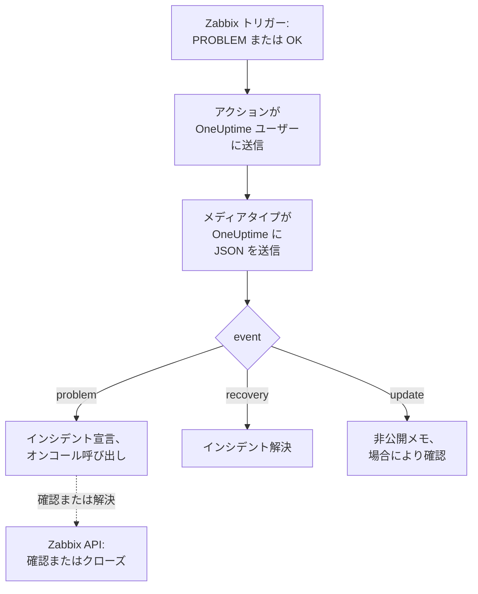

# Zabbix

[Zabbix](https://www.zabbix.com) の問題を OneUptime に送信すると、各問題がオンコールチームを呼び出すインシデントになり、Zabbix が回復すると解決されます。すぐに使えるワークフローテンプレートが両側を同期させます。Zabbix で行われたことはインシデントに記録され、インシデントを確認または解決すると、Zabbix の問題が確認またはクローズされます。Zabbix は各問題を Webhook のメディアタイプで送信するため、どちら側にもインストールするものはありません。

:::cards
- [OneUptime で問題を受け取る方法を選ぶ](#oneuptime-で問題を受け取る方法を選ぶ): ワークフローテンプレートか、受信リクエストモニター。
- [テンプレートから始める](#テンプレートから始める): 6 つのテンプレート、その動作と必要な入力。
- [Zabbix を設定する](#zabbix-を設定する): メディアタイプ、ユーザー、アクション。
- [トラブルシューティング](#トラブルシューティング): 問題が届かない、またはインシデントが開いたままの場合。
:::

## 仕組み



Zabbix は、ユーザーのメディアを通じてそのユーザーに問題を送信します。ここでのメディアは **OneUptime** という名前の Webhook メディアタイプです。そのスクリプトは、問題ごと、その回復ごと、そして Zabbix で誰かが問題を更新するごとに、問題のイベント ID、名前、ホスト、重大度を含む小さな JSON ドキュメントを OneUptime に送信します。OneUptime は、イベント ID を使って問題が作成したインシデントを見つけます。

## 前提条件

- 自分が管理する Zabbix サーバー。このガイドは Zabbix 6.0 LTS と 7.0 LTS 向けに書かれています。Webhook メディアタイプは Zabbix 5.0 以降で同じように動作します。Zabbix の API を呼び出すテンプレートには、Zabbix 6.4 以降、または [Zabbix 6.0 での 1 か所の変更](#zabbix-60-の場合) が必要です。
- HTTPS で OneUptime に到達できる Zabbix サーバー。Zabbix を呼び出すテンプレートでは、Zabbix に到達できる OneUptime も必要です。
- OneUptime では、ワークフローを作成する権限、またはモニターの方法を選ぶ場合はモニターを作成する権限。OneUptime Cloud では、ワークフローに **Growth** プラン以上が必要です。

## OneUptime で問題を受け取る方法を選ぶ

まず OneUptime を設定します。Zabbix の送信先となる URL が得られます。

| 方法 | 使う場面 |
| --- | --- |
| ワークフローテンプレート (推奨) | 各問題を Zabbix の重大度に応じたインシデントまたはアラートにし、High と Disaster ではオンコールを呼び出し、回復で解決し、Zabbix での操作をそこに記録し、OneUptime から Zabbix を確認またはクローズしたい場合。 |
| 受信リクエストモニター | ワークフローなしで、どのプランでもインシデントを作成し、ステータスが Zabbix に従うモニターが欲しい場合。Zabbix には何も戻りません。 |

どちらも同じメディアタイプから同じ JSON を受け取るため、一方から始めて、後で Zabbix の URL を 1 つ変えるだけで切り替えられます。

## テンプレートから始める

**ワークフローを作成** ダイアログには、カテゴリー一覧の **Zabbix** の下に 6 つの Zabbix テンプレートがあります。インシデント用が 3 つ、次に同じ 3 つのアラート用です。

| テンプレート | 動作 | 必要な入力 |
| --- | --- | --- |
| **インシデント** | | |
| Declare an incident for each Zabbix problem | Zabbix がすべてのイベントを送信するワークフロー。問題ごとにインシデントを宣言し、High と Disaster ではオンコールを呼び出し、Zabbix での更新を記録し、回復でインシデントを解決します。 | Zabbix URL |
| Acknowledge or close the Zabbix problem with the incident | インシデントが確認されると、その問題を確認します。解決されると問題をクローズし、Zabbix が手動クローズを許可しない場合は確認します。 | Zabbix URL、Zabbix API Token |
| Copy incident private notes to the Zabbix problem | インシデントの各非公開メモを、その問題にメッセージとして追加します。 | Zabbix URL、Zabbix API Token |
| **アラート** | | |
| Create an alert for each Zabbix problem | インシデントと同じですが、問題ごとにアラートを作成します。 | Zabbix URL |
| Acknowledge or close the Zabbix problem with the alert | インシデントと同じですが、アラートの状態に従います。 | Zabbix URL、Zabbix API Token |
| Copy alert private notes to the Zabbix problem | アラートの各非公開メモを、その問題にメッセージとして追加します。 | Zabbix URL、Zabbix API Token |

まず **Declare an incident for each Zabbix problem** から始めます。アラートの場合は **Create an alert for each Zabbix problem** から始めます。これが作成するインシデントまたはアラートは、問題のイベント ID をカスタムフィールド `zabbixEventId` に保持し、ほかの 2 つのテンプレートはそれを使って問題を見つけます。

### テンプレートに必要な入力

- **Zabbix URL**: Zabbix を開くときのアドレス。たとえば `https://zabbix.example.com`、Zabbix がパスの下で動いている場合は `https://example.com/zabbix` です。問題へのリンクはそこを指し、Zabbix を呼び出すテンプレートはその `api_jsonrpc.php` にリクエストを送信します。Zabbix 内のページのアドレスは受け付けません。
- **Zabbix API Token**: ワークフローが操作に使う Zabbix ユーザーの API トークン。作成方法は [API トークンを作成する](#api-トークンを作成する) を参照してください。シークレット変数として保存され、Zabbix にだけ送信されます。送信先は `Authorization` ヘッダーで、Zabbix 6.0 ではリクエストの本文です。

### テンプレートで問題を受け取る

:::steps
1. **ワークフロー** に移動し、**ワークフローを作成** をクリックします。**またはテンプレートから始める** で、カテゴリー一覧の **Zabbix** を選び、**Declare an incident for each Zabbix problem** をクリックしてから **このテンプレートを使う** をクリックします。
2. **Zabbix URL** を入力します。 **Who to page for High and Disaster problems** で呼び出すオンコールポリシーを選び（誰も呼び出さない場合は選ばない）、 **ワークフローを作成** をクリックします。ワークフローはオフの状態で **ビルダー** に開きます。
3. **Webhook** トリガーをクリックしてから **URL をコピー** をクリックし、URL を Zabbix 用に控えておきます。
4. **ビルダー** の上部で **有効** をオンにします。オフのワークフローは Zabbix に `400` で応答します。
:::

次に、その URL に問題を送信するように [Zabbix を設定します](#zabbix-を設定する)。

### ワークフローの動作

**Webhook** トリガーの後、 **Check With JavaScript** ステップ `read-event-1` がメディアタイプの送る `event` を読み取り、 **Incident From Another Tool**（アラートのテンプレートでは **Alert From Another Tool** ）が、問題のイベント ID をもとにその意味どおりに処理します:

| イベント | ワークフローの動作 |
| --- | --- |
| `problem` | `Zabbix: <problem> on <host>` というタイトルのインシデントを、Zabbix の重大度に対応する重大度で宣言し、ステータスページには表示しません。説明には Zabbix の問題へのリンクと、ホスト、重大度、開始時刻、運用データ、タグを記載します。High または Disaster の問題では、選んだオンコールポリシーを呼び出します。Zabbix が同じイベント ID で再送した問題では、新しいインシデントは作成されません。 |
| `recovery` | 問題のインシデントがまだ解決されていなければ解決します。理由はタイムラインに残ります。 |
| `update` | Zabbix で行われたこと (誰が行ったか、何をしたか、何を書いたか) を非公開メモとしてインシデントに追加します。更新で問題が確認された場合はインシデントも確認し、オンコールのエスカレーションが止まります。 |

それ以外のもの (別のツールからのリクエストなど) はそのままにされ、 `read-event-1` が **No** に進み、実行の **ステップ** にその理由が示されます。失敗したステップは実行を失敗させ、 **ステップ** にあるその項目に理由が示されます。

### 重大度

新しいプロジェクトでは、テンプレートは Zabbix の 6 つの重大度を次のインシデントとアラートの重大度に対応付けます:

| Zabbix の重大度 | インシデント | アラート | オンコール |
| --- | --- | --- | --- |
| Disaster | Critical Incident | High | 呼び出す |
| High | Critical Incident | High | 呼び出す |
| Average | Major Incident | Low | 呼び出さない |
| Warning | Major Incident | Low | 呼び出さない |
| Information | Minor Incident | Low | 呼び出さない |
| Not classified | Minor Incident | Low | 呼び出さない |

独自の重大度がある場合、Disaster と High は最も重いものに、Average と Warning は中間のものに、Information と Not classified は最も軽いものに対応します。Zabbix は重大度に 0 (Not classified) から 5 (Disaster) までの番号を付けており、テンプレートは番号を読むため、Zabbix で重大度の名前を変えても何も変わりません。

- 重大度を名前で自分の重大度に対応付けるには、`read-event-1` ステップの `SEVERITY_BY_NAME` を編集します。たとえば Warning なら `{ 2: 'Minor Incident' }` です。
- Average の問題でも呼び出すには、`if-page-1` の **If / Else** ステップの **Compare with** を `3` にします。

### 確認とメモを Zabbix に送り返す

:::steps
1. [API トークンを作成します](#api-トークンを作成する)。
2. **Acknowledge or close the Zabbix problem with the incident** からワークフローを作成します。**Zabbix URL** と **Zabbix API Token** を入力し、**ワークフローを作成** をクリックして、**有効** をオンにします。
3. メモも Zabbix に送りたい場合は、**Copy incident private notes to the Zabbix problem** でも同じようにします。
:::

状態のテンプレートは先に Zabbix に問題を問い合わせるため、Zabbix ですでに確認または解決された問題はそのままにされます。問題をクローズするには、そのトリガーで Zabbix の **Allow manual close** が必要です。これがない場合、問題は代わりに確認され、インシデントが解決されたことを伝えるメッセージが付き、回復したときに Zabbix がクローズします。Zabbix の問題が作成していないインシデントと、**プライベートインシデント** とマークされたインシデントは、Zabbix に送信されません。

### API トークンを作成する

:::steps
1. [問題を受け取る](#問題を受け取るユーザーを作成する) `OneUptime` ユーザーを使います。Zabbix はユーザー自身の更新をそのユーザーに送信しないため、このユーザーのトークンを使えば、OneUptime の確認やメッセージが更新として OneUptime に戻ってくることはありません。
2. **Users → User roles** でユーザーのロールを確認します。**Access to API** が有効で、**Acknowledge problems**、**Add problem comments**、**Close problems** が許可されている必要があります。誰も変更していなければ、**User role** はこれらを許可しています。
3. **Users → User groups** でユーザーのグループを確認します。問題の確認とメッセージの追加には、ホストグループに対する **Read** 権限で十分です。問題をクローズするには **Read-write** が必要です。
4. **Users → API tokens** に移動し、**Create API token** をクリックします。`OneUptime` ユーザーを選び、**Set expiration date and time** のチェックを外すか日付を控えて、**Add** をクリックします。
5. **Auth token** をコピーします。Zabbix はこれを一度しか表示しません。**Zabbix API Token** に貼り付けます。
:::

### Zabbix 6.0 の場合

Zabbix 6.0 は API トークンを `Authorization` ヘッダーではなく、リクエストの本文から読み取ります。Zabbix を呼び出す各テンプレートの **Update Zabbix Problem** ステップで、 **その他の項目** の下にある **Zabbix 6.0** をオンにします。Zabbix 7.2 以降は本文のトークンを拒否するため、アップグレード時には再びオフにします。

## モニターで問題を受け取る

[受信リクエストモニター](/docs/monitor/incoming-request-monitor) は URL を発行し、その条件が各リクエストの処理を決めます。

:::steps
### モニターを作成する

**モニター** に移動し、**モニターを作成** をクリックします。**モニターの種類** で **受信リクエスト** を選び、名前を `Zabbix` にして **次へ** をクリックします。

### 問題ごとにインシデントを宣言する

**条件** ステップで、最初の条件 (モニターをオフラインとしてマークする条件) を開きます。フィルターを **リクエストボディ**、**含む**、`"status":"1"` に設定します。この条件は、フィルターが一致するとすでにインシデントを宣言します。インシデントを入力します:

- **インシデントタイトル**: `Zabbix: {{requestBody.name}} on {{requestBody.host}}`。
- **重大度**: Zabbix の問題に付けるインシデントの重大度。
- **オンコールポリシー** (**オンコール** の下): 呼び出すポリシー。
- **インシデントを自動解決** (**その他の項目** の下): 初期状態のままオンにしておきます。これがないと回復は無視され、インシデントは開いたままになります。

### 問題ごとに 1 件のインシデントを作成する

同じ条件で **設定** を開き、**ペイロードのフィールドでインシデントとアラートをグループ化** をオンにします。下のとおり入力すると、問題ごとに専用のインシデントが作成され、その回復で解決されます:

| フィールド | 値 |
| --- | --- |
| **次ごとに別々のインシデントを作成…** | `requestBody.event_id` |
| **回復を示すフィールド** | `requestBody.status` |
| **回復を意味する値** | `0` |

### モニターをオンラインに戻す

2 つ目の条件 (モニターをオンラインとしてマークする条件) を開き、フィルターを **リクエストボディ**、**含む**、`"status":"0"` に設定します。

### URL をコピーする

**モニターを作成** をクリックします。モニターの **概要** ページに **ハートビート URL** が表示されます。Zabbix 用にコピーします:

```text
https://oneuptime.com/heartbeat/<secret key>
```

セルフホストのインストールでは、`oneuptime.com` の代わりに独自のホストになります。
:::

モニターは、リクエストの JSON を書かれたとおりに読み取ります: `"status":"1"`、スペースなしです。各設定の働きについては、[別のシステムからアラートを受け取る](/docs/monitor/incoming-request-monitor#他システムからのアラート受信) を参照してください。Zabbix で行われた更新も `"status":"1"` で送信され、モニターはそれを再び問題として読み取り、新しいインシデントは作成しません。

## Zabbix を設定する

Zabbix には 3 つのものが必要です。OneUptime に送信するメディアタイプ、送信先のユーザー、そしてそのユーザーに問題を送信するアクションです。

:::steps
### OneUptime メディアタイプを作成する

1. **Alerts → Media types** (Zabbix 6.0 では **Administration → Media types**) に移動し、**Create media type** をクリックします。
2. **Name** を `OneUptime`、**Type** を **Webhook** に設定します。
3. 次の **Parameters** を追加します。それぞれが Zabbix の [マクロ](https://www.zabbix.com/documentation/current/en/manual/appendix/macros/supported_by_location) をリクエストに渡します:

   | 名前 | 値 |
   | --- | --- |
   | `url` | `{ALERT.SENDTO}` |
   | `event_id` | `{EVENT.ID}` |
   | `event_name` | `{EVENT.NAME}` |
   | `event_value` | `{EVENT.VALUE}` |
   | `event_severity` | `{EVENT.SEVERITY}` |
   | `event_nseverity` | `{EVENT.NSEVERITY}` |
   | `host` | `{HOST.NAME}` |
   | `event_date` | `{EVENT.DATE}` |
   | `event_time` | `{EVENT.TIME}` |
   | `event_opdata` | `{EVENT.OPDATA}` |
   | `event_tags` | `{EVENT.TAGSJSON}` |
   | `trigger_id` | `{TRIGGER.ID}` |
   | `event_update_status` | `{EVENT.UPDATE.STATUS}` |
   | `event_update_action` | `{EVENT.UPDATE.ACTION}` |
   | `event_update_message` | `{EVENT.UPDATE.MESSAGE}` |
   | `event_update_user` | `{USER.FULLNAME}` |

4. これを **Script** に貼り付けます:

   ```javascript
   var params = JSON.parse(value);

   // Zabbix leaves a macro it has no value for as it is written, such as
   // {EVENT.UPDATE.MESSAGE} on a problem: it is sent as nothing.
   function given(text) {
     var written = String(text === undefined || text === null ? "" : text);
     return /^\{[A-Z0-9_.]+\}$/.test(written) || written === "*UNKNOWN*"
       ? ""
       : written;
   }

   var isUpdate = given(params.event_update_status) === "1";
   var payload = {
     source: "zabbix",
     // "problem", "recovery" or "update".
     event: isUpdate
       ? "update"
       : params.event_value === "0"
         ? "recovery"
         : "problem",
     event_id: params.event_id,
     name: params.event_name,
     host: params.host,
     severity: params.event_severity,
     // 0 Not classified, 1 Information, 2 Warning, 3 Average, 4 High, 5 Disaster.
     severity_number: params.event_nseverity,
     // "1" for a problem, "0" for its recovery.
     status: params.event_value,
     date: params.event_date,
     time: params.event_time,
     opdata: given(params.event_opdata),
     tags: [],
     trigger_id: params.trigger_id,
   };

   try {
     var tags = JSON.parse(given(params.event_tags) || "[]");
     payload.tags = Array.isArray(tags) ? tags : [];
   } catch (error) {
     payload.tags = [];
   }

   if (isUpdate) {
     payload.update = {
       action: given(params.event_update_action),
       message: given(params.event_update_message),
       user: given(params.event_update_user),
     };
   }

   var request = new HttpRequest();
   request.addHeader("Content-Type: application/json");

   var response = request.post(params.url, JSON.stringify(payload));

   if (request.getStatus() < 200 || request.getStatus() >= 300) {
     throw (
       "OneUptime responded with HTTP " + request.getStatus() + ": " + response
     );
   }

   return "OK";
   ```

5. **Message templates** タブで、**Problem** 用、**Problem recovery** 用、**Problem update** 用のテンプレートを 1 つずつ追加します。本文は空のままにします。リクエストはスクリプトが組み立てます。Zabbix は、テンプレートがある種類のイベントにのみメディアタイプを使います。
6. **Add** をクリックします。

### 問題を受け取るユーザーを作成する

1. **Users → Users** (Zabbix 6.0 では **Administration → Users**) に移動し、**Create user** をクリックします。名前を `OneUptime` にし、通知を受け取れるユーザーグループとロール (**User role** など) を割り当てます。
2. **Media** タブで **Add** をクリックします。**Type** を `OneUptime`、**Send to** を OneUptime からコピーした URL に設定します。**When active** と重大度はそのままにするか、OneUptime に送らない重大度のチェックを外します。
3. **Add** をクリックし、もう一度 **Add** をクリックしてユーザーを保存します。

### アクションで問題を OneUptime に送信する

1. **Alerts → Actions → Trigger actions** (Zabbix 6.0 では **Configuration → Actions**) に移動し、**Create action** をクリックします。名前を `Notify OneUptime` にします。
2. 必要に応じて **Conditions** で絞り込みます。例: **Trigger severity is greater than or equals Warning**。条件がなければ、すべての問題が送信されます。
3. **Operations** タブで、メディアタイプ `OneUptime` を通じてユーザー `OneUptime` に送信するオペレーションを追加します。
4. 回復も送信されるように、同じオペレーションを **Recovery operations** にも追加し、Zabbix での確認とコメントも送信されるように **Update operations** にも追加します。
5. **Add** をクリックし、アクションが有効になっていることを確認します。
:::

一部の問題をインシデントのテンプレートに、ほかの問題をアラートのテンプレートに送るには、`OneUptime` ユーザーに `OneUptime` タイプのメディアを 2 つ設定します。それぞれが 1 つのワークフローの URL に送信し、受け取るべき重大度を指定します。

## テストする

1. Zabbix で **Alerts → Media types** を開き、`OneUptime` の横の **Test** をクリックします。コピーした URL と、`event_id` `12345`、`event_name` `Test problem`、`host` `web-1`、`event_nseverity` `4`、`event_value` `1` などのサンプル値を入力します。**Test** をクリックすると、Zabbix がスクリプトの応答 `OK` またはスクリプトが投げたエラーを表示します。
2. OneUptime でワークフローの **ログ → 実行履歴** を開いて実行を確認するか、モニターを開いてインシデントが作成されたことを確認します。
3. `event_value` `0` と同じ `event_id` でもう一度テストします。インシデントが解決されます。

その後、たとえばしきい値を一時的に下げて本物のトリガーを発火させ、問題が届くのを確認します。更新を試すには、Zabbix でメッセージを付けて問題を確認します。インシデントに非公開メモが付き、確認済みになります。

## Zabbix の重大度を対応付ける

Zabbix は重大度をテキストで送信します: `Not classified`、`Information`、`Warning`、`Average`、`High`、`Disaster`。

- **テンプレートの場合**、重大度は自動で対応付けられます。[重大度](#重大度) を参照してください。
- **モニターの場合** は、重大度のグループごとに **条件を追加** をクリックし、新しい条件を最初の条件より上にドラッグします。条件は上から確認され、最初に一致したものが決め手になります。それぞれに `"status":"1"` と `"severity":"Disaster"` のような重大度の 2 つのフィルターを設定し、**一致条件** を **すべて** にします。それぞれに独自の **重大度** と **インシデントを自動解決**、同じグループ化の設定を持つインシデントを設定します。

## トラブルシューティング

:::details OneUptime に何も届かない
- Zabbix で **Reports → Action log** を開き、アクションが問題を送信したかどうかと、何が返ってきたかを確認します。
- Zabbix サーバーから自分でリクエストを送信します: `curl -i -X POST <url> -H 'Content-Type: application/json' -d '{"source":"zabbix","event":"problem","event_id":"1","name":"Test","host":"test","severity_number":"4","status":"1"}'`。
- モニターは、何も確認しないうちに、シークレットキーが間違っていてもすぐに `200` を返します。リクエストが届いているかどうかは、モニターのタイムラインで確認してください。
- オフのワークフローは `400` を返します。その **ビルダー** の上部で **有効** をオンにします。
:::

:::details Zabbix がスクリプトエラーを報告する
メディアタイプを開いて **Test** を使います。Zabbix がスクリプトの結果か、スクリプトが投げたエラーを表示します。OneUptime からの `2xx` 以外の応答は、スクリプトがそのステータスとともに投げるので、まず URL を確認してください。
:::

:::details インシデントは作成されるが解決されない
- アクションには **Recovery operations** が必要です。ないと Zabbix は回復を送信しません。
- テンプレートの場合は、ワークフローの **ログ → 実行履歴** で回復の実行を開きます。最後のステップに理由が示されます。インシデントを作成しなかった問題の回復では何も変わりません。
- モニターの場合、条件のインシデントには **その他の項目** の **インシデントを自動解決** が必要です。**回復を示すフィールド** は `requestBody.status`、**回復を意味する値** は正確に `0` でなければなりません。
:::

:::details Zabbix の問題が確認もクローズもされない
**ログ → 実行履歴** で状態のテンプレートの実行を開きます。最後のステップに Zabbix の応答が示されます。

- `Not authorized`: API トークンが間違っている、期限切れ、または無効になっているか、Zabbix が 6.4 より古いです ([Zabbix 6.0 の場合](#zabbix-60-の場合) を参照)。
- `Cannot close problem: trigger does not allow manual closing`: トリガーで **Allow manual close** をオンにします。テンプレートはすでに、こうした問題をクローズする代わりに確認しています。
- `No permissions to referred object or it does not exist!`: ユーザーは問題を参照できますが、クローズするには **Read-write** 権限が必要です。
- `Zabbix has no problem with event ID`: ユーザーが問題のホストを参照できません。そのユーザーグループに、ホストグループに対する **Read** 権限を付与します。
:::

:::details インシデントに値ではなく参照が表示される
リクエストにないフィールドへの参照は、空にされず、波かっこも含めて書かれたまま残ります。Zabbix が `Content-Type: application/json` を送信していること、使っているフィールド名 (`name`、`host`、`severity`、`status`、`event_id`) がスクリプトのペイロードと一致していることを確認してください。ワークフローの場合は、**ログ → 実行履歴** で実行を開き、トリガーが受け取った内容と比較します。[注意点](/docs/workflows/variables#落とし穴) を参照してください。
:::

:::details すべての問題が 2 回届く
おそらくアクションに、同じユーザーに送信するオペレーションが 2 つあります (最初のステップとエスカレーションのステップなど)。テンプレートは何が届いてもイベント ID ごとに 1 件のインシデントしか作成しませんが、配信ごとに 1 回の実行になります。アクションの **Operations** を確認してください。
:::

## セキュリティ

- **URL はパスワードと同じように扱ってください。** URL を持つ人は誰でもインシデントを作成できます。漏れた場合はリセットします: ワークフローの **Webhook** トリガーの **URL をリセット**、またはモニターの **設定** ページの **受信リクエストのシークレットキーをリセット** です。その後、Zabbix ユーザーのメディアの **Send to** を更新します。
- **リンクは自分の Zabbix を指します。** テンプレートは、リクエストの内容にかかわらず、**Zabbix URL** が示すサイト上の問題にリンクし、Zabbix が送信したものはテキストとして書き込みます。
- **API トークンはワークフローの処理に必要な範囲に限定してください。** これはシークレット変数で、実行ログでは伏せられ、Zabbix にだけ送信されます（ **Zabbix 6.0** がオンでない限り `Authorization` ヘッダーで送信）。そのユーザーには上記の操作だけを許可するロールを与え、漏れた場合は **Users → API tokens** でトークンを削除します。
- **インシデントが必要なものだけを送信してください。** アクションの条件や、ユーザーのメディアの重大度を使って、重大度の低い問題は Zabbix に残します。
- **セルフホストの場合は?** ファイアウォールを通じて、Zabbix サーバーから OneUptime に HTTPS で到達できるようにします。プライベートネットワーク上の Zabbix を呼び出すには、ワークフローに [アウトバウンドのネットワークアクセス](/docs/workflows/configuration#送信ネットワークアクセス) が必要です。

## 次のステップ

:::cards
- [ワークフローテンプレート](/docs/workflows/authoring): テンプレートからワークフローを作成し、ビルダーで変更します。
- [受信リクエスト モニター](/docs/monitor/incoming-request-monitor): Zabbix の問題を受け取るモニターのすべての設定。
- [エスカレーションルール](/docs/on-call/escalation-rules): オンコールポリシーが誰をいつ呼び出すかを決めます。
- [インテグレーションの概要](/docs/integrations/index): 接続できるその他のツール。
:::
