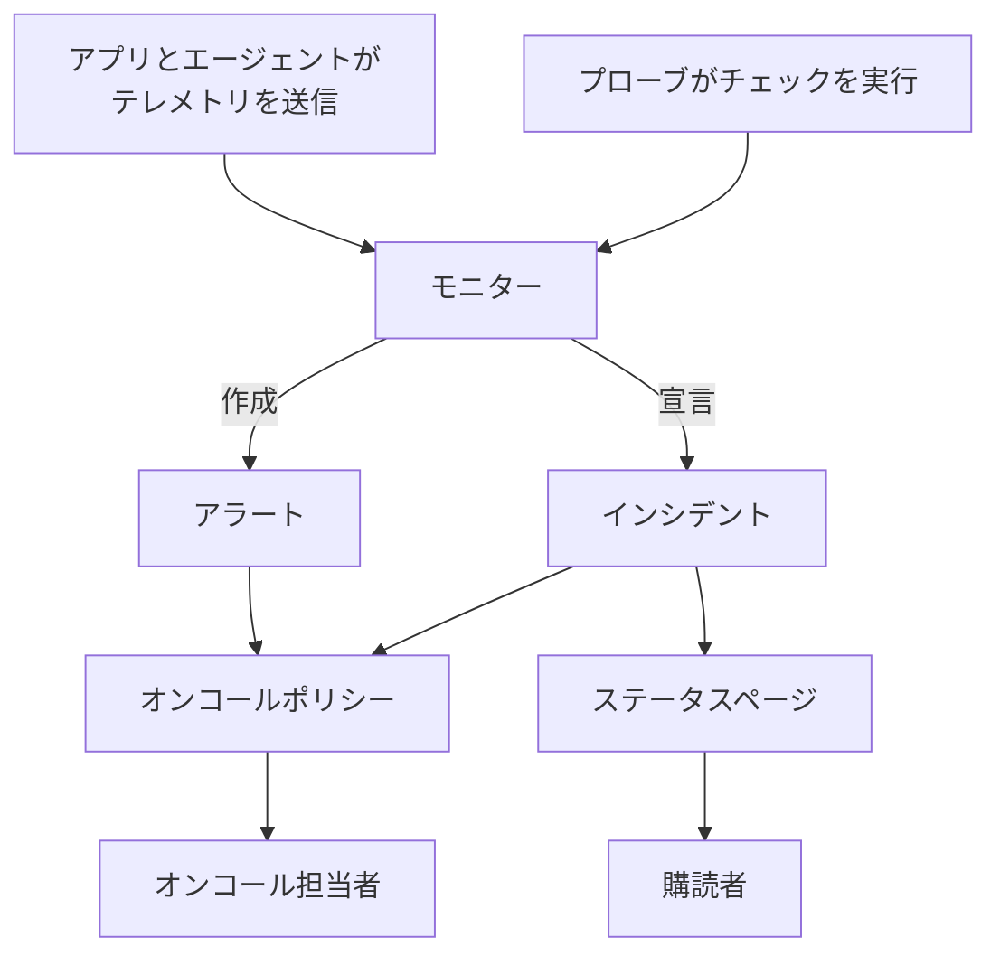
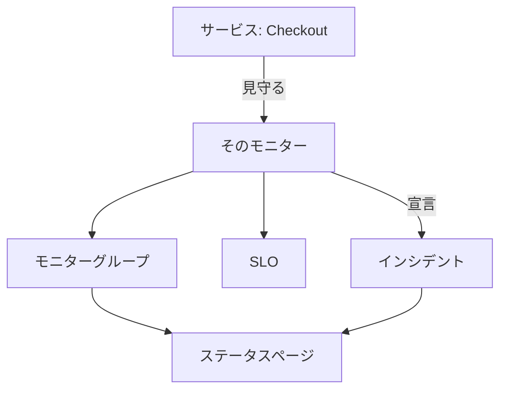

# 基本概念

OneUptime には多くの製品がありますが、どれもいくつかの考え方の上に成り立っています。プロジェクト、モニター、インシデントとアラート、オンコール、ステータスページ、テレメトリです。その周りに、監視する対象、インストールするもの、そしてあなたに代わって動くルールがあります。このページでは、それぞれを数文で説明し、どうつながるかを示し、詳しく扱うページへ案内します。一度読めば、ドキュメントのほかのページがずっと読みやすくなります。言葉を 1 つずつ調べるには [用語集](/docs/introduction/glossary) を、似て見える 2 つのものから選ぶには [どれを使うべきか](/docs/introduction/which-one) を参照してください。

:::cards
- [プロジェクトと人](#プロジェクトと人): すべてが置かれる場所と、誰が何をできるか。
- [モニターとプローブ](#モニターとプローブ): OneUptime が異常に気づく仕組み。
- [インシデントとアラート](#インシデントとアラート): チームが対応の拠り所にする記録。
- [オンコール](#オンコール): 誰が、どのように呼び出され、次は誰か。
:::

## 各要素のつながり

問題は、OneUptime の中を一方向に流れます。プローブとあなた自身のテレメトリが、モニターに情報を送ります。モニターの条件が、いつ異常とみなすか、そして何を開くか（インシデント、アラート、またはその両方）を決めます。オンコールポリシーがそれについて人を呼び出し、ステータスページがインシデントを顧客に知らせます。

## プロジェクトと人

**プロジェクト** は、すべてを保持します。モニター、インシデント、オンコールポリシー、ステータスページ、テレメトリ、設定です。ほとんどの会社は 1 つで足り、環境や事業部門ごとに 1 つずつ持つ会社もあります。あるプロジェクトで作成したものは、別のプロジェクトからは見えません。

**アカウント** は、プロジェクトとは別のものです。メールアドレスとパスワードが 1 組の 1 つのアカウントで、いくつでもプロジェクトに所属できます。プロジェクトの切り替えは、左上のプロジェクトピッカーで行います。 [アカウント](/docs/introduction/your-account) を参照してください。

人は **チーム** を通じてプロジェクトに所属し、チームの権限がメンバーにできることを決めます。新しいプロジェクトは 3 つのチームから始まります。あなたが入っている Owners、そして Admin と Members です。OneUptime Cloud では、プロジェクトごとにプランがあります。

:::cards
- [ユーザー、チーム、権限](/docs/permissions/index): メンバーを招待し、できることを決めます。
:::

## モニターとプローブ

**モニター** は、あなたが運用しているものを 1 つチェックし、それが動いているかを判断します。ほとんどのモニターは **プローブ** がチェックします。プローブは、ページのリクエスト、API の呼び出し、ホストへの ping、データベースへのクエリといったチェックを、スケジュールに沿って実行するマシンです。OneUptime Cloud は複数のリージョンでプローブを動かし、セルフホストのインストールは独自のプローブを動かします。さらに、ネットワークの内側にカスタムプローブを追加することもできます。ほかのモニターは、代わりにあなたが送るものを読み取ります。アプリからのテレメトリや、サーバー、Kubernetes クラスター、その他のインフラストラクチャ上のエージェントが報告するデータです。

モニターの **条件** は、各結果が何を意味するかを決めます。条件は順番にチェックされ、最初に一致したものが、モニターの状態を変えたり、インシデントを宣言したり、アラートを作成したり、その 3 つすべてを行ったりできます。新しいプロジェクトには、 **稼働中**、 **機能低下**、 **オフライン** の 3 つのモニターの状態があります。

:::cards
- [モニターの作成](/docs/monitor/create-monitor): 種類を選び、何をどのくらいの頻度でチェックするかを指定します。
- [カスタム プローブ](/docs/probe/custom-probe): 自社ネットワークからしか届かないものをチェックします。
:::

## 監視する対象

モニターは 1 つのものをチェックします。モニターの周りで、OneUptime は運用しているものの記録を保持しており、これらの記録にはメニューで出会います。

- **モニターグループ** は、複数のモニターを 1 つのステータスにまとめるので、Checkout のように多くの部品でできたものを、ステータスページで 1 行として表示できます。
- **サービス** は、運用しているアプリケーションやマイクロサービスです。OneUptime はテレメトリが初めて届いたときにサービスを追加し、そのログ、トレース、メトリクス、例外、インシデントを 1 つのページにまとめます。
- **ホスト**、 **Kubernetes** クラスター、そして **インフラストラクチャ** のその他の項目は、運用しているマシンとプラットフォームで、インストールしたエージェントが埋めていきます。
- **インベントリ** は、そのすべてを 1 つにまとめた一覧です。サービス、ホスト、クラスター、デバイス、クラウドリソース、そしてテレメトリをまったく送らないものまで含まれます。

これらは、問題が現れる場所で交わります。サービスのモニターは 1 つのモニターグループにまとめることができ、SLO がそれらを測定し、1 つが失敗するとインシデントを宣言します。インシデントは影響するリソースの中にそのサービスを挙げ、ステータスページはグループとインシデントを表示します。

:::cards
- [モニターグループ](/docs/monitor/monitor-groups): 複数のモニターを 1 つのステータスにまとめます。
- [サービス](/docs/telemetry/services): 運用しているすべてのアプリケーションを、それぞれ 1 ページで。
- [インベントリの概要](/docs/inventory/overview): OneUptime があなたの環境について知っているすべて。
:::

## 信頼性の目標

**SLO** (サービスレベル目標) は、監視している対象の信頼性の目標です。たとえば「30 日間で 99.9% の時間は稼働」のように表します。OneUptime は 5 分ごとに、そのモニターから SLO を測定します。目標が許容するダウンタイムがエラーバジェットです。十分に残っていればリスクを取れ、残りが少なければペースを落として安定性に投資します。

:::cards
- [SLO 概要](/docs/slo/introduction): 目標を設定し、バジェットがどれだけ残っているかを確認します。
:::

## インシデントとアラート

どちらも問題を記録し、どちらもオンコール担当者を呼び出せます。違いは、その問題が誰に影響するかです。

| | インシデント | アラート |
| --- | --- | --- |
| **何か** | 障害や速度低下など、ユーザーに影響する問題 | ユーザーに影響が出る前に、チームが調べるべき問題 |
| **ステータスページでは** | 表示でき、購読者に知らせる | 表示されない |
| **最初の状態** | **原因特定**、 **確認済み**、 **解決済み** | **原因特定**、 **確認済み**、 **解決済み** |
| **最初の重大度** | Critical Incident、Major Incident、Minor Incident | **高**、 **低** |

確認すると、誰かが対応中であることが伝わり、オンコールポリシーは次のレベルを呼び出さなくなります。解決すると、それは閉じられます。独自の状態と重大度を追加でき、アラートを、それが一部だったと判明したインシデントにリンクできます。

**エピソード** は、関連するインシデント、または関連するアラートをまとめ、チームが 1 つのものとして対応できるようにします。どれをまとめるかは、グループ化ルールが決めます。

:::cards
- [インシデント 概要](/docs/incidents/index): インシデントがどのように宣言、対応、解決されるか。
- [アラートの概要](/docs/alerts/index): アラートの発生元と、エピソードによるまとめ方。
- [リンクされたアラート](/docs/incidents/linked-alerts): 障害が発生させたアラートを、そのインシデントに結び付けます。
:::

## オンコール

**オンコールポリシー** は、インシデントやアラートについて誰を呼び出すか、そして誰も応答しなければ次は誰かを決めます。その **エスカレーションルール** がレベルです。各レベルは担当者を呼び出し、誰かが確認するのを待ってから次のレベルを呼び出します。レベルは、人、チーム、または **オンコールスケジュール** を呼び出せます。オンコールスケジュールは、いつ誰がオンコールかを把握しているローテーションです。

それぞれの人への連絡方法は、本人が決めます。各自が **ユーザー設定** で、OneUptime から連絡を受ける方法（メール、SMS、電話、プッシュ通知、Slack、Microsoft Teams など）と、呼び出されたときにどれを使うかを管理します。

:::cards
- [オンコールの概要](/docs/on-call/index): 呼び出しが人に届く仕組みと、各要素の場所。
- [エスカレーションルール](/docs/on-call/escalation-rules): 誰かが応答するまで、レベルごとに人を呼び出します。
- [オンコールスケジュール](/docs/on-call/schedules): ローテーション、レイヤー、引き継ぎ。
- [OneUptime からの連絡の仕組み](/docs/notifications/index): 一人ひとりへの連絡方法を決める通知方法、ルール、設定。
:::

## ステータスページとメンテナンス

**ステータスページ** は、サービスが動いているかを顧客に示します。表示するモニターを選び、顧客にわかる名前を付けます。それらのモニターのいずれかでインシデントが進行している間、ページはそれを表示し、その **購読者** にはメール、SMS、Slack、Microsoft Teams、Webhook で知らせが届きます。ステータスページは、公開にも、招き入れた人だけの非公開にもできます。

**定期メンテナンス** は、計画された作業を事前に告知します。イベントは **予定**、 **進行中**、 **終了**、 **完了** と進み、イベントを表示するステータスページが、訪問者と購読者にそれを知らせます。

:::cards
- [ステータス ページ 概要](/docs/status-pages/index): ステータスページを作成し、表示する内容を決めます。
- [購読者とお知らせ](/docs/status-pages/subscribers): 誰に、いつ知らせるか。
- [定期メンテナンスの概要](/docs/scheduled-maintenance/index): イベントの進み方と、一時停止するもの。
:::

## テレメトリ

**テレメトリ** は、あなたのシステムが OneUptime に送るものです。ログ、メトリクス、トレース、例外、プロファイルがあります。アプリは OpenTelemetry で送信し、OneUptime のエージェントはホスト、Kubernetes クラスター、Docker ホスト、その他のインフラストラクチャから送信します。送信元はそれぞれ **取り込みキー** を使います。取り込みキーは **プロジェクト設定 → テレメトリと APM → 取り込みキー** で作成します。テレメトリは、検索したり、ダッシュボードでグラフにしたり、テレメトリモニターで見守ったりできます。テレメトリモニターは、ほかのモニターと同じようにインシデントやアラートを発生させます。メニューでは、 **ログ**、 **メトリクス**、 **トレース**、 **プロファイル**、 **例外** がそれぞれ 1 つの種類を開きます。 **AI / LLM** は AI の会話を追い、 **データオブザーバビリティ** はデータベースのテーブルを見守り、 **トポロジー** はそのすべてのつながりをマップにします。

:::cards
- [OpenTelemetry](/docs/telemetry/open-telemetry): アプリからログ、メトリクス、トレースを送信します。
- [ログ モニター](/docs/monitor/logs-monitor): ログに特定のパターンが現れたときに知らせを受けます。
:::

## セキュリティ

**セキュリティイベント** は、ログ、セキュリティツール、その他送信したあらゆるもののセキュリティイベントを保持します。その検出ルールは見つけたものをセキュリティケースに変え、チームはキューでケースに対応し、プレイブックがそれに応答します。 **データセキュリティ** は、バケット、データベース、テレメトリの中の機密データと、その保管方法の問題点を見つけます。

:::cards
- [セキュリティをはじめる](/docs/telemetry/security-getting-started): すでに持っているデータから脅威を見つけます。
- [データセキュリティの概要](/docs/data-security/index): 機密データを見つけ、その保管方法を改善します。
:::

## インストールするものとキー

OneUptime のほとんどは、何もインストールせずに使えます。OneUptime が外部から見られないものに届かせたいときだけ何かをインストールし、それぞれがキーを使って OneUptime に外向きに接続します。

- カスタムプローブは、ネットワークの内側でモニターのチェックを実行し、独自のプローブ ID とキーを使います。
- **OpenTelemetry Collector**、Kubernetes エージェント、Docker エージェントは、 **取り込みキー** を使ってテレメトリを送信します。Server / VM モニターの裏で動くインフラストラクチャエージェントは、そのモニターのシークレットキーで送信します。
- **Runner** は、インフラストラクチャの内側で Runbook のステップを実行し、独自の Runner ID とキーを使います。

取り込みキーは、テレメトリを送り込むことしかできません。 **API キー** はもう 1 つの種類で、スクリプト、CLI、Terraform、AI アシスタントが、与えた権限の範囲でプロジェクトを読み書きできるようにします。どちらも、もう一方の代わりにはなりません。

:::cards
- [どれを使うべきか](/docs/introduction/which-one#プローブエージェントコレクターrunner-のどれか): 何をインストールし、それぞれがどのキーを使うか。
- [取り込みキー](/docs/telemetry/ingestion-keys): テレメトリを送るキーを作成し、範囲を決め、ローテーションします。
:::

## 自動化と AI

- **ワークフロー** は、何かが起きたときにアクションを実行します。たとえば、インシデントが宣言されたときに Slack に投稿します。
- **Runbook** は、対応手順を、チームが手動または自動で実行できるステップに変えます。
- **OneUptime AI** は、新しいインシデントとアラートを調査し、見つけたことをそのタイムラインに投稿します。 **AI に質問** は、プロジェクトについての質問に答えます。新しいプロジェクトは AI がオンの状態で始まり、 **プロジェクト設定 → AI → AI 機能** の **AI を有効化** スイッチで、そのすべてをオフにできます。

:::cards
- [ワークフロー 概要](/docs/workflows/index): トリガーとコンポーネントでアクションを自動化します。
- [AI SRE](/docs/ai/ai-sre): OneUptime AI がインシデントとアラートを調査する仕組み。
:::

## ラベルと所有者

**ラベル** は、モニター、インシデント、ステータスページ、その他ほとんどのリソースに付けるタグで、それらを絞り込んだりグループ化したりするのに使います。チームの権限を、特定のラベルが付いたリソースに限定することもできます。 **所有者** は、1 つのリソースに責任を持つ人とチームで、そのリソースに何かが起きると知らせを受けます。ラベルルールと所有者ルールは、新しいリソースに自動でラベルと所有者を追加します。

:::cards
- [ラベルルールと所有者ルール](/docs/configuration/label-and-owner-rules): 新しいリソースに自動でラベルを付け、所有者を割り当てます。
:::

## ルールの種類

OneUptime では、多くのものがルールと呼ばれます。どれも、何か新しいものが届いたときにあなたに代わって 1 つの判断を下し、いくつかの系統に分かれます。そのほとんどは、 **インシデント** と **アラート** のサイドメニューにある **ルール** の下にあります。

| 何を決めるか | ルール |
| --- | --- |
| 誰を呼び出すか | **オンコールルール** は新しいインシデントやアラートで実行するオンコールポリシーを選び、ポリシーの **エスカレーションルール** がレベルごとに呼び出します |
| 誰が所有し、どうラベルを付けるか | **所有者ルール**、 **ラベルルール**、 **プライバシールール** |
| 何をまとめるか | **グループ化ルール** がエピソードを開き、そこに追加します |
| 何を実行するか | **Runbook ルール** は Runbook を開始し、 **AI ルール** は OneUptime AI が何を調査・修正するかを決めます |
| いつフォローアップするか | **SLA ルール** は応答時間と解決時間を追跡し、 **リマインダールール** は未解決の間、所有者にリマインドします |

モニター自身のルールは、その条件です。 **ユーザー設定** の下にあるオンコールルールは、さらに別のものです。各自のもので、呼び出しがその人にどう届くかを決めます。

:::cards
- [インシデントの設定と自動化](/docs/incidents/settings#インシデントの作成時に実行されるルール): インシデントの作成時に実行されるルールを、順番に。
- [私への連絡方法](/docs/notifications/on-call-rules): 呼び出しがあなたにどう届くか。
:::

## 次のステップ

:::cards
- [クイックスタート](/docs/introduction/quickstart): これらの考え方を、15 分で実践します。
- [用語集](/docs/introduction/glossary): OneUptime で使われるすべての言葉を、1〜2 文で。
- [どれを使うべきか](/docs/introduction/which-one): インシデントかアラートか、ワークフローか Runbook かなど、似たもの同士の比較。
- [インシデント 概要](/docs/incidents/index): モニターがインシデントを宣言した後に起きること。
:::
