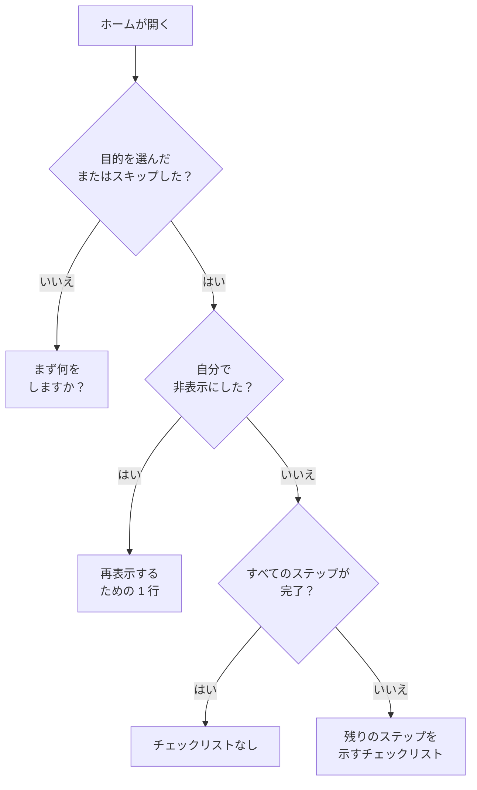

# ホーム画面とショートカット

ホームは、プロジェクトで最初に目にするページです。いま対応が必要なことがあるかをひと目で伝え、新しいプロジェクトを最初のセットアップへと導きます。このページでは、ホームに何が表示されるか、ダッシュボードで製品、ページ、アクションを見つける方法、そしてメニューをたどる手間を省くキーボードショートカットを説明します。

:::cards
- [ホームに表示されるもの](#ホームに表示されるもの): 問題が起きていないか、対応が必要なもの、プロジェクトの中身、そしてすべての製品。
- [画面の歩き方](#画面の歩き方): 製品メニューと、各ページ上部のバー。
- [検索](#ページ設定アクションを検索する): 名前を入力して、任意のページ、設定、アクションを見つけます。
- [キーボードショートカット](#キーボードショートカット): 2 つのキーで、ホーム、モニター、インシデントに移動します。
:::

## ホームに表示されるもの

上部のバーで **ホーム** を開くか、どこからでも `g` に続けて `h` を押します。ホームは、プロジェクトの概要を示す 1 つのページで、サイドメニューはありません。上から順に、次のものが表示されます。

1. 検索ボックスと、その横の **インシデントを宣言** と **作成**。
2. 問題が起きていないかを伝える 1 行と、その下に並ぶ、対応が必要なものを数える 5 つの数字。
3. **OneUptime へようこそ 👋**: 新しいプロジェクト向けのチェックリストで、完了するまで表示されます。
4. **対応が必要**: いま未解決の問題すべてを、名前で示します。
5. **このプロジェクト**: プロジェクトを構成するもの。メンテナンスが予定されているときは、 **今後のメンテナンス** も表示されます。
6. **OneUptime を探索**: すべての製品を、一度に 1 つのカテゴリずつ表示します。

### 検索と作成

検索ボックスは、 `Mod` + `K` と同じように検索を開きます。どのページ、モニター、インシデント、アラート、ステータスページ、オンコールポリシーでも、名前を入力して探せます。 [検索](#ページ設定アクションを検索する) を参照してください。 **インシデントを宣言** は、インシデントを宣言するフォームを開きます。 **作成** では、 **モニターを作成**、 **メンテナンスをスケジュール**、 **お知らせを作成** を選べます。どれも、使う権限のある人にだけ表示されます。

### 見出し

上部の 1 行は、未解決のもののうち最も緊急なものを、それに合った色で示します。

| 状況 | ホームの表示 |
| --- | --- |
| 未解決のインシデントがある | 対応中のインシデントの件数（赤） |
| 未解決のインシデントはないが、未解決のアラート、非稼働のモニター、リスクのある SLO のいずれかがある | 対応が必要な問題の件数（オレンジ） |
| 問題はなく、メンテナンスが実施中 | 実施中のメンテナンスの件数 |
| モニターが動いていて、未解決のものがない | **すべてのシステムが稼働中** |
| プロジェクトにまだモニターがない | **まだ何も監視されていません** |

その横には、ホームが最後にプロジェクトを読み込んだ時刻が表示され、 **更新** で読み込み直せます。1 分以上たってからホームのタブに戻ると、自動で更新されます。

まだ何も監視されていない間は、この行の最後に **最初のモニターを作成** が表示され、ガイド付きセットアップ **Web サイトや API のダウンを知る** を開きます。モニターを作成できる人にだけ表示されます。

### 5 つの数字

各数字は何かを数え、対応が必要かどうかを示し、その背後にある一覧を、一覧が属するプロダクトで開きます。

| 数字 | 数えるもの | 数がゼロのとき | 開くページ |
| --- | --- | --- | --- |
| **対応中のインシデント** | 解決されていないインシデント | **問題なし** | **インシデント → アクティブなインシデント** |
| **対応中のアラート** | 解決されていないアラート | **問題なし** | **アラート → アクティブなアラート** |
| **非稼働のモニター** | 状態が稼働中のどれにも当たらないモニター。アーカイブ済みのモニターと、監視がオフのモニターは除外されます。 | **すべて稼働中** | **モニター → 非稼働** |
| **実施中のメンテナンス** | 進行中のメンテナンスイベント | **実施中のものはありません** | **定期メンテナンス → 進行中のメンテナンスイベント** |
| **リスクのある SLO** | オンになっている SLO のうち、リスクがあるものや、エラーバジェットを使い切ったもの | **エラーバジェットは健全** | **SLO** |

数がゼロより大きいと **対応が必要** と表示され、メンテナンスと SLO では、それぞれ **実施中** と **エラーバジェット消費中** と表示されます。リスクのある SLO があるあいだは、 **リスクのある SLO** が **SLO** の一覧を、それらの SLO だけに絞り込んで開きます。まだモニターがないプロジェクトでは **モニターはまだありません** と表示され、SLO がないプロジェクトでは **SLO はまだありません** と表示されます。空のプロジェクトは、健全なプロジェクトと同じではないからです。このとき、この 2 つの数字はそれぞれ **モニター** と **SLO** の一覧を開き、そこで最初の 1 つを作成できます。

### ウェルカムチェックリスト

プロジェクトのオーナーまたは管理者が新しいプロジェクトのホームを初めて開くと、カードが **まず何をしますか？** と尋ねます。 **Web サイトや API のダウンを知る** や **まずは見て回る** など、目的を 1 つ以上選んで **続行** をクリックすると、その目的に必要なステップがチェックリストに入ります。 **スキップ** を選ぶと、どのプロジェクトにもある 4 つのステップになります。あとで答え直すには、チェックリストの **変更** をクリックします。モニター、テレメトリー、オンコールをすでに使っているプロジェクトには尋ねません。

各ステップは、レコードができたときではなく、実際に動いたときに自動でチェックされます。プロジェクトをセットアップする全員が、どのデバイスでも同じリストを見ます。

| ステップ | 完了の条件 | 開くページ |
| --- | --- | --- |
| **今のツールからインポート** | 別のツールからのインポートが完了する。 | **別のツールからインポート** |
| **最初のモニターを作成** | 最初のチェック結果が届く。 | ガイド付きセットアップ **Web サイトや API のダウンを知る**。モニターを作成できない人には **モニター** の一覧。 |
| **サーバーまたはクラスターを接続** | 最初のメトリクスが届く。 | **ホスト** |
| **最初のログ、メトリクス、トレースを送信** | プロジェクトの最初のログ、メトリクス、トレース、例外、プロファイルが届く。 | ガイド付きセットアップ **ログ、メトリクス、トレースを送信して、アラートを受け取る** |
| **オンコールポリシーを設定** | テスト通知が確認される、通知が誰かに届く、または誰かに届くポリシーをオンコールルールが実行する。 | ガイド付きセットアップ **障害時に適切な担当者を呼び出す** |
| **ステータスページを公開** | ステータスページにモニターが表示される。 | ガイド付きセットアップ **ステータスページを公開**。ステータスページを作成できない人には **ステータスページ** の一覧。 |
| **チームを招待** | 誰かが招待を承認する。 | **ユーザー** |

最初に行うステップには **次のステップ** が付きます。利用者が 1 人の OneUptime Cloud の Free プランでは、 **チームを招待** に Growth プランが必要だと表示され、 **請求** が開きます。まだメールを送信できないセルフホストのサーバーでは、サーバーの管理者に最初に **このサーバーはまだメールを送信できません** が表示され、管理者ダッシュボードが開きます。

ガイド付きセットアップは、ひとつのページで一歩ずつ作業全体を進め、最後に設定した内容と次にすることを示します。あとでもう一度開くには、その名前で検索してください。

ステップの下にある **OneUptime のしくみ** は、問題が流れる順に 4 つの中核製品を示します。 **モニター**、 **インシデントとアラート**、 **オンコール**、 **ステータスページ** です。クリックすると、それぞれが開きます。その下には、この流れにつながるもの（テレメトリとインフラストラクチャ）が示され、 [基本概念](/docs/introduction/core-concepts) と [用語集](/docs/introduction/glossary) へのリンクがあります。

すべてのステップが完了すると、チェックリストは全員の画面から消えます。それより前に隠すには **非表示** をクリックします。自分だけ、どのデバイスでも非表示になり、 **表示する** と **OneUptime のしくみ** のある 1 行が残ります。メンバーとしてプロジェクトに招待された人にはチェックリストは表示されません。 **OneUptime のしくみ** は、どのプロジェクトでもワンクリックで開けます。 **ヘルプ** から、または **OneUptime を探索** の横のボタンから開いてください。

### 対応が必要

**対応が必要** は、数字が数えているものを名前で一覧にします。未解決のインシデント、未解決のアラート、非稼働のモニター、リスクのある SLO、実施中のメンテナンスが、緊急度の高い順に並びます。各行には重大度や状態が表示され、インシデントやアラートがいつ始まったか、メンテナンスがいつ終わるかも示されます。行をクリックすると、そのレコードが開きます。種類ごとに最大 5 件まで表示され、残りは **すべて表示** で確認できます。これは、その種類の数字と同じ一覧を開きます。未解決のものが何もないときは、 **対応が必要なものはありません** と表示されます。

### セットアップのヘルス

プロジェクトのセットアップに、知らせるべき人に連絡が届かなくなる原因があるときは、 **対応が必要** の最後に **セットアップ** が表示され、確認が必要な項目の数を示します。これをクリックすると **セットアップのヘルス** が開き、設定の誤りが重大なものから順に、 **呼び出しが届きません**、 **修正をおすすめ**、 **提案** の下に一覧表示されます。たとえば、だれも呼び出さないモニター、どこからも実行されないオンコールポリシー、呼び出せない対応者、オフになっている SMS、だれも当番になっていないスケジュール、モニターを 1 つも表示しないステータスページです。各検出事項は何が問題かを 1 文で伝え、修正画面を開くボタンが付いています。モニターの検出事項は、そのモニターの **ダウンしたとき** カードが示す途切れと同じものです。チームが意図してそのままにしている検出事項は、理由を添えて全員に対して非表示にでき、 **却下済み** から復元できます。検索ではこのページが **セットアップのヘルス** として見つかり、AI に質問はこのページをもとに「セットアップは大丈夫？」に答えます。

### このプロジェクト

**このプロジェクト** には、プロジェクトの **モニター**、 **ステータスページ**、 **オンコールポリシー**、 **SLO**、 **サービス**、 **ダッシュボード**、 **ワークフロー** の数が表示されます。アーカイブ済みのものは数えません。各行は、それぞれの一覧を開きます。プロジェクトに 1 つもない種類には、数の代わりに **セットアップ** と表示されます。

**今後のメンテナンス** には、予定されているメンテナンスの時間枠が、近い順に 3 つまで表示されます。何も予定されていないときは表示されません。

### OneUptime を探索

**OneUptime を探索** は、 **製品** メニューの製品を、基本から始めて、一度に 1 つのカテゴリずつ表示します。各製品には何のためのものかが示され、クリックするとその製品が開きます。プロジェクトで非表示にした製品は含まれません。

## 画面の歩き方

OneUptime のすべては、上部バーの **製品** にあります。メニューはグループを 1 つのリストの行として並べ、常に最初のグループである「基本」を開いた状態で開きます。基本には、モニター、インシデント、アラート、オンコール、ステータスページ、定期メンテナンス、SLO があります。ほかのグループ（オブザーバビリティ、セキュリティ、AI、コード、リソース、インフラストラクチャ、クラウド、ダッシュボードと自動化、設定）は、それぞれ同じリストの 1 行に折りたたまれています。各行には、そのグループの製品名とその数が表示されます。行をクリックすると開いたり折りたたんだりでき、矢印キーでその行に移動して **Enter** を押しても同じです。

- **検索ですべてが見つかります。** メニューの検索ボックスに入力すると、名前や機能、あるいは `k8s` や `RUM` のようなおなじみの言葉で、どの製品でも見つかります。検索は、折りたたまれたグループの中も探します。
- **今いる場所から始まります。** 表示中のページのグループは自動で開き、最近開いた製品は上部に並びます。
- **選択は保持されます。** メニューは、ほかのグループのうちどれを開き、どれを折りたたんだかを、ブラウザーに記憶します。基本は、折りたたんだことがあっても、メニューを開くたびに再び開いた状態になります。
- **スマートフォンでは**、メニューボタンが同じように製品を並べます。基本は上部に開いた状態で表示され、ほかのグループはそれぞれ、タップで開く 1 行として表示されます。
- **プロジェクトで使わない製品。** プロジェクトのオーナーまたは管理者は、 **プロジェクト設定 → 基本 → 製品** でそれらを非表示にできます。非表示の製品は、メニューの最後の行である **その他の製品** に移ります。検索では引き続き見つかり、ページは動作し、データも届き続けます。そのうちの 1 つにデータが届き始めると、再表示できるユーザーにホームが知らせます。
- **固定。** **ホーム** と **製品** の横にある上部バーに製品を置いておけます。メニューの製品カードのピンを押すか、製品ページのタイトルの横にある **固定** を押します。固定できるのは 5 つまでで、どのブラウザーでも同じように表示されます。スマートフォンでは、固定した製品がメニューの最初に並びます。
- **使用中の製品。** 基本と設定を除く各グループでは、プロジェクトで使っている製品が先に並び、まだセットアップしていない製品には **未セットアップ** と表示されます。OneUptime Cloud では、ご利用のプランに含まれない製品に、その製品を含むプランの名前が表示されます。

### 上部のバー

すべてのページの上部には、2 本のバーがあります。

| 場所 | あるもの |
| --- | --- |
| 左上 | プロジェクトピッカー: 自分の別のプロジェクトに切り替えたり、新しいプロジェクトを作成したりします。 |
| 右上 | **検索** と **AI に質問**、いま対応が必要なもの（アクティブなインシデントとアラート、当番になっているオンコールポリシー、保留中の招待）を示す通知ベル、 **ヘルプ**、そして [アカウント](/docs/introduction/your-account) メニューを開くあなたの写真。 |
| その下 | 左に **ホーム** と **製品**、右に **ユーザー設定**: このプロジェクトで OneUptime があなたに連絡する方法。 |

**ヘルプ** は、学ぶのに役立つ項目から始まります。 **クイックスタート**、 **OneUptime のしくみ**、 **用語集**、このドキュメント（**ドキュメント**）です。その下に **キーボードショートカット** の一覧と、メールと Slack でのサポートがあります。タブレットや狭いウィンドウでは、場所を節約するために **AI に質問** は表示されません。 **検索** のアクションから開けます。スマートフォンでは、 **検索** と **ヘルプ** がメニューボタンの一覧の先頭と末尾に移ります。通知ベルとあなたの写真は残ります。

**プローブ** のように点線の下線が付いた言葉は、ポインターを合わせる、Tab キーで移動する、またはタップすると、その意味を表示します。 **続きを読む** を押すと、その言葉が [用語集](/docs/introduction/glossary) で開きます。

### ページと一覧

各ページのタイトルの上には、 *プロジェクト › Docker › 設定 › 所有者ルール* のようなパンくずが表示され、そのページの場所がわかります。最後より前の各ステップをクリックすると、そのページが開きます。

- **一覧は自動で最新の状態に保たれます。** どこかでインシデントやアラートが作成、確認、解決されると、インシデント、アラート、エピソードの一覧に数秒以内に反映されます。再読み込みは不要です。行を選択している、ダイアログを開いているなど、一覧での作業の途中は更新を待ち、作業が終わってから反映します。
- **スマートフォンでは、フィルターのチップが折りたたまれ**、 **フィルター** にまとまるので、一覧が上の方から始まります。設定したチップは **すべてクリア** と一緒に表示されたままです。 **フィルター** を押すとすべてのチップが表示され、もう一度押すと折りたたまれます。
- 一覧の **⋯** メニューにある **列** では、一覧に表示する列とその順序を選べます。選んだ列はこのブラウザーに保存されます。プロジェクト所有者またはプロジェクト管理者は、そこで **このプロジェクトの全員にこれらの列を表示** にチェックを入れることもできます。その一覧で自分の列を選んでいない人にはこの列が表示され、 **プロジェクトのデフォルトにリセット** を押すと自分の列がこの列に戻ります。
- 同じメニューの **コンパクトな行** は、すべての一覧の行を低く表示するので、長い一覧では約2割多くの行が見えます。この設定はこのブラウザーに保存されます。
- **スマートフォンや、行が収まらないほど狭いカードでは、一覧は1行ずつカードで表示されます。** カードの上の帯には **名前で並べ替え** のように並び順が表示されます。押すと、並べ替えに使う列と、 **昇順** または **降順** を選べます。
- **インシデントのページは番号から始まります。** 見出し、パンくずのステップ、ブラウザーのタブには `INC-42 Checkout is down` のように表示され、そのインシデントを示すダイアログも同じなので、同じタイトルのインシデントも見分けられます。アラート、メンテナンスイベント、エピソードも同じです。

## ページ、設定、アクションを検索する

**Cmd+K**（Mac）または **Ctrl+K**（Windows と Linux）を押すか、上部バーの検索アイコンをクリックして、入力を始めます。検索で見つかるものは次のとおりです。

- **メニューのすべてのページ**: メニューでの名前で見つかります。API キー、危険な操作、オンコールスケジュール、インシデントの重大度、自分の通知方法などです。各結果には、 *プロジェクト設定 › 詳細* のようにそのページの場所が表示されるので、同じ名前のページ（インシデント、アラート、モニターそれぞれのカスタムフィールド）も簡単に見分けられます。
- **ページの設定**: カードやスイッチに表示されている名前で見つかります。 *ログインに SSO を必須にする* でSSOが、 *カスタム SMTP 設定* で通知チャネルが見つかります。名前は英語でも、お使いの言語でも入力できます。
- **アクション**: やりたいことで見つかります。インシデントを宣言、モニターを作成、あるいは危険な操作を開くプロジェクトを削除などです。何かを変更するアクションは、それを行う権限のある人にだけ表示されます。
- **モニター、インシデント、アラート、ステータスページ、オンコールポリシー**: 名前で見つかります。インシデントとアラートは `INC-42` のような番号でも見つかり、結果は番号から始まるので、同じタイトルのものも見分けられます。
- **ドキュメント**: ほかのすべての結果の下にある *ドキュメント* グループに、入力した言葉に合うページやセクションが、あなたの言語で表示されます。入力ミスがあっても見つかります。それぞれ新しいタブで開くので、今いる場所はそのままです。

検索は、入力したことを意図どおりに読み取ります。

- 大文字と小文字、アクセント記号、スペース、ハイフンの違いは関係ありません。 *on-call*、 *on call*、 *oncall* はどれも同じページを見つけ、単語の順序も自由です。
- 多くのページについて、別の言葉（英語）も知っています。オンコールポリシーには *pager* や *escalation*、オンコールスケジュールには *rota*、2 要素認証には *2fa*、危険な操作には *delete project* です。
- 製品名を加えると、検索を絞り込めます。 *incident custom fields* は、インシデントのカスタムフィールドのページを見つけます。
- *incidnet* のような小さなタイプミスがあっても、入力どおりに一致するものがなければ、意図したものが見つかります。

検索ボックスが空のときは、最近開いたページ、アクション、製品が表示されます。

## キーボードショートカット

ダッシュボードのどこでも `?` を押すと、すべてのショートカットが表示されます。 **ヘルプ** を開いて **キーボードショートカット** を選んでも表示できます。Mac では `Mod` は Command キー、Windows と Linux では Ctrl キーです。

| キー | 動作 |
| --- | --- |
| `Mod` + `K` | コマンドパレットを開き、任意のページ、設定、アクションを検索します。 |
| `Mod` + `I` | いま見ているものについて AI に質問します。 |
| `/` | このページのリストを検索します。 |
| `?` | キーボードショートカットを表示します。 |
| `Esc` | ダイアログやパネルを閉じます。 |

### 製品に移動する

`g` を押してから文字キーを押すと、その製品に直接移動します。文字キーは、 `g` から 1.5 秒以内に押してください。

| キー | 移動先 |
| --- | --- |
| `g`、次に `h` | ホーム |
| `g`、次に `m` | モニター |
| `g`、次に `i` | インシデント |
| `g`、次に `a` | アラート |
| `g`、次に `o` | オンコール |
| `g`、次に `s` | ステータスページ |
| `g`、次に `e` | 定期メンテナンス |
| `g`、次に `d` | ダッシュボード |
| `g`、次に `l` | ログ |
| `g`、次に `t` | トレース |

ショートカットは作業の邪魔をしません。フィールドに入力している間は `?`、`/`、`g` は何もせず、ダイアログが開いている間はどのキーでもページを移動しないので、うっかり押したキーで入力途中のフォームが失われることはありません。ほかの製品も、 `Mod` + `K` で検索すればすぐに開けます。

## 次のステップ

:::cards
- [クイックスタート](/docs/introduction/quickstart): ウェルカムチェックリストを、ステップごとに進めます。
- [アカウント](/docs/introduction/your-account): プロフィール、サインインのセキュリティ、言語とテーマ。
- [AI に質問](/docs/ai/ask-ai): AI に質問が答えられること、あなたの代わりにできること。
- [基本概念](/docs/introduction/core-concepts): モニター、インシデント、アラート、オンコールとは何か。
:::
