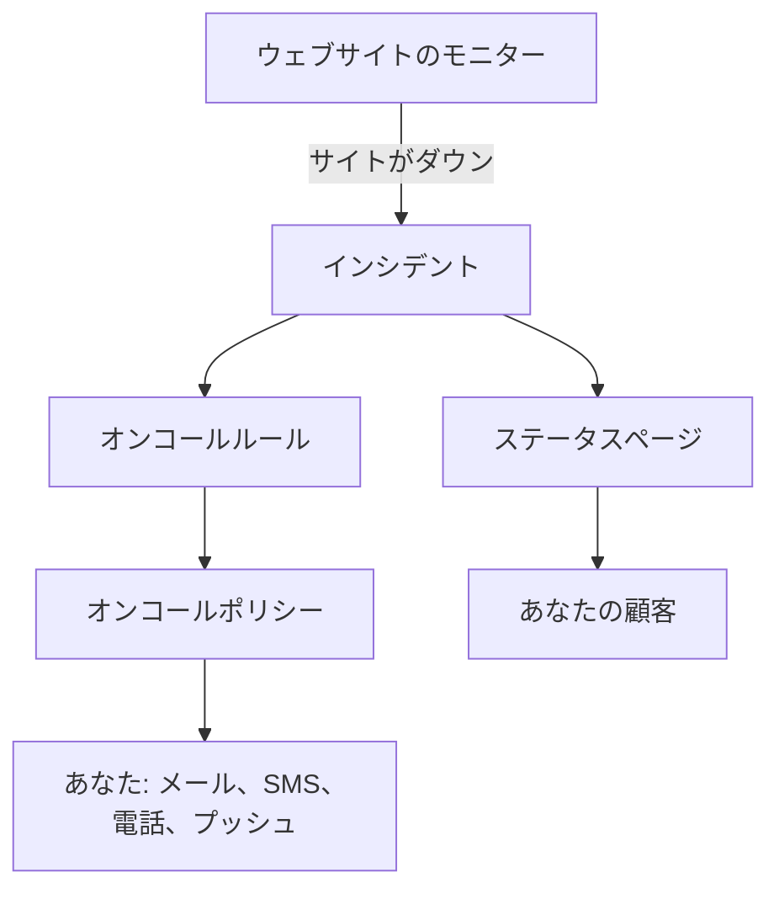

# クイックスタート

このガイドでは、新しいアカウントから約 15 分で、動く構成までを案内します。5 分ごとにウェブサイトをチェックするモニター、サイトがダウンしたときにあなたを呼び出すオンコールポリシー、そして顧客に知らせるステータスページです。プロジェクトのホームページにある **OneUptime へようこそ 👋** チェックリストと、その各ステップが開くガイド付きセットアップに沿って進めます。

ほかのツールから移行する場合は、先に [インポート](/docs/introduction/getting-started#他のツールから移行する) してください。モニター、オンコールスケジュール、ステータスページをそのまま引き継げます。

## 始める前に

- **アカウント。** OneUptime Cloud では [oneuptime.com](https://oneuptime.com/accounts/register) でサインアップし、届いたメールのリンクを開きます。自分のインストールでは、ブラウザーで開いてサインアップします。最初のアカウントがマスター管理者になります。インストール方法は [Docker Compose](/docs/installation/docker-compose) を参照してください。
- **監視するウェブサイト。** HTTP または HTTPS で応答するアドレスなら何でもかまいません。たとえば会社のホームページです。

## プロジェクトを作成する

OneUptime のすべては、プロジェクトの中にあります。モニター、インシデント、オンコールポリシー、ステータスページ、そしてそれらに取り組む人々です。

:::steps
### 新しいプロジェクトを始める

初めてサインインすると、OneUptime は **プロジェクトがありません** と表示します。 **新しいプロジェクトを作成** をクリックします。すでに誰かからプロジェクトに招待されている場合は、代わりに同じページで招待を承諾します。

### 名前を付ける

**プロジェクト名** に、会社名などを入力します。OneUptime Cloud では、その下でプランも選びます。Free があらかじめ選ばれていて、有料プランは無料トライアルから始まります。

### 作成する

**プロジェクトを作成** をクリックします。プロジェクトのホームページが開き、上部に **OneUptime へようこそ 👋** チェックリストが表示されます。 最初に **まず何をしますか？** と尋ねられます。 **Web サイトや API のダウンを知る**、 **障害時に適切な担当者を呼び出す**、 **ステータスページで顧客に伝える** を選んで **続行** をクリックします。
:::

## ウェブサイトを監視する

:::steps
### ウェブサイトのセットアップを開く

チェックリストで **最初のモニターを作成** をクリックします。ガイド付きセットアップ **Web サイトや API のダウンを知る** が開き、サイトのチェック、通知先の選択、テストの送信を 1 ページで行います。モニターを作成できない人には、代わりに **モニター** の一覧が開きます。

### アドレスを入力する

**何を確認しますか？** で、 **Web サイトまたは API のアドレス** にサイトの完全なアドレス ( `https://example.com` など) を入力し、 **確認を開始** をクリックします。プローブはすぐにチェックし、その後は 5 分ごとにチェックします。サイトが応答しない、またはエラーを返すと、モニターは **オフライン** になり、インシデントを宣言します。 **続行** をクリックします。

OneUptime Cloud の Free プランでは、モニターは利用量に応じて課金されるため、サイトをチェックする前にプロジェクトに支払い方法が必要です。支払い方法がない場合、このステップで [支払い方法の追加](/docs/configuration/billing#支払い方法) を求められます。

### 通知先を選ぶ

**誰に知らせますか？** では、あなたがすでに **呼び出し先** に入っています。 **保存して続行** をクリックすると `Default on-call policy` が作成され、プロジェクトの新しいインシデントとアラートのたびに、まずはメールであなたを呼び出します。プロジェクトにいるチームメンバーも呼び出すには、先に **チームメンバーを追加** をクリックします。

### 自分にテストを送る

**テストを送信する** で **自分にテスト呼び出しを送信** をクリックし、 **重大度** を選んで **テスト呼び出しを送信** をクリックします。TEST と書かれたメールのリンクを開き、そこで呼び出しを確認応答します。続いてダイアログの **完了** と **続行** をクリックします。セットアップは、設定した内容のまとめで終わります。
:::

すべてのオプションを自分で設定するには、またはウェブサイト以外のものをチェックするには、 **製品** メニューから **モニター** を開き、 **モニターを作成** をクリックします。フォームとすべてのモニタータイプは [モニターの作成](/docs/monitor/create-monitor) で説明しています。

API もチェックし、最初のチェックが戻ってこないときにどうするかを知るには、 [ウェブサイトや API が落ちたときに知る](/docs/guides/website-down) に沿って進めてください。

## ダウンしたときに呼び出しを受ける

ウェブサイトのセットアップがすでに `Default on-call policy` を作成しており、新しいインシデントとアラートのたびにメールであなたを呼び出すため、チェックリストは **オンコールポリシーを設定** を完了にします。それでも、そのガイド付きセットアップで、電話、一緒に呼び出す人、誰も応答しないときの動作を追加できます。

:::steps
### オンコールのセットアップを開く

`Ctrl+K` (Mac では `Cmd+K`) を押し、 `get paged` と入力して **障害時に適切な担当者を呼び出す** を選びます。チェックリストが **オンコールポリシーを設定** を完了にしていない間は、そのステップも同じガイド付きセットアップを開きます。

### 連絡方法を選ぶ

**どのように連絡しますか？** には、サインインに使うメールがすでに表示されています。プッシュ通知を受けるには、App Store または Google Play から OneUptime On-Call アプリをインストールしてサインインし、 **再確認** をクリックします。SMS と電話でも連絡を受けるには、 **SMS と電話を有効にする** をクリックし、 **あなたの電話番号** に番号を入力して **SMS でコードを送信** をクリックします。OneUptime Cloud では SMS と電話の料金はプロジェクトの残高から支払われるため、このステップでは先に残高の追加を求められます。 **続行** をクリックします。

### ほかに呼び出す人を選ぶ

**ほかに誰がオンコールですか？** で、 **オンコールポリシー** は `Default on-call policy` のままにします。チームメンバーをあなたと一緒に呼び出すには、 **最初のエスカレーションルールに追加** で追加します。 **保存して続行** をクリックします。

### 誰も応答しないときの動作を決める

**誰も応答しなかったら？** では、プロジェクトにいるのがあなただけの間は **同じ人をもう一度呼び出す** を選びます。チームメンバーが加わったら、 **別の人を呼び出す** で、 **次に呼び出す** で選んだ人を呼び出せます。OneUptime Cloud では、この選択肢は有料プランでのみ使えます。 **保存して続行** をクリックします。

### テスト呼び出しを送る

**テスト呼び出しを送信** で **このポリシーをテスト** をクリックし、 **重大度** を選んで **テスト呼び出しを送信** をクリックします。メール、SMS、または電話から呼び出しを確認応答し、ダイアログの **完了** と **続行** をクリックします。セットアップは **呼び出しを設定しました** で終わります。
:::

> [!NOTE]
> 新しいプロジェクトでは、SMS と電話はオフになっています。プロジェクトの所有者、Billing Admin、または Manage Billing の権限を持つ人が、 **プロジェクト設定 → 通知 → 通知チャネル** の **通知チャネル** カードでオンにします。

ポリシーは 2 つのオンコールルールで動きます。新しいインシデントごとのルールと、新しいアラートごとのルールです。1 つ目を見るには、 **製品** メニューから **インシデント** を開き、サイドメニューの **ルール** を展開して **オンコールルール** を選びます。このルールは **すべてのインシデント** に一致します。重大なものなど一部のインシデントだけでポリシーを呼び出すには、そこでルールを編集するか、 **インシデントのオンコールルールを作成** をクリックして独自のルールを追加します。

代わりにフィールドを 1 つずつ入力してポリシーを作るには、 **製品** メニューから **オンコール** を開き、 **オンコールポリシーを作成** をクリックします。レベルの追加、ローテーション、各レベルの待ち時間については、 [エスカレーションルール](/docs/on-call/escalation-rules) と [オンコールスケジュール](/docs/on-call/schedules) を参照してください。

セットアップのすべての画面と、呼び出しが届かないときの対処については、 [電話、SMS、プッシュで呼び出しを受ける](/docs/guides/paging) に沿って進めてください。

## ステータスページを公開する

:::steps
### ステータスページのセットアップを開く

チェックリストで **ステータスページを公開** をクリックします。ガイド付きセットアップ **ステータスページを公開** が開き、ページに名前を付け、モニターを載せ、顧客に見える内容を表示します。ステータスページを作成できない人には、代わりに **ステータスページ** の一覧が開きます。ウェブサイトのセットアップのまとめからも、 **ステータスページに表示** として同じセットアップが開きます。

### 名前を付けてモニターを選ぶ

**名前を付けて、表示する内容を選ぶ** で、提案された **ステータスページ名** をそのまま使うか、独自の名前を入力します。 **表示する内容** でウェブサイトのモニターにチェックを入れ、 **ステータスページを作成** をクリックします。この時点からページはリンクで公開され、アドレスを知っている人なら誰でも開けます。

### ページを開く

**お客様に見える内容** で、 **公開リンク** のアドレスを開きます。ウェブサイトは稼働中と表示されます。セットアップに戻り、 **問題なし** をクリックします。セットアップは、次にやることのまとめで終わります。
:::

代わりにページを手作業で作るには、 **製品** メニューから **ステータスページ** を開いて **ステータスページを作成** をクリックし、その **概要** で **モニターを追加** を使ってモニターを追加します。ページに独自のロゴと色を付けるには、 [ステータス ページのブランディングとドメイン](/docs/status-pages/branding-and-domains) を参照してください。

ステータスページを HTTPS で独自ドメインに載せるには、 [ステータスページを公開する](/docs/guides/status-page) に沿って進めてください。

## チームを招待する

チェックリストで **チームを招待** をクリックするか、 **製品** メニューの **設定** にある **ユーザー** を開きます。 **ユーザーを招待** をクリックし、相手の **メール** を入力して **チーム** を選びます。最初はメンバーのチームが選ばれています。 **招待** をクリックします。OneUptime から招待メールが送られ、その人ができることはチームによって決まります。 [ユーザー、チーム、権限](/docs/permissions/index) を参照してください。

## 試してみる

テスト用のインシデントを宣言して、一連の流れが動くことを確かめましょう。

:::steps
### テスト用のインシデントを宣言する

**インシデント** を開き、 **インシデントを宣言** をクリックします。 **タイトル** に `Test incident` などと入力し、 **インシデントの重大度** を選んで **次へ** をクリックします。 **モニター** でウェブサイトのモニターを選ぶと、インシデントがステータスページに表示されます。概要に達するまで **次へ** をクリックし、 **インシデントを宣言** をクリックします。

### 動きを確かめる

1、2 分以内に、オンコールポリシーがあなたを呼び出し、インシデントがステータスページに表示されます。

### 解決する

インシデントのページで **解決** をクリックします。呼び出しが止まり、インシデントはステータスページから消えます。
:::

> [!WARNING]
> ステータスページを開いた人には、解決するまでテスト用のインシデントが見えます。ページのアドレスを共有する前にテストしてください。

## トラブルシューティング

:::details 呼び出されなかった
インシデントを開き、サイドメニューで **オンコールの実行** を選びます。ポリシーが実行されたかどうか、誰を呼び出したかがわかります。実行されていなければ、オンコールルールが有効で、そのポリシーを指定しているかを確認します。実行されていれば、 **ユーザー設定 → 通知方法** の方法が確認済みかを確認します。
:::

:::details インシデントがステータスページに表示されない
ステータスページは、インシデントのモニターのいずれかがそのページにあるとき、インシデントを表示します。インシデントの影響を受けるリソースにあなたのモニターが含まれていること、そしてそのモニターがステータスページにあることを確認してください。
:::

:::details モニターはオフラインと表示しているが、サイトは動いている
モニターを開き、プローブが何を受け取ったかを確認します。 [Web サイト モニター](/docs/monitor/website-monitor) のトラブルシューティングのセクションを参照してください。
:::

## 次のステップ

:::cards
- [基本概念](/docs/introduction/core-concepts): いま設定したものの背景にある考え方。
- [用語集](/docs/introduction/glossary): ここまでに出てきたすべての言葉を、1〜2 文で。
- [オンコールスケジュール](/docs/on-call/schedules): オンコールをチームで分担します。
- [ステータス ページのブランディングとドメイン](/docs/status-pages/branding-and-domains): ステータスページを自分たちらしくします。
- [OpenTelemetry](/docs/telemetry/open-telemetry): アプリからログ、メトリクス、トレースを送信します。
:::
