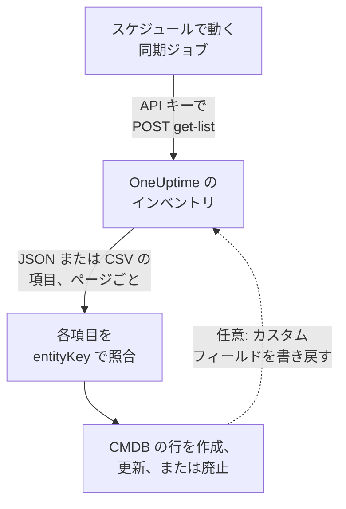

# CMDB へのエクスポート

すでに CMDB や資産台帳を運用しているなら、OneUptime はそれを置き換えようとはしません。OneUptime が持っていて CMDB にはたいてい欠けているのは、実際に動いているものの姿を、誰も手を入れずに最新に保ったものです。テレメトリから、そしてネットワークやクラウドアカウントをすでに監視しているポーラーから検出されます。このページは、その姿を自社の正式な記録システムに取り込むための手順です。

:::cards
- [同期の仕組み](#同期の仕組み): 一覧を読み、安定したキーで突き合わせる定期ジョブ。
- [カタログの取得](#カタログの取得): リクエストをページごとに、JSON または CSV で。
- [資産の詳細](#資産の詳細): ホストとネットワークデバイスに共通の情報とキー。
- [書き戻し](#書き戻し): 資産タグを OneUptime に送り、OneUptime から見えないものを追加します。
:::

## 同期の仕組み

同期は、スケジュールに従って実行するジョブです。API キーを使って REST API からインベントリの一覧を読み、各項目を識別キーで CMDB の行と突き合わせ、一致するように行を作成、更新、または廃止します。項目のカスタムフィールドに値を書き戻すこともできます。



## 取得できるもの

3 つの REST リソースがあり、それぞれに [OneUptime API](/docs/api-reference/api-reference) の標準エンドポイントがあります。

| リソース | エンドポイント | 内容 |
| --- | --- | --- |
| インベントリ項目 | `/api/inventory-item` | 環境内のもの一つにつき一行 |
| カスタムフィールドの定義 | `/api/inventory-item-custom-field` | プロジェクト独自のフィールドの語彙 |
| 関係 | `/api/inventory-item-relationship` | 項目間の向きのあるつながり |

インベントリ項目の主な列は次のとおりです。

| 列 | 意味 |
| --- | --- |
| `_id` | OneUptime の ID。外部参照として使います |
| `entityType` | `host`、`k8s.pod`、`network.device`、`appliance`、… |
| `entityKey` | 安定した識別ハッシュ。名前が変わっても変わらないため、突き合わせにはこちらのキーが適しています |
| `displayName` | 人が読む名前 |
| `source` | `discovered`、`inventory`、`manual` のいずれか |
| `description` | 自由記述のテキスト |
| `identifyingAttributes` | 項目をその項目たらしめる、決して変わらない属性 |
| `descriptiveAttributes` | それ以外に観測されたすべて。下の [資産の詳細](#資産の詳細)、[ホストの資産属性](#ホストの資産属性)、[ネットワークデバイスの資産属性](#ネットワークデバイスの資産属性) を参照 |
| `customFields` | 独自のフィールド。フィールド名がキーです |
| `resourceType` / `resourceId` | より詳しい OneUptime のレコードがある場合の、そのレコードへのポインター |
| `firstSeenAt` / `lastSeenAt` | 最初と最後に観測された日時 |
| `isArchived` | 稼働中の一覧から外されているかどうか |

## 始める前に

同期には、インベントリを読める API キーが必要です。OneUptime Cloud では、API キーには **Growth** 以上のプランが必要です。

:::steps
### API キーを作成する

**プロジェクト設定 → 詳細 → API キー** を開き、**API キーを作成** をクリックします。**名前** を付け、**アクセス** で、プロジェクト内のすべてを読むなら **閲覧者** を、同期に必要なものだけを与えるなら **権限は後で選択** を選びます。

### 必要なものだけを与える

読み取り専用のエクスポートに必要な権限は **Read Telemetry Service** の 1 つです。インベントリは独自の権限を持たず、テレメトリの権限を共有します。キーのページで **権限を追加** をクリックして選びます。値を書き戻すには **Edit Telemetry Service** も追加します。

### キーをコピーする

キーのページから **API キー** をコピーし、ジョブで使えるようにします。

```bash
export ONEUPTIME_API_KEY="your-api-key"
```
:::

キーは各リクエストの `ApiKey` ヘッダーで送られ、自分のプロジェクトのインベントリを読みます。そのため、リクエストでプロジェクトを指定することはありません。

## カタログの取得

必要な列を指定して、一覧のエンドポイントに `POST` します。`select` は必須です。API は求められたものしか返しません。

```bash
curl -X POST 'https://oneuptime.com/api/inventory-item/get-list' \
  -H "ApiKey: $ONEUPTIME_API_KEY" \
  -H 'Content-Type: application/json' \
  -d '{
    "query": { "isArchived": false },
    "select": {
      "_id": true,
      "entityType": true,
      "entityKey": true,
      "displayName": true,
      "source": true,
      "customFields": true,
      "descriptiveAttributes": true,
      "lastSeenAt": true
    },
    "sort": { "displayName": "ASC" },
    "limit": 100,
    "skip": 0
  }'
```

セルフホストのインストールでは、`https://oneuptime.com` の代わりに自分の OneUptime のアドレスを使います。応答は `{ "data": [...], "count": ... }` で、`count` は一致する項目の総数です。すべて取得するまで、`skip` を `limit` ずつ増やしてページを送ります。`limit` は最大 10,000 です。日付と `_id` 以外の ID は、`{ "_type": "DateTime", "value": "..." }` や `{ "_type": "ObjectID", "value": "..." }` のように包まれて返るので、`value` から読み取ってください。

### ネットワークデバイスだけ

`entityType` で一覧を絞り込みます。

```bash
curl -X POST 'https://oneuptime.com/api/inventory-item/get-list' \
  -H "ApiKey: $ONEUPTIME_API_KEY" \
  -H 'Content-Type: application/json' \
  -d '{
    "query": { "entityType": "network.device", "isArchived": false },
    "select": { "_id": true, "entityKey": true, "displayName": true, "customFields": true },
    "limit": 100,
    "skip": 0
  }'
```

各ネットワークデバイスの `descriptiveAttributes` には、ホスト名、IP アドレス、シリアル番号、MAC アドレス、メーカー、モデル、ファームウェア、オペレーティングシステム、ロール、サイト、場所が入っています。下の [ネットワークデバイスの資産属性](#ネットワークデバイスの資産属性) を参照してください。インターフェースや隣接機器など、ポーラーが知っているその他の情報は Network Device のレコード自体にあります。`resourceId` をたどって `/api/network-device/:id/get-item` を呼ぶか、`/api/network-device/get-list` を直接取得します。

### CSV として

どの一覧のエンドポイントも、`?output-type=csv` を付けると JSON の代わりに CSV で応答します。

```bash
curl -X POST 'https://oneuptime.com/api/inventory-item/get-list?output-type=csv' \
  -H "ApiKey: $ONEUPTIME_API_KEY" \
  -H 'Content-Type: application/json' \
  -d '{ "query": {}, "select": { "displayName": true, "entityType": true, "customFields": true }, "limit": 500, "skip": 0 }' \
  -o inventory.csv
```

ダッシュボードの **すべての項目** 一覧も同じようにエクスポートでき、有効にしたカスタムフィールドの列が含まれます。各 [資産の詳細](#資産の詳細) もそこで列になります。**ホスト名**、**IP アドレス**、**シリアル番号**、**モデル** などは最初は非表示なので、列の選択から有効にしてください。行がホストかネットワークデバイスかにかかわらず、エクスポートには情報ごとに 1 列が入ります。

## 資産の詳細

ホストとネットワークデバイスは同じ情報で記述され、同じキーで保存されます。行がサーバーでもスイッチでも、CMDB の 1 つの列にシリアル番号が入り、ダッシュボードの項目の **資産の詳細** カードはどちらでもすべての情報を同じ順序で表示します。何も報告されていない情報は省かれずに **不明** と表示されるため、欠けている部分が見えます。

| 情報 | キー | ホストの場合 | ネットワークデバイスの場合 |
| --- | --- | --- | --- |
| ホスト名 | `host.name` | ホストの名前。ホストの識別情報なので `identifyingAttributes` に入ります | デバイス自身の名前。SNMP の `sysName`、なければ検出時に見つかった NetBIOS 名または DNS 名。IP アドレスになることはありません |
| IP アドレス | `host.ip` | コレクターが報告するすべてのアドレス | OneUptime がポーリングするアドレス (IP アドレスの場合)。それ以外はプローブがその DNS 名を解決したアドレス |
| MAC アドレス | `host.mac` | 検出 | デバイスに入力された値、または巡回したルーターの ARP テーブルから学習した値 |
| シリアル番号 | `host.serial_number` | 付与 | ENTITY-MIB |
| メーカー | `device.manufacturer` | 付与 | ENTITY-MIB、なければ `sysDescr` または `sysObjectID` が示すもの |
| モデル | `device.model.name` | 付与 | ENTITY-MIB、なければ `sysDescr` が示すもの |
| ファームウェアバージョン | `device.firmware.version` | 付与 | ENTITY-MIB、なければ `sysDescr` が示すもの |
| オペレーティングシステム | `os.name` | `os.description` (または `os.type`) | `sysDescr` が示すもの: Cisco IOS、Junos OS、Arista EOS、Linux |
| OS バージョン | `os.version` | 検出 | ENTITY-MIB、なければ `sysDescr` が示すもの |
| デバイスの種類 | `device.type` | 付与。なければカードが OS と名前から分類します (サーバー、ファイアウォール、...) | そのロール。割り当てたもの、なければトポロジーマップが描画する際のもの |
| 場所 | `device.location` | 付与。なければカードはクラウドのゾーンを表示します | `sysLocation`。カードはサイトを先に表示します |

情報ごとの値の出どころは、下の [ホストの表](#ホストの資産属性) と [ネットワークデバイスの表](#ネットワークデバイスの資産属性) で詳しく説明しています。

## ホストの資産属性

ホストの `descriptiveAttributes` には、CMDB の行で通常必要になる資産情報が、OpenTelemetry の属性名をキーとして入っています。

| フィールド | キー | 既定で収集されるか |
| --- | --- | --- |
| IP アドレス | `host.ip` | はい。マシンに複数ある場合はカンマ区切り |
| MAC アドレス | `host.mac` | はい。稼働中のインターフェースごとに一つ、カンマ区切りで、`AC-DE-48-23-45-67` の形式 |
| アーキテクチャ | `host.arch` | はい |
| マシン ID | `host.id` | はい。Windows ではマシンの GUID、Linux では `/etc/machine-id` |
| オペレーティングシステム | `os.type`、`os.description`、`os.version` | はい |
| クラウド上の配置 | `cloud.provider`、`cloud.region`、`cloud.availability_zone` | クラウドの検出器がある場合のみ |
| シリアル番号 | `host.serial_number` | 設定の手順が一つ必要 |
| メーカー | `device.manufacturer` | 設定の手順が一つ必要 |
| モデル | `device.model.name` | 設定の手順が一つ必要 |
| ファームウェア (BIOS または UEFI) のバージョン | `device.firmware.version` | 設定の手順が一つ必要 |
| オペレーティングシステムの名前 | `os.name` | 報告する SDK からのみ。それ以外では `os.description` が OS を示します |
| デバイスの種類 | `device.type` | 任意。同じ方法で付与します (`Hypervisor`、`Workstation`) |
| 場所 | `device.location` | 任意。同じ方法で付与します (`Frankfurt DC, Rack B4`) |

「はい」の項目はすべてコレクターの `resourcedetection` プロセッサーから得られ、OneUptime が生成する設定にすでに含まれています。

`cloud.*` のキーには、そのプロセッサーにクラウドの検出器が必要です。`detectors: [system, env, ec2]`、ほかのクラウドでは `gcp` または `azure` を指定します。同梱の設定は `[system, env]` だけを実行するため、検出器を追加するまでこの 3 つは空のままです。

シリアル番号、メーカー、モデル、ファームウェアにはリソース検出器がありません。これらはマシンのファームウェアにあり、Windows では WMI、Linux では DMI を通じて読み取られるため、マシンをプロビジョニングするときに一度だけリソースに付与します。行に載せたいデバイスの種類や場所も同じ方法で付与します。各オペレーティングシステム向けの正確なスニペットは [インベントリ属性](/docs/telemetry/host-otel-collector#インベントリ属性-ipmacシリアル番号メーカーモデルファームウェア) にあります。`host.manufacturer`、`host.model.name`、`host.firmware.version`、`host.bios.version` も別の表記として受け付けられ、`device.*` のキー (および `device.serial_number` は `host.serial_number`) で保存されるため、同期が読むキーは情報ごとに常に 1 つです。

CMDB がすでにハードウェア識別子をキーにしているなら、`host.id` を突き合わせのキーとして検討する価値があります。`entityKey` と違ってマシン自身の ID なので、エンドポイント管理ツールが同じマシンについて報告する値と一致します。

属性は追加されるだけで、空になることはありません。報告されなくなった属性も行に残るため、同期がすでに読んだ値が知らないうちに消えることはありません。

## ネットワークデバイスの資産属性

ネットワークデバイス (`entityType: network.device`) は Network Device のレコードから反映され、その `descriptiveAttributes` は同じ情報についてホストと同じキーを使います。そのため、行がサーバーでもスイッチでも、CMDB の 1 つの列にシリアル番号が入ります。

| フィールド | キー | 出どころ |
| --- | --- | --- |
| ホスト名 | `host.name` | デバイス自身の名前。SNMP の `sysName`、なければ検出時に見つかった NetBIOS 名または逆引き DNS 名。IP アドレスでしか名前が付かない場合は省かれます |
| IP アドレス | `host.ip` | OneUptime がポーリングするアドレス (IP アドレスの場合)。DNS 名でポーリングするデバイスでは、プローブがその名前を最後に解決したアドレス |
| DNS 名 | `net.device.dns_name` | 検出時に見つかった逆引き DNS 名、または OneUptime がポーリングする DNS 名 |
| MAC アドレス | `host.mac` | デバイスに入力された値、または巡回したルーターの ARP テーブルから学習した値 |
| メーカー | `device.manufacturer` | ENTITY-MIB の `entPhysicalMfgName`、なければ `sysDescr` が示すメーカー、なければ `sysObjectID` のベンダー |
| モデル | `device.model.name` | ENTITY-MIB の `entPhysicalModelName`、なければ `sysDescr` が示すモデル |
| シリアル番号 | `host.serial_number` | ENTITY-MIB の `entPhysicalSerialNum` |
| ファームウェアバージョン | `device.firmware.version` | ENTITY-MIB の `entPhysicalFirmwareRev`、なければ Ubiquiti、HPE、Aruba のデバイスで `sysDescr` が示すファームウェア |
| オペレーティングシステム | `os.name` | `sysDescr` が示すオペレーティングシステム |
| ソフトウェアまたは OS のバージョン | `os.version` | ENTITY-MIB の `entPhysicalSoftwareRev`、なければ `sysDescr` が示すリリース |
| システムの説明 | `os.description` | `sysDescr` |
| デバイスの種類 | `device.type` | デバイスに割り当てたロール、なければトポロジーマップが分類したロール。プロジェクトでの呼び名で入ります |
| 場所 | `device.location` | `sysLocation`。ただし Net-SNMP の「Sitting on the Dock of the Bay」のようなエージェントの既定値は除きます |
| サイト | `oneuptime.site.name` | デバイスが割り当てられている Network Site |
| ポーリング先のアドレス | `net.device.hostname` | OneUptime がポーリングするアドレス。IP アドレスまたは DNS 名です。`host.name` と `host.ip` ができる前に書かれた同期のために残されています |

ENTITY-MIB の行はデバイスの最初の SNMP ウォークの後に埋まります。ping だけで監視しているデバイスや、まだポーリングされていないデバイスのようにウォークされないデバイスでも、名前、メーカー、オペレーティングシステム、場所は、アドレスに対する最後の検出スキャンが SNMP で読み取った内容から、MAC アドレスは巡回したルーターの ARP テーブルから得られます。ENTITY-MIB を実装していないデバイスには、報告できるシリアル番号やファームウェアがありません。それでも多くのプラットフォームでは `sysDescr` がモデルとオペレーティングシステムを示します。Cisco Meraki MX は `Meraki MX85` を報告し、それでメーカーとモデルが埋まります。`sysDescr` が既知の形式でないプラットフォームでは、推測で埋めずに何も追加しません。

[Meraki 接続](/docs/monitor/network-traffic#netflow-を使わない-cisco-meraki) が組織を読み取ると、Meraki デバイスは自身のポーリングで空のままの情報を Meraki ダッシュボードから取得します。シリアル番号、モデル、ファームウェア、メーカー、MAC アドレス、名前、管理アドレス、登録されている住所、種類です。シリアル番号または MAC アドレスが Meraki デバイスと同じデバイスと、OneUptime が Meraki デバイスの管理アドレスでポーリングしていて名前も同じデバイスが、組織のデバイスとみなされます。デバイスに保存された値と、デバイス自身のポーリングで読み取った値が優先されます。

デバイスに保存された値 (入力した値や API で設定した値) が、検出で読み取った内容に置き換えられることはありません。デバイス自身のウォークが読み取った値とスキャンが読み取った値では、新しい方が使われます。スキャンが読み取った内容は、そのアドレスで同じマシンを見つけた場合にだけ使われます。読み取ったシステム名、`sysObjectID`、NetBIOS 名がデバイスのものと食い違う場合、そこで読み取った内容は何も使われません。項目の **資産の詳細** カードには、各値の出どころと時刻が表示されます。

ホスト名が IP アドレスになることはありません。アドレスでしか名前が付かないデバイスには `host.ip` があり、`host.name` はありません。SNMP ウォークがシステム名を報告すると、次の処理で `host.name` が入ります。

これらの値は 15 分ごとに Network Device のレコードからコピーされ、前の値に追加されるのではなく前の値を **置き換えます**。そのため、デバイスで消された値 (たとえば削除された MAC アドレス) はインベントリ項目からも消えます。

*利用可能なアップグレード* のバージョンはありません。SNMP にはそのための標準オブジェクトがないため、OneUptime はデバイスが実行しているバージョンを記録します。

## 項目と CMDB の行の突き合わせ

`displayName` ではなく `entityKey` で突き合わせます。これは項目を識別する属性のハッシュなので、名前の変更や新しいタグの影響を受けません。ラベルが付け替えられたホストは、表示名が変わっても同じキーを保ちます。`_id` も同じように安定しており、1 つのプロジェクトとしかやり取りしないなら最も簡単な外部キーです。

`customFields` の日付は UTC の ISO-8601 文字列です。CSV エクスポートも、ダッシュボードが表示するわかりやすい形式ではなくこの形式で書き出すため、解析で予期しない問題が起きずに取り込めます。

## 最新の状態を保つ

変更フィードはありません。都合のよい間隔で一覧のエンドポイントをポーリングし、`entityKey` で比較します。`lastSeenAt` は項目が最後に観測された日時を示し、前回の実行以降に沈黙したものを見つけるには、たいていこれが最も手軽な方法です。

次のポーリングと次のコピーを待たずにネットワークデバイスを今すぐ読み直すには、項目の **資産の詳細** カードで **更新** を押すか、**Edit Network Device** を持つキーで `POST /api/network-device/{id}/refresh` を送信します。プローブが 1 分以内にポーリングし、Meraki 接続が組織を読み直し、新しい読み取り結果が届きしだい項目がコピーされます。

実行の間に消えた項目は、期限切れになった (期間を超えて沈黙した検出済み項目) か、元のレコードが削除されたかのどちらかです。カスタムフィールドの値を持つ反映済みの項目は、元のレコードがなくなると削除されずにアーカイブされるため、`"isArchived": true` で問い合わせると、関連する資産データを失わずに廃止されたものを確認できます。

## 書き戻し

同じエンドポイントは書き込みも受け付けるため、同期で `customFields` に値を送れます。たとえば、CMDB がすでに管理している資産タグを、対応する OneUptime の項目に付与できます。それにはキーに **Edit Telemetry Service** が必要です。

OneUptime から見えないものの項目も、`POST /api/inventory-item` で追加できます。`entityType` に `external.service`、`external.database`、`appliance` のいずれかを、そして `displayName` を指定します。識別キーは OneUptime が計算し、これらの項目が期限切れになることはありません。これには **Create Telemetry Service** を持つキーが必要です。

## トラブルシューティング

:::details すべてのリクエストが 402 Payment Required で拒否される
OneUptime Cloud では、API キーはプロジェクトが **Growth** 以上のプランにある間だけ機能します。何も削除されません。プロジェクトがプランに戻れば、キーはそのまま再び機能します。[プラン未満の API キーと SCIM](/docs/api-reference/api-reference#プラン未満の-api-キーと-scim) を参照してください。
:::

:::details すべてのリクエストが 422 You do not have permissions を返す
キーにインベントリを読み取る権限がありません。**権限は後で選択** で作成したキーは、権限を得るまで何もできません。[始める前に](#始める前に) のとおり、キーのページで **Read Telemetry Service** を追加してください。
:::

:::details 必要な列がないまま一覧が返ってくる
一覧は `select` で指定した列と `_id` だけを返します。読む列はすべて `select` に追加してください。`descriptiveAttributes` と `customFields` も同様です。
:::

:::details あるはずの項目が見つからない
`"isArchived": false` を送ると、アーカイブされた項目は除かれます。検出済みの項目は期間を超えて沈黙すると削除され、反映済みの項目は元のレコードと一緒に消えます。アーカイブされた項目を見るには `"isArchived": true` を指定してください。
:::

## 次のステップ

:::cards
- [インベントリの概要](/docs/inventory/overview): 項目の出どころと、それぞれが残る期間。
- [インベントリのカスタムフィールド](/docs/inventory/custom-fields): 同期で読み書きするフィールドを定義します。
- [OneUptime API リファレンス](/docs/api-reference/api-reference): リクエスト、ステータスコード、すべての書き込みが従うルール。
:::
