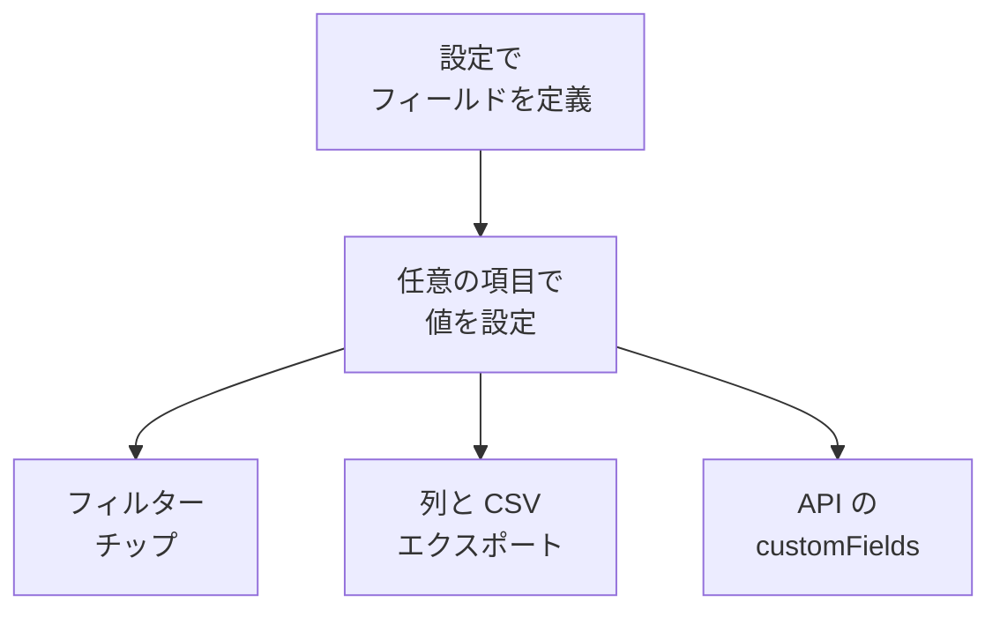

# インベントリのカスタムフィールド

OneUptime は環境に何があるかを検出します。カスタムフィールドは、どれだけ監視してもわからないことを記録します。ステッカーに書かれたシリアル番号、保証の期限、どのチームが所有しているか、稼働中か予備部品の引き出しにあるか、といったことです。フィールドをプロジェクトに一度定義し、各項目で入力します。

:::cards
- [カスタムフィールドの仕組み](#カスタムフィールドの仕組み): ソースにかかわらず、すべての項目で 1 つの語彙。
- [フィールドの定義](#フィールドの定義): フィールドを作成し、種類を選び、ドロップダウンの選択肢を並べます。
- [一覧の絞り込み](#一覧の絞り込み): 次の四半期に期限が切れるものを 2 クリックで見つけます。
- [注意点と制限](#注意点と制限): 名前の変更、重複、日付、削除したフィールド。
:::

## カスタムフィールドの仕組み

フィールドはプロジェクトに一度定義され、すべての項目がその値を持てます。OneUptime が検出した項目、反映している項目、手動で追加した項目のどれでもです。フィールドは一覧の上のフィルターチップ、任意の列、CSV エクスポートの列になります。API は同じ値を各項目の `customFields` で読み書きします。

> [!NOTE]
> OneUptime Cloud では、カスタムフィールドは **Growth** 以上のプランに含まれます。それより下のプランでは、フィールドの定義、一覧表示、変更ができません。API は `402 Payment Required` を返し、一覧にはカスタムフィールドのチップも列も表示されません。

## フィールドの定義

:::steps
### カスタムフィールドのページを開く

**製品 → リソース → インベントリ** に移動し、サイドメニューで **設定** を開いてから **カスタムフィールド** を開きます。

### フィールドを作成する

**インベントリ項目のカスタムフィールドを作成** をクリックします。**フィールド名**、任意の **フィールドの説明**、そして下の表から選んだ **フィールドタイプ** を指定します。

### ドロップダウンの選択肢を並べる

ドロップダウンの種類では、**ドロップダウンのオプション** に選択肢を追加します。各選択肢には色を付けられ、表のセルとフィルターチップで同じように使われます。名前の付いた色のいずれか、**色なし**、または正確なカラーコードを指定する **カスタムカラー** を選びます。選択肢をハンドルでドラッグすると、並び順を変えられます。
:::

| 種類 | 用途 |
| --- | --- |
| **テキスト** | シリアル番号、資産タグ、ラック位置、発注番号 |
| **数値** | コスト、ラックユニット、ポート数 |
| **ブール値** | サポート対象、PCI の範囲内 |
| **ドロップダウン（単一選択）** | ライフサイクルのステータス、環境、重要度: 固定リストから一つの回答 |
| **ドロップダウン（複数選択）** | コンプライアンスの範囲、タグ: 固定リストから複数の回答 |
| **日付** | 購入日、保証の期限、サポート終了日 |
| **日付と時刻** | 最終監査日時、廃棄日時 |
| **長いテキスト** | アクセス手順、メモ: 複数行のプレーンテキスト |
| **リッチテキスト（Markdown）** | 書式とリンクを含むメモ。Markdown エディターで記述します |
| **ファイル** | 保証書、署名済みの発注書、ラックのラベルの写真: 一つのファイル |
| **複数のファイル** | マニュアル、請求書、写真: 最大 10 個のファイル |

## 資産の語彙の例

一般的なハードウェア資産台帳は、これらのフィールドにそのまま対応します。

| フィールド名 | 種類 | 例 |
| --- | --- | --- |
| `Serial Number` | テキスト | `FDO24160ABC` |
| `Asset Tag` | テキスト | `IT-004821` |
| `Purchase Date` | 日付 | 2024-03-11 |
| `Warranty Expiry` | 日付 | 2027-03-10 |
| `Lifecycle Status` | ドロップダウン | 稼働中、予備、修理中、廃棄済み |
| `Assigned Site` | ドロップダウン | ロンドン DC、フランクフルト DC、本社オフィス |
| `Owner Team` | ドロップダウン | ネットワーク、プラットフォーム、セキュリティ |
| `Cost Centre` | テキスト | `CC-4410` |

値は項目の **カスタムフィールド** ページで設定します。ソースにかかわらずどの項目でも値を持てるため、OneUptime が検出したスイッチや反映しているネットワークデバイスも、手動で追加したアプライアンスと同じ資産の語彙を持てます。

## 一覧の絞り込み

各カスタムフィールドは **すべての項目** 一覧の上にフィルターチップとして表示され、チップでは種類に合った比較を選べます。

| フィールドタイプ | 比較 |
| --- | --- |
| **テキスト**、**長いテキスト**、**リッチテキスト（Markdown）** | 等しい、ではない、を含む、を含まない、で始まる、で終わる、が空、が空でない |
| **数値** | 等しい、ではない、より大きい、以上、より小さい、以下、が空、が空でない |
| **ブール値**、**ドロップダウン（単一選択）**、**ドロップダウン（複数選択）** | 等しい、ではない、が空、が空でない |
| **日付**、**日付と時刻** | 等しい、より前、より後、の間、が空、が空でない |
| **ファイル**、**複数のファイル** | 等しい |

**ファイル** または **複数のファイル** のチップが尋ねるのは 1 つだけです。フィールドが **ファイルあり** か **ファイルなし** かです。

チップは AND で組み合わされるため、「Warranty Expiry が 2026-10-01 より前 AND Lifecycle Status が稼働中」は一覧の 1 つのビューになります。これこそ資産台帳が答えるべき問いであり、テキストフィールドに日付を入れるのではなく日付の種類を使う理由です。テキストフィールドは `2026-10-01` を問題なく保存しますが、次の四半期に期限が切れるものを教えてはくれません。

カスタムフィールドの列は最初は非表示です。列の選択から有効にしてください。値はまとめて 1 つの JSON 列に保存されていて、一覧はその列で並べ替えられないため、並べ替えはできません。

## 注意点と制限

- 値は各項目にフィールド名で保存されます。フィールドの名前を変えても、古い名前で保存済みの値は移りません。例外はインシデントのカスタムフィールドで、名前を変えると値も移ります ([フィールドの名前を変更する](/docs/incidents/settings#フィールドの名前を変更する) を参照)。
- ドロップダウンの選択肢は、項目に値が入った後でも追加、名前の変更、ドラッグでの並べ替え、削除ができます。名前を変えた選択肢は、それを持つすべての項目で変わります。削除した選択肢は、別の選択肢を選び直さない限り、それを持つ項目に残り、もう選択肢ではないものとして表示されます ([ドロップダウンの選択肢を変更する](/docs/incidents/settings#ドロップダウンの選択肢を変更する) を参照)。
- 値を一意にする仕組みはありません。2 つの項目が同じシリアル番号を持つことができ、それを止めるものはありません。
- 日付は ISO-8601 の UTC タイムスタンプとして保存され、あなたのタイムゾーンで表示されます。
- フィールドを削除すると、一覧とフィルターバーから消えます。すでに書き込まれた値は項目に残ります。
- **ファイル** または **複数のファイル** のフィールドは、1 つあたり 10 MB までのファイルを受け付けます。種類は [ファイルフィールド](/docs/incidents/settings#ファイルフィールド) に挙げたもので、プロジェクト内でアップロードされたものに限ります。ダウンロードできるのは項目を表示できるユーザーだけで、ファイルはどこからも参照されなくなった時点で削除されます。

## 次のステップ

:::cards
- [インベントリの概要](/docs/inventory/overview): 項目の出どころと、各ページに表示される内容。
- [CMDB へのエクスポート](/docs/inventory/cmdb-sync): 項目とそのカスタムフィールドを別のシステムに取り込みます。
- [インシデントのカスタムフィールド](/docs/incidents/settings#カスタムフィールド): 同じフィールドタイプをインシデントでも使えます。いくつかの追加もあります。
:::
