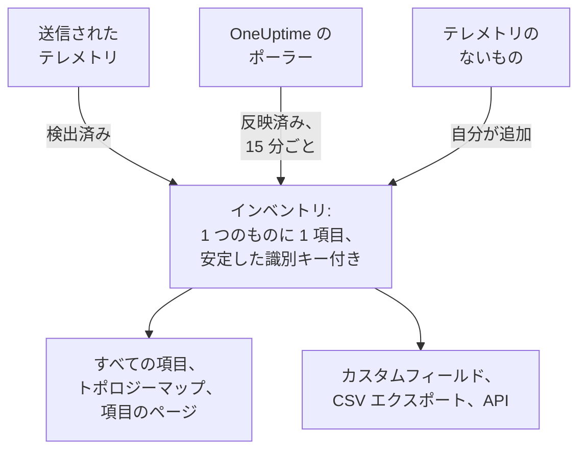

# インベントリの概要

インベントリは、OneUptime があなたの環境について知っているすべてを 1 つにまとめた一覧です。サービス、ホスト、Kubernetes オブジェクト、仮想マシン、ネットワークデバイス、クラウドリソース、IoT デバイス、サーバーレス関数、そしてテレメトリをまったく送らないものまで含まれます。その大半は、OneUptime がすでに監視している内容から自動的に埋まります。あなたが追加するのは、監視ではわからないこと、つまり用途、所有者、保証の期限です。 [用語集](/docs/introduction/glossary#監視する対象) では、インベントリに含まれる各種類のレコードが何かを説明しています。

:::cards
- [項目がインベントリに入る仕組み](#項目がインベントリに入る仕組み): 検出、反映、または自分で追加。
- [ページの見つけ方](#ページの見つけ方): インベントリのページと、各項目のページ。
- [Esper からデバイスをインポートする](#esper-からデバイスをインポートする): Esper テナントに登録されたすべての Android デバイスと Apple デバイスを、常に最新の状態で。
- [Microsoft Intune からデバイスをインポートする](#microsoft-intune-からデバイスをインポートする): Intune が管理するすべての Windows PC、Mac、iPhone、iPad、Android デバイスを、常に最新の状態で。
- [Workspace ONE UEM からデバイスをインポートする](#workspace-one-uem-からデバイスをインポートする): Workspace ONE が管理するすべてのスマートフォン、タブレット、コンピューターを、常に最新の状態で。
- [SOTI MobiControl からデバイスをインポートする](#soti-mobicontrol-からデバイスをインポートする): MobiControl が管理するすべての堅牢型デバイス、スマートフォン、タブレット、コンピューターを、常に最新の状態で。
- [手動で追加する](#手動で追加する): サードパーティの API、外部データベース、アプライアンス。
- [削除せずにアーカイブする](#削除せずにアーカイブする): 一覧を整理して、その状態を保つ方法。
:::

## 項目がインベントリに入る仕組み

OneUptime は監視のためにすでにあなたの環境を見ているので、カタログは誰かが忘れずに入力した内容ではなく、観測した内容から作られます。どの項目にもソースがあり、ソースが項目の持ち主を決めます。つまり、編集できるかどうか、そして自然に消えることがあるかどうかです。

| ソース | API での値 | 取得元 | 残る期間 |
| --- | --- | --- | --- |
| **検出済み** | `discovered` | テレメトリの到着時に読み取られる OpenTelemetry のリソース属性。テレメトリを送るサービス、ホスト、Kubernetes オブジェクト、仮想マシンです。 | バッチごとに改めて登録されます。種類ごとの期間より長く沈黙すると削除されます (下記参照)。 |
| **反映済み** | `inventory` | OneUptime のポーラーが保持するレコード。ネットワークデバイス、クラウドリソース、IoT デバイス、サーバーレス関数、RUM アプリケーション、Docker ホスト、Podman ホスト、そしてデバイス管理サービスの接続がインポートするデバイスです。15 分ごとにコピーされます。管理対象デバイスは、その接続が読み取られるたびにコピーされます。 | 元のレコードがある限り。レコードを削除すると、項目も一緒に消えます。 |
| **自分が追加** | `manual` | OneUptime からは見えないもののために、あなたが追加したもの。サードパーティの API、ベンダーが管理するデータベース、ラックのアプライアンスなどです。 | 削除するまで。期限切れになることはありません。 |

検出済みまたは反映済みの項目は、名前や種類を変えられません。次の処理でソースが変更を上書きしてしまうためです。代わりに、項目の **設定** ページに、変更を残すにはどこで行えばよいかが表示されます。ソースにかかわらず、どの項目にもいつでも追加できるのは、カスタムフィールドの値です。[インベントリのカスタムフィールド](/docs/inventory/custom-fields) を参照してください。

### 沈黙した項目が残る期間

検出済みの項目にはハートビートがあります。テレメトリが届くたびに最終確認時刻が進み、一覧の **ステータス** 列にその新しさが表示されます。管理対象デバイスも同じで、デバイス管理サービスにチェックインするたびに最終確認時刻が進みます。それ以外の反映済みの項目と自分で追加した項目にはハートビートがないため、ステータスは警告にならず空欄のままです。

| ステータス | 意味 |
| --- | --- |
| **ライブ** | 直近 30 分以内に確認されました。 |
| **最近** | 直近一日以内に確認されました。 |
| **古い** | 一日を超えて確認されていません。**沈黙** ページに一覧表示されます。 |

OneUptime は 3 時間ごとに、種類ごとの期間より長く沈黙している検出済みの項目を、アーカイブ済みのものも含めて削除し、そのカスタムフィールドの値も一緒に消えます。反映済みの項目と自分で追加した項目が、この方法で削除されることはありません。

| 項目の種類 | テレメトリがないまま削除されるまでの期間 |
| --- | --- |
| Pod、Deployment、Proxmox ゲスト、OpenStack インスタンス、VMware 仮想マシン | 1 日 |
| Kubernetes のノードと名前空間、Proxmox ノード、OpenStack ハイパーバイザー、VMware のホスト、クラスター、データストア、そしてトレースが呼び出すデータベースとリモートサービス | 7 日 |
| サービス、ホスト、Kubernetes・Proxmox・Ceph のクラスター、OpenStack クラウド、ストレージアレイ、vCenter、Docker Swarm クラスター | 30 日 |

OneUptime が検出した関係は、30 日間再び確認されないと削除されます。

## ページの見つけ方

**製品 → リソース → インベントリ** を開きます。サイドメニューには次のページがあります。**ソース別**、**設定**、**ヘルプ**、**詳細** は最初は折りたたまれています。セクションのタイトルをクリックすると開きます。

| ページ | 内容 |
| --- | --- |
| **概要** | 項目の数、その種類、沈黙した項目の数、最近追加されたもの。 |
| **すべての項目** | すべての項目。名前、説明、識別キーで検索し、種類、ソース、ステータス、カスタムフィールドで絞り込み、手動で項目を追加できます。 |
| **管理対象デバイス** | デバイス管理サービスの接続 (Esper、Microsoft Intune、Workspace ONE UEM、SOTI MobiControl) と、それらがインポートするすべてのデバイス。各デバイスのステータス、グループ、モデル、オペレーティングシステムが表示されます。 |
| **トポロジーマップ** | 項目どうしのつながり。サービス、その呼び出し先、そしてそれらが動くホスト、Pod、デバイスです。 |
| **沈黙** | 一日を超えて音沙汰のない項目。テレメトリを送っていない検出済みの項目と、デバイス管理サービスへのチェックインが止まったデバイスです。 |
| **ソース別** | 一つのソースの項目: **検出済み**、**反映済み**、**自分が追加**。 |
| **設定 → カスタムフィールド** | プロジェクトがすべての項目に持たせるフィールド。 |
| **ヘルプ → ドキュメント** | インベントリの短いガイドと、認識する項目の種類。 |
| **詳細 → アーカイブ済み** | アーカイブした項目。ここからアーカイブを解除できます。 |

項目を開くと、その項目自身のサイドメニューに、**概要** (種類、ソース、ステータス、そして観測されたすべての属性)、**接続**、**カスタムフィールド**、**ログ**、**トレース**、**メトリクス**、**プロファイル**、**例外**、そして **インシデント**、**アラート**、**定期メンテナンス** があります。**詳細** の下には **設定**、**監査ログ**、**項目を削除** があります。テレメトリのページには、項目自身が送ったものが表示されます。インシデント、アラート、メンテナンスイベントは、その項目が表すサービス、ホスト、Kubernetes クラスターのものです。それ以外の項目では、代わりにどのリソースを見ればよいかがページに表示されます。

### 資産の詳細

ホストとネットワークデバイスには **資産の詳細** カードがあり、どちらも同じ方法で記述されます。ホスト名、IP アドレス、MAC アドレス、シリアル番号、メーカー、モデル、ファームウェアバージョン、オペレーティングシステム、OS バージョン、デバイスの種類、場所です。Android デバイスのカードには、Android エージェントまたはそのデバイス管理サービスから得たセキュリティパッチレベルも表示されます。パッチが **更新が必要** かどうかも **セキュリティパッチレベル** 列と同じように示し、経過日数も表示します。何も報告されていない情報は **不明** と表示され、カードにはその理由と不明な情報の埋め方が示されます。SNMP で報告しないデバイス、まだ読み取られていないデバイス、ダッシュボードに情報がある Meraki デバイスのいずれかです。

- ホストの情報は、テレメトリのリソース属性から得られます。IP アドレスと MAC アドレス、アーキテクチャ、オペレーティングシステムは最初から、シリアル番号、メーカー、モデル、ファームウェアは付与した時点から得られます。
- ネットワークデバイスの情報は、SNMP ポーリング、ロール、サイトから得られます。ポーリングで読み取れていない情報は、検出から得られます。アドレスの最後のスキャン、ルーターの ARP テーブル、プローブの DNS 解決です。Meraki MX のように ENTITY-MIB を持たないデバイスでも、システムの説明からメーカー、モデル、オペレーティングシステムを、自身のポートから MAC アドレスを得られます。IP アドレスがホスト名として表示されることはありません。
- [Meraki 接続](/docs/monitor/network-traffic#netflow-を使わない-cisco-meraki) が組織を読み取ると、Meraki デバイスはポーリングで空のままの情報も Meraki ダッシュボードから取得します。シリアル番号、モデル、ファームウェアなどです。

**すべての項目** では、対応が必要な Android デバイスを見つけられます。**セキュリティパッチレベル** フィルターで **更新が必要** を選ぶと、セキュリティパッチレベルが 90 日より古いデバイスが一覧になります。[ホスト モニター](/docs/monitor/host-monitor) の Security Patch Out of Date アラートが読むのと同じルールです。**エージェントの権限** フィルターは、[Android エージェント](/docs/telemetry/android-agent) にまだ READ_LOGS、READ_DROPBOX_DATA、使用状況へのアクセスのいずれかがないデバイスを一覧にします。どちらのフィルターにも同じ名前の列があり、有効にするまでは非表示で、CSV エクスポートにも含まれます。その横の **デバイス管理サービスの ID** 列には、デバイス管理サービスがそのデバイスを識別する ID が入ります。たとえば `espercli secureadb connect --device` が受け取る Esper の ID です。

カードには、各情報の出どころと時刻が表示されます。ホストのコレクター、ネットワークデバイス自身の SNMP ポーリング、それを読み取った検出スキャンなど、ほとんどの情報に共通する出どころは、情報の下に一度だけ示されます。ルーターの ARP テーブルやデバイスに保存された値など、それ以外の出どころは、その情報の下に示されます。ネットワークデバイスに保存された値が検出で読み取った内容に置き換えられることはなく、両者が異なる場合はカードに両方が表示されます。

ネットワークデバイスのカードには、ネットワークデバイスを編集できるユーザー向けに **更新** ボタンがあります。これでデバイスを今すぐ読み直します。プローブが 1 分以内にポーリングし、Meraki 接続が組織を読み直します。カードには、新しい読み取り結果が届いたこと、またはプローブがデバイスに到達できなかったことが表示され、読み取り結果が届きしだい項目がデバイスからコピーされます。

同じ情報は **すべての項目** 一覧の列でもあり、有効にするまでは非表示で、CSV エクスポートにも含まれます。キーの一覧は [CMDB へのエクスポート](/docs/inventory/cmdb-sync#資産の詳細) にあります。

### 接続

項目の **接続** ページには、両方向の隣接項目が **呼び出し**、**呼び出し元**、**実行場所**、**関連** にまとめて表示されます。各グループには合計が表示され (接続が 100,000 を超えるグループは「100,000+」と表示)、**さらに表示** で残りをページ送りできるため、混み合ったクラスター、名前空間、ノードでも、最初の数件だけでなくすべての接続が表示されます。このページは時間範囲に制限されません。API から手動で追加した関係や、アーカイブされた隣接項目も含まれます。インベントリにもう存在しない隣接項目は、そのキーで表示されます。

## Esper からデバイスをインポートする

Esper テナントを接続すると、そのテナントに登録されているすべてのデバイスがインベントリに入ります。Android デバイス（アプリが一度も起動していないデバイスも含みます）と、iPhone、iPad、Apple TV です。各デバイスは 1 つのホストで、Esper だけが知っている情報を持ちます。グループ、オペレーティングシステムとビルド、シリアル番号と IMEI、バッテリーとストレージ、そして Android デバイスではセキュリティパッチレベルとインストール済みのアプリです。Esper は自分からは何も送らないため、OneUptime がスケジュールに従って読み取ります。デバイスは 15 分ごと、各 Android デバイスのアプリは 6 時間ごとです。

:::steps
### Esper で API キーを作成する

Esper コンソールの API Key Management でキーを作成します。OneUptime は読み取りのみを行うため、Esper のロールでデバイス、グループ、アプリを読み取れるユーザーのキーで十分です。キーは、置き換えられたとき、またはそのユーザーが削除されたときに使えなくなります。

### テナントを接続する

**製品 → リソース → インベントリ** に移動し、**管理対象デバイス** を開いて **デバイス管理サービスを接続** をクリックし、**Esper** を選びます。**テナント** (Esper コンソールのアドレスで `.esper.cloud` の前にある名前。 `acme.esper.cloud` なら `acme`) と **API キー** を入力します。**その他の項目** には、接続の名前と読み取る頻度があります。

### 最初の読み取りを確認する

**接続** は、何かを保存する前にキーをテストします。読み取りでインポートされるデバイスの数か、何が問題でどう直せばよいかが表示されます。最初の読み取りは 1 分以内に始まり、接続の行に結果が表示されます。
:::

| Esper が報告するもの | 表示される場所 |
| --- | --- |
| モデル、メーカー、シリアル番号、オペレーティングシステムとそのバージョン、ビルド、IP アドレスと MAC アドレス | デバイスの **資産の詳細** カードと、**すべての項目** の列 |
| ステータス、最終チェックイン、グループ、セキュリティパッチレベル、IMEI、バッテリー、ストレージ、Esper エージェント | デバイスの **Esper** カードと、**管理対象デバイス** の **デバイス** 一覧 |
| アプリとそのバージョン | デバイスの **インストール済みアプリ** 一覧 |
| Esper のデバイス ID | **すべての項目** の **デバイス管理サービスの ID** 列 |

### 同じデバイスを 1 つの項目にまとめる

デバイスからテレメトリを送るアプリや Android Agent が Esper と同じ方法でデバイスに名前を付けると、Esper がインポートするデバイスと 1 つの項目にまとまります。Esper が各デバイスで埋める管理対象の構成から、次のリソース属性を設定してください。

| リソース属性 | 管理対象の構成の値 | 内容 |
| --- | --- | --- |
| `host.name` | `${esper.deviceName}` | Esper でのデバイスの名前 (例: `ESP-ID-AAAAW`)。必須です。 |
| `host.serial_number` | `${esper.serialNumber}` | デバイスのシリアル番号。省略可能です。 |

OneUptime は、デバイスの項目を Esper での名前、次にシリアル番号の順に探し、どれにも一致しない場合にだけ新しく作成します。Android Agent は `device_name` と `device_serial` の設定から両方を設定します。アプリの管理対象の構成は [Android のセットアップ](/docs/rum/android-setup#esper-からフリートをインポートする) に示しています。

### デバイスが沈黙したとき、または Esper から外れたとき

30 分間チェックインしていない Android デバイスは **オフライン** になり、最後のチェックインからの経過時間が表示されます。iPhone、iPad、Apple TV は Apple のプッシュサービスに起こされたときにチェックインし、その間隔は何時間も空くことがあるため、1 日たってから **オフライン** になります。その項目の **ステータス** は、最後のチェックイン、またはそれより新しければテレメトリに従うため、一日沈黙したデバイスは **沈黙** ページに表示されます。

Esper から削除されたデバイスは **削除済み** となり、その項目はアーカイブされます。項目は一覧から外れ、**詳細 → アーカイブ済み** で待機します。Esper に戻ってきたデバイスは一覧にも戻ります。デバイスが外れてから 30 日後に、デバイスは削除され、その項目も削除されます。ただし、テレメトリやあなたが項目に何かを追加していた場合、項目は削除されません。

### デバイスがチェックインしなくなったらアラートを受け取る

**管理対象デバイス** で接続の行の **アラートをセットアップ** をクリックし、**Esper Android Device Stopped Checking In** と **Esper Apple Device Stopped Checking In** を作成します。前者は Esper に 1 時間を超えてチェックインしていない Android デバイスごとに、後者は 1 日を超えてチェックインしていない Apple デバイスごとに、そのデバイスの名前を付けたアラートを 1 件開き、デバイスが再びチェックインすると解決します。

接続を読み取るたびに、各デバイスが何分前に最後にチェックインしたかがメトリクス `oneuptime.managed_device.check_in.age` として記録され、モニターは 5 分ごとに各デバイスの最新の値を確認します。Android Agent も実行しているデバイスは **Host Stopped Reporting** に任せるため二重にアラートが出ることはなく、Esper から削除されたデバイスのアラートは解決されます。読み取りに失敗すると何も記録されないため、次の読み取りまでアラートが開くことも解決することもありません。夜間に電源を切るフリートでは、モニターのしきい値を上げてください。

**Esper Security Patch Out of Date** も作成すると、Esper が報告するセキュリティパッチレベルが 90 日より古い Android デバイスごとに個別のアラートが開き、デバイスが更新されると解決されます。読み取りのたびに、各 Android デバイスのパッチレベルが何日前のものかがメトリクス `oneuptime.managed_device.security_patch.age` として記録されます。Android Agent を実行しているデバイスはそのホストの **Security Patch Out of Date** に任せるため、二重にアラートが出ることはありません。

## Microsoft Intune からデバイスをインポートする

Microsoft Intune テナントを接続すると、Intune が管理するすべてのデバイスがインベントリに入ります。Windows PC、Mac、iPhone、iPad、Android デバイス、Linux マシンです。各デバイスは 1 つのホストで、Intune が知っている情報を持ちます。カテゴリ、オペレーティングシステムとそのバージョン、シリアル番号と IMEI、コンプライアンス、所有形態と登録、ストレージ、そして Intune がデバイス上で検出したアプリです。Intune は自分からは何も送らないため、OneUptime がスケジュールに従って読み取ります。デバイスは 15 分ごと、各デバイスのアプリは 6 時間ごとです。

:::steps
### Microsoft Entra でアプリを登録する

Microsoft Entra 管理センターで `App registrations` を開き、`New registration` をクリックします。名前を付け、`Accounts in this organizational directory only` のままにして登録します。その `Overview` に、OneUptime が求める 2 つの ID、`Application (client) ID` と `Directory (tenant) ID` が表示されます。

### Intune のデバイスを読み取れるようにする

`API permissions` で `Add a permission`、`Microsoft Graph`、`Application permissions` の順にクリックし、`DeviceManagementManagedDevices.Read.All` を追加します。続いて `Grant admin consent` をクリックします。これはテナントの管理者にしかできません。OneUptime に必要なのはこの 1 つの権限だけです。デバイスと、Intune がその上で検出したアプリを一覧でき、何も変更できません。

### クライアントシークレットを作成する

`Certificates & secrets` で `New client secret` をクリックし、`Secret ID` ではなく `Value` をコピーします。Microsoft が値を表示するのは一度だけです。シークレットは期限が切れると使えなくなるため、その前に新しいものを作成し、接続を編集して入力してください。

### Intune テナントを接続する

**製品 → リソース → インベントリ** に移動し、**管理対象デバイス** を開いて **デバイス管理サービスを接続** をクリックし、**Microsoft Intune** を選びます。**テナント ID**、**アプリケーション (クライアント) ID**、**クライアントシークレット** を入力します。テナントが米国政府向けクラウドにある場合は、**その他の項目** の **クラウド** でそれを選びます。**接続** は何かを保存する前にアプリ登録をテストし、読み取りでインポートされるデバイスの数か、何が問題でどう直せばよいかを示します。
:::

デバイスはおよそ 8 時間ごとに Intune にチェックインし、最後のチェックインはデバイスが最後にそうした時刻です。1 日チェックインしていないデバイスは **オフライン** です。アプリは Intune がデバイス上で検出したもので、Microsoft Graph はそれをベータ版でしか一覧しません。個人所有のデバイスでは、Intune が管理するアプリです。Intune のグループは Microsoft Entra のグループで、この権限では読み取らないため、デバイスのグループはデバイスカテゴリです。デバイスのユーザーについては何も読み取りません。

Intune はデバイスに所有者が付けた名前を使うため、2 台のデバイスが同じ名前になることがあります。誰も名前を変えていない iPhone はすべて `iPhone` です。1 つの接続の 2 台のデバイスが共有する名前は、インベントリではどちらのものにもなりません。それぞれシリアル番号で名付けられ、ほかにその名前のデバイスがなくなると名前が戻ります。

デバイスのチェックインが止まったときにアラートを受け取るには、接続の行で **アラートをセットアップ** をクリックし、**Intune Device Stopped Checking In** を作成します。Intune に 1 日を超えてチェックインしていないデバイスごとに、そのデバイスの名前を付けたアラートを 1 件開きます。週末に電源を切ったノート PC も同じように見えるため、1 日では短すぎる場合はモニターのしきい値を上げてください。**Intune Security Patch Out of Date** は、Esper のテンプレートと同じように、セキュリティパッチレベルが 90 日より古い Android デバイスごとにアラートを出します。

## Workspace ONE UEM からデバイスをインポートする

Workspace ONE UEM サーバーを接続すると、そのサーバーが管理するすべてのデバイスがインベントリに入ります。iPhone、iPad、Mac、Windows PC、Android デバイス、Linux マシンです。各デバイスは 1 つのホストで、Workspace ONE が知っている情報を持ちます。組織グループ、オペレーティングシステムとそのバージョン、モデル、シリアル番号と IMEI、コンプライアンス、登録と所有形態、バッテリー、ストレージ、メモリ、そしてアプリです。Workspace ONE は自分からは何も送らないため、OneUptime がスケジュールに従って読み取ります。デバイスは 15 分ごと、各デバイスのアプリは 6 時間ごとです。

:::steps
### 読み取り専用のロールを作成する

Workspace ONE UEM コンソールで `Accounts`、`Administrators`、`Roles` の順に開き、`Add Role` をクリックします。`API`、`REST` の下で `Devices` と `Apps` に `Read` を選び、それ以外は何も選びません。OneUptime に必要なのはこのロールだけです。デバイスとそのアプリを一覧でき、何も変更できません。

### OAuth クライアントを作成する

`Groups & Settings`、`Configurations`、`OAuth Client Management` の順に開き、`Add` をクリックします。OneUptime がデバイスを読み取る組織グループを選び、作成したロールをクライアントに割り当てます。`Client ID` と `Client Secret` をコピーします。Workspace ONE がシークレットを表示するのは一度だけです。

### サーバーを接続する

**製品 → リソース → インベントリ** に移動し、**管理対象デバイス** を開いて **デバイス管理サービスを接続** をクリックし、**Workspace ONE UEM** を選びます。**REST API URL** を入力します。`Groups & Settings`、`All Settings`、`System`、`Advanced`、`API`、`REST API` の順に開くと、`https://as1234.awmdm.com` のように表示されています。**サインイン方法** は **OAuth クライアント** のままにして、**クライアント ID** と **クライアントシークレット** を入力し、データセンターのトークンサービスの **リージョン** を選びます。**接続** は何かを保存する前にクライアントをテストし、読み取りでインポートされるデバイスの数か、何が問題でどう直せばよいかを示します。
:::

オンプレミスの Workspace ONE サーバーにはトークンサービスがありません。**サインイン方法** で **管理者アカウント** を選び、読み取り専用のロールを持つ管理者の **ユーザー名** と **パスワード**、そして同じ REST API 設定にある **REST API キー** を入力します。この REST API 設定ではベーシック認証が許可されている必要があります。OneUptime Cloud が読み取れるのは公開インターネット上のサーバーだけなので、プライベートネットワーク上のサーバーはセルフホストの OneUptime で読み取ります。

デバイスは独自のスケジュールで Workspace ONE に報告し、iPhone では報告の間隔が何時間も空くため、1 日報告していないデバイスは **オフライン** になります。登録されなくなったデバイスは除外されます。デバイスの名前は、Workspace ONE がユーザーの名前から作るフレンドリ名ではなく、デバイスが報告する名前です。デバイスのユーザーについては何も読み取りません。すべてのリクエストはテナントの 1 日あたりの API クォータに数えられるため、1 回の読み取りでアプリを読むのは最大 25 台のデバイスまでで、次の読み取りでその次のデバイスを読みます。

デバイスからテレメトリを送るアプリや Android Agent は、デバイスのシリアル番号によってそのデバイスと 1 つの項目にまとまります。Android Agent の管理対象の構成で、`device_serial` 設定にルックアップ値 `{DeviceSerialNumber}` を設定してください。

デバイスのチェックインが止まったときにアラートを受け取るには、接続の行で **アラートをセットアップ** をクリックし、**Workspace ONE Device Stopped Checking In** を作成します。Workspace ONE に 1 日を超えて報告していないデバイスごとに、そのデバイスの名前を付けたアラートを 1 件開きます。**Workspace ONE Security Patch Out of Date** は、Esper のテンプレートと同じように、セキュリティパッチレベルが 90 日より古い Android デバイスごとにアラートを出します。

## SOTI MobiControl からデバイスをインポートする

SOTI のクラウドにあるかオンプレミスにあるかにかかわらず、SOTI MobiControl サーバーを接続すると、そのサーバーが管理するすべてのデバイスがインベントリに入ります。堅牢型の Android デバイス、スマートフォン、タブレット、スキャナー、iPhone、iPad、Mac、そして Windows と Linux のコンピューターです。各デバイスは 1 つのホストで、MobiControl が知っている情報を持ちます。デバイスグループ、オペレーティングシステムとそのバージョン、モデル、シリアル番号と IMEI、コンプライアンス、エージェント、バッテリー、ストレージ、メモリ、そしてインストール済みのアプリケーションです。MobiControl は自分からは何も送らないため、OneUptime がスケジュールに従って読み取ります。デバイスは 15 分ごと、各デバイスのアプリは 6 時間ごとです。

:::steps
### 読み取り専用の MobiControl ユーザーを作成する

MobiControl の Web コンソールで、SOTI Identity のユーザーではなく、MobiControl 自身のユーザーを追加します。一般権限では `Web Console Access` と `View Installed Applications` だけを許可し、OneUptime が読み取るデバイスグループで `View Groups` を付与します。OneUptime に必要なのはこのユーザーだけです。デバイスとそのアプリを見ることができ、何も変更できません。

### API クライアントを作成する

Web コンソールで `Global Settings`、`Services`、`API Client` の順に開き、API クライアントを追加します。`Client ID` と `Client Secret` をコピーします。MobiControl がシークレットを表示するのは一度だけです。MobiControl 2024.0 より古いサーバーでは、サーバー上で `MCAdmin.exe APIClientAdd -n:OneUptime` を実行して作成します。

### MobiControl サーバーを接続する

**製品 → リソース → インベントリ** に移動し、**管理対象デバイス** を開いて **デバイス管理サービスを接続** をクリックし、**SOTI MobiControl** を選びます。**サーバー** (Web コンソールのアドレスから `/MobiControl` を除いたもの。例: `https://acme.mobicontrolcloud.com`) と、API クライアントの **クライアント ID** と **クライアントシークレット**、続いてユーザーの **ユーザー名** と **パスワード** を入力します。**接続** は何かを保存する前にサインインをテストし、読み取りでインポートされるデバイスの数か、何が問題でどう直せばよいかを示します。
:::

MobiControl エージェントはサーバーとの接続を常に保っているため、エージェントが接続しているデバイスはオンラインで、エージェントが 30 分間接続していないデバイスは **オフライン** です。iPhone、iPad、Mac は Apple のプッシュサービスを通じて何時間もの間隔でチェックインし、1 日たつと **オフライン** になります。管理者が無効にしたデバイスは **無効** で、登録解除中のデバイスは除外されます。OneUptime Cloud が読み取れるのは公開インターネット上のサーバーだけなので、プライベートネットワーク上のサーバーはセルフホストの OneUptime で読み取ります。デバイスのユーザーについては何も読み取りません。

デバイスからテレメトリを送るアプリや Android Agent は、デバイスのシリアル番号によってそのデバイスと 1 つの項目にまとまります。Android Agent の管理対象の構成で、`device_serial` 設定にマクロ `%SERIALNUM%` を設定してください。

デバイスのチェックインが止まったときにアラートを受け取るには、接続の行で **アラートをセットアップ** をクリックし、**SOTI Device Stopped Checking In** と **SOTI Apple Device Stopped Checking In** を作成します。前者はエージェントが 1 時間を超えて接続していない Android、Windows、Linux のデバイスごとに、後者は 1 日を超えてチェックインしていない Apple デバイスごとに、そのデバイスの名前を付けたアラートを 1 件開きます。**SOTI Security Patch Out of Date** は、Esper のテンプレートと同じように、セキュリティパッチレベルが 90 日より古い Android デバイスごとにアラートを出します。

## 手動で追加する

OneUptime が自力では決して見られないものを項目として追加すると、依存関係の行き先が実在のものになり、そのものにカスタムフィールドを持たせられます。

:::steps
### すべての項目を開く

**製品 → リソース → インベントリ** に移動し、**すべての項目** を開きます。

### 項目を追加する

**項目を追加** をクリックします。**種類** を選び、**名前** と、必要なら **説明** を入力します。名前と種類の組み合わせが項目の識別情報になるため、同じ種類の 2 つの項目に同じ名前は付けられません。

### カスタムフィールドを入力する

新しい項目を開きます。ソースは **自分が追加** と表示され、**カスタムフィールド** ページでプロジェクトが管理する値を入力できます。
:::

手動で追加できる種類は 3 つです。

- `external.service` (**外部サービス**): サードパーティの API や SaaS への依存。
- `external.database` (**外部データベース**): OneUptime がモデル化できるサーバーではないデータベース。データベースサーバーは、セルフホストでもマネージドでも、PostgreSQL から Snowflake まで、代わりに **データベース → データベースを作成** で登録します ([データベース](/docs/telemetry/databases))。そのレコードは同じアドレスを示すトレース、コンテナ、エンジンのメトリクスと結び付きますが、インベントリ項目ではそうなりません。同じサーバーを両方の方法で追加すると、結び付かないレコードが 2 つ残ります。
- `appliance` (**アプライアンス**): エージェントのないハードウェアやソフトウェア。

この制限は重複を防ぐためです。ホストのように OneUptime が観測できる種類の項目を手動で作ると、入力した名前でキーが付けられますが、同じマシンの検出済み項目は報告された属性でキーが付けられます。2 つが統合されることはなく、同じホストが一覧にずっと 2 回表示されることになります。

## 削除せずにアーカイブする

アーカイブすると、識別情報、履歴、カスタムフィールドの値を保ったまま、項目を一覧から外せます。これは「確認したので、一覧には要らない」という意思表示です。アーカイブした項目もテレメトリの収集は続きます。

| ソース | アーカイブ | 削除 |
| --- | --- | --- |
| **検出済み** | アーカイブされたままです。 | 次のテレメトリのバッチで戻ってきます。 |
| **反映済み** | アーカイブされたままです。 | 次のコピーで戻ってきます。代わりに元のレコードを削除してください。 |
| **自分が追加** | アーカイブされたままです。 | 完全に消えます。 |

項目をアーカイブするには、**すべての項目** で選択してまとめてアーカイブするか、項目を開いてその **設定** ページの **アーカイブ** カードを使います。アーカイブした項目は **インベントリ → 詳細 → アーカイブ済み** にあり、そこで選択してアーカイブを解除できます。

> [!NOTE]
> 反映済みのデバイスが元のレコードから削除されると、OneUptime はその項目も削除します。ただし、あなたが入力したカスタムフィールドの値が項目にある場合は例外です。その値は唯一のコピーで、元に戻す方法がないため、項目は削除されずにアーカイブされます。入力した内容をすべて残したまま **詳細 → アーカイブ済み** で見つかります。

## 関係とトポロジー

OneUptime は項目を観測しながら、向きのある関係で結び付けます。**インベントリ → トポロジーマップ** がそれを描画し、項目の **接続** ページにはその項目自身の関係が一覧表示されます。 [トポロジー](/docs/telemetry/topology) を参照してください。

| 関係 | 例 |
| --- | --- |
| `runs-on` | Pod はノード上で動きます。仮想マシンはそのホスト上で動きます。 |
| `member-of` | Pod、ノード、名前空間はクラスターのメンバーです。 |
| `hosted-on` | サービスはホスト上でホストされます。 |
| `part-of` | Pod はその Deployment の一部です。 |
| `depends-on` | サービスが別のサービスを呼び出します。両者の間をまたぐスパンから判断されます。 |

## 次のステップ

:::cards
- [インベントリのカスタムフィールド](/docs/inventory/custom-fields): シリアル番号、保証日、所有者、ライフサイクルのステータスを管理します。
- [CMDB へのエクスポート](/docs/inventory/cmdb-sync): カタログを自社の正式な記録システムに取り込みます。
- [データベース](/docs/telemetry/databases): サービスが使うデータベースサーバーを監視します。
:::
