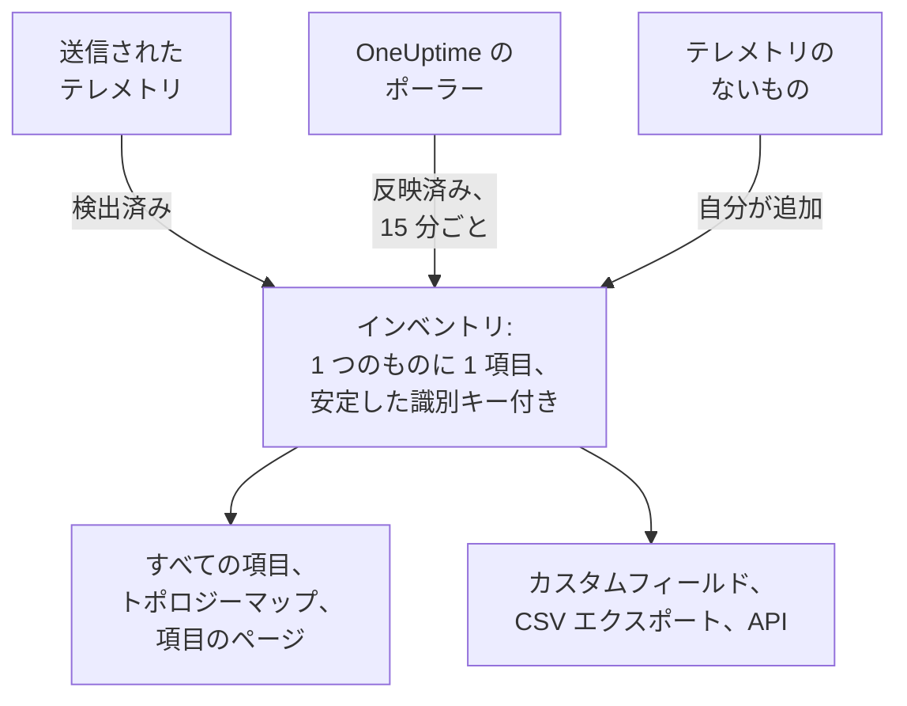

# インベントリの概要

インベントリは、OneUptime があなたの環境について知っているすべてを 1 つにまとめた一覧です。サービス、ホスト、Kubernetes オブジェクト、仮想マシン、ネットワークデバイス、クラウドリソース、IoT デバイス、サーバーレス関数、そしてテレメトリをまったく送らないものまで含まれます。その大半は、OneUptime がすでに監視している内容から自動的に埋まります。あなたが追加するのは、監視ではわからないこと、つまり用途、所有者、保証の期限です。

:::cards
- [項目がインベントリに入る仕組み](#項目がインベントリに入る仕組み): 検出、反映、または自分で追加。
- [ページの見つけ方](#ページの見つけ方): インベントリのページと、各項目のページ。
- [手動で追加する](#手動で追加する): サードパーティの API、外部データベース、アプライアンス。
- [削除せずにアーカイブする](#削除せずにアーカイブする): 一覧を整理して、その状態を保つ方法。
:::

## 項目がインベントリに入る仕組み

OneUptime は監視のためにすでにあなたの環境を見ているので、カタログは誰かが忘れずに入力した内容ではなく、観測した内容から作られます。どの項目にもソースがあり、ソースが項目の持ち主を決めます。つまり、編集できるかどうか、そして自然に消えることがあるかどうかです。

| ソース | API での値 | 取得元 | 残る期間 |
| --- | --- | --- | --- |
| **検出済み** | `discovered` | テレメトリの到着時に読み取られる OpenTelemetry のリソース属性。テレメトリを送るサービス、ホスト、Kubernetes オブジェクト、仮想マシンです。 | バッチごとに改めて登録されます。種類ごとの期間より長く沈黙すると削除されます (下記参照)。 |
| **反映済み** | `inventory` | OneUptime のポーラーが保持するレコード。ネットワークデバイス、クラウドリソース、IoT デバイス、サーバーレス関数、RUM アプリケーション、Docker ホスト、Podman ホストです。15 分ごとにコピーされます。 | 元のレコードがある限り。レコードを削除すると、項目も一緒に消えます。 |
| **自分が追加** | `manual` | OneUptime からは見えないもののために、あなたが追加したもの。サードパーティの API、ベンダーが管理するデータベース、ラックのアプライアンスなどです。 | 削除するまで。期限切れになることはありません。 |

検出済みまたは反映済みの項目は、名前や種類を変えられません。次の処理でソースが変更を上書きしてしまうためです。代わりに、項目の **設定** ページに、変更を残すにはどこで行えばよいかが表示されます。ソースにかかわらず、どの項目にもいつでも追加できるのは、カスタムフィールドの値です。[インベントリのカスタムフィールド](/docs/inventory/custom-fields) を参照してください。

### 沈黙した項目が残る期間

検出済みの項目にはハートビートがあります。テレメトリが届くたびに最終確認時刻が進み、一覧の **ステータス** 列にその新しさが表示されます。反映済みの項目と自分で追加した項目にはハートビートがないため、ステータスは警告にならず空欄のままです。

| ステータス | 意味 |
| --- | --- |
| **ライブ** | 直近 30 分以内に確認されました。 |
| **最近** | 直近一日以内に確認されました。 |
| **古い** | 一日を超えて確認されていません。**沈黙** ページに一覧表示されます。 |

OneUptime は 3 時間ごとに、種類ごとの期間より長く沈黙している検出済みの項目を、アーカイブ済みのものも含めて削除し、そのカスタムフィールドの値も一緒に消えます。反映済みの項目と自分で追加した項目が、この方法で削除されることはありません。

| 項目の種類 | テレメトリがないまま削除されるまでの期間 |
| --- | --- |
| Pod、Deployment、Proxmox ゲスト、VMware 仮想マシン | 1 日 |
| Kubernetes のノードと名前空間、Proxmox ノード、VMware のホスト、クラスター、データストア、そしてトレースが呼び出すデータベースとリモートサービス | 7 日 |
| サービス、ホスト、Kubernetes・Proxmox・Ceph のクラスター、ストレージアレイ、vCenter、Docker Swarm クラスター | 30 日 |

OneUptime が検出した関係は、30 日間再び確認されないと削除されます。

## ページの見つけ方

**製品 → リソース → インベントリ** を開きます。サイドメニューには次のページがあります。**ソース別**、**設定**、**ヘルプ**、**詳細** は最初は折りたたまれています。セクションのタイトルをクリックすると開きます。

| ページ | 内容 |
| --- | --- |
| **概要** | 項目の数、その種類、沈黙した項目の数、最近追加されたもの。 |
| **すべての項目** | すべての項目。名前、説明、識別キーで検索し、種類、ソース、ステータス、カスタムフィールドで絞り込み、手動で項目を追加できます。 |
| **トポロジーマップ** | 項目どうしのつながり。サービス、その呼び出し先、そしてそれらが動くホスト、Pod、デバイスです。 |
| **沈黙** | 一日を超えてテレメトリを送っていない検出済みの項目。 |
| **ソース別** | 一つのソースの項目: **検出済み**、**反映済み**、**自分が追加**。 |
| **設定 → カスタムフィールド** | プロジェクトがすべての項目に持たせるフィールド。 |
| **ヘルプ → ドキュメント** | インベントリの短いガイドと、認識する項目の種類。 |
| **詳細 → アーカイブ済み** | アーカイブした項目。ここからアーカイブを解除できます。 |

項目を開くと、その項目自身のサイドメニューに、**概要** (種類、ソース、ステータス、そして観測されたすべての属性)、**接続**、**カスタムフィールド**、**ログ**、**トレース**、**メトリクス**、**パフォーマンスプロファイル**、**例外**、そして **インシデント**、**アラート**、**定期メンテナンス** があります。**詳細** の下には **設定**、**監査ログ**、**項目を削除** があります。テレメトリのページには、項目自身が送ったものが表示されます。インシデント、アラート、メンテナンスイベントは、その項目が表すサービス、ホスト、Kubernetes クラスターのものです。それ以外の項目では、代わりにどのリソースを見ればよいかがページに表示されます。

### 資産の詳細

ホストとネットワークデバイスには **資産の詳細** カードがあり、どちらも同じ方法で記述されます。ホスト名、IP アドレス、MAC アドレス、シリアル番号、メーカー、モデル、ファームウェアバージョン、オペレーティングシステム、OS バージョン、デバイスの種類、場所です。何も報告されていない情報は **不明** と表示され、カードには不明な情報の埋め方が示されます。

- ホストの情報は、テレメトリのリソース属性から得られます。IP アドレスと MAC アドレス、アーキテクチャ、オペレーティングシステムは最初から、シリアル番号、メーカー、モデル、ファームウェアは付与した時点から得られます。
- ネットワークデバイスの情報は、SNMP ポーリング、ロール、サイトから得られます。ポーリングで読み取れていない情報は、検出から得られます。アドレスの最後のスキャン、ルーターの ARP テーブル、プローブの DNS 解決です。Meraki MX のように ENTITY-MIB を持たないデバイスでも、システムの説明からメーカーとモデルを得られます。IP アドレスがホスト名として表示されることはありません。

カードには、各情報の出どころと時刻が表示されます。ホストのコレクター、ネットワークデバイス自身の SNMP ポーリング、それを読み取った検出スキャンなど、ほとんどの情報に共通する出どころは、情報の下に一度だけ示されます。ルーターの ARP テーブルやデバイスに保存された値など、それ以外の出どころは、その情報の下に示されます。ネットワークデバイスに保存された値が検出で読み取った内容に置き換えられることはなく、両者が異なる場合はカードに両方が表示されます。

同じ情報は **すべての項目** 一覧の列でもあり、有効にするまでは非表示で、CSV エクスポートにも含まれます。キーの一覧は [CMDB へのエクスポート](/docs/inventory/cmdb-sync#資産の詳細) にあります。

### 接続

項目の **接続** ページには、両方向の隣接項目が **呼び出し**、**呼び出し元**、**実行場所**、**関連** にまとめて表示されます。各グループには合計が表示され (接続が 100,000 を超えるグループは「100,000+」と表示)、**さらに表示** で残りをページ送りできるため、混み合ったクラスター、名前空間、ノードでも、最初の数件だけでなくすべての接続が表示されます。このページは時間範囲に制限されません。API から手動で追加した関係や、アーカイブされた隣接項目も含まれます。インベントリにもう存在しない隣接項目は、そのキーで表示されます。

## 手動で追加する

OneUptime が自力では決して見られないものを項目として追加すると、依存関係の行き先が実在のものになり、そのものにカスタムフィールドを持たせられます。

:::steps
### すべての項目を開く

**製品 → リソース → インベントリ** に移動し、**すべての項目** を開きます。

### 項目を追加する

**項目を追加** をクリックします。**種類** を選び、**名前** と、必要なら **説明** を入力します。名前と種類の組み合わせが項目の識別情報になるため、同じ種類の 2 つの項目に同じ名前は付けられません。

### カスタムフィールドを入力する

新しい項目を開きます。ソースは **自分が追加** と表示され、**カスタムフィールド** ページでプロジェクトが管理する値を入力できます。
:::

手動で追加できる種類は 3 つです。

- `external.service` (**外部サービス**): サードパーティの API や SaaS への依存。
- `external.database` (**外部データベース**): OneUptime がモデル化できるサーバーではないデータベース。データベースサーバーは、セルフホストでもマネージドでも、PostgreSQL から Snowflake まで、代わりに **データベース → データベースを作成** で登録します ([データベース](/docs/telemetry/databases))。そのレコードは同じアドレスを示すトレース、コンテナ、エンジンのメトリクスと結び付きますが、インベントリ項目ではそうなりません。同じサーバーを両方の方法で追加すると、結び付かないレコードが 2 つ残ります。
- `appliance` (**アプライアンス**): エージェントのないハードウェアやソフトウェア。

この制限は重複を防ぐためです。ホストのように OneUptime が観測できる種類の項目を手動で作ると、入力した名前でキーが付けられますが、同じマシンの検出済み項目は報告された属性でキーが付けられます。2 つが統合されることはなく、同じホストが一覧にずっと 2 回表示されることになります。

## 削除せずにアーカイブする

アーカイブすると、識別情報、履歴、カスタムフィールドの値を保ったまま、項目を一覧から外せます。これは「確認したので、一覧には要らない」という意思表示です。アーカイブした項目もテレメトリの収集は続きます。

| ソース | アーカイブ | 削除 |
| --- | --- | --- |
| **検出済み** | アーカイブされたままです。 | 次のテレメトリのバッチで戻ってきます。 |
| **反映済み** | アーカイブされたままです。 | 次のコピーで戻ってきます。代わりに元のレコードを削除してください。 |
| **自分が追加** | アーカイブされたままです。 | 完全に消えます。 |

項目をアーカイブするには、**すべての項目** で選択してまとめてアーカイブするか、項目を開いてその **設定** ページの **アーカイブ** カードを使います。アーカイブした項目は **インベントリ → 詳細 → アーカイブ済み** にあり、そこで選択してアーカイブを解除できます。

> [!NOTE]
> 反映済みのデバイスが元のレコードから削除されると、OneUptime はその項目も削除します。ただし、あなたが入力したカスタムフィールドの値が項目にある場合は例外です。その値は唯一のコピーで、元に戻す方法がないため、項目は削除されずにアーカイブされます。入力した内容をすべて残したまま **詳細 → アーカイブ済み** で見つかります。

## 関係とトポロジー

OneUptime は項目を観測しながら、向きのある関係で結び付けます。**インベントリ → トポロジーマップ** がそれを描画し、項目の **接続** ページにはその項目自身の関係が一覧表示されます。 [トポロジー](/docs/telemetry/topology) を参照してください。

| 関係 | 例 |
| --- | --- |
| `runs-on` | Pod はノード上で動きます。仮想マシンはそのホスト上で動きます。 |
| `member-of` | Pod、ノード、名前空間はクラスターのメンバーです。 |
| `hosted-on` | サービスはホスト上でホストされます。 |
| `part-of` | Pod はその Deployment の一部です。 |
| `depends-on` | サービスが別のサービスを呼び出します。両者の間をまたぐスパンから判断されます。 |

## 次のステップ

:::cards
- [インベントリのカスタムフィールド](/docs/inventory/custom-fields): シリアル番号、保証日、所有者、ライフサイクルのステータスを管理します。
- [CMDB へのエクスポート](/docs/inventory/cmdb-sync): カタログを自社の正式な記録システムに取り込みます。
- [データベース](/docs/telemetry/databases): サービスが使うデータベースサーバーを監視します。
:::
