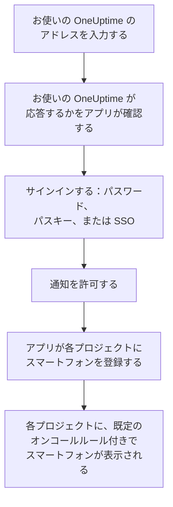
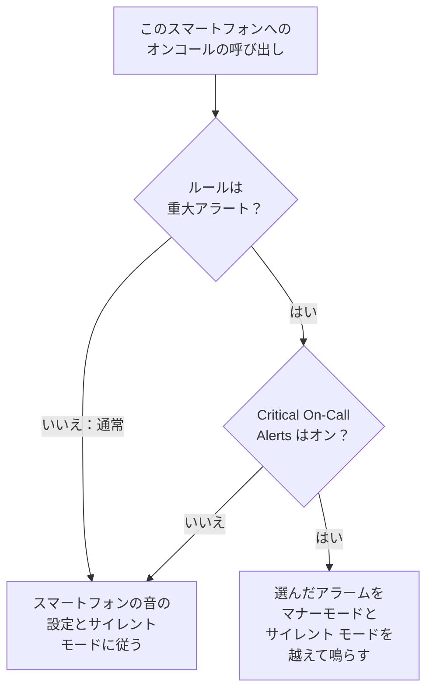

# Android インストール

Android のスマートフォンやタブレットに **OneUptime On-Call** をインストールし、お使いの OneUptime に接続してサインインします。そのあと自分にテスト通知を送り、緊急のオンコールの呼び出しがマナーモードやサイレント モードでも鳴るようにします。

:::cards
- [アプリをインストールする](#アプリをインストールする): Google Play から、または Google Play のないスマートフォンでは APK から。
- [サインインする](#サインインする): お使いの OneUptime のアドレス、次にアカウント。
- [呼び出しがスマートフォンに届くことを確認する](#呼び出しがスマートフォンに届くことを確認する): ダッシュボードでスマートフォンを見つけてテストします。
- [マナーモードでも鳴らす](#マナーモードでも鳴らす): 重大なアラートとアラーム音。
- [トラブルシューティング](#トラブルシューティング): サインイン、通知、インストールの問題。
:::

## 始める前に

- Android 7.0 以降のスマートフォンまたはタブレット。
- OneUptime プロジェクトのアカウント。呼び出しを受けるには、オンコール中である必要もあります。[エスカレーションルール](/docs/on-call/escalation-rules) を参照してください。
- お使いの OneUptime のアドレス。OneUptime Cloud では `https://oneuptime.com`、独自のものなら `https://oneuptime.example.com` のようなアドレスです。アプリは HTTPS でのみ接続します。

## アプリをインストールする

:::tabs
@tab Google Play
1. スマートフォンで [Google Play の OneUptime On-Call](https://play.google.com/store/apps/details?id=com.oneuptime.oncall) を開くか、Google Play で OneUptime On-Call を検索します。
2. **インストール** をタップし、次に **開く** をタップします。

Google Play がアプリを最新の状態に保ちます。
@tab APK
Google Play のないスマートフォン向けです。APK は OneUptime のリリースごとに同じコードからビルドされ、GitHub のリリースに添付されます。

1. スマートフォンで [最新の APK](https://github.com/OneUptime/oneuptime/releases/latest/download/oneuptime-on-call-android-app.apk) を開きます。
2. ダウンロードしたファイルを開きます。Android に尋ねられたら、ブラウザに不明なアプリのインストールを許可してから、**インストール** をタップします。
3. アプリの一覧から OneUptime On-Call を開きます。

APK は自動では更新されません。ときどき最新のものを上書きでインストールしてください。サインインと設定はそのまま残ります。
:::

## サインインする

:::steps
### お使いの OneUptime のアドレスを入力する
アプリを開きます。**Connect your workspace** で、OneUptime Cloud なら `https://oneuptime.com` のまま、それ以外ならお使いの OneUptime のアドレスを入力し、**Connect** をタップします。`https://<your-oneuptime>/api/status` が応答すると、アプリは次に進みます。

### アカウントにサインインする
アカウントのサインイン方法に合わせて、次のいずれかを使います。

- メールアドレスとパスワードを入力して **Sign In**。**Forgot password?** をタップすると、新しいパスワードを設定するためのリンクがメールで届きます。
- ダッシュボードでパスキーを追加済みなら **Sign in with a passkey**。[パスキーを追加する](/docs/introduction/your-account#パスキーを追加する) を参照してください。ブラウザが開いてパスキーを確認し、アプリに戻ります。
- 組織でシングルサインオンを使っている場合は **Sign in with SSO**。プロバイダーを選ぶか、仕事用のメールアドレスを入力して **Continue** をタップします。安全なブラウザが開き、サインインするとアプリに戻ります。

2 要素認証がオンの場合は、認証アプリの 6 桁のコード、またはバックアップコードのいずれかを入力します。セキュリティキーはアプリでは使えません。管理者が 2 要素認証を必須にしていて、まだ設定していない場合は、アプリが先に認証アプリの設定を一緒に行います。

### 通知を許可する
OneUptime On-Call による通知の送信を許可するかを Android が尋ねたら、**許可** をタップします。Android 13 以降では確認が表示され、それより前のバージョンではオフにしない限り許可されています。

続いてアプリが各プロジェクトにスマートフォンを登録します。どのプロジェクトでも、既定のオンコールルール付きでプッシュデバイスの一覧に表示されるため、これ以降は呼び出しがスマートフォンに届きます。
:::

アプリは一度に 1 つのプロジェクトを表示します。切り替えるには、画面上部のプロジェクト名をタップします。シングルサインオンが必須のプロジェクトは、**Settings → Manage Projects** で **Authenticate with SSO** をタップするまで **SSO Required** と表示されます。

## 呼び出しがスマートフォンに届くことを確認する

:::steps
### ダッシュボードでスマートフォンを見つける
ダッシュボードで **ユーザー設定 → 通知方法** を開き、**プッシュ通知** タブを開きます。スマートフォンは **プッシュ通知デバイス** の下に機種名で表示されます。一覧はプロジェクトごとにあります。

### テストを送る
スマートフォンの行で **テスト通知** をクリックします。スマートフォンに通知が届くので、タップしてアプリを開きます。
:::

どの呼び出しをどれだけ早くスマートフォンに送るかは、オンコールルールで決まります。**ユーザー設定 → オンコールルール** を参照してください。新しいスマートフォンには、追加するほかの方法と同じ既定のルールが設定されます。

## マナーモードでも鳴らす

既定では、オンコールの呼び出しはスマートフォンのサウンド設定に従います。マナーモードのスマートフォンは鳴らず、サイレント モードは呼び出しを保留します。重大なアラートを使うと、オンコールの呼び出しがその両方を越えて鳴ります。重大なアラートは、スマートフォンごとにオンにするまでオフです。

:::steps
### Critical On-Call Alerts をオンにする
アプリで **Settings** を開き、**Notifications** の下の **Critical On-Call Alerts** をオンにします。

### サイレント モードへのアクセスを許可する
Android の **サイレント モードへのアクセス** の一覧が開きます。OneUptime On-Call のアクセスをオンにしてからアプリに戻ると、アプリがアクセスを確認し、呼び出しが鳴るかどうかをスイッチの下に表示します。

### アラーム音を選ぶ
スイッチの下の **Alarm sound** をタップします。スマートフォン自身の音のほかに、Klaxon、Siren、Digital alarm、Smoke alarm、そして小さな音で始まりだんだん大きくなる Rising alarm から選べます。音の横の再生ボタンを押すと試聴できます。重大な呼び出しはスマートフォンのアラームの音量で鳴るので、音量を上げたままにしておいてください。
:::

鳴らすのはオンコールの呼び出しだけで、しかも既定の **重大アラート** に設定されたオンコールルールからのものだけです。**通常** に設定したルールは、スイッチに関係なくスマートフォンの設定に従います。そのため、重大なインシデントでは起こされ、軽微なものは静かに知らされるようにできます。スマートフォンを消音した状態で **テスト通知** を送ると、呼び出しがどう鳴るかを確かめられます。

## 呼び出しが遅れて届かないようにする

OneUptime はオンコールの呼び出しを高い優先度で送信し、Android は何時間も操作されていないスマートフォンにもそれを届けます。ただし、アプリのバッテリー使用を制限しているスマートフォンでは、それでも保留されることがあります。

- **設定 → アプリ → OneUptime On-Call → バッテリー** を開き、**制限なし** を選びます。機種によっては **アプリのバッテリー使用量** という名前です。
- **設定 → アプリ → OneUptime On-Call → 通知** で、アプリの通知がオンになっていることを確認します。
- スマートフォンのバッテリーセーバーやスリープ中のアプリの一覧に、OneUptime On-Call を入れないでください。

## アプリをロックする

アプリの **Settings** で **Biometrics Login** をオンにすると、起動のたびに指紋、顔、またはスマートフォンの画面ロックを求めます。このスイッチは、スマートフォンに指紋認証か顔認証が設定されていると表示されます。同じ画面の **Appearance** では、ライトまたはダークの外観を選ぶか、スマートフォンの設定に合わせます。

## 更新、サインアウト、アンインストール

- **更新。** Google Play がアプリを更新します。APK の場合は、最新のものを上書きでインストールします。アプリのバージョンは **Settings** 画面の一番下に表示されます。
- **サインアウト。** **Settings → Log Out** でサインアウトすると、すべてのプロジェクトのプッシュデバイスから、スマートフォンがそのオンコールルールとともに削除されます。もう一度サインインすると、既定のルールで追加し直されます。
- **アンインストール。** ほかのアプリと同じように削除します。サインインしたままだった場合、スマートフォンへのプッシュが失敗するまで一覧に残り、その時点で OneUptime が **通知を受信していません** とマークします。その項目は **削除** で削除してください。アプリを再インストールしてサインインすると、スマートフォンは既定のルールで新しい項目として追加されます。

## トラブルシューティング

:::details 「Could not connect to the server」
アプリが `https://<your-oneuptime>/api/status` に接続できませんでした。`https://` を含めてアドレスを確認してください。お使いの OneUptime がプライベートネットワーク上にある場合は、VPN などで先にスマートフォンをそのネットワークに接続します。そのアドレスをスマートフォンのブラウザで開くと、スマートフォンが OneUptime に到達できる場合は `{"status":"ok"}` と表示されます。
:::

:::details 通知が届かない
- Android の設定でアプリの通知がオンになっていること、サイレント モードがオフか重大なアラートがオンになっていることを確認します。
- **ユーザー設定 → 通知方法** の **プッシュ通知** にスマートフォンが表示されていることを確認し、**テスト通知** を送ります。
- スマートフォンに **通知を受信していません** と表示されている場合は、サインインした状態でアプリを開きます。アプリがスマートフォンを再登録します。[スマートフォンの再登録が必要になるとき](/docs/mobile-desktop-apps/faq-troubleshooting#スマートフォンの再登録が必要になるとき) を参照してください。
- **ユーザー設定 → オンコールルール** でオンコールルールを確認します。
- セルフホストの OneUptime では、サーバーがプッシュリレーに到達できることを確認します。[プッシュ通知](/docs/self-hosted/push-notifications#ネットワークアクセス) を参照してください。
:::

:::details サイレント モード中に重大なアラートが鳴らない
アプリの **Settings** を開きます。**Critical On-Call Alerts** の下の行に、何が足りないかが表示されます。たいていはサイレント モードへのアクセスが許可されていません。**設定 → 通知 → サイレント モードへのアクセス** で許可してから、アプリに戻ります。アラーム音を選んだ場合は、その音の通知チャンネルにもサイレント モードを上書きする許可が必要です。
:::

:::details APK のインストール時に「アプリはインストールされていません」と表示される
OneUptime On-Call が Google Play など別の入手元からすでにインストールされており、Android は一方の上にもう一方をインストールしません。アンインストールしてから APK をインストールし、もう一度サインインします。
:::

:::details Biometrics Login スイッチがない
このスイッチは、Android の設定で指紋認証か顔認証を設定すると表示されます。
:::

## 次のステップ

:::cards
- [FAQ とトラブルシューティング](/docs/mobile-desktop-apps/faq-troubleshooting): スマートフォンに呼び出しが届かなくなったときの対処。
- [iOS インストール](/docs/mobile-desktop-apps/ios-installation): iPhone や iPad で同じアプリを使います。
- [エスカレーションルール](/docs/on-call/escalation-rules): 誰をいつ呼び出すかを決めます。
- [プッシュ通知](/docs/self-hosted/push-notifications): セルフホストの OneUptime がスマートフォンに呼び出しを送るしくみ。
:::
