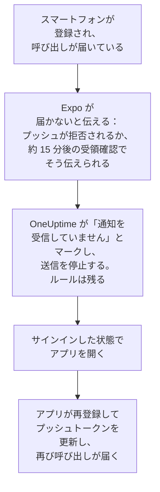

# FAQ とトラブルシューティング

OneUptime のモバイルアプリとデスクトップアプリについてのよくある質問への回答と、よく起こる問題の解決策です。サインイン、届かない通知、再登録が必要になったスマートフォンを扱います。

:::cards
- [モバイルアプリについての質問](#モバイルアプリについての質問): デバイス、プロジェクト、セルフホスト、セキュリティ。
- [デスクトップアプリについての質問](#デスクトップアプリについての質問): デスクトップアプリとは何か、何ができないか。
- [スマートフォンの再登録が必要になるとき](#スマートフォンの再登録が必要になるとき): スマートフォンに呼び出しが届かなくなる理由と、復帰させる方法。
- [トラブルシューティング](#トラブルシューティング): サインイン、通知、インストールの問題。
:::

## モバイルアプリについての質問

:::details アプリは無料ですか？
はい。OneUptime On-Call は、App Store、Google Play、GitHub の APK で無料で提供されています。OneUptime のアカウントでサインインします。
:::

:::details どのスマートフォンやタブレットで動作しますか？
iOS または iPadOS 16.4 以降の iPhone と iPad、Android 7.0 以降の Android スマートフォンとタブレットです。
:::

:::details セルフホストの OneUptime でも使えますか？
はい。アプリの起動時にお使いの OneUptime の `https://` アドレスを入力するか、サインイン画面で **Change Server** をタップします。既定では、サーバーは OneUptime のプッシュリレーを通じてスマートフォンに呼び出しを送るため、Apple、Google、Expo のアカウントは不要です。[プッシュ通知](/docs/self-hosted/push-notifications) を参照してください。
:::

:::details 複数のプロジェクトで使えますか？
はい。アプリはあなたがメンバーになっているすべてのプロジェクトにスマートフォンを登録するため、どのプロジェクトからも呼び出しを受けられます。表示するのは一度に 1 つのプロジェクトです。切り替えるには、画面上部のプロジェクト名をタップします。
:::

:::details 複数のスマートフォンでサインインできますか？
はい。スマートフォンやタブレットはそれぞれ独立したプッシュデバイスで、独自のオンコールルールと独自の重大なアラートの設定を持ちます。
:::

:::details アプリで何ができますか？
- **Home**: プロジェクトで対応が必要なもの。進行中のインシデントとアラート、ロールで閲覧できる場合は開いているセキュリティケース、問題のあるモニター、グループ化されたイベント。
- **Monitors**: すべてのモニター。状態で絞り込め、それぞれの詳細も見られます。
- **Inbox**: インシデントとアラート、それらをまとめるエピソード。1 つ開いて **Acknowledge**、**Resolve**、**Add Note** を使います。ロールでプロジェクトのセキュリティケースを閲覧できる場合は、**Security** に開いているケースが並びます。1 つ開いて、承認待ちのプレイブックのステップに **Approve** または **Reject** を使うか、**Assign to me** でケースを引き受けるか、**Close case** を使います。
- **On-Call**: あなたがオンコール中かどうかといつまでか、ほかに誰がオンコール中か、あなたに送られた呼び出し、そしてしばらくの間あなたの呼び出しをチームメイトに任せる **Cover for me**。
- **Settings**: プロジェクトとシングルサインオン、外観、重大なアラートとアラーム音、**Biometrics Login**、オンコールのカレンダーフィード、**Log Out**。

それ以外はすべてダッシュボードにあります。
:::

:::details 通知から呼び出しを確認できますか？
いいえ。通知をタップすると、アプリが該当するインシデント、アラート、エピソード、セキュリティケースを正しいプロジェクトで開くので、そこで確認します。アプリがロックされているかサインアウトしている場合は、中に入ったときにその呼び出しを開きます。
:::

:::details スマートフォンでのサインインは安全ですか？
アプリはお使いの OneUptime と HTTPS でのみ通信します。サインイン情報はスマートフォン上のアプリ専用のストレージに保存され、**Log Out** はそれを削除して、サーバー上のセッションもサインアウトします。**Biometrics Login** をオンにすると、起動のたびに顔、指紋、またはパスコードを求めます。
:::

:::details アプリはオフラインで動作しますか？
いいえ。接続がない間は画面上部に **No internet connection** と表示され、接続が戻ると再開します。
:::

## デスクトップアプリについての質問

:::details デスクトップアプリとは何ですか？
ブラウザからアプリとしてインストールした OneUptime のダッシュボードです。専用のウィンドウ、スタートメニューや Dock やランチャーのアイコン、そして通知を備えています。ダッシュボードそのものなので、ダッシュボードでできることはすべてできます。
:::

:::details なぜアプリストアにないのですか？
その必要がないからです。アプリは開くたびにお使いの OneUptime からダッシュボードを読み込むため、Windows、macOS、Linux のどれでも、常にお使いの OneUptime と同じバージョンで、更新するものはありません。
:::

:::details スマートフォンのように起こしてくれますか？
いいえ。ブラウザはおやすみモードや集中モードを上書きできないため、デスクトップの通知はコンピューターが許す音量でしか鳴りません。必ず起きなければならない呼び出しには、重大なアラートを有効にしたモバイルアプリを使ってください。
:::

:::details オフラインで動作しますか？
いいえ。ブラウザのタブで開いたダッシュボードと同じく、お使いの OneUptime への接続が必要です。
:::

## スマートフォンの再登録が必要になるとき

OneUptime はスマートフォンへの呼び出しを Expo 経由で送り、Expo がそれを Apple または Google に渡します。スマートフォンにもう届かないと Expo が伝えると、アプリがスマートフォンを再登録するまで、OneUptime はそのスマートフォンへの送信を停止します。

Expo がスマートフォンを届かないと伝えるのは、スマートフォンからアプリが削除されたとき、またはそのプッシュトークンが無効になったときです。スマートフォンは削除されません。**ユーザー設定 → 通知方法** の **プッシュ通知** タブに **通知を受信していません** と表示され、届かなかった呼び出しのオンコールのタイムラインにその理由が示されます。あなたのほかのスマートフォンや通知方法には、通常どおり呼び出しが届きます。

アプリは、起動するたび、サインインしたとき、アプリに戻ったときにスマートフォンを登録します (最大で 5 分に 1 回)。登録のたびに Expo からプッシュトークンを取得し直すことでトークンが更新され、スマートフォンは以前のルールのまま再び呼び出しを受け取ります。

| 起きたこと | すること | OneUptime の動作 |
| --- | --- | --- |
| アプリがまだインストールされている | サインインした状態で開く | スマートフォンがルールのまま再び通知を受け取る |
| iPhone や iPad でアプリを再インストールした | インストールしてサインインする | たいてい同じ項目がルールごと戻る |
| Android でアプリを再インストールした | インストールしてサインインし、古い項目を削除する | 既定のルールで新しい項目ができる。古い項目はマークされたまま |
| 古いスマートフォンのバックアップから設定した新しいスマートフォン | 新しいスマートフォンでアプリを開く | 古いスマートフォンの項目がマークされていれば、新しいスマートフォンがルールごと引き継ぐ。そうでなければ、新しいスマートフォンに専用の項目ができる |
| 何もない状態から設定した新しいスマートフォン | サインインして、古い項目を削除する | 既定のルールで新しい項目ができる |
| アプリからサインアウトした | もう一度サインインする | サインアウトでスマートフォンとそのルールが削除された。既定のルールで戻る |

ブラウザも、プッシュサブスクリプションの期限が切れると通知を受け取らなくなることがあります。ダッシュボードは可能なときにそれを更新します。ブラウザがマークされたままの場合は、そのブラウザで **デバイスを登録** を使ってもう一度登録します。

## トラブルシューティング

### サインイン

:::details 「Could not connect to the server」
アプリが `https://<your-oneuptime>/api/status` に接続できませんでした。`https://` を含めてアドレスを確認してください。アプリは通常の HTTP では接続しません。お使いの OneUptime がプライベートネットワーク上にある場合は、VPN などで先にスマートフォンをそのネットワークに接続します。スマートフォンが OneUptime に到達できる場合、そのアドレスをスマートフォンのブラウザで開くと `{"status":"ok"}` と表示されます。
:::

:::details 「No SSO configuration found for the email」
そのメールアドレスが属するどのプロジェクトにもシングルサインオンが設定されていないか、そのメールアドレスのアカウントがこの OneUptime にありません。メールアドレスを確認するか、パスワードでサインインしてください。管理者がインストール全体に設定したプロバイダーは、メールアドレスの入力欄の前に表示されます。
:::

:::details 2 番目の要素がセキュリティキーしかない
アプリはセキュリティキーを使えません。バックアップコードのいずれかでサインインするか、ダッシュボードでアカウントに認証アプリを追加してください。[2 要素認証をオンにする](/docs/introduction/your-account#2-要素認証をオンにする) を参照してください。
:::

:::details パスキーでのサインインに失敗する
パスキーを使うには、お使いの OneUptime のアドレスが `https://` で始まり、この OneUptime 用に追加したパスキーがあることが必要です。[パスキーを追加する](/docs/introduction/your-account#パスキーを追加する) を参照してください。別のサーバーを使うには、サインイン画面で **Change Server** をタップします。
:::

### 通知

:::details スマートフォンに通知が届かない
- スマートフォンが OneUptime On-Call からの通知を許可していること、おやすみモードや集中モードが通知を保留していないことを確認します。
- **ユーザー設定 → 通知方法** の **プッシュ通知** タブで、スマートフォンが一覧にあることを確認し、**テスト通知** を送ります。
- **通知を受信していません** と表示されている場合は、サインインした状態でアプリを開きます。[スマートフォンの再登録が必要になるとき](#スマートフォンの再登録が必要になるとき) を参照してください。
- **ユーザー設定 → オンコールルール** でオンコールルールを確認します。どの呼び出しがどの方法に届くかは、ルールで決まります。
- セルフホストの OneUptime では、サーバーがプッシュリレーに到達できることを確認します。[プッシュ通知](/docs/self-hosted/push-notifications#ネットワークアクセス) を参照してください。
:::

:::details Android で呼び出しが遅れて届く
Android の OneUptime On-Call の設定でバッテリー使用を **制限なし** にし、バッテリーセーバーの一覧にアプリを入れないでください。[呼び出しが遅れて届かないようにする](/docs/mobile-desktop-apps/android-installation#呼び出しが遅れて届かないようにする) を参照してください。
:::

:::details 重大なアラートがサイレントモードで鳴らない
アプリの **Settings** を開きます。**Critical On-Call Alerts** の下の行に、そのスマートフォンで何が足りないかが表示されます。次に、呼び出しを送ったオンコールルールが **通常** ではなく **重大アラート** に設定されていることを、**ユーザー設定 → オンコールルール** で確認します。スイッチはスマートフォンごとにあります。
:::

### デスクトップアプリ

:::details アドレスバーにインストールアイコンがない
サインイン後のダッシュボードのページから、`https://` で、Edge または Chrome、または macOS Sonoma 14 以降の Safari でインストールしてください。アイコンが表示されない場合は、ブラウザのメニューからもインストールできます。[Windows インストール](/docs/mobile-desktop-apps/windows-installation#アプリをインストールする) を参照してください。
:::

:::details デスクトップに通知が届かない
**ユーザー設定 → 通知方法** の **プッシュ通知** タブで **デバイスを登録** を使ってブラウザを登録し、尋ねられたら通知を許可して、コンピューター自体の通知設定を確認します。セルフホストの OneUptime では、ブラウザ通知に VAPID キーが必要です。
:::

## サポートを受ける

ここでの説明が実際の表示と異なる場合は、アプリのバージョン (**Settings** 画面の一番下) と使用しているプラットフォームを添えて、[GitHub で issue を作成](https://github.com/OneUptime/oneuptime/issues) してください。

## 次のステップ

:::cards
- [アプリの概要](/docs/mobile-desktop-apps/index): どのアプリを使うか、アプリが OneUptime に接続するしくみ。
- [Android インストール](/docs/mobile-desktop-apps/android-installation): Android でアプリをインストールして設定します。
- [iOS インストール](/docs/mobile-desktop-apps/ios-installation): iPhone や iPad でアプリをインストールして設定します。
- [プッシュ通知](/docs/self-hosted/push-notifications): セルフホストの OneUptime が呼び出しを送るしくみと、Expo のエラー。
:::
