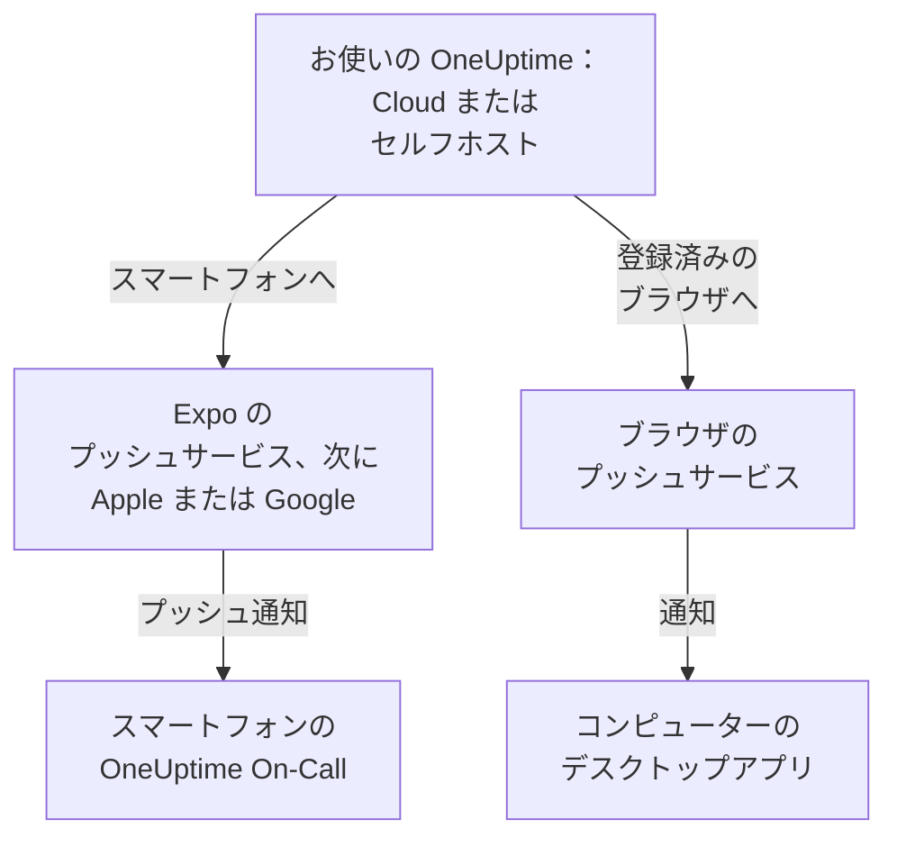

# アプリの概要

OneUptime には、スマートフォン用のアプリとコンピューター用のアプリがあります。iPhone、iPad、Android 用の **OneUptime On-Call** は、オンコール中にあなたを呼び出し、どこにいてもインシデントを確認して解決できるようにします。Windows、macOS、Linux では、OneUptime のダッシュボードをブラウザからデスクトップアプリとしてインストールでき、専用のウィンドウで開きます。どちらも OneUptime Cloud とセルフホストの OneUptime で動作します。

:::cards
- [アプリを選ぶ](#アプリを選ぶ): それぞれのアプリでできることを並べて比べます。
- [アプリが OneUptime に接続するしくみ](#アプリが-oneuptime-に接続するしくみ): サインインとオンコールの呼び出しがたどる経路。
- [モバイルアプリを入手する](#モバイルアプリを入手する): App Store、Google Play、または GitHub から。
- [デスクトップアプリを入手する](#デスクトップアプリを入手する): Edge、Chrome、または Safari からダッシュボードをインストールします。
:::

## アプリを選ぶ

|  | モバイルアプリ | デスクトップアプリ |
| --- | --- | --- |
| 概要 | OneUptime On-Call。iPhone、iPad、Android 用のネイティブアプリ | ブラウザからインストールした OneUptime のダッシュボード |
| 入手先 | App Store、Google Play、または GitHub の APK | お使いの OneUptime。ダウンロードは不要 |
| オンコールの呼び出し | サイレントモードやおやすみモードでも鳴らせるプッシュ通知 | ブラウザを登録した後のブラウザ通知 |
| できること | インシデント、アラート、セキュリティケース、モニター、オンコール中の人の表示。確認、解決、プレイブックのステップの承認、メモの追加 | ダッシュボードでできることすべて |
| 更新 | ストアから、または新しい APK をインストールして | 開くたびにお使いの OneUptime からダッシュボードを読み込む |
| 対応環境 | iOS 16.4 以降、Android 7.0 以降 | Windows、macOS、Linux の Edge または Chrome、または macOS Sonoma 14 以降の Safari |

両方を使うこともできます。仕事中はデスクトップアプリを開いておき、夜はスマートフォンに起こしてもらいましょう。

## アプリが OneUptime に接続するしくみ

モバイルアプリはお使いの OneUptime にサインインし、あなたがメンバーになっている各プロジェクトにスマートフォンを登録します。それ以降、OneUptime はオンコールの呼び出しを含むスマートフォンのプッシュ通知を Expo のプッシュサービス経由で送信し、Expo がそれを Apple または Google に渡して配信します。セルフホストの OneUptime は、既定では OneUptime のプッシュリレーを通じて送信するため、Apple、Google、Expo の独自のアカウントは不要です。[プッシュ通知](/docs/self-hosted/push-notifications) を参照してください。

デスクトップアプリは、専用のウィンドウで開くダッシュボードそのものです。そのブラウザをプッシュ通知用に登録すると、通知を表示します。登録の方法は Windows、macOS、Linux の各ページで説明しています。

## 始める前に

- OneUptime プロジェクトのアカウント。呼び出しを受けるには、オンコール中である必要もあります。[エスカレーションルール](/docs/on-call/escalation-rules) を参照してください。
- お使いの OneUptime のアドレス。OneUptime Cloud では `https://oneuptime.com`、セルフホストの OneUptime では `https://oneuptime.example.com` のような独自のアドレスです。
- HTTPS で提供されている OneUptime。モバイルアプリは通常の HTTP では接続しません。また、ブラウザが通知を表示し、Edge や Chrome がアプリをインストールできるのも HTTPS のサイトだけです。

## モバイルアプリを入手する

:::steps
### OneUptime On-Call をインストールする
iPhone や iPad では [App Store](https://apps.apple.com/us/app/oneuptime-on-call/id6759615391) から、Android では [Google Play](https://play.google.com/store/apps/details?id=com.oneuptime.oncall) から入手します。Google Play のない Android スマートフォンには、代わりに [APK](https://github.com/OneUptime/oneuptime/releases/latest/download/oneuptime-on-call-android-app.apk) をインストールします。同じリンクは、ダッシュボードの **プロジェクト設定 → 通知 → モバイルアプリ** にもあります。

### お使いの OneUptime に接続する
アプリを開き、OneUptime Cloud なら `https://oneuptime.com` のまま、それ以外ならお使いの OneUptime のアドレスを入力して、パスワード、パスキー、またはシングルサインオンでサインインします。

### 通知を許可する
スマートフォンに尋ねられたら許可します。アプリが各プロジェクトにスマートフォンを登録し、オンコールの呼び出しが届くようになります。
:::

各手順の詳細と、その後に確認することは、[Android インストール](/docs/mobile-desktop-apps/android-installation) と [iOS インストール](/docs/mobile-desktop-apps/ios-installation) を参照してください。

## デスクトップアプリを入手する

:::steps
### ダッシュボードを開く
Microsoft Edge か Google Chrome、Mac では Safari でも、お使いの OneUptime にサインインします。

### インストールする
Edge や Chrome では、アドレスバーの右端にあるインストールアイコンをクリックします。Safari では **ファイル → Dockに追加** を選択します。

### ほかのアプリと同じように開く
スタートメニュー、Dock、またはアプリランチャーから、専用のウィンドウで開きます。
:::

ブラウザごとの手順は、[Windows インストール](/docs/mobile-desktop-apps/windows-installation)、[macOS インストール](/docs/mobile-desktop-apps/macos-installation)、[Linux インストール](/docs/mobile-desktop-apps/linux-installation) を参照してください。

## 次のステップ

:::cards
- [Android インストール](/docs/mobile-desktop-apps/android-installation): Android にアプリをインストールしてサインインし、呼び出しが届くことを確認します。
- [iOS インストール](/docs/mobile-desktop-apps/ios-installation): iPhone や iPad にアプリをインストールし、重大なアラートをオンにします。
- [Windows インストール](/docs/mobile-desktop-apps/windows-installation): Edge または Chrome からダッシュボードをインストールします。
- [macOS インストール](/docs/mobile-desktop-apps/macos-installation): Safari、Chrome、または Edge からダッシュボードを Dock に追加します。
- [Linux インストール](/docs/mobile-desktop-apps/linux-installation): Chrome、Chromium、または Edge からダッシュボードをインストールします。
- [FAQ とトラブルシューティング](/docs/mobile-desktop-apps/faq-troubleshooting): よくある質問への回答、解決策、スマートフォンに呼び出しが届かなくなったときの対処。
:::
