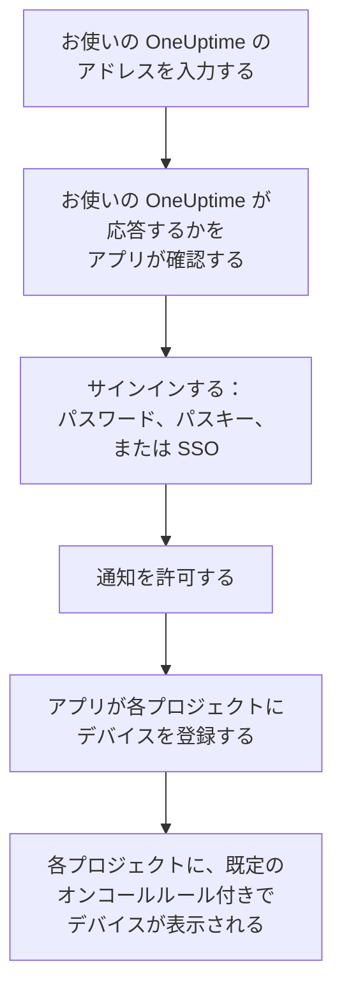
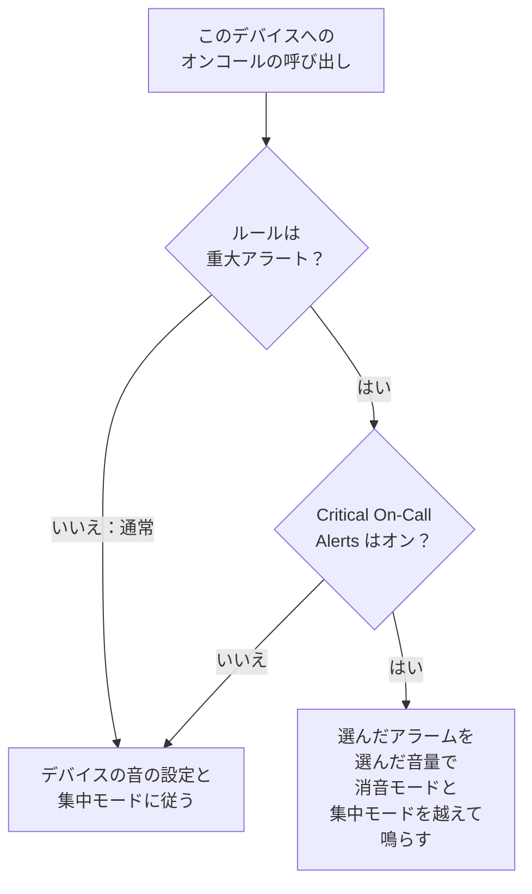

# iOS インストール

App Store から iPhone や iPad に **OneUptime On-Call** をインストールし、お使いの OneUptime に接続してサインインします。そのあと自分にテスト通知を送り、緊急のオンコールの呼び出しが消音モードや集中モードでも鳴るようにします。

:::cards
- [アプリをインストールする](#アプリをインストールする): App Store から。
- [サインインする](#サインインする): お使いの OneUptime のアドレス、次にアカウント。
- [呼び出しがデバイスに届くことを確認する](#呼び出しがデバイスに届くことを確認する): ダッシュボードでデバイスを見つけてテストします。
- [消音モードでも鳴らす](#消音モードでも鳴らす): 重大なアラート、アラーム音とその音量。
- [トラブルシューティング](#トラブルシューティング): サインイン、通知、重大なアラートの問題。
:::

## 始める前に

- iOS 16.4 以降の iPhone、または iPadOS 16.4 以降の iPad。
- OneUptime プロジェクトのアカウント。呼び出しを受けるには、オンコール中である必要もあります。[エスカレーションルール](/docs/on-call/escalation-rules) を参照してください。
- お使いの OneUptime のアドレス。OneUptime Cloud では `https://oneuptime.com`、独自のものなら `https://oneuptime.example.com` のようなアドレスです。アプリは HTTPS でのみ接続します。

## アプリをインストールする

1. iPhone や iPad で [App Store の OneUptime On-Call](https://apps.apple.com/us/app/oneuptime-on-call/id6759615391) を開くか、App Store で OneUptime On-Call を検索します。
2. **入手** をタップし、Face ID、Touch ID、または Apple アカウントのパスワードで確定します。
3. **開く** をタップするか、ホーム画面から OneUptime On-Call を開きます。

**設定 → App Store** の **Appのアップデート** がオンなら、App Store がアプリを最新の状態に保ちます。

## サインインする

:::steps
### お使いの OneUptime のアドレスを入力する
アプリを開きます。**Connect your workspace** で、OneUptime Cloud なら `https://oneuptime.com` のまま、それ以外ならお使いの OneUptime のアドレスを入力し、**Connect** をタップします。`https://<your-oneuptime>/api/status` が応答すると、アプリは次に進みます。

### アカウントにサインインする
アカウントのサインイン方法に合わせて、次のいずれかを使います。

- メールアドレスとパスワードを入力して **Sign In**。**Forgot password?** をタップすると、新しいパスワードを設定するためのリンクがメールで届きます。
- 組織でシングルサインオンを使っている場合は **Sign in with SSO**。プロバイダーを選ぶか、仕事用のメールアドレスを入力して **Continue** をタップします。安全なブラウザが開き、サインインするとアプリに戻ります。
- ダッシュボードでパスキーを追加済みなら **Sign in with a passkey**。[パスキーを追加する](/docs/introduction/your-account#パスキーを追加する) を参照してください。ブラウザのシートが開いてパスキーを確認し、アプリに戻ります。

2 要素認証がオンの場合は、認証アプリの 6 桁のコード、またはバックアップコードのいずれかを入力します。セキュリティキーはアプリでは使えません。管理者が 2 要素認証を必須にしていて、まだ設定していない場合は、アプリが先に認証アプリの設定を一緒に行います。

### 通知を許可する
OneUptime On-Call による通知の送信を許可するかを iOS が尋ねたら、**許可** をタップします。

続いてアプリが各プロジェクトに iPhone や iPad を登録します。どのプロジェクトでも、既定のオンコールルール付きでプッシュデバイスの一覧に表示されるため、これ以降は呼び出しがデバイスに届きます。
:::

アプリは一度に 1 つのプロジェクトを表示します。切り替えるには、画面上部のプロジェクト名をタップします。シングルサインオンが必須のプロジェクトは、**Settings → Manage Projects** で **Authenticate with SSO** をタップするまで **SSO Required** と表示されます。

## 呼び出しがデバイスに届くことを確認する

:::steps
### ダッシュボードでデバイスを見つける
ダッシュボードで **ユーザー設定 → 通知方法** を開き、**プッシュ通知** タブを開きます。iPhone や iPad は **プッシュ通知デバイス** の下に機種名で表示されます。一覧はプロジェクトごとにあります。

### テストを送る
デバイスの行で **テスト通知** をクリックします。デバイスに通知が届くので、タップしてアプリを開きます。
:::

どの呼び出しをどれだけ早くデバイスに送るかは、オンコールルールで決まります。**ユーザー設定 → オンコールルール** を参照してください。新しいデバイスには、追加するほかの方法と同じ既定のルールが設定されます。

## 消音モードでも鳴らす

既定では、オンコールの呼び出しはデバイスのサウンド設定に従います。消音モードでは鳴らず、おやすみモードなどの集中モードは呼び出しを保留します。重大なアラートを使うと、オンコールの呼び出しがその両方を越えて鳴ります。重大なアラートは、デバイスごとにオンにするまでオフです。

:::steps
### Critical On-Call Alerts をオンにする
アプリで **Settings** を開き、**Notifications** の下の **Critical On-Call Alerts** をオンにします。

### 重大なアラートを許可する
OneUptime On-Call による重大な通知の送信を許可するかを iOS が尋ねたら、**許可** をタップします。すると iOS は **設定 → 通知 → OneUptime On-Call** にアプリの **重大な通知** スイッチを追加し、あとからそこで変更できます。アプリのスイッチの下の行に、呼び出しが鳴るかどうかが表示されます。

### アラーム音とその音量を選ぶ
スイッチの下の **Alarm sound** をタップします。デバイス自身の重大な通知の音のほかに、Klaxon、Siren、Digital alarm、Smoke alarm、そして小さな音で始まりだんだん大きくなる Rising alarm から選べます。音の横の再生ボタンを押すと試聴できます。次に、呼び出しを鳴らす音量を 25%、50%、75%、100% (既定) から選びます。
:::

鳴らすのはオンコールの呼び出しだけで、しかも既定の **重大アラート** に設定されたオンコールルールからのものだけです。**通常** に設定したルールは、スイッチに関係なくデバイスの設定に従います。そのため、重大なインシデントでは起こされ、軽微なものは静かに知らされるようにできます。デバイスを消音モードにした状態で **テスト通知** を送ると、呼び出しがどう鳴るかを確かめられます。**Alarm sound** 画面の試聴は着信音の音量で鳴り、消音モードではまったく鳴りません。本物の呼び出しは、選んだ音量で消音モードを越えて鳴ります。

> [!NOTE]
> 重大なアラートには、App Store の OneUptime On-Call 1.5.0 以降が必要です。それより前のバージョンは Apple の重大なアラートの許可なしでビルドされていたため、iOS がスイッチを表示することはありませんでした。

## 呼び出しが保留されないようにする

重大なアラートを使わない場合、集中モードや要約によって呼び出しが保留されることがあります。

- **集中モード。** **設定 → 集中モード** で、各集中モードが許可するアプリに OneUptime On-Call を追加します。
- **時刻指定要約。** **設定 → 通知 → 時刻指定要約** で、OneUptime On-Call を含めないでください。要約に入った通知は、要約の次の時刻まで待たされます。
- **通知。** **設定 → 通知 → OneUptime On-Call** で、**通知を許可** をオンのままにします。

## アプリをロックする

アプリの **Settings** で **Biometrics Login** をオンにすると、起動のたびに Face ID、Touch ID、またはパスコードを求めます。このスイッチは、デバイスに Face ID か Touch ID が設定されていると表示されます。同じ画面の **Appearance** では、ライトまたはダークの外観を選ぶか、デバイスの設定に合わせます。

## 更新、サインアウト、アプリの削除

- **更新。** App Store がアプリを更新します。App Store のアカウントから手動で更新することもできます。アプリのバージョンは **Settings** 画面の一番下に表示されます。
- **サインアウト。** **Settings → Log Out** でサインアウトすると、すべてのプロジェクトのプッシュデバイスから、デバイスがそのオンコールルールとともに削除されます。もう一度サインインすると、既定のルールで追加し直されます。
- **削除。** アプリのアイコンを長押しし、**Appを削除** をタップしてから、もう一度 **Appを削除** をタップします。サインインしたままだった場合、デバイスへのプッシュが失敗するまで一覧に残り、その時点で OneUptime が **通知を受信していません** とマークします。アプリを再インストールしてサインインすると、たいていはその項目がルールごと戻ります。デバイスを使わなくなった場合は、**削除** で項目を削除してください。

## トラブルシューティング

:::details 「Could not connect to the server」
アプリが `https://<your-oneuptime>/api/status` に接続できませんでした。`https://` を含めてアドレスを確認してください。お使いの OneUptime がプライベートネットワーク上にある場合は、VPN などで先にデバイスをそのネットワークに接続します。そのアドレスをデバイスの Safari で開くと、デバイスが OneUptime に到達できる場合は `{"status":"ok"}` と表示されます。
:::

:::details 通知が届かない
- **設定 → 通知 → OneUptime On-Call** で **通知を許可** がオンになっていること、集中モードが呼び出しを保留していないことを確認します。
- **ユーザー設定 → 通知方法** の **プッシュ通知** にデバイスが表示されていることを確認し、**テスト通知** を送ります。
- デバイスに **通知を受信していません** と表示されている場合は、サインインした状態でアプリを開きます。アプリがデバイスを再登録します。[スマートフォンの再登録が必要になるとき](/docs/mobile-desktop-apps/faq-troubleshooting#スマートフォンの再登録が必要になるとき) を参照してください。
- **ユーザー設定 → オンコールルール** でオンコールルールを確認します。
- セルフホストの OneUptime では、サーバーがプッシュリレーに到達できることを確認します。[プッシュ通知](/docs/self-hosted/push-notifications#ネットワークアクセス) を参照してください。
:::

:::details iOS の設定に重大な通知のスイッチがない
先にアプリで **Critical On-Call Alerts** をオンにしてください。iOS がスイッチを追加するのは、アプリが重大なアラートを求めた後だけです。このバージョンでは重大なアラートを受け取れないとアプリに表示される場合は、App Store から OneUptime On-Call を更新します。
:::

:::details 重大なアラートが鳴らない
アプリの **Settings** を開きます。**Critical On-Call Alerts** の下の行に、何が足りないかが表示されます。**設定 → 通知 → OneUptime On-Call** で **重大な通知** がオンになっていること、アプリの **Alarm sound** 画面の音量が低く設定されていないことを確認します。
:::

:::details Biometrics Login スイッチがない
このスイッチは、**設定 → Face IDとパスコード** または **設定 → Touch IDとパスコード** で Face ID か Touch ID を設定すると表示されます。
:::

## 次のステップ

:::cards
- [FAQ とトラブルシューティング](/docs/mobile-desktop-apps/faq-troubleshooting): スマートフォンに呼び出しが届かなくなったときの対処。
- [Android インストール](/docs/mobile-desktop-apps/android-installation): Android で同じアプリを使います。
- [エスカレーションルール](/docs/on-call/escalation-rules): 誰をいつ呼び出すかを決めます。
- [プッシュ通知](/docs/self-hosted/push-notifications): セルフホストの OneUptime がスマートフォンに呼び出しを送るしくみ。
:::
