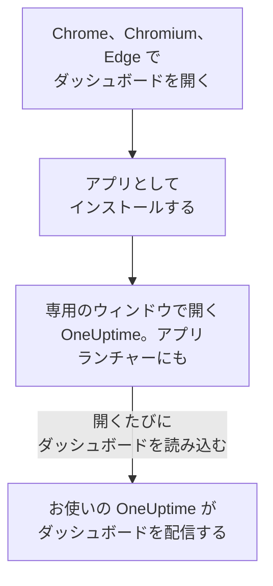

# Linux インストール

OneUptime のダッシュボードは、Google Chrome、Chromium、または Microsoft Edge から Linux にアプリとしてインストールできます。専用のウィンドウで開き、デスクトップのアプリランチャーに専用の項目があり、通知を表示できます。ダウンロードするものはありません。アプリはお使いの OneUptime のダッシュボードそのもので、お使いの OneUptime が最新であれば常に最新です。

:::cards
- [アプリをインストールする](#アプリをインストールする): Chrome、Chromium、または Edge から。
- [ランチャーから開く](#ランチャーから開く): ほかのデスクトップアプリと同じように。
- [このコンピューターで通知を受け取る](#このコンピューターで通知を受け取る): ブラウザをプッシュ通知用に登録します。
- [トラブルシューティング](#トラブルシューティング): インストールアイコンがない、通知が来ない、ランチャーに項目がない。
:::

## デスクトップアプリのしくみ

インストールしたアプリは、ブラウザのサインイン、設定、通知の許可を共有します。ブラウザを閉じても、アプリは専用のウィンドウで動き続けます。

## 始める前に

- 最新の Google Chrome、Chromium、または Microsoft Edge がある Linux デスクトップ。
- HTTPS で提供されているお使いの OneUptime のアドレス。OneUptime Cloud では `https://oneuptime.com`、独自のものなら `https://oneuptime.example.com` のようなアドレスです。
- ダッシュボードにサインインできるアカウント。

## アプリをインストールする

:::tabs
@tab Chrome
1. Chrome または Chromium でお使いの OneUptime を開き、サインインします。
2. ダッシュボードの任意のページで、アドレスバーの右端にあるインストールアイコンをクリックし、**インストール** をクリックします。または **⋮ → キャスト、保存、共有 → ページをアプリとしてインストール** を開きます。
3. Chrome が専用のウィンドウで OneUptime を開き、アプリランチャーに追加します。
@tab Edge
1. Edge でお使いの OneUptime を開き、サインインします。
2. ダッシュボードの任意のページで、アドレスバーの右端にあるインストールアイコンをクリックし、**インストール** をクリックします。または **設定など (…) → その他のツール → アプリ → このサイトをアプリとしてインストール** を開きます。
3. Edge が専用のウィンドウで OneUptime を開き、アプリランチャーに追加します。
:::

サインイン後に、ダッシュボードのページからインストールしてください。サインインページはアプリではありません。

## ランチャーから開く

ブラウザはアプリのデスクトップエントリ (`~/.local/share/applications` 内の `.desktop` ファイル) を追加するため、OneUptime は GNOME、KDE Plasma などのランチャーに表示されます。ほかのアプリと同じように、そこからドックやパネルにピン留めしてください。

## このコンピューターで通知を受け取る

アプリはブラウザを通じて通知を表示します。通知を受け取りたい各プロジェクトで、ブラウザをプッシュ通知用に登録してください。

:::steps
### プッシュデバイスを開く
アプリで **ユーザー設定 → 通知方法** を開き、**プッシュ通知** タブを開きます。

### このブラウザを登録する
**デバイスを登録** をクリックし、**デバイス名** は `Chrome on Linux` のような提案のままにするか変更して、もう一度 **デバイスを登録** をクリックします。OneUptime による通知の表示を許可するかをブラウザが尋ねたら、**許可** を選びます。

### テストを送る
**Browser Registered** ダイアログで **Send Test Notification** をクリックします。デスクトップが通知サービスを通じて表示します。何も表示されない場合は、[トラブルシューティング](#トラブルシューティング) を参照してください。
:::

ブラウザは、デスクトップのおやすみモードを越えて鳴らすことはできません。必ず起きなければならない呼び出しには、重大なアラートを有効にしたモバイルアプリを使ってください。[Android インストール](/docs/mobile-desktop-apps/android-installation#マナーモードでも鳴らす) を参照してください。

セルフホストの OneUptime では、ブラウザ通知にサーバーの VAPID キーが必要です。[プッシュ通知](/docs/self-hosted/push-notifications#セルフホストの設定) を参照してください。

## 更新

更新するものはありません。アプリは開くたびにお使いの OneUptime からダッシュボードを読み込むため、お使いの OneUptime がアップグレードされると変わります。アップグレードの前から開いているウィンドウは、Ctrl+R で再読み込みしてください。

## アンインストール

:::tabs
@tab Chrome
アプリのウィンドウで **⋮** メニューを開き、アプリをアンインストールする項目を選んでから **削除** を選びます。
@tab Edge
Edge で `edge://apps` を開き、OneUptime の **詳細** を選んでから **アンインストール** を選びます。
:::

アプリをアンインストールしても、ブラウザの登録は解除されません。ブラウザは引き続き通知を受け取ります。止めるには、**ユーザー設定 → 通知方法** の **プッシュ通知** タブで、**削除** を使ってブラウザを削除します。

## トラブルシューティング

:::details アドレスバーにインストールアイコンがない
サインインページではなく、サインイン後のダッシュボードのページを開き、アドレスが `https://` で始まることを確認してください。ブラウザは安全なサイトからしかアプリをインストールしません。それでもアイコンが表示されない場合は、上記のとおりブラウザのメニューを使います。ほかのブラウザはサイトをアプリとしてインストールできないことがあります。Chrome、Chromium、または Edge を使ってください。
:::

:::details 通知が表示されない
- **ユーザー設定 → 通知方法** の **プッシュ通知** タブで、このブラウザが一覧にあることを確認し、**テスト通知** を送ります。
- デスクトップのおやすみモードがオフで、その通知設定がブラウザを許可していることを確認します。
- ブラウザが OneUptime の通知をブロックしている場合は、アドレスバーの左端のアイコンをクリックしてサイトの通知を許可し、ブラウザをもう一度登録します。
- セルフホストの OneUptime では、サーバーに VAPID キーがない場合、**デバイスを登録** ダイアログにそう表示されます。
:::

:::details ランチャーにアプリがない
代わりにブラウザから開いてください。Chrome や Chromium では `chrome://apps`、Edge では `edge://apps` です。デスクトップエントリをログイン時にしか読み込まないランチャーでは、一度ログアウトしてログインし直すと表示されます。
:::

## 次のステップ

:::cards
- [Android インストール](/docs/mobile-desktop-apps/android-installation): 重大なアラートを使ってスマートフォンで呼び出しを受け取ります。
- [Windows インストール](/docs/mobile-desktop-apps/windows-installation): Windows で同じアプリを使います。
- [FAQ とトラブルシューティング](/docs/mobile-desktop-apps/faq-troubleshooting): 両方のアプリについての回答。
- [アカウント](/docs/introduction/your-account): 各プロジェクトで OneUptime があなたに連絡する方法。
:::
