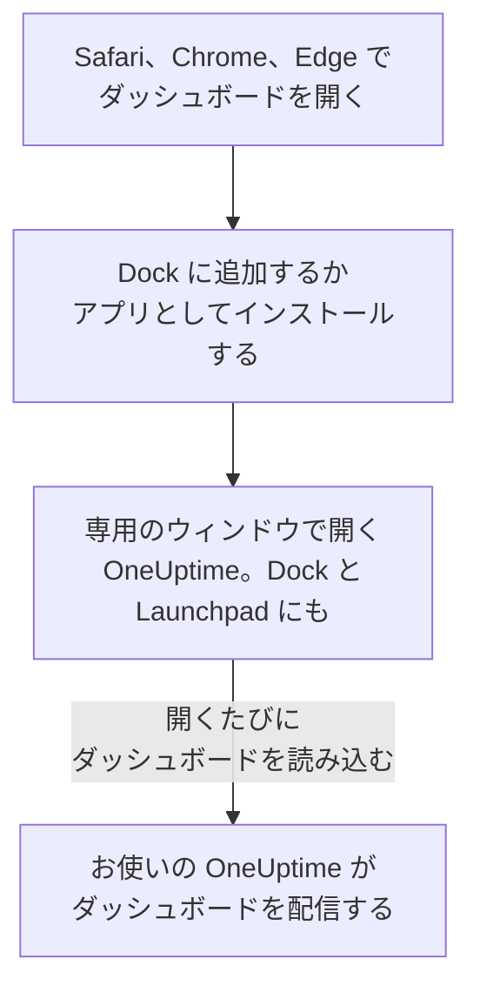

# macOS インストール

OneUptime のダッシュボードは、Mac にアプリとしてインストールできます。Safari から Dock に追加するか、Google Chrome または Microsoft Edge からインストールします。専用のウィンドウで開き、Dock と Launchpad に専用のアイコンがあり、通知を表示できます。ダウンロードするものはありません。アプリはお使いの OneUptime のダッシュボードそのもので、お使いの OneUptime が最新であれば常に最新です。

:::cards
- [アプリをインストールする](#アプリをインストールする): Safari、Chrome、または Edge から。
- [Dock に置いておく](#dock-に置いておく): ワンクリックで、またはログイン時に開きます。
- [この Mac で通知を受け取る](#この-mac-で通知を受け取る): アプリをプッシュ通知用に登録します。
- [トラブルシューティング](#トラブルシューティング): Dockに追加がない、通知が来ない、再びサインインを求められる。
:::

## デスクトップアプリのしくみ

Safari の Web アプリは、Safari とは別に、独自のサインイン、Cookie、設定を持ちます。Chrome や Edge からインストールしたアプリは、それらをそのブラウザと共有します。

## 始める前に

- Safari の場合は macOS Sonoma 14 以降。Chrome と Edge は、動作するどの macOS でもアプリをインストールできます。
- HTTPS で提供されているお使いの OneUptime のアドレス。OneUptime Cloud では `https://oneuptime.com`、独自のものなら `https://oneuptime.example.com` のようなアドレスです。
- ダッシュボードにサインインできるアカウント。

## アプリをインストールする

:::tabs
@tab Safari
1. Safari でお使いの OneUptime を開き、サインインします。
2. ダッシュボードの任意のページで **ファイル → Dockに追加** を選ぶか、ツールバーの共有ボタンをクリックしてから **Dockに追加** をクリックします。
3. 名前はそのままか変更して、**追加** をクリックします。
4. Dock から OneUptime を開き、もう一度サインインします。Web アプリは Safari のサインインを共有しません。
@tab Chrome
1. Chrome でお使いの OneUptime を開き、サインインします。
2. ダッシュボードの任意のページで、アドレスバーの右端にあるインストールアイコンをクリックし、**インストール** をクリックします。または **⋮ → キャスト、保存、共有 → ページをアプリとしてインストール** を開きます。
3. Chrome が専用のウィンドウで OneUptime を開き、Launchpad に追加します。
@tab Edge
1. Edge でお使いの OneUptime を開き、サインインします。
2. ダッシュボードの任意のページで、アドレスバーの右端にあるインストールアイコンをクリックし、**インストール** をクリックします。または **設定など (…) → その他のツール → アプリ → このサイトをアプリとしてインストール** を開きます。
3. Edge が専用のウィンドウで OneUptime を開き、Launchpad に追加します。
:::

サインイン後に、ダッシュボードのページからインストールしてください。サインインページはアプリではありません。Safari は Web アプリを、ホームフォルダの中の「アプリケーション」フォルダに保存します。

## Dock に置いておく

- **Dock。** アプリを開いている間に、Dock のアイコンを Control キーを押しながらクリックし、**オプション → Dockに追加** を選びます。Safari の Web アプリは、最初から Dock にあります。
- **ログイン時に開く。** Dock のアイコンを Control キーを押しながらクリックし、**オプション → ログイン時に開く** を選びます。
- **Spotlight。** Command + スペースバーを押して、OneUptime と入力します。

## この Mac で通知を受け取る

通知を受け取りたい各プロジェクトでアプリをプッシュ通知用に登録すると、アプリが通知を表示します。Safari の Web アプリは、Web アプリの中から登録してください。Web アプリはそれ自体が独立したブラウザです。Chrome や Edge からインストールしたアプリは、そのブラウザとして登録されます。

:::steps
### プッシュデバイスを開く
アプリで **ユーザー設定 → 通知方法** を開き、**プッシュ通知** タブを開きます。

### このアプリを登録する
**デバイスを登録** をクリックし、**デバイス名** は `Safari on macOS` のような提案のままにするか変更して、もう一度 **デバイスを登録** をクリックします。OneUptime による通知の送信を許可するかを macOS やブラウザが尋ねたら、**許可** を選びます。

### テストを送る
**Browser Registered** ダイアログで **Send Test Notification** をクリックします。何も表示されない場合は、Mac の通知設定を確認してください。[トラブルシューティング](#トラブルシューティング) を参照してください。
:::

ブラウザは、おやすみモードなどの集中モードを越えて鳴らすことはできません。必ず起きなければならない呼び出しには、重大なアラートを有効にしたモバイルアプリを使ってください。[iOS インストール](/docs/mobile-desktop-apps/ios-installation#消音モードでも鳴らす) を参照してください。

セルフホストの OneUptime では、ブラウザ通知にサーバーの VAPID キーが必要です。[プッシュ通知](/docs/self-hosted/push-notifications#セルフホストの設定) を参照してください。

## 更新

更新するものはありません。アプリは開くたびにお使いの OneUptime からダッシュボードを読み込むため、お使いの OneUptime がアップグレードされると変わります。アップグレードの前から開いているウィンドウは、Command + R で再読み込みしてください。

## アンインストール

:::tabs
@tab Safari
Finder でホームフォルダを開き、その中の「アプリケーション」フォルダから OneUptime をゴミ箱にドラッグします。
@tab Chrome
アプリのウィンドウで **⋮** メニューを開き、アプリをアンインストールする項目を選んでから **削除** を選びます。
@tab Edge
Edge で `edge://apps` を開き、OneUptime の **詳細** を選んでから **アンインストール** を選びます。
:::

アプリをアンインストールしても、その登録は解除されません。ブラウザは引き続き通知を受け取ります。止めるには、**ユーザー設定 → 通知方法** の **プッシュ通知** タブで、**削除** を使って削除します。

## トラブルシューティング

:::details Safari に「Dockに追加」がない
Safari が Web アプリを Dock に追加できるのは macOS Sonoma 14 以降です。macOS をアップデートするか、代わりに Chrome または Edge からアプリをインストールしてください。
:::

:::details 通知が表示されない
- **ユーザー設定 → 通知方法** の **プッシュ通知** タブで、アプリまたはそのブラウザが一覧にあることを確認し、**テスト通知** を送ります。
- Mac で **システム設定 → 通知** を開き、OneUptime、またはインストール元のブラウザが通知を送信できること、集中モードが通知を保留していないことを確認します。
- ブラウザが OneUptime の通知をブロックしている場合は、ブラウザのサイトの設定で通知を許可し、もう一度登録します。
- セルフホストの OneUptime では、サーバーに VAPID キーがない場合、**デバイスを登録** ダイアログにそう表示されます。
:::

:::details アプリで再びサインインを求められる
Safari の Web アプリは独自のサインインを持つので、アプリの中でサインインしてください。Chrome や Edge からインストールしたアプリはブラウザのサインインを共有しているため、ブラウザでサインアウトしたり、その Cookie を消去したりすると、アプリもサインアウトされます。
:::

## 次のステップ

:::cards
- [iOS インストール](/docs/mobile-desktop-apps/ios-installation): 重大なアラートを使って iPhone で呼び出しを受け取ります。
- [Windows インストール](/docs/mobile-desktop-apps/windows-installation): Windows で同じアプリを使います。
- [FAQ とトラブルシューティング](/docs/mobile-desktop-apps/faq-troubleshooting): 両方のアプリについての回答。
- [アカウント](/docs/introduction/your-account): 各プロジェクトで OneUptime があなたに連絡する方法。
:::
