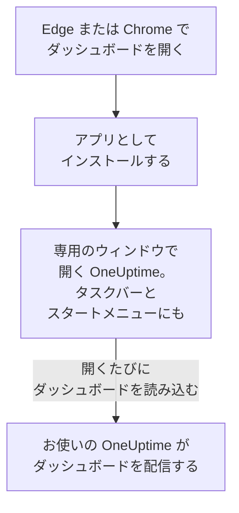

# Windows インストール

OneUptime のダッシュボードは、Microsoft Edge または Google Chrome から Windows にアプリとしてインストールできます。専用のウィンドウで開き、タスクバーとスタートメニューに専用のアイコンがあり、通知を表示できます。ダウンロードするものはありません。アプリはお使いの OneUptime のダッシュボードそのもので、お使いの OneUptime が最新であれば常に最新です。

:::cards
- [アプリをインストールする](#アプリをインストールする): Edge または Chrome から、数回のクリックで。
- [ピン留めして Windows と一緒に起動する](#ピン留めして-windows-と一緒に起動する): いつでもワンクリックで開けるようにします。
- [このコンピューターで通知を受け取る](#このコンピューターで通知を受け取る): ブラウザをプッシュ通知用に登録します。
- [トラブルシューティング](#トラブルシューティング): インストールアイコンがない、通知が来ない、再びサインインを求められる。
:::

## デスクトップアプリのしくみ

インストールしたアプリは、ブラウザのサインイン、設定、通知の許可を共有します。ブラウザを閉じても、アプリは専用のウィンドウで動き続けます。

## 始める前に

- Windows 10 または Windows 11 と、最新の Microsoft Edge または Google Chrome。
- HTTPS で提供されているお使いの OneUptime のアドレス。OneUptime Cloud では `https://oneuptime.com`、独自のものなら `https://oneuptime.example.com` のようなアドレスです。
- ダッシュボードにサインインできるアカウント。

## アプリをインストールする

:::tabs
@tab Edge
1. Edge でお使いの OneUptime を開き、サインインします。
2. ダッシュボードの任意のページで、アドレスバーの右端にあるインストールアイコンをクリックし、**インストール** をクリックします。または **設定など (…) → その他のツール → アプリ → このサイトをアプリとしてインストール** を開きます。
3. Edge が専用のウィンドウで OneUptime を開き、タスクバーやスタートへのピン留めを提案することがあります。
@tab Chrome
1. Chrome でお使いの OneUptime を開き、サインインします。
2. ダッシュボードの任意のページで、アドレスバーの右端にあるインストールアイコンをクリックし、**インストール** をクリックします。または **⋮ → キャスト、保存、共有 → ページをアプリとしてインストール** を開きます。
3. Chrome が専用のウィンドウで OneUptime を開き、スタートメニューに追加します。
:::

サインイン後に、ダッシュボードのページからインストールしてください。サインインページはアプリではありません。あとで開くときは、スタートメニューで OneUptime を検索します。

## ピン留めして Windows と一緒に起動する

- **タスクバー。** アプリを開いている間に、タスクバーのアイコンを右クリックして **タスク バーにピン留めする** を選びます。
- **Windows と一緒に起動。** Edge で `edge://apps` を開き、OneUptime の **詳細** を選んで **デバイス ログイン時に自動起動** をオンにします。同じページで、アプリをタスクバーやスタートにピン留めしたり、デスクトップにショートカットを置いたりできます。

## このコンピューターで通知を受け取る

アプリはブラウザを通じて通知を表示します。通知を受け取りたい各プロジェクトで、ブラウザをプッシュ通知用に登録してください。

:::steps
### プッシュデバイスを開く
アプリで **ユーザー設定 → 通知方法** を開き、**プッシュ通知** タブを開きます。

### このブラウザを登録する
**デバイスを登録** をクリックし、**デバイス名** は `Edge on Windows` のような提案のままにするか変更して、もう一度 **デバイスを登録** をクリックします。OneUptime による通知の表示を許可するかをブラウザが尋ねたら、**許可** を選びます。

### テストを送る
**Browser Registered** ダイアログで **Send Test Notification** をクリックします。何も表示されない場合は、Windows 自体の通知設定を確認してください。[トラブルシューティング](#トラブルシューティング) を参照してください。
:::

ブラウザは Windows が許す以上の音量では鳴らせず、応答不可を上書きできません。必ず起きなければならない呼び出しには、重大なアラートを有効にしたモバイルアプリを使ってください。[Android インストール](/docs/mobile-desktop-apps/android-installation#マナーモードでも鳴らす) または [iOS インストール](/docs/mobile-desktop-apps/ios-installation#消音モードでも鳴らす) を参照してください。

セルフホストの OneUptime では、ブラウザ通知にサーバーの VAPID キーが必要です。[プッシュ通知](/docs/self-hosted/push-notifications#セルフホストの設定) を参照してください。

## 更新

更新するものはありません。アプリは開くたびにお使いの OneUptime からダッシュボードを読み込むため、お使いの OneUptime がアップグレードされると変わります。アップグレードの前から開いているウィンドウは、Ctrl+R で再読み込みしてください。

## アンインストール

:::tabs
@tab Edge
`edge://apps` を開き、OneUptime の **詳細** を選んでから **アンインストール** を選びます。
@tab Chrome
アプリのウィンドウで **⋮** メニューを開き、アプリをアンインストールする項目を選んでから **削除** を選びます。
:::

Windows の **設定 → アプリ → インストールされているアプリ** にもアプリが表示され、そこで **アンインストール** を選んでも削除できます。

アプリをアンインストールしても、ブラウザの登録は解除されません。ブラウザは引き続き通知を受け取ります。止めるには、**ユーザー設定 → 通知方法** の **プッシュ通知** タブで、**削除** を使ってブラウザを削除します。

## トラブルシューティング

:::details アドレスバーにインストールアイコンがない
サインインページではなく、サインイン後のダッシュボードのページを開き、アドレスが `https://` で始まることを確認してください。ブラウザは安全なサイトからしかアプリをインストールしません。それでもアイコンが表示されない場合は、上記のとおりブラウザのメニューを使います。ほかのブラウザはサイトをアプリとしてインストールできないことがあります。Edge または Chrome を使ってください。
:::

:::details 通知が表示されない
- **ユーザー設定 → 通知方法** の **プッシュ通知** タブで、このブラウザが一覧にあることを確認し、**テスト通知** を送ります。
- Windows で **設定 → システム → 通知** を開きます。通知がオンで、ブラウザに対してもオンになっていて、応答不可がオフである必要があります。Windows 10 では、このページの名前は「通知とアクション」です。
- ブラウザが OneUptime の通知をブロックしている場合は、アドレスバーの左端のアイコンをクリックしてサイトの通知を許可し、ブラウザをもう一度登録します。
- セルフホストの OneUptime では、サーバーに VAPID キーがない場合、**デバイスを登録** ダイアログにそう表示されます。
:::

:::details アプリで再びサインインを求められる
アプリはブラウザのサインインを共有しています。ブラウザでサインアウトしたり、その Cookie を消去したりすると、アプリもサインアウトされます。
:::

## 次のステップ

:::cards
- [macOS インストール](/docs/mobile-desktop-apps/macos-installation): Mac で同じアプリを使います。
- [Android インストール](/docs/mobile-desktop-apps/android-installation): スマートフォンで呼び出しを受け取ります。
- [FAQ とトラブルシューティング](/docs/mobile-desktop-apps/faq-troubleshooting): 両方のアプリについての回答。
- [アカウント](/docs/introduction/your-account): 各プロジェクトで OneUptime があなたに連絡する方法。
:::
