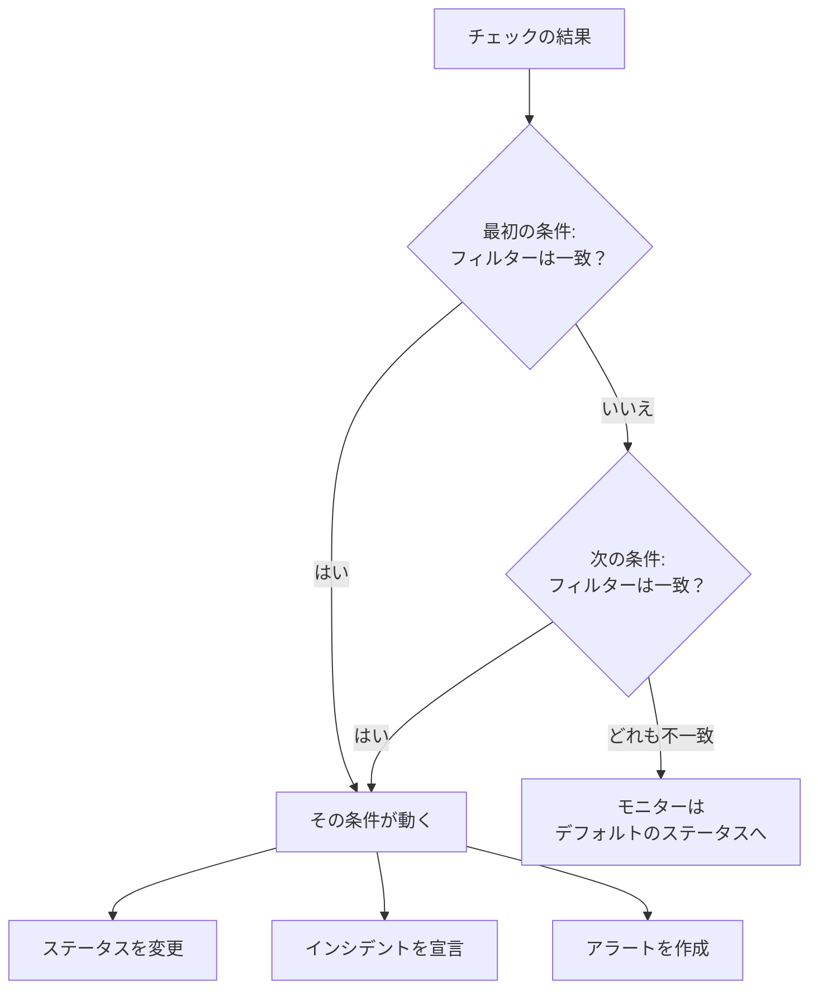
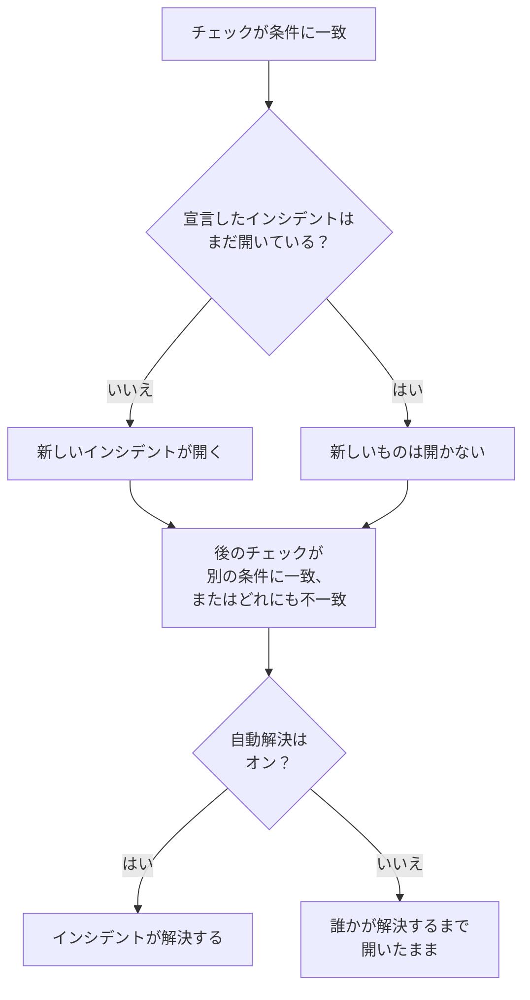

# モニターの条件とステータス

モニターの条件は、各チェックが何を意味するかを決めます。モニターが稼働しているかダウンしているか、そして OneUptime がインシデントを宣言するかアラートを作成するかです。ステータスは、モニターがなりうる状態を並べたプロジェクトの一覧で、**稼働中** から **オフライン** まであります。このページでは、すべてのモニターの種類についてその両方を説明します。各種類のページには、その種類が提供するフィルターが載っています。

:::cards
- [条件の決め方](#条件の決め方): 上から順に見て、最初に一致したものが勝ちます。
- [条件の中身](#条件の中身): フィルター、一致条件、アクション、設定。
- [モニターの条件を変更する](#モニターの条件を変更する): 条件の編集、追加、並べ替え、テスト。
- [モニターのステータス](#モニターのステータス): 組み込みのステータスと独自のステータス。
:::

## 条件の決め方

モニターがチェックされるたびに、その条件がリストの上から順に結果を判定します。フィルターが一致した最初の条件が何が起きるかを決め、そのチェックではそれより下の条件は見られません。どれにも一致しない場合、モニターは **デフォルトのモニターステータス** になります。

順序もルールの一部です。新しいモニターは条件を悪いものから順に並べます。オフライン、次にその種類にあれば警告（期限切れが近い証明書やドメイン）、最後にオンラインです。**Is Online** が **真** のような広い正常系の条件はほぼすべてのチェックに一致するため、最後に置きます。ほかの条件より上にあると毎回最初に一致してしまい、ほかの条件が動くことはありません。

一致してもステータスを変えない条件も、そのチェックの結果を決めます。モニターは今のステータスを保ち、その下の条件は次のチェックを待ちます。**デフォルトのモニターステータス** が適用されるのは、どの条件にも一致しないときだけです。新しいモニターのデフォルトは **稼働中** で、条件の下にある **その他の項目** で変更できます。

> [!NOTE]
> ホスト、コンテナ、ディスク、インターフェースごとにインシデントやアラートを開くモニターは、各チェックですべての条件を判定するため、2 つのホストが同時に別々の条件に一致することがあります。これは、クエリに **グループ化** があるモニター（メトリクスモニターやログモニターなど）や、すべてのディスクやインターフェースに `*` を指定した条件のことです。ペイロードのフィールドでインシデントをグループ化する受信リクエストモニターは、それでも最初の一致で止まります。

## 条件の中身

条件を開くと、名前と 3 つのセクションがあり、それぞれ 1 行の要約に折りたためます。

| 部分 | 内容 |
| --- | --- |
| **条件名** | 条件リストに表示される名前で、その条件が開くすべてのインシデントとアラートの根本原因にも使われます。**条件を追加** は新しい条件にフィルターに沿った名前を付け、自分で名前を入力するまで、名前はフィルターに合わせて変わります。 |
| **フィルター** | チェックが示すべき内容で、ひとつ以上のフィルターで表します。Kubernetes モニターとメトリクスモニターでは **アラートルール** と呼びます。 |
| **アクション** | フィルターが一致したときに起きること。ステータスの変更、アラートの作成、インシデントの宣言、またはその組み合わせです。 |
| **設定** | **この条件を有効化**、任意の **説明**、そして受信リクエストモニターでは **ペイロードのフィールドでインシデントとアラートをグループ化**。 |

### フィルター

フィルターはチェックから値をひとつ読み取り、比較します。**フィルタータイプ**（何を読むか。例: **レスポンスステータスコード**）、**フィルター条件**（どう比較するか。例: **より大きい**）、**値** です。Kubernetes モニターやメトリクスモニターのようにメトリクスを比較するモニターでは、代わりに **条件** と **しきい値** を指定します。モニターの種類ごとに独自のフィルタータイプがあり、[監視条件](/docs/monitor/website-monitor#監視条件) のように各種類のページに載っています。

フィルターが 2 つ以上あると、その下に **一致条件** が表示されます。**すべて** はすべてのフィルターが一致する必要があることを、**いずれか** はひとつで十分であることを意味します。新しい条件は **すべて** から始まります。

**Is Online**、**レスポンスステータスコード**、**レスポンスタイム（ms）** のように各チェックを測るフィルターには、**この条件を一定期間にわたって評価する** があります。最新のチェックだけでなく最近のチェックの期間を判定し、最初は直近 5 分間と **All Values** に設定されています。この場合、期間内のすべてのチェックが一致したときにだけ一致します。[一定期間にわたる評価](/docs/monitor/website-monitor#一定期間にわたる評価) を参照してください。

### アクション

各アクションは **アクション** の下にあるスイッチです。

| スイッチ | 何をするか |
| --- | --- |
| **フィルターが一致したとき、モニターのステータスを変更します。** | **モニターのステータスを次に変更** で選んだステータスにモニターを移します。 |
| **フィルターが一致したとき、アラートを作成します。** | **アラートを作成** で設定したアラートを作成します。アラートはチームに知らせるもので、ステータスページには表示されません。 |
| **フィルターが一致したとき、インシデントを宣言します。** | **インシデントを作成** で設定したインシデントを宣言します。ステータスページに表示できます。 |

インシデントやアラートでは、タイトル、**重大度**、そして折りたたまれた部分で説明、所有者、ラベル、オンコールポリシーを指定します。タイトルと説明には `{{monitorName}}` のようにチェックの値を入れられます。[インシデント & アラート テンプレート](/docs/monitor/incident-alert-templating) を参照してください。条件が一致したときに誰かを呼び出すには、**オンコール** でポリシーを選びます。[オンコールポリシー](/docs/on-call/policies) を参照してください。

### 設定

**この条件を有効化** は、新しい条件ではすべてオンです。オフにすると、条件を使わずに残しておけます。その条件はすべてのチェックで飛ばされ、ステータスを変えず、何も開かず、見出しに **無効** と表示されます。

**ペイロードのフィールドでインシデントとアラートをグループ化** は、受信リクエストで見つかった値ごとにインシデントをひとつ開くため、ひとつの Webhook アドレスで複数のインシデントを開いたままにできます。[インシデントのグループ化を有効にする](/docs/monitor/incoming-request-monitor#インシデントのグループ化を有効にする) を参照してください。

## インシデントとアラートが開くときと閉じるとき

インシデントを宣言する条件は、一致したときにインシデントを開きます。モニターが回復すると、条件でそう設定されていれば、インシデントは自動で閉じます。

- **ひとつずつ。** 条件が宣言したインシデントがまだ開いている間は、同じ条件がまた一致しても、別のインシデントは宣言されません。アラートも同じです。ホストやペイロードのフィールドでグループ化するモニターは、ホストや値ごとにひとつずつ開いたままにし、**メールごとに新しいインシデントを開く** がオンの受信メールの条件は、メールごとにひとつ開きます。
- **閉じるとき。** 別の条件が一致するか、どれも一致しない後のチェックで、条件の **インシデントを自動解決** がオンのインシデントは解決され、**アラートを自動解決** がオンのアラートも同様です。どちらもインシデントまたはアラートの **その他の項目** の中にあり、新しいモニターが最初に持つ条件ではオンになっています。
- **複数のプローブ。** 複数のプローブでチェックされるモニターは、プローブの結果がそろったときにだけ変わります。[条件の評価方法](/docs/monitor/create-monitor#条件の評価方法) を参照してください。
- **親モニターがダウンしているとき。** モニターの **構成 → 依存関係** ページでは、**依存するモニター** にそのモニターが依存するモニターを指定します。そのどれかが **親のステータスがこの場合に抑制** に挙げたステータス（空のままならオフラインのステータスのいずれか）にある間、モニターはインシデントもアラートも開きません。ステータスは引き続き変わり、開いているものは引き続き解決されます。
- **定期メンテナンス。** 進行中のメンテナンスイベントに含まれるモニターはチェックされないため、その条件も実行されません。[定期メンテナンスの概要](/docs/scheduled-maintenance/index) を参照してください。

チェックがどう判定されたかを見るには、モニターの **概要** を開きます。**モニターの概要** カードに、どの条件が一致し、それぞれが何をしたかが表示されます。すでにひとつ開いていたためにスキップしたインシデントも含まれます。

## モニターの条件を変更する

:::steps
### 条件のページを開く

**モニター** に移動してモニターを開きます。サイドメニューの **構成** を展開し、**条件** をクリックします。**監視条件** カードに、各条件、何をチェックするか、何をするかが表示されます。

### 「監視条件を編集」をクリックする

エディターではすべての条件が開いた状態で表示されます。条件の見出しをクリックすると 1 行に折りたたまれ、名前、フィルターの数、何をするかが表示されます。

### 条件を追加、変更、並べ替える

**条件を追加** は、開いた状態でフィルターに沿った名前の条件を末尾に追加します。条件を移動するには、左側のハンドルをドラッグします。最初の一致が勝つので、最悪のケースを先頭に置きます。**条件を削除** は条件をひとつ削除します。モニターには少なくともひとつの条件が残ります。

### 条件を保存する

**変更を保存** をクリックします。次のチェックからは新しい条件で判定されます。

### モニターをテストする

プローブがチェックするモニターでは、カードの **モニターをテスト** をクリックし、**プローブを選択** でプローブを選んで **テストを実行** をクリックします。**モニターテスト結果** にチェックの結果が表示されます。
:::

手動モニターには条件がありません。ステータスは自分で設定します。[ステータスを更新する](/docs/monitor/manual-monitor#ステータスを更新する) を参照してください。

## モニターのステータス

モニターは常にプロジェクトのステータスのどれかにあります。新しいプロジェクトには、最も健全なものから最悪のものまで、次の 3 つがあります。

| ステータス | 位置 | 色 | OneUptime がどう扱うか |
| --- | --- | --- | --- |
| **稼働中** | 1 | 緑 | 新しいモニターはこのステータスから始まり、新しいモニターの **デフォルトのモニターステータス** でもあります。組み込み。 |
| **機能低下** | 2 | 黄 | それ自体では何もしません。あなたの条件がモニターをここに移します。 |
| **オフライン** | 3 | 赤 | 新しいモニターのオフラインの条件がモニターをここに移し、OneUptime はこのステータスのモニターをダウンとして扱います。組み込み。 |

この一覧は順序でもあります。モニターがまとめて表示される場所では、一覧で最も下にあるステータスが優先されます。モニターグループ、ステータスページのグループ、ステータスページ全体のステータスは、それぞれのモニターの中で最悪のステータスを表示します。

### ステータスが効く場所

| 場所 | ステータスが決めること |
| --- | --- |
| **モニター** の一覧 | 各モニターの現在のステータス。**非稼働** には稼働中以外のステータスにあるモニターが並び、横に赤い件数が表示されます。 |
| ステータスページ | 各行の色と稼働率。ページの **ダウンタイムとしてカウント** にあるステータスだけが稼働率に響きます。新しいステータスページは、稼働中以外のすべてのステータスから始まります。[ページに表示する内容を選ぶ](/docs/status-pages/index#ページに表示する内容を選ぶ) を参照してください。 |
| モニターグループ | グループのステータス。そのモニターの中で最悪のものです。[モニターグループ](/docs/monitor/monitor-groups) を参照してください。 |
| SLO | SLO が数えるダウンタイム。SLO 自身のステータスの一覧に基づきます。[ダウンタイムとして数えるステータス](/docs/slo/introduction#ダウンタイムとして数えるステータス) を参照してください。 |
| 依存関係 | 親モニターが子のインシデントとアラートを抑えるかどうか。デフォルトでは、親がオフラインのステータスにある間です。 |

あとから追加したステータスは、既存のステータスページの **ダウンタイムとしてカウント** の一覧には追加されません。自分で追加してください。

### 独自のステータスを追加する

:::steps
### 「モニターステータス」を開く

**モニター → 設定 → モニターステータス** に移動します。サイドメニューの **設定** は折りたたまれているので、先に展開します。**モニターステータス** カードに、最も健全なものから最悪のものまでステータスが並びます。

### ステータスを作成する

**モニターステータスを作成** をクリックし、**名前**、**説明**、**色** を入力します。新しいステータスはオフラインのステータスのすぐ上に入るため、障害は引き続き最悪として扱われます。

### 位置を決める

ハンドルでステータスをドラッグします。一覧で下にあるステータスほど、その上のどのステータスよりも悪いものとして扱われます。

### 条件で使う

ステータスは、条件がモニターをそこに移すまで何もしません。そのステータスを設定すべき条件の **モニターのステータスを次に変更** で選びます。
:::

稼働中とオフラインのステータスには **組み込み** の印が付いています。名前と色は変更できますが、削除はできません。OneUptime Cloud では、ステータスの作成や変更に Growth プランが必要です。ステータスの管理には、Project Owner、Project Admin、Monitor Admin のいずれかのロール、または対応するモニターステータスの権限を持つカスタムロールが必要です。

### ステータスのタイムライン

ステータスの変更はすべて、モニターの **ステータスタイムライン** に残ります。開始時刻、継続時間、そしてそのステータスを設定した条件を示す **原因を表示** です。**モニターのステータスイベントを作成** は手動でステータスを追加します。プローブがチェックするモニターでは、ステータスを持つ条件に一致した次のチェックで、そのステータスが再び設定されます。

モニターのステータスの変更が所有者に通知されるのは、所有者が通知設定で **モニターのステータスが変更されました** をオンにしている場合だけで、最初はオフです。どの条件にも一致せず **デフォルトのモニターステータス** に戻ったモニターは、誰にも通知しません。[新しいメンバーでオンになっているもの](/docs/notifications/notification-settings#新しいメンバーでオンになっているもの) を参照してください。

## トラブルシューティング

:::details サイトはダウンしているのに、モニターが稼働中のまま
リストの上のほうにある条件が先に一致しています。**構成 → 条件** を開いて順序を確認してください。正常系の条件は最後に置きます。また、オフラインの条件で **この条件を有効化** がオンになっていること、そのアクション **フィルターが一致したとき、モニターのステータスを変更します。** がオンでステータスが選ばれていることも確認してください。
:::

:::details モニターがダウンしたのにインシデントが開かなかった
一致した条件を確認してください。**フィルターが一致したとき、インシデントを宣言します。** がオンである必要があります。同じ条件のインシデントがまだ開いている間、**依存するモニター** の親モニターがダウンしている間、モニターが定期メンテナンス中の間は、インシデントは宣言されません。モニターの **概要** にある **モニターの概要** カードに、どれだったかが表示されます。
:::

:::details モニターが回復してもインシデントが開いたまま
インシデントの条件を開き、そのインシデントの **その他の項目** を展開してください。**インシデントを自動解決** がオンである必要があります。その後削除した条件のインシデントは、モニターでは解決されません。手動で解決してください。
:::

:::details オフラインの削除ボタンがロックされている
**稼働中** と **オフライン** は組み込みです。OneUptime がモニターをこれらに移すため、名前は変更できますが削除はできません。代わりに独自のステータスを削除するか、組み込みのステータスの名前を変更してください。
:::

## 次のステップ

:::cards
- [モニターの作成](/docs/monitor/create-monitor): 新しいモニターの 3 つのステップ。
- [インシデント & アラート テンプレート](/docs/monitor/incident-alert-templating): チェックの値をタイトルと説明に入れます。
- [モニターグループ](/docs/monitor/monitor-groups): 複数のモニターをひとつのステータスにまとめます。
- [インシデント 概要](/docs/incidents/index): 条件がインシデントを宣言した後に起きること。
:::
