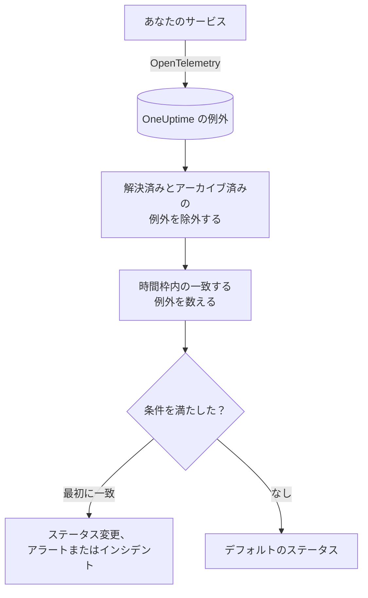

# 例外モニター

例外モニターは、サービスが OneUptime に報告する例外のうち、フィルター（メッセージ、例外タイプ、環境、サービス）に一致するものを時間枠の中で数えます。その数が条件を満たすと、モニターのステータスを変えたり、アラートを作成したり、インシデントを宣言したりします。本番環境での新しいクラッシュ、1 つの例外タイプ、エラーの急増でアラートを出すために使います。

:::cards
- [モニターを作成する](#例外モニターを作成する): 数える例外と、アラートを出すタイミングを選びます。
- [環境](#環境): モニターを `production` に絞ります。
- [評価のしくみ](#評価のしくみ): 何が数えられるか、例外を解決すると何が起こるか。
- [条件](#条件): 条件とデフォルト。
:::

## しくみ



OneUptime は毎分、モニターのフィルターに一致し、時間枠内に発生した例外を数えます。解決済みにした例外やアーカイブした例外は除きます。その数をモニターの条件と上から順に比べ、最初に一致した条件で何が起こるかが決まります。どれにも一致しなければ、モニターはデフォルトのステータスに戻ります。

## 始める前に

- サービスが OpenTelemetry で例外を OneUptime に送っていること。[OpenTelemetry](/docs/telemetry/open-telemetry) を参照してください。
- モニターを環境に絞るには、サービスがリソース属性 `deployment.environment` を設定している必要があります。

## 例外モニターを作成する

:::steps
### 新しいモニターを始める

**モニター** に移動し、**モニターを作成** をクリックします。または、例外のページで **解決** の横にある **モニターを作成** をクリックします。新しいモニターは、そのサービスでのその例外のタイプを最初から監視し、再び発生したときにアラートします。

### Exceptions を選ぶ

**モニターの種類** で **その他のモニターの種類** をクリックし、**テレメトリ** の下の **例外** を選ぶか、検索ボックスに `exceptions` と入力します。**名前** を入力し、**次へ** をクリックします。

### モニターで知りたいことを選ぶ

**このモニターで何を知りたいですか？** で、**あらゆる例外** または **例外が多すぎる** を選びます。どちらを選んでもルールが入力され、その下で変更できます。自分で設定するには **その他** を選びます。**新しい例外**、**解決済みの例外が再発**、**例外の急増** は、初めて確認された例外、解決した後に再発した例外、通常を大きく上回る増加をアラートします。

### 数える例外を選ぶ

**監視する例外** で **メッセージに含む語句**、**例外タイプ**、**環境** を設定します。空のままのフィルターはすべての例外に一致します。フィルターの下の **一致する例外** に、現在一致する例外が表示されます。

### 絞り込む（任意）

**その他の項目** を開くと、テレメトリサービスやインフラエンティティでフィルターしたり、解決済みやアーカイブ済みの例外も数えたりできます。

### アラートする条件を決める

**アラートする条件** で **条件**、**例外の件数**、**時間枠** を選びます。その下の文が、ルールを平易な言葉で言い直します。その下のチャートは、直近数時間の各時間枠で一致した例外を数え、ルールの数値を線で描き、ルールが何回アラートしたかを示します。チャートのボタンは、その期間にルールが超えなかったはずの数値を提案します。**アラート対象** で、ルールが比較するものを **例外**、**新しい例外**、**再発した例外**、**通常を上回る増加** から選びます。グラフは **例外** の場合にだけ表示されます。

### どうなるかを選ぶ

**どうなるか** で **アラートを作成**、**インシデントを宣言**、**両方** のいずれかを選び、タイトルと重大度を付けます。ルールが一致している間、モニターは **その他の項目** にあるステータスを表示します。一致しなくなると、モニターはデフォルトのステータスに戻り、アラートやインシデントは自動で解決します。

### モニターを作成する

**モニターを作成** をクリックします。モニターは **概要** ページで開き、1 分以内に最初の評価が行われます。
:::

## 何を照会するか

| 項目 | 一致するもの | デフォルト |
| --- | --- | --- |
| **メッセージに含む語句** | メッセージにこのテキストを含む例外。大文字と小文字は区別しません。 | 空: すべての例外 |
| **例外タイプ** | これらのタイプのいずれかの例外。`TypeError, NullReferenceException` のようにカンマで区切ります。タイプ名は完全に一致する必要があります。 | 空: すべてのタイプ |
| **環境** | これらの環境のいずれかからの例外。カンマで区切ります（[環境](#環境) を参照）。 | 空: すべての環境 |
| **時間枠**（**アラートする条件** 内） | 直近 5 秒から直近 24 時間までの例外。 | **過去 5 分** |
| **テレメトリサービスでフィルター**（**その他の項目** 内） | 選んだサービスのいずれかからの例外。 | 空: すべてのサービス |
| **インフラエンティティで絞り込み**（**その他の項目** 内） | 選んだホスト、Pod、コンテナー、その他のエンティティのいずれかからの例外。 | 空: すべてのエンティティ |
| **解決済みの例外を含める**（**その他の項目** 内） | 解決済みとしてマークされた例外も数えます。 | オフ |
| **アーカイブされた例外を含める**（**その他の項目** 内） | アーカイブされた例外も数えます。 | オフ |

例外が数えられるには、設定したすべてのフィルターに一致する必要があります。

### 環境

環境は、各例外の OpenTelemetry リソース属性 `deployment.environment` から取られます。例外エクスプローラーが `env:production` でフィルターするのと同じ値です。環境を 1 つ、またはカンマで区切って複数入力します。例外は、その環境がいずれかと一致すると数えられます。

一致は完全一致で、大文字と小文字を区別します。`production` は `Production` や `prod` には一致しません。このフィルターを設定すると、環境のない例外は数えられません。環境のない例外も含め、すべての環境の例外を数えるには空のままにします。

環境のフィルターは他のすべてのフィルターと組み合わされます。そのため、1 つのテレメトリサービスと `production` に絞ったモニターは、そのサービスの本番の例外だけを数えます。

API でモニターを作成するときは、ステップの `exceptionMonitor` の `environments` に環境名のリストを設定します。

```json
{
  "exceptionMonitor": {
    "telemetryServiceIds": [],
    "environments": ["production"],
    "exceptionTypes": [],
    "message": "",
    "includeResolved": false,
    "includeArchived": false,
    "lastXSecondsOfExceptions": 300
  }
}
```

## 評価のしくみ

- **毎分。** 例外モニターはプローブでチェックされないため、設定する間隔も **プローブと間隔** ページもありません。
- **数えるのは発生回数で、例外タイプではありません。** モニターは、一致する例外が **時間枠** 内に発生するたびに数えます。40 回スローされた 1 つの例外は 40 と数えます。
- **解決済みとアーカイブ済みの例外は除外されます。** **解決済みの例外を含める** や **アーカイブされた例外を含める** をオンにしない限り、解決済みにした例外やアーカイブした例外の発生は数えられません。そのため、例外を解決済みにすると、その例外が開いたインシデントが閉じることがあります。解決済みの例外が再び発生すると、自動で未解決に戻り、再び数えられます。
- **例外がなければカウントは 0。**
- **OneUptime 自身の停止は沈黙ではありません。** OneUptime 自身がデータを受信していなかった時間（再起動中、アップグレード中、遅れの取り戻し中）が時間枠に含まれている間、チェックは待ちます。ステータスは変わらず、インシデントやアラートが開かれたり解決されたりすることもありません。[OneUptime がデータを受信していないとき](/docs/monitor/when-oneuptime-is-not-receiving) を参照してください。
- **条件は上から順に。** 最初に一致した条件で決まるため、最も重大なものを先頭に置きます。

ステータスの変化はすべて、その理由とともにモニターの **ステータスタイムライン** に記録されます。

## 条件

例外モニターの条件の **フィルタータイプ** は 4 つです。時間枠内で一致した例外の数である **Exception Count** と、下で説明する **New Exceptions**、**Regressed Exceptions**、**Exception Increase (in %)** です。**アラートする条件** は条件を 1 つ設定し、その **条件** は **より多い**、**以上**、**より少ない**、**以下**、**ちょうど** のいずれかです。複数の条件や、フィルターが 2 つ以上ある条件にするには、**どうなるか** の **その他の項目** にある **カスタム条件として編集** をクリックします。そこでは各条件に **フィルター条件** と **値** があります。

| フィルター条件 | 例外の数が次のとき一致 |
| --- | --- |
| **より大きい** | 値より大きい |
| **以上** | 値以上 |
| **より小さい** | 値より小さい |
| **以下** | 値以下 |
| **等しい** | 値とちょうど等しい |
| **等しくない** | 値以外 |

例外の数には異常の条件がありません。比べるベースラインがないためです。

「モニターを作成」で作った例外モニターは、**このモニターで何を知りたいですか？** で選んだ内容のルールから始まります。

| 選択 | ルール | どうなるか |
| --- | --- | --- |
| **あらゆる例外** | **過去 5 分** で **より多い** `0` | アラートを作成し、自動で解決します |
| **例外が多すぎる** | **過去 5 分** で **より多い** `20` | アラートを作成し、自動で解決します |
| **新しい例外** | **新しい例外**：**過去 10 分** で **より多い** `0` | アラートを作成し、自動で解決します |
| **解決済みの例外が再発** | **再発した例外**：**過去 10 分** で **より多い** `0` | アラートを作成し、自動で解決します |
| **例外の急増** | **通常を上回る増加**：**過去 15 分** で **より多い** `200` | アラートを作成し、自動で解決します |

API や Terraform で条件なしに作成した例外モニターは、次の条件から始まります。

| 条件 | フィルター | 効果 |
| --- | --- | --- |
| Check if … has exceptions | **Exception Count** **より大きい** `0` | モニターをオフラインにし、インシデントを宣言します（自動で解決） |
| Check if … has no exceptions | **Exception Count** **等しい** `0` | モニターをオンラインにします |

## 新しい例外、再発した例外、急増する例外

例外の件数に加えて、例外モニターはエラートラッカーが最初に示すものをアラートできます。それぞれ、条件がチェックするときにだけ読み取られます。

| フィルタータイプ | 時間枠内で数えるもの |
| --- | --- |
| **New Exceptions** | 初めて確認され、解決済みでもアーカイブ済みでもない一致する例外。 |
| **Regressed Exceptions** | 解決した後に再発し、まだ開いている一致する例外。 |
| **Exception Increase (in %)** | 一致した例外の件数が通常をどれだけ上回るか。通常は時間枠の前日を同じ長さの時間枠あたりにした値で、最低 1 件とします。静かな 1 日の後の 10 件は 900% です。 |

新しい例外と再発した例外は、サービス、例外の種類、環境、メッセージで絞り込まれ、インフラエンティティでも絞り込まれます。時間枠内の発生のいずれかが選んだエンティティのどれかから来た例外が数えられます。

## 実例: 本番の例外だけ

API が本番で例外をスローするたびにインシデントにしたく、staging では何もしたくないとします。**あらゆる例外** を選び、**環境** を `production` にし、**時間枠** は **過去 5 分** のままにして、**どうなるか** で **インシデントを宣言** を選びます。直近 5 分間は次のとおりです。

| 例外 | 環境 | 状態 | 数えられる？ |
| --- | --- | --- | --- |
| `TypeError` × 3 | `production` | アクティブ | はい: 3 |
| `TypeError` × 40 | `staging` | アクティブ | いいえ: 別の環境 |
| `TimeoutError` × 2 | なし | アクティブ | いいえ: 環境なし |
| `NullReferenceException` × 4 | `production` | 発生後に解決済み | いいえ: 解決済み |

**Exception Count** は 3 なので **より多い** `0` が一致し、モニターはオフラインになってインシデントが宣言されます。アクティブな本番の例外がない 5 分間が過ぎるとルールは一致しなくなり、モニターはデフォルトのステータスに戻り、インシデントは自動で解決します。

## トラブルシューティング

:::details エクスプローラーには例外が表示されるのに、モニターは 0 と数える
**環境** の値をエクスプローラーの `env:` フィルターと比べてください。一致は完全一致で大文字と小文字を区別し、フィルターを設定すると環境のない例外は除外されます。次に、それらの例外が解決済みやアーカイブ済みになっていないか確認します。モニターの **条件** ページ（**構成** の下）を開き、**監視条件を編集** をクリックすると、**一致する例外** にフィルターが一致しているものが表示されます。
:::

:::details 例外を解決したらインシデントも解決した
想定どおりの動作です。解決済みの例外は数えられないため、カウントが下がって条件が一致しなくなりました。例外が再び発生すると、未解決に戻って再び数えられます。それでも数えるには **解決済みの例外を含める** をオンにします。
:::

:::details 例外タイプのフィルターに何も一致しない
**例外タイプ** は、例外が報告されたときのタイプ名（`TypeError` など）と完全一致で比較されます。例外エクスプローラーからタイプをコピーしてください。
:::

## 次のステップ

:::cards
- [トレース モニター](/docs/monitor/traces-monitor): 失敗したスパンとエンドポイントでアラートを出します。
- [ログ モニター](/docs/monitor/logs-monitor): ログの量と内容でアラートを出します。
- [インシデント & アラート テンプレート](/docs/monitor/incident-alert-templating): 役に立つアラートのタイトルと説明を書きます。
- [OpenTelemetry](/docs/telemetry/open-telemetry): 例外を OneUptime に送ります。
:::
