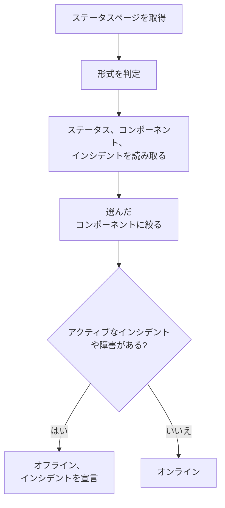

# 外部ステータス ページ モニター

外部ステータス ページ モニターは、あなたが依存しているサービス (AWS、GCP、Azure、GitHub、OpenAI、Anthropic など多数) の公開ステータスページを監視し、そのプロバイダーが障害やパフォーマンスの低下を報告したときにアラートを出します。依存先の問題をプロバイダーが報告した時点ですぐに知り、自分たちの問題と区別するために使います。

OneUptime で作られたステータスページもリソースごとに読み取り、計画メンテナンスと障害を区別します。別のチームのプロジェクトや、ステータスページを OneUptime で運用しているベンダーを監視できます。

:::cards
- [モニターを作成する](#外部ステータス-ページ-モニターを作成する): ステータスページの URL を貼り付け、監視対象を選びます。
- [コンポーネントを選ぶ](#コンポーネント): 依存しているコンポーネントだけを監視します。
- [条件](#監視条件): デフォルトで何をダウンと見なすか。
- [OneUptime のステータスページ](#oneuptime-のステータスページ): 別のプロジェクトのリソースと、そのメンテナンス。
- [よく使われるステータスページ](#よく使われるステータスページの-url): 多くのチームが依存しているサービスの URL です。
:::

## 仕組み

チェックのたびに、プローブはステータスページを取得し、その形式を判定して、全体のステータス、コンポーネント、アクティブなインシデントを読み取ります。コンポーネントやコンポーネントグループを選んでいる場合は、それらだけが対象になります。そのうえで、条件がモニターをオンラインかオフラインかに決めます。

次の用途に使えます。

- アプリケーションが依存するサードパーティのサービスの可用性の監視
- 依存先のプロバイダーで障害が起きたときのアラート
- 個々のコンポーネントのステータスの追跡
- 依存しているコンポーネントだけの監視 (たとえば GitHub の Git Operations と Pull Requests、または OpenAI の "APIs" グループ)。ページのほかの場所にある無関係なインシデントでモニターが発火しなくなります
- ユーザーに影響が出る前のパフォーマンス低下の検出
- 自分たちのインシデントと依存先のプロバイダーの問題の関連付け

## サポートされているプロバイダー

| プロバイダー | 説明 |
| ------------------------ | ---------------------------------------------------------------------- |
| **自動** (デフォルト) | ステータスページの形式を自動で判定します |
| **Atlassian Statuspage** | Atlassian Statuspage で動いているステータスページ (JSON API) |
| **incident.io** | incident.io で動いているステータスページ (例: `https://status.openai.com`) |
| **OneUptime Status Page** | OneUptime で作られたステータスページ。各リソースのステータスと、メンテナンス中のもの |
| **RSS** | RSS フィードを提供しているステータスページ |
| **Atom** | Atom フィードを提供しているステータスページ |

### 自動判定

**自動** に設定すると、OneUptime は次の順序でステータスページの形式を自動で判定します。

1. まず incident.io のステータスページ API (`/proxy/<host>`) を試します。
2. 次に Atlassian Statuspage の JSON API (`/api/v2/status.json`、`/api/v2/components.json`、`/api/v2/incidents/unresolved.json`) を試します。
3. 次に、OneUptime のステータスページのサマリー (`/status-page-api/summary/<page>`) を要求します。
4. それらが失敗した場合は、ページを RSS または Atom のフィードとして解析しようとします。
5. 最後の手段として、HTTP で到達できるかどうかの基本的なチェックを行います。

> [!NOTE]
> incident.io を最初にチェックするのは、一部の incident.io のステータスページ (`https://status.openai.com` など) が、コンポーネントグループとアクティブなインシデントを省いた限定的な Atlassian 互換のエンドポイントも公開しているためです。incident.io を先にチェックすることで、グループを含むより豊富なデータが使われます。

到達可能性のチェックは、明示的に選んだプロバイダーが失敗したときのフォールバックでもあります。これはページが応答するかどうか (`2xx` または `3xx` の応答ならオンライン) だけを伝え、コンポーネントやインシデントは報告しません。

## 外部ステータス ページ モニターを作成する

:::steps
### 新しいモニターを始める

**モニター** に移動し、**モニターを作成** をクリックします。**モニターの種類** で **その他のモニターの種類** をクリックし、**Basic Monitoring** の下の **外部ステータスページ** を選ぶか、検索ボックスに `statuspage` と入力します。**名前** を入力し、**次へ** をクリックします。

### ステータスページの URL を入力する

**ステータスページ URL** を入力します。形式がわかっている場合を除き、**プロバイダー** は **自動** のままにします。

### 必要ならコンポーネントを選ぶ

**コンポーネント** を開いて、ページ自身の一覧から依存しているコンポーネント (GitHub の `Git Operations` や `Pull Requests` など) を選びます。ページ全体を監視するには空のままにします。代わりに 1 つのグループを監視するには、**その他の項目** を開いて **コンポーネントグループのフィルター** (たとえば `APIs`) を入力します。

### テストする

**モニターをテスト** をクリックしてページを 1 回取得し、見つかったプロバイダー、コンポーネント、インシデントを確認します。

### 条件を確認する

条件のステップは [デフォルトの条件](#デフォルトの条件) から始まります。これは、プロバイダーが範囲内のアクティブなインシデントや障害を報告したときにモニターをオフラインにします。必要なら変更し、**次へ** をクリックします。

### プローブを選んで作成する

**プローブ** と **監視間隔** (最初は **5 分ごと**) を選び、**モニターを作成** をクリックします。
:::

## 構成オプション

| オプション | 入力する内容 | デフォルト |
| --- | --- | --- |
| **ステータスページ URL** | ステータスページの URL。Atlassian Statuspage や incident.io で動いているサイトでは、通常はルートの URL です (例: `https://status.example.com`)。RSS/Atom フィードの場合は、フィードの URL を直接入力します。 | — |
| **プロバイダー** | 形式を判定させるなら **自動**、わかっているなら **Atlassian Statuspage**、**incident.io**、**OneUptime Status Page**、**RSS**、**Atom** のいずれか。 | **自動** |
| **コンポーネント** | 監視するコンポーネント。ページ自身の一覧から選ぶか、入力します。 | ページ全体 |
| **コンポーネントグループのフィルター** | モニターの対象を絞るグループ。**その他の項目** にあります。 | すべてのグループ |
| **タイムアウト（ms）** | ステータスページを待つ最大時間。**その他の項目** にあります。 | `10000` (10 秒) |
| **再試行** | 最初の試行が失敗した後、1 秒間隔で何回再試行するか。`0` は 1 回だけ試行することを意味します。**その他の項目** にあります。 | `3` (最大 4 回の試行) |

### コンポーネント

依存しているコンポーネントを選ぶと、モニターはそれらだけを監視します。**External Status Page Component Status** はそれらのステータスだけを比較し、全体のステータスはそれらの中で最も悪いものになり、**External Status Page Active Incidents** はそれらの少なくとも 1 つに影響するインシデントだけを数えます。いくつ選んでも、ページのチェックは 1 回のままです。

**コンポーネント** を開くと、ブラウザーが Atlassian Statuspage、incident.io のページ、または OneUptime のステータスページからそのページ自身の一覧を読み取り、ページのグループごとに表示します。稼働中でないコンポーネントには、その状態が示されます。選んだ名前は、大文字と小文字を区別せずに、まさにその名前のコンポーネントを監視します。GitHub のページの `Copilot` は `Copilot AI Model Providers` ではありません。

一覧を読み取れない場合 (社内のページ、ブラウザーに一覧を公開していないページ、RSS や Atom のフィード) は、名前を入力して Enter キーを押します。`*` は任意のテキストを表します。`*us-east-1*` は名前に `us-east-1` を含むすべてのコンポーネントを監視します。RSS や Atom のフィードでは、タイトルにいずれかの名前を含む項目が数えられます。

選んだコンポーネントを監視している間は、どのコンポーネントも挙げていないインシデントは数えられません。それらに影響するとは示されていないからです。何も選んでいなければ、モニターはページ全体を監視し、すべてのインシデントが数えられます。

以前のコンポーネント名フィルターで保存したモニターは、これまでと同じものを監視し続けます。フィルターは **コンポーネント** に、`*API*` のようにその名前を星で挟んだ形で表示され、その名前を含むすべてのコンポーネントに一致します。

> [!WARNING]
> 何にも一致しない名前は何も監視せず、正常に見えます。**コンポーネント** と **モニターをテスト** はどちらも、ページに載っていない選択済みのコンポーネントを示します。

### コンポーネントグループのフィルター

ステータスページがコンポーネントをグループに分けている場合は、モニターを 1 つのグループに絞れます。たとえば `https://status.openai.com` で `APIs` と入力すると、モニターは OpenAI の API サービスに絞られます。

コンポーネントグループを設定すると、**アクティブなインシデントの数** と **全体のステータス** は、そのグループのコンポーネントだけを使って計算されます。無関係なグループ (たとえば ChatGPT) に影響するインシデントでは、"APIs" グループに絞ったモニターは発火しません。コンポーネントも選んでいる場合は、そのグループの選んだコンポーネントだけが数えられます。

コンポーネントグループによる絞り込みは、**Atlassian Statuspage**、**incident.io**、**OneUptime Status Page** のプロバイダーでサポートされています。RSS と Atom のフィードはコンポーネントグループを公開していません。

## 監視条件

外部サービスをオンラインとオフラインのどちらと見なすかを決める条件を、次に基づいて設定できます。

| フィルタータイプ | チェック内容 | フィルター条件 |
| --- | --- | --- |
| **External Status Page Is Online** | ステータスページに到達でき、ステータスのデータを返しているかどうか | 真 または 偽 |
| **External Status Page Overall Status** | ページが報告する全体のステータス | 等しい、等しくない、含む、含まない、で始まる、で終わる |
| **External Status Page Component Status** | 範囲内の各コンポーネントのステータス (設定している場合は選んだコンポーネント、またはグループのもの): 稼働中、メンテナンス中、パフォーマンス低下、部分的な障害、大規模な障害、全面的な障害 | 等しい、等しくない、含む、含まない、で始まる、で終わる |
| **External Status Page Active Incidents** | ステータスページで現在アクティブなインシデントの数 (コンポーネントやグループを選んでいる場合は、範囲内のコンポーネントに影響するものだけ) | 等しい、等しくない、および数値の比較 |
| **External Status Page Response Time (in ms)** | ステータスページのデータの取得にかかる時間 | より大きい、より小さい、以上、以下 |

全体のステータスはページに書かれているそのままなので、値はプロバイダーによって異なります。Atlassian Statuspage は `All Systems Operational` のような独自の説明を、OneUptime のステータスページは `under_maintenance` のような対象範囲内のコンポーネントのうち最も悪いステータスを、フィードは `operational` や `degraded_performance` を、到達可能性のチェックは `reachable` や `unreachable` を報告します。コンポーネントやグループを選んでいる場合は、どのページでも、それらの中で最も悪いステータスになります。これらの比較は大文字と小文字を区別します。モニターの概要では、各コンポーネントと同じく全体のステータスも言葉と色で表示されます (`under_maintenance` は **メンテナンス中** と表示されます) が、条件はページが報告する値そのものを比較します。障害でアラートを出すには、通常は **External Status Page Active Incidents** と **External Status Page Component Status** のほうが信頼できます。

RSS や Atom のフィードでは、直近 24 時間の項目がアクティブなインシデントとして数えられます。RSS の項目は公開日で、Atom のエントリーは更新日で判断します。日付が未来の項目は、その日付になるまで数えられません。

### デフォルトの条件

デフォルトでは、OneUptime はステータスページにとって本当に重要なもの、つまり単に到達できるかどうかではなく、アクティブなインシデントとコンポーネントの状態に基づいて条件を作成します。

| 条件 | フィルター | 効果 |
| --- | --- | --- |
| Offline | 次の **いずれか**: ページがオンラインでない、範囲内に 1 つ以上のアクティブなインシデントがある、範囲内のコンポーネントがパフォーマンス低下、部分的な障害、大規模な障害、全面的な障害のいずれかを報告している | モニターをオフラインにし、インシデントを宣言します。条件が一致しなくなるとインシデントは自動で解決します |
| Online | 次の **すべて**: ページがオンラインである、範囲内にアクティブなインシデントがない | モニターをオンラインにします |

アクティブなインシデントの数とコンポーネントのステータスは選んだコンポーネントとグループを反映するので、これらのデフォルトの条件は自動的に、関心のあるコンポーネントだけを対象にします。

## OneUptime のステータスページ

OneUptime で作られたステータスページ (別のチームのプロジェクトや、OneUptime Cloud またはセルフホストの OneUptime 上にあるベンダーのページ) を監視するには、プロバイダーに **OneUptime Status Page** を選ぶか、**自動** のままにします。 **ステータスページ URL** には、ページ自体のアドレスを入力します。ドメインがあれば `https://status.example.com` のようなドメインを、なければ `https://oneuptime.com/status-page/<status-page-id>` を入力します。

モニターはページのサマリー `/status-page-api/summary/<page>` を読み取ります ([サマリーを読む](/docs/status-pages/public-api#サマリーを読む) を参照)。ページが訪問者に見せているものだけを読み、もう一方のプロジェクトのそれ以外のものは読みません。ページ上の各リソース (モニターまたはモニターグループ) は、ページが付けた名前で、ページのグループに入ったコンポーネントになります。グループの中のグループは `Core / Databases` と表されます。リソースは **コンポーネント** で選び、1 つのグループを監視するには **コンポーネントグループのフィルター** を使います。

コンポーネントのステータスは、ページ上のステータスが表す値なので、コンポーネントのステータスの条件はどのステータスページとも同じように機能します。

| ページ上 | コンポーネントのステータス |
| --- | --- |
| プロジェクトの稼働中ステータス | `operational` |
| `Degraded` という名前のステータス | `degraded_performance` |
| `Offline`、`Down`、`Major Outage` という名前のステータス | `major_outage` |
| `Partial Outage` という名前のステータス | `partial_outage` |
| `Full Outage` という名前のステータス | `full_outage` |
| `Maintenance` という名前のステータス | `under_maintenance` |
| その他のステータス | `degraded_performance` |
| **現在のステータスを表示** がオフで、ページが隠しているステータス | `unknown` |

進行中の計画メンテナンスのイベントがリソースに影響している間 (イベントがそのリソースのモニターか、そのモニターグループ内のモニターを指定している間) は、モニターのステータスにかかわらず、コンポーネントは `under_maintenance` になります。イベントがモニターを保持している間、そのモニターはチェックされないためです。まだ始まっていないイベントや終わったイベントは何も変えません。ページのアクティブなインシデントは、影響を受けるリソースについて数えられます。

[デフォルトの条件](#デフォルトの条件) がメンテナンスを障害と取り違えることはありません。もう一方のプロジェクトの計画作業の間も、モニターはオンラインのままです。

### 上流のメンテナンスを自分のモニターに表示する

:::steps
### 条件を追加する

モニターの条件で **条件を追加** をクリックします。フィルターに **External Status Page Component Status**、 **等しい**、 **メンテナンス中** を設定し、 **モニターのステータスを次に変更** でメンテナンス用のステータスを選びます。

### いちばん上に移動する

新しい条件をほかの条件の上にドラッグします。最初に一致した条件が優先されます。

### モニターをテストで確かめる

もう一方のプロジェクトでメンテナンスが進行中のときに **モニターをテスト** をクリックします。影響を受けるコンポーネントは **メンテナンス中** と表示されます。
:::

### OneUptime のステータスページがモニターに読ませるもの

誰でも開けるページは、訪問者が見るとおりに読み取られます。サインイン、SSO、パスワードのいずれかを求める非公開のページは読み取れません。 **OneUptime Status Page** を選んでいれば、チェックは失敗し、その理由を示します。IP 許可リストのあるページは、プローブのアドレスを許可している必要があります。そのネットワーク内のプローブから監視してください。

## テンプレート変数

外部ステータス ページ モニターからインシデントやアラートを作成するときは、タイトル、説明、対処メモで次の変数を使えます ([インシデント & アラート テンプレート](/docs/monitor/incident-alert-templating) を参照)。

| 変数 | 説明 |
| ------------------------- | ------------------------------------------------------------------------------- |
| `{{isOnline}}`            | ステータスページがオンラインかどうか (true/false) |
| `{{responseTimeInMs}}`    | 応答時間 (ミリ秒) |
| `{{failureCause}}`        | 失敗の理由 (ある場合) |
| `{{overallStatus}}`       | 全体のステータスを示す値 |
| `{{activeIncidentCount}}` | アクティブなインシデントの数 (コンポーネントを選んでいる場合は、監視しているコンポーネントのもの) |
| `{{componentStatuses}}`   | コンポーネントのステータスの JSON 配列 (`name`、`status`、`description`、`groupName`) |
| `{{provider}}`            | 判定されたプロバイダー (Atlassian Statuspage、incident.io、OneUptime Status Page、RSS、Atom)。到達可能性のチェックの後は空です |
| `{{componentGroup}}`      | モニターが絞られているコンポーネントグループ (ある場合) |
| `{{componentName}}`       | モニターが監視するコンポーネント (選んでいる場合、カンマ区切り) |

## よく使われるステータスページの URL

よく使われるサービスのステータスページの一覧です。その多くは Atlassian Statuspage か incident.io を使っているので、**自動** のプロバイダーが自動で判定します。どちらでも作られておらず、フィードでもないページは到達可能性のチェックしか受けられません。そうしたページでは、プロバイダーが RSS や Atom のフィードを公開していれば、代わりにそれを監視してください。

| サービス | ステータスページの URL |
| ---------------------------- | --------------------------------------------- |
| AWS                          | `https://health.aws.amazon.com/health/status` |
| Google Cloud Platform        | `https://status.cloud.google.com`             |
| Microsoft Azure              | `https://status.azure.com`                    |
| GitHub                       | `https://www.githubstatus.com`                |
| OpenAI                       | `https://status.openai.com`                   |
| Anthropic                    | `https://status.anthropic.com`                |
| Cloudflare                   | `https://www.cloudflarestatus.com`            |
| Datadog                      | `https://status.datadoghq.com`                |
| PagerDuty                    | `https://status.pagerduty.com`                |
| Twilio                       | `https://status.twilio.com`                   |
| Stripe                       | `https://status.stripe.com`                   |
| Slack                        | `https://status.slack.com`                    |
| Atlassian (Jira, Confluence) | `https://status.atlassian.com`                |
| Vercel                       | `https://www.vercel-status.com`               |
| Netlify                      | `https://www.netlifystatus.com`               |
| DigitalOcean                 | `https://status.digitalocean.com`             |
| Heroku                       | `https://status.heroku.com`                   |
| MongoDB Atlas                | `https://status.cloud.mongodb.com`            |
| Fastly                       | `https://status.fastly.com`                   |
| New Relic                    | `https://status.newrelic.com`                 |
| Sentry                       | `https://status.sentry.io`                    |
| CircleCI                     | `https://status.circleci.com`                 |

## ベストプラクティス

- **自動プロバイダーを使う** — 正確な形式がわかっている場合を除き、自動判定はほとんどのステータスページでうまく機能します。
- **依存しているコンポーネントを選ぶ** — たとえば GitHub の Git Operations と Pull Requests を選べば、無関係なインシデントによるノイズを防げます。
- **グループ全体を監視する** — グループのすべてに依存している場合 (たとえば OpenAI の "APIs")、あとから加わるコンポーネントも監視されます。
- **自分のモニターと組み合わせる** — 外部ステータス ページ モニターを、自分たちの API モニターや Web サイトのモニターと組み合わせます。両方が同時にダウンしたとき、依存先のステータスページが根本原因をより早く示してくれます。

## トラブルシューティング

:::details モニターはオフラインだが、インシデントは使っていない部分に関するものだ
**コンポーネント** で依存しているコンポーネントを、または **コンポーネントグループのフィルター** で 1 つのグループを選んでください。そうすれば、アクティブなインシデントの数とコンポーネントのステータスはそれらだけを数えます。どのコンポーネントも挙げていないインシデントは数えられません。
:::

:::details 障害が起きてもモニターがオフラインにならない
選んだ名前がページ上の何にも一致していない (正常に見える) か、ページが到達可能性のチェックしか受けていない可能性があります。**モニターをテスト** を実行してください。見つかったプロバイダーとコンポーネントが表示され、ページに載っていない選択済みのコンポーネントが示されます。
:::

:::details 自動が誤った形式を選ぶ、またはコンポーネントが見つからない
ページが使っているとわかっているものを **プロバイダー** に設定してください。RSS や Atom のフィードの場合は、ステータスページではなくフィード自体の URL を入力します。
:::

:::details コンポーネントの一覧が読み込まれない
一覧はブラウザーがステータスページから直接読み取ります。ブラウザーから届かない社内のページ、ほかのサイトに一覧を公開していないページ、RSS や Atom のフィードには選べる一覧がありません。ページに表示されているとおりに各コンポーネントの名前を入力し、Enter キーを押してください。プローブはこれまでどおりページを読み取ります。
:::

:::details OneUptime のステータスページにコンポーネントが表示されない
**プロバイダー** に **OneUptime Status Page** を選び、 **モニターをテスト** をクリックします。ページが非公開か、IP 許可リストがプローブを締め出しているかが結果に表示されます。しばらく更新されていないセルフホストの OneUptime は、まだサマリーを提供しません。更新されるまで、そのページには到達可能性のチェックが行われるか、フィードとして読み取られます。
:::

:::details 社内のステータスページに到達できない
プローブは、許可されていない限りプライベートネットワークのアドレスを拒否します。ネットワーク内のプローブに `PROBE_ALLOW_PRIVATE_NETWORK_MONITORS=true` を設定してください。[プライベートネットワークへのアクセス](/docs/self-hosted/private-network-access) を参照してください。
:::

## 次のステップ

:::cards
- [インシデント & アラート テンプレート](/docs/monitor/incident-alert-templating): プロバイダーのステータスをインシデントのタイトルに入れます。
- [API モニター](/docs/monitor/api-monitor): プロバイダーのステータスと並べて、自分たちのエンドポイントをチェックします。
- [モニターの作成](/docs/monitor/create-monitor): すべてのモニターの種類に共通する手順です。
:::
