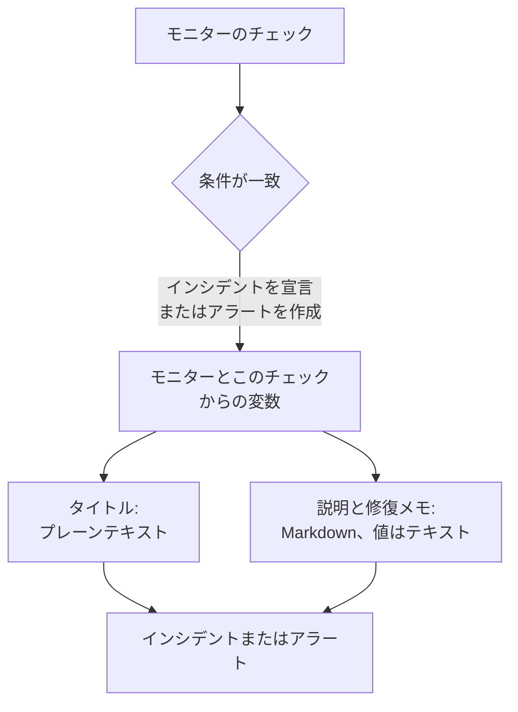

# インシデント & アラート テンプレート

モニターの条件がインシデントを宣言したりアラートを作成したりすると、そのタイトル、説明、修復メモは、あなたが書いたテンプレートから埋められます。テンプレートには `{{variable}}` プレースホルダー (`{{monitorName}}` や `{{responseStatusCode}}` など) を入れます。そうすれば各インシデントは、それを開いたチェックの値を使って、何が起きたかを伝えます。

:::cards
- [テンプレートを書く場所](#テンプレートを書く場所): 条件が作るインシデントやアラートのタイトル、説明、修復メモ。
- [基本的な使い方](#基本的な使い方): プレースホルダー、オブジェクトへのパス、リスト。
- [すべてのモニターにある変数](#すべてのモニターにある変数): モニターの名前と、しきい値を超えたリソース。
- [モニターの種類ごとの変数](#モニターの種類ごとの変数): チェックの種類ごとに報告される内容。
:::

## テンプレートの仕組み

テンプレートは、条件がインシデントやアラートを作成するときに一度だけ埋められます。OneUptime はモニターと一致したチェックから変数を集め、各値をそのプレースホルダーの位置に入れて、結果を保存します。後でテンプレートを変更すると、それ以降に作成されるインシデントとアラートが変わりますが、すでに開いているものは変わりません。



- **タイトルはプレーンテキストです。** どこに表示されても、テンプレートが描画したとおりに読めます。
- **説明と修復メモは Markdown です。** あなたが書いた Markdown は描画され、監視対象のシステムが送ってきた値はすべてテキストとして入るため、その中の何もリンク、画像、メンションを追加できません。[説明と修復メモに入る値](#説明と修復メモに入る値) を参照してください。
- **グループ化されたモニターは、各インシデントを自分のシリーズについて埋めます。** ホスト、Pod、デバイスごとに 1 つのインシデントを開くモニターは、各テンプレートをそのシリーズの値で埋め、テンプレートにシリーズの名前がまだ書かれていなければ、タイトルにシリーズの名前を加えます。

## テンプレートを書く場所

:::steps
### モニターの条件を開く

**モニター** に移動してモニターを開き、サイドメニューの **条件** をクリックします。**監視条件を編集** をクリックします。

### インシデントまたはアラートをオンにする

条件の **アクション** で、**フィルターが一致したとき、インシデントを宣言します。** または **フィルターが一致したとき、アラートを作成します。** をオンにします。その下にインシデントまたはアラートのフォームが開きます。

### タイトルを書く

**インシデントタイトル** または **アラートタイトル** にタイトルを入力します。たとえば `{{monitorName}} is down` です。その横にある **動的テンプレートについて詳しく見る** を開くと、**動的テンプレート変数** が表示されます。このモニターの種類が持つすべての変数と、それぞれの内容です。変数をクリックするとコピーされます。

### 説明と修復メモを書く

**インシデントの説明** または **アラートの説明** を書くには **説明** を開き、**修復メモ** を書くには **その他の項目** を開きます。これらのエディターは変数そのものを提示します。**テンプレート変数** はエディターの下に変数を一覧表示し、ツールバーの **変数を挿入** は同じ一覧を開き、`{{` と入力するとカーソル位置で一覧が開きます。

### 条件を保存する

**変更を保存** をクリックします。この条件が次に作成するインシデントやアラートから、新しいテンプレートが使われます。
:::

## 基本的な使い方

プレースホルダーは、二重の波かっこで囲んだ変数名です。インシデントが作成されると、OneUptime はそれを変数の値に置き換え、周りのテキストは書いたとおりに残します。

```text title="Title template"
{{monitorName}} returned {{responseStatusCode}} in {{responseTimeInMs}} ms
```

モニターの名前が `Checkout API`、レスポンスのステータスコードが `502`、レスポンスにかかった時間が `842` ミリ秒なら、インシデントのタイトルは次のようになります。

```text title="Title as created"
Checkout API returned 502 in 842 ms
```

### オブジェクトとリストへのパス

オブジェクトやリストを持つ変数は、[JavaScript 式](/docs/monitor/javascript-expression) と同じように、パスで読み取ります。

| 書き方 | 読み取るもの | 例 |
| --- | --- | --- |
| `{{object.field}}` | オブジェクトのフィールド (任意の深さ) | `{{responseBody.error.message}}` |
| `{{list[0]}}` または `{{list.0}}` | リストの要素 (0 から数える) | `{{diskMetrics[0].usagePercent}}` |
| `{{list[last]}}` | リストの最後の要素 | `{{processes[last].name}}` |
| `{{object}}` | オブジェクトまたはリスト全体 (JSON として) | `{{responseBody}}` |

フィールド名にはハイフンを含められます (`{{responseHeaders.content-type}}` のように)。`[-1]` のような負のインデックスは何も読み取りません。`[last]` を使ってください。

### 値がない場合

パスがどこにもつながらないプレースホルダーは、波かっこも含めて書いたとおりにテキストに残ります。レスポンスに `error` フィールドがなければ、`{{responseBody.error.id}}` はそのままタイトルに表示されます。このチェックが報告しなかった変数も同じで、たとえば失敗しなかったチェックの `failureCause` がそうです。チェックが空のテキストとして報告した値は、何もない文字列に置き換えられます。

グループ化されているかどうかにかかわらず動く 1 つのテンプレートを書くには、[影響を受けたリソース](#影響を受けたリソース) の変数を使います。これらは常に存在し、モニターがグループ化されていないときは空です。

### 説明と修復メモに入る値

説明と修復メモは Markdown です。インシデントやアラートのページ、メール、そして Slack と Microsoft Teams のチャネルに表示されます。テンプレートがそこに入れる値は、監視対象のシステムが送ってきたもの (レスポンスのボディやヘッダー、受信したリクエストやメール、デバイスやシリーズのラベル) なので、どの値もテキストとして入ります。テンプレートがどこに置いても送られたとおりに読め、値の中のリンク、画像、HTML タグ、`<!channel>` のような Slack のメンションは、動作せずにテキストとして表示されます。値の中のむき出しの Web アドレスはリンクになりますが、リンク先がわかる形で表示されます。テンプレート自体に書いた Markdown は、書いたとおりに描画されます。

値はどんなサイズでもかまいません (レスポンスのボディや何メガバイトものログなど)。通知はそれを含めて送信されます。各チャネルは受け付けられる分だけを運び、長すぎる説明は、改行があればそこで切られて、"… (truncated — see OneUptime for the full text)" で終わります。

- **メール**: 説明、メモ、根本原因のそれぞれが、メール本文のうち約 256 KB までを運びます。それより長い場合は、末尾の注記がインシデントまたはアラートにリンクします。メール全体 (本文とスクリーンショット) は 3 MB 未満に収まり、どのメールサーバーや Microsoft Graph でも受け付けられます。本文と一緒に収まらないスクリーンショットは省かれ、その場所に注記が入ります。
- **インシデントやアラートのページ** にはすべてが表示されます。128 KB を超え、レイアウトに時間がかかる説明は、プレーンテキストとして 1 行ずつ表示されます。
- **Slack** は、Slack がメッセージに表示する分 (約 30,000 文字) までを運びます。**Microsoft Teams** は、OneUptime アプリからのメッセージで約 40,000 文字、受信 Webhook (ステータスページの購読者、ワークフロー) で約 12,000 文字を運びます。これは送信時のメッセージで測るため、表は変換後の HTML として数えられます。
- **SMS、電話、プッシュ通知、WhatsApp、Telegram** は、それぞれのプロバイダーが受け付ける分を運びます。[レベルが人を呼び出すしくみ](/docs/on-call/escalation-rules#レベルが人を呼び出す仕組み) を参照してください。

どのチャネルも、テキストを長さに応じた時間で描画します。描画にはるかに長い時間がかかる部分 (64 KB を超える行、プレーンな行が長く続く段落、閉じられない `*`、`_`、`[` だらけの段落、十六段階を超えて入れ子になった引用やリスト、インシデントやアラートのページでは千行を超える表やリスト) は、その場所でプレーンテキストとして表示され、説明の残りは通常どおり描画されます。

## 高度な使い方

### リストをループする

`{{#each path}}` は、`{{/each}}` までのテキストを、`path` にあるリストの要素ごとに 1 回ずつ繰り返します。

```text title="Loop syntax"
{{#each arrayPath}}
  ...text with {{field}} placeholders for each item...
{{/each}}
```

ループの中では次のようになります。

- `{{field}}` と `{{field.nested}}` は現在の要素を読み取ります。要素にない名前は、外側の要素、次にテンプレート全体の変数から探されます。
- `{{@index}}` は要素の位置で、0 から数えます。
- `{{this}}` は要素そのもので、文字列のようなプレーンな値のリストで使います。
- リストではないパスや空のリストに対するループは、何も書き出しません。
- ループは入れ子にできます。ほかのループの中にある `{{#each}}` は、外側の各要素の内側のリストを読み取ります。

たとえば、次のアラート通知を受け取る [受信リクエスト モニター](/docs/monitor/incoming-request-monitor) が、

```json title="Request body"
{
  "receiver": "payments",
  "alerts": [
    { "status": "firing", "labels": { "alertname": "HighLatency" } },
    { "status": "resolved", "labels": { "alertname": "DiskFull" } }
  ]
}
```

次の説明テンプレートを持っていると、

```text title="Description template"
Alerts for {{requestBody.receiver}}:
{{#each requestBody.alerts}}
- {{@index}}: {{labels.alertname}} ({{status}})
{{/each}}
```

作成されるインシデントの説明は次のようになります。各要素は前後の改行を保つため、要素の間には空行が入りますが、説明は 1 つのリストとして表示されます。

```text title="Description as created"
Alerts for payments:

- 0: HighLatency (firing)

- 1: DiskFull (resolved)
```

### グループ化されたモニターの値

**グループ化** 属性を持つメトリクスベースのモニターは、シリーズごとに 1 つのインシデントを開き、各属性の値は属性名の変数になります。`host.name` でグループ化すると `{{host.name}}` が、`resource.k8s.pod.name` でグループ化すると `{{resource.k8s.pod.name}}` が得られます。`{{seriesLabels}}` はそれらすべてをオブジェクトとして持ちます。

グループ化された [ログ モニター](/docs/monitor/logs-monitor) も同じように動作します。各グループ化属性の値は、そのキーの変数になります。

## すべてのモニターにある変数

### モニター

| 変数 | 内容 | 例 |
| --- | --- | --- |
| `monitorName` | モニターの名前。 | `Checkout API` |
| `monitorId` | モニターの ID。 | `a0f78958-da0a-4775-9fd9-c9fc63d3456f` |
| `monitorType` | モニターの種類。 | `Website`、`Synthetic Monitor` |

### 影響を受けたリソース

これらは、グループ化されたモニターがインシデントを開いた対象のシリーズ (Pod、コンテナー、ホスト、ディスク) を表します。グループ化されていないモニターでは空なので、どのモニターのテンプレートでも使えます。

| 変数 | 内容 |
| --- | --- |
| `seriesResourceSuffix` | シリーズの識別子。区切り文字で始まり、タイトルの末尾に付けるためのものです。 |
| `seriesResourceSummary` | 区切り文字のない同じ識別子で、文の中に入れるためのものです。 |
| `seriesResourceBlock` | シリーズのすべてのラベルを Markdown のリストにしたもの。説明に最適です。 |
| `seriesDebugCommands` | まさにこのリソースに対する読み取り専用のコマンド (`kubectl` や `docker` など) を Markdown のリストにしたもの。 |

## モニターの種類ごとの変数

### ウェブサイトと API のモニター

| 変数 | 内容 | 型 |
| --- | --- | --- |
| `responseBody` | レスポンスのボディ。JSON ならオブジェクト、それ以外はテキスト。 | `JSON` または `string` |
| `responseHeaders` | レスポンスのヘッダー (小文字の名前で)。 | `Dictionary<string>` |
| `responseStatusCode` | HTTP ステータスコード。 | `number` |
| `responseTimeInMs` | 応答時間 (ミリ秒)。 | `number` |
| `isOnline` | モニターがレスポンスをオンラインとみなしたかどうか。 | `boolean` |

### 受信リクエスト モニター

| 変数 | 内容 | 型 |
| --- | --- | --- |
| `requestBody` | リクエストのボディ。JSON ならオブジェクト。 | `JSON` または `string` |
| `requestHeaders` | リクエストのヘッダー (小文字の名前で)。 | `Dictionary<string>` |
| `requestMethod` | HTTP メソッド (`POST` など)。 | `string` |
| `incomingRequestReceivedAt` | リクエストを受信した日時 (ISO 8601 タイムスタンプ)。 | `string` |

条件で **ペイロードのフィールドでインシデントとアラートをグループ化** がオンのときは、グループ化キーも変数になり、その名前はグループ化パスの **最後のセグメント** になります。`requestBody.alerts[*].labels.alertname` でグループ化すると `{{alertname}}`、`requestBody.alerts[*].fingerprint` でグループ化すると `{{fingerprint}}` が得られます。その横には `requestBody` 全体もそのまま残ります。

> [!NOTE]
> `[*]` はグループ化パスのフィールドでしか使えません。テンプレートの中では何も読み取らないため、プレースホルダーは書いたまま残ります。`{{requestBody.alerts[0].annotations.summary}}` は常にペイロードの最初のアラートを読み取り、インシデントが開かれた対象のアラートではありません。グループ化変数と、`commonLabels` や `commonAnnotations` のようなペイロードの共通フィールドを使ってください。[受信リクエスト モニター](/docs/monitor/incoming-request-monitor) を参照してください。

### 受信メール モニター

| 変数 | 内容 | 型 |
| --- | --- | --- |
| `emailSubject` | メールの件名。 | `string` |
| `emailFrom` | 送信者のメールアドレス。 | `string` |
| `emailTo` | メールの宛先 (モニター自身のアドレスはマスクされます)。 | `string` |
| `emailBody` | メールのプレーンテキストの本文。 | `string` |
| `emailReceivedAt` | メールを受信した日時 (UTC の ISO 8601 タイムスタンプ)。 | `string` |

タイトルでは、これらはそれぞれ最大 150 文字の 1 行に切り詰められます。説明と修復メモには完全な値が入ります。[受信メール モニター](/docs/monitor/incoming-email-monitor#テンプレート変数) を参照してください。

### Ping、IP、ポートのモニター

| 変数 | 内容 | 型 |
| --- | --- | --- |
| `isOnline` | ターゲットが応答したかどうか。 | `boolean` |
| `responseTimeInMs` | 応答時間 (ミリ秒)。ポートの場合は DNS 解決と TCP 接続の合計です。 | `number` |
| `failureCause` | チェックが失敗したときの理由。 | `string` |
| `isTimeout` | チェックがタイムアウトしたかどうか。 | `boolean` |

### NTP モニター

| 変数 | 内容 | 型 |
| --- | --- | --- |
| `isOnline` | タイムサーバーがプローブのリクエストに応答したかどうか。 | `boolean` |
| `isSynchronized` | stratum 1 から 15 で、うるう秒アラームなしに、実際のタイムスタンプで応答したかどうか。 | `boolean` |
| `stratum` | サーバーが報告した stratum。プライマリサーバーは 1、同期していないときは 16、kiss-o'-death では 0。 | `number` |
| `clockOffsetInMs` | サーバーの時計がプローブの時計からどれだけずれているか (ミリ秒)。正の値はサーバーが進んでいることを意味します。 | `number` |
| `referenceId` | サーバーが同期している先。stratum 1 では `GPS` のようなソース、それ以外では上位サーバーのアドレス。 | `string` |
| `leapIndicator` | 問題がなければ 0 から 2、サーバーが自分の時計は同期していないと示すときは 3。 | `number` |
| `kissCode` | stratum 0 のとき、サーバーが時刻の代わりに送ってきた 4 文字のコード (`RATE` など)。 | `string` |
| `responseTimeInMs` | リクエストから応答までの時間 (ミリ秒)。 | `number` |
| `roundTripDelayInMs` | やり取りのネットワーク往復時間 (サーバー自身の処理時間を除く)。 | `number` |
| `rootDelayInMs` | サーバーから参照クロックまでの往復時間 (ミリ秒)。 | `number` |
| `rootDispersionInMs` | サーバー自身が見積もった最大誤差 (ミリ秒)。 | `number` |
| `serverTime` | サーバーが応答を送ったときのサーバーの時計 (ISO 8601 タイムスタンプ)。 | `string` |
| `referenceTime` | サーバーの時計が最後に設定または補正された日時 (ISO 8601 タイムスタンプ)。 | `string` |
| `serverAddress` | リクエストの送信先アドレス。 | `string` |
| `port` | リクエストの送信先 UDP ポート。 | `number` |
| `failureCause` | サーバーが応答しなかった理由、または同期していない理由。 | `string` |
| `isTimeout` | サーバーが時間内に応答しなかったかどうか。 | `boolean` |

### SSL 証明書モニター

| 変数 | 内容 | 型 |
| --- | --- | --- |
| `isOnline` | 証明書のチェックが成功したかどうか。 | `boolean` |
| `isSelfSigned` | 証明書が自己署名かどうか。 | `boolean` |
| `createdAt` | 証明書が発行された日時 (ISO 8601 タイムスタンプ)。 | `string` |
| `expiresAt` | 証明書の有効期限 (ISO 8601 タイムスタンプ)。 | `string` |
| `commonName` | 証明書のコモンネーム (CN)。 | `string` |
| `organizationalUnit` | 組織単位 (OU)。 | `string` |
| `organization` | 組織 (O)。 | `string` |
| `locality` | 市区町村 (L)。 | `string` |
| `state` | 州または都道府県 (ST)。 | `string` |
| `country` | 国 (C)。 | `string` |
| `serialNumber` | シリアル番号。 | `string` |
| `fingerprint` | SHA-1 フィンガープリント。 | `string` |
| `fingerprint256` | SHA-256 フィンガープリント。 | `string` |
| `failureCause` | チェックが失敗したときの理由。 | `string` |

### DNS モニター

| 変数 | 内容 | 型 |
| --- | --- | --- |
| `isOnline` | クエリに応答があったかどうか。 | `boolean` |
| `responseTimeInMs` | クエリ時間 (ミリ秒)。 | `number` |
| `isTimeout` | クエリがタイムアウトしたかどうか。 | `boolean` |
| `isDnssecValid` | DNSSEC 検証の結果。 | `boolean` |
| `records` | 返されたレコード。それぞれ `{type, value, ttl}` の形です。 | `Array<Object>` |
| `recordValues` | レコードの値だけ。 | `Array<string>` |
| `failureCause` | クエリが失敗したときの理由。 | `string` |

### DNSSEC モニター

| 変数 | 内容 | 型 |
| --- | --- | --- |
| `isOnline` | チェックが完了したかどうか。 | `boolean` |
| `domainName` | チェックしたゾーン。 | `string` |
| `isZoneSigned` | ゾーンに DNSKEY レコードがあるかどうか。 | `boolean` |
| `isParentDsPresent` | 親ゾーンにそのゾーンの DS レコードがあるかどうか。 | `boolean` |
| `isChainValid` | 信頼の連鎖が検証できるかどうか。 | `boolean` |
| `resolverConsensusAd` | すべてのリゾルバーが AD フラグを返したかどうか。 | `boolean` |
| `isNameserverConsistent` | すべての権威ネームサーバーが同じ SOA シリアルを返したかどうか。 | `boolean` |
| `earliestSignatureExpiration` | 最初の RRSIG 署名が期限切れになる日時 (ISO 8601 タイムスタンプ)。 | `string` |
| `daysUntilSignatureExpiry` | その署名が期限切れになるまでの日数。 | `number` |
| `dnskeyCount` | DNSKEY レコードの数。 | `number` |
| `dsRecordCount` | 親にある DS レコードの数。 | `number` |
| `rrsigCount` | 見つかった RRSIG レコードの数。 | `number` |
| `responseTimeInMs` | チェックにかかった時間 (ミリ秒)。 | `number` |
| `failureCause` | チェックが失敗したときの理由。 | `string` |

### ドメイン モニター

| 変数 | 内容 | 型 |
| --- | --- | --- |
| `isOnline` | 登録情報の検索が成功したかどうか。 | `boolean` |
| `domainName` | 検索したドメイン。 | `string` |
| `lookupMethod` | 応答したプロトコル: RDAP または WHOIS。 | `string` |
| `registrar` | レジストラー。 | `string` |
| `createdDate` | ドメインが登録された日時。 | `string` |
| `updatedDate` | 登録情報が最後に変更された日時。 | `string` |
| `expiresDate` | 登録の有効期限。 | `string` |
| `nameServers` | ドメインのネームサーバー。 | `Array<string>` |
| `domainStatus` | レジストリのステータスコード (`clientTransferProhibited` など)。 | `Array<string>` |
| `dnssec` | レジストリの DNSSEC ステータス。 | `string` |
| `responseTimeInMs` | 検索にかかった時間 (ミリ秒)。 | `number` |
| `failureCause` | 検索が失敗したときの理由。 | `string` |

### サーバー / VM モニター

| 変数 | 内容 | 型 |
| --- | --- | --- |
| `hostname` | サーバーのホスト名。 | `string` |
| `requestReceivedAt` | サーバーのレポートを受信した日時 (ISO 8601 タイムスタンプ)。 | `string` |
| `cpuUsagePercent` | 使用中の CPU (0 から 100)。 | `number` |
| `cpuCores` | CPU コアの数。 | `number` |
| `memoryUsagePercent` | 使用中のメモリ (0 から 100)。 | `number` |
| `memoryFreePercent` | 空きメモリ (0 から 100)。 | `number` |
| `memoryTotalBytes` | メモリの合計 (バイト)。 | `number` |
| `diskMetrics` | マウントされたディスクごとに 1 エントリ。 | `Array<Object>` |
| `diskMetrics[].diskPath` | ディスクのマウントポイント。 | `string` |
| `diskMetrics[].usagePercent` | ディスクの使用中の容量 (0 から 100)。 | `number` |
| `diskMetrics[].freePercent` | ディスクの空き容量 (0 から 100)。 | `number` |
| `diskMetrics[].totalBytes` | ディスクのサイズ (バイト)。 | `number` |
| `processes` | エージェントが報告した実行中のプロセス。 | `Array<Object>` |
| `processes[].pid` | プロセス ID。 | `number` |
| `processes[].name` | プロセス名。 | `string` |
| `processes[].command` | プロセスを起動したコマンド。 | `string` |
| `failureCause` | チェックが失敗したときの理由。 | `string` |

### 合成モニター

合成モニターは、使うように設定されたブラウザーと画面サイズの組み合わせごとに 1 回スクリプトを実行します。たとえば、デスクトップ画面の Chromium とモバイル画面の Firefox です。`syntheticResponses` は実行ごとに 1 エントリを持ちます。`{{syntheticResponses[0].browserType}}` のように位置で 1 つの実行を読み取るか、`{{#each syntheticResponses}}` ですべての実行を読み取ります。

| 変数 | 内容 | 型 |
| --- | --- | --- |
| `failureCause` | チェックが失敗したときの理由。 | `string` |
| `syntheticResponses` | スクリプトを実行したブラウザーと画面サイズごとに 1 エントリ。 | `Array<Object>` |
| `syntheticResponses[].executionTimeInMs` | 実行にかかった時間 (ミリ秒)。 | `number` |
| `syntheticResponses[].result` | スクリプトが返したもの。 | `string`、`number`、`boolean` または `JSON` |
| `syntheticResponses[].scriptError` | 実行が終了したときのエラー (あれば)。 | `string` |
| `syntheticResponses[].logMessages` | 実行が記録したログ。 | `Array<string>` |
| `syntheticResponses[].screenshots` | 実行が撮ったスクリーンショット。名前ごとに、それぞれ base64 テキストとして入ります。[スクリーンショットを表示する](#スクリーンショットを表示する) を参照してください。 | `Object` |
| `syntheticResponses[].browserType` | 実行のブラウザー。 | `string` |
| `syntheticResponses[].screenSizeType` | 実行の画面サイズ。 | `string` |

#### スクリーンショットを表示する

`screenshots` の各エントリは、スクリプトが撮ったスクリーンショットで、スクリプトが付けた名前 (`screenshots["login-page"] = await page.screenshot()`) の下に base64 テキストとして入っています。インシデントやアラートの説明や修復メモに表示するには、それを画像で囲みます。

```text title="Description template"
{{syntheticResponses[0].scriptError}}


```

すると、スクリーンショットはインシデントやアラートのページ、そのインシデントを表示するステータスページ、それに関するメール通知、そしてそれに関する Slack と Microsoft Teams のメッセージに表示されます。メールでは添付されて本文に表示され、Gmail、Outlook、Apple Mail のいずれでも表示されるため、オンコール担当者は OneUptime を開かずにページの様子を確認できます。

- PNG、JPEG、GIF、WebP のスクリーンショットが表示されます。`image/png` は JPEG のスクリーンショット (`page.screenshot({ type: "jpeg" })`) にも使えます。
- 1 通のメールが運べる画像は最大 2 MB、最大 20 枚です。収まらない画像は代替テキスト付きの注記に置き換えられるため、各画像に代替テキストを付けてください。JPEG のスクリーンショットは PNG よりはるかに小さく、失敗した実行のスクリーンショット 1 枚のほうが、すべての実行のすべてのスクリーンショットよりも多くを語ることがよくあります。
- Slack と Microsoft Teams では、スクリーンショットは説明の中でそれが置かれた場所に表示されます。単独の行にある画像はその行の位置を占め、文、リスト、表の途中にある画像はそこに代替テキストを残して、その後に表示されます。Slack は PNG、JPEG、GIF のスクリーンショットを、1 メッセージあたり最大 10 枚、10 MB まで表示します。OneUptime アプリは各画像を Slack ワークスペースにプライベートにアップロードし、メッセージに表示します。Teams は 1 枚あたり最大 1 MB の PNG、JPEG、GIF のスクリーンショットを、メッセージのカード内に 1 メッセージあたり最大 10 枚、2 MB まで表示します。
- Slack へのアップロードには、アプリの `files:write` 権限が必要です。OneUptime がこの権限を要求する前にワークスペースが Slack を接続していた場合は、**プロジェクト設定 → ワークスペース → Slack** で Slack を接続し直してください (セルフホストのサーバーでは、先に Slack アプリに権限を追加してください。[Slack 統合](/docs/self-hosted/slack-integration#メッセージ内の画像) を参照)。
- チャットで表示できないスクリーンショット (WebP、上記の制限を超えるもの、Slack や Teams が拒否したもの、受信 Webhook 経由で送られたメッセージ内のスクリーンショット) は、代替テキスト、または代替テキストがなければ "[image]" として表示されるため、各画像に代替テキストを付けてください。画像の base64 がチャットに届くことはありません。
- 表示されるのは、テンプレートに書いた画像だけです。監視対象のページやスクリプトが報告した値 (エラーメッセージやログ行) の中の画像は、引き続きテキストとして表示されます ([説明と修復メモに入る値](#説明と修復メモに入る値) を参照)。
- OneUptime AI が読むのはスクリーンショットの周りのテキストで、スクリーンショットそのものではありません。調査、下書きされたポストモーテムやメモ、ランブックの AI ステップ、ワークフローの AI ステップがモデルに渡すものには、画像の位置に `[image omitted: PNG, 340 KB]` のような短い注記が入ります。モデルが読むのはテキストで画像ではなく、スクリーンショットの base64 は呼び出しのたびに数十万トークンになるためです。調査のアクティビティには、何が省かれたかが記録されます。

失敗したすべての実行のスクリーンショットを表示するには、画像をループの中に入れます。ここでは、スクリプトが各スクリーンショットを `screenshots["failure"]` として保存しています。

```text title="Description template"
### What the page looked like
{{#each syntheticResponses}}
**{{browserType}} / {{screenSizeType}}**: {{scriptError}}


{{/each}}
```

### カスタム JavaScript コード モニター

| 変数 | 内容 | 型 |
| --- | --- | --- |
| `result` | スクリプトが返したもの。`{{result.status}}` のようにパスでフィールドを読み取ります。 | `string`、`number`、`boolean` または `JSON` |
| `executionTimeInMs` | スクリプトの実行時間 (ミリ秒)。 | `number` |
| `scriptError` | スクリプトが終了したときのエラー (あれば)。 | `string` |
| `logMessages` | スクリプトが `console.log` で記録したもの。 | `Array<string>` |
| `failureCause` | チェックが失敗したときの理由。 | `string` |

### ネットワークデバイス モニター

| 変数 | 内容 | 型 |
| --- | --- | --- |
| `isOnline` | デバイスに ping **または** SNMP で到達できるかどうか。ポーリングのたびに設定されます。 | `boolean` |
| `responseTimeInMs` | SNMP **ウォーク** の応答時間 (ミリ秒)。ping の往復時間ではありません。 | `number` |
| `failureCause` | SNMP ウォークが失敗したときの理由。 | `string` |
| `isTimeout` | SNMP ウォークがタイムアウトしたかどうか。 | `boolean` |
| `oidResponses` | 問い合わせた OID。それぞれ `{oid, name, value, type}` の形です。 | `Array<Object>` |
| `{{OID_NAME}}` | 名前付き OID の値を名前で (`{{sysUpTime}}` のように)。 | `string` または `number` |
| `sysName` | SNMP システムグループから取得したデバイスの名前。 | `string` |
| `sysDescr` | SNMP システムグループから取得したデバイスの説明。 | `string` |
| `sysObjectId` | ベンダーが登録したエンタープライズ OID。デバイスのフィンガープリントです。 | `string` |
| `sysLocation` | SNMP システムグループから取得したデバイスの場所。 | `string` |
| `downInterfaces` | 管理上はアップだが動作上はダウンしているインターフェイス。それぞれ `{name, alias, interfaceIndex}` の形です。インターフェイス監視が必要です。 | `Array<Object>` |
| `interfacesTotal` | ウォークしたインターフェイスの数。 | `number` |
| `interfacesUp` | 管理上も動作上もアップしているインターフェイス。 | `number` |
| `interfacesDown` | 管理上はアップだが動作上はダウンしているインターフェイス。 | `number` |
| `interfaceWalkFailure` | インターフェイスのウォークが失敗したときのエラー。 | `string` |
| `tables` | デバイスの SNMP テーブルをキーごとに。それぞれの `rowCount`、`rows`、`unhealthyRowCount`、`unhealthyRows` を `{{tables.ipsec_tunnels.unhealthyRowCount}}` のように読み取ります。 | `Object` |
| `snmpTable` | 行ごとのアラートが対象とする SNMP テーブル。 | `string` |
| `snmpTableRow` | 行ごとのアラートが対象とする行 (トンネル、無線、ネイバーなど)。 | `string` |
| `trapOid` | トラップの OID。SNMP トラップがチェックをトリガーしたときのみ。 | `string` |
| `trapSourceIp` | トラップの送信元アドレス。SNMP トラップがチェックをトリガーしたときのみ。 | `string` |
| `trapVarbinds` | トラップの varbind。それぞれ `{oid, value}` の形です。SNMP トラップがチェックをトリガーしたときのみ。 | `Array<Object>` |

ネットワークデバイスはポーリングのたびに ping され、認証情報があるときだけ SNMP でウォークされます。そのため、**ping だけのデバイスが埋める上記の変数は `isOnline` だけです**。それ以外はすべて SNMP ウォークから得られるため、ウォークがなければ書いたまま残ります。認証情報のないデバイスにも使う可能性のあるテンプレートでは、`{{isOnline}}` とデバイスの名前を先頭に置いてください。各種ポーリングが何を収集するかは、[ネットワークデバイス モニター](/docs/monitor/network-device-monitor#what-a-poll-actually-does) を参照してください。

### データベース ヘルス モニター

| 変数 | 内容 | 型 |
| --- | --- | --- |
| `isOnline` | プローブが接続してベースラインのクエリを実行できたかどうか。メトリクスが欠けていても false にはなりません。 | `boolean` |
| `responseTimeInMs` | 接続してベースラインのクエリを実行するまでの時間 (ミリ秒)。 | `number` |
| `failureCause` | チェックが失敗したときの理由。 | `string` |
| `connectionError` | 接続エラー (認証情報や接続文字列は含みません)。 | `string` |
| `engineVersion` | データベースサーバーが報告したバージョン。 | `string` |
| `collectedGroups` | このチェックで値が得られたメトリクスグループ。 | `Array<string>` |
| `unavailableGroups` | 収集できなかったグループ。それぞれ `{group, reason, message, remediation}` の形です。 | `Array<Object>` |
| `collectionIssueSummary` | 利用できなかったすべてのグループについての 1 行。タイトルにそのまま使えます。すべて収集できたときは空です。 | `string` |
| `metrics` | 収集した値をシリーズ名ごとに。 | `Object` |

`metrics` のシリーズ名には `oneuptime.monitor.database.connections.used.percent` のようにドットが含まれ、パスは各ドットをオブジェクトの中に入る 1 ステップとして読むため、テンプレートでは `metrics` から 1 つの値を取り出せません。`{{metrics}}` を JSON として丸ごと入れるか、`{{collectionIssueSummary}}` を使ってください。収集されなかったメトリクスは `metrics` に存在せず、ゼロにはなりません。1 つの値で判断したいときは、条件の中で [JavaScript 式](/docs/monitor/javascript-expression) を使って比較してください。

### 外部ステータスページ モニター

| 変数 | 内容 | 型 |
| --- | --- | --- |
| `overallStatus` | ステータスページの全体のステータス (`major_outage` など)。 | `string` |
| `activeIncidentCount` | ステータスページで開いているインシデントの数。 | `number` |
| `componentStatuses` | コンポーネント。それぞれ `{name, status, description, groupName}` の形です。 | `Array<Object>` |
| `provider` | ステータスページの種類: Atlassian Statuspage、incident.io、RSS、Atom。 | `string` |
| `componentGroup` | モニターが監視しているコンポーネントグループ (ある場合)。 | `string` |
| `componentName` | モニターが監視しているコンポーネント (ある場合)。 | `string` |
| `isOnline` | ステータスページが応答したかどうか。 | `boolean` |
| `responseTimeInMs` | ステータスページの応答にかかった時間 (ミリ秒)。 | `number` |
| `failureCause` | チェックが失敗したときの理由。 | `string` |

### メトリクスとインフラストラクチャのモニター

Metrics、Kubernetes、Docker、Host、Podman、Docker Swarm、Proxmox、VMware、Ceph、Storage Array、IoT Device の各モニターには、固有の変数が 1 つあります。

| 変数 | 内容 | 型 |
| --- | --- | --- |
| `metricName` | モニターの最初のクエリが読むメトリクスの名前 (`container.cpu.time` など)。 | `string` |

グループ化されている場合は、各 **グループ化** 属性の値と `seriesLabels` もあります。[グループ化されたモニターの値](#グループ化されたモニターの値) を参照してください。IoT Device モニターのテンプレートはデバイスごとにグループ化するため、テンプレートから作成したモニターには `{{device.id}}` もあります。

### その他のモニターの種類

Logs、Traces、Exceptions、Security Events、AI / LLM、SQL Query の各モニターには、固有の変数はありません。[すべてのモニターにある変数](#すべてのモニターにある変数) を使い、グループ化された Logs モニターでは [グループの値](#グループ化されたモニターの値) を使ってください。

## 例

### 遅い API

```text title="Title"
{{monitorName}} is slow: {{responseTimeInMs}} ms
```

```text title="Description"
### API error
Status: **{{responseStatusCode}}**
Latency: **{{responseTimeInMs}} ms**
Message: `{{responseBody.error.message}}`
```

### 期限切れが近い証明書

```text title="Title"
Certificate for {{commonName}} expires {{expiresAt}}
```

### 容量が不足しつつあるサーバー

```text title="Description"
### {{hostname}}
CPU: **{{cpuUsagePercent}}%**
Memory: **{{memoryUsagePercent}}%**

**Disks:**
{{#each diskMetrics}}
- {{diskPath}}: {{usagePercent}}% used ({{freePercent}}% free)
{{/each}}

**Processes:**
{{#each processes}}
- [{{pid}}] {{name}}: {{command}}
{{/each}}
```

### 失敗した Ping、IP、ポートのチェック

```text title="Description"
{{monitorName}} could not be reached: {{failureCause}}
Timed out: {{isTimeout}}
Response time: {{responseTimeInMs}} ms
```

### 合成モニターのすべての実行

```text title="Description"
### Synthetic monitor results
{{#each syntheticResponses}}
- **{{browserType}} / {{screenSizeType}}**: {{result}} in {{executionTimeInMs}} ms
  - Script error: {{scriptError}}
  - First log line: {{logMessages[0]}}
{{/each}}
```

### カスタム コード チェック

```text title="Description"
The script ran for {{executionTimeInMs}} ms and returned {{result}}.
Last log line: {{logMessages[last]}}
```

### ネットワークデバイス

これらはデバイスに SNMP の認証情報があることを前提としています。ping だけのデバイスでは、`{{isOnline}}` 以外はすべて書いたまま残ります。

```text title="Title"
{{sysName}}: {{interfacesDown}} interfaces down
```

```text title="Description"
### {{sysName}} ({{sysLocation}})
Online: {{isOnline}}
SNMP walk: {{responseTimeInMs}} ms

{{#each downInterfaces}}
- {{name}} ({{alias}}) is down
{{/each}}
```

### Alertmanager または Grafana のアラート

```text title="Title"
[{{requestBody.status}}] {{requestBody.receiver}}
```

```text title="Description"
### Alerts from {{requestBody.receiver}}
{{#each requestBody.alerts}}
**Alert {{@index}}**: {{labels.alertname}}
- Status: {{status}}
- Summary: {{annotations.summary}}
- Source: {{generatorURL}}
{{/each}}
```

## トラブルシューティング

:::details タイトルにプレースホルダーが波かっこごと表示される
このチェックでは、パスが値につながっていません。変数の名前と大文字小文字を上の表と照らし合わせるか、条件で **動的テンプレートについて詳しく見る** を開いてください。このモニターの種類の変数が一覧表示されます。レスポンスやリクエストのボディへのパスは、送られたとおりのボディに一致している必要があり、`[*]` や `[-1]` のような負のインデックスは何も読み取りません。`[0]` または `[last]` を使ってください。
:::

:::details 値が JSON として表示される
パスがオブジェクトやリストで止まっているため、その全体が JSON として入っています。`{{responseBody.error.message}}` のように欲しいフィールドをパスに加えるか、`{{#each}}` でリストをループしてください。
:::

:::details ループが何も書き出さない
`#each` の後のパスがこのチェックではリストではないか、リストが空です。パスをペイロードと照らし合わせ、すべての `{{#each}}` に対応する `{{/each}}` があることを確認してください。
:::

:::details 値の中の Markdown がテキストとして表示される
これは意図したものです。監視対象のシステムが送ってきた値はテキストとして入るため、説明にリンク、画像、メンションを追加することはできません。代わりに、値の周りのテンプレートに書式を書いてください。[説明と修復メモに入る値](#説明と修復メモに入る値) を参照してください。
:::

:::details スクリーンショットが Slack、Microsoft Teams、メールに表示されない
画像の形式とサイズを [スクリーンショットを表示する](#スクリーンショットを表示する) と照らし合わせてください。Slack では、OneUptime アプリに `files:write` 権限が必要です。OneUptime がこの権限を要求する前にワークスペースが Slack を接続していた場合は、**プロジェクト設定 → ワークスペース → Slack** で Slack を接続し直してください。
:::

## 次のステップ

:::cards
- [JavaScript 式](/docs/monitor/javascript-expression): 同じプレースホルダーを条件の判定で使います。
- [インシデントの宣言](/docs/incidents/declaring-incidents): 条件がインシデントを宣言した後に起きること。
- [合成モニター](/docs/monitor/synthetic-monitor): 説明に表示できるスクリーンショットを撮ります。
- [受信リクエスト モニター](/docs/monitor/incoming-request-monitor): Webhook を、アラートごとに名前の付いたインシデントに変えます。
:::
