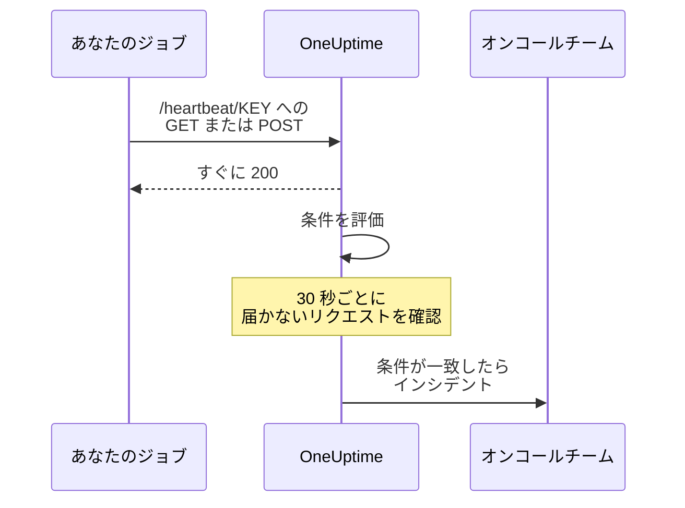
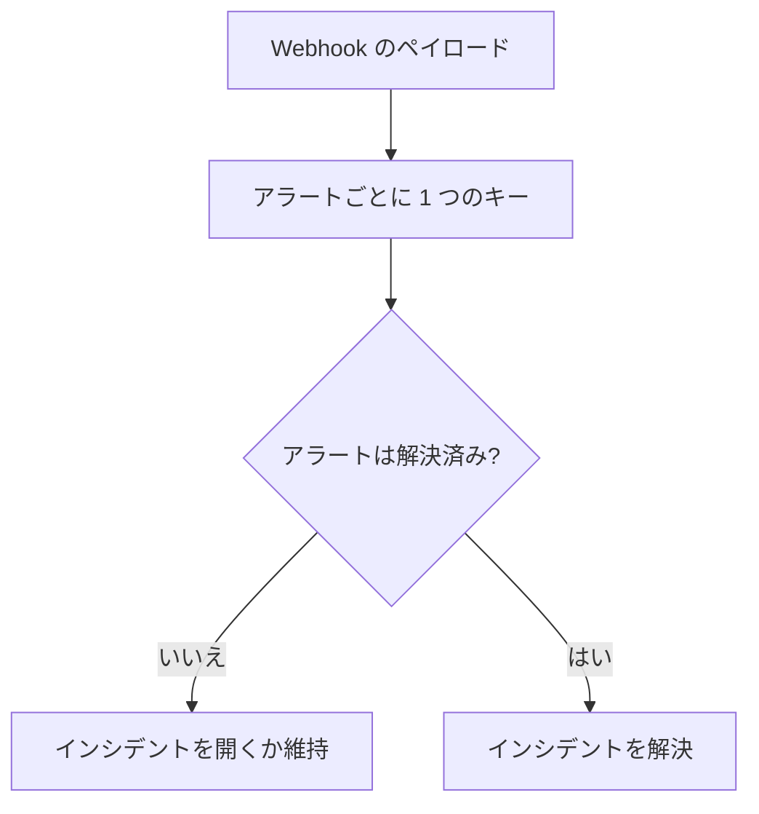

# 受信リクエスト モニター

受信リクエスト モニターは、ほかのシステムが HTTP リクエストを送るための URL を提供します。OneUptime はすべてのリクエストを条件に照らして評価し、モニターのステータスの変更、インシデントの宣言、オンコール当番の呼び出しを行えます。

このモニターは 2 つの異なる役割をこなします。

- **ハートビート監視** — cron ジョブ、ワーカー、デバイスがスケジュールに従って URL を呼び出し、呼び出しが届かなくなると OneUptime がインシデントを作成します。
- **他システムからのアラート受信** — Prometheus Alertmanager、Grafana、そのほか JSON を POST できるものがアラートを送り込み、OneUptime がそれぞれをインシデントに変換して、オンコールへエスカレーションし、回復時に自動で解決します。

どちらも同じモニターの種類を使います。両者を分けるのは、設定する条件です。

:::cards
- [モニターを作成する](#受信リクエスト-モニターを作成する): 数ステップでハートビート URL を手に入れます。
- [ハートビートを送る](#ハートビートを送る): curl、cron、Node.js、Python、Go から送れます。
- [呼び出しが止まったらアラートを出す](#10-分間ハートビートがなければオフラインにする-デッドマンスイッチ): モニターをデッドマンスイッチにします。
- [アラートを受信する](#他システムからのアラート受信): Alertmanager や Grafana のアラートごとに 1 つのインシデントを作ります。
- [SNS または Event Grid にサブスクライブする](#amazon-sns-または-azure-event-grid-にサブスクライブする): ワンクリックでサブスクリプションを確認します。
:::

## 仕組み

外部からシステムをチェックするものはありません。あなたのシステムがモニターの URL を呼び出し、OneUptime はすぐに応答してから、モニターの条件に照らしてリクエストを評価します。届かなく *なった* リクエストを調べる条件は、さらに 30 秒ごとにバックグラウンドで再評価されるので、沈黙によってもインシデントが作成されます。



次の用途に使えます。

- cron ジョブやスケジュールされたタスクの監視
- バックグラウンドワーカーが動作していることの確認
- 外部から到達できないファイアウォール内のサービスの監視
- Prometheus Alertmanager、Grafana、その他のアラートシステムからのアラート受信
- HTTP を扱えるあらゆるシステムからのハートビート信号の追跡

## 受信リクエスト モニターを作成する

:::steps
### 新しいモニターを始める

**モニター** に移動し、**モニターを作成** をクリックします。

### 受信リクエストを選ぶ

**モニターの種類** で **受信リクエスト** を選びます。上部にある一般的な種類の 1 つです。**名前** を入力し、**次へ** をクリックします。

### 条件を確認する

**条件** のステップは [デフォルトの条件](#最初から用意されているもの) から始まります。ハートビートの場合は **条件を追加** をクリックし、新しい条件に **受信リクエスト** / **分間受信なし** のフィルターを設定して、ステータスをオフラインに変えてインシデントを宣言するようにし、**インシデントを自動解決** をオンにします。そのあと、それをリストの一番上にドラッグします。理由は [条件の例](#条件の例) を参照してください。

### モニターを作成する

**モニターを作成** をクリックします。モニターは **概要** ページで開き、**最初のハートビートを送信** カードに、コピーボタン付きの **ハートビート URL** と `curl` コマンドの例が表示されます。

### 最初のリクエストを送る

その URL にリクエストを送るようにサービスを設定します ([ハートビートを送る](#ハートビートを送る) を参照)。最初のリクエストが届くと、カードはモニターの履歴に置き換わり、**ハートビート URL** カードに URL と最後のリクエストが届いた日時が表示されます。
:::

> [!NOTE]
> URL にはモニターのシークレットキーが含まれるため、モニターを編集できる人だけがこれを見られます。URL はいつでも、モニターの **ドキュメント** ページ (サイドメニューの **構成** セクション) で確認できます。

## リクエスト URL

モニターには次の形式の固有の URL があります。

```text
https://oneuptime.com/heartbeat/YOUR_SECRET_KEY
```

セルフホストの場合は、`https://oneuptime.com` を OneUptime インスタンスの URL に置き換えてください。

この URL には **GET** または **POST** のリクエストを送ります。HEAD は受け付けられ、GET として扱われます。PUT、PATCH、DELETE は 404 を返します。パスに含まれるシークレットキーが認証情報で、プロジェクトが[すべてのリクエストでシークレットを必須にしている](#すべてのリクエストでシークレットを必須にする)場合を除き、ヘッダーやトークンは不要です。クエリ文字列は無視されるので、条件で読み取りたいものはボディかヘッダーで送ってください。

> [!WARNING]
> この URL を知っている人は誰でもモニターを正常な状態にできるので、秘密として扱ってください。漏れた場合は、モニターの **設定** ページを開いて **受信リクエストのシークレットキーをリセット** をクリックし、すべての送信元を更新してください。モニターの概要には、最新のリクエストがログに保持されるとおりに表示されます。シークレットと個人データはマスクされ、**リクエストの内容を保持** がオフの場合はヘッダーと本文は表示されません。マスクは既知の名前とパターンしか検出しないため、このエンドポイントに API キーやトークンを送らないでください。

> [!IMPORTANT]
> OneUptime は空の JSON オブジェクト (`{}`) とともにすぐに `200` を返し、リクエストをキューで処理します。この応答はあらゆる検証の前に書き込まれるので、`200` はリクエストが受け付けられたことの確認では **ありません**。シークレットキーの誤り、削除されたモニター、無効化されたモニターでも `200` が返ります。リクエストが届いていることは、モニター自身のタイムラインで確認してください。すべてのリクエストでシークレットを必須にしているプロジェクトは、シークレットのないリクエストに `401` を返します。また、配信の前に URL を確認するサービスには、そのサービスが期待する応答が返ります。 [先に URL を確認するサービス](#先に-url-を確認するサービス) を参照してください。

### リクエストボディを送る

ボディ内のフィールドを参照したい場合 (インシデントのタイトルの `{{requestBody.status}}`、インシデントのグループ化での JSON パス、JavaScript 式の条件など) は、`Content-Type: application/json` を送ってください。このドキュメントは全体を通してこの形式を前提にしています。ボディは JSON のオブジェクトか配列でなければなりません。不正な JSON や、`"error"` のような単独の値は `500` で拒否されます。

| コンテンツタイプ | 条件とテンプレートから見えるもの |
| --- | --- |
| `application/json` | 解析された JSON。 |
| `application/x-www-form-urlencoded` | 解析されたフォーム。角かっこ付きのキーは入れ子になり (`alerts[0][status]=firing`)、値はすべて文字列です。 |
| `text/plain` | テキストが JSON のオブジェクトか配列なら、解析された JSON。Amazon SNS はメッセージをこの形で送ります。それ以外のテキストはそのテキスト自体になるので、 `backup failed: error 42` を送るとデフォルトの条件でモニターはオフラインになります。 |
| `application/cloudevents+json` 、またはほかの `+json` 型 | 解析された JSON。Azure Event Grid は CloudEvents をこの形で配信します。 |
| それ以外、またはなし | 空のボディ (`{}`)。そのため `requestBody` への参照はどれも解決されず、テンプレートではそのまま残ります。 |

最大 50 MB のボディを受け付け、それより大きいものは `413` で拒否されます。ボディを `Content-Encoding: gzip` で圧縮しないでください。JSON として保存されず、その中へのパスが解決されなくなります。

### ハートビートを送る

各例は 1 つのリクエストを送ります。`YOUR_SECRET_KEY` は、モニターの URL にあるキーに置き換えてください。

:::tabs
@tab curl
```bash
# Simple GET request
curl https://oneuptime.com/heartbeat/YOUR_SECRET_KEY

# POST request with a JSON body
curl -X POST https://oneuptime.com/heartbeat/YOUR_SECRET_KEY \
  -H "Content-Type: application/json" \
  -d '{"status": "healthy", "version": "1.2.3"}'
```
@tab Cron
```bash
# Send a heartbeat every 5 minutes
*/5 * * * * curl -fsS https://oneuptime.com/heartbeat/YOUR_SECRET_KEY > /dev/null

# Or ping only when the job succeeds, so a failed run counts as a missed heartbeat
0 2 * * * /usr/local/bin/backup.sh && curl -fsS https://oneuptime.com/heartbeat/YOUR_SECRET_KEY > /dev/null
```
@tab Node.js
```javascript title="heartbeat.mjs"
// Node.js 18 or later: fetch is built in. Run with `node heartbeat.mjs`.
const response = await fetch(
  "https://oneuptime.com/heartbeat/YOUR_SECRET_KEY",
  {
    method: "POST",
    headers: { "Content-Type": "application/json" },
    body: JSON.stringify({ status: "healthy", version: "1.2.3" }),
  },
);

console.log(response.status); // 200
```
@tab Python
```python title="heartbeat.py"
# Python 3, standard library only. Run with `python3 heartbeat.py`.
import json
import urllib.request

request = urllib.request.Request(
    "https://oneuptime.com/heartbeat/YOUR_SECRET_KEY",
    data=json.dumps({"status": "healthy", "version": "1.2.3"}).encode(),
    headers={"Content-Type": "application/json"},
    method="POST",
)

with urllib.request.urlopen(request, timeout=10) as response:
    print(response.status)  # 200
```
@tab Go
```go title="heartbeat.go"
// Run with `go run heartbeat.go`.
package main

import (
	"bytes"
	"fmt"
	"net/http"
)

func main() {
	body := []byte(`{"status": "healthy", "version": "1.2.3"}`)

	resp, err := http.Post(
		"https://oneuptime.com/heartbeat/YOUR_SECRET_KEY",
		"application/json",
		bytes.NewReader(body),
	)
	if err != nil {
		panic(err)
	}
	defer resp.Body.Close()

	fmt.Println(resp.StatusCode) // 200
}
```
@tab PowerShell
```powershell
# Windows PowerShell 5.1 or PowerShell 7
Invoke-RestMethod -Method Post `
  -Uri "https://oneuptime.com/heartbeat/YOUR_SECRET_KEY" `
  -ContentType "application/json" `
  -Body '{"status": "healthy", "version": "1.2.3"}'
```
:::

## すべてのリクエストでシークレットを必須にする

モニターの URL を知っていれば誰でもリクエストを送れます。プロジェクト所有者またはプロジェクト管理者は、モニターを誰が設定したかにかかわらず、プロジェクトのすべての受信リクエストモニターでプロジェクト独自のシークレットのいずれかも必須にできます。**すべてのリクエストでシークレットを必須にする** をオンにしてください。シークレットのないリクエストは、ハートビートとして数えられたり、モニターの最新リクエストとして保存されたり、条件に到達したりする前に、理由とともに `401` で拒否されます。シークレットのあるリクエストは、これまでどおりモニター独自の条件に進みます。

シークレットと切り替えを管理するのは、プロジェクト所有者とプロジェクト管理者、そして Create、Read、Edit、Delete Incoming Request Secret の権限を持つカスタムロールです。Read ではシークレットの値を表示でき、Edit では切り替えのオンとオフもできます。

:::steps
### シークレットを作成する

**モニター → 設定 → 受信リクエストのシークレット** に移動してシークレットを作成します。名前を付けると OneUptime が値を生成するので、一覧からコピーします。

### すべての送信元から送信する

送信元が設定できる方法で、シークレットを `X-OneUptime-Secret` ヘッダー、または `Authorization` ヘッダーの Bearer トークンとして送信します。独自のヘッダーを設定できない送信元は、代わりにシークレットで各リクエストに署名できます。[シークレットでリクエストに署名する](#シークレットでリクエストに署名する)を参照してください。

### 見落とした送信元を見つける

プロジェクトにシークレットができた時点から、OneUptime はまだ何も拒否せずに、すべてのリクエストにシークレットがあるかを確認します。同じページの **シークレットのないリクエスト** には、過去 24 時間に有効なシークレットのないリクエストを受信した受信リクエストモニターが、その理由とともに一覧表示されます。理由は、シークレットが送信されなかったか、誤ったシークレットが送信されたかのどちらかです。それらの送信元を修正してください。送信元を修正したモニターは、**シークレットありの最終受信** が **シークレットなしの最終受信** より後の時刻になり、24 時間以内に一覧から消えます。

### 必須化をオンにする

**すべてのリクエストでシークレットを必須にする** をオンにします。プロジェクトにシークレットがない間はオンにできないため、送信元が誤って拒否されることはありません。オンにする前に、過去 24 時間に有効なシークレットのないリクエストを受信した受信リクエストモニターがあれば、その数が表示されます。それらの送信元はそれ以降拒否されます。
:::

```bash
curl -X POST https://oneuptime.com/heartbeat/YOUR_SECRET_KEY \
  -H "X-OneUptime-Secret: YOUR_PROJECT_SECRET"

# Or as a bearer token
curl -X POST https://oneuptime.com/heartbeat/YOUR_SECRET_KEY \
  -H "Authorization: Bearer YOUR_PROJECT_SECRET"
```

OneUptime がシークレットを保存することはありません。何かを保存する前に、リクエストからヘッダーを取り除き、プロジェクトのシークレットである Bearer トークンをマスクします。

1 つのモニターに 15 分間で 10 を超える異なる誤ったシークレットを送ったアドレスは、その後は送ったシークレットが正しくても誤っていても、その `Retry-After` ヘッダーが示す時刻まで (最長 15 分) `429` で拒否されます。ほかのアドレスの送信元は影響を受けません。古いシークレットを送り続ける送信元には、引き続き何が誤っているかを示す `401` が返ります。

> [!TIP]
> 誰も拒否せずにシークレットを置き換えるには、2 つ目のシークレットを作成して送信元をそちらに移し、古いシークレットの **最終使用** が変わらなくなったら削除します。プロジェクトのシークレットは、ほかのモニターに限定されていない限りどれでも受け付けられ、必須化がオンの間はモニターを対象とする最後の 1 つを削除できません。

### シークレットでリクエストに署名する

送信元は、シークレットを送る代わりにシークレットで各リクエストに署名できます。こちらのほうが安全です。シークレットが送信されることはなく、誰かが傍受したリクエストを後から再送することもできません。送信元が署名できる場合は、署名を優先してください。OneUptime は次の署名を確認します。いずれも、シークレットを鍵とする 16 進数の HMAC-SHA256 です。

| 送信元 | ヘッダー | 署名の対象 |
| --- | --- | --- |
| 独自のコード | `X-OneUptime-Signature: t=<time>,v1=<signature>` | `<time>.<body>` |
| GitHub の Webhook | `X-Hub-Signature-256` | 本文 |
| Slack | `X-Slack-Signature` と `X-Slack-Request-Timestamp` | `v0:<time>:<body>` |
| Stripe | `Stripe-Signature` | `<time>.<body>` |

`<time>` はリクエストに署名した時刻で、1970 年からの秒数です。OneUptime の時計から 5 分を超えてずれた署名は拒否され、同じ署名付きリクエストを 2 回送った場合も拒否されます。GitHub の署名には時刻がないため、OneUptime は各署名を 1 日間記憶します。GitHub では、プロジェクトのシークレットのいずれかを Webhook のシークレットにしてください。Slack と Stripe は独自の署名シークレットを作成するので、その値でプロジェクトのシークレットを **その他の項目** で作成してください。

```bash
body='{"status":"healthy"}'
t=$(date +%s)
sig=$(printf '%s.%s' "$t" "$body" | openssl dgst -sha256 -hmac "YOUR_PROJECT_SECRET" | sed 's/^.* //')

curl -X POST https://oneuptime.com/heartbeat/YOUR_SECRET_KEY \
  -H "Content-Type: application/json" \
  -H "X-OneUptime-Signature: t=$t,v1=$sig" \
  -d "$body"
```

URL のクエリ文字列に含めたシークレットは受け付けられません。プロキシやアクセスログは、モニター独自のキーと一緒に URL 全体を保存するためです。プローブの受信リクエスト Ingress は署名付きリクエストの本文を届いたまま転送するので、プローブ経由でも署名は有効です。

### シークレットを一部のモニターに限定する

シークレットは、制限しない限りプロジェクトのすべての受信リクエストモニターで受け付けられます。テナントごとに独自のシークレットを送るプロジェクトでは制限してください。**その他の項目** で **特定のモニター** または **ラベル付きのモニター** を選びます。ほかのモニターは、誤ったシークレットと同じく `401` で拒否し、**シークレットのないリクエスト** にはその理由が **このモニター用ではないシークレット** と表示されます。必須化がオンの間、プロジェクトはモニターを対象とするシークレットを少なくとも 1 つ保持します。

## 監視条件

サービスをオンライン、機能低下、オフラインのどれと見なすかを決める条件を設定できます。条件の各フィルターには **フィルタータイプ** (何を見るか)、**フィルター条件** (どう比較するか)、**値** があります。

### 最初から用意されているもの

新しい受信リクエスト モニターは、リクエストボディを読む 2 つの条件とともに作成されます。

| 条件 | フィルタータイプ | フィルター条件 | 値 | 効果 |
| -------- | ------------ | ---------------- | ------- | -------------------------------------------- |
| Offline  | リクエストボディ | 含む | `error` | モニターをオフラインにし、インシデントを開く |
| Online   | リクエストボディ | 含まない | `error` | モニターをオンラインにする |

これは、送信元がペイロードで自分の状態を報告するよくあるケースに合っています。ボディに `error` を含むリクエストはモニターをダウンさせ、その語を含まない次のリクエストがモニターを復帰させてインシデントを解決します。ボディがまったくないリクエストは「`error` を含まない」と見なされるので、単純なハートビートの呼び出しはモニターをオンラインに保ちます。

値は、送信元が実際に送るもの (`"status":"firing"`、`FAILED` など) に変更してください。比較はキーを含むボディ全体に対する、大文字と小文字を区別する部分文字列の検索なので、`{"error":null}` も `error` に一致します。

> [!NOTE]
> これらのデフォルトはデッドマンスイッチでは **ありません**。リクエストが届かなくなっても、ここにあるものは何も発火しません。沈黙に対してアラートを受けたい場合は、下で説明するように **受信リクエスト** / **分間受信なし** の条件を追加してください。

### 使用できるフィルタータイプ

| フィルタータイプ | チェック内容 | 補足 |
| --------------------- | ------------------------------------------------------ | -------------------------------------------------------------------------------------------- |
| 受信リクエスト | 一定の時間内にリクエストを受信したかどうか | 何も届かないときに発火できる唯一のチェック |
| リクエストボディ | リクエストのボディ | 部分文字列の一致。オブジェクトのボディはコンパクトな JSON として比較されます |
| リクエストヘッダー | リクエストヘッダーの名前 | ヘッダー名全体との完全一致。大文字と小文字は区別しません |
| リクエストヘッダーの値 | リクエストヘッダーの値 | ヘッダー値全体との完全一致。大文字と小文字は区別しません |
| JavaScript 式 | `requestBody` と `requestHeaders` を使った任意の式 | 最も柔軟な選択肢です。[JavaScript 式](/docs/monitor/javascript-expression) を参照してください |

### フィルター条件

フィルタータイプごとに、独自の条件のセットがあります。

| フィルタータイプ | 条件 |
| --- | --- |
| **受信リクエスト** | **分以内に受信** — 指定した分数以内にリクエストを受信した。**分間受信なし** — 指定した分数以内にリクエストを受信しなかった。 |
| **リクエストボディ**、**リクエストヘッダー**、**リクエストヘッダーの値** | **含む** と **含まない** |
| **JavaScript 式** | **true と評価される** |

> [!NOTE]
> ヘッダーの名前と値は小文字にしたうえで、部分文字列ではなく名前や値の全体と比較されます。`application/json` は `application/json; charset=utf-8` に一致しません。部分文字列で比較するのは **リクエストボディ** だけです。プロキシや OneUptime 自身のロードバランサーが追加するヘッダー (`x-forwarded-for`、`x-real-ip`) も保存されます。

オブジェクトのボディは空白のないコンパクトな JSON として比較されるので、**リクエストボディ** / **含む** のフィルターは `"status":"firing"` と書く必要があります。整形されたペイロードから `"status": "firing"` をコピーすると、一致することはありません。

### 条件の例

#### 10 分間ハートビートがなければオフラインにする (デッドマンスイッチ)

| フィールド | 値 |
| --- | --- |
| **フィルタータイプ** | 受信リクエスト |
| **フィルター条件** | 分間受信なし |
| **値** | `10` |

#### リクエストボディの内容に基づいて機能低下にする

| フィールド | 値 |
| --- | --- |
| **フィルタータイプ** | リクエストボディ |
| **フィルター条件** | 含む |
| **値** | `"status":"degraded"` |

> [!IMPORTANT]
> デッドマンスイッチはデフォルトの条件の **上** に置いてください。条件は上から順にチェックされ、最初に一致したものが結果を決めます。バックグラウンドのチェックは最後のリクエストを読み直すので、デフォルトのオンラインの条件 ("リクエストボディ 含まない `error`") がそれに一致し続け、その下の条件には順番が回ってきません。**条件を追加** は末尾に条件を追加するので、上にドラッグしてください。

> [!WARNING]
> モニターがバックグラウンドで再評価されるのは、条件の少なくとも 1 つが **受信リクエスト** をチェックしている場合だけです。条件がリクエストボディ、リクエストヘッダー、JavaScript 式だけをチェックするモニターは、リクエストが届いたときにだけ評価され、それ以外のときは評価されません。そのため、ひとりでにオフラインになることはありません。ハートビートが届かないときのアラームが必要なら、**受信リクエスト** の条件が必要です。

バックグラウンドのチェックは分単位で数え、値を *超えた* 時点で発火します。"分間受信なし: 10" は、最後のリクエストから約 11 分後に発火します (チェックは 30 秒ごとに実行されます)。一度もリクエストを受信していないモニターは、作成時刻を最後のリクエストとして扱うので、新しいモニターに同じ条件を設定すると、送信元を接続していなくても作成から約 11 分後に発火します。値に数えられるのは OneUptime が受信していた分だけです。OneUptime 自体の再起動、アップグレード、遅れの取り戻しの間の分は数えません。詳しくは [OneUptime がデータを受信していないとき](/docs/monitor/when-oneuptime-is-not-receiving) を参照してください。

## 他システムからのアラート受信

Alertmanager、Grafana などのツールは、1 つ以上のアラートを記述した JSON ドキュメントを POST します。デフォルトでは条件はインシデントを **1 つ** だけ開くので、5 つのアラートを含むペイロードでもインシデントは 1 つになります。インシデントのグループ化はこれを変えます。ペイロードから値を取り出し、**異なる値ごとに別々のインシデント** を開き、それらはすべて同時に開いていられます。



### インシデントのグループ化を有効にする

:::steps
1. 条件を開き、**設定** を展開します。
2. **ペイロードのフィールドでインシデントとアラートをグループ化** をオンにします。
3. **次ごとに別々のインシデントを作成…** を入力します。各インシデントを自動で解決させたい場合は、**各インシデントを自動解決する条件…** のフィールドと値も入力します (下を参照)。その後、モニターを保存します。
:::

| フィールド | 例 | 役割 |
| ---------------------------------- | ---------------------------------------- | ---------------------------------------------------------------------- |
| 次ごとに別々のインシデントを作成… | `requestBody.alerts[*].labels.alertname` | 異なる値ごとにインシデントを分けるパス |
| 回復を示すフィールド | `requestBody.alerts[*].status` | アラートが回復したと判断するためにチェックするパス |
| 回復を意味する値 | `resolved` | 回復を示す正確な値 |
| 1 回のリクエストあたりの最大インシデント数 | `100` (デフォルト) | 値の種類が多いフィールドが無制限にインシデントを開かないようにする安全上限 |

グループ化は、それをオンにした条件だけのものです。モニターのほかの条件はグループ化しません。そのうちのどれかがリクエストに一致すると、どの条件もグループ化しないモニターと同じように、そのインシデントとアラートを開きます。

### パスの構文

パスはリテラルの接頭辞 `requestBody.` で始まる必要があります。これがないパス (`alerts[*].labels.alertname`) は、どのリクエストでも値が見つかりません。`{{ }}` で囲むのは任意で、`requestBody.status` と `{{requestBody.status}}` は同じように動作します。

- `[*]` は配列に展開され、**異なる** 値ごとに 1 つのインシデントになります。同じ値になる 2 つの要素は 1 つのインシデントにまとめられ、そのインシデントの状態 (発火中/解決済み) は **最初の** 一致した要素から取られます。**パス内でワイルドカードになるのは最初の `[*]` だけです**。`requestBody.groups[*].alerts[*].name` は何にも一致しません。
- `[0]` と `[last]` は 1 つの要素を選び、`[*]` の後に続けられます。
- オブジェクトと配列の値、空の文字列、null はスキップされます。`0` と `false` は有効なキーです。
- ボディは JSON オブジェクトでなければなりません。最上位が配列のペイロードはグループ化されません。

### フィールドのないリクエスト

グループ化された条件に一致しても、そのパスに値がないリクエスト (フィールドがない、空である、オブジェクトやリストを持つ、またはボディが JSON オブジェクトでない) でも、その条件のインシデントとアラートは開きます。グループ化しない場合と同じく、モニター全体に対して 1 つです。リクエストが届かなくなったために一致したグループ化された条件も同じです。`{{alertname}}` のようにグループ化の変数を使うタイトルは、入れる値がないため、書いたとおりに表示されます。

**インシデントを自動解決** がオンなら、そのインシデントは、フィールドのない後のリクエストが回復したことを伝えたとき、または後のリクエストが別の条件に一致したときに解決されます。そのような回復で新しく開くものはありません。

配列の一部の要素に値があり、ほかの要素にない場合、値ごとにそれぞれのインシデントが開き、値のない要素はそれ自身では何も開きません。

モニターの **概要** にある **モニターの概要** カードに、各リクエストが何をしたかが表示されます。条件がモニター全体として扱ったときや、新しく何も開かなかったときも含みます。

### 解決はイベント駆動

Webhook はそのペイロードにあるものしか表さないので、OneUptime はキーが現れなくなったという理由でインシデントを解決することはありません。インシデントが解決されるのは、ペイロードがそのキーの回復を明示したときだけです。次の 2 つがどちらも満たされている必要があります。

1. **回復を示すフィールド** と **回復を意味する値** が設定されていて、ペイロードと一致すること。比較は大文字と小文字を区別する完全一致で、`Resolved` は `resolved` に一致しません。
2. 条件のインシデントで、インシデントフォームの **その他の項目** にある **インシデントを自動解決** がオンになっていること。これがないと、一致した回復イベントは無視され、インシデントは開いたままになります。(アラートと **アラートを自動解決** についても同じです。) デフォルトのオフラインの条件では最初からオンになっていますが、自分で条件に追加したインシデントでは最初はオフです。

自分で条件に追加したアラートも、最初は **アラートを自動解決** がオフなので、オンにするまで回復してもアラートは開いたままです。**各インシデントを自動解決する条件…** には、回復で解決される条件のインシデントとアラートが示され、開いたままになるものはそれぞれ、その設定をオンにするボタンとともに示されます。モニターの **概要** にある **モニターの概要** カードには、回復で開いたままになったインシデントとアラートが、その理由とともに表示されます。

**1 回のリクエストあたりの最大インシデント数** は、作成だけでなく取り出しも制限します。上限を超えたキーは回復の判定からも見えないので、異なるキーの数が上限を超えるペイロードでは、上限の外で `resolved` を報告するアラートはインシデントを閉じません。

> [!NOTE]
> ペイロードのフィールドでグループ化する条件を持つモニターは、受信したすべてのリクエストを 1 つずつ、届いた順に評価します。そのため、アラートと回復が集中しても、値ごとのインシデントとアラートがそれぞれ開かれ、解決されます。評価を待てるのは最大 1,000 件のリクエスト、または 16 MB までです。それを超えると待機中の最も古いものがスキップされ、 **モニターの概要** カードにその件数が表示されます。グループ化しないモニターは、待機中のリクエストのうち最新のものだけを評価します。

> [!NOTE]
> **回復を示すフィールド** に `[*]` が含まれていて、**次ごとに別々のインシデントを作成…** に含まれていない場合、リクエストが回復したとみなされるのは、その配列のすべての要素がそう示しているときだけです。`requestBody.alerts[*].status` と `resolved` を使うと、`requestBody.groupLabels.alertname` でグループ化されたインシデントは、リクエストのすべてのアラートが解決されたときに解決され、1 つでもまだ発火中なら開いたままです。

> [!WARNING]
> `[*]` のない回復のパスはペイロード全体に対して評価されるので、ペイロードの最上位の `status: resolved` は、そのペイロード内のすべてのキーを解決します。自身のステータスがまだ発火中のアラートも含みます。

### インシデントに名前を付ける

グループ化のキーは、**パスの最後のセグメント** にちなんだ名前の変数として、インシデントとアラートのテンプレートで使えます。

| パス | 変数 |
| ---------------------------------------- | ----------------- |
| `requestBody.alerts[*].labels.alertname` | `{{alertname}}`   |
| `requestBody.alerts[*].fingerprint`      | `{{fingerprint}}` |
| `requestBody.commonLabels.severity`      | `{{severity}}`    |

ペイロード全体も一緒に使えるので、インシデントのタイトルを `{{alertname}}` にして、説明で `{{requestBody.commonAnnotations.summary}}` を参照する、といったことができます。[インシデント & アラート テンプレート](/docs/monitor/incident-alert-templating) を参照してください。

> [!WARNING]
> 変数名は、OneUptime が回復イベントを開いているインシデントと照合するための識別情報の一部です。グループ化のパスを最後のセグメントが異なるものに変えると、古いパスで現在開いているインシデントはすべて取り残されます。自動では解決できなくなり、手動で閉じる必要があります。

`[*]` が使えるのは、グループ化のパスの 2 つのフィールド **だけ** です。それ以外の場所では解決されず、解決されないプレースホルダーは空にならずに **そのまま** 表示されます。タイトルを `{{requestBody.alerts[*].labels.alertname}}` にすると、中かっこが残ったまま表示されます。`{{requestBody.alerts[0].annotations.summary}}` というタイトルは解決されますが、常にペイロードの最初のアラートを読み、このインシデントを開いたアラートを読むわけではありません。グループ化の変数と、ペイロードの共通の `commonAnnotations` フィールドを組み合わせて使ってください。

### 実例

Alertmanager の完全な構成は [Prometheus Alertmanager](/docs/integrations/prometheus-alertmanager) を参照してください。Grafana については [Grafana](/docs/integrations/grafana) を参照してください。

## 先に URL を確認するサービス

新しいエンドポイントに配信する前に、そのエンドポイントを確認するサービスがあります。サービスはエンドポイントにリクエストを送り、期待どおりの応答が返ってから配信を始めます。OneUptime はこの確認に自分で応答するので、モニターの **ハートビート URL** をサービスに貼り付けるだけで済みます。

| サービス | 確認のリクエスト | OneUptime の応答 |
| --- | --- | --- |
| Azure Event Grid (Event Grid スキーマ) | `SubscriptionValidationEvent` | その `validationCode` を `validationResponse` として返す |
| Azure Event Grid (CloudEvents スキーマ) | 送信元を示す `OPTIONS` リクエスト | その送信元を `WebHook-Allowed-Origin` で返す |
| Slack Events API | `url_verification` リクエスト | その `challenge` |
| Microsoft Graph の変更通知 | `validationToken` 付きの `POST` | トークンを `text/plain` で返す |
| Okta のイベントフック | `X-Okta-Verification-Challenge` 付きの `GET` | ヘッダーの値を `verification` として返す |

確認に応答するのはモニター自身の URL だけで、リクエストが有効な場合に限ります。すべてのリクエストでシークレットを必須にしているプロジェクトでは、シークレットのない確認はほかのリクエストと同じく `401` で拒否されるので、サービスはヘッダーでシークレットを送る必要があります。応答には、サービスが返してもらうために送った値だけが入り、リクエストのほかの部分は入りません。それも、その値がサービスの送る形になっている場合に限ります。

確認はほかのリクエストと同じようにモニターに届くので、モニターの条件で評価され、モニターの **概要** に表示されます。CloudEvents の確認には応答するだけです。プローブの受信リクエスト Ingress は、確認にもほかのリクエストと同じく `{}` で応答するので、これらのサービスは OneUptime 自身の URL に送ってください。

## Amazon SNS または Azure Event Grid にサブスクライブする

Amazon SNS は、送ったリンクを誰かが開いてサブスクリプションを確認するまで、新しいエンドポイントに何も送りません。Azure Event Grid も、確認に応答しないエンドポイントにはこのようなリンクを送りますが、OneUptime はその確認に応答します。まだ開かれていないリンクが届くと、モニターの **概要** にある **モニターの概要** カードに、サービスが何を待っているか、トピック、そしてリンクを新しいタブで開くボタンが 1 つ表示されます。

| サービス | リクエスト | ボタン | リンクの有効期間 |
| --- | --- | --- | --- |
| Amazon SNS | 新しい HTTPS サブスクリプションに対する `SubscriptionConfirmation` | **サブスクリプションを確認** | 2 日間 |
| Amazon SNS | サブスクリプションが削除されたときの `UnsubscribeConfirmation` | **サブスクリプションを復元** | 2 日間 |
| Azure Event Grid | 新しい Webhook イベントサブスクリプションに対する `SubscriptionValidationEvent` | **サブスクリプションを検証** | 10 分間 |

ボタンは、リンクを開いたあとも、モニターに次のリクエストが届くまで表示されたままです。リンクの有効期間が過ぎると、カードには代わりに新しいリンクを受け取る方法が表示されます。その後に新しいリクエストが届いている場合は、**モニタリングログ** を開き、そのリクエストの行で **概要を表示** をクリックします。

リンクとその中のトークンは、リクエストが保持される場所 (リクエストの詳細、ログ、リクエストが開くインシデントとアラート) では、どこでもマスクされずに保持されます。このリンクでできるのは、このモニターへの配信を始めることだけです。対象になるのはサービス自身のアドレスを指すリンクだけで、それ以外のリンクは通常どおりマスクされ、ボタンも表示されません。

### Amazon SNS

:::steps
1. Amazon SNS コンソールでトピックを開き、**Create subscription** を選びます。プロトコルに `HTTPS` を選び、エンドポイントにモニターの **ハートビート URL** を貼り付けます。
2. モニターの **概要** を開き、**モニターの概要** カードで **サブスクリプションを確認** をクリックします。SNS コンソールで、サブスクリプションのステータスが **Pending confirmation** から確認済みに変わります。
:::

SNS はメッセージを `text/plain` とラベル付けした JSON として送り、モニターはそれを JSON として読み取ります。そのため、条件、テンプレート、インシデントのグループ化で、`{{requestBody.Subject}}` や `{{requestBody.Message}}` などのフィールドを使えます。CloudWatch アラームの JSON のような通知自体の JSON は、`Message` の中にテキストとして届きます。

カードにリンクがもう開けないと表示された場合は、SNS コンソールでサブスクリプションを選択し、**Request confirmation** を選びます。SNS は 48 時間以内に確認されなかったサブスクリプションを削除します。そうなった場合は、サブスクリプションを作り直してください。

### Azure Event Grid

:::steps
1. Azure portal で、イベントを受け取りたいリソースを開き、イベントサブスクリプションを追加します。イベントスキーマに **Event Grid Schema** または **Cloud Event Schema v1.0** を、エンドポイントの種類に **Web Hook** を、エンドポイントにモニターの **ハートビート URL** を選びます。
2. イベントサブスクリプションを作成します。OneUptime が Event Grid の確認に応答するので、サブスクリプションは作成と同時に検証され、イベントが届き始めます。
:::

Event Grid がエンドポイントを検証するのは、エンドポイントがコードをそのまま返したとき、またはエンドポイントの所有者が Event Grid の送ったリンクを開いたときです。OneUptime はコードを返すので、 **モニターの概要** カードに **サブスクリプションを検証** が表示されるのは、OneUptime が応答しなかった検証の場合だけです。その場合は 10 分以内に開いてください。リンクはポート 553 の Event Grid を指しているため、ブラウザーの手前にあるファイアウォールでこのポートを許可しておく必要があります。先に 10 分が過ぎると、イベントサブスクリプションは失敗します。その場合は作り直してください。

## ベストプラクティス

1. **時間の範囲を適切に設定する** — cron ジョブが 5 分ごとに実行されるなら、"分間受信なし" のしきい値を 10〜15 分にして、ときどき起きる遅延を許容し、その条件を最初に置きます。
2. **意味のあるデータを含める** — リクエストボディで状態の情報を送り、きめ細かな条件を設定できるようにします。
3. **`Content-Type: application/json` 付きの POST を使う** — ボディの中身を読むものはすべて、これに依存しています。
4. **1 つのモニターで 2 つの役割を混ぜない** — イベント駆動のアラートを受信するモニターには一定のリズムがないので、そこに "分間受信なし" の条件を置くと状態が頻繁に切り替わります。デッドマンスイッチには別のモニターを使ってください。
5. **モニター自体を見守る** — リクエストを送るサービスがエラーを適切に処理し、失敗したリクエストが見過ごされないようにします。

## トラブルシューティング

:::details 送信元は 200 を受け取るのに、モニターに何も表示されない
`200` はリクエストを検証する前に送られるので、リクエストが受け付けられた証拠にはなりません。URL のシークレットキーがモニターの **ハートビート URL** と一致していること、モニターが無効化されていないことを確認してください。そのうえで、モニターのタイムラインでリクエストが届いているかを確認します。
:::

:::details 送信元に 401 が返る
プロジェクトがすべてのリクエストでシークレットを必須にしているのに、リクエストがシークレットを送信しなかったか、プロジェクトのものではないシークレットを送信しました。どちらなのかは応答に書かれています。[すべてのリクエストでシークレットを必須にする](#すべてのリクエストでシークレットを必須にする)のとおり、プロジェクトのシークレットのいずれかを `X-OneUptime-Secret` ヘッダーまたは Bearer トークンとして送信してください。拒否されたリクエストがモニターに届くことはありません。他のモニターに限定されたプロジェクトのシークレットを送った場合や、署名付きリクエストの署名が 5 分より古い場合、以前に送信済みの場合、別のシークレットや途中で変わった本文で作られた場合も、`401` が返ります。
:::

:::details 送信元に 429 が返る
そのアドレスが 1 つのモニターに 15 分間で 10 を超える異なる誤ったシークレットまたは署名を送ったため、そのモニターへのシークレット付きリクエストは、`Retry-After` ヘッダーの時刻まですべて拒否されます。誤ったシークレットで署名する送信元は毎回新しい誤った署名を作るので、すぐにここに至ります。[すべてのリクエストでシークレットを必須にする](#すべてのリクエストでシークレットを必須にする)のとおりにモニターが受け付けるシークレットを渡せば、時間が過ぎたあとはリクエストが受け付けられます。
:::

:::details シークレットを必須にした後、モニターにリクエストが届かない
送信元がシークレットを送信していないか、誤ったシークレットを送信しているため、送信されたリクエストはすべて拒否されています。モニターの **ハートビート URL** の下の行に、拒否された最新のリクエストがいつ届いたかが表示されます。また、**シークレットのないリクエスト** には、過去 24 時間にそうしたリクエストを受信したすべてのモニターが、その理由とともに表示されます。[すべてのリクエストでシークレットを必須にする](#すべてのリクエストでシークレットを必須にする)のとおり、それらの送信元からプロジェクトのシークレットのいずれかを送信してください。
:::

:::details ハートビートが止まってもモニターがオフラインにならない
沈黙に気づけるのは **受信リクエスト** (**分間受信なし**) の条件だけです。なければ追加し、デフォルトの条件より上にドラッグしてください。デフォルトのオンラインの条件はバックグラウンドのチェックのたびに最後のリクエストに一致し、最初に一致した条件が結果を決めます。
:::

:::details リクエストボディのフィルターが一致しない
`Content-Type: application/json` を送り、値をコンパクトな JSON で書いてください。`"status":"firing"` のように、コロンの後に空白を入れません。JSON、フォーム、 `text/plain` のいずれのコンテンツタイプもないと、ボディは空になり、ボディのフィルターは一致しません。
:::

:::details URL が確認に応答しなかったとサービスに表示される
サービスには、プローブではなく OneUptime 自身のモニターの **ハートビート URL** を渡してください。すべてのリクエストでシークレットを必須にしているプロジェクトでは、サービスがシークレットを送らない限り、確認は `401` で拒否されます。そのうえでサービスにもう一度 URL を確認させてください。すぐに応答が返ります。
:::

:::details 「リクエストヘッダー」のフィルターが一致しない
ヘッダーの名前と値は全体で比較されます。値の一部ではなく、`application/json; charset=utf-8` のような完全な値を指定してください。
:::

:::details Amazon SNS でサブスクリプションが確認待ちと表示される
モニターの **概要** にある **モニターの概要** カードで、**サブスクリプションを確認** をクリックします。その後に新しいリクエストが届いている場合は、**モニタリングログ** を開き、確認リクエストの行で **概要を表示** をクリックします。**リクエストの内容を保持** がオフだと、モニターはボディを保持しないため、リンクも残りません。モニターの **設定** でオンにすると、最新のリクエストがリンクとともに再び表示されます。
:::

:::details 送信元が 500 を受け取る
リクエストは `Content-Type: application/json` と宣言していますが、ボディが JSON のオブジェクトでも配列でもありません。正しい JSON を送るか、別のコンテンツタイプを使ってください。
:::

## 次のステップ

:::cards
- [Prometheus Alertmanager](/docs/integrations/prometheus-alertmanager): 受信アラートの完全なセットアップです。
- [Grafana](/docs/integrations/grafana): 同じことを Grafana のアラートで行います。
- [インシデント & アラート テンプレート](/docs/monitor/incident-alert-templating): タイトルと説明で使えるすべての変数です。
- [JavaScript 式](/docs/monitor/javascript-expression): 式の構文と引用符のルールです。
:::
