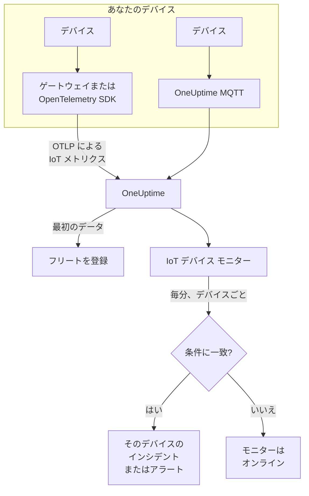

# IoT デバイス モニター

IoT デバイス モニターは 1 つのデバイスのフリートを監視し、デバイスがオフラインになったとき、バッテリーが少なくなったとき、信号が弱くなったとき、過熱したとき、CPU が忙しい状態が続いたときに知らせます。デバイスが OpenTelemetry または MQTT で OneUptime に送信する `iot_*` メトリクスを読み取るため、外部から何かをチェックすることはなく、プローブも関与しません。

:::cards
- [モニターを作成する](#iot-デバイス-モニターを作成する): ダッシュボードでの六つのステップ。
- [テンプレート](#組み込みのアラートテンプレート): 五つの組み込みアラート。デバイスごとに一つのインシデント。
- [オフラインの検出](#オフラインの検出): 停止したデバイスや沈黙したデバイスに気づく仕組み。
- [メトリクス](#収集されるメトリクス): モニターが読み取る `iot_*` シリーズ。
:::

## 仕組み

デバイス、またはデバイスが通信するゲートウェイが、測定値を OneUptime に送信します。OpenTelemetry を使うか、OneUptime の MQTT エンドポイントに直接送ります。どの測定値にも、フリートの名前 `iot.fleet.name` とデバイス自身の ID `device.id` が付いています。最初のデータでフリートが登録されます。

IoT デバイス モニターは 1 つのフリートに結び付いています。毎分、そのフリートのメトリクスに対してクエリを実行し、結果を条件と比較します。テンプレートは `device.id` でグループ化するため、30 台のセンサーがオフラインになると 30 件のインシデントが開き、それぞれがデバイスの名前を示し、デバイスが回復するとそれぞれ自動で解決します。



## 始める前に

- **デバイスからデータを送信させます。** [IoT デバイスのガイド](/docs/telemetry/iot-devices) では、OpenTelemetry SDK や Collector、または MQTT でメトリクスを送信する方法を説明しています。
- **フリートが登録されていることを確認します。** デバイスが送信する `iot.fleet.name` の名前で、**製品 → インフラストラクチャ → IoT → すべてのフリート** に表示されます。
- **想定しているデバイスを登録します**。フリートの **デバイスレジストリ** で登録すると、デバイスが沈黙したときに知らせを受けられます。[オフラインの検出](#オフラインの検出) を参照してください。

## IoT デバイス モニターを作成する

:::steps
### 新しいモニターを開始する

**モニター** に移動し、**モニターを作成** をクリックします。

### IoT デバイスを選ぶ

**モニターの種類** で **その他のモニターの種類** をクリックし、**インフラストラクチャ** の下の **IoT デバイス** を選ぶか、検索ボックスに `iot` と入力します。**名前** を入力し (インシデントとアラートのタイトルに使われます)、**次へ** をクリックします。

### フリートを選ぶ

**IoT モニターの設定** で、**IoT フリート** からフリートを選びます。データを送信したことのあるフリートはすべて一覧にあります。

### 監視する内容を選ぶ

三つのタブから一つを選びます。

- **Quick Setup**: [テンプレート](#組み込みのアラートテンプレート) をクリックします。テンプレートはメトリクス、集計、時間範囲、`device.id` によるグループ化、しきい値を設定し、下の条件を自分のものに置き換えます。**時間範囲** は後からでも変更できます。
- **Custom Metric**: **IoT メトリクス** から 1 つのメトリクスを選び、**集計** と **時間範囲** を設定します。[フィルター](#モニターの設定) で、1 つのデバイスまたは 1 種類のデバイスに絞り込めます。カスタムメトリクスはグループ化されず、フリート全体として判定します。
- **詳細**: **メトリクスを選択** でクエリと数式を自分で組み立てます。独自のメトリクス名も使えます。たとえば、デバイスのメモリサイズに対する使用中メモリの割合です。**グループ化** で `device.id` を指定すると、各デバイスを個別に判定できます。

### 条件を確認する

**モニター条件** の各条件を開き、**メトリクス変数を選択**、**集計**、**条件**、**しきい値** を確認します。テンプレートを使うと、これらは自動で入力されます。**Custom Metric** や **詳細** では、モニターは [デフォルトの条件](#デフォルトの条件) から始まります。これはメトリクスがゼロに落ちたことしか検知しないため、自分のしきい値を設定してください。

### モニターを作成する

**モニターを作成** をクリックします。OneUptime がモニターのページを開き、毎分評価します。モニターが上げたインシデントとアラートは、ほかのモニターと同じように、オンコールのポリシー、Slack、Microsoft Teams、メール、SMS、Webhook に届きます。
:::

> [!TIP]
> 複数のテンプレートを一度に設定するには、**製品 → インフラストラクチャ → IoT** からフリートを開き、**推奨事項** に移動します。必要なテンプレートを選び、呼び出す相手を選ぶと、OneUptime がテンプレートごとに 1 つのモニターを作成します。

## モニターの設定

| フィールド | タブ | 動作 |
| --- | --- | --- |
| **IoT フリート** | すべて | 必須。すべてのクエリを `resource.iot.fleet.name` に限定します。 |
| **リソーススコープ** | Custom Metric、詳細 | 任意。**デバイス** または **フリート**: `iot.scope` 属性の完全一致です。メトリクスを選ぶと **デバイス** に設定されます。 |
| **デバイス ID** | Custom Metric、詳細 | 任意。`device.id` で 1 つのデバイス (`sensor-001` など)。 |
| **デバイスの種類** | Custom Metric、詳細 | 任意。この `iot.device.type` を報告するデバイス (`sensor` や `gateway` など)。 |
| **IoT メトリクス** | Custom Metric | [カタログ](#収集されるメトリクス) の 1 つのメトリクス。 |
| **集計** | Custom Metric | サンプルの組み合わせ方: **平均**、**最大**、**最小**、**合計**、**カウント**。メトリクスの通常の集計から始まります。 |
| **時間範囲** | すべて | クエリが読み取る移動ウィンドウ。**Past 1 Minute** から **Past 365 Days** まで。新しいモニターは **Past 1 Minute** から始まり、テンプレートは独自の値を設定します。 |
| **メトリクスを選択** | 詳細 | クエリビルダー: **メトリクス**、**集計の基準**、**属性で絞り込み**、**グループ化**、さらにクエリを組み合わせる **メトリクスを追加** と **数式を追加**。 |

フィルターは組み合わせて働きます。**デバイス ID** と **デバイスの種類** の両方を指定すると、別の種類のデバイスは何にも一致しません。

## 組み込みのアラートテンプレート

**Quick Setup** は 5 個のテンプレートを提示します。各テンプレートは完全なモニターを作ります。メトリクスのクエリ、`device.id` によるグループ化、発火する条件と回復する条件です。しきい値は編集できる出発点です。

条件は、ウィンドウ内のすべての分で条件が成り立つときだけ発火します。ただし **Device Offline** は、1 を下回る最初の測定値で発火します。しきい値の条件は、しきい値から 10% 離れたところで回復するため、しきい値付近を行き来する値で状態がばたつくことはありません。

| テンプレート | カテゴリ | 重大度 | 監視対象 | 発火する条件 | 回復する条件 |
| --- | --- | --- | --- | --- | --- |
| Device Offline | 可用性 | 重大 | `iot_device_up`、`device.id` ごとに Min、過去 30 分 | いずれかの測定値が 1 未満、または登録済みのデバイスがウィンドウ全体で何も送信しない | 1 に戻る |
| Low Battery | 電源 | 警告 | `iot_battery_percent`、`device.id` ごとに Avg、過去 5 分 | 20% 未満 | 22% 以上 |
| Weak Signal | 接続性 | 警告 | `iot_signal_strength_dbm`、`device.id` ごとに Avg、過去 5 分 | -100 dBm 未満 | -90 dBm 以上 |
| High Temperature | 環境 | 重大 | `iot_temperature_celsius`、`device.id` ごとに Max、過去 5 分 | 70 °C を超える | 63 °C 以下 |
| High CPU Usage | システム | 警告 | `iot_cpu_usage_ratio`、`device.id` ごとに Avg、過去 5 分 | 0.9 を超える (CPU の 90%) | 0.81 以下 |

**重大度** はピッカーが表示するラベルです。テンプレートが作成するインシデントとアラートは、プロジェクトで最も重大なインシデントとアラートの重大度から始まります。条件の中で変更してください。

- **Device Offline は 30 分を読み取ります**。数分おきに報告するデバイスが、二つの報告の間でオフラインと判定されないようにするためです。おおよそ 15 分に 1 回より少ない頻度で報告するデバイスには、より長いウィンドウが必要です。
- **High Temperature は各分で Max を使います**。同じ分の低い測定値で高い測定値が隠れないようにするためです。それでも、ウィンドウのすべての分で高温が続く必要があります。
- **High CPU Usage は比率を比較します:** `iot_cpu_usage_ratio` は 0 から 1 の範囲なので、0.9 は 90% です。

## オフラインの検出

**Device Offline** は、デバイスが `iot_device_up = 0` を報告すると発火します。停止したデバイスや沈黙したデバイスは、次の三つの方法でこれを発火させます。

| 方法 | 起きること |
| --- | --- |
| **ゲートウェイが報告する** | ゲートウェイまたはコレクターが、到達できなくなったデバイスについて `iot_device_up = 0` を送信します。 |
| **MQTT Last Will** | OneUptime の MQTT エンドポイントに接続したデバイスは、`status` トピックに Last Will を登録します。デバイスが停止すると、セッションが切れた瞬間にブローカーがそのデバイスの `iot_device_up = 0` を送信します。ポーリングも、報告が来ないのを待つ必要もありません。[MQTT 経由でのメトリクス送信](/docs/telemetry/iot-devices#mqtt-経由でのメトリクス送信) を参照してください。 |
| **デバイスが登録されている** | フリートの **デバイスレジストリ** にあるデバイスは、データが来ることを期待されています。ウィンドウ全体で何も送信しないと、モニターはそのデバイスが `0` を報告したものとして扱うため、そのデバイス専用のインシデントが開き、デバイスが再び報告すると自動で解決します。 |

登録済みのデバイスはフリートのインベントリにもオフラインとして残りますが、未登録のデバイスは 15 分間沈黙すると削除されます。沈黙の検出には、`iot_device_up` の条件に **Treat As Zero** のデータなしポリシーが必要です。テンプレートから作成した Device Offline モニターにはこれが設定されています。デバイスの登録機能ができる前に作成した Device Offline モニターは、手動で設定するか、テンプレートから作り直す必要があります。

> [!NOTE]
> Last Will もゲートウェイの報告もないまま沈黙した未登録のデバイスは、単にデータの送信を止めるだけなので、デバイスごとにグループ化したモニターではそのデバイスを特定できません。デバイスを登録するか、重要なデバイスには専用のモニター (その **デバイス ID** を使った **Custom Metric**) を用意し、**データがない場合** を **トリガー** に設定してください。沈黙の検出には、フリートのほかのデバイスが少なくとも 1 つ報告を続けていることも必要です。たとえばゲートウェイの障害でフリート全体が沈黙した場合は、デバイスごとではなく、モニターに対して 1 つのインシデントが上がります。

## 収集されるメトリクス

各シリーズには、デバイスの `device.id` ラベルと、`iot.scope`、`iot.device.type`、`iot.device.kind` の属性が付いています。

| メトリクス | 単位 | 説明 |
| --- | --- | --- |
| `iot_device_up` | — | デバイスが動作中なら 1、停止中またはオフラインなら 0。 |
| `iot_battery_percent` | `%` | バッテリーの残量 (0 から 100)。下がり続けるときは、デバイスがまもなく報告を止めます。 |
| `iot_signal_strength_dbm` | `dBm` | 無線の信号強度。0 に近いほど強く、信号が弱くなると接続が切れる前触れです。 |
| `iot_temperature_celsius` | `°C` | デバイスの温度。高い値は、ハードウェアの過熱や周囲の問題を意味することがあります。 |
| `iot_cpu_usage_ratio` | `ratio` | 使用中の CPU (0 から 1、1 がフル使用)。 |
| `iot_memory_usage_bytes` | `bytes` | 使用中のメモリ。デバイスのメモリサイズと比べると、メモリの逼迫がわかります。 |
| `iot_uptime_seconds` | `s` | デバイスが動作している時間。再起動するとゼロに戻ります。 |

## 監視条件

条件は、モニターのクエリや数式の 1 つをしきい値と比較します。IoT デバイス モニターの条件が提供する **フィルタータイプ** は **Metric Value** の 1 つだけで、どのルールも次のフィールドでメトリクスの値を確認します。

| フィールド | 動作 |
| --- | --- |
| **フィルタータイプ** | 常に **Metric Value**。このモニターが提供する唯一のチェックです。 |
| **メトリクス変数を選択** | 確認するクエリまたは数式 (変数名で指定)。 |
| **集計** | ウィンドウ内の値を一つの答えにする方法: **平均**、**合計**、**Maximum Value**、**Minimum Value**、**All Values** (すべての値が一致する必要があります)、**Any Value** (一つで十分です)。 |
| **条件** | **Greater Than**、**Less Than**、**Greater Than Or Equal To**、**Less Than Or Equal To**、**Equal To**、または異常の条件: **Anomalously High**、**Anomalously Low**、**Anomalous**。 |
| **しきい値** | 比較する値。メトリクスに単位があるときは、横に単位の一覧が表示されます。異常の条件では表示されません。 |
| **感度** | 異常の条件のみ。**低** (4σ)、**中** (3σ、デフォルト)、**高** (2σ)。 |
| **ベースラインウィンドウ** | 異常の条件のみ。14 日 (デフォルト)、28 日、60 日、90 日の履歴。 |
| **データがない場合** | **その他の項目** の中にあります。ウィンドウにシリーズのサンプルがないときの動作: **Ignore** (デフォルト) はそのシリーズを飛ばし、**Treat As Zero** は `0` として読み、**トリガー** は条件を一致させます。 |

異常の条件は、各値をベースラインの同じ曜日の同じ時間帯と比較します。ベースラインウィンドウに十分な履歴がたまるまでは "Learning" の状態にとどまり、何も上げません。

### デフォルトの条件

テンプレートから作らないモニターは、二つの条件から始まります。

| 順序 | 条件 | 一致するとき | 結果 |
| --- | --- | --- | --- |
| 1 | Check if _monitor name_ is offline | 最初のクエリのいずれかの値が `0` | モニターを **オフライン** にし、インシデント "_monitor name_ is offline" を宣言します。モニターが回復すると自動で解決します。 |
| 2 | Check if _monitor name_ is online | いずれかの値が `0` を超える | モニターを **稼働中** にします。 |

> [!IMPORTANT]
> 無音はどちらの条件にも一致しません。データの送信を止めたフリートは、モニターを元の状態のままにします。データが止まったことを知るには、条件で **データがない場合** を **トリガー** に設定してください。OneUptime 自体が受信していなかった時間は、データがないとはみなされません。その時間を含むウィンドウのチェックは、[OneUptime がデータを受信していないとき](/docs/monitor/when-oneuptime-is-not-receiving) で説明しているとおり、代わりに待機します。

## Terraform

[OneUptime の Terraform プロバイダー](/docs/terraform/monitor-steps) は、IoT デバイス モニターのステップの設定を `iot_monitor` 属性で扱います。これは `iotMonitor` 設定 (`fleetIdentifier`、`resourceFilters`、`metricViewConfig`、`rollingTime`) の生の JSON で、`jsonencode()` で書きます。

```hcl title="main.tf"
monitor_steps = [{
  iot_monitor = jsonencode({
    fleetIdentifier = "building-a-sensors"
    resourceFilters = {}
    rollingTime     = "Past 5 Minutes"
    metricViewConfig = {
      queryConfigs = [{
        metricAliasData = { metricVariable = "battery_percent", title = "Battery", description = "", legend = "" }
        metricQueryData = {
          filterData = {
            metricName     = "iot_battery_percent"
            attributes     = {}
            aggegationType = "Avg"
            aggregateBy    = {}
          }
          groupByAttributeKeys = ["device.id"]
        }
      }]
      formulaConfigs = []
    }
  })
  criteria = [ /* ... */ ]
}]
```

`fleetIdentifier` はフリートの `iot.fleet.name` で、OneUptime の ID ではありません。

## トラブルシューティング

:::details フリートが「IoT フリート」の一覧にない
フリートはデバイスのデータから自動で登録されます。デバイスが `iot.fleet.name` を送信していることを確認し、[IoT デバイスのガイド](/docs/telemetry/iot-devices) に従って、データが届いていることを確かめてください。
:::

:::details デバイスごとではなく、フリート全体で一つのインシデントが発火する
クエリがグループ化されていません。**Custom Metric** のモニターはフリートを全体として判定します。テンプレートを使うか、**詳細** で **グループ化** に `device.id` を指定してください。
:::

:::details デバイスが停止したのに Device Offline が発火しなかった
デバイスが Last Will を送らず、ゲートウェイも報告しなかったため、単に沈黙しただけです。フリートの **デバイスレジストリ** に登録し、`iot_device_up` の条件の **データがない場合** が **Treat As Zero** になっていることを確認してください。[オフラインの検出](#オフラインの検出) を参照してください。
:::

:::details 正常なデバイスで Device Offline が発火する
デバイスの報告頻度が 30 分のウィンドウより低いため、一部のウィンドウにはそのデバイスのデータがありません。**時間範囲** を長くするか、デバイスの報告頻度を上げてください。WebSocket の MQTT エンドポイントでは、MQTT のキープアライブを 5 分未満にしてください。OneUptime はアイドル状態の WebSocket 接続を 300 秒で閉じ、そのときに Last Will が送信されます。
:::

:::details テンプレートにデータが表示されない
テンプレートは `iot_*` のメトリクス名を正確に読み取り、`device.id` ラベルでグループ化します。デバイスが送信しているものを、フリートの **メトリクス** ページで [メトリクスの規約](/docs/telemetry/iot-devices#メトリクスの規約) と比べてください。
:::

## 次のステップ

:::cards
- [IoT デバイス](/docs/telemetry/iot-devices): OpenTelemetry または MQTT でデバイスのメトリクスを送信します。
- [メトリクス モニター](/docs/monitor/metrics-monitor): IoT のメトリクスに限らず、どのメトリクスでもアラートを出します。
- [インシデント & アラート テンプレート](/docs/monitor/incident-alert-templating): インシデントのタイトルにデバイスの ID を入れます。
:::
