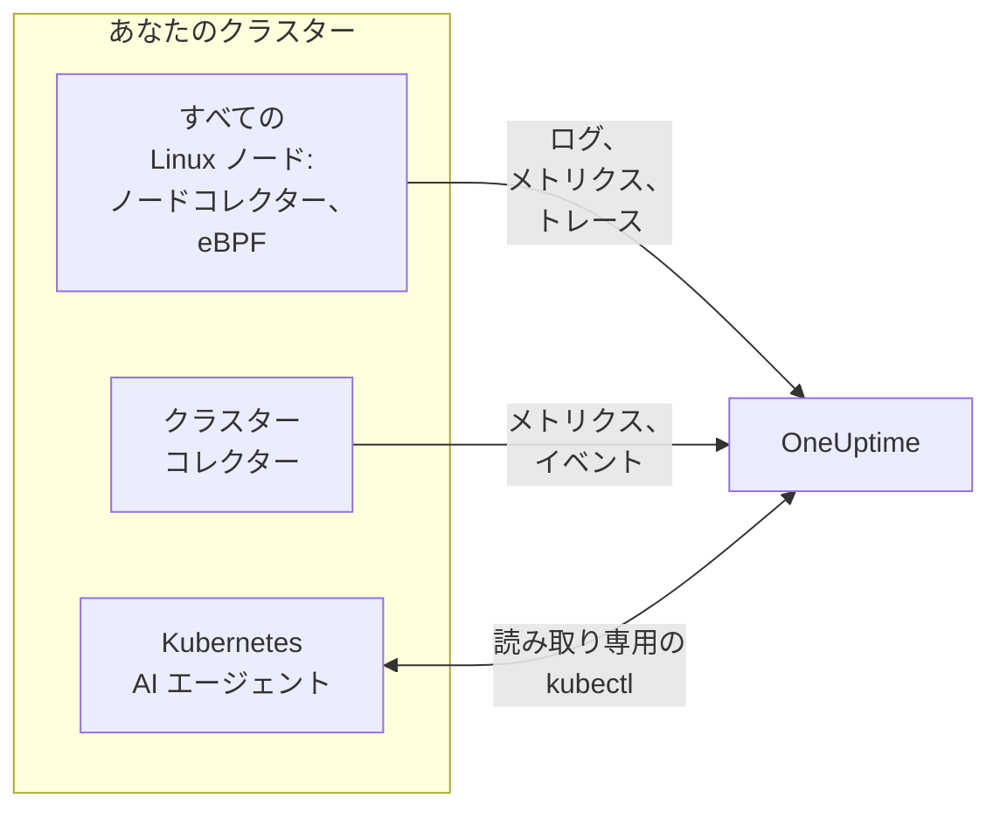

# Kubernetes エージェント (Helm インストール)

OneUptime Kubernetes エージェントは Helm チャートで、クラスターのメトリクス、イベント、Pod ログ、eBPF で取得したアプリケーショントレース、ノードごとの OS メトリクスを収集し、OneUptime に送信します。`helm install` を 1 回実行するだけで配置でき、アプリのコードを変更する必要はありません。[Kubernetes モニター](/docs/monitor/kubernetes-monitor) は、エージェントが送信するデータでアラートを出します。

:::cards
- [エージェントをインストールする](#エージェントをインストールする): Helm を使った四つのステップ。
- [プリセットを選ぶ](#プリセットを選ぶ): 標準のクラスター、GKE Autopilot、EKS Fargate。
- [よく使うオプション](#よく使うオプション): ほとんどのクラスターで変更する設定。
- [トラブルシューティング](#トラブルシューティング): 診断スクリプトと、よくある問題。
:::

## チャートがインストールするもの

チャートは、専用の名前空間でいくつかのワークロードを実行します。それぞれが収集したデータを、渡された取り込みキーを使って、OTLP であなたの OneUptime URL に送信します。



| ワークロード | 種類 | 役割 | デフォルトで有効 |
| --- | --- | --- | --- |
| クラスターコレクター | Deployment | クラスターのメトリクス、Kubernetes イベント、Pod、ノード、ワークロードの完全な仕様を Kubernetes API から収集します。 | はい |
| ノードコレクター | DaemonSet | `/var/log/pods` からの Pod ログ、kubelet と cAdvisor のメトリクス、ノードの OS メトリクス。 | はい |
| eBPF インストルメンテーション (OBI) | DaemonSet | すべての Pod からの HTTP、gRPC、SQL、Redis のトレースとリクエストメトリクス、およびサービスマップ。 | はい |
| Kubernetes AI エージェント | Deployment | OneUptime AI がこのクラスターのインシデントやアラートを調査するときに、読み取り専用の `kubectl` を実行できるようにします。 | はい |
| ログテイラー | Deployment | ノードコレクターが読めない場合に、Kubernetes API 経由で Pod ログを取得します。 | `gke-autopilot` と `eks-fargate` のプリセットで有効 |
| eBPF プロファイラー | DaemonSet | すべてのプロセスの継続的な CPU フレームグラフ。 | いいえ |
| kube-state-metrics | Deployment | Pod のフェーズ、コンテナーの待機理由、リソースクォータ。 | いいえ |

エージェントのイメージはすべて Linux 専用なので、すべてのワークロードは Linux ノードに固定されます。

## 始める前に

- **取り込みキー。** OneUptime の **プロジェクト設定 → テレメトリと APM → 取り込みキー** で作成します。エージェントはこれを `x-oneuptime-token` ヘッダーとして送信するため、プロジェクトの API キーはここでは使えません。
- **Helm 3** と、クラスターへの `kubectl` アクセス。アップグレードでは `--reset-then-reuse-values` を使うため、Helm 3.14 以降が必要です。
- **クラスターの名前**。プロジェクト内で一意である必要があります。名前がないとチャートはインストールを拒否します。同じ名前の 2 つのクラスターは 1 つとして表示されてしまうためです。
- クラスターからあなたの OneUptime URL への **アウトバウンド HTTPS**。

## エージェントをインストールする

:::steps
### Helm リポジトリを追加する

```bash
helm repo add oneuptime https://helm-chart.oneuptime.com
helm repo update
```

### チャートをインストールする

URL をあなたの OneUptime URL に置き換え、2 つのプレースホルダーを取り込みキーとクラスターの名前に置き換えます。

```bash
helm install oneuptime-agent oneuptime/kubernetes-agent \
  --namespace oneuptime-kubernetes-agent \
  --create-namespace \
  --set oneuptime.url=https://oneuptime.com \
  --set oneuptime.apiKey=<YOUR_API_KEY> \
  --set clusterName=<A_UNIQUE_NAME_FOR_THIS_CLUSTER>
```

これは `standard` プリセットを使います。GKE Autopilot または EKS Fargate では、代わりに [それぞれのプリセットを選んで](#プリセットを選ぶ) ください。

### Pod が実行中か確認する

```bash
kubectl get pods -n oneuptime-kubernetes-agent
```

1、2 分以内に、すべての Pod が `Running` になるはずです。

### OneUptime でクラスターを見つける

**製品 → インフラストラクチャ → Kubernetes → すべてのクラスター** を開きます。数分以内にクラスターがその名前で表示され、ノード、Pod、ワークロードが表示されていきます。
:::

## プリセットを選ぶ

Kubernetes プラットフォームによっては、ワークロードが `hostPath` ボリュームをマウントしたり DaemonSet を実行したりすることを許可していません。ノードコレクターはこれらを使います。`preset` 設定で、あなたの環境で動作するものを選びます。

| プリセット | 用途 | Pod ログ | 各ノードで |
| --- | --- | --- | --- |
| `standard` (デフォルト) | セルフマネージド、**EKS on EC2**、**GKE Standard**、**AKS**、minikube、kind、k3s | ノードコレクターが `/var/log/pods` を読み取る | kubelet、cAdvisor、OS のメトリクス |
| `gke-autopilot` | **GKE Autopilot** | ログテイラーが Kubernetes API 経由で読み取る | kubelet と cAdvisor のメトリクス (`hostPath` なし) |
| `eks-fargate` | **EKS Fargate** | ログテイラーが Kubernetes API 経由で読み取る | なし: Fargate は DaemonSet を実行しません |

よくわからない場合は、`preset` を未設定のままにすると `standard` になります。インストールが `hostPath` を挙げた Pod Security エラーで失敗した場合は、`gke-autopilot` で、EKS Fargate では `eks-fargate` でインストールし直してください。

GKE Autopilot と EKS Fargate は、eBPF インストルメンテーションとプロファイリングに必要な特権 Pod も拒否するため、それぞれのプリセットはどちらも含めません。

:::tabs
@tab Standard
```bash
helm install oneuptime-agent oneuptime/kubernetes-agent \
  --namespace oneuptime-kubernetes-agent --create-namespace \
  --set oneuptime.url=https://oneuptime.com \
  --set oneuptime.apiKey=<YOUR_API_KEY> \
  --set clusterName=prod
```
@tab GKE Autopilot
```bash
helm install oneuptime-agent oneuptime/kubernetes-agent \
  --namespace oneuptime-kubernetes-agent --create-namespace \
  --set oneuptime.url=https://oneuptime.com \
  --set oneuptime.apiKey=<YOUR_API_KEY> \
  --set clusterName=prod-gke-autopilot \
  --set preset=gke-autopilot
```
@tab EKS Fargate
```bash
helm install oneuptime-agent oneuptime/kubernetes-agent \
  --namespace oneuptime-kubernetes-agent --create-namespace \
  --set oneuptime.url=https://oneuptime.com \
  --set oneuptime.apiKey=<YOUR_API_KEY> \
  --set clusterName=prod-eks-fargate \
  --set preset=eks-fargate
```
:::

## クラスターにラベルを付ける

インストール時に渡したラベルは、クラスターと、このエージェントが報告するサービスやホストに付けられます。`--set oneuptime.labels.<key>=<value>` は、`<key>:<value>` という名前のプロジェクトラベルになります。

```bash
helm install oneuptime-agent oneuptime/kubernetes-agent \
  --namespace oneuptime-kubernetes-agent \
  --create-namespace \
  --set oneuptime.url=https://oneuptime.com \
  --set oneuptime.apiKey=<YOUR_API_KEY> \
  --set clusterName=prod \
  --set oneuptime.labels.team=payments \
  --set oneuptime.labels.env=production \
  --set oneuptime.labels.region=us-east-1
```

または values ファイルにまとめます。

```yaml title="values.yaml"
oneuptime:
  url: https://oneuptime.com
  apiKey: <YOUR_API_KEY>
  labels:
    team: payments
    env: production
    region: us-east-1
clusterName: prod
```

```bash
helm install oneuptime-agent oneuptime/kubernetes-agent \
  --namespace oneuptime-kubernetes-agent --create-namespace \
  -f values.yaml
```

すると、このエージェントが送信するすべてのレコード (ログ、メトリクス、トレース、プロファイル) に `team:payments`、`env:production`、`region:us-east-1` が付きます。各ラベルは `oneuptime.label.<key>=<value>` というリソース属性で、OneUptime は `oneuptime.label.` で始まるすべての属性をラベルに変換します。ラベルは大文字小文字を区別せずに照合されるため、既存の `Production` ラベルは重複して作られずに再利用されます。エージェントが、あなたが OneUptime で追加したラベルを削除することはありません。

## Pod ログ

`preset` は `logs.mode` を設定しますが、これは自分で設定することもできます。

| `logs.mode` | ログの読み取り方 | 利点 | 注意点 |
| --- | --- | --- | --- |
| `daemonset` | ノードごとに 1 つのノードコレクターが `/var/log/pods` 以下のファイルを追跡します。 | オーバーヘッドが最小で、ノードに合わせてスケールし、Kubernetes API サーバーに負荷をかけず、ログローテーションにも追従します。 | `hostPath` と DaemonSet が必要です。 |
| `api` | 1 つのログテイラーが、`kubectl logs -f` と同じように、各コンテナーのログを Kubernetes API からストリーミングします。 | `hostPath` がブロックされている環境や、`restricted` の Pod Security Standard が適用される環境でも動作します。 | コンテナーのストリームはそれぞれ API サーバーへの長時間の接続です。1 つのレプリカで数千のコンテナーを扱えます。 |
| `disabled` | 何もしません。 | すでに別の方法でログを送信しているアプリ向け。 | |

ログの収集をオフにするには、`--set logs.enabled=false` を設定し、代わりに [OpenTelemetry](/docs/telemetry/open-telemetry) SDK でアプリケーションログを送信します。メトリクスには影響しません。ノードコレクターは動き続けます。

### 複数の OS が混在するクラスター (Windows ノードプール)

Windows ノードでは、エージェントの Pod は実行されません。それでも、Windows ノードとその Pod に関するクラスターレベルのデータは届きます。これは Kubernetes API から取得されるためです (ノードの状態、Pod のフェーズ、Kubernetes イベント、kube-state-metrics)。Windows ノードに欠けているのは、ノード上で収集されるデータです。OS メトリクス、kubelet と cAdvisor のメトリクス、eBPF トレース、プロファイル、そして `daemonset` ログモードでは Pod ログです。

Windows ノード上の Pod のログも収集するには、ハイブリッドモードをオンにします。

```bash
helm upgrade oneuptime-agent oneuptime/kubernetes-agent \
  --namespace oneuptime-kubernetes-agent --reset-then-reuse-values \
  --set logs.windowsPods.enabled=true
```

するとログテイラーが、Windows ノード上の Pod だけを対象に、ノードコレクターと並んで動作します。Linux の Pod は引き続きコストの低いファイル追跡を使い、両者はノードの OS で Pod を分け合うため、同じログ行が二度送信されることはありません。

- **テイラーのイメージのバージョン。** Windows だけを対象にする分割は `kubernetes-log-tailer` イメージに組み込まれています。古いイメージはこれを無視して *すべての* Pod を追跡するため、Linux の各 Pod のログが二度送信されます。`logs.api.image.tag` をチャートのリリースより古いバージョンに固定しないでください。また、ノードに古い `release` イメージがキャッシュされている可能性がある場合は、アップグレードに `--set logs.api.image.pullPolicy=Always` を追加してください。
- **重大度によるフィルタリング。** `filters.logs.minSeverity` を設定すると、認識できる重大度のない行は、ノードコレクターの経路では破棄されますが、ログテイラーの経路では残ります。[ログの重大度によるフィルタリング](/docs/telemetry/kubernetes-agent#ログの重大度によるフィルタリング) を参照してください。その結果、Windows の Pod は Linux の Pod よりも多くのレベルなしの行を送信することがあります。

## eBPF によるアプリケーショントレース

チャートは、すべてのノードで [OpenTelemetry eBPF Instrumentation (OBI)](https://opentelemetry.io/docs/zero-code/obi/) を実行します。OBI は eBPF プログラムを Linux カーネルに読み込み、各 Pod のネットワークトラフィックを監視するため、アプリを一切変更せずに (SDK もサイドカーもなしで) HTTP と HTTPS、gRPC、SQL と Redis の呼び出しを再構築できます。それらをトレースとリクエストメトリクスとして OneUptime に送信します。

1、2 分以内に、サービスが **製品 → トレース** とサービスマップに表示されます。`k8s.cluster.name` にはクラスターの名前が設定されるため、クラスターで絞り込めます。

### eBPF をオフにするとき

eBPF はデフォルトで有効です。次の場合は `--set ebpf.enabled=false` でオフにしてください。

- クラスターが **GKE Autopilot** または **EKS Fargate** の場合。これはそれぞれのプリセットが自動で行います。これらは特権 Pod を拒否しますが、OBI はプログラムを読み込むために特権が必要です。
- ノードが BTF のない **Linux 5.8** より古いカーネルで動いている場合。Debian 11、Ubuntu 20.10、Fedora 34、RHEL 9 以降なら問題ありません。
- アプリがすでに OpenTelemetry SDK でトレースを送信していて、二重に受け取りたくない場合。

### eBPF が送信するもの

OBI はいくつかの種類のシグナルを送信します。それぞれ `--set ebpf.features.<key>=false` でオフにできます。

| 設定 | デフォルト | 追加されるもの |
| --- | --- | --- |
| `ebpf.features.httpMetrics` | オン | サービスごとの HTTP と gRPC のリクエストメトリクス: リクエストレート、レイテンシのヒストグラム、エラー。 |
| `ebpf.features.spanMetrics` | オン | スパンメトリクス: サービス、ルートまたは操作、スパンの種類、ステータスごとの呼び出し数と所要時間。`traces.span.metrics.calls` と `traces.span.metrics.duration` (秒) です。 |
| `ebpf.features.serviceGraph` | オン | あるサービスから別のサービスへの各呼び出しのレートとレイテンシ。これでサービスマップが描かれます。 |
| `ebpf.features.networkMetrics` | オン | すべての Pod の組の間で TCP と UDP でやり取りされたバイト数とパケット数 (Kubernetes 上の名前付き)。OBI が読めないプロトコルでも、通信しているすべての Pod の組がわかります。 |
| `ebpf.features.networkInterZoneMetrics` | オフ | 同じことをゾーン間で。シリーズの数が倍になるため、ゾーンごとにスケジューリングしている場合にだけオンにしてください。 |
| `ebpf.features.tcpStats` | オン | ノードごとの TCP 統計: 往復時間、失敗した接続、再送。 |

### サービス間でトレースをつなげる

OBI は呼び出しをまたいでトレースを運ぶこともできます。Pod A が HTTP または gRPC で Pod B を呼び出すと、B 側のスパンが A のトレースに加わり、どちらのアプリにも SDK は必要ありません。**これはデフォルトではオフです。** 下の警告を読んだうえで、`--set ebpf.contextPropagation=true` でオンにしてください。

| オプション | デフォルト | 動作 |
| --- | --- | --- |
| `ebpf.contextPropagation` | オフ | 送信トラフィックに W3C `traceparent` を書き込み、スパンがサービス間でつながるようにします。 |
| `ebpf.contextPropagationMode` | `headers` | 方法: `headers` (HTTP/1.1 のリクエストヘッダー、最も影響範囲が狭い)、`tcp` (Linux Traffic Control による TCP オプション)、または `all` (両方)。`contextPropagation` がオンのときだけ読み取られます。 |
| `ebpf.trackRequestHeaders` | オン | カーネル内でリクエストヘッダーを追跡し、受信側が通常の HTTP サーバーでも `traceparent` を見つけられるようにします。`contextPropagation` がオンのときだけ効果があります。 |

> [!WARNING]
> どの伝播モードも、すでに送信中のトラフィックを変更します。通常の HTTP では、OBI はヘッダーが収まるようにカーネル内で送信リクエストを広げます。TLS と生の TCP では、Traffic Control のフックから TCP オプションを追加し、パケットとそのチェックサムを書き換えます。そのあと接続のバイト数の計算が正確に補正されないと、ストリームは **同期がずれます**。nginx のようなプロキシを経由する転送は、レスポンスが約 64 KB を超えたところで途中で止まり、接続がタイムアウトするまで動きません。小さなリクエストは動き続けるため、アプリケーションやプロキシのバグのように見えます。この書き換えをなくせるカーネルのバージョンはありません。トレース、リクエストメトリクス、サービスマップは、これがなくてもすべて動作します。サービスに組み込んだ OpenTelemetry SDK なら、カーネルでの書き換えなしにトレースをつなげられます。オンにする場合は、まず本番ではないクラスターで試し、プロキシを経由する大きな転送を確認してください。

### ログをトレースにつなげる

**デフォルトではオフです。** オンにすると、OBI は計装するすべてのプロセスの `write()` システムコールにプローブを取り付け、次のようにします。

- **JSON のログ行** には `trace_id` と `span_id` のフィールドが加わります (行にすでにあるフィールドは残ります)。ノードコレクターはこれらをログレコード自身のトレースフィールドに移すため、OneUptime ではスパンのログにワンクリックでたどり着け、ログ行のトレースにも同様にたどり着けます。
- **その他のログ行** は、リンクなしでそのまま収集されます。

```bash
helm upgrade oneuptime-agent oneuptime/kubernetes-agent \
  --namespace oneuptime-kubernetes-agent --reset-then-reuse-values \
  --set ebpf.logToTraceCorrelation=true
```

| オプション | デフォルト | 動作 |
| --- | --- | --- |
| `ebpf.logToTraceCorrelation` | `false` | OBI のログエンリッチャーと、ノードコレクターによる `trace_id` の引き上げをオンにします。 |
| `ebpf.logEnricher.services` | `[{service: [{exe_path: "*"}]}]` | エンリッチャーが対象にするプロセス。各エントリは OBI の [GlobAttributes](https://opentelemetry.io/docs/zero-code/obi/configure/options/#service-discovery) セレクターで、`exe_path`、`languages`、`k8s_pod_labels`、`k8s_pod_annotations`、`open_ports`、`cmd_args` などのフィールドを使います。 |

#### これと一緒にクラッシュする APM エージェント

エンリッチャーは、アプリの出力バッファを **プロセスの内部で** 書き換えます。一致したプロセスが `write()` を呼び出すと、OBI は元のバイトを消して、エンリッチしたコピーを書き込みます。`LD_PRELOAD` で読み込まれ、自分でも `write()` をラップする APM エージェントは、これに耐えられません。

| APM エージェント | ライブラリ | 起きること |
| --- | --- | --- |
| Dynatrace OneAgent | `liboneagentproc.so` | アプリが SIGSEGV (終了コード 139) でクラッシュします。Dynatrace のウォッチドッグ自身の `write()` が 10 秒の制限を超えて止まり、OneAgent が再起動を繰り返します。 |
| New Relic | `libnewrelic*.so` | 同じ種類のクラッシュ。 |
| AppDynamics | `libappdynamics*.so` | 同じ種類のクラッシュ。 |
| Datadog | `libdd*.so` | 同じ種類のクラッシュ。 |
| Instana | `libinstana*.so` | 同じ種類のクラッシュ。 |

**最も影響を受けやすいのは .NET アプリです。** Dynatrace の .NET エージェントは常に `LD_PRELOAD` で読み込まれ、Microsoft.Extensions.Logging のコンソールログはバッファリングされないため、すべての行がこの経路を通ります。Python と Go のアプリは通常影響を受けません。

これらのエージェントのいずれかと併用するには、`logEnricher.services` がエージェントのない Pod だけを指すようにします。エンリッチャーには除外の方法がないため、エンリッチする Pod を列挙します。

```yaml title="values.yaml"
ebpf:
  logToTraceCorrelation: true
  logEnricher:
    services:
      # Enrich only pods with the apm-agent=none label
      - service:
          - k8s_pod_labels:
              apm-agent: "none"
```

または、ランタイムで選びます。Dynatrace の `LD_PRELOAD` による読み込みは .NET を対象にしているため、Python、Go、Ruby、Node.js だけをエンリッチすれば影響を避けられます。

```yaml title="values.yaml"
ebpf:
  logToTraceCorrelation: true
  logEnricher:
    services:
      - service:
          - languages: "python,go,ruby,nodejs"
```

#### ログは JSON でバッファリングなしにする

- **`trace_id` が付くのは JSON の行だけです。** ロガーを JSON 形式に切り替えてください: `structlog`、`pino`、`winston`、`serilog`、`logback-json`、klog `--logging-format=json` など。
- **バッファリングされた出力はリンクを壊します**。その場合 `write()` がリクエストとは別のスレッドで実行されるためです。**Python** では `PYTHONUNBUFFERED=1` を設定します。**.NET** では、起動時に `Console.SetOut(new StreamWriter(Console.OpenStandardOutput()) { AutoFlush = true })` を呼び出します。Microsoft.Extensions.Logging の `AddConsole()` と Serilog の非同期シンクは動作せず、Serilog の通常の `WriteTo.Console()` は動作します。
- Greenlet、gevent、Tornado などの独自の非同期ランタイムは対象外です。

### eBPF を調整する

| オプション | デフォルト | 動作 |
| --- | --- | --- |
| `ebpf.enabled` | `true` | eBPF の DaemonSet を実行します。`false` にすると含めません。 |
| `ebpf.image.tag` | `v0.14.0` | OBI のイメージ。OBI は 1.0 より前の段階です。テストしたバージョンに固定し、変更する前にもう一度テストしてください。 |
| `ebpf.autoTargetExe` | `*` | 計装する実行ファイルのグロブ (カンマ区切り)。`*/python,*/java` のように絞り込むと、計装するランタイムを減らせます。 |
| `ebpf.excludeExePaths` | シェル、クラスターの基盤コンポーネント、サービスメッシュのサイドカー、CNI エージェント、ブラウザー、ClickHouse、コレクター、OBI 自身 | スキップする実行ファイルのグロブ (カンマ区切り)。広すぎるグロブは、あなた自身のバイナリもスキップします。 |
| `ebpf.logLevel` | `info` | `debug`、`info`、`warn`、`error` のいずれか。 |
| `ebpf.printTraces` | `false` | スパンを OBI 自身のログにも出力し、何を取得しているかを確認できるようにします。 |
| `ebpf.resources.*` | 要求は `100m` CPU と `512Mi` メモリ、制限は `2000m` と `2Gi` | トラフィックの多いノードや、短命のプロセスが多いノードでは引き上げてください。 |

OBI が動作してトラフィックを見ているかを確認するには、次を実行します。

```bash
kubectl get pods -n oneuptime-kubernetes-agent -l component=ebpf-instrument
kubectl logs -n oneuptime-kubernetes-agent -l component=ebpf-instrument --tail=200
```

## 継続的な CPU プロファイリング

[OpenTelemetry eBPF Profiler](https://github.com/open-telemetry/opentelemetry-ebpf-profiler) も、`otel/opentelemetry-collector-ebpf-profiler` イメージとして各ノードで実行できます。Go、Java、.NET、Python、Ruby、Node.js、PHP、Perl、C、C++、Rust で、すべてのプロセスが実行している内容を 1 秒間に 19 回サンプリングし、プロファイルを OneUptime に送信します。プロファイルは **製品 → パフォーマンスプロファイル** に表示され、トレースの各スパンにもフレームグラフとして表示されます。

**プロファイリングはデフォルトではオフです。** ノードあたりの CPU とメモリのコストが eBPF インストルメンテーションより大きいためです。`--set profiling.enabled=true` でオンにしてください。

eBPF インストルメンテーションもオンにしていると (デフォルト)、各サンプルは属するトレースを持つため、スパンごとにフレームグラフが得られます。そのためにチャートは OBI に、実行中のトレースコンテキストを利用可能な状態に保つよう指示します (`OTEL_EBPF_BPF_POPULATE_TRACE_CONTEXT=true`)。これにより、計装されたアプリでは非同期のコンテキスト切り替えのたびにわずかなコストがかかります。スパンへのリンクなしのフレームグラフにするには、`profiling.obiProcessContext=false` を設定します。

プロファイリングには **Linux 5.10** 以降と、ノードのプロセス ID を持つ特権 Pod が必要です。そのため GKE Autopilot や EKS Fargate では実行できず、それぞれのプリセットはオフのままにします。kind や k3d のように、ノード自体がコンテナーである環境ではプロセスを区別できず、スパンにリンクされるサンプルはほとんどありません。

| オプション | デフォルト | 動作 |
| --- | --- | --- |
| `profiling.enabled` | `false` | プロファイラーの DaemonSet を実行します。 |
| `profiling.image.tag` | `0.152.0` | プロファイラーのイメージ。1.0 より前の段階です。テストしたバージョンに固定してください。 |
| `profiling.samplesPerSecond` | `19` | 1 秒あたりのサンプル数。19 にすると、一般的なタイマー周波数と重なるのを避けられます。 |
| `profiling.offCpuThreshold` | `0` | 0 より大きく 1 以下の値にすると、CPU 外で費やした時間もプロファイルし、ロックの競合やブロッキング I/O がわかります。追加のコストがかかります。 |
| `profiling.tracers` | `""` (すべてのランタイム) | 読み込む言語トレーサー (カンマ区切り)。`go,python` など。 |
| `profiling.obiProcessContext` | `true` | サンプルを OBI のトレースにリンクし、そのために OBI にトレースコンテキストを利用可能な状態に保たせます。 |

## その他のデータ収集

| オプション | デフォルト | 追加されるもの |
| --- | --- | --- |
| `hostMetrics.enabled` | オン | `/proc` と `/sys` からの各ノードの OS メトリクス: ディスク I/O キュー、ファイルシステムの inode、ネットワークインターフェイスのエラー、ページング、ロードアベレージ。ノードコレクターの中で動作し、追加の Pod は不要です。 |
| `kubeletstats.utilizationMetrics.enabled` | オン | コンテナーと Pod の CPU とメモリを、request と limit に対する割合で。CPU とメモリの飽和モニターがこれを読み取ります。request も limit もない Pod では常に 0 です。 |
| `kubeletstats.volumeMetrics.enabled` | オン | 各 PVC の空き容量と合計容量 (`k8s.volume.available`、`k8s.volume.capacity`)。PVC Low Disk Space モニターがこれを読み取ります。PVC と Pod の組ごとに 1 シリーズです。 |
| `cadvisor.enabled` | オン | 各 kubelet の `/metrics/cadvisor` からの CPU スロットリングと OOM kill: `container_cpu_cfs_throttled_seconds_total`、`container_cpu_cfs_periods_total`、`container_oom_events_total` だけです。 |
| `kubeStateMetrics.enabled` | オフ | kube-state-metrics からの Pod のフェーズ (Pending、Terminating)、スケジュールできない Pod、コンテナーの待機理由 (CrashLoopBackOff、ImagePullBackOff)、リソースクォータの使用量。`kubeStateMetrics.mode: bundled` (デフォルト) は小さな kube-state-metrics を実行し、`external` はすでに実行しているものを `kubeStateMetrics.endpoint` で読み取ります。 |
| `auditLogs.enabled` | オフ | Kubernetes の監査ログ `/var/log/kubernetes/audit.log`: API へのすべてのリクエストと、誰が何に対して行ったか。セルフマネージドのクラスターのみ: マネージドのクラスター (EKS、GKE、AKS、DOKS) はこれをクラウドプロバイダーに送ります。 |
| `csi.enabled` | オフ | `app=csi-driver` または `app.kubernetes.io/component=csi-driver` のラベルが付いた Pod からの CSI ストレージドライバーのメトリクス: ボリュームのアタッチとデタッチの時間、プロビジョニングの失敗、IOPS。 |
| `coreDns.enabled` | オフ | `:9153/metrics` 上の CoreDNS のメトリクス: クエリレート、レイテンシ、キャッシュヒット、エラー。 |
| `controlPlane.enabled` | オフ | etcd、API サーバー、スケジューラー、コントローラーマネージャー。セルフマネージドのクラスターのみ: マネージドのクラスターはこれらを公開しません。 |
| `cost.enabled` | オフ | 各ワークロードのコスト。[Kubernetes コストオブザーバビリティ](/docs/telemetry/kubernetes-cost) を参照してください。 |

## よく使うオプション

| オプション | デフォルト | 動作 |
| --- | --- | --- |
| `oneuptime.url` | (必須) | あなたの OneUptime URL。 |
| `oneuptime.apiKey` | (必須) | **プロジェクト設定 → テレメトリと APM → 取り込みキー** で作成した取り込みキー。`x-oneuptime-token` ヘッダーとして送信されます。プロジェクトの API キーは使えません。 |
| `clusterName` | (必須) | クラスターの名前。プロジェクト内で一意です。すべてのレコードが `k8s.cluster.name` としてこれを持ちます。 |
| `preset` | (空: `standard`) | `standard`、`gke-autopilot`、`eks-fargate` のいずれか。[プリセットを選ぶ](#プリセットを選ぶ) を参照してください。 |
| `oneuptime.labels` | `{}` | このエージェントからのすべてのレコードに付けるラベル。[クラスターにラベルを付ける](#クラスターにラベルを付ける) を参照してください。 |
| `namespaceFilters.rules` | `kube-system` を `podLogs` と `ebpfDiscovery` から除外 | `podLogs`、`ebpfDiscovery`、`metrics`、`traces` で名前空間を含めたり除外したりするルール。パターンには `*` を使え、除外が常に優先されます。 |
| `filters.logs.minSeverity` | `""` | このレベルより下の Pod ログ行を破棄します: `TRACE`、`DEBUG`、`INFO`、`WARN`、`ERROR`、`FATAL`。 |
| `filters.metrics.exclude` | `[]` | 破棄するメトリクス名。 |
| `sampling.traces.percentage` | `100` | 残すトレースの割合 (0 から 100)。トレースは丸ごと残されるか破棄されます。 |
| `logs.enabled` | `true` | Pod ログを収集します。 |
| `logs.mode` | (`preset` から) | `daemonset`、`api`、`disabled` のいずれか。プリセットより優先されます。 |
| `logs.windowsPods.enabled` | `false` | Windows ノード上の Pod も追跡します。[複数の OS が混在するクラスター](#複数の-os-が混在するクラスター-windows-ノードプール) を参照してください。 |
| `logs.api.replicas` | `1` | `api` モードでのログテイラーのレプリカ数。 |
| `ebpf.enabled` | `true` | eBPF のトレースとリクエストメトリクス。[eBPF によるアプリケーショントレース](#ebpf-によるアプリケーショントレース) を参照してください。 |
| `profiling.enabled` | `false` | CPU フレームグラフ。[継続的な CPU プロファイリング](#継続的な-cpu-プロファイリング) を参照してください。 |
| `kubeStateMetrics.enabled` | `false` | kube-state-metrics からのクラスターの状態。 |
| `aiAgent.enabled` | `true` | Kubernetes AI エージェント。何ができるかは [Kubernetes AI エージェント](/docs/telemetry/kubernetes-agent) を参照してください。 |

チャートの [`values.yaml`](https://github.com/OneUptime/oneuptime/blob/master/HelmChart/Public/kubernetes-agent/values.yaml) はすべてのオプションを一覧で説明しています。[Kubernetes エージェント](/docs/telemetry/kubernetes-agent) では、フィルタリング、サンプリング、データ量を抑える方法を説明しています。

## アップグレード

```bash
helm repo update
helm upgrade oneuptime-agent oneuptime/kubernetes-agent \
  --namespace oneuptime-kubernetes-agent \
  --reset-then-reuse-values
```

`--reset-then-reuse-values` (Helm 3.14 以降) は、あなたが設定した値 (プリセット、クラスターの名前、フィルター) を残し、それ以外の値はすべて新しいチャートから取ります。新しい `--set` はその後に追加してください。Helm 3.13 以前では、代わりに設定した値を使ってアップグレードします。

```bash
helm repo update
helm get values oneuptime-agent --namespace oneuptime-kubernetes-agent -o yaml > values.yaml && \
  helm upgrade oneuptime-agent oneuptime/kubernetes-agent \
  --namespace oneuptime-kubernetes-agent -f values.yaml
```

`--reuse-values` でアップグレードしないでください。アップグレード元のチャートのデフォルト値も残してしまうため、新しいチャートのデフォルト値 (eBPF イメージを含む) が適用されなくなります。リリースが古いチャートのデフォルト値で動いている場合、インストールやアップグレードの後に Helm が表示するノートの最後に、警告と、それを直すコマンドが表示されます。

> [!WARNING]
> **eBPF のスパンメトリクスの名前が変わりました。** `ebpf.features.spanMetrics` は現在、`traces.span.metrics.calls` と `traces.span.metrics.duration` (秒) を送信します。これは以前の `traces_spanmetrics_calls_total` と `traces_spanmetrics_latency` に代わるもので、同じシリーズを OBI が維持する名前で送信します (古い名前は非推奨になりました)。古い名前を使うダッシュボード、グラフ、メトリクスモニターは、アップグレード後に新しいデータを受け取らず、エラーも出ません。新しい名前に移し、古い名前を挙げている `filters.metrics` のエントリもすべて更新してください。

## アンインストール

```bash
helm uninstall oneuptime-agent --namespace oneuptime-kubernetes-agent
kubectl delete namespace oneuptime-kubernetes-agent
```

## トラブルシューティング

:::details クラスターが Disconnected と表示される、またはデータが届かない
チャートの診断スクリプトを実行します。Pod、取り込みキー、クラスターから外への経路を確認し、キーが受け付けられるかを OneUptime に問い合わせて、1 つの判定を表示します。読み取るだけで、何も変更しません。

```bash
curl -fsSL https://raw.githubusercontent.com/OneUptime/oneuptime/master/HelmChart/Public/kubernetes-agent/troubleshoot.sh \
  | bash -s -- -n oneuptime-kubernetes-agent
```

特に再インストールの後によくある原因は、間違った、または失効した取り込みキーです。OneUptime がキーを拒否し、コレクターは Pod が `Running` のまま、すべてのバッチを破棄します。
:::

:::details インストールが "hostPath volumes are not allowed" で失敗する
クラスターが `hostPath` をブロックしています。Kubernetes API 経由でログを読むプリセットに切り替えます。このプリセットは eBPF も含めません。

```bash
helm upgrade oneuptime-agent oneuptime/kubernetes-agent \
  --namespace oneuptime-kubernetes-agent \
  --reset-then-reuse-values \
  --set preset=gke-autopilot
```

EKS Fargate では `--set preset=eks-fargate` を使います。
:::

:::details Windows ノードでエージェントの Pod が ImagePullBackOff のままになる
古いチャートは、エージェントの DaemonSet を Windows ノードにもスケジュールしていましたが、そこでは Linux のイメージを取得できません。`helm upgrade` を実行してください。現在のチャートはすべてのワークロードを Linux ノードに固定するため、止まっていた Pod はなくなります。Windows ノード上の Pod のログを収集するには、[複数の OS が混在するクラスター](#複数の-os-が混在するクラスター-windows-ノードプール) を参照してください。
:::

:::details OneUptime にログが届かない
エージェントの Pod とそのログを確認します。

```bash
kubectl get pods -n oneuptime-kubernetes-agent
kubectl logs -n oneuptime-kubernetes-agent -l app.kubernetes.io/part-of=oneuptime --tail=200
```

`api` モードでは、ログテイラーがポート 13133 の `/healthz` で、エクスポートの状態を返します。`kubectl port-forward` でアクセスしてください。
:::

:::details eBPF の Pod が CrashLoopBackOff になる、または起動しない
OBI のログを読みます。

```bash
kubectl logs -n oneuptime-kubernetes-agent -l component=ebpf-instrument --tail=200
```

- **カーネルが古すぎるか、BTF がありません。** OBI には BTF 付きの Linux 5.8 以降が必要です。ノードで `uname -r` を実行して確認してください。アップグレードできない場合は、`--set ebpf.enabled=false` で eBPF をオフにします。
- **特権 Pod が拒否されています。** Autopilot や Fargate 以外でも拒否するクラスターがあります。eBPF をオフにしてください。
- **OBI は動いているが、トレースが届きません。** `--set ebpf.printTraces=true` を設定し、OBI のログをもう一度読みます。そこにスパンがあれば、OneUptime へのエクスポートが失敗しています。URL と取り込みキーを確認してください。スパンがなければ、静的にリンクされたものなど、OBI が読めない TLS ライブラリでトラフィックが暗号化されている可能性があります。
:::

:::details トレースのリンクをオンにした後、大きな転送が止まる
これは `ebpf.contextPropagation` がトラフィックを書き換えているためです。[サービス間でトレースをつなげる](#サービス間でトレースをつなげる) の警告を参照してください。`--set ebpf.contextPropagation=false` でオフにします。
:::

:::details ログのリンクをオンにした後、アプリが終了コード 139 でクラッシュする
`LD_PRELOAD` で読み込まれる APM エージェントが同じ Pod にあります。[これと一緒にクラッシュする APM エージェント](#これと一緒にクラッシュする-apm-エージェント) を参照してください。`ebpf.logToTraceCorrelation` をオフにするか、`ebpf.logEnricher.services` がそのエージェントのない Pod を指すようにしてください。
:::

:::details 1 つのログテイラーではクラスターに足りない (api モード)
名前空間を複数のリリースに分け、それぞれを独自の名前空間ルールでインストールします。

```bash
helm install oneuptime-agent-ns-a oneuptime/kubernetes-agent \
  --set preset=gke-autopilot \
  --set-json 'namespaceFilters.rules=[{"action":"include","namespaces":["app-a","app-b"],"scopes":["podLogs"]}]' \
  ...
```

`logs.api.replicas` を増やすとテイラーが増えますが、各テイラーは許可されたすべての名前空間を読むため、重複を避けるにはやはり名前空間を分ける必要があります。
:::

## 次のステップ

:::cards
- [Kubernetes モニター](/docs/monitor/kubernetes-monitor): エージェントが送信するデータでアラートを出します。
- [Kubernetes エージェント](/docs/telemetry/kubernetes-agent): フィルタリング、サンプリング、AI エージェント、データ量を抑える方法。
- [Kubernetes コストオブザーバビリティ](/docs/telemetry/kubernetes-cost): 各ワークロードのコストを確認します。
- [トレース モニター](/docs/monitor/traces-monitor): eBPF が取得したトレースでアラートを出します。
:::
