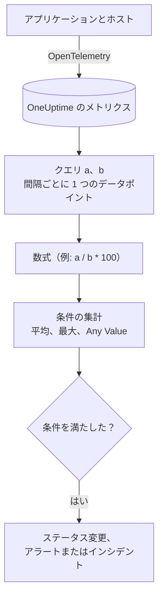

# メトリクス モニター

メトリクスモニターは、アプリケーションとインフラが OneUptime に送るメトリクスを照会し、比率や合計が必要なときは数式で組み合わせ、その結果をローリングの時間範囲で条件と比べます。リクエストレート、エラー率、キューの深さ、CPU、メモリー、ディスク（あらゆる数値の系列）に使えます。グループ化すれば、ホストやコンテナーごとに 1 つのアラートを出せます。

:::cards
- [モニターを作成する](#メトリクスモニターを作成する): クエリ、数式、時間範囲、条件。
- [評価のしくみ](#評価のしくみ): データポイント、数式、条件の集計。
- [実例](#実例-増えていくキュー): 同じデータを集計ごとに見る。
- [系列ごとのアラート](#系列ごとのアラートgroup-by): ホスト、コンテナー、マウントポイントごとに 1 つのアラート。
:::

## しくみ

OneUptime は毎分、モニターの各メトリクスクエリをその時間範囲で実行します。クエリは時間の区切りごとに 1 つのデータポイントを返し、数式はクエリを区切りごとに組み合わせます。そのあと各条件が、チェック対象のクエリまたは数式のデータポイントを 1 つにまとめ（平均、最大、または各ポイントのテスト）、その結果をしきい値と比べます。

## 始める前に

- アプリケーションやインフラが OpenTelemetry でメトリクスを OneUptime に送っていること。[OpenTelemetry](/docs/telemetry/open-telemetry) を参照してください。
- メトリクスの名前と、フィルターやグループ化に使う属性を把握しておきます。**メトリクス** と **グループ化** のリストには、OneUptime が受信済みの名前と属性だけが表示されます。

## メトリクスモニターを作成する

:::steps
### 新しいモニターを始める

**モニター** に移動し、**モニターを作成** をクリックします。または、メトリクスエクスプローラーで監視したいチャートを作り、**このビューからモニターを作成** をクリックします。新しいモニターはそのクエリから始まります。

### Metrics を選ぶ

**モニターの種類** で **その他のモニターの種類** をクリックし、**テレメトリ** の下の **メトリクス** を選ぶか、検索ボックスに `metrics` と入力します。**名前** を入力し、**次へ** をクリックします。

### メトリクスのクエリを追加する

**監視するメトリクス** で **メトリクス** と、その **集計の基準** を選びます。属性でフィルターしたり **グループ化** したりするには **フィルターとグループ化** を開きます。クエリをもう 1 つ追加するには **メトリクスを追加** を、組み合わせるには **数式を追加** をクリックします。クエリの下のチャートは直近数時間を表示し、ルールの値を赤い線で描くので、ルールがチェックする値を確認できます。

### アラートする条件を決める

**アラートする条件** で、メトリクスの **測り方**、**時間枠**、**条件**、**値** を選びます。ステップにクエリや数式が 2 つ以上あるときは、ルールが読む **メトリクス** も選びます。その下の文が、ルールを平易な言葉で言い直します。

### どうなるかを選ぶ

**どうなるか** で **アラートを作成**、**インシデントを宣言**、**両方** のいずれかを選び、タイトルと重大度を付けます。ルールが一致している間、モニターは **その他の項目** にあるステータスを表示します。一致しなくなると、モニターはデフォルトのステータスに戻り、アラートやインシデントは自動で解決します。

### モニターを作成する

**モニターを作成** をクリックします。モニターは **概要** ページで開き、1 分以内に最初の評価が行われます。
:::

## 何を照会するか

### メトリクスのクエリ

| 項目 | 役割 | デフォルト |
| --- | --- | --- |
| **メトリクス** | 照会するメトリクス。 | 必須 |
| **集計の基準** | 各時間区切りの値を 1 つのデータポイントにまとめる方法: 平均、合計、最小、最大、カウント、またはパーセンタイル（P50、P75、P90、P95、P99）。 | 平均 |
| **属性で絞り込み**（**フィルターとグループ化** 内） | 属性がこれらの条件を満たす系列だけ。 | フィルターなし |
| **グループ化**（**フィルターとグループ化** 内） | これらの属性の一意な値ごとに 1 つの系列（[系列ごとのアラート](#系列ごとのアラートgroup-by) を参照）。 | 1 つの系列 |

各クエリと数式には、追加した順に変数（`a`、`b`、`c` など）が割り当てられます。

### 数式

数式は、クエリの変数を `+`、`-`、`*`、`/`、`%`、`^` とかっこで、時間区切りごとに組み合わせます。変数は先頭に `$` を付けても付けなくても書けます。

- `a / b * 100`: `a` が `b` に占める割合（パーセント）
- `a + b`: 2 つのメトリクスの合計
- `a - b`: 両者の差

### ローリング時間枠

**アラートする条件** の **時間枠** は、各評価がどこまでさかのぼるかを決めます: **過去 1 分**、**過去 5 分**、**過去 10 分**、**過去 15 分**、**過去 30 分**、**過去 1 時間**、**過去 2 時間**、**過去 3 時間**、**過去 6 時間**、**過去 12 時間**、**過去 24 時間**、**過去 2 日間**、**過去 3 日間**、**過去 7 日間**、**過去 14 日間**、**過去 30 日間**、**過去 60 日間**、**過去 90 日間**、**過去 180 日間**、**過去 365 日間**。

時間枠が長いほど各時間区切りが広くなり、1 つのデータポイントが表す時間も長くなります。

| 時間枠 | データポイント 1 つあたり |
| --- | --- |
| 過去 1 分 から 過去 3 時間 | 1 分 |
| 過去 6 時間、過去 12 時間 | 5 分 |
| 過去 24 時間 | 15 分 |
| 過去 2 日間、過去 3 日間 | 30 分 |
| 過去 7 日間 | 1 時間 |
| 過去 14 日間、過去 30 日間 | 1 日 |
| 過去 60 日間 から 過去 180 日間 | 1 週間 |
| 過去 365 日間 | 1 か月 |

## 評価のしくみ

- **毎分。** メトリクスモニターはプローブでチェックされないため、設定する間隔も **プローブと間隔** ページもありません。
- **まずクエリ、次に数式。** 各クエリは、その **集計の基準** を使って、時間範囲の時間区切りごとに 1 つのデータポイントを返します。数式は、クエリのデータポイントから区切りごとに計算されます。
- **そのあとルールの測り方。** ルールは、そのメトリクスのデータポイントを、**測り方** のとおりに値と比べる数値にまとめます。

| 測り方 | カスタム条件では | 条件のチェック対象 |
| --- | --- | --- |
| 平均 | 平均 | データポイントの平均 |
| 合計 | 合計 | データポイントの合計 |
| 最大値 | Maximum Value | 最も高いデータポイント |
| 最小値 | Minimum Value | 最も低いデータポイント |
| すべての値（時間枠全体） | All Values | すべてのデータポイント: すべてが条件を満たし、時間範囲全体をカバーする必要がある |
| いずれかの値（どの時点でも） | Any Value | すべてのデータポイント: 1 つでも条件を満たせばよい |

- **条件は上から順に。** Group By のないモニターでは最初に一致した条件で決まるため、最も重大なものを先頭に置きます。グループ化されたモニターは、系列ごとにすべての条件をチェックします（[条件の評価が異なる](#条件の評価が異なる) を参照）。
- **データがないことはゼロではありません。** 時間範囲内にクエリがデータポイントを返さない場合、ルールは **アラートする条件** の **その他の項目** にある **データがないとき** に従います: **なし**（デフォルト。ルールは一致しない）、**ゼロとして数える**、**一致したものとしてアラートする**。
- **すべての値には時間範囲全体が必要です。** 系列が **すべての値（時間枠全体）** で測るルールを満たすのは、そのデータポイントが時間範囲の開始から現在までをカバーし、欠けたデータポイントが 1 つを超える空白がない場合だけです。CloudWatch のようにモニターのデータがすべて遅れて届く場合は、最新のデータポイントが現在の代わりになります。データを送り始めたばかりのホスト、コンテナー、Deployment や、しばらく沈黙していたものは、時間範囲全体のデータがそろうまで待ちます。評価ログには、どこまで進んだかが表示されます: `Waiting for 15 minutes of data: 2 of 15 minutes so far`。アラートやインシデントがすでに開いている系列は、データポイントだけで判定されるため、データの短い空白で解決することはありません。メトリクスの報告間隔が時間範囲より長い場合、単独のデータポイントは数分たつと範囲全体を表すものとして数えられます。値がどれだけ続くかを判定するには、時間範囲を報告間隔の 2 倍以上にしてください。
- **OneUptime 自身の停止は沈黙ではありません。** OneUptime 自身がデータを受信していなかった時間（再起動中、アップグレード中、遅れの取り戻し中）が時間範囲に含まれている間、チェックは待ちます。**データがないとき** の設定にかかわらず、ステータスは変わらず、インシデントやアラートが開かれたり解決されたりすることもありません。[OneUptime がデータを受信していないとき](/docs/monitor/when-oneuptime-is-not-receiving) を参照してください。

## 条件

これらのモニターは常に **Metric Value**、つまり設定したメトリクスクエリまたは数式の集計値を評価します。**アラートする条件** は **測り方**、**時間枠**、**条件**、**値** から条件を 1 つ設定します。メトリクスに単位がある場合は、値の横で単位を選びます。その **条件** は **上回る**、**以上**、**下回る**、**以下**、**ちょうど**、**異常に高い**、**異常に低い**、**異常に高いか低い** のいずれかです。重大度の段階など複数の条件にするには、**どうなるか** の **その他の項目** にある **カスタム条件として編集** をクリックします。そこでは各条件に **メトリクス**、**集計**、**条件**、**しきい値** があります。

| 条件 | 値が次のとき一致 |
| --- | --- |
| **より大きい** | しきい値より大きい |
| **以上** | しきい値以上 |
| **より小さい** | しきい値より小さい |
| **以下** | しきい値以下 |
| **等しい** | しきい値とちょうど等しい |
| **Anomalously High** | この曜日・時間帯の想定範囲を上回る |
| **Anomalously Low** | その範囲を下回る |
| **Anomalous** | その範囲をどちらかの方向に外れる |

異常の条件にはしきい値がありません。代わりに **アラートする条件** には **感度**（低、デフォルトの中、高）が、カスタム条件にはさらに **ベースラインウィンドウ**（デフォルトの 14 日、28 日、60 日、90 日）が表示され、各データポイントを、そのウィンドウから作った同じ曜日・時間帯のベースラインと比べます。その曜日・時間帯の履歴が十分にたまるまで、条件は学習中でアラートを出しません。

「モニターを作成」で作ったメトリクスモニターは、最初のクエリに対する 1 つのルールから始まります: **過去 5 分** の **平均** が入力した **値** を **上回る** と **アラートを作成**。

API や Terraform で条件なしに作成した新しいメトリクスモニターは、最初のクエリに対する 2 つの条件から始まります。どちらも集計は **Any Value** です。

| 条件 | 条件 | 効果 |
| --- | --- | --- |
| Check if … is offline | **等しい** `0` | モニターをオフラインにし、インシデントを宣言します（自動で解決） |
| Check if … is online | **より大きい** `0` | モニターをオンラインにします |

> [!NOTE]
> オフライン条件は、報告された値 0 で発火するもので、沈黙では発火しません。メトリクスが届かなくなったときにアラートを出すには、その **データがない場合** を **トリガー** にします。

## 実例: 増えていくキュー

checkout のキューが深いままのときにインシデントにしたいとします。クエリ `a` はゲージ `checkout.queue.depth` で、**集計の基準** は最大、**時間枠** は **過去 5 分** です。1 回の評価で、次の 1 分ごとのデータポイント 5 つが見えます。

| 分 | 10:01 | 10:02 | 10:03 | 10:04 | 10:05 |
| --- | --- | --- | --- | --- | --- |
| `a` | 640 | 980 | 1,500 | 1,620 | 1,100 |

**上回る** `1000` のルールは、**測り方** ごとに異なる答えを出します。

| 測り方 | 1,000 と比べる値 | 一致？ |
| --- | --- | --- |
| 平均 | 1,168 | はい |
| 合計 | 5,840 | はい |
| 最大値 | 1,620 | はい |
| 最小値 | 640 | いいえ |
| すべての値（時間枠全体） | 640、980、1,500、1,620、1,100 | いいえ: 2 つのポイントが 1,000 を超えていない |
| いずれかの値（どの時点でも） | 640、980、1,500、1,620、1,100 | はい: 1,500 が超えている |

**平均** は持続的な滞留でアラートを出し、1 分だけ深い状態は無視します。**すべての値（時間枠全体）** は範囲内のすべての分が深くなるまで待ちます。**いずれかの値（どの時点でも）** は最初の深い 1 分でアラートを出します。

## 系列ごとのアラート（Group By）

メトリクスクエリの **グループ化** は、そのクエリを属性の一意な値ごと（ホストごと、コンテナーごと、マウントポイントごと）の系列に分け、Group By を設定したモニターは各系列を独立して評価します。この 1 つの設定が、「フリート全体が不調」と「`prod-db-01` が不調」の違いになります。

### グループごとに 1 つのアラート

Group By を `host.name` にすると、50 台のホストを監視するディスク使用率モニターは **しきい値を超えたホストごとに 1 つのアラート（またはインシデント）** を出します。ホスト A がいっぱいになると専用のアラートが開き、10 分後にホスト B がいっぱいになると、その隣に 2 つ目の別のアラートが開きます。

Group By がないと、同じモニターは 1 つのスカラーになります。クエリはすべてのホストを 1 つの数値にまとめ、モニターは **モニター全体で 1 つのアラート** を出します。そのアラートが開いている間に 2 台目のホストがしきい値を超えても何も起きず（モニターはすでにアラート中で、新しく出すものがないため）、オンコールのエンジニアはホスト B のことを知りません。**ホストごとのアラートは Group By の設定で得られます。** ホストごと、コンテナーごと、マウントポイントごとに呼び出されたいなら、設定してください。

### 独立した解決

グループごとのアラートは、それぞれ自分のグループを追います。ホスト A がしきい値を下回ると、そのアラートは自動で解決し、ホスト B のアラートはホスト B が回復するまで開いたままです。あるグループの回復で、別のグループのアラートが閉じることはありません。

### 条件の評価が異なる

- **グループ化されたモニターはすべての条件を評価します。** そのため、重大度の段階が異なるグループで同時に発火することがあります。「Critical: 95 より大きい」を「Warning: 80 より大きい」の上に置くと、同じチェックで 96% のホストは重大なアラートを、85% のホストは警告のアラートを開きます。両方の段階を超えたホストでも受け取るアラートは、最初に一致した条件からのちょうど 1 つです。そのため、**条件は最も重大なものから順に並べてください**。
- **グループ化されていないモニターは、最初に一致した条件で止まります。** 発火するのはその条件だけです。これも、アラートの条件を正常な条件より上に置く理由です。広い正常な条件を先頭に置くと、ほぼ毎回のチェックで一致し、その下のアラート条件が評価されることがなくなります。

| ホスト | ディスク使用率 | Critical (> 95) | Warning (> 80) | 出されるアラート |
| --- | --- | --- | --- | --- |
| `prod-db-01` | 96% | はい | はい | Critical |
| `prod-db-02` | 85% | いいえ | はい | Warning |
| `prod-db-03` | 40% | いいえ | いいえ | なし |

### グループ化する属性の選び方

誰かを呼び出す理由になる、本当に別個のものを示す属性でグループ化します。フリート全体のホストメトリクスならホストの属性、コンテナーのメトリクスならコンテナーや Pod の属性、ファイルシステムやディスク I/O のメトリクスならマウントポイントやデバイスの属性、ネットワークのメトリクスならインターフェースの属性です。**グループ化** のドロップダウンにはコレクターが実際に送っている属性が入るため、キーを手入力するのではなくリストから選んでください。

すでにシステム全体で 1 つのスカラーであるメトリクス（クラスター全体のリーダーフラグ、スケジューラーの滞留、単一ホストのモニターでのそのホストの CPU）はグループ化しないでください。グループ化しても系列はちょうど 1 つで、変わるのはアラートのタイトルだけです。

グループ化の属性の値は、アラートやインシデントのタイトル、説明、修復メモで [テンプレート変数](/docs/monitor/incident-alert-templating) としても使えます。`host.name` でグループ化すると、タイトルを `Disk almost full on {{host.name}}` にできます。

## トラブルシューティング

:::details チャートではしきい値を超えているのに、モニターがアラートを出さなかった
まず **測り方** を確認します。**すべての値（時間枠全体）** は時間範囲内のすべてのデータポイントが値を超えたときだけ一致し、**平均** は短いスパイクを平らにします。**すべての値（時間枠全体）** は系列に時間範囲全体のデータがそろうまで待つため、データを送り始めたばかりのホストや Deployment はまだ判定されません。次に、ルールが意図したクエリまたは数式を読んでいるか（`a` は数式 `c` ではありません）、**値** が思っている単位になっているかを確認します。
:::

:::details メトリクスが届かなくなったのに何も起きなかった
データポイントのない時間範囲は値 0 ではありません。**データがないとき** がデフォルトの **なし** のままだと、ルールは一致しません。沈黙でアラートを出すには、**アラートする条件** の **その他の項目** で **一致したものとしてアラートする** に設定します。
:::

:::details フリート全体で 1 つのアラートしか届かない
クエリに **グループ化** がないため、すべてのホストが 1 つの数値にまとめられています。クエリをホスト、コンテナー、マウントポイントの属性でグループ化してください（[系列ごとのアラート](#系列ごとのアラートgroup-by) を参照）。
:::

:::details 異常の条件がまったく発火しない
まだ学習中です。比較対象の曜日・時間帯に、**ベースラインウィンドウ** 内の十分な履歴がまだありません。
:::

## 次のステップ

:::cards
- [インシデント & アラート テンプレート](/docs/monitor/incident-alert-templating): ホストと値をアラートのタイトルに入れます。
- [ログ モニター](/docs/monitor/logs-monitor): ログの量と内容で、グループごとにアラートを出します。
- [ホスト モニター](/docs/monitor/host-monitor): ホスト向けの CPU、メモリー、ディスクの既製チェック。
- [OpenTelemetry](/docs/telemetry/open-telemetry): メトリクスを OneUptime に送ります。
:::
