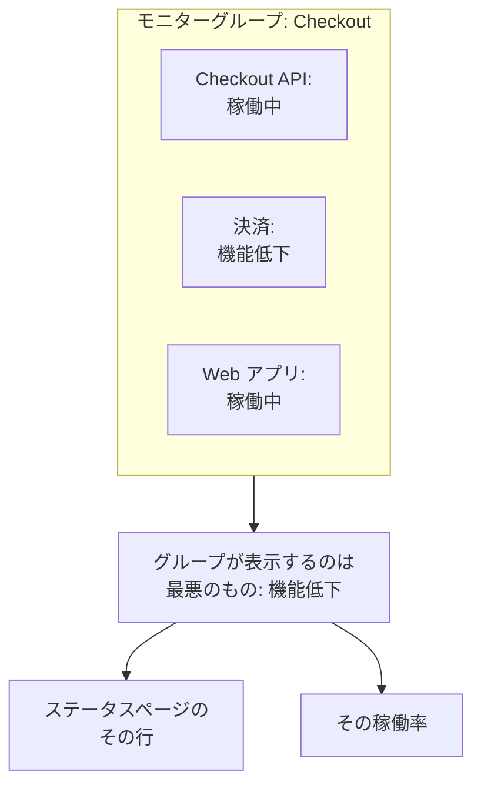

# モニターグループ

モニターグループは、複数のモニターをひとつのステータスにまとめます。合わせてひとつのサービスを構成するモニターをグループにします。たとえば Checkout なら、その API、決済サービス、Web アプリです。グループはそれらの中で最悪のステータスを表示し、独自の稼働率を持ち、ステータスページはグループ全体を 1 行で表示できます。

:::cards
- [グループのステータスの決まり方](#グループのステータスの決まり方): モニターの中で最悪のステータス。
- [モニターグループを有効にする](#モニターグループを有効にする): プロジェクト設定のスイッチひとつ。
- [モニターグループを作成する](#モニターグループを作成する): 名前を付けて、モニターを追加します。
- [ステータスページにグループを表示する](#ステータスページにグループを表示する): グループ全体で 1 行。
:::

## グループのステータスの決まり方

グループは稼働中のステータスから始まり、モニターの中で最悪のステータスになります。つまり、プロジェクトのモニターステータスの一覧で最も下にあるものです。モニターがひとつ **機能低下** になればグループ全体が **機能低下** になり、ひとつが **オフライン** になればグループも **オフライン** になります。

- **アーカイブされたモニターは数えません。** アーカイブされたモニターはチェックされないため、ステータスが固定されます。グループはそれを除外します。
- **空のグループは稼働中です。** モニターがないグループ、またはアーカイブされたモニターしかないグループは、稼働中のステータスを表示します。モニターを追加するまで、ダッシュボードではステータスの代わりに **モニターはまだありません** と表示されます。
- **順序はあなたが決めます。** どのステータスが最悪かは、**モニター → 設定 → モニターステータス** の順序で決まります。[モニターのステータス](/docs/monitor/criteria-and-statuses#モニターのステータス) を参照してください。

モニターグループはステータスページのグループではありません。ステータスページのグループは、ひとつのステータスページ上で行をまとめる見出しです。モニターグループは複数のモニターを表す 1 行で、どのステータスページでも表示できます。

## 始める前に

- **プラン。** OneUptime Cloud では、モニターグループに Scale プランが必要です。
- **スイッチ。** モニターグループは、プロジェクトで **モニターグループ** をオンにするまで非表示です（下記参照）。オンにするには、Project Owner ロール、または Edit Project か Manage Billing の権限を持つカスタムロールが必要です。
- **ロール。** グループの作成、変更、削除には、Project Owner、Project Admin、Project Member、Monitor Admin、Monitor Member のいずれかのロール、または対応するモニターグループの権限を持つカスタムロールが必要です。Viewer はグループを見られますが、変更はできません。

## モニターグループを有効にする

:::steps
### 「機能フラグ」を開く

**プロジェクト設定 → 詳細 → 機能フラグ** に移動します。サイドメニューの **詳細** は折りたたまれているので、先に展開します。

### スイッチをオンにする

**モニターグループ** のスイッチをオンにします。すぐに保存されます。**モニター** のサイドメニューに **モニターグループ** が表示され、各ステータスページの **モニター** の項目は **リソース** という名前に変わり、そこでグループを追加できます。
:::

スイッチを再びオフにすると、メニューから **モニターグループ** が消えます。グループは削除されません。

## モニターグループを作成する

:::steps
### 「モニターグループ」を開く

**モニター → モニターグループ** に移動します。**モニターグループ** カードには、各グループが **現在のステータス**、ラベル、所有者とともに表示されます。

### グループを作成する

**モニターグループを作成** をクリックし、**名前** と、必要なら **説明** を入力して、フォームの下部にある **モニターグループを作成** をクリックします。グループはモニターなしで作成されます。

### モニターを追加する

グループを開きます。モニターが 1 つもないうちは、**概要** に **モニターを追加** が表示されます。その後は、サイドメニューの **モニター** をクリックしてから **モニターを追加** をクリックします。**モニター** でグループのモニターをすべて選び、**モニターを追加** をクリックします。

### ステータスを確認する

**概要** をクリックします。**現在のステータス** にはグループの今のステータスが、**稼働率グラフ** には直近 90 日間が 1 日 1 本のバーで表示されます。
:::

グループからモニターを外すには、**グループ内のモニター** のその行で **削除** をクリックします。モニター自体は変わりません。モニターは複数のグループに属することができます。

## グループのページ

グループを開くと、サイドメニューにそのページが表示されます。

| ページ | 表示内容 |
| --- | --- |
| **概要** | **モニターグループの詳細**、**現在のステータス**、そして直近 90 日間のグループの稼働率を示す **稼働率グラフ**。モニターのないグループでは、グラフの代わりに **モニターを追加** が表示されます。 |
| **モニター** | **グループ内のモニター**。**モニターを追加** と **削除** があります。 |
| **インシデント** | グループ内のいずれかのモニターのインシデント。 |
| **アラート** | グループ内のいずれかのモニターのアラート。 |
| **所有者** | グループを担当するユーザーとチーム。最初は折りたたまれている **詳細** の下にあります。 |
| **監査ログ** | 誰がいつグループを変更したか。これも **詳細** の下にあります。 |
| **グループを削除** | グループを削除します。これも **詳細** の下にあります。 |

**概要** の稼働率は、稼働中以外のすべてのステータスをダウンタイムとして数えます。ステータスページは、自身の **ダウンタイムとしてカウント** の一覧にあるステータスだけを数えます。[ページに表示する内容を選ぶ](/docs/status-pages/index#ページに表示する内容を選ぶ) を参照してください。

**モニターグループ** の一覧では、所有者とラベルでグループを絞り込み、多くのグループにまとめてラベルと所有者を設定し、グループを JSON としてエクスポートまたはインポートできます。

## ステータスページにグループを表示する

:::steps
### ステータスページのリソースを開く

**ステータスページ** に移動してページを開き、サイドメニューの **リソース** をクリックします。

### ダイアログをグループに切り替える

**モニターを追加** をクリックします。モニターのドロップダウンの下にある **代わりにモニターグループを追加してください。** をクリックします。ドロップダウンが **モニターグループ** に変わります。

### グループを選んで追加する

グループを選びます。訪問者が読む名前である **表示名** には、自分で入力するまでグループの名前が入ります。**モニターを追加** をクリックすると、グループのステータスとともに行がページに表示されます。
:::

ステータスページでは、その行がグループ内のすべてのモニターを表します。

- **ステータス。** グループのステータス、つまりモニターの中で最悪のものです。
- **インシデント。** グループ内のいずれかのモニターのインシデントがページに表示され、影響を受けたリソースの中にグループの名前が挙がります。
- **購読者。** グループを選んだ購読者は、その中のすべてのモニターについて知らされます。[購読者にリソースとイベントタイプを選ばせる](/docs/status-pages/subscribers#購読者にリソースとイベントタイプを選ばせる) を参照してください。

その行のほかのオプション（稼働率や履歴グラフなど）については、[ステータス ページのリソースとグループ](/docs/status-pages/resources-and-groups) を参照してください。

> [!WARNING]
> モニターグループを削除すると、それを表示しているすべてのステータスページからその行も削除されます。グループ内のモニターとそのインシデントは削除されません。

## API と Terraform

グループは `/api/monitor-group` で、その中の各モニターは `monitorGroupId` と `monitorId` を組み合わせる `/api/monitor-group-resource` の行です。Terraform では `oneuptime_monitor_group` と `oneuptime_monitor_group_resource` です。[モニターグループ](/docs/terraform/examples#モニターグループ) を参照してください。

## トラブルシューティング

:::details モニターのメニューにモニターグループがない
**モニターグループ** のスイッチがオフです。**プロジェクト設定 → 詳細 → 機能フラグ** でオンにしてください。OneUptime Cloud では、グループには Scale プランも必要です。
:::

:::details ほとんどのモニターが稼働しているのに、グループがオフラインを表示する
それがルールです。グループは最悪のモニターを表示します。グループの **モニター** を開いてダウンしているモニターを探すか、グループに属さないモニターを外してください。
:::

:::details ステータスページにグループを追加できない
**代わりにモニターグループを追加してください。** は、プロジェクトで **モニターグループ** のスイッチがオンの間だけダイアログに表示されます。
:::

## 次のステップ

:::cards
- [モニターの条件とステータス](/docs/monitor/criteria-and-statuses): 各モニターのステータスを決めるもの。
- [ステータス ページのリソースとグループ](/docs/status-pages/resources-and-groups): ステータスページの行を配置します。
- [購読者とお知らせ](/docs/status-pages/subscribers): グループのインシデントを顧客に知らせます。
:::
