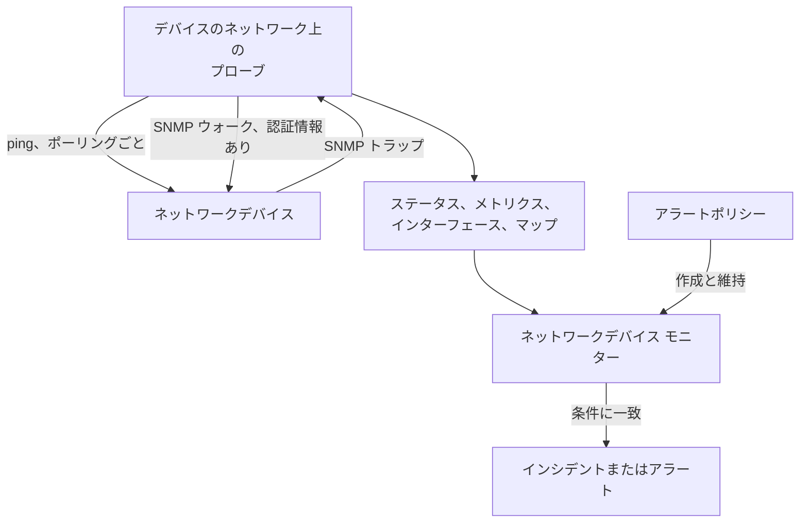
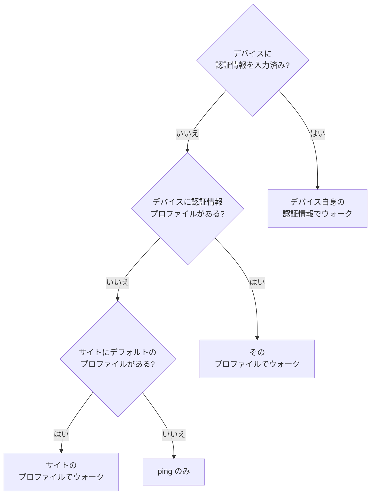
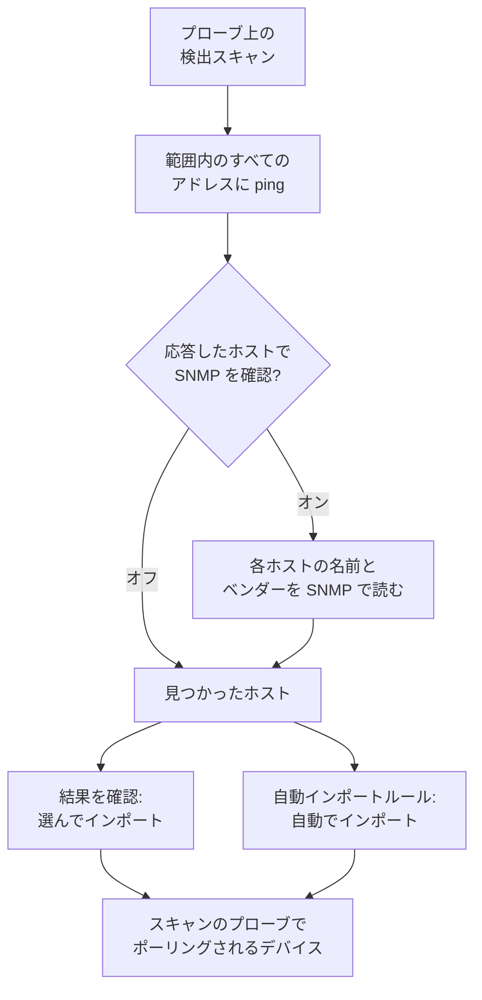
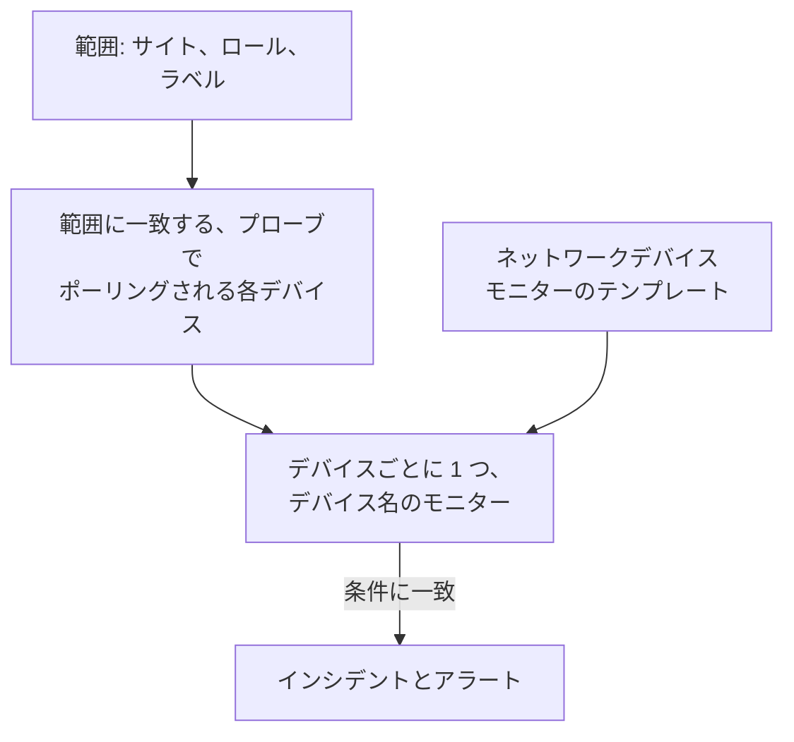
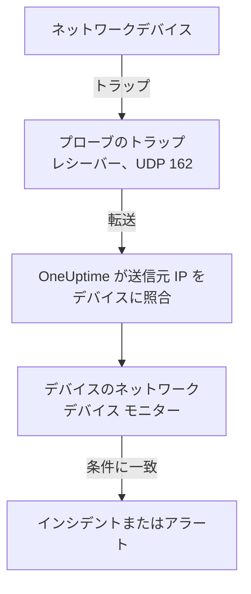

# ネットワークデバイス モニター

スイッチ、ルーター、ファイアウォール、アクセスポイント、PDU、カメラ、プリンターを監視します。SNMP に対応しているかどうかにかかわらず、ネットワーク上にアドレスを持つものなら何でも対象です。

アドレスとプローブを指定してデバイスを追加すると、プローブがスケジュールに従ってデバイスに ping を送ります。デバイスにはアップまたはダウンのステータス、ネットワークマップ上の位置、サイトのヘルスへの 1 票が与えられます。SNMP 認証情報を渡すと、同じプローブがデバイスを SNMP ウォークもします。インターフェースとそこに挿さった光モジュール、ハードウェアのインベントリ、LLDP と CDP のネイバー、ヘルス OID です。モニター、またはフリート全体に対するアラートポリシーを追加すると、そのポーリングとトラップからインシデントとアラートが発生します。

:::cards
- [デバイスを追加する](#ネットワークデバイスの追加): アドレスとプローブを 1 ページで指定します。
- [ネットワークを検出する](#ネットワークスキャンによるデバイスの検出): アドレス範囲をスキャンし、応答したものをインポートします。
- [SNMP でデバイスを読み取る](#snmp-認証情報と認証情報プロファイル): インターフェース、光モジュール、インベントリ、ヘルス。
- [アラートを受け取る](#アラート): 1 台のデバイスにはモニター、フリートにはポリシー。
- [マップを見る](#ネットワークトポロジー): ライブで描かれるネイバー、PDF への書き出し。
- [問題を解決する](#トラブルシューティング): 保留中のデバイス、失敗するウォーク、届かないトラップ。
:::

## 仕組み



デバイスとモニターは別々の役割を担います。

| 構成要素 | 役割 | 必要になる場面 |
| --- | --- | --- |
| デバイス | プローブがデバイス自身のスケジュールでポーリングします。各ポーリングは到達可否、ping の往復時間、パケットロスを記録し、SNMP 認証情報のあるポーリングはデバイスの識別情報、インターフェース、ネイバー、ヘルス OID も読み取ります。 | 常に必要です。追加するのはデバイスです。 |
| モニター | デバイスのすべてのポーリング結果とすべてのトラップに対して条件を評価し、インシデントとアラートを作成します。 | インシデントとアラートにだけ必要です。ステータス、インベントリ、グラフ、マップにモニターは要りません。 |

## 始める前に

- **デバイスに到達できるプローブ。** プローブは自分のネットワークからデバイスに ping を送り、ウォークします。そのため、プライベートアドレスのデバイスにはそのネットワーク内の [カスタムプローブ](/docs/probe/custom-probe) が必要です。パブリックインターネット上のプローブからは届きません。
- **ping 以上の情報を得るための SNMP。** 任意です。デバイスに v1 または v2c のコミュニティ文字列、または SNMPv3 ユーザーを設定し、プローブからの UDP 161 を開けておきます。これがない場合、デバイスには ping だけが送られます。
- **トラップ、syslog、フロー。** 任意です。プローブは SNMP トラップを UDP 162 で、syslog を有効にすれば UDP 5140 で、フローレコードを UDP 2055、4739、6343 で受け取ります。デバイスからプローブへのこれらのポートを開けてください。

## ネットワークの概要

**ネットワーク → 概要** はネットワーク領域を開いたときの最初の画面で、まず答えを示します。ネットワークが正常かどうか、正常でなければ何が問題なのかを、最も悪い知らせから 1 文で伝えます。

| 表示 | 表示されるとき |
| --- | --- |
| **3 台のデバイスがダウンしています** | デバイスのプローブまたはモニターがデバイスに到達できません。 |
| **2 件のサイトに注意が必要です** | すべてのデバイスが応答していますが、サイトのヘルスが正常ではありません。 |
| **5 個のインターフェースがダウンしています** | すべてのデバイスが応答していますが、消灯しているポートがあります。 |
| **2 台のデバイスが詳細を報告していません** | ping には応答しますが、SNMP ウォークが失敗しているため、インターフェースとヘルスが更新されません。原因は多くの場合、認証情報です。 |
| **最初のチェックを待っています** | デバイスが追加され、プローブがまだチェックしていません。 |
| **40 台すべてのデバイスが稼働中です** | すべてのデバイスが応答しています。最初のチェックを待っているデバイスは、別の行で数えられます。 |

その下の 1 行は、デバイスがダウンしたときに何かがインシデントを作成するかどうかを示します。有効な [アラートポリシー](#アラートポリシー) の数、または 1 つもない場合は **アラートをセットアップ** のリンクです。横にある **デバイスを追加** と **デバイスを検出** のボタンはそれぞれのフォームを開き、下のタイルとリストが詳細を示します。注意が必要なデバイスとサイト、ベンダー別のフリート、最近のスキャンです。

まだ何も追加されていないときは、代わりに 2 つの始め方が表示されます。**デバイスを検出** はアドレス範囲をスキャンして追加するものを選べるようにするもので、ネットワーク全体や新しいサイトに最適です。**デバイスを 1 台追加** は IP アドレスまたはホスト名で 1 台を追加します。

ネットワークメニューには毎日開くものが表示されています。**概要**、**デバイス**、**サイト**、**マップ**、**トラフィック**、**検出** です。残りはセクションに折りたたまれており、セクションは自分のページを開くと自動的に展開されます。

| セクション | ページ |
| --- | --- |
| **トポロジー** | **デバイスのトポロジー**、**エンドポイント**、**レイテンシマトリクス**、**サイトのリンク**、**デバイスのリンク** |
| **ルール** | **自動インポートルール**、**サイトの割り当てルール**、**所有者ルール**、**ラベルルール**、**リンクルール** |
| **設定** | **アラートポリシー**、**SNMP 認証情報**、**デバイスのロール**、**サイトの種類**、**OID 収集テンプレート** |
| **詳細** | **アーカイブ済みのデバイス** |

## ネットワークデバイスの追加

:::steps
### デバイスの一覧を開く
**ネットワーク → デバイス** に移動し、**デバイスを追加** をクリックします。ネットワークの **概要** にある **デバイスを追加** でも同じフォームが開きます。

### デバイスのアドレスを入力する
**ホスト名** に IP アドレスまたはホスト名を入力します。**名前** を空にしておくと、デバイスはホスト名で名付けられます。

### サイトとプローブを確認する
サイトを使っている場合は、デバイスがある **サイト** を選びます。**プローブ** にはサイトのデフォルトのプローブ、またはプロジェクトで唯一のカスタムプローブが自動で入ります。デバイスに到達できるプローブであることを確認してください。

### デバイスを追加する
**デバイスを追加** をクリックします。数分以内にプローブがデバイスに ping を送り、ステータスが **アップ** または **ダウン** になります。SNMP 認証情報がある場合は、最初のウォークが成功した後、デバイスの概要にも識別情報、インターフェース、ヘルスが表示されます。
:::

フォームは 1 ページです。ホスト名、名前、サイト、プローブがあり、その下に **SNMP** と **その他の項目** が折りたたまれています。デバイスの監視方法については何も尋ねません。追加したデバイスはすべてプローブがポーリングし、必要な一部のデバイス向けの [紐付けモニターによる上書き](#紐付けモニターによる上書き) はデバイスの **設定** ページにあります。

デバイスの詳細(名前、説明、ロール、サイト、ラベル、アドレス)は、後から 1 か所で編集します。**設定** ページの **デバイスの設定** カードです。概要の **デバイスの詳細** カードにはこれらが表示され、**設定で編集** のリンクがあります。

### デバイス

| 項目 | 説明 | 必須 |
| --- | --- | --- |
| ホスト名 | プローブが ping を送る IP アドレスまたはホスト名です。デバイスに認証情報があれば SNMP でウォークします。 | はい |
| 名前 | core-switch-01 のようなわかりやすい名前です。空にすると、デバイスはホスト名で名付けられます。API も同じで、名前なしで作成したデバイスはホスト名で名付けられます。 | いいえ |
| サイト | デバイスがある [ネットワークサイト](/docs/monitor/network-sites) です。サイトのヘルスはそのデバイスから集約され、デフォルトのプローブを持つサイトは下のプローブを自動で埋めます。 | いいえ |
| プローブ | このデバイスに ping を送り、認証情報があれば SNMP でウォークし、トラップ、syslog、[フローレコード](/docs/monitor/network-traffic) を受け取るプローブです。デバイスに直接到達できる必要があります。パブリックインターネット上のプローブはプライベートアドレスに届きません。 | はい |

**プローブ** は可能な場合に自動で入ります。カスタムプローブがちょうど 1 つのプロジェクトではそれが最初に入り、サイトを選ぶと [サイトのデフォルトのプローブ](/docs/monitor/network-sites#監視のデフォルト) に置き換わります。自分で選んだプローブが上書きされることはありません。サイトにデフォルトのプローブを設定しておけば、アドレスだけでデバイスを追加できます。

### その他の項目(折りたたみ)

| 項目 | 説明 | 必須 |
| --- | --- | --- |
| 説明 | 自由記述です。 | いいえ |
| デバイスのロール | コアスイッチ、アクセススイッチ、ファイアウォールなどです。マップ上の階層を決め、アラートポリシーの範囲を絞ります。 | いいえ |
| MAC アドレス | デバイス自身の MAC です。LLDP も CDP も話さないデバイスを、そのデバイスを学習したスイッチポートに配置するためにマップが使います。[ping のみのデバイスとそのスイッチポート](#ping-のみのデバイスとそのスイッチポート) を参照してください。通常はルーターの ARP テーブルから自動で学習されます。 | いいえ |
| インシデント用の Ping モニターも作成する | プローブはすでにデバイスに ping を送ってステータスを与えています。失敗した ping をインシデントに変えるのが Ping モニターです。チェックを入れると、保存時にホスト名に対して Ping モニターが作成され、デバイスに紐付けられます。プランの対象数に含まれ、そのインシデントはモニターのページで有効にするまでオフのままです。 | いいえ |

Ping モニターのチェックを入れると、モニター自身のプローブである **プローブから ping** が表示されます。これらはデバイスのネットワークに到達できる必要があります。空にすると、プロジェクトのデフォルトのプローブが使われます。多数のデバイスにまとめてアラートを出すには、代わりに [アラートポリシー](#アラートポリシー) を使ってください。

### SNMP(折りたたみ、任意)

折りたたんだままにすると、デバイスには ping だけが送られます。折りたたまれたセクションがそのことを 1 文で示します。デバイスは最初のポーリングからステータスを持ち、サイトとマップにも表示されますが、認証情報を得るまではインターフェース、インベントリ、ヘルス OID がありません。セクションを開いてコミュニティ文字列や v3 ユーザーを入力するか、保存済みの認証情報プロファイルを選びます。

:::tabs
@tab SNMP v1 / v2c
| 項目 | 説明 | 必須 |
| --- | --- | --- |
| SNMP バージョン | V1、V2c、V3 のいずれかです。 | はい、V2c で始まります |
| SNMP コミュニティ文字列 | v1 または v2c のコミュニティ文字列です。例: `public`。 | いいえ: 空なら ping のみ |
| SNMP ポート | エージェントが待ち受ける UDP ポートです。 | いいえ、既定は 161 |
| SNMP 認証情報プロファイル | ここに認証情報を入力する代わりに使う、保存済みの認証情報セットです。 | いいえ |
@tab SNMPv3
| 項目 | 説明 | 必須 |
| --- | --- | --- |
| SNMP v3 のセキュリティレベル | No Auth, No Priv、Auth, No Priv、Auth, Priv のいずれかです。 | はい |
| SNMP v3 のユーザー名 | デバイスに設定されたセキュリティ名(ユーザー)です。 | はい: 空なら ping のみ |
| SNMP v3 の認証プロトコル | MD5、SHA、SHA-256、SHA-512 のいずれかです。 | 認証ありの場合 |
| SNMP v3 の認証キー | 認証のパスフレーズです。 | 認証ありの場合 |
| SNMP v3 のプライバシープロトコル | DES、AES、AES-256 のいずれかです。 | 暗号化ありの場合 |
| SNMP v3 のプライバシーキー | プライバシー(暗号化)のパスフレーズです。 | 暗号化ありの場合 |
:::

デバイスに入力した認証情報は、横で選んだ認証情報プロファイルより優先され、デバイスのサイトもデフォルトのプロファイルを持てます。プロファイルの認証情報は暗号化して保存されます。デバイスに入力した認証情報は同じ読み取り権限で保護されますが、暗号化して保存はされません。共有の認証情報をプロファイルに置くべき理由がもう 1 つ増えます。

## 多数のデバイスをまとめて変更する

顧客ネットワークの検出スキャンでは、1 つのサイトに属し、1 つのロールを共有し、1 つのベンダーのデバイスが何十台も取り込まれます。1 台ずつ開く必要はありません。**デバイス** の一覧で行にチェックを入れるか、フィルターに一致するすべてのデバイスを選択して、**一括操作** を開きます。

| 操作 | 内容 |
| --- | --- |
| **サイトを設定** / **サイトをクリア** | 選択したすべてのデバイスを選んだサイトに移し、そのサイトのヘルスに数えられるようにします。自身のプローブがないデバイスは、サイトのデフォルトのプローブを使います。**サイトをクリア** はデバイスをサイトから外します。サイトの割り当てルールに一致するデバイスは、次のポーリングでルールのサイトに戻ります。検出が見つけ続けるデバイスには、代わりに **ネットワーク → ルール → サイトの割り当てルール** でルールを追加してください。**サイトを設定** のダイアログからリンクしています。 |
| **デバイスのロールを設定** / **デバイスのロールをクリア** | 選択したすべてのデバイスに同じロールを与えます。たとえば、すべて「Access Switch」である二十台のスイッチです。ロールはプロジェクト独自のもので、**ネットワーク → 設定 → デバイスのロール** にあり、ダイアログからリンクしています。**デバイスのロールをクリア** は、各デバイスのロールを SNMP の識別情報から改めて判断します。 |
| **ベンダーテンプレートを適用** | [ベンダーテンプレート](#ベンダーのヘルステンプレート) のヘルス OID と SNMP テーブルを、選択したすべてのデバイスに追加します。ダイアログの最初の選択肢 **各デバイスのベンダーに合わせる** は、各デバイスの SNMP ウォークが報告する内容からそのデバイスのテンプレートを選ぶため、混在した選択でもすべてに正しいテンプレートが当たります。または、全台に同じテンプレートを選びます。 |

各操作は選択全体に対して 1 つのダイアログと 1 回の保存で完了し、各デバイスは自身の設定ページで編集するときと同じチェックを通ります。権限、ロールのラベルと所有者の範囲、デバイスが収集できるものの上限です。

**ベンダーテンプレートを適用** は、実行前に何をするかを示します。どのテンプレートが何台に適用され、何台がそのままになるか、その理由です。各デバイスがすでに収集しているものに追加するだけで何も削除せず、テンプレートの内容をすべて持っているデバイスは書き直されません。そのままになるのは、モニターで管理されるデバイス(ポーリングされません)、[OID 収集テンプレート](#oid-収集テンプレート) に紐付けられたデバイス(収集するものはテンプレートが決めるので、ベンダーの OID はそちらに追加します)、そして照合時には、まだ SNMP でウォークされていないデバイスやベンダーにテンプレートがないデバイスです。

操作が終わると、変更されたデバイスの数、失敗したデバイスとその理由(ロールで編集できないデバイス、上限を超えたリストなど)、変更しなかったデバイスとその理由(すでにそのサイトやロールにあるデバイス、ベンダーテンプレートが対象外とするデバイス)が一覧表示されます。

その他の一括操作は関連する箇所で説明しています。**OID 収集テンプレートを設定** は [OID 収集テンプレート](#oid-収集テンプレート) で、**SNMP 認証情報プロファイルを設定**、**プローブによるポーリングに切り替え**、**Ping モニターを作成** は [一括で](#一括で) で、**名前をホスト名に短縮** は [検出したデバイスの名前の付け方](#検出したデバイスの名前の付け方) で説明します。

## ポーリングが実際に行うこと

プローブがポーリングするデバイスの各ポーリングは ping です。デバイスに使える SNMP 認証情報がある場合、プローブは完全な SNMP ウォークも実行します。両者は並行して動き、ウォークが ping を待つことはないため、ICMP を破棄する ACL の内側にある SNMP 機器でも **アップ** と報告されます。

| 結果 | ping のみのデバイス | SNMP 認証情報のあるデバイス |
| --- | --- | --- |
| ステータス(アップまたはダウン) | ping から | ping またはウォークから。どちらかが応答すれば十分です |
| ping の往復時間とパケットロス | デバイスのメトリクスとして記録 | デバイスのメトリクスとして記録 |
| SNMP の応答時間 | — | ウォークの時間。ping の時間ではありません |
| インターフェース、ネイバー、エンドポイント | — | 成功したウォークから |
| システムの識別情報、ベンダー、モデル、シリアル | — | 成功したウォークから |
| ヘルス OID と SNMP テーブル | — | 成功したウォークから |

使える認証情報とは、コミュニティ文字列のある v1 または v2c のセット、またはユーザー名のある v3 のセットで、[認証情報の優先順位](#snmp-認証情報と認証情報プロファイル) に従って見つかったものです。空のセットはスキップされるため、推測したデフォルトのコミュニティでデバイスがウォークされることはありません。

パケットロスは [Ping モニター](/docs/monitor/ping-monitor) と同じ系列を使うため、製品全体で同じように読めます。往復時間には専用の系列 `oneuptime.monitor.ping.round.trip.time` があります。ネットワークデバイスでは単なる応答時間は SNMP ウォークの時間だからです。デバイスの **メトリクス** ページにはインターフェースの使用率とヘルス OID のグラフが表示され、直近 1 時間の往復時間はマップ上のデバイスのドロワーに描かれます。

### 「SNMP 失敗中」は「ダウン」ではない

ping には応答するがウォークが失敗するデバイスは **アップ** で、**SNMP 失敗中** のタグが付きます。どちらの意味も重要です。

- アップなのは、そのアドレスで何かが応答しているからです。赤く表示すると、正常に動いているデバイスがインシデント数に加わってしまいます。
- SNMP 失敗中なのは、インターフェース、インベントリ、ヘルス OID の更新が止まっているからです。原因はほとんどの場合、認証情報、無効になった SNMP エージェント、または ACL です。数値が止まっていることを教えてくれるものは、ページ上にほかにありません。

ping とウォークの両方が失敗するデバイスは単に **ダウン** なので、このタグは常に緑のステータスの横にだけ表示されます。

### デバイスのステータスの読み方

デバイスを表示するすべての場所(デバイスの一覧、サイトのデバイスページ、概要、マップ)は、同じ 3 つの判定と、その横の同じ補足を使います。

| 判定 | 意味 |
| --- | --- |
| **アップ** | 最後のポーリング(ping または SNMP)、または紐付けられたモニターがデバイスに到達しました。 |
| **ダウン** | 最後のポーリング(ping または SNMP)、または紐付けられたモニターがデバイスに到達できませんでした。 |
| **保留中** | まだ判定がありません。一度もポーリングされていないか、プローブが割り当てられていないか、モニターが紐付けられていません。 |

| 補足 | 表示されるとき | 対処 |
| --- | --- | --- |
| **古い** | デバイスの間隔を大きく超えてポーリングが試みられていません。 | デバイスのプローブがオンラインで、フリートの処理が追いついているか確認します。 |
| **プローブなし** | デバイスはプローブでポーリングされる設定ですが、プローブがないか、ポーリングがオフです。 | 到達できるプローブを割り当てます。それまでは何もポーリングしません。 |
| **モニターなし** | デバイスは [紐付けモニターによる上書き](#紐付けモニターによる上書き) を使っていますが、何も紐付けられていません。 | モニターを紐付けるか、プローブによるポーリングに戻します。 |
| **SNMP 失敗中** | ping ではアップですが、最後の SNMP ウォークが失敗しました。 | 認証情報、SNMP エージェント、ACL を確認します。 |

**デバイス** の一覧には 3 つの値を持つ **SNMP** フィルターがあります。**OK**(最後のウォークが成功)、**失敗中**(最後のウォークが失敗)、**未設定**(ping のみ、認証情報なし、または一度もポーリングされていない)です。「認証情報が使えなくなったデバイスはどれか」が 1 クリックでわかります。一覧の **インターフェース（アップ / ダウン）** 列は、ping のみでウォークされないデバイスには `0 / 0` ではなく **SNMP なし** と表示します。動作中のポートが 0 というのは別の主張であり、誤りだからです。

## SNMP 認証情報と認証情報プロファイル

デバイスは、次の順で見つかった最初の使える認証情報セットでウォークされ、最初に見つかった時点で検索が止まります。



サイトの段階では、デバイス自身のサイトだけを読み、それより先は見ません。Unit にあるデバイスは、その上の Region に設定されたプロファイルを使いません。一方、サイトのデフォルトのプローブはツリーを下に伝わります。プローブはデバイスに 1 回コピーされるのに対し、認証情報はポーリングのたびに読み直されるからです。詳しくは [ネットワークサイト](/docs/monitor/network-sites#監視のデフォルト) を参照してください。

### SNMP 認証情報のページ

**ネットワーク → 設定 → SNMP 認証情報** には、プロジェクトの認証情報プロファイルがあります。プロファイルは名前の付いた 1 つのセット(v1 または v2c のコミュニティ文字列、またはセキュリティレベル、プロトコル、キーを持つ v3 ユーザー)で、何台のデバイスやサイトからでも参照できます。デバイスには何もコピーされないため、コミュニティ文字列の変更はここで 1 回編集するだけで済み、そのプロファイルを使うすべてのデバイスが次のポーリングで新しい値を使います。

プロファイルのシークレットは暗号化して保存され、デバイス自身の認証情報を読めるロールだけが読めます。プロファイルを表示するデバイスやサイトには、プロファイルの名前とバージョンだけが表示され、シークレットは表示されません。

デバイスやサイトがまだ参照しているプロファイルは削除できません。削除は、妨げになっているものの件数とともに拒否されます。それらのデバイスとサイトを別のプロファイルに移すか、プロファイルを外してから削除してください。

### デバイスを ping のみに戻す

デバイスの **設定** ページにある **設定を編集** の **SNMP 認証情報** の手順に、**ping のみ — このデバイス自身の SNMP 認証情報を消去** というチェックボックスがあります。保存時に、デバイス自身のコミュニティ文字列と v3 ユーザー名を消去します。どの項目を空にすればよいかが自明ではないため用意されています。v3 のデバイスは、ほかに何を空にしてもユーザー名が残っている限りウォーク可能なままです。

デバイス自身の認証情報を消去しても、プロファイルは消去されません。デバイスやそのサイトがまだプロファイルを指定していれば、デバイスはそのプロファイルでウォークされ続けます。ping だけにするには、プロファイルも外してください。

### 一括で

**デバイス** の一覧でデバイスを選択し、次の操作を使います。

- **SNMP 認証情報プロファイルを設定** / **SNMP 認証情報プロファイルをクリア**: 選択したデバイスにプロファイルを付ける、または外します。
- **プローブによるポーリングに切り替え**: 紐付けモニターによる上書きを使っているデバイス向けです。プローブを選ぶと、選択した各デバイスはその後スケジュールに従って ping を受け、認証情報を得ればウォークもされます。すでに紐付けられているモニターは紐付けられたままで、デバイスのステータスはプローブから得られるようになります。
- **Ping モニターを作成**: 紐付けモニターによる上書きを使っているデバイス向けに、各デバイスのホスト名に Ping モニターを作成して紐付け、デバイスがアップかダウンを示すようにします。

プロジェクトに、紐付けモニターによる上書きを使っていて何も紐付けられていないデバイス(何もポーリングせず、何も報告しないデバイス)があると、**デバイス** ページにバナーが表示され、それらを修正するための選択へのリンクが示されます。

## サイトの監視のデフォルト

[ネットワークサイト](/docs/monitor/network-sites#監視のデフォルト) は、そのデバイスのための 2 つのデフォルトを持ちます。**デフォルトのプローブ** は、自身のプローブを持たずにサイトに作成された、またはサイトに移されたデバイスにコピーされます。**デフォルトの SNMP 認証情報プロファイル** は、自身の認証情報を持たないサイト内のデバイスのポーリングのたびに読まれます。サイトに両方を設定すれば、そこではアドレスだけでデバイスを追加でき、最初のポーリングから ping とウォークが行われます。各デフォルトがサイトツリーのどこまで伝わるかは、サイトのガイドで説明しています。

## 紐付けモニターによる上書き

どのプローブも到達できない、あるいは ping では意味のある監視ができない機器があります。NAT の内側のデバイス、HTTP チェックで判断した方がよいアプライアンス、実際の指標がポートチェックであるサービスなどです。こうした機器のために、デバイスの **設定** ページの **設定を編集** に **監視方法** があります。

| 方法 | 意味 |
| --- | --- |
| **プローブ** | デフォルトです。割り当てられたプローブがスケジュールに従って ping を送り、認証情報があれば SNMP でウォークします。 |
| **紐付けられたモニター** | 既存のモニターのステータスがこのデバイスのステータスになります。 |

デバイスを **紐付けられたモニター** に切り替えると、ポーリングが止まります。プローブ、間隔、ポーリングのスイッチは **ポーリングとデータ収集** カードから消え、デバイスの過去のポーリング結果は消去され、ステータスは紐付けたモニターから得られます。モニターの紐付けは任意です。紐付けるまで、デバイスは **保留中** と表示され、**モニターなし** のタグが付きます。

**プローブ** に戻すとポーリングが再開し、プローブの指定が求められます。紐付けられていたモニターはそのまま紐付けられてアラートを出し続けますが、デバイスのステータスは決めなくなります。

ほとんどのデバイスにこれは不要です。プローブでポーリングされるデバイスにはすでに到達性のステータスがあるので、それを得るために Ping モニターを紐付ける必要はありません。そのモニターのインシデントが欲しいときにモニターを紐付けてください。

## ポーリングとデータ収集

ポーリングの設定は、デバイスの **設定** ページの **ポーリングとデータ収集** カード(**ポーリングを編集**)にあります。デフォルト値は新しいデバイスに合っているので、調整は不要です。

| 設定 | 説明 | デフォルト |
| --- | --- | --- |
| プローブ | デバイスをポーリングするプローブです。 | デバイスの追加時に設定 |
| ポーリングが有効 | プローブが以下のスケジュールでデバイスをポーリングします。デバイスを削除せずにポーリングを一時停止するにはオフにします。 | オン |
| ポーリング間隔（分） | プローブがデバイスをポーリングする頻度です。最小 1 分です。 | 5 |
| インターフェースをウォーク | ポーリングごとにインターフェーステーブル(IF-MIB)をウォークします。各ポートのステータス、帯域幅、使用率、エラーに加え、マップ用の LLDP と CDP のネイバーです。 | オン |
| 接続されたエンドポイントを収集 | ARP テーブルとブリッジ転送テーブルもウォークし、デバイスに接続されているもの(POS 端末、プリンター、電話、ノート PC)を見つけます。ARP テーブルからは、そのアドレスで登録されたデバイスの MAC アドレスも埋めます。ポーリングごとにウォークが増えます。 | オフ |
| OID 収集テンプレート | デバイスが収集する、共有の名前付き OID リストです。テンプレートを編集すると、紐付けられたすべてのデバイスが次のポーリングで変わります。 | なし |
| デバイス固有のヘルス OID | テンプレートの OID に加えて、このデバイスだけが収集する追加の OID です。 | なし |
| ベンダーのヘルステンプレートを自動適用 | デバイスのベンダーが認識され、デバイス自身の OID リストが空のとき、次のポーリングでベンダーのテンプレートからリストを埋めます。 | オフ。検出がインポートするデバイスではオン |
| Device-Specific SNMP Tables | テンプレートのテーブルに加えて、このデバイスだけがウォークする追加の [SNMP テーブル](#snmp-テーブル) です。テンプレートのテーブルと同じキーのテーブルは、このデバイスではテンプレートのものを置き換えます。 | なし |

**インターフェースをウォーク** 以下のすべてには SNMP 認証情報が必要です。ping のみのデバイスではこれらの設定は保持されますが、適用されるウォークがありません。

### インターフェースのウォーク

**インターフェースをウォーク** がオンで認証情報が見つかると、各ポーリングは各インターフェースの運用ステータスと管理ステータス、送受信ビット、使用率、エラーを追跡します。同じウォークで、マップ用の LLDP と CDP のネイバーも収集します。

ラボ用のポートや意図的に抜いたリンクなどのインターフェースを、デバイスの **インターフェース** ページでミュートすると、インベントリには残りますがアラートとメトリクスからは外れます。ウォークが失敗しても、収集済みのものが中途半端に消えることはありません。最後のインターフェースのスナップショットが残り、デバイスには **SNMP 失敗中** のタグが付くので、それが最新だと誤解されることはありません。

### ベンダーのヘルステンプレート

**ヘルス OID** エディターでは、**ベンダーのヘルステンプレート** がデバイスのベンダー向けの既製の OID セットを適用します。多くのテンプレートには [SNMP テーブル](#snmp-テーブル) も含まれ、**SNMP Tables** エディターの **Add a Vendor's Tables** で追加します。

| ベンダーテンプレート | ヘルス OID | SNMP テーブル |
| --- | --- | --- |
| Generic (Host Resources MIB) | CPU 負荷、合計と空きの RAM、ロードアベレージ | CPU コア(プラットフォームの番号付けにかかわらず、コアごとに一行) |
| Arista EOS | CPU 負荷、ロードアベレージ、合計と空きの RAM | — |
| Cambium Networks cnMatrix | CPU、RAM、フラッシュ、温度、電源電圧 | ファン、PoE ポート、冗長電源 |
| Cambium Networks Enterprise Wi-Fi (cnPilot, XV, XE, XH) | CPU、空きメモリ、Wi-Fi クライアント、cnMaestro への接続 | Wi-Fi 無線(バンド、チャネル、幅、送信出力、クライアント、ノイズフロア、エアタイム、状態)、SSID |
| Cisco IOS / IOS-XE | CPU、使用中と空きのメモリ、温度、ファンの状態、電源の状態 | — |
| Dell Force10 / OS9 | CPU、メモリ | — |
| Extreme Networks EXOS / Switch Engine | CPU、温度、過温度アラーム、電源の状態 | 電源装置、ファン、スロットごとのメモリ、スタックメンバー |
| Extreme Networks Fabric Engine / VOSS | vIST セッション、I-SID 数 | ネイバー名で示すファブリック(IS-IS)の隣接関係、スロットごとの CPU とメモリ、温度センサー、ファン、電源装置 |
| Extreme Networks IQ Engine (HiveOS) Access Points | CPU、メモリ、Wi-Fi クライアント、温度 | Wi-Fi 無線(チャネル、送信出力、ノイズフロア)、SSID |
| Extreme Networks Wireless Controller (XIQ-C, ExtremeWireless) | アクセスポイント、稼働中のアクセスポイント、Wi-Fi クライアント | アクセスポイント(状態、クライアント、アドレス、ソフトウェア)、Wi-Fi 無線(バンド、チャネル、幅、ノイズフロア、ビジーなエアタイム)、WLAN(SSID、クライアント) |
| Fortinet FortiGate | CPU、メモリ、ディスク | — |
| HPE / Aruba ProCurve | CPU、合計と空きのメモリ | — |
| HPE Aruba Instant (AOS 8) | クラスター名、ファームウェアバージョン、コンダクター | アクセスポイント(ステータス、モデル、CPU、メモリ)、アクセスポイント名で示す Wi-Fi 無線(チャネル、送信出力、ノイズフロア、使用率、クライアント、状態)、SSID(クライアント) |
| HPE Aruba Mobility Controller (AOS 8) | アクセスポイント、Wi-Fi クライアント、コントローラーのロール | アクセスポイント(ステータス、モデル、AP グループ)、アクセスポイント名で示す Wi-Fi 無線(バンド、チャネル、送信出力、使用率、クライアント、モード)、SSID(クライアント、アップとダウンのアクセスポイント)、プロセッサー、メモリ |
| Huawei VRP | CPU、メモリ、温度 | — |
| Juniper Junos | CPU、メモリバッファー、温度 | — |
| MikroTik RouterOS | CPU 負荷、温度、電圧 | — |
| Palo Alto PAN-OS | 管理 CPU、セッション使用率、アクティブなセッション | — |
| Sophos Firewall (SFOS / XGS) | メモリ、ディスク、スワップ、HA の状態とピアの状態、IPsec サービス、CPU 温度(SFOS v22 以降) | IPsec トンネル(ステータスには SFOS v20 以降が必要)、CPU コア |
| TP-Link Omada Access Points (EAP) | Wi-Fi クライアント | — |
| Ubiquiti EdgeOS / EdgeSwitch / UniFi Switches | CPU 負荷、合計と空きの RAM | — |
| Ubiquiti UniFi Access Points | 分離状態、ロードアベレージ、合計と空きの RAM | Wi-Fi 無線(バンド、エアタイム)、SSID(バンド、チャネル、クライアント、送信出力、接続品質)、CPU コア |

テンプレートの OID はデバイス自身のリストにコピーされ、そこで削ったり追加したりできます。最初のウォークでベンダーが特定されると、デバイスのページが一致するテンプレートを提案します。照合ではデバイスの `sysObjectID` を読み、1 つのエンタープライズ番号に 2 つの OS がある場合は `sysDescr` も読みます。汎用ハードウェア上の Extreme Fabric Engine は EXOS と同じエンタープライズ番号(1916)を報告し、両者を区別できるのは説明(`…-FabricEngine (9.0.4.0)`)だけです。UniFi のアクセスポイントも同じ方法で Ubiquiti のルーターと区別され(`U6-Pro 6.6.50.15098`)、古いファームウェアが Net-SNMP のツリーで応答する場合も同様です。IQ Engine のアクセスポイントは、同じツリーを共有する Aerohive のスイッチと区別されます(`AP230, HiveOS 8.2r1`)。

**ベンダーのヘルステンプレートを自動適用** がオンのデバイスは、最初のポーリングでテンプレートの OID とテーブルを受け取ります。自動インポートルールが取り込むデバイスと、**結果を確認** からベンダーテンプレートのスイッチをオンにしてインポートしたデバイス(オフにしない限りオンです)です。スイッチができる前に検出したフリートなど、多数のデバイスにまとめてテンプレートを適用するには、**デバイス** の一覧で選択して **ベンダーテンプレートを適用** を使います([多数のデバイスをまとめて変更する](#多数のデバイスをまとめて変更する) を参照)。

ベンダーテンプレートの適用は 1 回限りのコピーなので、テンプレートが変わっても何も伝わりません。1 台を超える場合は、代わりに **OID 収集テンプレート** を使ってください。作成時には、ベンダーテンプレートを出発点として選べます。

### OID 収集テンプレート

**OID 収集テンプレート**(**ネットワーク → 設定 → OID 収集テンプレート**)は名前の付いた OID リストで、通常は「Cisco Catalyst 9300」のようなデバイスの種類にちなんで名付け、何台のデバイスでも紐付けられます。紐付けはコピーではなくライブです。デバイスの OID リストはポーリングのたびに組み立てられるため、テンプレートを編集すると、紐付けられたすべてのデバイスが次のポーリングで収集する内容が変わります。同期の手順はありません。

作成する前に、本当に必要か確認してください。ポートごとの送受信ビット、運用ステータス、使用率、毎秒のエラーは、OID なしで、すべてのポーリングですべてのポートから収集され([インターフェースのウォーク](#インターフェースのウォーク) を参照)、ポートごとのアラートにもすでに使えます。テンプレートはポート単位ではないもののためにあります。CPU、メモリ、温度、ファン、電源装置、BGP ピアです。

Zabbix から移行する場合の対応は次のとおりです。

| Zabbix | OneUptime |
| --- | --- |
| Template | OID 収集テンプレート |
| Item | そのテンプレートの OID |
| アイテムのプロトタイプを持つディスカバリールール「Network interfaces by SNMP」 | インターフェースのカウンターには組み込みで常にオン。書く必要はありません |
| Trigger | モニターの条件 |
| 検出したインターフェースごとに一つのトリガーのプロトタイプ | **インターフェース** を `*` にした条件。ポートごとに展開されます |
| アイテムのプロトタイプを持つ、その他の SNMP テーブル(トンネル、無線、ファン)のディスカバリールール | テンプレート上の [SNMP テーブル](#snmp-テーブル) |
| そのようなテーブルに対するトリガーのプロトタイプ | **Row** を `*` にした SNMP Table Value または SNMP Table Row Is Unhealthy の条件 |
| ホストグループ | ラベル |
| 「Link template on host discovery」アクション | 自動インポートルールの **OID 収集テンプレート** |
| ホストグループに対するアクション(「すべてのスイッチでアラート」) | [アラートポリシー](#アラートポリシー) |

テンプレート上の OID は書かれたとおりに収集されるため、テーブルの 1 行を指す OID(`…ifSpeed.3`)は、ポーリングの日にインデックス 3 にあるものが何であれ、その行だけを収集します。トンネル、無線、ファン、ネイバーなどのリストは [SNMP テーブル](#snmp-テーブル) に入れるべきです。SNMP テーブルはすべての行をウォークし、行の増減を追跡します。ポートごとのインターフェースデータにはどちらも不要です。インターフェースのウォークが、運用ステータス、毎秒の送受信ビット、使用率、毎秒のエラーの合計を系列として記録します。方向別のエラー、破棄、管理ステータス、リンク速度はデバイスのインターフェースインベントリに入りますが、系列ではないためアラートには使えません。

デバイスを紐付ける方法は 3 つあり、検出が見つけ続けるフリートでは 3 つ目が最も重要です。

- 1 台ずつ、デバイスの **ポーリングとデータ収集** カードで。
- まとめて、**デバイス** の一覧でデバイスを選択し、**OID 収集テンプレートを設定** を使って。一覧の **テンプレート** 列で、どのデバイスが何に紐付けられているかがわかります。
- 自動で、自動インポートルールに OID 収集テンプレートを設定して。スキャンがインポートするすべてのデバイスが、作成された時点で紐付けられます。

デバイスはまずテンプレートの OID を収集し、次に自身の **デバイス固有のヘルス OID** を収集します。両方が同じ OID を指定している場合は 1 回だけ収集され、デバイスの名前と説明が優先されます。テンプレートのエントリーは位置を保つため、デバイス固有の追加がそれらを押し出すことはありません。

| 上限 | 値 |
| --- | --- |
| デバイスがポーリングするヘルス OID | 200 |
| テンプレートの OID | 150 |
| 紐付けられたデバイス自身の OID | 50 |
| 紐付けられていないデバイス自身の OID | 200 |

上限は合算されるため、紐付けられたデバイスが 200 を超える OID をポーリングすることはありません。超えた場合は保存時の検証エラーになり、ポーリング時に黙って切り捨てられることはありません。すでに 50 を超える自身の OID を持つデバイスを紐付けようとすると、削除すべき数を示すメッセージとともに拒否されます。

まだデバイスが紐付けられているテンプレートは削除できません。たとえば一括操作の **OID 収集テンプレートを解除** で先に紐付けを外してください。削除によってフリート全体の収集が黙って止まることはありません。

### カスタム OID

ポーリングごとに収集したい OID を、テンプレートまたはデバイス固有の追加として追加します。

| 項目 | 説明 | 必須 |
| --- | --- | --- |
| OID | 数値の OID です。例: 1.3.6.1.2.1.1.1.0。 | はい |
| 名前 | OID のわかりやすい名前です。例: sysDescr。 | いいえ |
| 説明 | OID が表すものです。 | いいえ |

収集した値はデバイスの **メトリクス** ページにグラフ表示され、**SNMP OID Value** と **SNMP OID Exists** の条件でアラートを出せます。これらの条件の OID ピッカーには、選んだデバイスが収集する OID(テンプレートのものとデバイス自身のもの)が一覧表示されるので、入力する必要はありません。

長い OID リストは、それぞれが 1 つの UDP データグラムに収まるよう、複数の SNMP GET リクエストに分割されます。`tooBig` を返すデバイスを古いリリースがオフラインと報告していたため OID リストを短くしていた場合、もうその必要はありません。

### SNMP テーブル

デバイスが知っていることの一部はリストです。IPsec トンネル、Wi-Fi 無線、SSID、ファブリックのネイバー、ファン、電源装置ごとに 1 行です。SNMP テーブルは列で定義され、すべての行がポーリングのたびにウォークされるため、トンネルが追加、名前変更、削除されても、誰も何も編集せずに追跡されます。

| 項目 | 役割 |
| --- | --- |
| 名前とキー | テーブルの呼び名です。キー(英字、数字、アンダースコア。空なら名前から作られます)は条件、メトリクス、テンプレート変数が使うものなので、テーブルの名前を変えてもアラートが壊れることはありません。 |
| 種類 | 行が何であるかです。VPN トンネル、Wi-Fi アクセスポイント、Wi-Fi 無線、Wi-Fi SSID、ルーティングのネイバー、ハードウェア、汎用のいずれかです。Wi-Fi の種類はデバイスの [Wi-Fi ページ](#wi-fi-タブ) に使われます。 |
| 列 | 収集する列の OID(テーブルのエントリーの OID に列番号を付けたもの。例: Sophos のトンネルのステータスなら `1.3.6.1.4.1.2604.5.1.6.1.1.1.1.9`)です。それぞれに名前と、任意で単位、ロール(ステータス、バンド、チャネル、チャネル幅、送信出力、クライアント、ノイズフロア、使用率、SSID)、値のラベル、正常な値を持てます。 |
| 行の名前 | トンネルの接続名のように、各行に名前を付ける値を持つ任意の列です。指定しない場合、行はインデックスで名付けられます。名前は、インデックスを共有する兄弟テーブル(Fabric Engine は IS-IS の隣接関係を `rcIsisAdjHostName` から名付けます)や、インデックスがこのテーブルのインデックスの先頭になる親テーブル(Aruba Instant は各無線をアクセスポイントで名付けます)から取ることもできます。名前でインデックス付けされたテーブル(ArubaOS は SSID を SSID でインデックス付けします)は、デコードしたインデックスで名付けられます。 |
| 行の上限 | 保持する行数です。既定は 100、最大は 250 です。 |

数値は数値として読まれ、数値で始まるテキストはその数値として読まれます(`"36"`、`"-95 dBm"`、`"80MHz"`)。多くのベンダーが文字列に数値を入れるためです。数値に見えるだけの値には、列の値の種類を **Text only** にします。**Value labels** はコードを言葉に変えます(`0=inactive, 1=active`)。グラフや比較には引き続き生の値が使われ、表示にはラベルが使われます。**Healthy values**(`1`)はどの値が正常かを示します。デバイスの **SNMP Tables** ページで行に色を付け、**SNMP Table Row Is Unhealthy** の条件を動かします。

一部のベンダーテンプレートの列は、独自の単位で値を保持する MIB のために、読み取った数値を **調整** もします。ArubaOS は送信出力を 2 倍で報告し(読み取り値 × 0.5)、Aruba Instant はノイズフロアを符号なしで(× −1)、Aerohive はノイズフロアに 256 を足して(− 256)、Extreme のコントローラーはチャネル幅を 20 MHz 単位で(× 20)報告します。表示、グラフ、比較に使われるのは調整後の数値なので、**Noise Floor Greater Than -80** はどのベンダーでも同じ意味になり、テーブルエディターは列の下に計算式を表示します。

テーブルは、紐付けられたすべてのデバイスで共有される [OID 収集テンプレート](#oid-収集テンプレート)(最大 10 テーブル)、またはデバイス自身の **Device-Specific SNMP Tables**(さらに最大 10)から来ます。ポーリングのたびにキーで統合され、テンプレートが先で、同じキーのデバイスのテーブルがテンプレートのものを置き換えます。どちらのエディターにも **Add a Vendor's Tables** があります。

プローブは各列をサブツリーとしてウォークし、デバイス上のすべてのテーブルで共有する 30 秒の予算内に収めます。ウォークできないテーブルは理由を示し、ポーリングを失敗させることはありません。デバイスの **SNMP Tables** ページは最後の正常な行を保持し、最新のウォークが失敗したことを示します。一方、条件はこのウォークが返したものだけを判定するため、タイムアウトが空のテーブルとして読まれることはありません。数値のセルはすべて、属性 `snmpTableKey`、`snmpTableName`、`snmpTableColumn`、`snmpTableColumnOid`、`snmpTableRow`、`snmpTableRowIndex` を持つメトリクス `oneuptime.monitor.snmp.table.value` として記録されます。そのため、ダッシュボードで各トンネルのステータスや各無線の送信出力をグラフ化でき、メトリクスモニターで `snmpTableRow` ごとにグループ化できます。

### Wi-Fi タブ

ウォークに Wi-Fi テーブル(Wi-Fi のベンダーテンプレートが取り込むアクセスポイント、無線、SSID)を含むデバイスには、**Wi-Fi** ページが追加されます。冒頭に稼働中のアクセスポイント(コントローラーの場合)、オンの無線、クライアント、SSID を示し、続いてコントローラーが管理する各アクセスポイントの状態、無線、クライアント、各無線のバンド、チャネル、周波数、チャネル幅、送信出力、クライアント、ノイズフロア、エアタイム、各 SSID のバンドとクライアントを一覧表示します。列はロールで見つけるため、列にロールを付けたどのベンダーのテーブルも同じように表示されます。

ベンダーごとにこれらの情報の持ち方は異なり、このページがそれをまとめ直します。

- 周波数は、802.11 のチャネルプラン(2.4、5、6 GHz)を使ってバンドとチャネルから算出します。MIB でチャネルとされている箇所に周波数を報告するコントローラー(Extreme のもの)は、逆に読み取ります。
- バンドを報告しない無線は、チャネルで判断します。1 から 14 は 2.4 GHz、32 から 177 は 5 GHz、6 GHz だけが使う番号(37、53、181…)は 6 GHz です。
- UniFi はチャネル、送信出力、クライアントを SSID ごとに報告します。無線はそれらを自分のバンドの SSID から取ります。
- Aruba はクライアントを無線ごとに数えます。アクセスポイントのクライアントは、その無線のクライアントです。
- ネットワークを送出していないインターフェース(IQ Engine はすべてのインターフェースを一覧にし、それらには N/A を付けます)は SSID として表示しません。

まだ Wi-Fi を報告していないデバイスでは、ページがそのベンダーのテンプレート(自動適用と同じように最後のポーリングから照合したもの)を示し、**テンプレートを適用** で適用します。無線は次のポーリングの後に表示されます。

### 対応している Wi-Fi ベンダー

各 Wi-Fi ベンダーが SNMP で報告するものと、そのクラウドにしかないもの:

| ベンダー | アクセスポイントとコントローラー | ベンダーテンプレート | SNMP で読み取るもの | ベンダーのクラウド API が必要なもの(未対応) |
| --- | --- | --- | --- | --- |
| Cambium Networks | エンタープライズ Wi-Fi アクセスポイント(cnPilot、XV、XE、XH) | Cambium Networks Enterprise Wi-Fi (cnPilot, XV, XE, XH) | 各無線のバンド、チャネル、幅、送信出力、クライアント、ノイズフロア、エアタイム、状態。SSID。CPU、メモリ | cnMaestro のフリートビュー |
| Ubiquiti UniFi | UniFi アクセスポイント(UAP、U6、U7、UK) | Ubiquiti UniFi Access Points | 各無線のバンドとエアタイム。各 SSID のチャネル、クライアント、送信出力。コアごとの CPU、メモリ | UniFi Network アプリケーションのクライアントごとのデータとサイトビュー |
| HPE Aruba | 仮想コントローラー経由の Instant クラスター(AOS 8) | HPE Aruba Instant (AOS 8) | 各アクセスポイントのステータス、CPU、メモリ。各無線のチャネル、送信出力、ノイズフロア、使用率、クライアント、状態。クライアント付きの SSID | — |
| HPE Aruba | Mobility Controller(AOS 8) | HPE Aruba Mobility Controller (AOS 8) | 管理対象の各アクセスポイントのステータス。各無線のバンド、チャネル、送信出力、使用率、クライアント。クライアント付きの SSID。コントローラーの CPU とメモリ | — |
| HPE Aruba | Aruba Central が管理する AOS 10 のアクセスポイント | — | 到達性(ping) | 無線、SSID、クライアント: Aruba Central の API |
| Extreme Networks | IQ Engine(HiveOS)のアクセスポイント | Extreme Networks IQ Engine (HiveOS) Access Points | 各無線のチャネル、送信出力、ノイズフロア。SSID。CPU、メモリ、クライアント、温度 | ExtremeCloud IQ のクライアントビューとフリートビュー |
| Extreme Networks | ExtremeCloud IQ Controller(旧 Extreme Campus Controller)と ExtremeWireless コントローラー | Extreme Networks Wireless Controller (XIQ-C, ExtremeWireless) | 各アクセスポイントの状態とクライアント。各無線のバンド、チャネル、幅、ノイズフロア、ビジーなエアタイム。クライアント付きの WLAN | — |
| TP-Link | Omada アクセスポイント(EAP) | TP-Link Omada Access Points (EAP) | TP-Link の EAP クライアント MIB を持つファームウェアでのクライアント数 | 無線、チャネル、SSID: Omada Controller の API |
| Juniper | Mist アクセスポイント | — | 到達性(ping)。Mist の Webhook によるアクセスポイントのアップとダウン | それ以外のすべて: Mist のクラウド API |

テンプレートは各デバイスの `sysObjectID` と `sysDescr` から照合されるため、自動適用、一括操作 **ベンダーテンプレートを適用** の **各デバイスのベンダーに合わせる**、Wi-Fi ページは、指示しなくてもテンプレートを選びます。例外は TP-Link のテンプレートで、これは自分で適用します。ベンダーごとの SNMP の有効化:

- **Cambium**: cnMaestro では、SNMP は AP グループごとに設定します(Configuration → Wi-Fi Profiles → AP Groups → Management → SNMP)。v2c のコミュニティまたは v3 ユーザーを使います。各アクセスポイントを追加します。
- **Ubiquiti UniFi**: UniFi Network アプリケーションで SNMP を有効にすると、管理対象のデバイスに設定されます。各アクセスポイントを追加します。
- **HPE Aruba Instant**: クラスターの SNMP を有効にし、仮想コントローラーのアドレスを 1 台のデバイスとして追加します。仮想コントローラーがすべてのアクセスポイントに代わって応答します。
- **HPE Aruba Mobility Controller**: コントローラーを追加します。キャンパスのアクセスポイント自体は SNMP に応答しません。
- **Extreme IQ Engine**: ExtremeCloud IQ がアクセスポイントに配布するネットワークポリシーで SNMP を有効にし、各アクセスポイントを追加します。
- **Extreme Wireless Controller**: コントローラーの管理設定で SNMP を有効にし、コントローラーを追加します。
- **TP-Link Omada**: Omada Controller でサイトの SNMP を有効にし(Network Config → SNMP)、アクセスポイントを追加して、その設定ページまたは **ベンダーテンプレートを適用** でテンプレートを適用します。
- **Juniper Mist**: Mist のアクセスポイントは SNMP に応答しません。到達性のために ping のみのデバイスとして追加し、Mist の `device-updowns` Webhook を [受信リクエストモニター](/docs/monitor/incoming-request-monitor) に送ると、オフラインになったアクセスポイントがインシデントになります。

コントローラーのテーブルは最大 250 行を保持します。250 を超えるアクセスポイントや無線を持つコントローラーでは残りは一覧に表示されず、テーブルにそのことが示されます。アクセスポイント数とクライアント数はヘルス OID なので、すべてを数えます。

### トランシーバー

デバイスのポートにある SFP、SFP+、SFP28、QSFP の光モジュールは、インターフェースをウォークするポーリングのたびに読み取られます。有効にする設定も、適用するテンプレートもありません。OneUptime は光モジュールごとに次の情報を保持します。

- 何であるか: 光モジュールが報告するベンダー、部品番号、シリアル番号、リビジョン、種類、波長です。サードパーティの光モジュール(FS.com、FLEXOPTIX、Carritech など)も、スイッチベンダー純正のものと同じように読み取ります。
- 測定値: デジタル光モニタリング(DOM、DDM とも呼ばれます)による温度、電源電圧、レーザーのバイアス電流、送信と受信の光パワーです。QSFP はパワーとバイアスをレーンごとに報告します。
- デバイス自身のしきい値: スイッチが各測定値について報告する警告とアラームの下限と上限です。光モジュールはこれらだけを基準に判定され、OneUptime が独自の上限を作ることはありません。
- 1 か月分の受信パワー: 過去 30 日間の、最も弱いレーンの日平均です。汚れたコネクター、曲がったファイバー、劣化していく光モジュールは、リンクが落ちる何週間も前にここに現れます。

デバイスの **インターフェース** ページは **トランシーバー** カードから始まります。まず問題、次に光モジュールごとに 1 行で、ポート、何であるか、言葉で示したステータス、測定値を表示します。しきい値を超えた測定値は色が付き、名前で示され(**下限アラーム**、**上限警告**)、RX の値の横には 1 か月分の受信パワーの小さなグラフがあります。QSFP の行は最も悪いレーンを示します。行をクリックすると、各レーンと各しきい値の比較、最良の日を含む受信パワーの推移、光モジュールの識別情報が表示されます。光モジュールを報告しないデバイス(銅線ポートだけのもの、またはエージェントが光モジュールを公開しないもの)では、カードは表示されません。

| ステータス | 意味 |
| --- | --- |
| 正常 | デバイスがしきい値を持つすべての測定値が、その範囲内にあります。 |
| 警告 | 測定値が警告のしきい値に達しているか、超えています。 |
| アラーム | 測定値がアラームのしきい値に達しているか超えている、またはデバイスが信号損失や送信機の障害を示しています。 |
| 未検出 | ポートに光モジュールがあったが、ポートが有効なまま報告されなくなりました。ページには以前あったものの名前が表示され続けます。 |
| しきい値なし | 光モジュールは測定値を報告しますが、判定に使う上限をデバイスが報告しません。**SNMP Transceiver Reading** でアラートを出してください。 |
| 検出済み | 光モジュールが診断情報をまったく報告しません。銅線 SFP やダイレクトアタッチケーブルではよくあることです。 |
| ポート無効 | ポートがシャットダウンされているため、レーザーは意図的にオフです。測定値は表示されますが、判定されることはありません。 |

デバイスの `sysObjectID` によって、測定値の取得元が決まります。標準にはないものを持つ場合はベンダー独自のテーブルを優先し、ENTITY-SENSOR-MIB を代替として使います。

| デバイス | 取得元 | しきい値 |
| --- | --- | --- |
| Cisco | CISCO-ENTITY-SENSOR-MIB。ENTITY-MIB を通じてポートに対応付け | あり |
| Arista | ENTITY-SENSOR-MIB。しきい値は ARISTA-ENTITY-SENSOR-MIB から | あり |
| Juniper | JUNIPER-DOM-MIB。マルチレーンの光モジュールにはレーンごとの測定値 | あり |
| HPE Comware と H3C | HH3C-TRANSCEIVER-INFO-MIB | あり |
| HPE Aruba ProCurve / ArubaOS-Switch | HP-ICF-TRANSCEIVER-MIB | あり |
| MikroTik RouterOS | MIKROTIK-MIB(`mtxrOpticalTable`)。信号損失と送信機障害のフラグ付き | なし |
| Cambium Networks cnMatrix(4.5 以降) | CAMBIUM-NETWORKS-TRANSCEIVER-MIB | なし |
| その他すべてのデバイス | ENTITY-SENSOR-MIB(RFC 3433)。ENTITY-MIB を通じてポートに対応付け | なし |

最初のポーリングですべてを読み取ります。以降のポーリングでは変化するもの(測定値と、交換された光モジュールを見分けるシリアル番号)だけを読み、残り(しきい値、識別情報、どの光モジュールがどのポートにあるか)は、光モジュールの挿入、取り外し、交換のとき、および少なくとも 1 時間に 1 回、読み直します。これらの MIB をどれも持たないデバイスでは、試した MIB ごとに 1 リクエストかかります。読み取りには専用の 20 秒の予算があり、タイムアウトしたり途中で打ち切られたりした読み取りは、光モジュールが消えたと報告するのではなく、デバイスの最後の正常な光モジュールを保持します。

有効なポートから消えた光モジュールはページ上ですぐに **未検出** と表示され、アラートでは 2 回連続のポーリングの後に欠落として数えられます。そのため、エージェントが 1 回空で応答しただけで誰かが呼び出されることはありません。シャットダウンされたポートから抜かれた光モジュールは単に忘れられ、ミュートしたインターフェースはページ上に光モジュールを残しますが、アラートの対象にはなりません。

各測定値はデバイスのメトリクスでもあり、ポートとレーンごとに 1 系列で、ページと同じ単位で記録されます。`oneuptime.monitor.snmp.transceiver.temperature`(°C)、`oneuptime.monitor.snmp.transceiver.voltage`(V)、`oneuptime.monitor.snmp.transceiver.bias.current`(mA)、`oneuptime.monitor.snmp.transceiver.tx.power` と `oneuptime.monitor.snmp.transceiver.rx.power`(dBm)で、属性 `interfaceName`、`interfaceIndex`、`lane` を持ちます。ダッシュボードでリンクの光を何か月にもわたってグラフ化でき、メトリクスモニターでそれにアラートを出せます。

ネットワークデバイス モニターのインシデントやアラートに対する OneUptime AI の調査は、関係するポートの光モジュールから始まります。まだ検出されているか、各測定値とデバイスのしきい値の比較、ここ数週間の受信パワーです。AI は、尋ねればどのデバイスの光モジュールも読み取れます。

### デバイスの識別情報

最初のウォークが成功すると、OneUptime は SNMPv2 のシステムグループと、デバイスが対応していれば ENTITY-MIB を読み取り、デバイスのレコードを埋めます。システム名、説明、場所、連絡先、稼働時間、ベンダー、モデル、シリアル番号、ファームウェアバージョンです。ベンダーのエンタープライズ OID(`sysObjectID`)はデバイスのフィンガープリントで、ベンダーを示し、一致するベンダーテンプレートを選びます。同じ情報は [インベントリ](/docs/inventory/cmdb-sync#network-device-asset-attributes) に、ほかのすべての資産とともに表示されます。

ping のみのデバイスは、自分または検出スキャンが付けた名前とアドレスを保持します。より良い情報を尋ねる SNMP エージェントがないからです。

## ネットワークスキャンによるデバイスの検出

デバイスを 1 台ずつ追加する代わりに、プローブからアドレス範囲をスキャンし、応答したものをインポートします。



:::steps
### 検出を開く
**ネットワーク → 検出** に移動し、**スキャンを開始** をクリックします。ネットワークの **概要** にある **デバイスを検出** でも同じフォームが開きます。

### スキャンする対象を指定する
**スキャン対象** の手順で範囲を入力し、**プローブ** を確認して、**応答したホストで SNMP を確認** するかどうかを決めます。

### 試す認証情報を追加する
SNMP がオンの場合、**SNMP 認証情報** の手順で試す認証情報のセットを指定します。オフの場合は 2 つ目の手順はなく、スキャンは [ping のみのスキャン](#ping-のみのスキャン) になり、**スキャンを開始** は最初のページにあります。

### スキャンを開始する
**スキャンを開始** をクリックします。プローブが範囲をスイープし、スキャンしたホスト数と応答したホスト数を報告します。SNMP に応答した数、ping のみのスキャンでは ping に応答した数です。

### 見つかったものをインポートする
完了したスキャンで **結果を確認** をクリックし、必要なデバイスを選択して **選択したものをインポート** をクリックします。
:::

| 項目 | 説明 | 必須 |
| --- | --- | --- |
| スキャン対象 | スキャンするアドレスです。[CIDR またはオクテット範囲の表記](#スキャン対象の表記) で指定します。 | はい |
| プローブ | スイープを実行するプローブです。範囲に直接到達できる必要があります。カスタムプローブがちょうど一つのプロジェクトでは、それが最初に入ります。 | はい |
| 応答したホストで SNMP を確認 | スキャンはまず範囲に ping を送ります。この設定で、応答したホストに SNMP で名前とベンダーを尋ねるかどうかが決まります。[ping のみのスキャン](#ping-のみのスキャン) にするにはオフにします。スキャンの作成時に選び、その後は変更できません。既定はオンです。 | いいえ |
| SNMP 設定 | 二つ目の手順で、試す認証情報のセットを順に指定します。各ホストにはいずれかが応答するまで各セットで問い合わせるので、バージョンとコミュニティまたは v3 ユーザーを共有するデバイスのグループごとに一セット追加します。 | SNMP の確認がオンのとき |

必要なスキャンのために、最初の手順の **その他の項目** に折りたたまれている項目:

| 項目 | 説明 | デフォルト |
| --- | --- | --- |
| 名前 | ほかのスキャンと区別するための、スキャンの目的です。空の場合、一覧にはスキャン対象が表示されます。 | 空 |
| Windows 名を照会（NetBIOS） | SNMP のシステム名を持たない各ホストに、NetBIOS 名(Windows のコンピューター名)を UDP 137 で問い合わせます。この名前はホストの逆引き DNS 名より優先されます。プライベートアドレスとカスタムプローブのみです。[検出したデバイスの名前の付け方](#検出したデバイスの名前の付け方) を参照してください。 | オン |
| 短いホスト名でデバイスに名前を付ける | インポートしたデバイスを完全修飾ホスト名の最初の部分で名付けます。`core-sw-01.corp.example.com` ではなく `core-sw-01` です。 | オフ |
| このスキャンを繰り返す | **再スキャンの間隔（分）**(15 分以上)ごとにスキャンを再実行し、検出を続けます。[自動インポートルール](#自動インポートルールによる自動インポート) を参照してください。繰り返しスキャンが見つけたホストは、自動インポートルールに一致しない限り、確認を待ちます。 | オフ |

### スキャン対象の表記

スキャン対象には 2 つの表記を使え、どちらも IPv4 のみです。CIDR は 1 つの連続したサブネットです。

```text
192.168.1.0/24
10.0.5.0/28
```

ネットワークアドレスとブロードキャストアドレスはスキップされるため、`/24` では 254 台のホストをスイープします。`/31` と `/32` にはスキップするネットワークアドレスやブロードキャストアドレスがないため、すべてのアドレスをスキャンします。

オクテット範囲では、4 つのオクテットのどれでも、1 つの数値の代わりに `low-high` の両端を含む範囲にできます。

```text
10.16-22.0-255.51-66
10.48-50.0-255.51-66
192.168.1.10-40
10.0.0.5
```

結果のすべてのアドレスをスキャンし、どれもネットワークアドレスやブロードキャストアドレスとして扱いません。それを判断するプレフィックス長がないからです。`10.0.0.0-255` には `10.0.0.0` と `10.0.0.255` が含まれます。

- 各オクテットは 0 から 255 の数値、または下限が先に来る範囲です。`10.22-16.0.1` は、黙って何もスキャンしないのではなく、逆順の範囲として拒否されます。
- 単独のアドレス(`10.0.0.5`)は、まさにそのホストをスキャンします。
- 1 回のスキャンで対象にできるのは最大 32,768 アドレスです。それより大きい対象はスキャンの保存時に拒否されます。複数のスキャンに分けるか、範囲を狭めてください。

対象はスキャンの保存時に検証されるため、入力ミスは数分後に失敗したスキャンとしてではなく、フォーム上で示されます。

オクテット範囲は、CIDR ブロックの形をしていないネットワークのためにあります。`10.16-22.0-255.51-66` は、`10.16` から `10.22` までの各 `/24` で `.51` から `.66` をスイープします。28,672 アドレスです。CIDR で書くと 1,792 回のスキャンが必要になり、これを含む最小の CIDR ブロック(`10.16.0.0/13`)は 512k アドレスで、その 98% は調べる価値がありません。

### スキャンがインポートするもの

スキャンが見つけたすべてのホストは、スキャンのプローブを割り当て、ポーリングをオンにした、プローブでポーリングされるデバイスとしてインポートされるため、最初のポーリングからステータスを持ちます。ホストによって異なるのは、一緒に取り込まれるものです。

- SNMP に応答したホストは、応答したアドレスをホスト名とし、以下で説明する方法で選んだ名前と、応答した認証情報を付けてインポートされます。そのため、v3 のスキャンでは、すぐにインターフェースとインベントリの収集を始める、v3 でウォーク可能なデバイスがインポートされます。
- ping には応答したが SNMP には応答しなかったホスト([ping のみのスキャン](#ping-のみのスキャン) が見つけるすべてのホストと、SNMP スキャンが識別できなかったホスト)は、認証情報なしでインポートされます。プローブはスケジュールに従って ping を送ります。後でデバイスに、またはデバイスやそのサイトのプロファイルとして認証情報を追加すると、同じプローブがウォークも始めます。

すでに登録されているデバイスはフラグが付けられ、スキップされます。インポートしたデバイスに [Ping](/docs/monitor/ping-monitor) や [IP](/docs/monitor/ip-monitor) のモニターを紐付けるのは、そのモニターのインシデントが欲しい場合だけにしてください。フリートには通常、[アラートポリシー](#アラートポリシー) の方が適しています。

スキャンが SNMP ホストを見つけた場合、**結果を確認** に **各 SNMP ホストのベンダーテンプレートを最初のポーリングで適用 (推奨)** が表示され、既定でオンです。インポートした各 SNMP デバイスは、最初のウォークが報告する内容に合った [ベンダーテンプレート](#ベンダーのヘルステンプレート)(ヘルス OID と SNMP テーブル)を受け取ります。自動インポートルールが取り込むデバイスと同じです。ベンダーにテンプレートがないデバイスはそのままです。テンプレートなしで始めるべきバッチでは、スイッチをオフにします。

### 検出したデバイスの名前の付け方

検出したホストには、次のうち最初に持っている名前が付きます。

1. SNMP のシステム名(`sysName`)。デバイスが自分について報告する名前です。`localhost` のようなプレースホルダーや IP アドレスは数えません。
2. NetBIOS 名。スキャンで **Windows 名を照会（NetBIOS）** がオンのとき、Windows や Samba のホストが自分について報告するコンピューター名です。ホストが報告した大文字と小文字を保ちます: `WB0024KDS03`。
3. 逆引き DNS 名。スイープの後にプローブが参照する PTR レコードです。
4. IP アドレス。

デバイス自身の名前が優先されるのは、それが所有者の使う名前だからです。`WB0024KDS03` という Windows ホストは、逆引きゾーンが `wb-0024-kds03.wbhq.com` と呼んでいても、その名前を保ちます。逆引き DNS 名も保持されます。**結果を確認** はアドレスの横にそれを表示し、デバイスはそれを **DNS 名** として保持します。NetBIOS はコンピューター名を 15 文字に切り詰めるため、より長い逆引き DNS 名の先頭部分である NetBIOS 名(`wb-0024-kitchen-display-03.wbhq.com` に対する `WB-0024-KITCHEN`)は、逆引き DNS 名に譲ります。

**結果を確認** にはデバイスが受け取る名前が表示され、そこでインポートしても [自動インポートルール](#自動インポートルールによる自動インポート) がインポートしても同じ名前になります。デバイスのホスト名は常に IP アドレスです。デバイスの名前が検出で付けられたままである間、概要には名前の由来が **名前のソース** として表示されます。

**短いホスト名でデバイスに名前を付ける** は、完全修飾名を最初のラベルまでに切り詰めます。`core-sw-01.corp.example.com` は `core-sw-01` としてインポートされます。逆引き DNS 名と、完全修飾ホスト名である `sysName` に適用され、それ以外(`Core Switch`、`ubuntu-22.04`、IP アドレス)はそのままです。デバイスの呼び名が変わるだけなので、再スキャンは不要です。**結果を確認** と自動インポートルールは次にホストを名付けるときにこれを使い、すでにインポートしたデバイスは名前を保ちます。

逆引き DNS 名のあるホストからインポートしたデバイスは、スキャンが短い名前を使うかどうかにかかわらず、完全な名前を **DNS 名** として保持します。これはデバイスの概要に表示され、**デバイス** の一覧の検索でヒットし、サイトの割り当てルールはホスト名のパターンをこれと照合します。そのため、`*.store-0660.corp.example.com` のルールは、名前からドメインが外れたデバイスも引き続き配置します。NetBIOS 名が DNS 名として保存されることはありません。ホストが自分について報告するもので、DNS レコードではないからです。

> [!WARNING]
> ラベルルールと所有者ルールはデバイスの名前と照合します。DNS 名(`*.wbhq.com`)や完全な名前(`*.corp.example.com`)向けに書いたパターンは、自身の名前や短い名前で名付けられたデバイスには一致しません。サイトの割り当てルールは DNS 名も試すため、引き続き一致します。

すでにインポートしたデバイスの名前を短くするには、**デバイス** の一覧で選択し、**名前をホスト名に短縮** を使います。確認画面には、名前が変わるデバイスの数が例とともに表示されます。DNS 名のないデバイスは、完全な名前を DNS 名として保持します。ただし、その名前が SNMP のシステム名でもある場合や、インポート時に切り詰められるほど長い場合は除きます。別のデバイスがすでにその短い名前を持っている場合、選択した 2 台が同じ短い名前になる場合、または選択した後で名前が変わった場合、そのデバイスはスキップされます。サイトの割り当てルールは名前が変わったデバイスごとに再実行されますが、ラベルルールと所有者ルールは再実行されないため、デバイス名と照合するルールでは [今すぐ実行](/docs/configuration/run-rules-now) を使ってください。既存の Ping モニターは名前を保ち、デバイス名のラベルが付いたメトリクスの系列は、新しい名前で新しい系列を始めます。

:::details NetBIOS 名: 照会の仕組み
Windows や Samba のホストには SNMP エージェントがないことが多いため、これがないと、所有者が使っていないかもしれない逆引き DNS 名やアドレスで一覧に表示されます。**Windows 名を照会（NetBIOS）** がオンの場合、プローブはスイープの後、SNMP のシステム名を持たない各ホストに、UDP 137 への NBSTAT クエリで NetBIOS 名を問い合わせます。逆引き DNS 名のないホストから先に問い合わせます。この設定は新しいスキャンではオン、この設定ができる前に作成されたスキャンではオフです。オンとオフを切り替えてもスキャンの結果は保たれ、次にスキャンを実行したときから有効になります。ベストエフォートで動作します。

- 問い合わせるのは、プライベートアドレス(`10.0.0.0/8`、`172.16.0.0/12`、`192.168.0.0/16`)とキャリアグレード NAT のアドレス(`100.64.0.0/10`)のホストだけです。パブリックアドレスには問い合わせません。
- グローバルプローブは、スキャンの設定にかかわらずクエリを送りません。ネットワーク内の [カスタムプローブ](/docs/probe/custom-probe) からスキャンを実行し、プローブからの UDP 137 とその応答を許可してください。
- 名前はホストが報告した大文字と小文字を保ち(`FILESRV01`)、1 から 15 文字で、有効なホスト名のラベルであり、英字を含む場合にだけ使われます。
- 照会は 1 回のスキャンで最大 2,000 ホストに問い合わせ、スキャンの最後に最大で約 1 分かかります。カスタムプローブでは `PROBE_DISCOVERY_NETBIOS_MAX_HOSTS` でホスト数を増やせます。上限や時間制限で途中で止まった場合、スキャンのステータスメッセージに問い合わせなかったホストの数が示され、応答しないホストは逆引き DNS 名、またはアドレスを名前として保ちます。
- 多数のホストへの NBSTAT クエリは、侵入検知のルールに引っかかることがあります。それが問題になるネットワークのスキャンではこの設定をオフにするか、事前にセキュリティチームに伝えてください。
:::

:::details ホストに名前がない場合
**結果を確認** でアドレスとして表示されるホストには、**No name found** とその横に (i) が表示されます。(i) にカーソルを合わせるかフォーカスすると、名前を付ける各方法の結果が表示されます。

- SNMP: スキャンが SNMP を確認しなかった、ホストが応答しなかった、またはシステム名なしで応答した、あるいは `localhost` や IP アドレスのように名前にできないもので応答しました。
- NetBIOS: スキャンでこの設定がオフ、スキャンがグローバルプローブで実行された、アドレスに問い合わせなかった(パブリックアドレス、またはホスト数や時間の上限に達した)、またはホストが UDP 137 で応答しませんでした。
- 逆引き DNS: プローブの DNS サーバーにそのアドレスの PTR レコードがない、有効なホスト名ではないレコードを返した、時間内に応答しなかった、失敗した(SERVFAIL)、クエリを拒否した、または到達できませんでした。あるいは、スキャンの名前照会の時間が尽きたか、DNS サーバーがまったく応答しなかったため、アドレスが一度も照会されませんでした。

プローブは、実行されている場所の `/etc/resolv.conf` にある自身の DNS サーバーで名前を照会します。同梱の Docker Compose のプローブではホストのもの、Kubernetes のプローブではクラスターの DNS です。これらはワークステーションが問い合わせるサーバーとは限らないため、PTR レコードがあるとわかっているホストにレコードが表示されない場合は、プローブのコンテナーまたは Pod の中から `nslookup <address>` を実行して比較してください。タイムアウトまたは失敗した照会は、スキャンの名前照会の時間が残っている間に 1 回再試行され、設定された各ネームサーバーに順に(最大 3 つ)問い合わせます。確定とみなされるのは、最初のネームサーバーの「PTR レコードなし」だけです。照会が失敗し続けた場合、スキャンのステータスメッセージにその対象ホスト数が示され、再スキャンで再び試みます。プローブの `/etc/hosts` にある名前は、DNS に問い合わせる前に使われます。
:::

:::details 後で見つかるより良い名前
スキャンが最初からホストの最良の名前を見つけるとは限りません。実行中のスキャンがアップロードする途中結果には名前がありません。逆引き DNS 名と NetBIOS 名は、スイープの後に 1 回だけ照会されるからです。そのため、途中結果からインポートされたホスト(自動インポートルール、またはスキャンの実行中に **結果を確認** から)は、最初は IP アドレスで名付けられます。NetBIOS の応答が失われることもあり、インポートした後でホストに SNMP エージェントが入ることもあります。

そのため、検出が名前を付けたデバイスは、名前の由来を覚えています。そのアドレスの完了したスキャンがより良い名前(逆引き DNS 名の代わりに SNMP のシステム名や NetBIOS 名、IP アドレスの代わりに何らかの名前)を見つけると、デバイスは今インポートした場合に付く名前に変更され、DNS 名がなければ埋められます。別のデバイスがすでにその名前を持っている場合は、アドレスを括弧に入れた名前(`FILESRV01 (10.0.0.5)`)になり、それも使われている場合は名前を保ちます。

名前は改善されるだけです。DNS レコードが変わったときや、後のスキャンで NetBIOS の応答がなかったとき、デバイスは名前を保ちます。DNS 名を持つデバイスは、そのアドレスで同じ DNS 名を見つけたスキャンによってのみ名前が変わります。そのため、アドレスが別のマシンのものになった場合(たとえば DHCP のリースが移った場合)、デバイスがそのマシンの名前を取ることはありません。自分で名前を変えたデバイス(設定ページ、API、または **名前をホスト名に短縮** で)は、スキャンによって名前が変わることはありません。名前の由来を検出が記録するようになる前にインポートされたデバイスは名前を保ちます。ただし、まだ実行中のスキャンが IP アドレスでインポートしたデバイスは、そのスキャンが完了したときに名前が変わります。
:::

### 自動インポートルールによる自動インポート

すべてのスキャンを手で確認する方法は、最初のいくつかのサブネットを超えると立ち行かなくなります。**ネットワーク → ルール → 自動インポートルール** は、インポートを一度書き留めておく場所です。ルールは、どの検出済みホストを取り込むか(IP 範囲と、任意のシステム名、説明、`sysObjectID` のパターン)と、任意で、インポートするデバイスに付けるモニターテンプレートと [OID 収集テンプレート](#oid-収集テンプレート) を指定します。除外としてマークしたルールは何も取り込まず、ほかのルールを拒否します。広いサブネットのルールからプリンターや電話を除外するのはこの方法です。

ルールには独自のスケジュールがなく、必要もありません。有効なルールは、各スキャンの結果が届くたびに自動で実行されます。長いスイープが実行中にアップロードする途中結果も対象なので、ホストは範囲の最後ではなく、見つかってから 1 分以内にインポートされます。検出スキャンで **このスキャンを繰り返す** をオンにすると、この組み合わせは恒常的な仕組みになります。スキャンが指定した間隔で範囲を再スイープし、見つけた新しいホストは誰も何も押さずにインポートされます。

ルールを保存すると、プロジェクトがすでに持つ結果にも適用されます。今日書いた、または有効にしたルールは、約 1 分以内に過去 24 時間に検出されたホストに届くため、1 回限りのスキャンの後に書いたルールが、二度と実行されないスキャンを待ち続けることはありません。それより古い結果には手を付けません。先月検出した環境をインポートするのは判断であって、ルールを保存した副作用ではないからです。ルールの 2 つのボタンがその判断をする方法で、どれだけ古くてもプロジェクトのすべてのスキャンに届きます。

- **ドライラン** は完了したすべてのスキャンを評価し、ルールが何をインポートして監視するかを報告します。何も書き込まないため、本番環境でルールを有効にする前に何を取り込むかを確かめる安全な方法です。無効なルールでもドライランできます。実際の実行にだけ有効化が必要で、そのためダッシュボードで作成したルールは **有効** がオフの状態で始まります。ドライランしてからオンにしてください。
- **ルールを実行** は同じ評価を行い、インポートを実行します。

**ルールを実行できる人。** 実行はプロジェクトのすべてのスキャンに届くため、**ドライラン** や **ルールを実行** を押すには、プロジェクト全体に及ぶ権限が必要です。ルールを編集する権限、ネットワークデバイスを作成する権限、そして - ルールにモニターテンプレートがある場合は - モニターを作成する権限で、それぞれプロジェクトのすべてのリソースを範囲とするものです。ラベルや所有するデバイスに限定された権限では足りず、デバイスやモニターの作成に対するチームのラベル付きブロックがあると実行は拒否されます。サイトの割り当てルールやデバイスのラベルルールの **今すぐ実行** には、ルールを編集する権限とネットワークデバイスを編集する権限が必要で、同じようにプロジェクト全体に及ぶ必要があります(各権限の名前は [既存のリソースに対するルールの実行](/docs/configuration/run-rules-now#始める前に) を参照してください)。

大規模な環境は、ペースを調整したバッチでインポートされます。デバイスやモニターの作成は、サイトの割り当て、所有者、ラベル、そしてモニターの場合はプラン、ステータス、ステータスページの処理という完全なパイプラインを通るため、1 回の実行では一度に数万ではなく、それぞれ数百ずつ作成します。**ルールを実行** を 1 回押すと、環境に必要なだけのバッチを処理して合計を報告するので、900 台のルーターのスキャンも 1 回押すだけです。作業が残ったまま実行が止まった場合、レポートに正確な残量が示され(「Stopped at the run cap with 409 active Network Device monitors still to create」)、ボタンをもう一度押すと続きから処理します。インポート済みのホストと作成済みのモニターはスキップされるため、再実行で二重に追加されることはありません。

デバイスとモニターは別々の作業で、上限も別です。デバイスのインポート後にモニターテンプレートが設定されたルールはデバイスをまったく作成せず、モニターだけを作成し、レポートにもそう示されます。

### ping のみのスキャン

**応答したホストで SNMP を確認** をオフにすると、スキャンは単純な ICMP スイープになります。範囲内のすべてのアドレスに ping を送り、応答したものを報告し、SNMP パケットは一切送りません。SNMP 認証情報の手順はフォームから消えて **スキャンを開始** のある 1 ページになり、バージョン、コミュニティ文字列、v3 の認証情報は尋ねられず、スキャンにも保存されません。

この選択はスキャンの作成時に行い、変更はできません。ping のみで作成したスキャンは、繰り返しスキャンの各実行も含めて ping のみのままです。同じ範囲を別の方法でスキャンするには、2 つ目のスキャンを作成します。

次のような場合に使います。

- その範囲の SNMP 認証情報がない場合。ラボ、テナントのネットワーク、引き継いだサブネットなどです。ping のみのスキャンなら、先にコミュニティ文字列を推測しなくても、そこで何が動いているかがわかります。
- 識別のチェックではなくインベントリのスイープが欲しい場合。どのモデルかではなく、この範囲で何が応答するかです。2 つのうちでより速くもあります。ping には応答するが SNMP では話してくれないホストに対する SNMP の問い合わせと、ホストごとのタイムアウトを省くからです。

実行する前に知っておくべきことが 2 つあります。

- プローブには ICMP を許可するランタイムが必要です。スイープは OS の `ping` を実行するため、プローブのコンテナーには `NET_RAW` ケーパビリティとそのバイナリーが必要です。OneUptime 自身のデプロイには両方があります。`docker-compose.base.yml` と Helm チャートの `probeContainerSecurityContext` が `NET_RAW` を追加し、プローブのイメージが `iputils-ping` をインストールします。ここでの失敗は通常、強化された Kubernetes の `securityContext` が `NET_RAW` を削除したか、カスタムのプローブイメージが `ping` を含めていないことを意味します。その場合、ping のみのスキャンには試せるものが残らないため、空の範囲を報告するのではなく、その旨のメッセージとともに失敗します。途中で ping が動かなくなった場合、スキャンはすでに確認したホストを保持し、範囲を完全には確認できなかったことを示します。
- 見つけたものはすべて、認証情報なしのプローブでポーリングされるデバイスとしてインポートされ、最初のポーリングからスキャンのプローブが ping を送ります。認証情報が手に入ったら、デバイスに、またはデバイスやそのサイトのプロファイルとして追加すると、プローブがデバイスのウォークも始めます。

ping のみのスキャンが見つけるのは、ICMP エコーに応答するホストだけです。ping を破棄するホスト(既定の Windows ホストや、多くの場合は管理 VLAN)は、SNMP に応答しても見えません。この場合は SNMP スキャンが対応します。ping の段階で SNMP に応答するものがまったく見つからない場合、SNMP スキャンは戻って、応答しなかったアドレスにも SNMP で問い合わせます。そのため、ある範囲に管理対象のデバイスがあるはずなのに ping のみのスキャンが空で返ってきた場合は、**応答したホストで SNMP を確認** をオンにしてもう一度スキャンしてください。

## アラート

ポーリングでステータス、インベントリ、グラフが得られます。インシデント、アラート、呼び出しにはモニターが必要で、モニターを用意する方法は 2 つあります。セット内のすべてのデバイスにモニターを維持するアラートポリシーか、1 台のデバイス用に作成するモニターです。

### アラートポリシー

**ネットワーク → 設定 → アラートポリシー** は、フリートのアラートを一度書き留めておく場所です。ポリシーは、どのデバイス(サイト、デバイスのロール、ラベルの範囲)に、何についてアラートを出すか(ネットワークデバイス モニターのテンプレート)を指定します。そのため、「到達不能になった倉庫のスイッチはすべてインシデントを作成する」は 200 個のモニターではなく 1 行で済みます。



その後 OneUptime は、デバイスの追加、サイト間の移動、ラベルの付け替え、アーカイブ、削除に応じて、一致するデバイスごとにテンプレートから作った 1 つのネットワークデバイス モニターを維持します。201 台目のスイッチは検出された瞬間に対象になります。少数のデバイスへの変更はすぐに適用され、1,000 台のデバイスをサイトに移すような大きな変更は、5 分ごとのスイープで取り込まれます。

- **スコープ** は種類間では AND、種類内では OR です。デバイスはサイトとロールとラベルに一致する必要があり、「サイト A またはサイト B」はどちらでも満たされます。空の種類はすべてに一致するため、すべての種類が空のポリシーはプロジェクトのすべてのデバイスを対象にし、表のその行には **すべてのデバイス** と表示されます。
- 対象になるのは、プローブでポーリングされ、プローブを持つデバイスだけです。紐付けモニターによる上書きを使っているデバイスはすでに自身のモニターを持ち、アーカイブ済みのデバイスは対象外です。
- 作成されたモニターはデバイス名で名付けられ、テンプレートと同期されます。テンプレートの条件を編集するとすべてのモニターが追従し、作成されたモニターを手で編集すると次の同期で上書きされます。ポリシーを無効にするとモニターは削除されずに停止し、ポリシーを削除すると作成したモニターも削除されます。
- 1 つのテンプレートが支えられるポリシーは 1 つだけで、同時に自動インポートルールで選ぶこともできません。作成されたモニターは 1 台のデバイスと 1 つのテンプレートに属するからです。フォームはこうした選択を 1 文の説明とともに拒否します。ポリシーはテンプレートより長く存続します。名前と範囲を保ち、別のテンプレートを選ぶまで何も作成せず、表にはテンプレートなしで表示されます。

> [!IMPORTANT]
> ポリシーが作成するモニターはすべて、プランの対象数に含まれます。大規模な環境に対するポリシーは 1 回の保存で多数のモニターになるため、推奨ポリシーの確認画面は、何かを作成する前にプロジェクトのデバイス数を示します。

表の **対象デバイス** 列には、ポリシーの最初の同期まで **まだ集計されていません** と表示され、**最終同期** には同期の日時、または失敗した理由が表示されます。

まだポリシーがない場合、ページに **推奨ポリシーを作成** が表示されます。[推奨アラートパック](#推奨アラートパック) を含むモニターテンプレート **Network device alert pack (recommended)** と、それをプロジェクト全体に適用するポリシー **Alert on every device** を作成します。テンプレートは説明の中のマーカーで再び見つけられるため、この操作で 2 つ目のコピーが作られることはなく、自分で作成するモニターにも使えるモニターテンプレートです。プロジェクト全体では多すぎる場合は、後でポリシーの範囲を絞ってください。

### 1 台ずつ

デバイスのページを開き、**このデバイスでアラートを出しているモニター** カードの **モニターを作成** をクリックします。モニターのフォームが、ネットワークデバイスの種類とデバイスが選ばれ、[推奨アラートパック](#推奨アラートパック) が入った状態で開きます。内容を確認し、重大度とオンコールポリシーを設定して保存します。

**モニター** から作成するには次のようにします。

1. **モニター** に移動し、**モニターを作成** をクリックします。
2. モニターの種類として **ネットワークデバイス** を選びます。
3. アラートを出すネットワークデバイスを選びます。データ収集に関すること(ホスト名、認証情報、スケジュール、インターフェースのウォーク、ヘルス OID)はすべてデバイスから来ます。モニターは条件を通じて、何についてアラートを出すかだけを選びます。

ネットワークデバイス モニターには独自の間隔がありません。デバイスのポーリング結果が届くたび、またデバイスからトラップが届くたびに評価されます。

### カスタムフィールドのデフォルト値

プロジェクトでモニターのカスタムフィールド(ベンダー、構成アイテム、担当サービスなど、CMDB に必要なもの)を定義している場合、モニターテンプレートでそれらを埋められます。**モニター → 設定 → テンプレート** からテンプレートを開き、**カスタムフィールドのデフォルト値** を設定します。

その後そのテンプレートから作成されるすべてのモニターがこれらの値を持ちます。**テンプレートからモニターを作成** で作成するもの、そして [検出スキャン](#ネットワークスキャンによるデバイスの検出) が 1,000 台のデバイスを一度に取り込んだときに自動インポートルールやアラートポリシーが作成するものです。

- テンプレートで空のフィールドはデフォルトではありません。各モニターが引き続き独自に値を持つため、テンプレートでスイッチのフリート全体のベンダーを既定にしつつ、構成アイテムはデバイスごとのままにできます。
- デフォルト値はモニターの作成時に適用され、既存のモニターには適用されません。同じカードの **リンクされたモニターにカスタムフィールドを同期** で、既存のモニターに反映します。テンプレートが既定にするフィールドは手入力した値も含めて上書きされ、確認画面で先にそれらのフィールドが示されます。テンプレートで空のフィールドには触れません。

通常の **テンプレートから同期** はカスタムフィールドには触れません。条件や間隔を反映しても、モニターの値が書き換わることはありません。

## 監視条件

条件は各ポーリング結果と各トラップを確認し、インシデントやアラートを作成します。

### 使用できるフィルタータイプ

| フィルタータイプ | 確認する内容 | ping のみのポーリングでは |
| --- | --- | --- |
| SNMP Device Is Online | デバイスに ping または SNMP で到達できるかどうかです。ステータスと同じ判定です。 | 評価される |
| SNMP Walk Is Succeeding | 最後の SNMP ウォークが成功したかどうかです。false は「SNMP 失敗中」の状態で、到達できるもののインターフェースとインベントリの更新が止まっています。 | 評価されない |
| SNMP Response Time (in ms) | ウォークの応答時間(ミリ秒)です。ping の時間ではありません。 | 評価されない |
| SNMP OID Value | 一つの OID が返した値です。 | 評価されない |
| SNMP OID Exists | OID が値を返すかどうかです。 | 評価されない |
| SNMP Interface Is Down | 管理上有効なインターフェースが運用上ダウンしているときに true です。 | 評価されない |
| SNMP Interface Utilization (in %) | 最も混雑しているインターフェースのリンク使用率です。 | 評価されない |
| SNMP Interface Errors (per second) | 最も悪いインターフェースのエラー率です。 | 評価されない |
| SNMP Transceiver Not Detected | 光モジュールのあったポートが、ポートが有効なまま二回連続のポーリングで何も報告しなかったときに true です。 | 評価されない |
| SNMP Transceiver Past Alarm Threshold | 光モジュールの測定値がデバイスの報告するアラームのしきい値に達しているか超えている、またはデバイスが信号損失や送信機の障害を示しているときに true です。 | 評価されない |
| SNMP Transceiver Past Warning Threshold | 警告のしきい値について同じものです。アラームのしきい値を超えた光モジュールも含みます。 | 評価されない |
| SNMP Transceiver RX Power Drop (in dB) | 光モジュールの受信パワーが、過去 30 日間の最良の日平均をどれだけ下回っているかです。 | 評価されない |
| SNMP Transceiver Reading | しきい値を報告しないデバイス向けに、一つの測定値(RX または TX のパワー(dBm)、温度(°C)、電源電圧(V)、バイアス電流(mA))を独自の値と比較します。範囲内のいずれかの光モジュールのいずれかのレーンが一致すると満たされます。 | 評価されない |
| SNMP Table Value | [SNMP テーブル](#snmp-テーブル) の一列を行ごとに見ます。範囲内のいずれかの行が一致すると満たされ、Row `*` では行ごとに一つのアラートを出します。 | 評価されない |
| SNMP Table Row Is Unhealthy | 範囲内の行のステータスが、その列の正常な値の外にあるときに true です。Row `*` では行ごとに一つのアラートを出します。 | 評価されない |
| SNMP Table Row Count | テーブル、または範囲内の行の数です。 | 評価されない |
| SNMP Trap Received (Trap OID) | 指定した OID のトラップがデバイスから届くと満たされます。 | トラップで評価 |
| SNMP Trap Varbind Value | トラップが運ぶ値、またはその varbind の一つです。 | トラップで評価 |

ウォークが実行されなかったポーリングでは、「評価されない」とされた条件は失敗の判定ではなく、判定なしを返します。SNMP の応答時間が長すぎるとインシデントを作成する条件が、ping だけを受けるデバイスで発火することはないため、ウォークに基づく条件で監視される ping のみのデバイスが誤ったアラームを出すことはありません。

インターフェースのチェックには、デバイスのポーリング設定で **インターフェースをウォーク** がオン(既定でオン)である必要があります。OID のチェックは、デバイスに設定されたヘルス OID を読みます。管理上無効なインターフェースは意図的にダウンしているため、障害としては数えません。

SNMP テーブルの条件では、テーブル、列(SNMP Table Value の場合)、行の範囲を選びます。空にするとすべての行を 1 つのまとめたアラートとして判定し、`*` は行ごとに別々のアラートを出して、それぞれ個別に解決され、行の名前が付きます。それ以外の値は、名前またはインデックスで 1 行を指定します。数値は数値として比較され、テキストは生の値とラベルの両方と比較されるため、Not Equal To `active` と Not Equal To `1` はどちらもダウンした Sophos のトンネルを捉えます。このポーリングでウォークが失敗したテーブルは、空として読むのではなく評価されず、テーブルの条件は時間の範囲ではなく現在のウォークだけを判定します。

トランシーバーの条件は、インターフェースのチェックと同じように範囲を持ちます。空にするとすべての光モジュールを 1 つのまとめたアラートとして判定し、`*` は光モジュールのあるポートごとに別々のアラートを出し(それぞれ個別に解決され、ポートの名前が付きます)、それ以外の値は名前またはエイリアスで 1 つのポートを指定します。このポーリング時点のデバイスの [トランシーバー](#トランシーバー) を判定しますが、それはすでに履歴(光モジュールが何回のポーリングで欠落しているか、1 か月分の受信パワー)を持っているため、これらも時間の範囲で評価されることはありません。トランシーバーの読み取りが失敗したポーリングでは最後の正常な読み取りで判定するため、確認できなかったポーリングで開いているアラートが解決されることはありません。

### 推奨アラートパック

条件のフォームで **推奨アラートを追加** をクリックすると、既製の条件セットが追加されます。多くのネットワーク運用者が求めるアラートを、毎回手で組み立てずに追加できます。デバイスのページからモニターを作成するとこのパックが入り、推奨アラートポリシーのテンプレートもこれを持っています。

| 条件 | 発火するとき | 作成するもの |
| --- | --- | --- |
| Device unreachable | デバイスが ping と SNMP に応答しなくなったとき。 | インシデント |
| SNMP walk failing | デバイスは ping に応答するが、SNMP ウォークが失敗しているとき。 | アラート |
| Interface down | 管理上有効なインターフェースが運用上ダウンしたとき。 | インシデント |
| Interface saturated | インターフェースの使用率が 80% を超えたとき。 | アラート |
| Interface errors | インターフェースが毎秒 1 件を超えるエラーを記録したとき。 | アラート |
| Transceiver not detected | 有効なままのポートで、光モジュールが二回連続のポーリングで検出されなくなったとき。 | アラート |
| Transceiver past its alarm threshold | 光モジュールの測定値がデバイスの報告するアラームのしきい値を超えた、またはデバイスが信号損失や送信機の障害を示したとき。 | アラート |
| Transceiver RX power dropping | 光モジュールの受光量が、過去 30 日間の最良の日より 2 dB 以上少ないとき。 | アラート |

デバイスが正常な値を宣言する [SNMP テーブル](#snmp-テーブル) をウォークしている場合、パックはそのようなテーブルごとに Row `*` の **SNMP Table Row Is Unhealthy** 条件も 1 つ追加します。トンネル、ルーティングのネイバー、コントローラーのアクセスポイントでは行ごとのインシデント(「IPsec Tunnels: row unhealthy」、またはコントローラーから消えたアクセスポイントの場合は「Access Points: row unhealthy」)、ハードウェアのテーブルと無線では行ごとのアラートです。

SNMP walk failing が意図的にインシデントではなくアラートなのは、デバイスがダウンしているわけではないからです。そのために午前 2 時に誰かを起こすのは誤りですが、インベントリの更新が止まっているので、誰かが認証情報を直すべきです。ウォークが実行されなかったときは条件が評価されないため、ping のみのデバイスでは発火しません。

3 つのトランシーバーの条件はポートごとに 1 つのアラートを出し(`*`)、同じ理由でインシデントではなくアラートです。消灯した光モジュールはすでにインターフェースをダウンさせ、Interface down がそれで呼び出しを行います。これらの条件はその理由を示すか、起こる前に警告します。2 dB は光の約 3 分の 1 が失われた状態で、正常なリンクが日々揺れる 0.数 dB を大きく超えており、リンクがマージンを失う前にコネクターを清掃できる早さです。光モジュールを報告しないデバイスでは、どれも発火しません。

パックを追加した後は、いつもどおり各条件の重大度とオンコールポリシーを選んでください。しきい値は、自分で作る条件と同じように編集できます。

## SNMP トラップ

ポーリングは次のポーリングで問題を捉えますが、トラップは数秒で捉えます。各プローブは、v1 と v2c のトラップと Inform を受け取って OneUptime に転送する SNMP トラップレシーバーを実行します。



### トラップレシーバーの有効化

レシーバーは既定でオンで、UDP 162 で待ち受けます。プローブで環境変数を使って設定します。

| 環境変数 | 説明 | デフォルト |
| --- | --- | --- |
| `PROBE_SNMP_TRAP_RECEIVER_ENABLED` | トラップレシーバーをオフにするには `false` にします。 | `true` |
| `PROBE_SNMP_TRAP_RECEIVER_PORT` | レシーバーが待ち受ける UDP ポートです。 | `162` |
| `PROBE_SNMP_TRAP_RATE_LIMIT_PER_MINUTE` | 残りを破棄する前に、毎分転送するトラップの数です。 | `300` |

プローブを Docker で実行している場合は、トラップが届くように UDP ポートを公開します。

```bash
docker run ... -p 162:162/udp oneuptime/probe
```

Docker 以外では、1024 未満のポートには昇格した権限が必要です。その権限でプローブを実行するか、`PROBE_SNMP_TRAP_RECEIVER_PORT` を 1024 より大きいポートにして、デバイスのトラップをそこに送ってください。バインドの失敗はログに記録され、ポーリングに影響することはありません。

次に、デバイスのトラップの送信先をプローブに向けます。Cisco IOS の例です。

```text
snmp-server host <probe-ip> traps version 2c <community>
```

### トラップとモニターの対応付け

トラップはデバイスのインベントリを通じて照合されます。

1. トラップがプローブのレシーバーに届き、OneUptime に転送されます。
2. OneUptime は、そのプローブに割り当てられたネットワークデバイスのうち、ホスト名、または **その他のアドレス** のいずれかがトラップの送信元 IP アドレスであるものを探します。
3. トラップはデバイスのトラップ履歴に記録され、一致したデバイス上のすべてのネットワークデバイス モニターが条件(通常は **SNMP Trap Received (Trap OID)** フィルター)に照らして評価します。

照合は認証情報ではなくアドレスで行うため、ping のみのデバイスでもトラップを受け取れます。読み取りの認証情報を持っていないデバイスでも、トラップは送れます。デバイスはトラップを送るアドレスで登録するか、そのアドレスをデバイスの **設定** ページの **その他のアドレス** に追加してください。SNMPv1 の汎用トラップ(coldStart、linkDown、linkUp など)は標準の SNMPv2 の通知 OID に変換されるため、SNMP のバージョンにかかわらず、linkDown はトラップ OID `1.3.6.1.6.3.1.1.5.3` に一致します。

#### 例: linkDown でインシデントを作成する

- **フィルタータイプ**: SNMP Trap Received (Trap OID)
- **フィルター条件**: Equal To
- **値**: `1.3.6.1.6.3.1.1.5.3`

フィルターには Contains、Starts With、Ends With もあるため、1 つの条件で OID のプレフィックスによってエンタープライズトラップのファミリーを捉えられます。

#### 例: 同じトラップ OID を共有するイベントを区別する

ベンダーによっては、すべてのイベントを同じトラップで送り、イベントをテキストの varbind に入れます。Sophos Firewall の通知はすべて `sfosNotification`(`1.3.6.1.4.1.2604.5.1.8.1.1`)で、メッセージは `sfosTrapMessage`(`1.3.6.1.4.1.2604.5.1.8.1.2`)にあります。この 2 つを 1 つの条件で組み合わせます。

- **SNMP Trap Received (Trap OID)**: Equal To `1.3.6.1.4.1.2604.5.1.8.1.1`
- **SNMP Trap Varbind Value**: varbind OID `1.3.6.1.4.1.2604.5.1.8.1.2`、Contains `IPSec`

否定のフィルター(Not Contains、Not Equal To、Is Empty)は、範囲内のどの varbind も肯定形に一致しない場合にだけ満たされます。varbind OID を空にすると、トラップが運ぶすべての varbind を検索します。

## アラートのテンプレート変数

ネットワークデバイス モニターのインシデントとアラートのテンプレートでは、次の変数を使えます。

| 変数 | 説明 |
| --- | --- |
| `{{isOnline}}` | デバイスに ping または SNMP で到達できるかどうか(true または false) |
| `{{responseTimeInMs}}` | SNMP ウォークの時間(ミリ秒) |
| `{{failureCause}}` | SNMP ウォークが失敗したときのエラーメッセージ |
| `{{oidResponses}}` | OID の応答の配列 |
| `{{OID_NAME}}` | 名前で指定した一つの OID の値: `{{sysUpTime}}` |
| `{{sysName}}` | SNMP のシステムグループにあるデバイス名 |
| `{{sysDescr}}` | SNMP のシステムグループにあるデバイスの説明 |
| `{{sysObjectId}}` | ベンダーのエンタープライズ OID(デバイスのフィンガープリント) |
| `{{sysLocation}}` | SNMP のシステムグループにあるデバイスの場所 |
| `{{downInterfaces}}` | 管理上アップだが運用上ダウンしているインターフェース。それぞれ `name`、`alias`、`interfaceIndex` を持ちます |
| `{{interfacesTotal}}` | ウォークしたインターフェースの数 |
| `{{interfacesUp}}` | 管理上も運用上もアップのインターフェース |
| `{{interfacesDown}}` | 管理上アップだが運用上ダウンしているインターフェース |
| `{{interfaceWalkFailure}}` | インターフェースのウォークが失敗したときのエラーメッセージ |
| `{{trapOid}}` | トラップの OID(トラップが起動したチェックで) |
| `{{trapSourceIp}}` | トラップの送信元アドレス(トラップが起動したチェックで) |
| `{{trapVarbinds}}` | トラップが運んだ varbind。それぞれ `oid` と `value` を持ちます |
| `{{tables.<key>.rowCount}}` | キーで指定した [SNMP テーブル](#snmp-テーブル) でウォークした行数: `{{tables.ipsec_tunnels.rowCount}}` |
| `{{tables.<key>.unhealthyRowCount}}` / `{{tables.<key>.unhealthyRows}}` | ステータスが正常な値の外にある行。それぞれ `name`、`index`、`values.<column>` を持ちます |
| `{{tables.<key>.rows}}` | すべての行(最大 50)。それぞれ `name`、`index`、`values.<column>` を持ち、列名は小文字で、空白は `_` になります |
| `{{snmpTable}}` / `{{snmpTableRow}}` | 行ごとのアラート(Row `*`)で、対象のテーブルと行 |

`{{isOnline}}` はすべてのポーリングで埋められます。それ以外の変数はすべて SNMP ウォークから来るため、ping のみのポーリングではすべて空です。ポリシーの範囲に認証情報のないデバイスが含まれる可能性がある場合は、`{{isOnline}}` とデバイス名で始まるテンプレートを書いてください。インターフェースとシステムの変数にはインターフェースのウォークがオンであることも必要で、トラップの変数はトラップがチェックを起動したときにだけ設定されます。次のようなインシデントのタイトルは:

```text
{{downInterfaces.0.name}} on {{sysName}} is down
```

「Gi0/1 on core-switch-01 is down」になります。テンプレート全般については [インシデントとアラートのテンプレート](/docs/monitor/incident-alert-templating) で説明しています。

## ネットワークトポロジー

**ネットワーク → トポロジー → デバイスのトポロジー** は、インターフェースのウォークが収集する LLDP のネイバーから作られ、Cisco の環境では CDP で補われる、ネットワークのライブマップです。管理対象のデバイスは塗りつぶされ、管理対象外の LLDP ピアは中空で表示されます。ノードの色はそのデバイスのステータスで、管理対象のデバイスをクリックすると開きます。

マップを埋めるには:

- デバイスに SNMP 認証情報を渡します。ネイバーのテーブルはウォークから来るため、ping のみのデバイスはマップに表示されますが、自身のネイバーは報告しません。
- デバイスのポーリング設定で **インターフェースをウォーク** をオンのままにします。ネイバーのテーブルはインターフェースと一緒にウォークされます。
- デバイス自体で LLDP(Cisco のデバイスでは CDP)を有効にします。

管理対象外のピアをクリックし、**監視に追加** で、プローブでポーリングされるデバイスとして登録します。ネイバーが一致して使っているプローブを取るため、最初のポーリングから ping を受け、SNMP を持っていることがわかれば後で認証情報を追加できます。

### マップを PDF として書き出す

マップ上部の **PDF をエクスポート** は、表示中のマップを PDF としてダウンロードします。アセスメント、変更要求、インシデントレビューに添付したり、オフラインで読んだりできます。デバイスマップのすべてのビューにあります。**デバイスのトポロジー**、**マップ** 上のサイト、**トポロジー** の **ネットワーク** タブです。

PDF には次のものが含まれます。

- 画面に見えている部分だけでなくマップ全体。ベクターで描かれるため、どの倍率でも鮮明です。各デバイスには名前、種類を表す形、ステータスを表す色(Up、Down、Unknown)があります。各リンクは状態どおりに描かれ、リンクのないデバイスは **何にもリンクされていません** の下にまとめられます。
- あなたのビュー。選んだレイアウト、ドラッグしたデバイス、そしてフィルター(非表示にしたノードの種類、エンドポイントの VLAN、ヘルスのフィルター、一致しないデバイスを薄く表示する検索)です。ヘッダーに、オンだったフィルターが示されます。
- 凡例と、プロジェクト、サイト、書き出しの時刻を示すヘッダー。
- 2 つの表。各デバイス(種類、分類、ステータス、ベンダーとモデル、アドレス、インターフェース、リンク数)と、各接続(両端のポート、状態、使用率、どのように見つかったか)です。

小さなサイトは A4 の 1 ページに収まります。大きなネットワークでは、拡大してもデバイス名が読めるように最初のページが大きくなり、表は A4 のページに続きます。PDF はどのテーマを使っていても常にライトで、画面上のマップからブラウザー内で作成されます。テキストは英語です。中国語、日本語、キリル文字など、組み込みフォントで描けない文字の名前は置き換えられ、PDF にその旨が示されます。

### マップからの ping と traceroute

マップ上の管理対象のデバイスをクリックするとドロワーが開き、ドロワーの **接続性** セクションが、「アップしているか」の後に通常続く 2 つの質問に答えます。これまでの状態はどうだったか、今すぐ到達できるか、です。

- **往復時間（過去 1 時間）** は、デバイス自身のポーリングによる ping の往復時間の小さなグラフで、下に現在値、平均値、ピーク値、横にその時間の最悪のパケットロスを示します。**メトリクスを開く** はデバイスの **メトリクス** ページを開きます。過去 1 時間に ping を受けていないデバイスには **過去 1 時間に ping のデータはありません。** と表示されます。
- **Ping** はデバイスに 5 つの ICMP エコー要求を送り、応答したかどうか、往復時間の最小、平均、最大、ジッター、パケットロスを報告します。一部に応答したデバイスは、パケットロスありで到達可能と報告されます。
- **traceroute** は、プローブからデバイスまでの経路をホップごとに報告します。ホップ番号、応答したホスト、その往復時間です。応答のなかったホップは `* * *` で示され、経路がデバイスに届かなかった場合は途切れたホップが示されます。

どちらも OneUptime のサーバーではなく、デバイスに割り当てられたプローブから実行されるため、答えはデバイスが実際に監視されている場所からの見え方です。プローブは約 10 秒以内に要求を取得し、報告が返るとすぐに結果が表示されます。2 分以内にプローブが応答しない場合、ドロワーにその旨が表示され、プローブがオンラインで診断に対応したバージョンを実行しているか確認するよう提案されます。プローブのないデバイスでは、ボタンの代わりに **設定** ページを案内するメモが表示されます。診断の実行には **Create Network Device Diagnostic** 権限が必要で、プロジェクトのメンバーは持っています。権限がない場合、ボタンは非表示になりますが、往復時間のグラフは表示されます。

結果は 2 日間保持された後、削除されます。マップではなくデバイスから見ている場合のために、同じツールがデバイスの概要の **接続ツール** カードにもあります。

### ping のみのデバイスとそのスイッチポート

レジ、ハンドセット、キオスク、カメラは LLDP も CDP も話さないため、報告する内容からマップ上に配置することはできません。しかし、そのスイッチは知っています。ウォークされるスイッチはすべて転送テーブル(どのポートでどの MAC を学習したか)を報告し、マップはそれを使って、スイッチからデバイス自身のノードまで、学習したポートと VLAN 付きでデバイスのケーブルを描きます。リンクはマップを読み込むたびに最新のウォークから算出されるため、デバイスが別のポートやスイッチに移ると、マップは次のポーリングで追従します。

そのために、マップは学習した MAC のどれがそのデバイスのものかを知る必要があります。方法は 2 つあり、どちらも手作業が必要になることはまれです。

- ARP テーブルから: サイトのルーター、または ARP テーブルを返すウォーク対象のデバイスで **接続されたエンドポイントを収集** がオンの場合、テーブルが各アドレスを MAC に結び付け、そのアドレスをホスト名とする登録済みデバイスの **MAC アドレス** が埋められます。この方法で学習した MAC は、後のウォークでアドレスが別の MAC に結び付くと修正されます。自分で入力した MAC には触れません。検出がインポートするように IP アドレスで登録したデバイスでは、ほかに何も要りません。
- 入力する: ホスト名が DNS 名である場合や、サイトのどのルーターもウォークしていない場合は、デバイスの **設定** ページまたは概要のカードで、デバイスに **MAC アドレス** を設定します。一般的な表記ならどれでも受け付けます。

デバイスがつながっているスイッチでも **接続されたエンドポイントを収集** がオンである必要があります。ポートはそこから来るからです。どの拠点にも `10.0.0.5` があるため、アドレスはデバイスのサイト内で照合されます。MAC はサイトにかかわらず一致します。

デバイスの概要には、スイッチ、ポート、VLAN を示す **接続先** カードがあります。マップでは、デバイスのドロワーが **接続先** の下に同じ内容を表示し、リンクのドロワーはスイッチの転送テーブルから学習したことを示します。Parent-Child ビューはデバイスをスイッチの下に描きます。同じ組み合わせについて **デバイスのリンク** で手で描いたリンクは、二重になるのではなく学習したリンクと統合されます。学習したポートが入力ミスのポートを置き換え、手で描いたリンクに設定した親は保たれます。


## ベストプラクティス

- **すべてを登録し、可能な場所に認証情報を追加する。** SNMP 認証情報のないデバイスにもステータス、サイト、マップ上の位置があるので、コミュニティ文字列を探している間も何も漏らさないでください。
- **サイトに監視のデフォルトを設定する。** サイトごとにデフォルトのプローブとデフォルトの認証情報プロファイルがあれば、新しいデバイスをアドレスだけで追加でき、サイト全体の認証情報の変更も 1 回の編集で済みます。
- **デバイスごとの認証情報より認証情報プロファイルを、v2c より SNMPv3 を選ぶ。** そうすれば、コミュニティ文字列の変更は何百台ものデバイスではなく 1 つのプロファイルに触れるだけで済み、v3 は認証と暗号化を加えます。
- **検出してからインポートする。** 検出スキャンは手でデバイスを追加するより速く、間違いも少なく、見つけたものはすべてインポートした瞬間からポーリングされます。
- **フリートのアラートをポリシーとして書き留める。** ポリシーは、今あるデバイスに加えて、これから検出するデバイスも対象にします。手で作ったモニターが対象にするのは、作成時にあったデバイスだけです。
- **デバイスはトラップを送るアドレスで登録する**、またはそのアドレスを **その他のアドレス** に記載してください。トラップは送信元 IP で照合されます。
- **スイッチとルーターではインターフェースのウォークをオンのままにし、各サイトのスイッチとルーターで接続されたエンドポイントの収集をオンにする。** インターフェースのウォークはインターフェースのアラート、使用率、マップを支え、エンドポイントのウォークは ping のみの各デバイスを接続先のポートに配置します。
- **紐付けモニターによる上書きは、プローブが到達できない機器のためにとっておく。** ポーリングをオフにし、それに伴いインターフェース、インベントリ、デバイス自身のメトリクスもなくなります。

## トラブルシューティング

:::details デバイスが保留中のままになる
デバイスは、まだ何も報告されていない間 **保留中** と表示されます。ステータスの横の補足を確認してください。

- **プローブなし**: プローブを割り当てるか、**ポーリングが有効** をオンに戻します。そうするまで、デバイスは何にもポーリングされません。
- **モニターなし**: デバイスは何も紐付けられていない [紐付けモニターによる上書き](#紐付けモニターによる上書き) を使っています。モニターを紐付けるか、**プローブによるポーリングに切り替え** でプローブに ping させます。
- 補足がまったくない: デバイスにはプローブがあり、最初のポーリングを待っています。大規模なフリートでは、プローブはサイクルごとに限られた数のデバイスを処理するため、最初のポーリングがデバイスの間隔より長くかかることがあります。

同じプローブ上で認証情報を持つデバイスは正常なのに、ping のみのデバイスが何時間も保留中のままの場合は、そのプローブのバージョンを確認してください。ping を優先するポーリングより前のプローブはデバイスに ping を送れず、認証情報のないデバイスを渡すと、デフォルトのコミュニティでウォークして正常なデバイスをダウンと報告してしまいます。そのため、サーバーは古いプローブには ping のみのデバイスを渡さず、プローブ名と保留したデバイス数を含む警告をバッチごとに 1 つログに記録します。これらのデバイスは、誤ってダウンになることなく、目に見える形で待機したまま保留中となり、プローブが更新されると、ほかに何もしなくても次のサイクルで報告を始めます。
:::

:::details デバイスがアップだが「SNMP 失敗中」のタグが付いている
デバイスは ping に応答しますが、SNMP ウォークは応答しません。可能性の高い順に:

- 認証情報が誤っているか、変更されました。[認証情報の優先順位](#snmp-認証情報と認証情報プロファイル) を確認してください。デバイス自身の認証情報はプロファイルより優先され、プロファイルはサイトのものより優先されます。
- デバイスで SNMP が有効になっていないか、エージェントが停止しています。
- ACL やファイアウォールが、プローブからの UDP 161 をブロックしています。
- v3 の場合、ユーザー名、認証プロトコルやキー、プライバシープロトコルやキー、セキュリティレベルがデバイスと一致していません。

その間、デバイスは最後のインターフェースとインベントリを保持します。消去されたのではなく止まっているだけで、タグはまさにそのことを示しています。
:::

:::details インターフェースの列に「SNMP なし」と表示される
デバイスはポーリングされましたが、優先順位のどこにも使える認証情報が見つからなかったため、ウォークは試みられませんでした。デバイスに認証情報を追加するか、認証情報プロファイルを指定するか、サイトにデフォルトのプロファイルを設定してください。電話、カメラ、PDU では普通の状態です。すべてのデバイスをウォークする必要はありません。
:::

:::details 認証情報のあるデバイスにインターフェースが表示されない
- デバイスのポーリング設定で **インターフェースをウォーク** がオンになっているか確認します。
- テンプレート変数 `{{interfaceWalkFailure}}` とモニターのログを確認します。デバイスが、その認証情報に対して IF-MIB のサブツリーを制限している可能性があります。
:::

:::details ping のみのデバイスがスイッチにつながって表示されない
マップは、スイッチの転送テーブルから ping のみのデバイスのケーブルを描きます。そのためには 3 つの条件がそろう必要があります。

- スイッチがエンドポイントを収集している: ポーリング設定で **接続されたエンドポイントを収集** がオンで、ウォークが成功する認証情報があること。スイッチがデバイスを学習すると、デバイスの概要に **接続先** カードが表示されます。
- デバイスの MAC がわかっている: **MAC アドレス** が設定されているか、サイトのルーターがエンドポイントを収集し、デバイスのホスト名がそのルーターの ARP テーブルが結び付けるアドレスであること。DNS 名で登録され MAC のないデバイスは照合できないため、MAC を入力してください。
- 同じサイト: アドレスは、それを学習したスイッチと同じサイトのデバイスにだけ照合されます。サイトのないデバイスは、そのスイッチにもサイトがない場合にだけアドレスで照合されます。スイッチがサイトにある場合は、デバイスも同じサイトに入れてください。MAC はサイトにかかわらず一致します。

デバイスが管理対象外のスイッチやハブの内側にある場合、管理対象のスイッチはその内側のすべての MAC を 1 つのポートで学習し、マップが描くのはそのポートです。管理対象のスイッチから見た物理的な事実です。
:::

:::details 検出したデバイスの一部だけがインポートされた
実行レポートがこれに答えます。ログではなく、実行が終わると開くダイアログにあります。バッチの上限で止まった実行はその旨と残りを示すので、**ルールを実行** をもう一度押すと、止まったところから続けます。完了したものの、予想より少ないホストしか取り込まなかった実行は、残りがどうなったかを示します。除外ルールで拒否された、そのアドレスにすでに登録されていた、またはルールの条件に一致しなかった、のいずれかです。

デバイスはすべてあるのにモニターがない場合: デバイスとモニターは別々の作業なので、デバイスのインポート後にモニターテンプレートが設定されたルールは、インポートしたデバイスなし、作成したモニターのみと報告します。これは失敗したインポートではなく、残っていた作業をルールがまさに実行しているものです。[自動インポートルールによる自動インポート](#自動インポートルールによる自動インポート) を参照してください。
:::

:::details SNMP テーブルに行が表示されない
- デバイスがそれらの列の OID の下で何も返していません。プローブのネットワークから 1 つをウォークしてください(`snmpwalk -v2c -c <community> <device> <column OID>`)。デバイスが実装していない列には行がありません。
- 認証情報が使う SNMP ビューに、そのサブツリーが含まれていない可能性があります。制限された v3 ユーザーは、多くの場合システムグループと IF-MIB しか見えません。
- Sophos のトンネルのステータスには SFOS v20 以降が必要です。Cambium のクライアント数は、ファームウェア 6.5.3 より前では 0 になります。
- Wi-Fi のテーブルは、ベンダーが設定する場所で SNMP を有効にするまで空のままです([対応している Wi-Fi ベンダー](#対応している-wi-fi-ベンダー) を参照)。Juniper Mist のアクセスポイントと、Aruba Central の AOS 10 のアクセスポイントは、SNMP にまったく応答しません。
- **Waiting for the first walk** の下に表示されているテーブルは、まだウォークされていません。デバイスの次の SNMP ポーリングが成功した後に表示されます。
:::

:::details トランシーバーのカードが表示されない
- デバイスが光モジュールを報告していないか、SNMP で公開していません。プローブのネットワークから ENTITY-SENSOR-MIB をウォークしてください(`snmpwalk -v2c -c <community> <device> 1.3.6.1.2.1.99.1.1.1.1`)。行がない場合、エージェントはその方法でセンサーを報告していません。
- デバイスのポーリング設定で **インターフェースをウォーク** がオフになっています。トランシーバーはインターフェースのウォークで読み取られ、見つかったポートに対応付けられます。
- 認証情報が使う SNMP ビューに、ENTITY-MIB やベンダーのトランシーバーテーブルが含まれていない可能性があります。制限された v3 ユーザーは、多くの場合システムグループと IF-MIB しか見えません。
- Cambium cnMatrix のスイッチは、ファームウェア 4.5 以降でトランシーバーを報告します。
:::

:::details トラップが届かない
- プローブまでの UDP 162、または `PROBE_SNMP_TRAP_RECEIVER_PORT` のポートを公開し、許可します。
- デバイスのホスト名、または **その他のアドレス** のいずれかが、トラップを送るアドレスであることを確認します。トラップはこの方法でデバイスに照合されます。
- プローブのログで、バインドのエラー(ポートが使用中、または 1024 未満のポートに対する権限がない)を確認します。
:::

:::details プローブのネットワークから SNMP をテストする
デバイスに認証情報を追加する前に、プローブ自身のネットワークからコマンドラインツールでテストしてください。

:::tabs
@tab SNMP v2c
```bash
snmpget -v2c -c public 192.168.1.1 1.3.6.1.2.1.1.1.0
```
@tab SNMPv3
```bash
snmpget -v3 -u username -l authPriv -a SHA -A authpassword -x AES -X privpassword 192.168.1.1 1.3.6.1.2.1.1.1.0
```
:::

デバイスの説明が返ってくれば、プローブはその認証情報でデバイスをウォークできます。
:::

## 次のステップ

:::cards
- [ネットワークサイト](/docs/monitor/network-sites): デバイスを場所ごとにまとめ、ヘルスをツリーの上へ集約します。
- [ネットワークトラフィック](/docs/monitor/network-traffic): デバイスのフローレコードから、誰が誰と通信しているかを確認します。
- [ネットワークベンダー別ガイド](/docs/monitor/network-vendor-guides): Sophos、Extreme、Cambium を最初から最後まで。
- [パケットキャプチャ](/docs/probe/packet-capture): デバイスのプローブで Wireshark 用にパケットをキャプチャします。
:::
