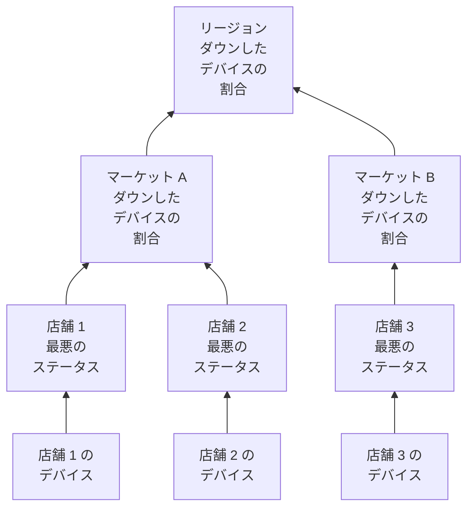

# ネットワークサイト (ヘルスの集約と稼働率)

ネットワークサイトは場所です。リージョン、マーケット、フランチャイジー、物流センター、1 つの店舗などです。サイトは入れ子になり、ネットワークデバイスがサイトに所属し、OneUptime がデバイスのヘルスをツリーの上へ集約します。そのため、リージョンの 1 つのステータスが「どこかで何か問題が起きていないか」に答えます。

サイトは **ネットワーク → サイト** に、マップ上では **ネットワーク → マップ** にあります。このページでは、サイトのステータスが配下のものからどう算出されるか、稼働率が何を意味するか、定期メンテナンスがその両方をどう変えるかを明確にします。

:::cards
- [サイトを追加する](#サイトの追加): 3 つの手順、または環境全体を CSV ファイルで。
- [監視のデフォルトを設定する](#監視のデフォルト): サイト内のすべてのデバイスにプローブと認証情報を。
- [ヘルスの集約方法を選ぶ](#親のヘルスの計算方法): 店舗には最悪のステータス、リージョンには割合。
- [稼働率を読む](#稼働率): パーセンテージが何を数えるか、日ごとに。
:::

## 仕組み



各サイトのステータスは、サブツリーのすべてのデバイスから、そのサイト自身の [集約ポリシー](#親のヘルスの計算方法) で判定されます。サイトの稼働率はそのサイト自身のステータスタイムラインから算出され、サイトの [メンテナンスウィンドウ](#ネットワークサイトの定期メンテナンス) は、そのデバイスを上位の投票から外します。

## 階層

サイトはツリーを形作ります。各サイトには **サイトの種類** と、任意で親サイトがあります。サイトの種類はプロジェクト独自の一覧で、**ネットワーク → 設定 → サイトの種類** にあり、新しいプロジェクトは上から順に Account Type、Region、Franchisee、Market、Unit と、Data Center、Other で始まります。種類は独自の階層(**親サイトの種類**)を持ち、どのサイトがあるサイトの親になれるかを決めます。**ユニットレベル** とマークした種類は環境の最下層、つまり個々の店舗や支店で、そのサイトはほかのサイトではなくデバイスを持ちます。

サイトの種類、名前、説明、親、位置は 1 か所で編集します。サイトの **設定** ページの **サイトの設定** カードです。サイトの概要にはこれらが **設定で編集** のリンクとともに表示され、**サイト** の一覧ではサイトを追加できますが、編集はできません。

各デバイスは 1 つのサイトに所属します。サイトのサブツリーはそのサイト自身と配下のすべてのサイトで、ヘルスはサブツリーのデバイスから集約されます。そのため、自身のデバイスを持たないリージョンにも、配下のユニットがステータスを持つのでステータスがあります。

> [!NOTE]
> 集約は、デバイスのステータスが変わったとき、デバイスが別のサイトに移ったとき、サイトがツリー内で移動したとき、そして時間の経過だけで答えが変わる場合を拾う 5 分ごとのスイープで、再計算されます。

## サイトの追加

:::steps
### 新しいサイトを始める
**ネットワーク → サイト** に移動し、**サイトを追加** をクリックします。

### サイトが何かを指定する
**サイトの詳細** の手順で、**サイトの種類**(リージョン、店舗、データセンターなど、どんな場所か)を選び、**名前** を入力します。説明、住所、マップ上にサイトを置く緯度と経度は **その他の項目** に折りたたまれています。今入力しても、後で入力してもかまいません。

### ツリーに配置する
**階層** の手順で、サイトが別のサイトの配下にある場合は **親サイト** を選びます。空にすると、サイトは最上位に置かれます。

### デフォルトを設定する
**監視のデフォルト** の手順で、サイトに追加されるデバイスの [デフォルトのプローブと認証情報プロファイル](#監視のデフォルト) を選び、**サイトを追加** をクリックします。
:::

サイト自身の **子サイト** ページでは、**子サイトを追加** が種類と名前だけを、位置を折りたたんだ 1 ページで尋ね、新しいサイトをそのサイトの配下に置きます。

### CSV ファイルからサイトをインポートする

環境全体を一度に取り込むには、**サイト** の一覧の上部にあるメニューを開き、**CSV からインポート** をクリックします。ファイルにはヘッダー行が必要です。列の順序は自由で、列名の大文字と小文字は区別されません。

```csv title="sites.csv"
name,siteType,parentName,address,latitude,longitude
North,Region,,,,
Leeds,Market,North,,,
Store 0660,Unit,Leeds,"1 High Street, Leeds",53.7997,-1.5492
```

- `name` と `siteType` は必須です。`siteType` はプロジェクトのサイトの種類のいずれかである必要があります。
- `parentName` は親サイトの名前で、同じファイル内にあってもかまいません。親のない行や、すでに存在する親を持つ行が先に入り、その後に子が入ります。最上位のサイトでは空にします。
- 親が見つからない行はスキップされ、結果に一覧表示されます。**インポートをプレビュー** で、何かを書き込む前にファイルが作成する内容を確認できます。

## マップ

**ネットワーク → マップ** は、サイトのある場所に合わせた地図上にサイトを表示します。サイトをクリックすると中に入れます。配下にサイトを持つサイトは、それらを地図上と、それらの間のリンクのグラフとして表示します。配下にサイトはないが自身のデバイスを持つサイト、または種類がユニットレベルのサイトは、それらのデバイスのライブトポロジーを開きます。

まだサイトのないプロジェクトにもマップはあります。マップは代わりにデバイスのトポロジーを表示し、デバイスをサイトにまとめると、位置に従って地図上に配置されます。

## 監視のデフォルト

サイトは、そこにあるデバイスをどう監視するかを一度だけ指定する場所でもあります。**サイトの設定** カードの **設定を編集** には、2 つの項目を持つ **監視のデフォルト** の手順があります。

| 設定 | 効果 |
| --- | --- |
| **デフォルトのプローブ** | このサイトのデバイスに ping を送り、認証情報があれば SNMP でウォークするプローブです。自身のプローブを持たずにサイトに作成されたデバイスはこれを使い、プローブを持たずにサイトに移されたデバイスも同じです。 |
| **デフォルトの SNMP 認証情報プロファイル** | デバイス自身にもそのプロファイルにも認証情報がないとき、このサイトのデバイスのウォークに使われる [認証情報プロファイル](/docs/monitor/network-device-monitor#snmp-認証情報と認証情報プロファイル) です。 |

サイトに両方を設定すると、そこではアドレスだけで新しいデバイスを追加でき、最初のポーリングから ping とウォークが行われます。

この 2 つは、意図的に異なる動きをします。

- プローブは、デバイスがサイトに作成されたとき、またはサイトに移されたときにデバイスにコピーされます。後でサイトのデフォルトのプローブを変えても、すでにプローブを持つデバイスは移りません。どのプローブがデバイスに到達できるかはネットワークの事実であり、サイトのフォームから一括で書き換える好みではないからです。
- 認証情報プロファイルは、ポーリングのたびにその場で読まれます。サイトに設定すると、そこにある認証情報のないすべてのデバイスが、デバイスごとの編集なしで次のポーリングからウォークされるようになり、外すと再び ping だけになります。

ツリーのどこまで届くかも異なります。

- プローブはツリー全体に届きます。デフォルトのプローブを持たないサイトに入ったデバイスは最も近い祖先のものを使うため、リージョンに設定した 1 つのプローブが配下のすべてのマーケットとユニットをカバーし、独自のものを指定したマーケットは、そのサブツリーでそれを上書きします。
- 認証情報プロファイルは、デバイス自身のサイトからだけ読まれます。Unit にあるデバイスは Region に設定したプロファイルを使わないため、デバイスが実際に所属するサイトに設定してください。

## 親のヘルスの計算方法

各サイトは、**設定** ページの **ヘルスの集約** カード(**集約ポリシー**)で、2 つの集約ポリシーのいずれかを選びます。

### いずれかのデバイスの最悪のステータス(デフォルト)

サブツリーのいずれかのデバイスが報告する最悪のステータスが、サイトのステータスになります。ステータスの悪さはモニターのステータスとしての優先度で決まります。新しいプロジェクトのステータスは Operational (1)、Degraded (2)、Offline (3) で、数値が大きいほど悪い状態です。オフラインのデバイスが 1 台あれば、横に正常なデバイスがいくつあっても、サイトはオフラインになります。

これはユニットには正しい答えです。1 つの建物にある 4 台のスイッチと 1 台のファイアウォールは独立していません。そのうち 1 台が消灯すればその住所の問題であり、平均すると実際の障害が隠れてしまいます。

400 店舗の上にあるリージョンには、通常は誤った答えです。店舗 12,000 のスイッチが 1 台消灯しただけでリージョン全体が Offline になります。最も狭い意味では正しくても実用上は役に立ちません。どこかの店舗に問題があるたびにリージョンが赤くなり、何も伝えなくなるからです。

### ダウンしたデバイスの割合

サイトのステータスは、サブツリーの報告しているデバイスのうち、正常なステータスにないものの割合で決まります。

| ダウンしたデバイスの割合 | サイトのステータス |
| --- | --- |
| 0% | Operational |
| 0% 超、しきい値未満 | Degraded: 正常でもオフラインでもないプロジェクトのステータス。プロジェクトにない場合は Offline |
| しきい値以上 | Offline |

しきい値はサイトごとに **オフラインのしきい値（%）** として設定し、既定は 50 です。

何もダウンしていなければ、しきい値をどれだけ低くしても Operational です。しきい値 0 は「いずれかのデバイスがダウンすればオフライン」という意味で、「正常なリージョンがオフライン」という意味ではありません。

### 投票するデバイス

ここでは両方のポリシーが一致しており、見た目以上に重要です。

- アーカイブ済みのデバイスは投票しません。廃止されたもので、サイトは保持しますが対象外です。
- 一度も何も報告していないデバイスは投票しません。最初のポーリングを待っているデバイスは障害の証拠ではないため、割合の分子からも分母からも外れます。オンボーディングが半分まで進んだリージョンは、応答した半分で評価されます。
- プローブでポーリングされるデバイス(通常のもの)は、最後のポーリングの結果で投票します。ping または SNMP で到達できるかどうかで、最後に成功してからどれだけ経ったかではありません。SNMP ウォークが失敗している間も ping に応答するデバイスは到達可能で、そのように投票します。サイトはアップと示し、デバイスの行には **SNMP 失敗中** と表示されるので、誰かが認証情報を直せます。
- モニターで管理されるデバイス(設定ページで紐付けモニターによる上書きに切り替えたもの)は、何もポーリングしないため、紐付けられたモニターのステータスで投票します。何も紐付けられていなければ一度も報告していないので、投票しません。

プローブでポーリングされるデバイスに付けたネットワークデバイス モニターは、デバイスの投票の仕方を変えません。「インターフェースがダウンしたので Offline」という条件を持つモニターがあると、すべての ping に応答するスイッチに Offline を付けてしまい、1 つの消灯したポートで、配下のデバイスの行がすべてアップなのにサイト全体が赤くなります。サイトが、自分が集約している一覧と食い違うことになります。ポーリングされるデバイスのヘルスの出どころはポーリングで、モニターはインシデントを作成するためにあります。

### ポリシーの選び方

フランチャイズの環境での妥当な出発点:

| 階層 | ポリシー | 理由 |
| --- | --- | --- |
| ユニットまたは店舗 | 最悪のステータス | デバイスが一台ダウンすれば、そのサイトに問題があるということです。 |
| マーケット | 割合、しきい値は約 50% | 店舗の半分がダウンしたマーケットはダウンしています。 |
| リージョン | 割合、しきい値は 25% から 50% | 一店舗だけの障害ではリージョンは Offline ではなく Degraded になり、システム全体の問題が起きると Offline になります。 |

ポリシーはサイトごとに設定するため、リージョンの行に割合のポリシーを与え、その配下はすべてデフォルトのままにできます。

## 稼働率

すべてのサイトにはステータスタイムラインがあります。集約されたステータスの変化ごとに 1 行で、ステータスが変わったときに開き、再び変わったときに閉じます。稼働率はここから算出されます。

- 正常とマークされていないステータスにある時間はダウンタイムです。
- 重なる行は統合されるため、同じ秒が 2 回数えられることはありません。
- どの行にも覆われていない時間はアップとして数えます。タイムラインは集約が実行されて初めて行を得るもので、証拠がないことは障害ではありません。
- まだ開いている行は、測定する期間の終わりまで続きます。

Degraded は正常ではないため、これもダウンとして数えます。つまり、どちらのポリシーでも、サイトの稼働率は配下の報告しているデバイスがどれもダウンしていなかった時間の割合です。ポリシーが変えるのは、部分的な障害が示すステータス(Degraded か Offline か)であり、それが数えられるかどうかではありません。

タイムラインの行がまったくないサイトは、100% ではなく `—` と表示されます。一度も集約されていないサイトは、完璧なのではなく監視されていないのです。

### 日ごとの稼働率

各サイトの概要には、30 日間の数値の横に **稼働率（24 時間）** が表示され、**ステータスタイムライン** ページには直近 24 時間、7 日、30 日、90 日と、直近 30 日間の 1 日ごとのバーが表示されます。

30 日間の平均では悪い 1 日を示せません。30 日の期間で丸 1 日の障害は 3.3 ポイントにしかならないため、火曜日に丸 1 日消灯していたサイトでも、月の値は 96.7% と、端数のように見える数字になります。日ごとのバーは同じデータを、悪い 1 日が悪い 1 本のバーになる形で示します。

日は、暦日ではなく、現在で終わる 24 時間ずつの移動区間です。デバイス、閲覧者、サーバーはそれぞれ別のタイムゾーンにある可能性があり、全員が合意できる「1 日」は存在しないからです。

### 親の稼働率は子の稼働率の平均ではない

親の稼働率は、親自身の集約ポリシーが生み出した親自身のタイムラインから算出され、子のパーセンテージの平均からではありません。

子の平均では、2 台のデバイスを持つ店舗と 200 台を持つ物流センターが同じ重みになります。親自身のタイムラインは代わりに、1 文で言える値を示します。リージョン内で何一つダウンしていなかった時間の割合です。意図的に厳しいため、大きなリージョンでは日ごとのバーと、部分的な障害が Degraded だったか Offline だったかを示すステータスと合わせて読んでください。

## ネットワークサイトの定期メンテナンス

ホストと同じように、イベントの **影響を受けるリソース** の手順にある **その他の影響を受けるリソース** で、サイトを定期メンテナンスイベントに紐付けます。サイト自身の **定期メンテナンス** ページには紐付けられたイベントが一覧表示され、そこにある **定期メンテナンスイベントを作成** は、サイトを選んだ状態でフォームを開きます。

親のウィンドウは配下のすべてをカバーします。リージョンのウィンドウはそこにあるすべてのマーケットとユニット(ウィンドウを予定した後に作成されたサイトも含む)をカバーするため、地域の回線事業者の切り替えで 400 店舗を列挙する必要はありません。

カバーは下へだけ届きます。1 つのユニットのウィンドウは、そのリージョンをメンテナンス中にはしません。リージョンは引き続きアップであることが期待され、同じ時間帯に別のユニットで起きた実際の障害は、引き続きリージョンに不利に数えられます。

### メンテナンスウィンドウが変えるもの

| ウィンドウ中 | 起きること |
| --- | --- |
| サイトのライブステータス | 変わりません。計画作業のために停止しているユニットは、マップとツリー上で引き続き Offline と表示され、横に「メンテナンス中」のバッジが付きます。見る人はそれが停止していることを知る必要があるからです。 |
| サイトの稼働率 | ウィンドウはダウンタイムと測定期間の両方から除かれます。二時間のメンテナンスでその日は 22 時間になり、その二時間の中のことはどちらにも数えられません。 |
| 祖先のヘルスの集約 | メンテナンス中のサブツリーのデバイスは投票しなくなるため、予定どおりの切り替えでリージョンが赤くなることはありません。 |
| 祖先の稼働率 | 影響を受けず、修正するものもありません。計画された停止は祖先のタイムラインに届いていないからです。 |

最後の行が、祖先ではウィンドウを稼働率から除くのではなく投票を保留して扱う理由です。リージョンの期間から除くと、同じ時間帯にリージョンの別の場所で起きた実際の障害まで消してしまいます。

稼働率は、処理がイベントの状態を切り替えた時刻ではなく、イベントで宣言された開始と終了の時刻で修正されるため、数値を暦と照らして手で確認できます。ウィンドウに完全に含まれる日は、日ごとのバーで完璧な日ではなくメンテナンスとして描かれ、平均には何も加えません。

### モニターとの関係

同じイベントにモニターを紐付けると、これまでどおりの動作をします。そのモニターのアクティブな監視は、ウィンドウの間一時停止します。この 2 つは独立しています。サイトを紐付けると集約とその稼働率から外れ、モニターを紐付けるとアラートが止まります。

## サイトのアラート

サイトの **設定** ページの **アラート発生中** カードには **異常時にアラート** があります。サイトの集約が正常ではないステータスに移るとアラートが開き、サイトが回復すると自動で解決します。**アラートの重大度** で重大度を設定します。空の場合は、プロジェクトで最も重い重大度になります。

アラートは変化に対してだけ出ます。すでに異常なサイトでオンにすると、過去についてアラートを出すのではなく、次の変化に備えます。Degraded は正常ではないため、割合のポリシーのサイトは、最悪のステータスのポリシーのサイトと同じように、報告しているデバイスのいずれかがダウンした時点でアラートを出します。サイトが Degraded と Offline の間を行き来する間、アラートは 2 つ目を出さずに開いたままで、タイトルはサイトが最初に達したステータスを示します。

## トラブルシューティング

:::details リージョンが常に赤い
サイトが最悪のステータスのポリシーなので、配下のどこかにあるオフラインのデバイス 1 台でオフラインになります。リージョンの **ヘルスの集約** カードで **Percentage of devices down** に切り替え、リージョンのどれだけがダウンしたらダウンとみなすかに合ったしきい値を設定してください。
:::

:::details サイトに稼働率ではなく — と表示される
サイトで一度も集約が実行されていないため、タイムラインの行がありません。完璧なのではなく、監視されていないのです。サイト、またはその配下のサイトにデバイスを追加すると、次の集約でタイムラインが始まります。
:::

:::details デバイスがサイトに数えられない
アーカイブ済みのデバイスと、まだ報告していないデバイスは投票しません。モニターが紐付けられていない、モニターで管理されるデバイスも、一度も報告していません。デバイスのステータスを確認してください。**保留中** のデバイスは、最初のポーリングの後に投票を始めます。
:::

:::details サイトのアラートが発火しなかった
**異常時にアラート** は、正常なステータスからほかのステータスへの変化で発火するため、オンにしたときにすでに異常だったサイトは、回復した後の次の変化でアラートを出します。デバイスが投票しているかも確認してください。アーカイブ済みのデバイスと最初のポーリングを待っているデバイスは投票せず、メンテナンス中のサイトのデバイスは上位の集約で投票しません。
:::

## 次のステップ

:::cards
- [ネットワークデバイス モニター](/docs/monitor/network-device-monitor): これらのサイトに所属するデバイスを追加、ポーリングし、アラートを出します。
- [ネットワークトラフィック](/docs/monitor/network-traffic): デバイスのフローレコードから、サイトのトラフィックを確認します。
- [インベントリ](/docs/inventory/overview): ほかのすべての資産と並ぶネットワークデバイス。
:::
