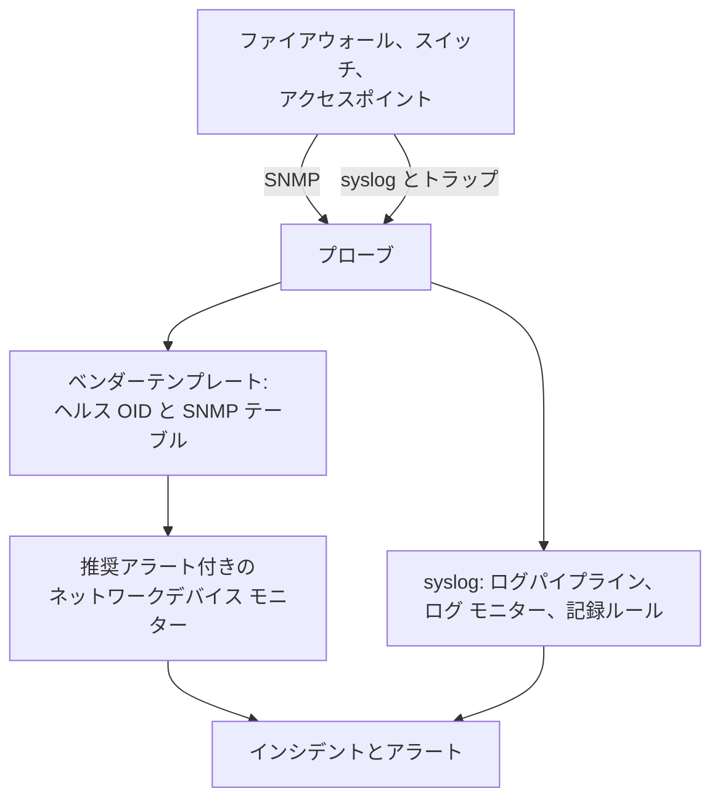

# ネットワークベンダー別ガイド (Sophos、Extreme、Cambium)

OneUptime で 3 つの一般的な環境を最初から最後まで監視する方法です。IPsec トンネル、WAN リンク、SD-WAN を持つ Sophos Firewall(XGS、SFOS)、ファブリックを持つ Extreme Networks のスイッチ(EXOS / Switch Engine と Fabric Engine / VOSS)、そして各無線のチャネルと送信出力まで含めた Cambium Networks の cnMatrix スイッチとエンタープライズ Wi-Fi アクセスポイントです。

:::cards
- [Sophos Firewall](#sophos-firewall-xgs-sfos): トンネル、WAN リンク、ゲートウェイ、SD-WAN。
- [Extreme Networks](#extreme-networks-exos-switch-engine-と-fabric-engine-voss): スイッチ、ファブリック、そのハードウェア。
- [Cambium Networks](#cambium-networks-エンタープライズ-wi-fi-と-cnmatrix): 各無線までのアクセスポイントと、cnMatrix スイッチ。
:::

## 仕組み

どのガイドも同じ部品を使います。

- 機器ごとに 1 つの [ネットワークデバイス](/docs/monitor/network-device-monitor)。到達できるプローブがポーリングし、適切なヘルス OID と [SNMP テーブル](/docs/monitor/network-device-monitor#snmp-テーブル) を持ち込むベンダーテンプレートを使います。
- アラート用に、デバイスごとに 1 つのネットワークデバイス モニター。デバイスのページから作成すると、[推奨アラート](/docs/monitor/network-device-monitor#推奨アラートパック)(正常な状態を知っている各テーブルの行ごとのアラートを含む)が自動で入ります。フリートでは、[アラートポリシー](/docs/monitor/network-device-monitor#アラートポリシー) がすべてのデバイスにモニターを維持します。
- ベンダーがログでしか報告しないものには、プローブへの syslog、各行を属性に変える [ログパイプライン](/docs/telemetry/log-pipelines)、トンネルやゲートウェイごとに 1 回アラートを出す [Group By 付きのログ モニター](/docs/monitor/logs-monitor#グループごとのアラートgroup-by)、そしてそのログの数値をグラフ化する [ログの記録ルール](/docs/telemetry/log-recording-rules) を使います。

## Sophos Firewall (XGS / SFOS)

| 見たいもの | 取得元 |
| --- | --- |
| ファイアウォールのヘルス: メモリ、ディスク、スワップ、HA の状態、IPsec サービス、コアごとの CPU | ベンダーテンプレート **Sophos Firewall (SFOS / XGS)** を使った SNMP |
| 名前で示す各 IPsec トンネルのステータス | SNMP テーブル `ipsec_tunnels`(SFOS v20 以降) |
| 各 WAN リンクのステータス、スループット、使用率、エラー | WAN ポートのインターフェースのウォーク |
| 各 WAN リンクのレイテンシ、パケットロス、ジッター | OneUptime のプローブからの Ping モニターとデバイスのポーリング |
| ゲートウェイのアップとダウン、SD-WAN の SLA の達成可否、SD-WAN の経路の変更 | ファイアウォールの syslog |
| ゲートウェイごとの SD-WAN のレイテンシ、ジッター、パケットロスのグラフ | SD-WAN の SLA ログに対するログの記録ルール |

Sophos は、どの SFOS のバージョンでも、ゲートウェイや SD-WAN のヘルスを SNMP で報告しません。それはファイアウォールのログと Sophos Central のアラートにしかないため、最後の 3 行は syslog を経由します。

### ファイアウォールを登録する

:::steps
1. ファイアウォールで、**Administration → SNMP** から SNMP を有効にします。SNMPv3 ユーザーまたは v2c のコミュニティを追加し、プローブのアドレスからの問い合わせを許可します。
2. OneUptime で **ネットワーク → デバイス** に移動し、**デバイスを追加** をクリックします。ファイアウォールの管理アドレスを入力し、到達できるプローブを選んで、**SNMP** で SNMP 認証情報を追加します。
3. デバイスの **設定** ページの **ポーリングとデータ収集** で、**ベンダーのヘルステンプレート** からテンプレート **Sophos Firewall (SFOS / XGS)** を適用し、**Add a Vendor's Tables** からそのテーブルを追加します。または **ベンダーのヘルステンプレートを自動適用** をオンにすると、最初のポーリングで両方が行われます。
:::

次のポーリングの後、デバイスの **SNMP Tables** ページには、各 IPsec 接続がそのステータス(active、inactive、partially active)とともに、CPU コアとあわせて一覧表示されます。SFOS はコアに 196608 から番号を振るため、CPU は単一の `hrProcessorLoad.1` ではなくテーブルから取得します。

### すべての IPsec トンネルにアラートを出す

デバイスのページで **モニターを作成** をクリックします。推奨アラートには **IPsec Tunnels: row unhealthy** が含まれます。これは `ipsec_tunnels` テーブルに対する Row `*` の **SNMP Table Row Is Unhealthy** 条件で、アクティブでないトンネルごとにトンネル名のインシデントを 1 つ作成し、トンネルが戻るとそれぞれを解決します。

Sophos がアクティブと報告するトンネルは、セキュリティアソシエーションが確立しているだけです。トラフィックが通ることを確かめるには、一方のサイトのプローブから各トンネルの向こう側のホストへの [Ping モニター](/docs/monitor/ping-monitor) を追加し、**ネットワーク → トポロジー → サイトのリンク** で 2 つの [サイト](/docs/monitor/network-sites) の間にトンネルをサイトのリンクとして描いて、そのモニターに紐付けます。マップ上のリンクはそのモニターの色になります。

### WAN リンク

- **ポートのヘルス。** インターフェースのウォークは、すでに各 WAN ポートのステータス、送受信ビット、使用率、エラーを測定しています。ファイアウォールのモニターで、**インターフェース** を WAN ポートの名前(すべてのポートなら `*`)にした **SNMP Interface Is Down** または **SNMP Interface Utilization (in %)** の条件が、リンクごとにアラートを出します。
- **経路の品質。** 各リンクのレイテンシ、パケットロス、ジッターはファイアウォールの外から測定します。OneUptime のクラウドプローブから各 WAN リンクのパブリックアドレスへの Ping モニターと、サイトのプローブから各 ISP のゲートウェイへの Ping モニターです。それらのモニターのパケットロスとジッターの条件がリンクごとにアラートを出し、**ネットワーク → トポロジー → レイテンシマトリクス** は、すべてのプローブとすべてのモニターの組み合わせをひと目で示します。
- **トラフィック。** SFOS は NetFlow v5 をエクスポートします。プローブのフローコレクターが既定で待ち受ける UDP 2055 でプローブに送ると、デバイスの **トラフィック** ページに、各 WAN リンクで誰が誰と通信しているかが表示されます。詳しくは [ネットワークトラフィック](/docs/monitor/network-traffic) を参照してください。

### syslog からのゲートウェイと SD-WAN

:::steps
1. プローブの syslog レシーバーを有効にします。プローブに `PROBE_SYSLOG_RECEIVER_ENABLED=true` を設定します。既定では UDP 5140 で待ち受けます(`PROBE_SYSLOG_RECEIVER_PORT` で変更できます)。プローブが Docker で動いている場合はポートを公開します。メッセージは、ホスト名または **その他のアドレス** のいずれかが送信元のアドレスであるネットワークデバイスに照合され、デバイスの **ログ** ページに表示されます。
2. ファイアウォールの **System services → Log settings** で、プローブとそのポートを指す syslog サーバーを追加し、IPsec とゲートウェイの **Event** ログタイプと、**SD-WAN** ログタイプにチェックを入れます。SLA のログは、これにチェックを入れるまでオフのままです。
3. **ログ → 設定 → パイプライン** で、`attributes.networkDevice.name = 'hq-firewall'` のようにファイアウォールのログに一致するフィルターを持つパイプラインを作成し、**ターゲットのプレフィックス** を `sophos` にした **Key=Value Parser** を追加します。ファイアウォールのログ行をテスターに貼り付けると、使っている SFOS のバージョンが生成する正確な属性名を確認できます。[Sophos の例](/docs/telemetry/log-pipelines#例-sophos-xgs-ファイアウォール) で手順を説明しています。
4. ファイアウォールのログに対して [ログ モニター](/docs/monitor/logs-monitor) を作成します。各トンネルやゲートウェイが個別にアラートを出すようにそれぞれ **Group by Attributes** を付け、数分間の **Log Count** **Greater Than** `0` という条件にします。下の行が、最初に作る 3 つです。
5. SD-WAN の品質をグラフ化します。SD-WAN のログ記録がオンになっていると、ファイアウォールはプロファイルとゲートウェイごとに SLA の要約(`latency`、`jitter`、`packet_loss`)を書き出します。**ログ → 設定 → 記録ルール** で、`sophos.gw_name` と `sophos.profile_name` でグループ化した `sophos.latency` の平均など、数値ごとに 1 つのルールを作成し、結果をグラフ化するか、ゲートウェイでグループ化する [メトリクスモニター](/docs/monitor/metrics-monitor) でアラートを出します。[ログの記録ルール](/docs/telemetry/log-recording-rules) でこの例を説明しています。
:::

| アラート | 数えるログ | グループ化の基準 |
| --- | --- | --- |
| IPsec トンネルの終了 | 属性 `sophos.log_component` = `IPSec`、本文に `terminated` を含む | `sophos.con_name` |
| ゲートウェイのダウン | 属性 `sophos.log_component` = `Gateway`、本文に `is Down` を含む | `sophos.gatewayname` |
| SD-WAN の SLA 未達 | 属性 `sophos.log_type` = `SD-WAN`、本文に `SLA not met` を含む | `sophos.gw_name` |

syslog のイベントは SNMP テーブルを補います。トンネルが落ちた瞬間に届く一方、テーブルは一度も上がらなかったトンネルも捉えます。

### トラップ

Sophos の通知はすべて同じトラップ `sfosNotification`(`1.3.6.1.4.1.2604.5.1.8.1.1`)で、イベントは `sfosTrapMessage`(`1.3.6.1.4.1.2604.5.1.8.1.2`)にテキストとして入っています。1 種類のイベントにアラートを出すには、**SNMP Trap Received (Trap OID)** の Equal To `1.3.6.1.4.1.2604.5.1.8.1.1` と、その varbind に対する **SNMP Trap Varbind Value**(たとえば Contains `IPSec`)を組み合わせます。ファイアウォールのトラップの送信先は SNMP v2c に設定してください。プローブのトラップレシーバーは v1 と v2c のトラップを受け取ります。

## Extreme Networks (EXOS / Switch Engine と Fabric Engine / VOSS)

| 見たいもの | 取得元 |
| --- | --- |
| EXOS: CPU、温度とそのアラーム、電源の状態、電源装置、ファン、スロットごとのメモリ、スタックメンバー | テンプレート **Extreme Networks EXOS / Switch Engine** |
| Fabric Engine: スロットごとの CPU とメモリ、温度センサー、ファン、電源装置、vIST セッション、I-SID 数 | テンプレート **Extreme Networks Fabric Engine / VOSS** |
| ネイバー名で示す各 Fabric Connect(IS-IS)の隣接関係 | Fabric Engine テンプレートのテーブル `isis_adjacencies` |
| ポート、LLDP のネイバー、ネットワークマップ | 両方ともインターフェースのウォーク |

### どのテンプレートか

Extreme の汎用ハードウェア(5000 シリーズと 7000 シリーズ)上の Fabric Engine は、EXOS と同じエンタープライズ番号を報告します。どの OS が動いているかを示すのは、システムの説明(`7520-48Y-8C-FabricEngine (9.0.4.0)`)だけです。OneUptime は両方を読むため、自動適用とデバイスのページの提案は正しいテンプレートを選び、古い VSP スイッチは Avaya/Nortel のツリーを報告して、直接 Fabric Engine として認識されます。

### ファブリックとハードウェアのアラート

Fabric Engine スイッチの推奨アラートには **Fabric Adjacencies (IS-IS): row unhealthy** が含まれ、隣接関係がアップしていないネイバーごとにインシデントを 1 つ作成します。Fabric Engine は隣接関係が変わったときにトラップ `rcnIsisPlsbAdjStateTrap`(`1.3.6.1.4.1.2272.1.21.0.281`)も送り、これに対する **SNMP Trap Received (Trap OID)** の条件は、次のポーリングを待たずに数秒でアラートを出します。

電源装置、ファン、温度センサー、スタックメンバーは正常な値を宣言するテーブルなので、推奨アラートでそれぞれ行ごとのアラートが付きます。

### フローと Wi-Fi

EXOS と Fabric Engine は、フローを sFlow と IPFIX としてエクスポートします。sFlow を UDP 6343 で、または IPFIX を UDP 4739 でプローブに送ると、デバイスの **トラフィック** ページにトラフィックが表示されます。[ネットワークトラフィック](/docs/monitor/network-traffic) を参照してください。

IQ Engine(HiveOS)のアクセスポイントと ExtremeCloud IQ Controller には独自のベンダーテンプレートがあり、デバイスの **Wi-Fi** ページを埋めます。これらについては、Ubiquiti UniFi、HPE Aruba、TP-Link Omada、Juniper Mist とともに [対応している Wi-Fi ベンダー](/docs/monitor/network-device-monitor#対応している-wi-fi-ベンダー) で説明しています。

## Cambium Networks (エンタープライズ Wi-Fi と cnMatrix)

### アクセスポイント

:::steps
1. アクセスポイントで SNMP を有効にします。cnMaestro では、SNMP は AP グループごとに設定します: **Configuration → Wi-Fi Profiles → AP Groups → Management → SNMP**。v2c の読み取りコミュニティまたは SNMPv3 ユーザーで有効にします。
2. 各アクセスポイントを管理アドレスとその認証情報で追加し、テンプレート **Cambium Networks Enterprise Wi-Fi (cnPilot, XV, XE, XH)** を適用するか、自動適用をオンにします。
3. デバイスの **Wi-Fi** ページを開きます。オンになっている無線の数、クライアント、SSID を示し、続いて各無線のバンド、チャネル、周波数、チャネル幅、送信出力、クライアント、ノイズフロア、エアタイムと、各 SSID とそのクライアントを表示します。周波数はバンドとチャネルから算出され、アクセスポイント自体は報告しません。
:::

役に立つアラートで、どれも `wifi_radios` テーブルに対する Row `*` の条件なので、各無線が個別にアラートを出します。

| アラート | 条件 |
| --- | --- |
| 無線がオフになった | **SNMP Table Row Is Unhealthy**、推奨アラートの一部 |
| 送信出力が変わった | **SNMP Table Value**、列 TX Power、Not Equal To 計画した出力 |
| 混雑した無線 | **SNMP Table Value**、列 Clients、Greater Than 上限 |
| ノイズの多いチャネル | **SNMP Table Value**、列 Noise Floor、Greater Than `-80` |

無線の数値はすべてメトリクス(`oneuptime.monitor.snmp.table.value`、無線と列ごとに 1 系列)でもあるため、チャネル、出力、クライアントを時系列でダッシュボードにグラフ化できます。チャネルが変わり続けるのは DFS が働いているためです。

Cambium がクライアントの総数を報告するのはファームウェア 6.5.3 からで、それより前のファームウェアは 0 を返します。

### cnMatrix スイッチ

テンプレート **Cambium Networks cnMatrix** は CPU、RAM、フラッシュ、温度、電源電圧を収集し、テーブルとしてファン、冗長電源、各ポートの PoE 消費を収集します。ポートと LLDP のネイバーは、ほかのスイッチと同じくインターフェースのウォークから得られます。

### cnMaestro のアラーム

cnMaestro は、アクセスポイントのオフラインなどのアラームを HTTPS の Webhook に送れます。それを [受信リクエストモニター](/docs/monitor/incoming-request-monitor) に向けると、それらのアラームが SNMP のデータと並ぶ OneUptime のインシデントになります。

## トラブルシューティング

:::details IPsec Tunnels テーブルにステータスがない
トンネルのステータスには SFOS v20 以降が必要です。認証情報の SNMP ビューに Sophos のエンタープライズツリー(`1.3.6.1.4.1.2604`)が含まれていることも確認してください。制限された v3 ユーザーは、多くの場合システムグループと IF-MIB しか見えません。
:::

:::details ファイアウォールから syslog が届かない
プローブの syslog レシーバーは既定でオフです。`PROBE_SYSLOG_RECEIVER_ENABLED=true` を設定し、プローブまでの UDP 5140、または設定した `PROBE_SYSLOG_RECEIVER_PORT` を公開してください。メッセージは送信元のアドレスでデバイスに照合されるため、OneUptime でのファイアウォールのホスト名、または **その他のアドレス** のいずれかが、syslog を送るアドレスである必要があります。
:::

:::details Fabric Engine スイッチに EXOS のテンプレートが適用された
テンプレートはスイッチのシステムの説明から選ばれます。デバイスの概要に Fabric Engine を示す説明(`7520-48Y-8C-FabricEngine (9.0.4.0)` など)が表示されているか確認してください。表示されている場合は、EXOS の OID とテーブルを削除し、**ベンダーのヘルステンプレート** から **Extreme Networks Fabric Engine / VOSS** を適用します。
:::

:::details Cambium のアクセスポイントがクライアント 0 と報告する
クライアントの総数にはファームウェア 6.5.3 以降が必要です。古いファームウェアでも、無線はチャネル、出力、ノイズフロアを報告します。
:::

## 次のステップ

:::cards
- [ネットワークデバイス モニター](/docs/monitor/network-device-monitor): デバイスが収集するすべてのものと、アラートに使えるすべての条件。
- [ログパイプライン](/docs/telemetry/log-pipelines): ファイアウォールのログを属性に分解します。
- [ログ モニター](/docs/monitor/logs-monitor): トンネルやゲートウェイごとに 1 回アラートを出します。
:::
