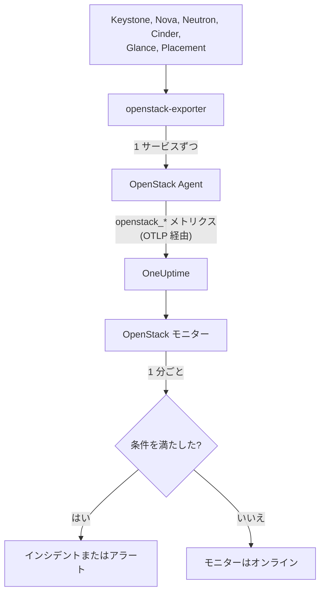

# OpenStack モニター

OpenStack モニターは 1 つのクラウド(API、その背後のワーカー、ハイパーバイザー、インスタンス、ネットワーク、ストレージプール、プロジェクトのクォータ)を監視し、API が応答しなくなったとき、ワーカーが停止したとき、ハイパーバイザーに空きがなくなったとき、プールが満杯になったときに通知します。OneUptime OpenStack Agent が openstack-exporter から収集する、またはプローブがクラウドの API から収集する `openstack_*` 系列を読み取ります。

:::cards
- [モニターを作成する](#openstack-モニターを作成する): ダッシュボードでの 6 つの手順。
- [テンプレート](#構築済みアラートテンプレート): すぐに使えるアラート。ワーカー、インスタンス、ネットワーク、リージョンごとに 1 件のインシデントを作成します。
- [外部からのチェック](#外部からのチェック): クラウドの外にあるプローブから、実際にインスタンスを起動できるかどうかを確認します。
- [識別属性](#識別属性): 特定のリージョン、ホスト、プロジェクトを対象にする方法。
- [メトリクス](#収集されるメトリクス): モニターがアラートの対象にできるすべての系列。
:::

## 仕組み

エージェントは OpenTelemetry Collector と openstack-exporter で、クラウドの API に到達できるマシン上で実行します。OpenStack の各サービスを個別の収集で読み取るため、Nova が失敗しても失われるのは Nova の系列だけです。また負荷を抑えて読み取り、compute、network、volume、placement は 2 分ごと、identity と image は 5 分ごとに収集します。

各系列にはクラウド名 `openstack.cloud.name` が付与され、各データポイントには `openstack.region.name` と `openstack_service` が付与されます。1 つのクラウドは 1 つの Keystone に相当し、OpenStack モニターは 1 つのクラウドに紐づきます。モニターは 1 分ごとにそのクラウドのメトリクスに対してクエリを実行し、結果を条件と比較します。



## 始める前に

- OpenStack Agent または[プローブ](/docs/telemetry/openstack-agentless)で**クラウドのメトリクスを収集します**。**ドキュメント**(**製品 → インフラストラクチャ → OpenStack**)に、エージェントのインストール手順があります。
- **クラウドが登録されていることを確認します。** 最初の収集の後、エージェントの `OPENSTACK_CLOUD_NAME` の名前で **製品 → インフラストラクチャ → OpenStack** に表示されます。

## OpenStack モニターを作成する

:::steps
### 新しいモニターを開始する

**モニター** に移動し、**モニターを作成** をクリックします。

### OpenStack を選ぶ

**モニターの種類** で **その他のモニターの種類** をクリックし、**インフラストラクチャ** の下にある **OpenStack** を選びます。検索ボックスに `openstack` と入力しても選べます。**名前** を入力し(インシデントとアラートのタイトルに使われます)、**次へ** をクリックします。

### クラウドを選ぶ

**OpenStack Monitor Configuration** の下で、**OpenStack クラウド** からクラウドを選びます。データを送信したことのあるすべてのクラウドが一覧に表示されます。選択すると、フィールドの下の行にデータが届いているかどうかが表示されます。

### 監視する対象を選ぶ

新しいモニターは、**アラートの対象** の **Cloud Stopped Reporting** から始まります。ほかの対象を監視するには、次のようにします。

- **変更** - 別の[テンプレート](#構築済みアラートテンプレート)を選びます。メトリクス、属性フィルター、集計、時間範囲、グループ化、しきい値が設定され、下の条件はテンプレートのものに置き換わります。**時間範囲** は引き続き変更できます。
- **Custom Metric**(**その他の項目** の下) - **OpenStack メトリクス** からメトリクスを 1 つ選び、**集計** と **時間範囲** を設定して、[フィルター](#モニターの設定)で絞り込みます。
- **詳細**(**その他の項目** の下) - **メトリクスを選択** で、クエリと数式を自分で組み立てます。`status`、`adminState`、`resourcetype` などの属性でフィルターできます。各部分を個別に判定するには、[識別属性](#識別属性)で **グループ化** します。

### 条件を確認する

**条件** の下で各条件を開き、その **メトリクス**、**集計**、**条件**、**しきい値** を確認します。テンプレートを使うとこれらは自動で入力されます。**Custom Metric** または **詳細** の場合、モニターはメトリクスがデータを送信しないことだけを検知する既定の条件で始まるため、自分でしきい値を設定してください。

### モニターを作成する

**モニターを作成** をクリックします。OneUptime がモニターのページを開き、1 分ごとに評価します。モニターが発生させたインシデントとアラートは、クラウドの **インシデント** ページと **アラート** ページにも一覧表示されます。
:::

> [!TIP]
> 複数のテンプレートをまとめて設定するには、**製品 → インフラストラクチャ → OpenStack** からクラウドを開き、**推奨事項** に移動します。使いたいテンプレートを選び、通知する相手を選ぶと、OneUptime がテンプレートごとに 1 つのモニターを作成します。

## モニターの設定

| 項目 | タブ | 内容 |
| --- | --- | --- |
| **OpenStack クラウド** | すべて | 必須。すべてのクエリを `resource.openstack.cloud.name` に限定します。 |
| **リージョン** | Custom Metric、詳細 | 任意。1 つのリージョン(`openstack.region.name`)。すべての系列に付与されています。 |
| **アベイラビリティーゾーン** | Custom Metric、詳細 | 任意。1 つのゾーン。ハイパーバイザー、インスタンス、ボリューム、Neutron エージェントでは `availability_zone`、Nova と Cinder のワーカーでは `zone` です。 |
| **ハイパーバイザー** | Custom Metric、詳細 | 任意。1 台のホスト。ワーカー、ハイパーバイザー、Placement では `hostname`、インスタンスでは `hypervisor_hostname` です。Nova のワーカーはホストの短い名前を、ハイパーバイザー、Placement、インスタンスは完全な名前を示すため、系列に表示されているほうを使ってください。 |
| **サービス** | Custom Metric、詳細 | 任意。`nova-compute` など、1 つのワーカーのバイナリ(`service`)。 |
| **プロジェクト ID** | Custom Metric、詳細 | 任意。1 つのプロジェクト。Nova と Cinder の系列、ネットワーク、サブネットでは `tenant_id`、Floating IP、ルーター、アドレス可用性では `project_id` です。 |
| **OpenStack メトリクス** | Custom Metric | [カタログ](#収集されるメトリクス)から選ぶメトリクス 1 つ。 |
| **集計** | Custom Metric | サンプルの結合方法。**平均**、**最大**、**最小**、**合計**、**カウント** のいずれかです。メトリクスで通常使われる集計が初期値になります。 |
| **時間範囲** | すべて | クエリが読み取るローリングウィンドウ。**Past 1 Minute** から **Past 365 Days** まで。新しいモニターは **過去 15 分** から始まり、テンプレートは独自に設定します。 |
| **メトリクスを選択** | 詳細 | クエリビルダー。**メトリクス**、**集計の基準**、**属性で絞り込み**、**グループ化** のほか、クエリを組み合わせる **メトリクスを追加** と **数式を追加** があります。 |

フィルターは、そのラベルを持つ系列だけを絞り込みます。`openstack_nova_up` にはプロジェクトがないため、プロジェクトフィルターを指定しても変わりません。

ウィンドウは、読み取るデータの収集 3 回分以上に保ってください。compute、network、volume、placement なら 6 分、identity と image なら 15 分です。これより短いと収集回数が足りず、**すべての値** が継続時間を意味しなくなります。

## 識別属性

すべての系列は、`openstack.cloud.name` を**リソース属性**として、`openstack.region.name` と `openstack_service` をデータポイント属性として持っています。残りはエクスポーター自身のラベルで示されます。

| 部分 | 系列 | 識別するラベル |
| --- | --- | --- |
| API | `openstack_*_up` | `openstack.region.name`, `openstack_service` |
| ワーカー | `openstack_nova_agent_state`, `openstack_neutron_agent_state`, `openstack_cinder_agent_state` | `hostname`, `service`。`adminState` はオペレーターが有効のままにしているかどうかを示します。Cinder では `uuid` でグループ化しないでください。エクスポーターが収集のたびに新しく生成します |
| ハイパーバイザー | `openstack_placement_resource_*`, `openstack_nova_vcpus_*` | `hostname`(完全な名前)、Placement では `resourcetype` |
| インスタンス | `openstack_nova_server_status` | `uuid`, `name`, `tenant_id`, `hypervisor_hostname`, `status`。値はコードなので、`status` の単語でフィルターします |
| ボリューム | `openstack_cinder_volume_gb` | `id`, `name`, `tenant_id`, `status` |
| ストレージプール | `openstack_cinder_pool_capacity_*` | `name`, `volume_backend_name` |
| ネットワーク | `openstack_neutron_network_ip_availabilities_*` | `network_id`, `network_name`, `cidr`, `ip_version` |
| ルーター | `openstack_neutron_l3_agent_of_router` | `router_id`, `agent_host`, `ha_state`, `agent_alive`, `agent_admin_up` |
| プロジェクト | `openstack_nova_limits_*`, `openstack_cinder_limits_*` | `tenant_id`, `tenant` |

モニターのフィルターとグループ化のキーでは、リソース属性は `resource.` で始まり(`resource.openstack.cloud.name`)、データポイント属性は始まりません(`openstack.region.name`、`hostname`、`status`)。空のラベルは OneUptime に届かないため、`disabledReason` は、誰かが無効にしたワーカーにのみ存在します。

## 構築済みアラートテンプレート

OneUptime には、OpenStack でよくある問題向けに 120 個のテンプレートが用意されており、**アラートの対象** の一覧から選べます。クラウドの「推奨事項」ページは、Heat、Magnum、Ironic、Manila、Octavia、Trove、Designate、Gnocchi、Swift のテンプレートを、それを実行しているクラウドにだけ表示します。プローブだけが送る系列を対象とするテンプレートは、プローブが収集するクラウドにだけ、[外部からのチェック](#外部からのチェック)を対象とするテンプレートは、そのチェックを有効にしているクラウドにだけ表示します。それ以外のクラウドではその系列が存在せず、アラートが発生することがないためです。各テンプレートは完全なモニターを構築します。メトリクスクエリ、属性フィルター、1 件のインシデントの対象を表すグループ化、発生する条件と回復する条件です。しきい値はクラウド自身のページが引く線と同じで、編集できる出発点です。

どのテンプレートも、監視対象を少なくとも 3 回の収集分読み取り、条件がウィンドウ全体で成り立ったときにだけ発生します。割合に対するしきい値は、その線から 10% 離れたところで回復するため、その付近で値が上下してもアラートが頻繁に切り替わりません。

| テンプレート | カテゴリ | 重大度 | 監視対象 | 発生条件 | 回復条件 |
| --- | --- | --- | --- | --- | --- |
| Cloud Stopped Reporting | 可用性 | クリティカル | `openstack_identity_up`、クラウド全体の Count、**過去 15 分** | ウィンドウ全体でデータなし: エージェントが停止した、OneUptime に到達できない、またはエクスポーターが Keystone にログインできない | データが再び届く |
| Identity API Down | 可用性 | クリティカル | `identity` の `openstack_identity_up` と `scrape_samples_scraped`、リージョンごとの Min、**過去 15 分** | すべての呼び出しが失敗した、またはエクスポーターがログインできず収集結果が空だった | どちらも 1 以上 |
| Compute API Down | 可用性 | クリティカル | `compute` の `openstack_nova_up` と `scrape_samples_scraped`、リージョンごとの Min、**過去 10 分** | すべての呼び出しが失敗した、またはエクスポーターが Nova の API に到達できず収集結果が空だった | どちらも 1 以上 |
| Network API Down | 可用性 | クリティカル | `network` の `openstack_neutron_up` と `up`、リージョンごとの Min、**過去 10 分** | すべての呼び出しが失敗した、またはエクスポーターが応答しなかった | どちらも 1 |
| Block Storage API Down | 可用性 | クリティカル | `volume` の `openstack_cinder_up` と `up`、リージョンごとの Min、**過去 10 分** | すべての呼び出しが失敗した、またはエクスポーターが応答しなかった | どちらも 1 |
| Image API Down | 可用性 | クリティカル | `image` の `openstack_glance_up` と `up`、リージョンごとの Min、**過去 15 分** | すべての呼び出しが失敗した、またはエクスポーターが応答しなかった | どちらも 1 |
| Placement API Down | 可用性 | クリティカル | `placement` の `openstack_placement_up` と `up`、リージョンごとの Min、**過去 10 分** | すべての呼び出しが失敗した、またはエクスポーターが応答しなかった | どちらも 1 |
| Compute Service Down | コントロールプレーン | クリティカル | `service = nova-compute` かつ `adminState = enabled` で絞り込んだ `openstack_nova_agent_state`、ホストごとの Min、**過去 10 分** | 1 未満: 有効な nova-compute が停止している。オペレーターが無効にしたものでは発生しない | 稼働した、または無効になった |
| Compute Service Disabled | コントロールプレーン | 警告 | `service = nova-compute` かつ `adminState = disabled` で絞り込んだ `openstack_nova_agent_state`、ホストごとの Count、**過去 10 分** | 0 を超える: `nova-compute` が無効にされ、そのホスト、アベイラビリティーゾーン、クラウドのいずれにも進行中のメンテナンスイベントが該当しない。libvirt が落ちたため自身を無効にしたもの(理由が `AUTO:` で始まる)は、libvirt Service Down が開いている間は通知されない。プロジェクトには通知されない | 再び有効になった、またはイベントが該当した |
| Scheduler or Conductor Down | コントロールプレーン | 警告 | `nova-scheduler` または `nova-conductor` かつ `adminState = enabled` で絞り込んだ `openstack_nova_agent_state`、ホストとバイナリごとの Min、**過去 10 分** | 1 未満。1 つでも残っている間はほかが処理を続ける | 稼働した、または無効になった |
| Every Scheduler or Conductor Down | コントロールプレーン | クリティカル | 同上、リージョンとバイナリごとの Max、**過去 10 分** | 1 未満: 稼働しているものがなく、新しいインスタンスを起動できない | 1 つが稼働した |
| Network Agent Down | コントロールプレーン | クリティカル | `adminState = up` で絞り込んだ `openstack_neutron_agent_state`、ホストとバイナリごとの Min、**過去 10 分** | 1 未満: 有効化されたエージェントが生存していない。オペレーターが down にしたものでは発生しない | 生存した、または down に設定された |
| Block Storage Service Down | コントロールプレーン | クリティカル | `adminState = enabled` で絞り込んだ `openstack_cinder_agent_state`、ホストとバイナリごとの Min、**過去 10 分** | 1 未満: 有効な Cinder サービスが停止している。オペレーターが無効にしたものでは発生しない | 稼働した、または無効になった |
| vCPU Allocation High | コンピュート | 警告 | `resourcetype = VCPU` で絞り込んだ `openstack_placement_resource_*`、使用量 / ((合計 - 予約) x 比率)、ハイパーバイザーごと、**過去 10 分** | 90% を超える: 負荷ではなく割り当て | 81% 以下 |
| Memory Allocation High | コンピュート | 警告 | 同上、`resourcetype = MEMORY_MB` | 90% を超える | 81% 以下 |
| Local Disk Allocation High | コンピュート | 警告 | 同上、`resourcetype = DISK_GB` | 90% を超える | 81% 以下 |
| Hypervisor CPU Saturated | コンピュート | 警告 | `openstack.hypervisor.instances.cpu.utilization`、ハイパーバイザーごと、**過去 15 分**。libvirt または Ceilometer のエクスポーターが必要 | CPU スレッドの 90% を超える: 割り当てではなく負荷。原因となっているインスタンスはそのページに表示される | 81% 以下 |
| Hypervisor Memory Pressure | コンピュート | 警告 | `openstack.hypervisor.instances.memory.utilization`、ハイパーバイザーごと、**過去 15 分**。libvirt のエクスポーター、または `memory.resident` を収集する Ceilometer が必要 | メモリの 90% を超える: 約束された量ではなく使用中の量 | 81% 以下 |
| Instance CPU Saturated | コンピュート | 警告 | `openstack.instance.cpu.utilization`、インスタンスごとの Max、**過去 15 分**。libvirt または Ceilometer のエクスポーターが必要 | vCPU の 95% を超える | 85.5% 以下 |
| Instance Disk Latency High | コンピュート | 警告 | `openstack.instance.disk.read.latency` と `openstack.instance.disk.write.latency`、インスタンスとディスクごとの Max、**過去 15 分**。libvirt のエクスポーター、または `disk.device.read.latency` と `disk.device.write.latency` を収集する Ceilometer が必要 | 1 リクエストあたり 50 ms を超える。リクエストのないディスクにはレイテンシがないため、アイドル状態のディスクでは発生しない | 45 ms 以下、または使用されなくなった |
| Instances in Error | コンピュート | 警告 | `status = ERROR` で絞り込んだ `openstack_nova_server_status`、リージョンごとの Count、**過去 10 分** | 0 を超える | なくなった |
| Instance Stuck Building | コンピュート | 警告 | `status = BUILD` または `BUILD(spawning)` で絞り込んだ `openstack_nova_server_status`、インスタンスごとの Max、**過去 1 時間** | 1 時間、すべての収集でそのステータスにある | そこから抜けた |
| Instance Stuck Transitioning | コンピュート | 警告 | `REBUILD`、`RESIZE`、`REVERT_RESIZE`、`MIGRATING`、`REBOOT`、`HARD_REBOOT`、`PASSWORD` について同様、**過去 1 時間** | 1 時間、すべての収集でそのいずれかにある | そこから抜けた |
| Instance Stuck in Verify Resize | コンピュート | 警告 | `VERIFY_RESIZE` について同様、**過去 1 時間** | 1 時間、確認または取り消しを待っている | 確認または取り消しされた |
| Router Not Active | ネットワーク | 警告 | `openstack_neutron_routers_not_active`、リージョンごとの Max、**過去 10 分** | 0 を超える | 0 になった |
| Floating IP Not Active | ネットワーク | 警告 | `openstack_neutron_floating_ips_associated_not_active`、リージョンごとの Max、**過去 10 分** | 0 を超える: 使用中のものが ACTIVE ではない。予備のものは down で正常 | 0 になった |
| External IP Pool Nearly Full | ネットワーク | 警告 | `ip_version = 4` の `openstack_neutron_network_ip_availabilities_*`、`openstack_neutron_network` の `is_external = true` と合わせて、ネットワークごと、**過去 10 分** | 外部ネットワークの IPv4 アドレスの 90% を超える。テナントのネットワークでは発生しない | 81% 以下 |
| Network Out of IPs | ネットワーク | クリティカル | 同上 | 100%: 空きアドレスがない | 90% 未満 |
| Router Without Active Agent | ネットワーク | クリティカル | `agent_admin_up = true` で絞り込んだ `openstack_neutron_l3_agent_of_router`、ルーターごとの Max、**過去 10 分** | 1 未満: ルーターを保持するエージェントが 1 つも生存していない。そのようなエージェントがない OVN では発生しない | 1 つが生存した |
| Router With Two Active Agents | ネットワーク | クリティカル | `ha_state = active` かつ `agent_alive = true` で絞り込んだ同じ系列、ルーターごとの Count、**過去 10 分** | 1 を超える: スプリットブレイン。OVN では発生しない | 1 以下 |
| Storage Pool Warning | ストレージ | 警告 | `openstack_cinder_pool_capacity_*`、(合計 - 空き) / 合計、プールごと、**過去 10 分** | 85% を超える | 76.5% 以下 |
| Storage Pool Critical | ストレージ | クリティカル | 同上 | 95% を超える | 85.5% 以下 |
| Volumes in Error | ストレージ | 警告 | 各エラーステータスについての `openstack_cinder_volume_status_counter`、リージョンとステータスごとの Max、**過去 10 分** | 0 を超える | 0 になった |
| Volume Stuck | ストレージ | 警告 | 遷移中の各ステータスについての `openstack_cinder_volume_gb`、ボリュームごとの Max、**過去 30 分** | 30 分間、すべての収集でそのステータスにある | そこから抜けた |
| Image Stuck | ストレージ | 警告 | 遷移中の各ステータスについての `openstack_glance_image_created_at`、イメージごとの Max、**過去 1 時間** | 1 時間、すべての収集でそのステータスにある | そこから抜けた、または削除された |
| Orchestration API Down | 可用性 | クリティカル | `orchestration` の `openstack_heat_up` と `up`、リージョンごとの Min、**過去 15 分** | すべての呼び出しが失敗した(`heat-engine` の停止もこのように見える)、またはエクスポーターが応答しなかった | どちらも 1 |
| Kubernetes Clusters API Down | 可用性 | クリティカル | `container-infra` の `openstack_container_infra_up` と `up`、リージョンごとの Min、**過去 15 分** | すべての呼び出しが失敗した、またはエクスポーターが応答しなかった | どちらも 1 |
| Rating API Down | 可用性 | クリティカル | `rating` の `openstack_cloudkitty_up` と `up`、リージョンごとの Min、**過去 15 分**。プローブだけが送る | CloudKitty の API が応答せず、各プロジェクトの課金計算が進まなくなる | どちらも 1 |
| Heat Engine Down | コントロールプレーン | 警告 | `openstack_heat_agent_state`、ホストごとの Min、**過去 15 分**。プローブだけが送る | Heat が `heat-engine` を down と一覧表示している。すべてのエンジンが停止すると Heat は一覧を取得できず、代わりに Orchestration API Down が発生する | 1 になった、または Heat がそのレコードを削除した |
| Magnum Conductor Down | コントロールプレーン | クリティカル | `adminState=enabled` の `openstack_container_infra_agent_state`、ホストごとの Min、**過去 15 分**。プローブだけが送る | Magnum が有効な `magnum-conductor` を down と一覧表示している。Magnum の API は応答し続けるため、ほかにこれを知らせるものはない | 1 になった、またはオペレーターが無効にした |
| Stack Failed | オーケストレーション | 警告 | 各 `*_FAILED` ステータスの `openstack_heat_stack_status`、スタックごと、**過去 15 分** | スタックがウィンドウ全体で失敗ステータスにある | 更新または削除された |
| Stack Stuck In Progress | オーケストレーション | 警告 | 各 `*_IN_PROGRESS` ステータスの `openstack_heat_stack_status`、スタックごと、**過去 2 時間** | スタックがウィンドウ全体で進行中ステータスにある。Heat が許容する 1 時間(オペレーターがそれより長く設定した場合を除く)を超えている | 次のステータスに到達した、または削除された |
| Kubernetes Cluster Failed | オーケストレーション | 警告 | 各 `*_FAILED` ステータスの `openstack_container_infra_cluster_status`、クラスターごと、**過去 15 分** | クラスターがウィンドウ全体で失敗ステータスにある | 更新または削除された |
| Kubernetes Cluster Stuck | オーケストレーション | 警告 | 各 `*_IN_PROGRESS` ステータスの `openstack_container_infra_cluster_status`、クラスターごと、**過去 2 時間** | クラスターがウィンドウ全体で進行中ステータスにある。進めるのは Magnum の conductor だけ | 次のステータスに到達した、または削除された |
| Shared File Systems API Down | 可用性 | クリティカル | `sharev2` の `openstack_sharev2_up` と `up`、リージョンごとの Min、**過去 15 分** | すべての呼び出しが失敗した、またはエクスポーターが応答しなかった。ログインできる認証情報ならどれでも 1 になるため、認証情報が拒否されたことが原因ではあり得ない | どちらも 1 |
| Manila Service Down | コントロールプレーン | 警告 | `adminState=enabled` の `openstack_sharev2_agent_state`、ホストとサービスごとの Min、**過去 15 分**。プローブだけが送る | Manila が有効なサービスを停止または down と一覧表示している。API は応答し続けるため、ほかにこれを知らせるものはない | 1 になった、またはオペレーターが無効にした |
| Share in Error | ストレージ | 警告 | 各エラーステータスの `openstack_sharev2_share_gb`、共有ごと、**過去 15 分** | 共有がウィンドウ全体でエラーステータスにある | 修復または削除された |
| Share Stuck | ストレージ | 警告 | 遷移中の各ステータスの `openstack_sharev2_share_gb`、共有ごと、**過去 1 時間** | 共有がウィンドウ全体で遷移中のステータスにある。Manila には、遅いバックエンド向けの独自のタイムアウトがない。移行中やバックアップ中のものは監視対象外 | 次のステータスに到達した、または削除された |
| Load Balancers API Down | ロードバランサー | クリティカル | `openstack_loadbalancer_up`、リージョンごとの Min、**過去 15 分** | 1 未満。Octavia の API が停止すると、エージェントのエクスポーターは 0 ではなく空の応答を受け取る(Octavia のないクラウドと同じ)ため、エージェントのクラウドでは通知されず、Octavia から最後に応答があった時刻はクラウドのページに表示される | 1 になった、または消えた |
| Load Balancer in Error | ロードバランサー | クリティカル | `provisioning_status=ERROR` の `openstack_loadbalancer_loadbalancer_status`、ロードバランサーごとの Count、**過去 15 分** | ロードバランサーがウィンドウ全体でプロビジョニング ERROR にある。Octavia はこれらを再試行しない | ACTIVE に戻った、または削除された |
| Load Balancer Stuck Pending | ロードバランサー | 警告 | 各 `PENDING_*` プロビジョニングステータスの `openstack_loadbalancer_loadbalancer_status`、ロードバランサーごとの Count、**過去 1 時間** | ロードバランサーがウィンドウ全体で PENDING ステータスにある: Octavia のワーカーが停止しているか、リクエストが失われた | ACTIVE または ERROR に到達した、または削除された |
| Load Balancer With Two Masters | ロードバランサー | クリティカル | `role=MASTER` かつ `status=ALLOCATED` の `openstack_loadbalancer_amphora_status`、ロードバランサーごとの Count、**過去 15 分**。amphora を一覧表示できる認証情報が必要 | 1 つのロードバランサーで、割り当て済みの複数の amphora が MASTER を名乗っている | 1 つだけになった |
| Amphora in Error | ロードバランサー | クリティカル | `status=ERROR` の `openstack_loadbalancer_amphora_status`、amphora ごとの Count、**過去 15 分**。amphora を一覧表示できる認証情報が必要 | amphora がウィンドウ全体で ERROR にある: ヘルスマネージャーが置き換えられなかった | 置き換えられた |
| Pool Has No Healthy Members | ロードバランサー | クリティカル | `operating_status=ERROR` の `openstack_loadbalancer_pool_status`、プールごとの Count、**過去 15 分** | プールのすべてのメンバーがヘルスチェックに失敗しているが、プールとそのロードバランサーのプロビジョニングは ACTIVE のまま | メンバーが正常に戻った |
| DNS API Down | 可用性 | クリティカル | `openstack_designate_up`、リージョンごとの Min、**過去 15 分**。プローブだけが提供する | 1 未満。Designate が停止すると、エージェントのエクスポーターは空の応答を受け取る(Designate のないクラウドと同じ)ため、エージェントが収集するクラウドでは、応答がなくなったことしか分からない | 1 になった |
| DNS Zone in Error | ネットワーク | 警告 | `status=ERROR` の `openstack_designate_zone_status` の件数、ゾーンごと、**過去 15 分** | ゾーンがウィンドウ全体で `ERROR` になっている: そのワーカーが DNS サーバーへの書き込みを諦めた | ほかの状態になった |
| DNS Zone Stuck Pending | ネットワーク | 警告 | `status=PENDING` の `openstack_designate_zone_status` の件数、ゾーンごと、**過去 30 分** | ゾーンがウィンドウ全体で `PENDING` になっている。ワーカーは数分で諦めるため、処理している者はいない | ほかの状態になった |
| DNS Recordset in Error | ネットワーク | 警告 | `status=ERROR` と、指定された各タイプの `openstack_designate_recordsets_status` の件数、ゾーンごと、**過去 15 分** | ゾーン自身の SOA と NS 以外のレコードセットが `ERROR` になっている。この 2 つはゾーンとともに `ERROR` になるため、DNS Zone in Error が知らせる | ほかの状態になった |
| Metrics API Down | 可用性 | クリティカル | `gnocchi` の `openstack_gnocchi_up` と `up`、リージョンごとの Min、**過去 15 分** | エクスポーターによる Gnocchi の読み取りが失敗した、またはエクスポーターが応答しなかった。Gnocchi に拒否された認証情報も同じに見えるため、認証情報で一度も Gnocchi を読み取れたことがないクラウドには提案されない | どちらも 1 |
| Gnocchi No Processors | メトリクス | クリティカル | `openstack_gnocchi_status_metricd_processors`、リージョンごとの Max、**過去 15 分** | Gnocchi のステータスにプロセッサーがない。API は応答とメジャーの受け付けを続けるため、**Metrics API Down** ではこれは分からない | プロセッサーが 1 つ表示された |
| Gnocchi Backlog Growing | メトリクス | 警告 | `openstack_gnocchi_status_measures_to_process`、**過去 2 時間** を通る直線 | その直線が今後 1 時間以内に 10,000 メジャーを超える。それを超えていても減少中のバックログでは発生しない | その直線が 9,000 に届かなくなった |
| Object Storage API Down | 可用性 | クリティカル | `object-store` の `openstack_object_store_up` と `up`、リージョンごとの Min、**過去 15 分** | エクスポーターによる Swift の読み取りが失敗した、またはエクスポーターが応答しなかった。Swift に拒否された認証情報も同じに見えるため、認証情報で一度も Swift を読み取れたことがないクラウドには提案されない | どちらも 1 |
| Object Container Growth Forecast | ストレージ | 警告 | `openstack_object_store_bytes`、**過去 7 日間** を通る直線、コンテナーごと | その直線が来週中に 1 TiB を超える。クラウドで通知すべき値に変更する | その直線が、その値の 90% に届かなくなった |
| Key Manager API Down | 可用性 | クリティカル | `openstack_barbican_up`、リージョンごとの Min、**過去 15 分**。プローブだけが提供する | 1 未満。エクスポーターには Barbican の読み取り機能がそもそもない | 1 になった |
| Swift Storage Server Not Answering | ストレージ | 警告 | `openstack_object_store_recon_up`、サーバーごとの Min、**過去 15 分**。クラウドの設定にストレージサーバーが指定されている場合に、プローブだけが提供する | サーバーが `/recon` に応答しない。Swift のプロキシはそのサーバーなしで応答を続ける | 応答した |
| Swift Rings Differ | ストレージ | 警告 | `openstack_object_store_recon_rings_differ`、リングごとの Min、**過去 15 分**。プローブだけが提供する | 指定されたサーバーが、あるリングについて異なるチェックサムを報告している | 一致した |
| Swift Replication Stale | ストレージ | 警告 | `openstack_object_store_recon_replication_age_seconds`、サーバーとリングごとの Min、**過去 15 分**。プローブだけが提供する | サーバーが最後にパスを完了してから 6 時間を超えている | 1 つが完了した |
| Databases API Down | 可用性 | クリティカル | `database` の `openstack_trove_up` と `up`、リージョンごとの Min、**過去 15 分** | エクスポーターによる Trove の読み取りが失敗した、またはエクスポーターが応答しなかった。Trove の mgmt API を読み取るため、拒否された認証情報は停止した API と同じに見え、認証情報で一度も Trove を読み取れたことがないクラウドには提案されない | どちらも 1 |
| Database Instance in Error | データベース | 警告 | 各エラーステータスの `openstack_trove_instance_status` の件数、インスタンスごと、**過去 15 分** | インスタンスがウィンドウ全体でエラーステータスにある | 修復または削除された |
| Database Instance Stuck | データベース | 警告 | 遷移中の各ステータスの `openstack_trove_instance_status` の件数、インスタンスごと、**過去 1 時間** | インスタンスがウィンドウ全体で遷移中のステータスにある。Trove にはワーカーの一覧がないため、`trove-taskmanager` の停止を知らせるのはこれだけ | 次のステータスに到達した、または削除された |
| Database Volume Nearly Full | データベース | 警告 | `openstack_trove_instance_volume_used_gb` を `openstack_trove_instance_volume_size_gb` で割った値、インスタンスごと、**過去 15 分** | 85% 以上。実行されていないインスタンスは使用量 0 と表示される。実行中のインスタンスを記録したものはない | サイズが変更された、または縮小した |
| Bare Metal API Down | ベアメタル | クリティカル | `openstack_ironic_up`、リージョンごとの Min、**過去 15 分** | 1 未満。Ironic の読み取りで判断できる場合にだけ通知する: プローブ、またはエクスポーター 1.7.0。Ironic が停止すると、エージェントのエクスポーターは読み取るものがなくなる(Ironic のないクラウドと同じ)ため、その場合は通知されず、Ironic から最後に応答があった時刻はクラウドのページに表示される | 1 になった、または消えた |
| Bare Metal Conductor Down | ベアメタル | 警告 | `openstack_ironic_agent_state`、ホストごとの Min、**過去 15 分**。プローブだけが送り、かつクラウドのポリシーが認証情報による Ironic の conductor の読み取りを許可している場合に限る(既定ではプロジェクトの認証情報は拒否される) | Ironic が conductor を生存していないと一覧表示している。API は応答し続け、すべてのノードも以前のままに見えるため、ほかにこれを知らせるものはない | 1 になった、または Ironic がそのレコードを削除した |
| Bare Metal Node in Error | ベアメタル | 警告 | 失敗した各 `provision_state` の `openstack_ironic_node`、ノードごとの Max、**過去 15 分** | 15 分間、すべての収集でその状態にある(メンテナンス中かどうかは問わない) | そこから抜けた、または削除された |
| Bare Metal Node Stuck Transitioning | ベアメタル | 警告 | `maintenance = false` で、遷移中の各 `provision_state` の `openstack_ironic_node`、ノードごとの Max、**過去 2 時間** | 2 時間、すべての収集でその状態にある。長いディスク消去は実際にこれだけかかることがあり、ノードのページでは分かるがここでは分からない | そこから抜けた、または削除された |
| Bare Metal Node in Maintenance Too Long | ベアメタル | 警告 | `maintenance = true` の `openstack_ironic_node`、ノードごとの Max、**過去 7 日間** | 7 日間、すべての収集でメンテナンス中にある。メトリクスをそれだけ長く保持している必要がある | メンテナンスが終わった、または削除された |
| Bare Metal Power State Unexpected | ベアメタル | 警告 | `provision_state = active`、`power_state = power off`、`maintenance = false` の `openstack_ironic_node`、ノードごとの Max、**過去 15 分** | 15 分間、すべての収集でその状態にある。所有者が停止したインスタンスも同じに見え、ノードのページでは分かるがここでは分からない | 電源が入った、またはデプロイされなくなった |
| Project Quota Nearly Reached | プロジェクト | 警告 | `openstack_nova_limits_*` と `openstack_cinder_limits_volume_*`、使用量 / 上限、プロジェクトごと、**過去 3 時間** | vCPU、メモリ、インスタンス、ボリュームのクォータの 90% を超える。[limits 系列を有効にする](#limits-系列を有効にする)必要がある | 81% 以下 |
| Token Issue Failing | 可用性 | クリティカル | `openstack_check_token_success`、リージョンごとの Min、**過去 5 分**。API チェックを有効にする必要がある | 1 未満: Keystone がプローブにトークンを発行しなかった | トークンが発行された |
| Service API Check Failing | 可用性 | クリティカル | `openstack_check_api_success`、リージョンと `service_type` ごとの Min、**過去 5 分**。API チェックを有効にする必要がある | 1 未満: カタログ内のいずれかのサービスが応答しなかった | 応答した、またはカタログから外れた |
| Public Certificate Expiring in 30 Days | 可用性 | 警告 | `openstack_check_certificate_expiry_days`、リージョン、ホスト、ポートごとの Min、**過去 5 分**。API チェックを有効にする必要がある | 残り 30 日未満 | 残り 33 日以上、またはエンドポイントがカタログから外れた |
| Public Certificate Expiring in 7 Days | 可用性 | クリティカル | 同上 | 残り 7 日未満 | 残り 7.7 日以上、またはエンドポイントがカタログから外れた |
| Instance Boot Failing | コンピュート | クリティカル | `phase = boot` で絞り込んだ `openstack_check_lifecycle_phase_success`、リージョンごとの Min、**過去 5 分**。ライフサイクルチェックを有効にする必要がある | 1 未満: 直近の実行でインスタンスを起動できなかった | 実行でインスタンスが起動した |
| Instance Boot Slow | コンピュート | 警告 | `step = server_active` で絞り込んだ `openstack_check_lifecycle_step_duration_seconds`、リージョンごとの Max、**過去 5 分**。ライフサイクルチェックを有効にする必要がある | 300 秒を超える(Tempest 自身の `build_timeout`) | 270 秒以下、または起動しなかった実行(これは Instance Boot Failing が知らせる) |
| Volume Attach Failing | ストレージ | クリティカル | `phase = volume` で絞り込んだ `openstack_check_lifecycle_phase_success`、リージョンごとの Min、**過去 5 分**。チェックのボリューム部分を有効にする必要がある | 1 未満: 直近の実行でボリュームを作成またはアタッチできなかった | 実行でボリュームがアタッチされた |
| Floating IP Unreachable | ネットワーク | クリティカル | `phase = floating_ip` で絞り込んだ `openstack_check_lifecycle_phase_success`、リージョンごとの Min、**過去 5 分**。チェックの Floating IP 部分を有効にする必要がある | 1 未満: 直近の実行で Floating IP 経由でサーバーに到達できなかった | 実行で到達できた |
| Flavor Can No Longer Be Placed | 容量 | 警告 | `openstack_capacity_flavor_fits`、**フレーバーごと、リージョンごと** | あと 1 つ分の空きがあるホストが 10 分間ない。誰かが要求できるフレーバーだけが対象で、すべてのホストに対して大きすぎるもの、および空きが無効にされたホストにしかないものは対象外 | ホストに空きができた、またはそのフレーバーが監視対象から外れた |
| Capacity Forecast Under 14 Days | 容量 | 警告 | `openstack_capacity_days_until_full`、**ゾーンとリソースクラス、外部ネットワーク、またはストレージプールごと** | 直近 1 週間の増加ペースで満杯になるまで 14 日未満の状態が 10 分間続く。履歴が 1 日未満の場合、または増加していない場合は通知されない | 15.4 日を超える、または予測がなくなった |
| Reserved Headroom Gone | 容量 | 警告 | `openstack_capacity_can_lose_a_host`、**ゾーンごと** | 最大のホストを失った場合に、その上で動いているものが収まらない状態が 10 分間続く。ホスト 1 台のゾーン、またはオペレーターが無効にしたホストがある場合は通知されない | 失っても収まる、またはそのゾーンが判定対象でなくなった |

**重大度** は、ピッカーに表示されるラベルです。テンプレートが作成するインシデントとアラートは、プロジェクトで最も重大なインシデント重大度とアラート重大度で始まります。変更するには条件を編集してください。

- **Up、alive、state の系列には Min を使います。** どれか 1 つが down なら 0 と読めるためです。**件数と info の系列には Max を使います。** Sum はどこにも使いません。モニターは系列とスクレイプをまたいで 1 分間のバケットを読むため、Sum ではそれらが足し合わされてしまうからです。
- **Cloud Stopped Reporting 以外のすべてのテンプレートは、1 件のインシデントの対象でグループ化します。** ワーカーのホストとバイナリ、API のリージョン、インスタンス、ルーター、ネットワーク、プール、プロジェクトです。インシデントにはその対象と、[次に実行するコマンド](#次に実行するコマンド)が示されます。
- **status 系列の値はコードであり、件数ではありません。** `openstack_nova_server_status` は、ERROR のインスタンスで 4 を返します。テンプレートは `status` の単語でフィルターします。
- **現れたばかりの系列は、ウィンドウ全体が埋まるまで待ちます。** そのため、別の状態へ向かう途中で一度だけ見えたインスタンス、ボリューム、イメージでは何も発生しません。各テンプレートは、そのサービス自身の `_up` 系列から、サービスがどのくらいの頻度で収集されるかを把握しています。
- **消えた系列は回復したものとして扱われます。** オペレーターが無効にしたワーカー、ERROR だった最後のインスタンスの削除、取り除かれたプールなどです。各テンプレートは、自身の系列と並べてそのサービス自身の `_up` 系列を読むため、部分が消えたのか、クラウドが沈黙したのかを区別できます。まったくデータが届かない場合、インシデントは開いたままになり、代わりに **Cloud Stopped Reporting** が通知します。
- **API が down のとき、その系列も消えます。** そのため、そのサービスのほかのテンプレートは解決され、障害が続いていれば、復旧の 1 ウィンドウ後に再び発生します。すべての API が同時に down と読める場合は、まずエクスポーターを確認してください。
- **そのサービスがないクラウドでは通知されません。** エクスポーターは、クラウドのカタログにないサービスに対して何も返しません。**ネットワーク**、**Block Storage**、**イメージ**、**Placement API Down** は、これを障害とは見なしません。**アイデンティティ** と **Compute API Down** は障害と見なします。エクスポーターは、Keystone や Nova の API が完全に停止した場合もそのように報告し、どのクラウドにもこの 2 つがあるからです。

### 発生したとき

`nova-compute` が停止すると、クラウドの **サービス** ページのその行が数分以内に down になります。


それがテンプレートのウィンドウ全体にわたって続くと、**Compute Service Down** が 1 件のインシデントを作成します。インシデントにはホストが示され、サービスが復旧すると自動的に解決されます。


### サービスのログが伝えること

さらに 7 つのテンプレートは、メトリクスではなくクラウドのログを読むため、ログモニターであり、エージェントの[ログプロファイル](/docs/telemetry/openstack#サービスログ)が必要です。それぞれこのクラウドのログだけを読み、探している対象を数え、件数が下がると自動的に解決されます。

| テンプレート | カテゴリ | 重大度 | 読み取る内容 | 発生条件 | 回復条件 |
| --- | --- | --- | --- | --- | --- |
| No Valid Host | サービスログ | 警告 | サービスが `WARNING` 以上で書き込んだ、`No valid host was found` を含む行、**過去 15 分** | 1 件以上 | ウィンドウ内に 1 件もない |
| RabbitMQ Connection Lost | サービスログ | クリティカル | `AMQP server on <host> is unreachable`、`Unable to connect to AMQP server`、oslo.messaging の `Connection failed` または `MessagingTimeout`、**過去 5 分** | 5 件以上 | 5 件未満 |
| Database Connection Lost | サービスログ | クリティカル | `DBConnectionError`、`SQL connection failed`、または MySQL の `Lost connection` と `Can't connect`、**過去 5 分** | 5 件以上 | 5 件未満 |
| Too Many Errors from a Service | サービスログ | 警告 | `ERROR` と `CRITICAL` の行、サービスとマシンごと、**過去 5 分** | 50 件以上 | 50 件未満 |
| Token Validation Failing | サービスログ | クリティカル | サービスの `Authorization failed for token`、**過去 5 分** | 10 件以上。1 件はだれかの古いセッション。Fernet キーがほかと異なるコントローラーはこのように見え、それ以上の情報を示す行はないため、各ホストの `/etc/keystone/fernet-keys` を比較する | 10 件未満 |
| Instance Action Failed | イベント | 警告 | `compute.exception` と `instance.*.error` すべて、インスタンス、イベント、理由ごと、**過去 15 分**。[通知](/docs/telemetry/openstack#通知をオンにする)またはプローブが必要 | 1 件以上 | ウィンドウ内に 1 件もない |
| Scheduling Failed | イベント | 警告 | `NoValidHost` を示す compute タスクのエラー。Nova が送る `compute_task.build_instances.error` など。Cinder の `scheduler.create_volume` と、Nova のドキュメントに記載があるがテスト用クラウドでは送られなかった `scheduler.select_destinations.error` も対象。インスタンス、イベント、理由ごと、**過去 15 分**。同じく必要 | 1 件以上 | ウィンドウ内に 1 件もない |

### クラウドを支えるもの

名前を指定すると、[エージェントがクラウドの下で読み取るもの](/docs/telemetry/openstack#クラウドの土台となるもの)を読み取ります。ウィンドウは少なくとも 3 回の収集分を読み取ります。Sum はどこにも使わず、消えた系列は回復したものとして扱われます。各テンプレートは、意図的に壊した実際のクラスターが示した内容をもとに作られています。

| テンプレート | 重大度 | 監視対象 | 発生条件 | インシデント 1 件あたりの対象 |
| --- | --- | --- | --- | --- |
| RabbitMQ Down | クリティカル | `up`、**過去 5 分** | 応答するノードがない | リージョン |
| RabbitMQ Node Down | 警告 | `up`、**過去 10 分** | ノードが応答しない | マシン |
| RabbitMQ Partition Detected | クリティカル | `erlang_vm_dist_node_state`、**過去 5 分** | すべてのノードが応答しているが、2 つのノード間のリンクが up でない | リージョン |
| RabbitMQ Memory Alarm | クリティカル | `rabbitmq_alarms_memory_used_watermark`、**過去 5 分** | 0 を超える: メッセージの受け付けを停止している | マシン |
| RabbitMQ Disk Alarm | クリティカル | `rabbitmq_alarms_free_disk_space_watermark`、**過去 5 分** | 0 を超える: メッセージの受け付けを停止している | マシン |
| RabbitMQ File Descriptors High | 警告 | 使用中と許容数の比較、**過去 5 分** | 90% 超 | マシン |
| RabbitMQ Messages Unacknowledged | 警告 | `rabbitmq_queue_messages_unacked`、**過去 10 分** | 1000 超 | マシン |
| RabbitMQ Queue Without Consumers | 警告 | `/metrics/detailed` の各キュー、**過去 10 分** | メッセージが待機しているのに読み取る者がいない。reply キューと fanout キューは除外される | キュー |
| MariaDB Cluster Down | クリティカル | `up`、`mysql_up`、`wsrep_cluster_status`、**過去 5 分** | 応答するノードがない、または Primary コンポーネントにノードがない | リージョン |
| Galera Cluster Size Dropped | 警告 | 読み取ったノード数と `wsrep_cluster_size` の比較、**過去 10 分** | Galera が数えたノード数が、指定した数より少ない | リージョン |
| Galera Node Not Ready | 警告 | `wsrep_ready`、**過去 10 分** | Galera が有効な状態で 1 未満 | マシン |
| Galera Node Out of Sync | 警告 | `wsrep_local_state`、**過去 10 分** | Synced でない。バックアップのように、`wsrep_desync` で意図的に指示されている場合を除く | マシン |
| MariaDB Too Many Connections | 警告 | 接続数と許容数の比較、**過去 5 分** | 80% 超 | マシン |
| MariaDB Slow Queries | 警告 | `mysql_slow_queries_increase`、**過去 10 分** | 毎分 10 件超 | マシン |
| Memcached Cluster Down | 警告 | `memcached_up`、**過去 5 分** | 応答するものがない。何も停止しないが、API は遅くなる | リージョン |
| Memcached No Connections | 警告 | `memcached_current_connections` とコマンド数、**過去 15 分** | 接続が 10 未満で、リクエストする者もいない。0 にはならない: 自身のリスナーとエクスポーターがいくつか保持している | リージョン |
| Memcached Evictions High | 警告 | `memcached_items_evicted_increase`、**過去 10 分** | 毎分 100 超 | マシン |
| HAProxy Down | クリティカル | `up`、**過去 5 分** | 応答するものがない | リージョン |
| HAProxy Backend Down | クリティカル | `DOWN` の `haproxy_backend_status`、**過去 5 分** | 応答するすべてのロードバランサーで down | バックエンド |
| HAProxy Server Down | 警告 | `DOWN` の `haproxy_server_status`、**過去 10 分** | サーバーが down で、そのバックエンドにはほかのサーバーがある | バックエンド |
| API 5xx Rate High | クリティカル | `haproxy_backend_http_responses_increase`、**過去 5 分** | 5% 超で、応答できるサーバーが残っている | バックエンド |
| API 4xx Rate High | 警告 | 同上、**過去 5 分** | 25% 超。HAProxy はクラスごとに数えるため、401 の急増はここに表れる | バックエンド |
| OVN Controller Not Running | クリティカル | `ovnc_encap_ip` と `ovnc_rconn_queued`、**過去 5 分** | あったものがなくなったシャーシ | マシン |
| Northbound or Southbound Database Without a Leader | クリティカル | `ovn_raft_cluster_leader`、**過去 5 分** | リーダーを名乗るメンバーがいない | データベース |
| OVN Northd Not Active | クリティカル | `ovn_northd_status`、**過去 10 分** | アクティブなものがない。OVN のデータベースがすべて停止した場合もこのように見える | リージョン |
| Geneve Transmit Errors | 警告 | `type = geneve` の `ovs_interface_tx_errors_increase`、**過去 10 分** | 毎分エラーが発生している | マシン |
| Open vSwitch Service Down | クリティカル | `ovs_memory_rules_total`、**過去 5 分** | エクスポーターは応答しているのに、あったマシンから消えた | マシン |
| Exporter Lost Open vSwitch's Database | 警告 | `ovs_build_info`、**過去 10 分** | Open vSwitch は応答しているのに、あったマシンから消えた。エクスポーターを再起動する | マシン |
| Network Exporter Target Down | 警告 | `up`、**過去 10 分** | openstack-network-exporter が応答しない | マシン |
| libvirt Service Down | クリティカル | `libvirt_up`、**過去 5 分** | 1 未満。nova-compute が自身を無効にするため、Compute Service Down と Compute Service Disabled は通知されない | マシン |
| libvirt Exporter Target Down | 警告 | `up`、**過去 10 分** | prometheus-libvirt-exporter が応答しない | マシン |

**1 つの障害につき 1 件のインシデントを作成します。** RabbitMQ が停止すると、`nova-compute` と、ML2/OVS では Neutron のエージェントも巻き込まれ、それぞれに専用のテンプレートがあります。そのため、あるものと一緒に落ちるものは、そのものよりも長く待ち、そのモニターは待機先のモニターにリンクされます。これはモニター依存関係で、両方がこれらのテンプレートから作成されていれば、どちらを先に作成しても自動で作られます。リージョン内で RabbitMQ Down が開いている間、それに依存するものはそのリージョンで何も作成せず、自身のページでは down と表示されます。RabbitMQ Down が解決された後も 10 分間は待ち続けます。エージェントはこれらのワーカーを 2 ～ 5 分ごとに読み取るため、それを過ぎても down のワーカーには別の問題があるからです。

| 障害の発生元 | それを待つもの |
| --- | --- |
| RabbitMQ Down | RabbitMQ Node Down、すべてのワーカーと API のテンプレート、およびログの RabbitMQ Connection Lost と Too Many Errors from a Service |
| MariaDB Cluster Down | Galera のノードとサイズのテンプレート、すべてのワーカーと API のテンプレート、Cloud Stopped Reporting、およびログの Database Connection Lost、Token Validation Failing、Too Many Errors from a Service |
| HAProxy Down | HAProxy のほかのテンプレート、すべての API テンプレート、Cloud Stopped Reporting |
| OVN Controller Not Running, Open vSwitch Service Down | そのリージョンの、`ovn-controller`、`neutron-ovn-agent`、`neutron-openvswitch-agent` に対する Network Agent Down(これら以外には作用しない) |
| Northbound or Southbound Database Without a Leader | OVN Northd Not Active |

エクスポーターはマシンを到達に使うアドレスで、Neutron はホスト名で呼ぶため、この 2 つをマシンで突き合わせることはできません。あるマシンの ovn-controller が down の間は、同じリージョンの別のマシンで down になっている `ovn-controller` エージェントも一緒に待機します。

インシデントには、何を巻き込んでいるかが示され、依存先が down の間のワーカーに対するアラートには、原因と思われるものが示されます。

### limits 系列を有効にする

3 つの **容量** テンプレートは、クラウドが報告している間 2 分ごとに、クラウドのインベントリから OneUptime 自身が書き込む系列を読み取ります。ゾーンやフレーバーの数を含むエクスポーター系列はありません。それぞれの意味は[容量](/docs/telemetry/openstack#容量)を参照してください。3 つとも、約束された量である割り当てに関するもので、負荷に関するものはありません。

**Project Quota Nearly Reached** は `openstack_nova_limits_*` と `openstack_cinder_limits_*` を読み取ります。これらはプロジェクトごとに API 呼び出しが必要になるため、既定では無効です。有効にするまでテンプレートは通知しません。エージェントの `install.sh` を `OPENSTACK_COLLECT_QUOTAS=true` を付けて再実行してください。すると 2 つ目のエクスポーターが 1 時間に 1 回これらを読み取り、テンプレートはその読み取り 3 回分を待ちます。プローブが読み取るクラウドでは、その **設定** ページの **データ収集** にある **プロジェクト制限** を有効にします。

### 次に実行するコマンド

テンプレートが開くインシデントには、名前が示された部分に対して何を実行すべきかが示されます。常に読み取り専用で、そのインシデントのリージョンに限定されます。例:

| インシデントが示す対象 | 提案されるコマンド |
| --- | --- |
| nova-compute | `openstack compute service list --host <host> --service nova-compute --long`, `openstack server list --all-projects --host <host>` |
| Neutron エージェント | `openstack network agent list --host <host> --long` |
| Cinder サービス | `openstack volume service list --host <host> --service <binary> --long` |
| ハイパーバイザー | `openstack hypervisor show <hypervisor>` |
| インスタンス | `openstack server show <instance>`, `openstack server event list <instance> --long` |
| ルーター | `openstack router show <router>`, `openstack network agent list --router <router> --long` |
| ネットワーク | `openstack ip availability show <network>`, `openstack floating ip list --network <network> --long` |
| プロジェクト | `openstack limits show --absolute --project <project>` |
| ベアメタルノード | `openstack baremetal node show <node>`, 作業が終わったら `openstack baremetal node maintenance unset <node>` |

## 収集されるメトリクス

以下のメトリクスは、モニターフォームが提示するカタログです。**読み取り** はそのメトリクスの通常の集計で、フォームはこれを初期値にします。GiB と MiB のサイズは、OpenStack 自身の `_gb` と `_mb` フィールドが保持する値です。

### 可用性

| メトリクス | 単位 | 読み取り | 説明 |
| --- | --- | --- | --- |
| `up` | - | Min | エクスポーターがこの収集にそもそも応答したか(1)、しなかったか(0)。停止した、タイムアウトした、またはエラーで応答した場合が 0 です。エクスポーターは API に到達できなかった場合でも応答するため、1 であっても API 自体については何も分かりません。エージェントのコレクターが報告し、サービスごと、リージョンごとに 1 系列です。 |
| `scrape_samples_scraped` | `count` | Min | エクスポーターが収集に対して返した系列の数。0 は、返すものがなかったことを意味します。Keystone にログインできなかった、または microversion を合意するために Nova の API に到達できなかった場合で、これらの失敗ではエクスポーターの系列がまったく残りません。エージェントのコレクターが報告し、サービスごと、リージョンごとに 1 系列です。 |
| `openstack_identity_up` | - | Min | Keystone の API がエクスポーターの呼び出しに応答したか(1)、すべて失敗したか(0)。Keystone にまったくログインできない場合、エクスポーターは何も返さないため、この系列は 0 ではなく消えます。 |
| `openstack_nova_up` | - | Min | Nova の API がエクスポーターの呼び出しに応答したか(1)、すべて失敗したか(0)。Nova の API にまったく到達できない場合、エクスポーターは何も返さないため、この系列は 0 ではなく消えます。 |
| `openstack_neutron_up` | - | Min | Neutron の API がエクスポーターの呼び出しに応答したか(1)、すべて失敗したか(0)。 |
| `openstack_cinder_up` | - | Min | Cinder の API がエクスポーターの呼び出しに応答したか(1)、すべて失敗したか(0)。 |
| `openstack_glance_up` | - | Min | Glance の API がエクスポーターの呼び出しに応答したか(1)、すべて失敗したか(0)。 |
| `openstack_placement_up` | - | Min | Placement の API がエクスポーターの呼び出しに応答したか(1)、すべて失敗したか(0)。 |

### コントロールプレーン

| メトリクス | 単位 | 読み取り | 説明 |
| --- | --- | --- | --- |
| `openstack_nova_agent_state` | - | Min | Nova のワーカー(nova-compute、nova-scheduler、nova-conductor)が up(1)か down(0)か。ワーカーごとに 1 系列です。adminState は enabled か disabled かを示し、disabled は計画された作業で、その理由は disabledReason に入ります。hostname は Nova の短いホスト名で、ハイパーバイザーと Placement の系列は完全な名前を示します。forced_down は、オペレーターが Nova に down だと伝えたことを示します。プローブだけが送ります。 |
| `openstack_neutron_agent_state` | - | Min | Neutron のエージェントが生存している(1)か、していない(0)か。ホストとバイナリごとに 1 系列です。adminState は up か down かを示し、down に設定されたものは計画された作業です。dhcp_network_count は、DHCP エージェントが処理しているネットワークの数を示します。プローブだけが送ります。 |
| `openstack_cinder_agent_state` | - | Min | Cinder のサービス(cinder-volume、cinder-scheduler、cinder-backup)が up(1)か down(0)か。ホストとバイナリごとに 1 系列です。adminState は enabled か disabled かを示し、disabled は計画された作業です。uuid ラベルは収集のたびに新しく生成されるため、これでグループ化しないでください。 |

### RabbitMQ

| メトリクス | 単位 | 読み取り | 説明 |
| --- | --- | --- | --- |
| `erlang_vm_dist_node_state` | - | Min | このノードの別のノードへのリンクの状態。3 は up、1 は pending で、パーティションで切り離されたピアはこの値になります。停止したピアには系列がまったくありません。 |
| `rabbitmq_alarms_memory_used_watermark` | - | Max | このノードがメモリのウォーターマークを超えている間は 1。続いている間、RabbitMQ はクラスター内のすべてのパブリッシャーを停止します。 |
| `rabbitmq_alarms_free_disk_space_watermark` | - | Max | このノードの空きディスクが制限を下回っている間は 1。続いている間、RabbitMQ はクラスター内のすべてのパブリッシャーを停止します。 |
| `rabbitmq_process_open_fds` | `count` | Max | このノードが開いているファイルディスクリプターの数。接続 1 つにつき 1 つを保持します。 |
| `rabbitmq_process_max_fds` | `count` | Max | このノードが開くことのできるファイルディスクリプターの数。 |
| `rabbitmq_queue_messages_unacked` | `count` | Max | このノードのキューが配信したが、まだ確認応答されていないメッセージ。増える一方の件数は、コンシューマーが処理をやめたのにメッセージを手放していないことを意味します。 |
| `rabbitmq_queue_messages` | `count` | Max | このノードのキュー内のメッセージ。ready と未確認応答の合計です。 |
| `rabbitmq_connections` | `count` | Max | このノードが保持している接続数。 |
| `rabbitmq_detailed_queue_messages_ready` | `count` | Max | 1 つのキューで待機しているメッセージ。RabbitMQ の detailed エンドポイントから取得します。reply キューと fanout キューは除外されます。 |
| `rabbitmq_detailed_queue_consumers` | `count` | Max | 1 つのキューのコンシューマー数。RabbitMQ の detailed エンドポイントから取得します。reply キューと fanout キューは除外されます。 |

### MariaDB と Galera

| メトリクス | 単位 | 読み取り | 説明 |
| --- | --- | --- | --- |
| `mysql_up` | - | Min | MariaDB がそのエクスポーターに応答したか(1)、しなかったか(0)。エクスポーターは MariaDB の隣にあるため、MariaDB が停止してもこの系列は消えず 0 になります。 |
| `mysql_global_status_wsrep_cluster_status` | - | Max | このノードが Primary コンポーネントにいる間は 1、そうでなければ 0。クラスターを組んでいない MariaDB も 0 になるため、Galera On と並べて読んでください。 |
| `mysql_global_variables_wsrep_on` | - | Max | Galera が有効な場合は 1。MariaDB のパッケージは Galera を組み込んでビルドされているため、クラスターを組んでいないサーバーもこの値が 0 のまま、ほかの系列を報告します。 |
| `mysql_global_status_wsrep_cluster_size` | `count` | Min | このノードが、クラスターにいくつのノードがあると認識しているか。 |
| `mysql_global_status_wsrep_ready` | - | Min | このノードがクエリを受け付けている間は 1、拒否している間は 0。 |
| `mysql_global_status_wsrep_local_state` | - | Min | このノードの状態を、量ではなくコードで表したもの。4 は Synced、3 は Joined、2 は Donor または Desynced、1 は Joining、0 は Primary コンポーネントの外です。 |
| `mysql_global_variables_wsrep_desync` | - | Max | だれかがこのノードに同期から外れるよう指示している間は 1。通常はバックアップのためです。これは計画された作業であり、これに対するアラートは発生しません。 |
| `mysql_global_status_threads_connected` | `count` | Max | このノードが保持している接続数。 |
| `mysql_global_variables_max_connections` | `count` | Max | このノードが受け付ける接続数。 |
| `mysql_slow_queries_increase` | `count` | Max | 前回の収集以降にこのノードが数えた、long_query_time を超えたクエリの数。つまり mysql_global_status_slow_queries の増加分です。 |

### Memcached

| メトリクス | 単位 | 読み取り | 説明 |
| --- | --- | --- | --- |
| `memcached_up` | - | Min | Memcached がそのエクスポーターに応答したか(1)、しなかったか(0)。エクスポーターは Memcached の隣にあるため、Memcached が停止してもこの系列は消えず 0 になります。 |
| `memcached_current_connections` | `count` | Max | この Memcached が保持している接続数。自身のリスナーとエクスポーターがいくつか保持しているため、0 にはなりません。 |
| `memcached_commands_increase` | `count` | Max | 前回の収集以降に、この Memcached が各種の要求を受けた回数。つまり memcached_commands_total の増加分です。 |
| `memcached_items_evicted_increase` | `count` | Max | 前回の収集以降に、この Memcached が空きを作るために早期に破棄したアイテムの数。つまり memcached_items_evicted_total の増加分です。 |

### HAProxy

| メトリクス | 単位 | 読み取り | 説明 |
| --- | --- | --- | --- |
| `haproxy_backend_status` | - | Max | バックエンドがとり得る状態ごとに 1 系列で、現在の状態に 1 が付きます。state ラベルがその単語です。 |
| `haproxy_server_status` | - | Max | バックエンドのサーバーがとり得る状態ごとに 1 系列で、現在の状態に 1 が付きます。state ラベルがその単語です。メンテナンスは up とも down とも見なされません。 |
| `haproxy_backend_active_servers` | `count` | Min | 各バックエンドで up のサーバーの数。サーバーのないセクションは常に 0 になるため、これだけではバックエンドが down とは判断できません。 |
| `haproxy_backend_http_responses_increase` | `count` | Max | 前回の収集以降に各バックエンドが返した応答の数を、クラス(2xx、3xx、4xx、5xx)別に表したもの。HAProxy はこれより細かく数えないため、401 は 4xx になります。 |

### OVN と Open vSwitch

| メトリクス | 単位 | 読み取り | 説明 |
| --- | --- | --- | --- |
| `ovnc_encap_ip` | - | Min | OVN シャーシとして設定されたマシンで 1。トンネルアドレスがラベルとして付きます。Open vSwitch から読み取られるため、ovn-controller が停止しても残り、Open vSwitch とともに消えます。 |
| `ovnc_rconn_queued` | `count` | Max | ovn-controller が起動してからキューに入れた OpenFlow メッセージの数。この系列があるのは実行中の ovn-controller だけで、ここではその目的で読み取っています。 |
| `ovn_raft_cluster_leader` | - | Max | OVN データベースのリーダーであるメンバーで 1、それ以外で 0。openstack-network-exporter は両方のデータベースのソケットを持つマシンでは Southbound を読み取るため、Northbound が表示されるのは、読み取れる Southbound がないマシンだけです。 |
| `ovn_northd_status` | - | Max | アクティブな ovn-northd で 1、スタンバイで 0。OVN のデータベースが停止していると、すべてで 0 になります。 |
| `ovs_memory_rules_total` | `count` | Max | ovs-vswitchd が保持している OpenFlow ルールの数。ovs-vswitchd 自身のソケット経由で問い合わせるため、停止すると消え、起動するとすぐに戻ります。 |
| `ovs_build_info` | - | Max | openstack-network-exporter が Open vSwitch のデータベースを読み取れる間は 1。バージョンがラベルとして付きます。バージョン 0.3.0 はそのデータベースに一度だけ接続するため、Open vSwitch が再起動すると、エクスポーターも再起動するまでこの系列は消えたままになります。 |
| `ovs_interface_tx_errors_increase` | `count` | Max | 前回の収集以降に、マシンの Geneve トンネルが報告した送信エラーの数。マシンにはポートごとに 1 つのインターフェースがあるため、エージェントは Geneve のインターフェースだけを残し、それ以外は残しません。 |

### libvirt

| メトリクス | 単位 | 読み取り | 説明 |
| --- | --- | --- | --- |
| `libvirt_up` | - | Min | libvirt がそのエクスポーターに応答したか(1)、しなかったか(0)。エクスポーターは libvirt の隣にあるため、libvirt が停止してもエクスポーターは応答を続け、この値が 0 になります。 |

### コンピュート

| メトリクス | 単位 | 読み取り | 説明 |
| --- | --- | --- | --- |
| `openstack_placement_resource_total` | - | Max | ハイパーバイザーが持つリソースの量(アロケーション比率を適用する前)。resourcetype ラベルに応じて、VCPU は vCPU、MEMORY_MB は MiB、DISK_GB は GiB。hostname はハイパーバイザーの完全な名前です。 |
| `openstack_placement_resource_reserved` | - | Max | Placement がハイパーバイザー上のインスタンスに割り当てずに確保しているリソースの量。単位は Placement Capacity と同じです。 |
| `openstack_placement_resource_allocation_ratio` | `ratio` | Max | Placement がハイパーバイザーのリソースを何倍まで約束するか。約束される量は (capacity - reserved) x この比率です。 |
| `openstack_placement_resource_usage` | - | Max | Placement がハイパーバイザー上のインスタンスに約束したリソースの量。これは負荷ではなく割り当てであり、アイドル状態のインスタンスもその全量を保持します。 |
| `openstack_placement_resource_generation` | `count` | Max | Placement が数える、ハイパーバイザーのインベントリが変更された回数。変更のたびに増えるため、何かが変わったことは分かりますが、何が変わったかは分かりません。 |
| `openstack_placement_resource_provider_allocations` | - | Max | 1 つのコンシューマー(その uuid)がハイパーバイザー上で保持しているリソースの量。 |
| `openstack_placement_flavor_fits` | `count` | Max | Placement が、あと何個そのフレーバーが収まると答えたか。ホストごとに数え、`GET /allocation_candidates` から取得します。リージョンに 1 系列、ゾーンとアグリゲートごとに 1 系列です。1 回の収集で数個のフレーバーずつ順番に読み取り、その間は最後に読み取った値が送られます。プローブだけが問い合わせます。 |
| `openstack_nova_vcpus_available` | `count` | Max | 名前に関わらず、ハイパーバイザーが持つ vCPU 数(アロケーション比率を適用する前)。Nova は microversion 2.88 でこれの報告をやめたため、信頼すべきは Placement の系列です。 |
| `openstack_nova_vcpus_used` | `count` | Max | Nova がハイパーバイザー上のインスタンスに約束した vCPU 数。負荷ではなく割り当てです。 |
| `openstack_nova_memory_available_bytes` | `bytes` | Max | 名前に関わらず、ハイパーバイザーが持つメモリ(アロケーション比率を適用する前)。 |
| `openstack_nova_memory_used_bytes` | `bytes` | Max | Nova がハイパーバイザー上のインスタンスに約束したメモリ。負荷ではなく割り当てです。 |
| `openstack_nova_local_storage_available_bytes` | `bytes` | Max | 名前に関わらず、ハイパーバイザーが持つローカルディスク(アロケーション比率を適用する前)。 |
| `openstack_nova_local_storage_used_bytes` | `bytes` | Max | Nova がハイパーバイザー上のインスタンスに約束したローカルディスク。使用量ではなく割り当てです。 |
| `openstack_nova_free_disk_bytes` | `bytes` | Min | Nova がハイパーバイザー上で空きと数えるローカルディスク。ハイパーバイザーが持つ以上を約束している場合は負の値になることがあります。 |
| `openstack_nova_current_workload` | `count` | Max | ハイパーバイザー上で実行中のビルド、リサイズ、スナップショット、マイグレーション、レスキューの操作の数。CPU 負荷ではありません。 |
| `openstack_nova_running_vms` | `count` | Max | ハイパーバイザー上の ACTIVE なインスタンスの数。hostname はハイパーバイザーの完全な名前です。 |
| `openstack_nova_server_status` | - | Max | インスタンスごとに 1 系列で、値はそのステータスを表す数値コードです。ACTIVE は 0、BUILD は 1、ERROR は 4。単語は status ラベルから読み取り、それでフィルターしてください。コードは件数でも重大度でもありません。エージェントのエクスポーターは、実際のクラウドでは address_ipv4 と address_ipv6 を空にし、プローブは Nova が一覧表示するアドレスからそれらを埋めます。hypervisor_hostname、host_id、availability_zone は、インスタンスがスケジュールされるまで空です。image_id は起動元のイメージの名前で、プローブだけが送り、ボリュームから起動したインスタンスでは送りません。network_names はアドレスを持つネットワークの名前を JSON 配列で一覧にしたもので、プローブだけが送ります。 |
| `openstack_nova_server_local_gb` | `GiB` | Max | 1 つのインスタンスが保持しているローカルディスク。_既定では無効です。_ エクスポーターから `--disable-metric=nova-server_local_gb` を削除してください。 |
| `openstack_nova_total_vms` | `count` | Max | リージョン内のインスタンスの数(ステータスを問いません)。 |
| `openstack_nova_instances_by_status` | `count` | Max | ステータスごとのインスタンス数で、リージョンごとにステータス 1 つにつき 1 系列です。サマリーサイズを超えるクラウドでは、インスタンスごとの系列の代わりにこれが保持されます。それ以外のクラウドは送りません。 |
| `openstack_nova_instances_by_project` | `count` | Max | 各プロジェクトが保持するインスタンス数で、リージョンごとにプロジェクト 1 つにつき 1 系列です。サマリーサイズを超えるクラウドでは、インスタンスごとの系列の代わりにこれが保持されます。それ以外のクラウドは送りません。 |
| `openstack_nova_flavors` | `count` | Max | リージョン内のフレーバーの数。 |
| `openstack_nova_flavor` | `count` | Max | フレーバーごとに 1 系列で、値は常に 1。そのサイズは vcpus、ram(MiB)、disk(GiB)ラベルに入ります。 |
| `openstack_nova_availability_zones` | `count` | Max | リージョン内で Nova が持つアベイラビリティーゾーンの数。 |
| `openstack_nova_security_groups` | `count` | Max | リージョン内で Nova が報告するセキュリティグループの数。Nova にこのルートはもうないため、エージェントは `--disable-metric=nova-security_groups` で除外しています。 |
| `openstack.instance.cpu.usage` | `{cpu}` | Max | このインスタンスが、ハイパーバイザーの CPU スレッドをいくつ使っているか。累積 CPU 時間から算出します。libvirt または Ceilometer のエクスポーターを読み取る場合にだけ報告されます。 |
| `openstack.instance.cpu.utilization` | `%` | Max | その CPU を、インスタンス自身の vCPU に対する割合で表したもの。100 はすべての vCPU がビジー状態です。QEMU 自身のスレッドが働く分、100 を超えることもあります。libvirt または Ceilometer のエクスポーターを読み取る場合にだけ報告されます。 |
| `openstack.instance.cpu.contention` | `%` | Max | インスタンスの vCPU が実行を望んだのに、ハイパーバイザーが待たせた時間を、vCPU に対する割合で表したもの。ゲストはこれを steal と呼びます。問題がインスタンスではなく隣のインスタンスにあることを示します。libvirt のエクスポーターから取得します。リリース済みの Ceilometer にはまだ `cpu.delay` メーターがなく、それが追加されれば読み取ります。 |
| `openstack.instance.memory.usage` | `By` | Max | ゲストが自身で使用していると報告している量で、バルーンドライバーから取得します。バルーンドライバーがないゲストにはこの値がありません。libvirt または Ceilometer のエクスポーターを読み取る場合にだけ報告されます。 |
| `openstack.instance.memory.resident` | `By` | Max | ゲストの申告に関わらず、インスタンスが実際にハイパーバイザーのメモリのうち保持している量。QEMU 自身が含まれるため、フレーバーのサイズより大きくなります。libvirt のエクスポーターを読み取る場合、または Ceilometer が `memory.resident` を収集する場合に報告されます。 |
| `openstack.instance.disk.read.rate` | `By/s` | Max | このインスタンスが 1 つのディスク(その `device`)から読み取っている 1 秒あたりのバイト数。libvirt または Ceilometer のエクスポーターを読み取る場合にだけ報告されます。 |
| `openstack.instance.disk.write.rate` | `By/s` | Max | このインスタンスが 1 つのディスクに書き込んでいる 1 秒あたりのバイト数。libvirt または Ceilometer のエクスポーターを読み取る場合にだけ報告されます。 |
| `openstack.instance.disk.read.operations` | `{operation}/s` | Max | このインスタンスの 1 つのディスクでの 1 秒あたりの読み取りリクエスト数。libvirt または Ceilometer のエクスポーターを読み取る場合にだけ報告されます。 |
| `openstack.instance.disk.write.operations` | `{operation}/s` | Max | このインスタンスの 1 つのディスクでの 1 秒あたりの書き込みリクエスト数。libvirt または Ceilometer のエクスポーターを読み取る場合にだけ報告されます。 |
| `openstack.instance.disk.read.latency` | `ms` | Max | このインスタンスの 1 つのディスクでの読み取りにかかった平均時間。読み取りのないディスクは 0 ではなく、値自体がありません。libvirt または Ceilometer のエクスポーターを読み取る場合にだけ報告されます。 |
| `openstack.instance.disk.write.latency` | `ms` | Max | このインスタンスの 1 つのディスクでの書き込みにかかった平均時間。書き込みのないディスクは 0 ではなく、値自体がありません。libvirt または Ceilometer のエクスポーターを読み取る場合にだけ報告されます。 |
| `openstack.instance.network.receive.rate` | `By/s` | Max | このインスタンスの 1 つのネットワークインターフェース(その `device`)に届く 1 秒あたりのバイト数。libvirt または Ceilometer のエクスポーターを読み取る場合にだけ報告されます。 |
| `openstack.instance.network.transmit.rate` | `By/s` | Max | このインスタンスの 1 つのネットワークインターフェースから出ていく 1 秒あたりのバイト数。libvirt または Ceilometer のエクスポーターを読み取る場合にだけ報告されます。 |
| `openstack.hypervisor.instances.cpu.usage` | `{cpu}` | Max | このハイパーバイザー上のインスタンス全体が、CPU スレッドをいくつ使っているか。ホスト自身のプロセスは含まれません。OneUptime のエージェントがホスト上で動作している場合は、Host プロダクトで確認できます。libvirt または Ceilometer のエクスポーターを読み取る場合にだけ報告されます。 |
| `openstack.hypervisor.instances.cpu.utilization` | `%` | Max | それを、このハイパーバイザーが持つ CPU スレッドに対する割合で表したもの(アロケーション比率を適用する前)。100 はすべてのスレッドがビジー状態です。libvirt または Ceilometer のエクスポーターを読み取り、かつインベントリがハイパーバイザーの持つ量を把握している場合にだけ報告されます。 |
| `openstack.hypervisor.instances.memory.resident` | `By` | Max | 約束された量に関わらず、このハイパーバイザー上のインスタンス全体が実際にそのメモリのうち保持している量。libvirt または Ceilometer のエクスポーターを読み取る場合にだけ報告されます。 |
| `openstack.hypervisor.instances.memory.utilization` | `%` | Max | それを、このハイパーバイザーが持つメモリに対する割合で表したもの(アロケーション比率を適用する前)。libvirt または Ceilometer のエクスポーターを読み取り、かつインベントリがハイパーバイザーの持つ量を把握している場合にだけ報告されます。 |
| `openstack.hypervisor.instances.reporting` | `{instance}` | Max | それらの系列が合計しているインスタンスの数。合計と、一部が欠けている合計を区別するために使います。libvirt または Ceilometer のエクスポーターを読み取る場合にだけ報告されます。 |

### ネットワーク

| メトリクス | 単位 | 読み取り | 説明 |
| --- | --- | --- | --- |
| `openstack_neutron_routers_not_active` | `count` | Max | リージョン内で、ステータスが ACTIVE 以外のルーターの数。正常なら 0 です。 |
| `openstack_neutron_floating_ips_associated_not_active` | `count` | Max | リージョン内で、何かに関連付けられているのに ACTIVE でない Floating IP の数。予備のものは down で正常なので、ここには数えません。正常なら 0 です。 |
| `openstack_neutron_l3_agent_of_router` | - | Max | ルーターと、それを保持する L3 エージェントの組ごとに 1 系列: エージェントが生存していれば 1、していなければ 0。ha_state(active または standby)と agent_admin_up ラベルが付きます。いずれかのエージェントが生存していればルーターは正常なので、ルーターごとに Max で読んでください。OVN のクラウドにはこのようなエージェントがなく、この系列もありません。 |
| `openstack_neutron_network_ip_availabilities_total` | `count` | Max | サブネットが持つアドレスの数。各ネットワークのサブネットごとに 1 系列です。 |
| `openstack_neutron_network_ip_availabilities_used` | `count` | Max | サブネットのアドレスのうち使用中の数。各ネットワークのサブネットごとに 1 系列です。 |
| `openstack_neutron_network` | - | Max | ネットワークごとに 1 系列で、値はそのステータスを表す数値コードです。ACTIVE は 0、BUILD は 1、DOWN は 2、ERROR は 3。外部ネットワークかどうかは is_external ラベルに入ります。 |
| `openstack_neutron_networks` | `count` | Max | リージョン内のネットワークの数。 |
| `openstack_neutron_subnet` | `count` | Max | サブネットごとに 1 系列で、値は常に 1。詳細はラベルに入ります。 |
| `openstack_neutron_subnets` | `count` | Max | リージョン内のサブネットの数。 |
| `openstack_neutron_subnets_total` | `count` | Max | サブネットプールが、あるプレフィックス長で合計いくつのサブネットを保持できるか。_既定では無効です。_ エクスポーターから `--disable-metric=neutron-subnets_total` を削除してください。 |
| `openstack_neutron_subnets_used` | `count` | Max | サブネットプールが、あるプレフィックス長で払い出したサブネットの数。_既定では無効です。_ エクスポーターから `--disable-metric=neutron-subnets_total` を削除してください。 |
| `openstack_neutron_subnets_free` | `count` | Min | サブネットプールが、あるプレフィックス長で払い出せるサブネットの残数。_既定では無効です。_ エクスポーターから `--disable-metric=neutron-subnets_total` を削除してください。 |
| `openstack_neutron_router` | `count` | Max | ルーターごとに 1 系列で、値は常に 1。status と admin_state_up ラベルが付きます。 |
| `openstack_neutron_routers` | `count` | Max | リージョン内のルーターの数。 |
| `openstack_neutron_floating_ip` | `count` | Max | Floating IP ごとに 1 系列で、値は常に 1。ステータスと、経由するルーターがラベルに入ります。予備のものは router_id がなく DOWN です。 |
| `openstack_neutron_floating_ips` | `count` | Max | リージョン内の Floating IP の数。 |
| `openstack_neutron_security_groups` | `count` | Max | リージョン内で Neutron が持つセキュリティグループの数。 |
| `openstack_neutron_port` | `count` | Max | ポートごとに 1 系列で、値は常に 1。status と binding_vif_type ラベルが付きます。管理者の認証情報ですべてのポートを一覧表示すると、大規模なクラウドでは Neutron が飽和しかねないため、エージェントは無効にしています。_既定では無効です。_ エクスポーターから `--disable-metric=neutron-port` を削除してください。 |
| `openstack_neutron_ports` | `count` | Max | リージョン内のポートの数。管理者の認証情報ですべてのポートを一覧表示すると、大規模なクラウドでは Neutron が飽和しかねないため、エージェントは無効にしています。_既定では無効です。_ エクスポーターから `--disable-metric=neutron-ports` を削除してください。 |
| `openstack_neutron_ports_no_ips` | `count` | Max | アドレスを持たない ACTIVE なポートの数。ほかのポート系列とともに、エージェントは無効にしています。_既定では無効です。_ エクスポーターから `--disable-metric=neutron-ports_no_ips` を削除してください。 |
| `openstack_neutron_ports_lb_not_active` | `count` | Max | ACTIVE でないロードバランサーポートの数。ほかのポート系列とともに、エージェントは無効にしています。_既定では無効です。_ エクスポーターから `--disable-metric=neutron-ports_lb_not_active` を削除してください。 |
| `openstack_neutron_vpn_endpoint_groups` | `count` | Max | リージョン内の VPN エンドポイントグループの数。 |
| `openstack_neutron_vpn_ike_policies` | `count` | Max | リージョン内の VPN IKE ポリシーの数。 |
| `openstack_neutron_vpn_ipsec_policies` | `count` | Max | リージョン内の VPN IPsec ポリシーの数。 |
| `openstack_neutron_vpn_services` | `count` | Max | リージョン内の VPN サービスの数。 |
| `openstack_neutron_vpn_service` | - | Max | VPN サービスごとに 1 系列で、値はそのステータスを表す数値コードです。ACTIVE は 0、DOWN は 1、BUILD は 2、ERROR は 3。 |
| `openstack_neutron_vpn_siteconnections` | `count` | Max | リージョン内の VPN サイト間接続の数。 |
| `openstack_neutron_vpn_siteconnection` | - | Max | VPN サイト間接続ごとに 1 系列で、値はそのステータスを表す数値コードです。ACTIVE は 0、DOWN は 1、BUILD は 2、ERROR は 3。 |

### ストレージ

| メトリクス | 単位 | 読み取り | 説明 |
| --- | --- | --- | --- |
| `openstack_cinder_pool_capacity_total_gb` | `GiB` | Max | Cinder のストレージプールが保持する容量。バックエンドが報告する値です。 |
| `openstack_cinder_pool_capacity_free_gb` | `GiB` | Min | Cinder のストレージプールの空き容量。バックエンドが報告する値です。 |
| `openstack_cinder_volume_status_counter` | `count` | Max | ステータスごとのボリューム数。status ラベルのステータスの単語ごとに 1 系列です。ボリュームのない既知のステータスは 0 です。 |
| `openstack_cinder_volume_gb` | `GiB` | Max | ボリュームごとに 1 系列で、値はそのサイズ。ステータスの単語は status ラベルに入ります。プローブが収集するクラウドでは、Cinder が管理者として扱う認証情報の場合、pool ラベルでそれを保持するプールが分かります。 |
| `openstack_cinder_volume_status` | - | Max | ボリュームごとに 1 系列で、値はそのステータスを表す数値コードです。エクスポーターでは非推奨です。Volume Size の status ラベル、または Volumes by Status を読み取ってください。 |
| `openstack_cinder_volumes` | `count` | Max | リージョン内のボリュームの数。 |
| `openstack_cinder_snapshots` | `count` | Max | リージョン内のボリュームスナップショットの数。 |
| `openstack_cinder_snapshot_gb` | `GiB` | Max | ボリュームスナップショットごとに 1 系列で、値はそのサイズ。ステータスの単語は status ラベルに入ります。プローブだけが送ります。エージェントのエクスポーターはスナップショットを数えるだけです。 |
| `openstack_cinder_backup_gb` | `GiB` | Max | ボリュームバックアップごとに 1 系列で、値はそのサイズ。ステータスの単語は status ラベルに入るため、失敗し続けているバックアップが分かります。プローブだけが送ります。エージェントのエクスポーターにはバックアップがありません。 |

### 容量

これらは OneUptime 自身が、クラウドが報告している間 2 分ごとに、クラウドのインベントリから書き込みます。収集するものはありません。どれも約束された量である割り当てであり、負荷ではありません。

| メトリクス | 単位 | 読み取り | 保持する内容 |
| --- | --- | --- | --- |
| `openstack_capacity_allocated` | - | Max | 満杯になり得るものの割り当て済みの量: ゾーンのリソースクラス、外部ネットワークの IPv4 アドレス、またはストレージプールのバイト数。`capacity_scope`、`capacity_name`、`resourcetype` でどれかが分かります。失われたホストや無効にされたホストが保持するものも数えます。それらのインスタンスは存在するためです。 |
| `openstack_capacity_total` | - | Max | そのうち割り当て可能な量。割り当てを提供できるホストから算出します。ゾーンの場合は (total - reserved) x アロケーション比率です。 |
| `openstack_capacity_days_until_full` | `d` | Max | 直近 1 週間の増加ペースで満杯になるまでの日数。すでに満杯なら 0。履歴が 1 日未満、または増加していない場合は系列がありません。 |
| `openstack_capacity_flavor_fits` | `count` | Max | あと何個そのフレーバーが収まるか。ホストごとに数え、リージョンごとに算出します。`source` は、Placement が答えたのか、インベントリを合算したのかを示します。だれかが要求できるフレーバーだけが対象で、すべてのホストに対して大きすぎるものは対象外です。 |
| `openstack_capacity_can_lose_a_host` | - | Min | ゾーンが最大のホストを失っても、その上で動いているものが収まる場合は 1、収まらない場合は 0。リソースクラスごとです。ホスト 1 台のゾーン、または無効にされたホストがあるゾーンには系列がありません。 |

### イメージ

| メトリクス | 単位 | 読み取り | 説明 |
| --- | --- | --- | --- |
| `openstack_glance_images` | `count` | Max | リージョン内のイメージの数。 |
| `openstack_glance_image_bytes` | `bytes` | Max | イメージごとに 1 系列で、値はそのサイズ。 |
| `openstack_glance_image_created_at` | `seconds` | Max | イメージごとに 1 系列で、値は作成された時刻(Unix 時間)。 |

### アイデンティティ

| メトリクス | 単位 | 読み取り | 説明 |
| --- | --- | --- | --- |
| `openstack_identity_project_info` | `count` | Max | プロジェクトごとに 1 系列で、値は常に 1。name、domain、enabled ラベルが付きます。 |
| `openstack_identity_projects` | `count` | Max | クラウドのプロジェクトの数。 |
| `openstack_identity_domain_info` | `count` | Max | ドメインごとに 1 系列で、値は常に 1。name と enabled ラベルが付きます。 |
| `openstack_identity_domains` | `count` | Max | クラウドのドメインの数。 |
| `openstack_identity_users` | `count` | Max | クラウドのユーザーの数。 |
| `openstack_identity_groups` | `count` | Max | クラウドのグループの数。 |
| `openstack_identity_regions` | `count` | Max | Keystone が認識しているリージョンの数。 |

### オーケストレーション

Heat または Magnum を実行しているクラウドにはこれらがあります。実行していないクラウドにはこれらがなく、そのページや推奨事項にも一切登場しません。

| メトリクス | 単位 | 読み取り | 説明 |
| --- | --- | --- | --- |
| `openstack_heat_up` | | Min | Heat の API が応答したか。Heat の API は一覧の取得をエンジンに依頼するため、`heat-engine` が停止している場合も 0 になります。 |
| `openstack_heat_stack_status` | | Max | スタックごとに 1 系列で、`id`、`name`、`project_id`、`status` が付きます。値はコードなので、`status` ラベルを読み取ってください。`project_id` は、管理者より下の権限では空です。 |
| `openstack_heat_stack_status_counter` | `count` | Max | ステータスごとのスタック数。リージョンごとです。 |
| `openstack_heat_agent_state` | | Min | Heat が各 `heat-engine` を up と一覧表示しているか。プローブだけが送ります。 |
| `openstack_container_infra_up` | | Min | Magnum の API が応答したか。`magnum-conductor` が停止していても 1 のままです。 |
| `openstack_cloudkitty_up` | | Min | CloudKitty を実行しているクラウドで、CloudKitty の API が応答したか。プローブだけが送ります。 |
| `openstack_cloudkitty_rated` | | Max | CloudKitty が 1 か月分についてプロジェクトに課金計算した金額で、1 時間に 1 回、プロジェクトと月ごとです。レートの単位に従った数値です。プローブだけが送ります。 |
| `openstack_container_infra_total_clusters` | `count` | Max | この認証情報に対して Magnum が一覧表示したクラスターの数。 |
| `openstack_container_infra_cluster_status` | | Max | クラスターごとに 1 系列で、`uuid`、`name`、`stack_id`、`status`、`node_count`、`master_count`、`project_id` が付きます。値はコードなので、`status` ラベルを読み取ってください。`project_id` はエクスポーターからは空です。 |
| `openstack_container_infra_cluster_masters` | `count` | Max | 各クラスターに要求されたコントロールプレーンノードの数。 |
| `openstack_container_infra_cluster_nodes` | `count` | Max | 各クラスターに要求されたワーカーノードの数。 |
| `openstack_container_infra_agent_state` | | Min | Magnum が各 `magnum-conductor` を up と一覧表示しているか。プローブだけが送ります。 |

### Shared File Systems

Manila を実行しているクラウドだけがこれらを送ります。Manila のないクラウドには痕跡も表示されません。

| メトリクス | 単位 | 読み取り | 説明 |
| --- | --- | --- | --- |
| `openstack_sharev2_up` | | Min | Manila の API が応答したか。API が停止していれば 0 で、ログインできる認証情報ならどれでも 1 になります。`manila-share` が停止していても 1 のままです。 |
| `openstack_sharev2_share_gb` | `GiB` | Max | 共有ごとに 1 系列で、`id`、`name`、`project_id`、`availability_zone`、`share_proto`、`share_type`、`status` が付きます。値が 0 になることはないため、共有があるステータスにしばらくとどまっていることが分かります。 |
| `openstack_sharev2_share_status` | | Max | 共有ごとに 1 系列。値はコードで、`creating` は 0 なので、`status` ラベルを読み取ってください。 |
| `openstack_sharev2_share_status_counter` | `count` | Max | ステータスごとの共有数。リージョンごとです。 |
| `openstack_sharev2_shares_counter` | `count` | Max | この認証情報に対して Manila が一覧表示した共有の数。リージョンごとです。 |
| `openstack_sharev2_agent_state` | | Min | Manila が各サービスを up と一覧表示しているか。`state` は、正常に停止したものは `stopped`、異常終了したものは `down` と示します。プローブだけが送ります。 |

### ロードバランサー

Octavia を実行しているクラウドだけがこれらを送ります。Octavia のないクラウドには痕跡も表示されません。Octavia の系列はステータスをラベルに、コードを値に持ち、正常なもののコードは 0 です。そのため、テンプレートはどの系列があるかを読み取り、値は読み取りません。

| メトリクス | 単位 | 読み取り | 説明 |
| --- | --- | --- | --- |
| `openstack_loadbalancer_up` | | Min | Octavia の読み取りが、判断できるところまで進んだか。API が停止していても 0 にはならず、空の応答になります。 |
| `openstack_loadbalancer_loadbalancer_status` | | Max | ロードバランサーごとに 1 系列で、`provisioning_status`、`operating_status`、`provider`、`vip_address`、`project_id` が付きます。値はオペレーティングステータスのコードなので、単語を読み取ってください。 |
| `openstack_loadbalancer_pool_status` | | Max | プールごとに 1 系列で、`provisioning_status`、`operating_status`、`protocol`、`lb_algorithm` が付きます。メンバーがすべて down のプールでも値は 0 のままです。`operating_status` を読み取ってください。 |
| `openstack_loadbalancer_amphora_status` | | Max | amphora ごとに 1 系列で、`status`、`role`、`compute_id`、`loadbalancer_id`、`cert_expiration`(数値ではなくテキスト)が付きます。amphora を一覧表示できるのは管理者だけです。 |
| `openstack_loadbalancer_listener_status` | | Max | リスナーごとに 1 系列で、値は常に 1。`provisioning_status`、`operating_status`、`protocol`、`protocol_port`、`loadbalancer_id` が付きます。プローブだけが送ります。 |
| `openstack_loadbalancer_member_status` | | Max | プールメンバーごとに 1 系列で、値は常に 1。何よりも `operating_status` が重要で、`pool_id`、`address`、`protocol_port`、`weight` も付きます。プローブだけが送ります。 |
| `openstack_loadbalancer_stats_active_connections` | `{connection}` | Max | 読み取り時点で開いている接続数。ロードバランサーごとです。プローブだけが送ります。Octavia の API を読み取ります。 |
| `openstack_loadbalancer_stats_connections_per_second` | `{connection}/s` | Max | 2 回の読み取りの間に毎秒開かれた接続数。ロードバランサーごとです。プローブだけが送ります。 |
| `openstack_loadbalancer_stats_bytes_in_per_second` | `By/s` | Max | 毎秒届いたバイト数。ロードバランサーごとです。プローブだけが送ります。 |
| `openstack_loadbalancer_stats_bytes_out_per_second` | `By/s` | Max | 毎秒送信されたバイト数。ロードバランサーごとです。プローブだけが送ります。 |
| `openstack_loadbalancer_stats_request_errors_per_second` | `{request}/s` | Max | 毎秒失敗したリクエスト数。ロードバランサーごとです。プローブだけが送ります。 |
| `openstack_loadbalancer_listener_stats_active_connections` | `{connection}` | Max | 同上、リスナーごと。プローブだけが送ります。 |
| `openstack_loadbalancer_listener_stats_connections_per_second` | `{connection}/s` | Max | 同上、リスナーごと。プローブだけが送ります。 |
| `openstack_loadbalancer_listener_stats_bytes_in_per_second` | `By/s` | Max | 同上、リスナーごと。プローブだけが送ります。 |
| `openstack_loadbalancer_listener_stats_bytes_out_per_second` | `By/s` | Max | 同上、リスナーごと。プローブだけが送ります。 |
| `openstack_loadbalancer_listener_stats_request_errors_per_second` | `{request}/s` | Max | 同上、リスナーごと。プローブだけが送ります。 |
| `openstack_loadbalancer_total_loadbalancers` | `count` | Max | この認証情報に対して Octavia が一覧表示したロードバランサーの数。リージョンごとです。 |
| `openstack_loadbalancer_total_pools` | `count` | Max | この認証情報に対して Octavia が一覧表示したプールの数。リージョンごとです。 |
| `openstack_loadbalancer_total_amphorae` | `count` | Max | この認証情報に対して Octavia が一覧表示した amphora の数。リージョンごとです。 |

### DNS

Designate を実行しているクラウドだけがこれらを送ります。Designate のないクラウドには痕跡も表示されません。

| メトリクス | 単位 | 読み取り | 説明 |
| --- | --- | --- | --- |
| `openstack_designate_up` | | Min | エクスポーターが Designate のゾーンを読み取れた場合は 1。API が停止していると何も返らないため、0 にはならずこの系列は消えます。したがって 0 は、Designate が応答したうえでゾーンの取得を拒否したことを意味し、管理者以外のあらゆる認証情報がこれに該当します。 |
| `openstack_designate_zones` | `count` | Max | Designate が一覧表示したゾーンの数。リージョンごとです。 |
| `openstack_designate_zone_status` | | Max | ゾーンごとに 1 系列で、`id`、`name`、`tenant_id`、`type`、`status` が付きます。値はコードで、`PENDING` は 0 なので、`status` ラベルを読み取ってください。 |
| `openstack_designate_recordsets` | `count` | Max | 各ゾーンが保持するレコードセットの数。エクスポーターは、これを取得するためにスクレイプのたびにゾーンごとに 1 回呼び出します。 |
| `openstack_designate_recordsets_status` | | Max | レコードセットごとに 1 系列で、`id`、`name`、`type`、`zone_id`、`zone_name`、`status` が付きます。値はコードで、`PENDING` は 0 なので、`status` ラベルを読み取ってください。 |
| `openstack_designate_agent_state` | | Min | Designate が各サービスを up と一覧表示しているか。プローブだけが送ります。 |

### メトリクス

Gnocchi を実行しているクラウドだけがこれらを送ります。Gnocchi のないクラウドには痕跡も表示されません。

| メトリクス | 単位 | 読み取り | 説明 |
| --- | --- | --- | --- |
| `openstack_gnocchi_up` | | Min | エクスポーターによる Gnocchi の読み取りが応答したか。Gnocchi のステータスを読み取りますが、これは管理者にしか許可されていないため、管理者以外の認証情報は API の停止と同じく 0 になります。 |
| `openstack_gnocchi_status_measures_to_process` | `count` | Max | `gnocchi-metricd` がまだ処理していないメジャーの数。 |
| `openstack_gnocchi_status_metric_having_measures_to_process` | `count` | Max | 処理待ちのメジャーがあるメトリクスの数。 |
| `openstack_gnocchi_status_metricd_processors` | `count` | Max | Gnocchi のステータスに示されているプロセッサーの数。 |

### オブジェクトストレージ

Swift を実行しているクラウドだけがこれらを送ります。Swift のないクラウドには痕跡も表示されません。

| メトリクス | 単位 | 読み取り | 説明 |
| --- | --- | --- | --- |
| `openstack_object_store_up` | | Min | エクスポーターによる Swift の読み取りが応答したか。Swift に拒否された認証情報は、プロキシの停止と同じく 0 になります。 |
| `openstack_object_store_bytes` | `bytes` | Max | コンテナーが保持する容量。`container_name` が付きます。認証情報自身のプロジェクトのものだけで、プロジェクトラベルはありません。 |
| `openstack_object_store_recon_servers` | `count` | Max | クラウドの設定が `/recon` の対象として指定している Swift ストレージサーバーの数。プローブだけが送ります。 |
| `openstack_object_store_recon_up` | | Min | 指定されたサーバーが `/recon` に応答したか。`address` が付きます。プローブだけが送ります。 |
| `openstack_object_store_recon_servers_not_answering` | `count` | Max | 指定されたサーバーのうち、応答していないものの数。プローブだけが送ります。 |
| `openstack_object_store_recon_replication_age_seconds` | `s` | Min | サーバーが最後にレプリケーションのパスを完了してからの経過時間。`address` と `ring` が付きます。プローブだけが送ります。 |
| `openstack_object_store_recon_replication_failures` | `count` | Max | そのパスの試行のうち失敗した数。`address` と `ring` が付きます。プローブだけが送ります。 |
| `openstack_object_store_recon_oldest_replication_seconds` | `s` | Max | それらのうち最も長い待ち時間。プローブだけが送ります。 |
| `openstack_object_store_recon_unmounted_drives` | `count` | Max | サーバーがマウントされていないと報告しているドライブの数。`address` が付きます。プローブだけが送ります。 |
| `openstack_object_store_recon_rings_differ` | | Min | 指定されたサーバーが、あるリングについて異なるチェックサムを報告しているか。`ring` が付きます。プローブだけが送ります。 |
| `openstack_object_store_recon_rings_differing` | `count` | Max | そのようになっているリングの数。プローブだけが送ります。 |
| `openstack_object_store_objects` | `count` | Max | コンテナーが保持するオブジェクトの数。`container_name` が付きます。認証情報自身のプロジェクトのものだけで、プロジェクトラベルはありません。 |

### キーマネージャー

カタログに Barbican が含まれるクラウドで、プローブだけがこれらを送ります。エクスポーターには Barbican の読み取り機能がありません。Barbican のないクラウドや、エージェントが収集するクラウドには痕跡も表示されません。

| メトリクス | 単位 | 読み取り | 説明 |
| --- | --- | --- | --- |
| `openstack_barbican_up` | | Min | Barbican の API が応答したか。拒否された認証情報でも、応答はあったため 1 になります。プローブだけが送ります。 |
| `openstack_barbican_secrets` | `count` | Max | この認証情報自身のプロジェクトが保持するシークレットの数。プローブだけが送ります。 |
| `openstack_barbican_orders` | `count` | Max | この認証情報自身のプロジェクトが保持するオーダーの数。プローブだけが送ります。 |
| `openstack_barbican_containers` | `count` | Max | この認証情報自身のプロジェクトが保持するシークレットコンテナーの数。プローブだけが送ります。 |

### データベース

Trove を実行しているクラウドだけがこれらを送ります。Trove のないクラウドには痕跡も表示されません。

| メトリクス | 単位 | 読み取り | 説明 |
| --- | --- | --- | --- |
| `openstack_trove_up` | | Min | エクスポーターによる Trove の読み取りが応答したか。Trove の mgmt API を読み取りますが、これは管理者にしか許可されていないため、管理者以外の認証情報は API の停止と同じく 0 になります。`trove-taskmanager` が停止していても 1 のままです。 |
| `openstack_trove_total_instances` | `count` | Max | Trove が一覧表示したデータベースインスタンスの数。リージョンごとです。 |
| `openstack_trove_instance_status` | | Max | インスタンスごとに 1 系列で、`id`、`name`、`tenant_id`、`datastore_type`、`datastore_version`、`status` が付きます。値はコードなので、`status` ラベルを読み取ってください。 |
| `openstack_trove_instance_volume_size_gb` | `GiB` | Max | 各インスタンスのボリュームの容量(GiB)。 |
| `openstack_trove_instance_volume_used_gb` | `GiB` | Max | 各インスタンスのボリュームのうち、データベースが使用した容量(GiB)。実行されていないインスタンスは、実際に保持している量に関わらず 0 になります。 |

### ベアメタル

Ironic を実行しているクラウドだけがこれらを送ります。Ironic のないクラウドには痕跡も表示されません。

| メトリクス | 単位 | 読み取り | 説明 |
| --- | --- | --- | --- |
| `openstack_ironic_up` | | Min | Ironic の読み取りが、判断できるところまで進んだ場合は 1。停止すると、OpenStack Agent が実行するエクスポーターは、Ironic のないクラウドと同じように空の 200 を返すため、この系列は 0 にならず消えます。プローブとエクスポーター 1.7.0 は 0 を返せます。 |
| `openstack_ironic_node` | | Max | Ironic がこの認証情報に見せるノードごとに 1 系列で、値は常に 1。内容はラベルに入り、プロビジョニング状態、電源状態、メンテナンス中かどうかです。Ironic はプロジェクトに対しては、そのプロジェクトが所有するノードだけを見せます。 |
| `openstack_ironic_node_provision_updated_at` | `seconds` | Max | Ironic がこのノードのプロビジョニング状態の変化を最後に確認した時刻(Unix 時間)。デプロイエージェントのハートビートでも更新されるため、長いディスク消去はノードが停止しているとは見なされません。一度も変化していないノードにはこの系列がありません。 |
| `openstack_ironic_node_updated_at` | `seconds` | Max | このノードのレコードが最後に変更された時刻(Unix 時間)。一度も変更されていないノードにはこの系列がありません。 |
| `openstack_ironic_agent_state` | | Min | Ironic が conductor を生存していると見なしている間は 1、ハートビートが期限切れになると 0。プローブだけが送ります。エクスポーターにはこの系列がなく、プロジェクトに限定された認証情報では一覧の取得が拒否されます。 |

### プロジェクト

| メトリクス | 単位 | 読み取り | 説明 |
| --- | --- | --- | --- |
| `openstack_nova_limits_vcpus_max` | `count` | Max | プロジェクトが使用できる vCPU の数。-1 は制限なし。_既定では無効です。_ エージェントの `install.sh` を `OPENSTACK_COLLECT_QUOTAS=true` を付けて実行すると、1 時間に 1 回読み取ります。 |
| `openstack_nova_limits_vcpus_used` | `count` | Max | プロジェクトのインスタンスが保持している vCPU の数。_既定では無効です。_ エージェントの `install.sh` を `OPENSTACK_COLLECT_QUOTAS=true` を付けて実行すると、1 時間に 1 回読み取ります。 |
| `openstack_nova_limits_memory_max` | `MiB` | Max | プロジェクトが使用できるメモリ(MiB)。-1 は制限なし。_既定では無効です。_ エージェントの `install.sh` を `OPENSTACK_COLLECT_QUOTAS=true` を付けて実行すると、1 時間に 1 回読み取ります。 |
| `openstack_nova_limits_memory_used` | `MiB` | Max | プロジェクトのインスタンスが保持しているメモリ(MiB)。_既定では無効です。_ エージェントの `install.sh` を `OPENSTACK_COLLECT_QUOTAS=true` を付けて実行すると、1 時間に 1 回読み取ります。 |
| `openstack_nova_limits_instances_max` | `count` | Max | プロジェクトが持てるインスタンスの数。-1 は制限なし。_既定では無効です。_ エージェントの `install.sh` を `OPENSTACK_COLLECT_QUOTAS=true` を付けて実行すると、1 時間に 1 回読み取ります。 |
| `openstack_nova_limits_instances_used` | `count` | Max | プロジェクトが持っているインスタンスの数。_既定では無効です。_ エージェントの `install.sh` を `OPENSTACK_COLLECT_QUOTAS=true` を付けて実行すると、1 時間に 1 回読み取ります。 |
| `openstack_cinder_limits_volume_max_gb` | `GiB` | Max | プロジェクトが使用できるボリューム容量。-1 は制限なし。_既定では無効です。_ エージェントの `install.sh` を `OPENSTACK_COLLECT_QUOTAS=true` を付けて実行すると、1 時間に 1 回読み取ります。 |
| `openstack_cinder_limits_volume_used_gb` | `GiB` | Max | プロジェクトが保持しているボリューム容量。_既定では無効です。_ エージェントの `install.sh` を `OPENSTACK_COLLECT_QUOTAS=true` を付けて実行すると、1 時間に 1 回読み取ります。 |
| `openstack_cinder_limits_backup_max_gb` | `GiB` | Max | プロジェクトが使用できるバックアップ容量。-1 は制限なし。_既定では無効です。_ エージェントの `install.sh` を `OPENSTACK_COLLECT_QUOTAS=true` を付けて実行すると、1 時間に 1 回読み取ります。 |
| `openstack_cinder_limits_backup_used_gb` | `GiB` | Max | プロジェクトが保持しているバックアップ容量。_既定では無効です。_ エージェントの `install.sh` を `OPENSTACK_COLLECT_QUOTAS=true` を付けて実行すると、1 時間に 1 回読み取ります。 |
| `openstack_cinder_volume_type_quota_gigabytes` | `GiB` | Max | プロジェクトが 1 つのボリュームタイプで使用できる容量。_既定では無効です。_ エージェントの `install.sh` を `OPENSTACK_COLLECT_QUOTAS=true` を付けて実行すると、1 時間に 1 回読み取ります。 |
| `openstack_nova_quota_cores` | `count` | Max | プロジェクトの vCPU クォータ。type ラベルがどの数値かを示します: in_use、reserved、limit。_既定では無効です。_ エクスポーターから `--disable-metric=nova-quota_cores` を削除してください。 |
| `openstack_nova_quota_instances` | `count` | Max | プロジェクトのインスタンスクォータ。type ラベルがどの数値かを示します: in_use、reserved、limit。_既定では無効です。_ エクスポーターから `--disable-metric=nova-quota_cores` を削除してください。 |
| `openstack_nova_quota_ram` | `MiB` | Max | プロジェクトのメモリクォータ(MiB)。type ラベルがどの数値かを示します: in_use、reserved、limit。_既定では無効です。_ エクスポーターから `--disable-metric=nova-quota_cores` を削除してください。 |
| `openstack_nova_quota_key_pairs` | `count` | Max | プロジェクトのキーペアクォータ。type ラベルがどの数値かを示します: in_use、reserved、limit。_既定では無効です。_ エクスポーターから `--disable-metric=nova-quota_cores` を削除してください。 |
| `openstack_nova_quota_metadata_items` | `count` | Max | プロジェクトの、インスタンスあたりのメタデータ項目数のクォータ。type ラベルがどの数値かを示します: in_use、reserved、limit。_既定では無効です。_ エクスポーターから `--disable-metric=nova-quota_cores` を削除してください。 |
| `openstack_nova_quota_server_groups` | `count` | Max | プロジェクトのサーバーグループクォータ。type ラベルがどの数値かを示します: in_use、reserved、limit。_既定では無効です。_ エクスポーターから `--disable-metric=nova-quota_cores` を削除してください。 |
| `openstack_nova_quota_server_group_members` | `count` | Max | プロジェクトの、サーバーグループあたりのメンバー数のクォータ。type ラベルがどの数値かを示します: in_use、reserved、limit。_既定では無効です。_ エクスポーターから `--disable-metric=nova-quota_cores` を削除してください。 |
| `openstack_nova_quota_fixed_ips` | `count` | Max | Nova におけるプロジェクトの Fixed IP クォータ。最近のクラウドでは Neutron に任せています。type ラベルがどの数値かを示します: in_use、reserved、limit。_既定では無効です。_ エクスポーターから `--disable-metric=nova-quota_cores` を削除してください。 |
| `openstack_nova_quota_floating_ips` | `count` | Max | Nova におけるプロジェクトの Floating IP クォータ。最近のクラウドでは Neutron に任せています。type ラベルがどの数値かを示します: in_use、reserved、limit。_既定では無効です。_ エクスポーターから `--disable-metric=nova-quota_cores` を削除してください。 |
| `openstack_nova_quota_security_groups` | `count` | Max | Nova におけるプロジェクトのセキュリティグループクォータ。最近のクラウドでは Neutron に任せています。type ラベルがどの数値かを示します: in_use、reserved、limit。_既定では無効です。_ エクスポーターから `--disable-metric=nova-quota_cores` を削除してください。 |
| `openstack_nova_quota_security_group_rules` | `count` | Max | Nova におけるプロジェクトのセキュリティグループルールクォータ。最近のクラウドでは Neutron に任せています。type ラベルがどの数値かを示します: in_use、reserved、limit。_既定では無効です。_ エクスポーターから `--disable-metric=nova-quota_cores` を削除してください。 |
| `openstack_nova_quota_injected_files` | `count` | Max | プロジェクトの、インスタンスあたりのインジェクトされるファイル数のクォータ。type ラベルがどの数値かを示します: in_use、reserved、limit。_既定では無効です。_ エクスポーターから `--disable-metric=nova-quota_cores` を削除してください。 |
| `openstack_nova_quota_injected_file_content_bytes` | `bytes` | Max | プロジェクトの、インジェクトされるファイル 1 つのサイズに対するクォータ。type ラベルがどの数値かを示します: in_use、reserved、limit。_既定では無効です。_ エクスポーターから `--disable-metric=nova-quota_cores` を削除してください。 |
| `openstack_nova_quota_injected_file_path_bytes` | `bytes` | Max | プロジェクトの、インジェクトされるファイルのパスの長さに対するクォータ。type ラベルがどの数値かを示します: in_use、reserved、limit。_既定では無効です。_ エクスポーターから `--disable-metric=nova-quota_cores` を削除してください。 |
| `openstack_neutron_quota_network` | `count` | Max | プロジェクトのネットワーククォータ。type ラベルがどの数値かを示します: used、reserved、limit。_既定では無効です。_ エージェントの `install.sh` を `OPENSTACK_COLLECT_QUOTAS=true` を付けて実行すると、1 時間に 1 回読み取ります。 |
| `openstack_neutron_quota_subnet` | `count` | Max | プロジェクトのサブネットクォータ。type ラベルがどの数値かを示します: used、reserved、limit。_既定では無効です。_ エージェントの `install.sh` を `OPENSTACK_COLLECT_QUOTAS=true` を付けて実行すると、1 時間に 1 回読み取ります。 |
| `openstack_neutron_quota_subnetpool` | `count` | Max | プロジェクトのサブネットプールクォータ。type ラベルがどの数値かを示します: used、reserved、limit。_既定では無効です。_ エージェントの `install.sh` を `OPENSTACK_COLLECT_QUOTAS=true` を付けて実行すると、1 時間に 1 回読み取ります。 |
| `openstack_neutron_quota_port` | `count` | Max | プロジェクトのポートクォータ。type ラベルがどの数値かを示します: used、reserved、limit。_既定では無効です。_ エージェントの `install.sh` を `OPENSTACK_COLLECT_QUOTAS=true` を付けて実行すると、1 時間に 1 回読み取ります。 |
| `openstack_neutron_quota_router` | `count` | Max | プロジェクトのルータークォータ。type ラベルがどの数値かを示します: used、reserved、limit。_既定では無効です。_ エージェントの `install.sh` を `OPENSTACK_COLLECT_QUOTAS=true` を付けて実行すると、1 時間に 1 回読み取ります。 |
| `openstack_neutron_quota_floatingip` | `count` | Max | プロジェクトの Floating IP クォータ。type ラベルがどの数値かを示します: used、reserved、limit。_既定では無効です。_ エージェントの `install.sh` を `OPENSTACK_COLLECT_QUOTAS=true` を付けて実行すると、1 時間に 1 回読み取ります。 |
| `openstack_neutron_quota_security_group` | `count` | Max | プロジェクトのセキュリティグループクォータ。type ラベルがどの数値かを示します: used、reserved、limit。_既定では無効です。_ エージェントの `install.sh` を `OPENSTACK_COLLECT_QUOTAS=true` を付けて実行すると、1 時間に 1 回読み取ります。 |
| `openstack_neutron_quota_security_group_rule` | `count` | Max | プロジェクトのセキュリティグループルールクォータ。type ラベルがどの数値かを示します: used、reserved、limit。_既定では無効です。_ エージェントの `install.sh` を `OPENSTACK_COLLECT_QUOTAS=true` を付けて実行すると、1 時間に 1 回読み取ります。 |
| `openstack_neutron_quota_rbac_policy` | `count` | Max | プロジェクトの RBAC ポリシークォータ。type ラベルがどの数値かを示します: used、reserved、limit。_既定では無効です。_ エージェントの `install.sh` を `OPENSTACK_COLLECT_QUOTAS=true` を付けて実行すると、1 時間に 1 回読み取ります。 |

### チェック

クラウドの外側からプローブが見つけるもの: [外部からのチェック](#外部からのチェック)を参照してください。これらは何も収集しないため、だれかがチェックを有効にするまで空です。すべてに `openstack.region.name` が付きます。

| メトリクス | 単位 | 読み取り | 説明 |
| --- | --- | --- | --- |
| `openstack_check_token_success` | - | Min | このクラウドを外部からチェックしているプローブに Keystone がトークンを発行したか。発行した場合は 1、しなかった場合は 0。 |
| `openstack_check_token_duration_seconds` | `s` | Max | Keystone がそのトークンを発行するのにかかった時間。 |
| `openstack_check_api_success` | - | Min | カタログ内のサービスが 1 行の読み取りに応答したか。応答した場合、またはこの認証情報を拒否した場合は 1(API が動作しているため)、失敗した、タイムアウトした、または到達できなかった場合は 0。ラベルは `service_type`、`service_name`、`outcome`。 |
| `openstack_check_api_duration_seconds` | `s` | Max | そのサービスが応答するのにかかった時間。ラベルは `service_type`、`service_name`。 |
| `openstack_check_certificate_expiry_days` | `d` | Min | カタログに示されたエンドポイントの証明書が失効するまでの日数。失効後は負の値。ラベルは `host`、`port`。 |
| `openstack_check_lifecycle_success` | - | Min | リージョンで最後に完了したライフサイクルの実行が、すべてのステップに合格したか: 1 または 0。次の実行が完了するまで毎分繰り返し報告されるため、1 か月の平均は、その月のうちインスタンスを起動できた時間の割合になります。 |
| `openstack_check_lifecycle_phase_success` | - | Min | ライフサイクルチェックの各部分の直近の結果: ラベル `phase` は `credential`、`boot`、`floating_ip`、`volume`、`cleanup` のいずれか。実行が到達しなかった部分は、直近の結果を保持します。 |
| `openstack_check_lifecycle_step_success` | - | Min | 直近の実行の各ステップに合格したか: ラベル `step`。到達しなかったステップには系列がありません。 |
| `openstack_check_lifecycle_step_duration_seconds` | `s` | Max | 合格したステップについて、直近の実行の各ステップにかかった時間: ラベル `step`。`server_active` は起動そのものです。 |
| `openstack_check_lifecycle_run_duration_seconds` | `s` | Max | 直近の実行にかかった時間。最初のリクエストから最後のリクエストまでです。 |
| `openstack_check_lifecycle_run_age_seconds` | `s` | Max | 直近の実行が完了してからの経過時間。 |
| `openstack_check_lifecycle_leftovers` | `count` | Max | 直近の実行が削除できなかったものの数。 |
| `openstack_check_lifecycle_janitor_removed` | `count` | Max | 直近の実行の開始時に janitor が削除したものの数。異常終了した実行が残していったものです。 |
| `openstack_check_lifecycle_refused` | - | Max | チェックが自身の認証情報での書き込みを拒否されている間は 1。そのため、どの実行にも判定がありません。 |

## 外部からのチェック

すべてのサービスが正常と報告していても、だれもインスタンスを起動できないことがあります。`oslo.middleware` の `/healthcheck` はサービスに到達できることしか示さないため、最も確かなテストは、ユーザーが行うことを実際に行うことです。プローブはこれをクラウドの外から行います。障害が起きたクラウドの内部で行うチェックは何も教えてくれないためです。クラウドの **チェック** ページから有効にします。[ガイド](/docs/telemetry/openstack#外部からクラウドを確認する)に、その方法と、ライフサイクルチェックが作成するもの、触れる可能性のあるものが正確に説明されています。

- **API チェック** は既定で毎分実行され、読み取りのみを行います。Keystone がトークンを発行し、カタログ内の各サービスが認証済みの 1 行の読み取りに応答し、各エンドポイントの証明書の有効期限が読み取られます。保守すべき一覧はありません。カタログに追加されたサービスは、その時点からチェックされます。
- **ライフサイクルチェック** は既定で 30 分ごとに実行され、オプトインした場合にのみ動作します。プロジェクト内で自己完結して、サーバーを作成し、`ACTIVE` になるのを待ち、必要に応じて Floating IP をアタッチして ping を送り、必要に応じてボリュームを作成してアタッチし、最後にすべてを削除します。各ステップの所要時間が系列になります。

### リージョンごとに 1 件のインシデント、失敗した実行から成功した実行まで

ライフサイクルの実行は 30 分に 1 回報告し、テンプレートは複数回の収集を読み取ります。そのため、直近の実行で分かったことは、それが直近である限り、毎分の API チェックとともに繰り返し報告されます。インシデントは失敗した実行から数分以内に開き、間隔に関わらず、次に成功した実行から数分以内に閉じます。失敗した実行のインシデントには、実行が報告した内容から読み取った、ステップと、Nova または Cinder が返した障害が示されます。障害は自由形式のテキストなのでラベルにはならず、次回に別の理由で起動に失敗しても、同じインシデントのままです。

沈黙は回復ではありません。間隔の 2.5 倍より古い判定はもう報告されず、プローブが停止した後は何も報告されないため、開いているインシデントは解決済みと見なされずに開いたままになります。

### これらの系列を土台にする

これらの名前とラベルは安定しており、SLO やステータスページの基礎にできます。

- `openstack_check_lifecycle_success` は、リージョンが動作しているかどうかを最も確実に示すシグナルです。任意の時点で直近の実行が合格したかどうかを示すため、1 か月の平均は、その月のうちインスタンスを起動できた時間の割合になります。
- `openstack_check_api_success` と `openstack_check_token_success` は、各 API について同じことを毎分答えます。
- 自身の認証情報を拒否されたチェック、または別の実行が動いている可能性があるためスキップされたチェックは、クラウドについて何も示さず、これらの系列はそのまま残ります。

## モニタリング条件

条件は、モニターのクエリまたは数式の 1 つをしきい値と比較します。OpenStack モニターの条件には **フィルタータイプ** がなく、すべてのルールが次の項目でメトリクスの値をチェックします。

| 項目 | 内容 |
| --- | --- |
| **メトリクス** | チェックするクエリまたは数式。変数名で指定します。 |
| **集計** | ウィンドウ内の値を 1 つの答えにする方法: **平均**、**合計**、**最大値**、**最小値**、**すべての値**(ウィンドウ全体ですべての値が一致する必要がある)、**いずれかの値**(1 つで十分)。 |
| **条件** | **より大きい**、**より小さい**、**以上**、**以下**、**等しい**、または異常条件の **異常に高い**、**異常に低い**、**異常**。**データなし** はウィンドウ内でクエリが何も送らなかったときに一致し、**データあり** は何かを送ったときに一致します。**上回る見込み** と **下回る見込み** は、ウィンドウ内のメトリクスの傾向が **予測期間** の終わりまでにしきい値を超える場合に一致します。 |
| **しきい値** | 比較する値。メトリクスに単位がある場合、隣に単位の一覧が表示されます。異常条件では表示されません。 |
| **感度** | 異常条件のみ。**低**(4σ)、**中**(3σ、既定)、**高**(2σ)。 |
| **ベースラインウィンドウ** | 異常条件のみ。14 日(既定)、28 日、60 日、90 日分の履歴。 |
| **データがない場合** | **その他の項目** の下にあります。ウィンドウにサンプルがない場合の動作: **Ignore**(既定)、**Treat As Zero**、**トリガー**。 |

異常条件は、各値をベースライン内の同じ曜日の同じ時間帯と比較します。ベースラインウィンドウに十分な履歴がたまるまで「学習中」の状態にとどまり、何も発生させません。このモニターはクエリを属性でフィルターするため、各クエリと、グループ化したクエリの各系列は、メトリクスが保持されている限りさかのぼった自身の履歴と比較されます。それが 2 週間未満の場合、Sum、Count、ヒストグラムに対するクエリはずっとその状態にとどまり、それ以外はメトリクスのすべての系列と比較されます。ヒストグラムのパーセンタイルは常にその状態にとどまります。

出発点となる条件の例:

- **ゾーンの nova-compute が停止している:** `service = nova-compute`、`adminState = enabled`、`zone = nova` で絞り込んだ `openstack_nova_agent_state`、最小、`hostname` でグループ化、**より小さい** `1`、過去 10 分。
- **ホストが保持するインスタンスが多すぎる:** `openstack_nova_running_vms`、最大、`hostname` でグループ化、**より大きい** ホストが保持すべき数。
- **ストレージプールの空き容量が少ない:** `openstack_cinder_pool_capacity_free_gb`、最小、`name` でグループ化、**より小さい** `100`。
- **同時に起動中のインスタンスが多すぎる:** `status = BUILD` で絞り込んだ `openstack_nova_server_status`、カウント、`openstack.region.name` でグループ化、**より大きい** `20`。

### 既定の条件

テンプレートから作成しないモニターは、2 つの条件で始まります。

| 順序 | 条件 | 一致する場合 | 動作 |
| --- | --- | --- | --- |
| 1 | Check if _monitor name_ is offline | 最初のクエリがウィンドウ全体でデータなし | モニターを **オフライン** にし、「_monitor name_ is offline」というインシデントを発生させます。モニターが回復すると自動的に解決されます。 |
| 2 | Check if _monitor name_ is online | 最初のクエリにデータがある | モニターを **稼働中** にします。 |

> [!IMPORTANT]
> `0` という値もデータなので、再起動やエラーのように頻繁にゼロになるメトリクスでも、モニターがオフラインになることはありません。値でアラートを出すには、テンプレートから始めるか、しきい値のある条件を追加してください。データがまったく届かず、一致する条件もない場合、モニターはステータスを保持し、開いているインシデントは開いたままになります。沈黙は回復ではありません。OneUptime 自身がデータを受信していなかった時間はデータなしとは見なされません。そのウィンドウを含むチェックは、代わりに待機します。詳しくは [OneUptime がデータを受信していないとき](/docs/monitor/when-oneuptime-is-not-receiving)を参照してください。

## Terraform

[OneUptime Terraform プロバイダー](/docs/terraform/monitor-steps)は、OpenStack モニターステップの設定を `openstack_monitor` 属性に保持します。これは `openstackMonitor` 設定(`cloudIdentifier`、`resourceFilters`、`metricViewConfig`、`rollingTime`)の生の JSON です。

```hcl title="main.tf"
monitor_steps = [{
  openstack_monitor = jsonencode({
    cloudIdentifier = "production"
    resourceFilters = { regionName = "RegionOne" }
    rollingTime     = "Past 10 Minutes"
    metricViewConfig = {
      queryConfigs = [{
        metricAliasData = { metricVariable = "compute_service_up", title = "Compute Service", description = "", legend = "" }
        metricQueryData = {
          filterData = {
            metricName     = "openstack_nova_agent_state"
            attributes     = { service = "nova-compute", adminState = "enabled" }
            aggegationType = "Min"
            aggregateBy    = {}
          }
          groupByAttributeKeys = ["openstack.region.name", "hostname", "service"]
        }
      }]
      formulaConfigs = []
    }
  })
  criteria = [ /* ... */ ]
}]
```

`cloudIdentifier` はクラウドの `openstack.cloud.name`(エージェントの起動時に指定した `OPENSTACK_CLOUD_NAME`)であり、OneUptime の ID ではありません。

## トラブルシューティング

:::details クラウドがクラウド一覧に表示されない
クラウドはエージェントのデータから自動的に登録されます。エージェントのコンテナーが実行中であること、およびトークンを使って OneUptime に到達できることを確認してください。
:::

:::details Project Quota Nearly Reached が発生しない
この系列は既定で無効です。[limits 系列を有効にする](#limits-系列を有効にする)を参照してください。
:::

:::details Router Without Active Agent が発生しない
OVN のクラウドには L3 エージェントがないため、`openstack_neutron_l3_agent_of_router` が存在せず、2 つのルーターエージェント用テンプレートは通知されません。
:::

:::details Keystone が停止したのに Block Storage API Down が発生しなかった
Keystone がないと、エクスポーターはどのサービスについても何も読み取れず、収集のたびに何も返しません。発生するのは **Identity API Down** と **Cloud Stopped Reporting** です。
:::

:::details 無効にしたワーカーがまだグラフに表示される
テンプレートはワーカーを `adminState` でフィルターするため、だれかが無効にしたものでは発生しませんが、フィルターのないグラフはそれも描画します。無効にした理由は `disabledReason` に示されます。
:::

:::details ホストでのフィルターが何にも一致しない
Nova のワーカーは `hostname` にホストの短い名前を示しますが、ハイパーバイザー、Placement、インスタンスは完全な名前を示します。系列に表示されている名前を使ってください。
:::

## 次のステップ

:::cards
- [Proxmox モニター](/docs/monitor/proxmox-monitor): Proxmox VE 向けの同種のモニター。
- [VMware モニター](/docs/monitor/vmware-monitor): vCenter 向けの同種のモニター。
- [インシデント](/docs/incidents/index): 条件がインシデントを発生させた後に起こること。
:::
