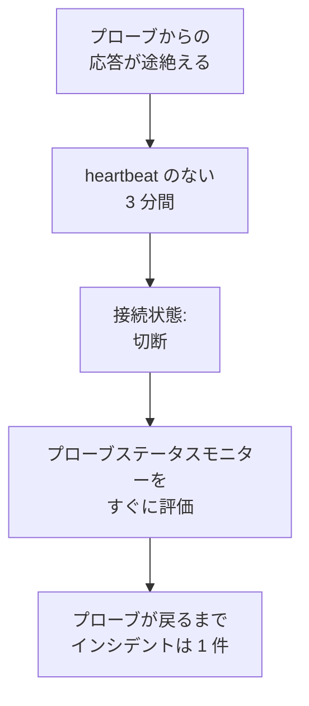

# プローブステータスモニター

プローブステータスモニターは、プローブからの応答が途絶えたことを知らせます。プローブが切断されるとインシデントが 1 件作成され、プローブが戻ると自動的に解決されます。カスタムプローブを対象にするか、セルフホストの OneUptime ではすべてのモニターが実行されるグローバルプローブを対象にすれば、応答のなくなったプローブのモニターが誰にも知られずにチェックされないままになることはありません。

:::cards
- [作成する](#プローブステータスモニターを作成する): プローブを選び、デフォルトの条件をそのまま使います。
- [条件](#条件): 接続中または切断されたプローブを、現在の値または一定期間で数えます。
- [メトリクス](#メトリクス): 接続中だったプローブの数を 1 分ごとに記録します。
:::

## 仕組み

OneUptime は、すべてのプローブステータスモニターを 1 分ごとに評価し、さらにプローブのいずれかが接続または切断された瞬間にも評価します。各プローブの接続状態 (プローブのページに表示されるもの) を読み取ります。プローブは 3 分間何も届かないと切断とみなされます。OneUptime 自体が停止していた、またはデータを受信していなかった場合は、プローブを切断とみなす前にまる 3 分間待つため、OneUptime のアップグレードでインシデントが作成されることはありません。

停止したままのプローブは 1 分ごとではなく 1 件のインシデントになります。モニターは、監視しているすべてのプローブが再び接続されるまで、インシデントを開いたままオフラインになり、その後インシデントは自動的に解決されます。

モニターは、自分のプロジェクトのプローブとグローバルプローブを監視できます。削除されたプローブはどちらにも数えられません。モニターが監視するプローブが 1 つも残っていない場合、モニターは現在のステータスを保ち、1 日後に概要でそのことを知らせます。

## プローブステータスモニターを作成する

:::steps
### 新しいモニターを開始する

**モニター** に移動し、**モニターを作成** をクリックします。

### プローブステータスを選ぶ

**モニターの種類** で **その他のモニターの種類** をクリックし、**その他** の下の **プローブステータス** を選びます。**名前** を入力し、**次へ** をクリックします。

### プローブを選ぶ

**監視するプローブ** でプローブを選びます。新しいモニターはプロジェクト自身のプローブから始まります。自前のプローブがないセルフホストの OneUptime では、グローバルプローブから始まります。OneUptime Cloud ではグローバルプローブは OneUptime が運用しているため、監視したい場合はプロジェクトが自分で選びます。

### モニターを作成する

下で説明するデフォルトの条件をそのまま使い、**モニターを作成** をクリックします。モニターはすぐに評価され、その概要には監視している各プローブが、切断されたものから順に表示されます。
:::

> [!TIP]
> プローブのページと、**モニター → 設定 → プローブ** にあるプローブの行のメニューにある **このプローブを監視** を使うと、そのプローブを監視し、その名前が付いたプローブステータスモニターで **モニターを作成** が開きます。

## 条件

プローブステータスモニターのフィルターはプローブを数えます。

| フィルター | 数えるもの |
| --- | --- |
| **Disconnected Probes** | 監視対象のプローブのうち、切断されているもの。 |
| **Connected Probes** | 監視対象のプローブのうち、接続中のもの。 |

どちらも整数で、**より大きい**、**より小さい**、**等しい** などで比較します。新しいモニターは次の 2 つの条件から始まります。

| 条件 | フィルター | 動作 |
| --- | --- | --- |
| Check if a probe is disconnected | **Disconnected Probes** が `0` より大きい | モニターをオフラインにし、`Probe disconnected: {{disconnectedProbeNames}}` というタイトルのインシデントを宣言します。このインシデントは自動的に解決されます。 |
| Check if every probe is connected | **Disconnected Probes** が `0` に等しい | モニターを稼働中にします。 |

**Connected Probes** は、複数のプローブを監視していて 1 つ失っても構わないモニターに向いています。**Connected Probes** が `2` より小さい場合、残りが 2 つ未満になったときにだけインシデントを宣言します。

### インシデントの前にもっと待つ

プローブは 3 分間応答がなくて初めて切断とみなされるため、短時間の再起動では何も作成されません。もっと待つには、フィルターの下で **この条件を一定期間にわたって評価する** をオンにし、**評価** で **All Values** を、**過去（分単位）** で期間を選びます。5 分にすると、インシデントが宣言されるまでに、プローブはさらに 5 分間切断されたままである必要があります。

## メトリクス

評価のたびに、モニターに 2 つの系列が記録されます。`oneuptime.monitor.probes.connected` と `oneuptime.monitor.probes.disconnected` で、監視対象のプローブのうち接続中だった数と切断されていた数です。これらはモニターの **メトリクス** ページにグラフで表示され、ダッシュボードやメトリクスモニターからも他の系列と同じように読み取れます。

## テンプレート変数

プローブステータスモニターのインシデントとアラートのテンプレートでは、すべてのモニターにある変数に加えて、次の変数を使えます。

| 変数 | 値 |
| --- | --- |
| `{{disconnectedProbeNames}}` | 切断されたプローブの名前 (カンマ区切り)。 |
| `{{disconnectedProbeCount}}` | 切断されたプローブの数。 |
| `{{connectedProbeNames}}` | 接続中のプローブの名前 (カンマ区切り)。 |
| `{{connectedProbeCount}}` | 接続中のプローブの数。 |
| `{{probeStatusSummary}}` | `1 of 3 probes is disconnected: EU Probe.` のように切断されたプローブの名前を挙げる、またはすべてのプローブが接続中であることを示す 1 文。 |
| `{{probes}}` | 各プローブ。それぞれに `probeName`、`isConnected`、`isGlobalProbe`、`lastAliveAt` があります。 |

## トラブルシューティング

:::details モニターにデータを待っていると表示される
新しいモニターは 1〜2 分以内に最初の評価を表示します。監視しているプローブがない場合は、代わりに **未セットアップ** と表示されます。**条件** でプローブを選んでください。
:::

:::details プローブが停止したのにインシデントが宣言されない
プローブは heartbeat が 3 分間ないと切断とみなされ、OneUptime 自体が停止していた後はさらに遅くなります。モニターが無効になっていないか、メンテナンス期間中でないか、条件がまだインシデントを宣言するようになっているかを確認してください。
:::

## 次のステップ

:::cards
- [カスタムプローブ](/docs/probe/custom-probe): 自分のネットワークでプローブを動かします。
- [モニターの条件とステータス](/docs/monitor/criteria-and-statuses): 条件がモニターのステータスをどう決めるか。
- [インシデントとアラートのテンプレート](/docs/monitor/incident-alert-templating): モニターが宣言するインシデントの文面を決めます。
:::
