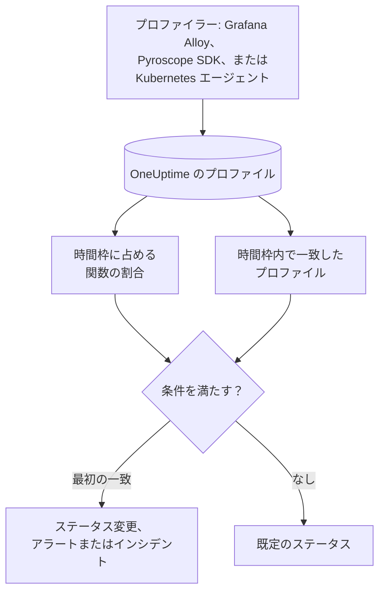

# プロファイル モニター

プロファイルモニターは、サービスが OneUptime に送る継続的なプロファイルを読み取り、2 つのことでアラートを出します。関数が本来より大きな割合の時間を占めるようになったとき（たとえばデプロイ後に重くなったパーサー）と、サービスからプロファイルが届かなくなったときです。毎分、指定した関数を時間枠のうちどれだけが通ったかを測り、フィルターに一致するプロファイルを数え、条件を満たすとモニターのステータスを変えたり、アラートを作成したり、インシデントを宣言したりします。

:::cards
- [モニターを作成する](#プロファイルモニターを作成する): プロファイラーの関数から、または モニターを作成 から。
- [何を照会するか](#何を照会するか): 関数、プロファイルの種類、サービス、時間枠。
- [条件](#条件): 時間枠に占める関数の割合、またはプロファイルの数。
- [関数が重くなる](#実例-関数が重くなる): 関数の割合が急に増えたらアラートを出します。
:::

## しくみ



OneUptime は毎分、モニターのフィルターに一致し、時間枠内に開始したプロファイルを読み取ります。それを数え、モニターが関数を指定している場合は、その時間枠の時間のうち関数を通った割合を測ります。これらの数値をモニターの条件と上から順に比べ、最初に一致した条件で何が起こるかが決まります。どれにも一致しなければ、モニターは既定のステータスに戻ります。

## 始める前に

- サービスが Grafana Alloy（eBPF）、Pyroscope SDK、または OneUptime の Kubernetes エージェントを通じて、継続的なプロファイリングデータを OneUptime に送っていること。[継続的プロファイリング](/docs/telemetry/profiles) を参照してください。
- 1 つの関数を監視するには、プロファイラーに表示されるとおりの関数名、またはファイルやパッケージのパスの一部がわかっていること。

## プロファイルモニターを作成する

:::steps
### プロファイラーから、または モニターを作成 から始める

いちばん速いのは関数そのものから始める方法です。**パフォーマンスプロファイル** で関数を開き、その割合へのアラートを提案するリンクをクリックします。**モニターを作成** が開き、その関数とサービス向けにモニターが入力済みで、しきい値は今日の割合より上に設定されています。詳しくは [実例: 関数が重くなる](#実例-関数が重くなる) を参照してください。それ以外の場合は、**モニター** に移動して **モニターを作成** をクリックします。

### Profiles を選ぶ

**モニターの種類** で **その他のモニターの種類** をクリックし、**テレメトリ** の下の **プロファイル** を選ぶか、検索ボックスに `profiles` と入力します。**名前** を入力し、**次へ** をクリックします。

### 読み取る内容を選ぶ

**プロファイルモニターの設定** で、**関数** に監視する関数を、**分析対象** にプロファイルの種類を、**プロファイルの監視期間（時間）** に時間枠を設定します。新しいモニターは **過去 5 分** の **CPU 時間** を読み取ります。フィールドの下の **このモニターが今読み取っている内容** には、一致するプロファイルの数と、関数が今日時間枠のどれだけを占めているかが表示されるので、しきい値をそれより上に設定できます。テレメトリサービスやインフラエンティティで絞り込むには、**その他の項目** を開きます。

### 条件を設定する

**モニターを作成** から始めたモニターには 2 つの条件があります。**プロファイル数** が 0 のときはインシデント付きでオフライン、0 より大きいときはオンラインです。関数でアラートを出すには、**関数の割合（%）** フィルターを追加します。[条件](#条件) を参照してください。

### モニターを作成する

**モニターを作成** をクリックします。モニターは **概要** ページで開き、最初の評価は 1 分以内に実行されます。
:::

### API または Terraform で作成する

モニターのステップは、その `profileMonitor` 設定と同じ設定を持ちます。次の設定は、1 つのサービスの CPU プロファイルで直近 5 分間の `parseOrder` を監視します。

```json
{
  "profileMonitor": {
    "telemetryServiceIds": [],
    "profileTypes": ["cpu"],
    "profileType": "",
    "functionName": "parseOrder",
    "attributes": {},
    "lastXSecondsOfProfiles": 300
  }
}
```

サービスの ID を `telemetryServiceIds` に入れるか、すべてのサービスのプロファイルを読み取るならリストを空のままにします。プロファイルを数えるだけなら `functionName` を空のままにします。[API](/docs/api-reference/api-reference) または [Terraform](/docs/terraform/monitor-steps) で、モニターの種類 `Profiles` と、この設定と少なくとも 1 つの条件を持つステップでモニターを作成します。Terraform では、`jsonencode()` で書いた設定をステップの `profile_monitor` 属性として渡します。

## 何を照会するか

| フィールド | 一致するもの | 既定値 |
| --- | --- | --- |
| `profileTypes` | これらのいずれかの種類のプロファイル。`cpu` のように完全一致で比べます。 | 空: すべての種類 |
| `profileType` | 種類にこのテキストを含むプロファイル。大文字と小文字は区別しません。設定すると `profileTypes` は無視されます。 | 空 |
| `functionName` | **関数の割合（%）** が割合を測るコード。関数名またはファイルパスにこのテキストを含むスタックフレームで、大文字と小文字は区別しません。 | 空: 割合は測りません |
| `telemetryServiceIds` | これらのいずれかのテレメトリサービスのプロファイル。 | 空: すべてのサービス |
| `entityKeys` | これらのいずれかのホスト、Pod、コンテナー、その他のインフラエンティティのプロファイル。 | 空: すべてのエンティティ |
| `attributes` | 属性がこれらの値を持つプロファイル。 | 空: 条件なし |
| `lastXSecondsOfProfiles` | 評価の前のこの秒数以内に開始したプロファイル。 | なし: 必ず設定してください。設定しないと保存済みのプロファイルがすべて数えられ、カウントが 0 になりません |

プロファイルが読み取られるには、設定したすべてのフィルターに一致する必要があります。フォームでは、**関数** が `functionName` を、**分析対象** が `profileTypes` を（**すべての種類のプロファイル** なら空）、**プロファイルの監視期間（時間）** が `lastXSecondsOfProfiles` を、**テレメトリサービスでフィルター** と **インフラエンティティで絞り込み** が `telemetryServiceIds` と `entityKeys` を設定します。

## 評価のしくみ

- **毎分。** プロファイルモニターはプローブでチェックされないため、設定する間隔も **プローブと間隔** ページもありません。
- **1 回の評価で 2 つの数値。** モニターは、すべてのフィルターに一致し、`lastXSecondsOfProfiles` 内に開始したプロファイルを数え、同じプロファイルに占める関数の割合を測ります。プロファイラーは一定の間隔でアップロードするため、時間枠には複数回のアップロードが入る余裕を持たせてください。
- **単位は一度に 1 つ。** 割合は 1 つの単位のサンプルを合計します。読み取る種類に単位が混ざる場合（たとえば SDK からのナノ秒単位の CPU 時間と eBPF からのサンプル数）、時間枠内でサンプルが最も多い単位を読み取ります。
- **プロファイルがなければカウントは 0 で、割合もない。** プロファイラーがアップロードをやめたサービスのカウントは 0 になり、**関数の割合（%）** の条件は空の時間枠には一致しません。プロファイリングが止まったことを知るには、**プロファイル数** でアラートを出してください。
- **OneUptime 自身の停止は沈黙ではありません。** OneUptime 自身がデータを受信していなかった時間（再起動中、アップグレード中、遅れの取り戻し中）が時間枠に含まれている間、チェックは待ちます。ステータスは変わらず、インシデントやアラートが開かれたり解決されたりすることもありません。[OneUptime がデータを受信していないとき](/docs/monitor/when-oneuptime-is-not-receiving) を参照してください。
- **条件は上から順に。** 最初に一致した条件で決まるため、最も重大なものを先頭に置きます。

ステータスの変化はすべて、その理由とともにモニターの **ステータスタイムライン** に記録されます。

## 条件

プロファイルモニターの条件は、2 つの数値のどちらかを値と比べます。

**関数の割合（%）** は、時間枠の時間のうちモニターの関数を通った割合で、0 から 100 です。`functionName` に一致するフレームを含むスタックは、深さにかかわらず 1 回だけ数えられるため、関数自身のコードと、それが呼び出すすべてが含まれます。

| フィルター条件 | 関数の割合が次のとき一致 |
| --- | --- |
| **より大きい** | 値を上回る |
| **以上** | 値以上 |
| **より小さい** | 値を下回る |
| **以下** | 値以下 |

**プロファイル数** は、時間枠内で一致したプロファイルの数です。

| フィルター条件 | プロファイルの数が次のとき一致 |
| --- | --- |
| **より大きい** | 値を上回る |
| **以上** | 値以上 |
| **より小さい** | 値を下回る |
| **以下** | 値以下 |
| **等しい** | 値とちょうど同じ |
| **等しくない** | 値以外 |

プロファイルの数には異常の条件がありません。比べるベースラインがないためです。

## 実例: 関数が重くなる

checkout サービスでは、`parseOrder` が CPU 時間の 18% を占めています。より大きなペイロードを解析するデプロイを見逃さないようにします。

1. **パフォーマンスプロファイル** で checkout サービスを選び、`parseOrder` を開きます。
2. その割合へのアラートを提案するリンクをクリックします。プロファイラーは 30% を提案します。今日の割合の 1.5 倍で、少なくとも 10 ポイント上、5 の倍数に切り上げた値です。
3. **モニターを作成** が開き、**過去 5 分** の **CPU 時間** を読み取る checkout サービスのプロファイルモニターと 2 つの条件が入っています。**関数の割合（%）** **より大きい** `30` は自動で解決するアラートを出し、モニターを低下状態にします。**以下** `30` はモニターを稼働中にします。インシデントは入力済みですがオフです。誰かを呼び出すにはオンにしてください。
4. **モニターを作成** をクリックします。

デプロイによって `parseOrder` が CPU 時間の 45% を占めるようになると、次の評価でアラートが出ます。修正で割合が 30% 未満に戻ると、アラートは自動で解決します。

## 実例: プロファイルが届かなくなる

checkout サービスでは、CPU プロファイルをアップロードする Pyroscope SDK が動いています。それが 5 分間届かなくなったらインシデントにしたいとします。

- `profileTypes`: `["cpu"]`、`telemetryServiceIds`: checkout サービス、`lastXSecondsOfProfiles`: `300`
- 条件 1: **プロファイル数** **等しい** `0`: モニターをオフラインにし、インシデントを宣言する
- 条件 2: **プロファイル数** **より大きい** `0`: モニターをオンラインにする

SDK がアップロードしている間は、各評価がいくつかのプロファイルを数え、条件 2 がモニターをオンラインに保ちます。SDK なしでサービスがデプロイされると、最後のアップロードから 5 分後にカウントが 0 に下がり、条件 1 が一致してインシデントが宣言されます。修正後の最初のアップロードでカウントが再び 0 を超え、そのインシデントで **インシデントを自動解決** がオンなら、インシデントは自動で解決します。

## トラブルシューティング

:::details モニターは 0 と数えるのに、OneUptime にはプロファイルが表示される
表示されているプロファイルとフィルターを比べてください。`profileTypes` はタイプと完全に一致する必要があり、`telemetryServiceIds` には正しいサービス ID が入っている必要があります。`lastXSecondsOfProfiles` が短いと、2 回のアップロードの間に収まってしまうこともあります。
:::

:::details 関数の割合が 0% のまま
時間枠内のどのフレームにも関数のテキストが含まれていません。プロファイラーで関数を開き、表示されているとおりに名前をコピーしてください。名前の一部でもよく、大文字と小文字は関係ありません。次に、**分析対象** が読み取るプロファイルの種類をサービスが送っているか確認してください。
:::

## 次のステップ

:::cards
- [継続的プロファイリング](/docs/telemetry/profiles): プロファイルを送り、プロファイラーで読み取ります。
- [モニターステップ](/docs/terraform/monitor-steps): Terraform からステップの設定を渡します。
- [トレース モニター](/docs/monitor/traces-monitor): 失敗したスパンでアラートを出します。
- [メトリクス モニター](/docs/monitor/metrics-monitor): CPU、メモリー、その他のメトリクスでアラートを出します。
:::
