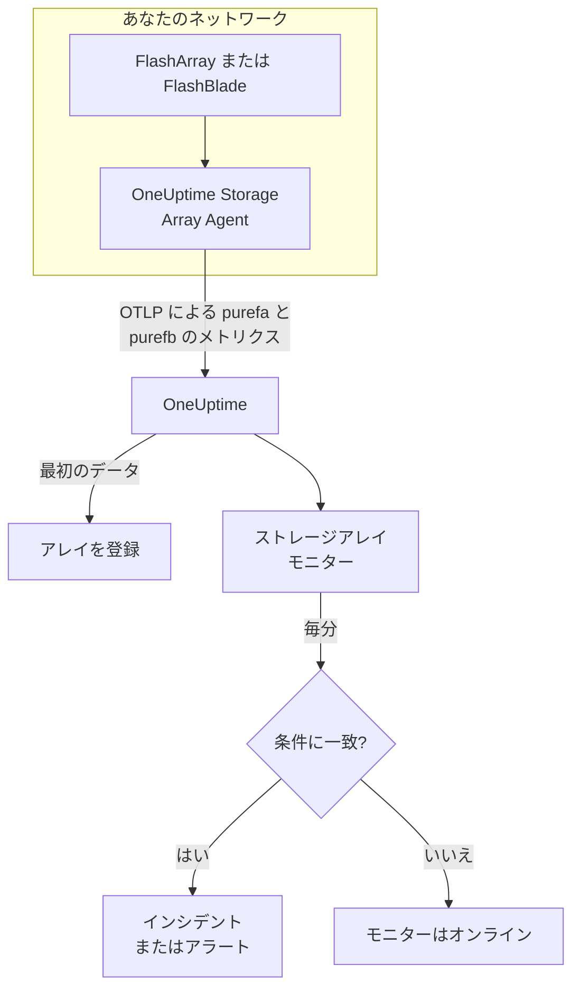

# ストレージアレイ モニター

ストレージアレイ モニターは 1 つのストレージアレイを監視し、アレイ自体がアラートを上げたとき、容量が足りなくなったとき、遅くなったとき、ハードウェアやホストのパスを失ったとき、レプリケーションが遅れたときに知らせます。Pure Storage FlashArray と Pure Storage FlashBlade に対応し、アレイ自身がエクスポートするメトリクス (Pure の `purefa_*` と `purefb_*` のシリーズ) を読み取ります。これらは OneUptime Storage Array Agent が収集します。

:::cards
- [モニターを作成する](#ストレージアレイ-モニターを作成する): ダッシュボードでの六つのステップ。
- [テンプレート](#組み込みのアラートテンプレート): 十八個の組み込みアラート。ボリューム、ホスト、コンポーネントごとに一つのインシデント。
- [Pure のシリーズの仕組み](#pure-のシリーズの形): 一つのメトリクス名に、多くの値。
- [メトリクス](#収集されるメトリクス): モニターがアラートを出せるすべてのシリーズ。
:::

## 仕組み

OneUptime Storage Array Agent は、アレイの管理インターフェイスに到達できるマシンで動作します。読み取り専用の API トークンでアレイのメトリクスを読み取り、アレイの名前 `storage.array.name` とプラットフォーム `storage.system` のラベルを付けて、OTLP で OneUptime に送信します。最初のデータでアレイが登録されます。

ストレージアレイ モニターは 1 つのアレイに結び付いています。毎分、そのアレイのメトリクスに対してクエリを実行し、結果を条件と比較します。



## 始める前に

- **Storage Array Agent をインストールします**。HTTPS でアレイに到達できる場所に、アレイの **readonly** ロールを持つユーザーの API トークンを使ってインストールします。[Storage Array Agent のガイド](/docs/telemetry/storage-arrays) では、ユーザー、トークン、インストールを、`ONEUPTIME_URL`、`ONEUPTIME_TELEMETRY_INGESTION_KEY`、`STORAGE_ARRAY_NAME`、アレイのアドレスとトークン (`PURE_FA_ENDPOINT` と `PURE_FA_API_TOKEN`、または `PURE_FB_ENDPOINT` と `PURE_FB_API_TOKEN`) とともに説明しています。
- **アレイが登録されていることを確認します。** 最初の読み取りから約 1 分後に、エージェントの `STORAGE_ARRAY_NAME` の名前で **製品 → インフラストラクチャ → Storage Arrays → All Storage Arrays** に表示されます。

## ストレージアレイ モニターを作成する

:::steps
### 新しいモニターを開始する

**モニター** に移動し、**モニターを作成** をクリックします。

### ストレージアレイを選ぶ

**モニターの種類** で **その他のモニターの種類** をクリックし、**インフラストラクチャ** の下の **ストレージアレイ** を選ぶか、検索ボックスに `storage` と入力します。**名前** を入力し (インシデントとアラートのタイトルに使われます)、**次へ** をクリックします。

### アレイを選ぶ

**Storage Array Monitor Configuration** で、**ストレージアレイ** からアレイを選びます。データを送信したことのあるアレイはすべて一覧にあります。アレイのプラットフォームによって、フォームが提示するメトリクスとテンプレートが決まります。

### 監視する内容を選ぶ

三つのタブから一つを選びます。

- **Quick Setup**: [テンプレート](#組み込みのアラートテンプレート) をクリックします。テンプレートはメトリクス、ラベルフィルター、集計、時間範囲、しきい値を設定し、下の条件を自分のものに置き換えます。**時間範囲** は後からでも変更できます。
- **Custom Metric**: **Storage Array Metric** から 1 つのメトリクスを選び、**集計** と **時間範囲** を設定します。[フィルター](#モニターの設定) で、1 つのボリューム、ホスト、Pod、コンポーネント、ファイルシステム、バケットに絞り込めます。
- **詳細**: **メトリクスを選択** でクエリと数式を自分で組み立てます。たとえば使用済み容量は、`purefa_array_space_bytes` を `space=capacity` に絞り込んだものから、同じメトリクスを `space=empty` に絞り込んだものを引いて求めます。オブジェクトのラベルで **グループ化** すると、各オブジェクトを個別に判定できます。

### 条件を確認する

**モニター条件** の各条件を開き、**メトリクス**、**集計**、**条件**、**しきい値** を確認します。テンプレートを使うと、これらは自動で入力されます。**Custom Metric** や **詳細** では、モニターは [デフォルトの条件](#デフォルトの条件) から始まります。これはメトリクスがゼロに落ちたことしか検知しないため、自分のしきい値を設定してください。

### モニターを作成する

**モニターを作成** をクリックします。OneUptime がモニターのページを開き、毎分評価します。モニターが上げたインシデントとアラートは、アレイの **インシデント** と **アラート** のページにも一覧表示されます。
:::

> [!TIP]
> 複数のテンプレートを一度に設定するには、**製品 → インフラストラクチャ → Storage Arrays** からアレイを開き、**推奨事項** に移動します。必要なテンプレートを選び、呼び出す相手を選ぶと、OneUptime がテンプレートごとに 1 つのモニターを作成します。

## モニターの設定

| フィールド | タブ | 動作 |
| --- | --- | --- |
| **ストレージアレイ** | すべて | 必須。すべてのクエリを `resource.storage.array.name` に限定するため、どちらも `vol-01` という名前のボリュームを持つ 2 つのアレイが混ざることはありません。 |
| **ボリューム** | Custom Metric、詳細 | FlashArray のみ。`name` ラベルで 1 つのボリューム (`vol-db-01` など)。Pod やボリュームグループ内のボリュームは `pod::volume` や `group/volume` という名前になります。 |
| **ホスト** | Custom Metric、詳細 | FlashArray のみ。アレイが認識している 1 つのホストを `host` ラベルで (`esxi-01` など)。 |
| **Pod** | Custom Metric、詳細 | FlashArray のみ。1 つの ActiveCluster または ActiveDR Pod を `name` ラベルで、レプリカリンクのシリーズでは `local_pod` で。 |
| **Hardware Component** | Custom Metric、詳細 | 1 つのハードウェアコンポーネント (`CH0.BAY1` や `CT0` など)。FlashArray では `component_name` ラベル、FlashBlade では `name`。 |
| **File System** | Custom Metric、詳細 | FlashBlade のみ。`name` ラベルで 1 つのファイルシステム。 |
| **Bucket** | Custom Metric、詳細 | FlashBlade のみ。`name` ラベルで 1 つのオブジェクトストアのバケット。 |
| **Storage Array Metric** | Custom Metric | [カタログ](#収集されるメトリクス) の 1 つのメトリクス。フォームはその意味を決めるラベルフィルターを追加し、説明するオブジェクトでグループ化するため、各ボリューム、ホスト、コンポーネントが個別に判定されます。 |
| **集計** | Custom Metric | サンプルの組み合わせ方: **平均**、**最大**、**最小**、**合計**、**カウント**。メトリクスの通常の集計から始まります。 |
| **時間範囲** | すべて | クエリが読み取る移動ウィンドウ。**Past 1 Minute** から **Past 365 Days** まで。新しいモニターは **過去 5 分** から、ファイルシステムやバケットのカスタムメトリクスは **過去 15 分** から始まります。テンプレートは独自の値を設定します。 |
| **メトリクスを選択** | 詳細 | クエリビルダー: **メトリクス**、**集計の基準**、**属性で絞り込み**、**グループ化**、さらにクエリを組み合わせる **メトリクスを追加** と **数式を追加**。 |

エージェントはアレイのエンドポイントを 60 秒ごとに、ボリューム、ホスト、Pod を 2 分ごとに読み取るため、5 分のウィンドウには必ずサンプルがあります。FlashBlade のファイルシステムとバケットは 5 分ごと (そのため 15 分)、FlashArray のディレクトリは 30 分ごとに読み取ります。ディレクトリのモニターには 60 分のウィンドウを指定してください。

## Pure のシリーズの形

Pure は **1 つの** メトリクス名に複数の値を載せ、ラベルで区別します。

- **`dimension`** (パフォーマンスのシリーズ)。`purefa_array_performance_latency_usec` は、読み取りレイテンシ (`usec_per_read_op`)、書き込みレイテンシ (`usec_per_write_op`)、ミラー書き込みのレイテンシ、そしてそれぞれの SAN、キュー、QoS、サービスの時間を持ちます。常に 1 つの `dimension` で絞り込んでください。これらをまたいで平均すると、200 µs の読み取りレイテンシとキューの値が混ざります。
- **`space`** (容量のシリーズ): `capacity`、`empty`、`snapshots`、`total_provisioned`、`total_physical`、`available_ratio` など。

いくつかのシリーズは状態を **ラベル** に持ち、値は常に 1 です。

| シリーズ | 状態のラベル | 1 シリーズの単位 |
| --- | --- | --- |
| `purefa_alerts_open` | `severity` (`summary`、`code`、`component_type` 付き) | オープンなアラート |
| `purefa_hw_component_status` | `component_status` | ハードウェアコンポーネント |
| `purefa_host_connectivity_info` | `status` (`details` 付き) | ホスト |
| `purefa_drive_capacity_bytes` | `component_status` (値はドライブの容量) | ドライブ |

悪い状態に絞り込んだシリーズは、何かがその状態にある間しか存在しないため、シリーズがないことは正常を意味します。だからこそ **0 を超える最大値で発火し、0 で回復する** という形が適しており、テンプレートもそのように作られています。回復の条件は、シリーズがないことをゼロとして数えます。

モニターのフィルターとグループ化のキーでは、エージェントの属性は `resource.` で始まり (`resource.storage.array.name`、`resource.storage.system`)、Pure 自身のラベルはそうではありません (`name`、`host`、`component_name`、`dimension`、`space`、`severity`)。

## 組み込みのアラートテンプレート

OneUptime には 18 個のテンプレートがあり (FlashArray 用が 11 個、FlashBlade 用が 7 個)、**Quick Setup** はアレイのプラットフォームに合うものを提示します。各テンプレートは完全なモニターを作ります。メトリクスのクエリ、そのラベルフィルター、オブジェクト自身のラベルによるグループ化、発火する条件と回復する条件です。しきい値は編集できる出発点です。

条件は、ウィンドウ内の **すべての** 値で条件が成り立つときだけ発火します。容量、レイテンシ、遅延、比率のしきい値で発火したモニターは、しきい値から 10% 離れて初めて回復するため、しきい値付近を行き来する値で状態がばたつくことはありません。アラートとハードウェアのテンプレートは、状態が解消されるとすぐに回復します。

### FlashArray

| テンプレート | カテゴリ | 重大度 | 監視対象 | 発火する条件 |
| --- | --- | --- | --- | --- |
| Critical Array Alert | Array Health | 重大 | `purefa_alerts_open` を `severity=critical` に絞り込み、`summary` ごとに Max、過去 5 分 | > 0 — アレイにオープンな重大アラートがある (故障したコンポーネント、容量の緊急事態、レプリケーションの失敗)。アラートごとに一つのインシデント。アラートが閉じると回復 |
| Warning Array Alert | Array Health | 警告 | `purefa_alerts_open` を `severity=warning` に絞り込み、`summary` ごとに Max、過去 5 分 | > 0 — アレイにオープンな警告アラートがある。アラートごとに一つのインシデント。アラートが閉じると回復 |
| Capacity Above 80% | 容量 | 警告 | `purefa_array_space_utilization`、Max、過去 15 分 | > 80 — Pure 自身の最初の容量しきい値。≤ 72 で回復 |
| Capacity Above 90% | 容量 | 重大 | `purefa_array_space_utilization`、Max、過去 5 分 | > 90 — アレイが書き込みを拒否する寸前。≤ 81 で回復 |
| High Read Latency | Performance | 警告 | `purefa_array_performance_latency_usec` を `dimension=usec_per_read_op` に絞り込み、Avg、過去 10 分 | > 5000 µs (5 ms) — FlashArray の読み取りは通常 1 ms を大きく下回る。≤ 4500 で回復 |
| High Write Latency | Performance | 警告 | `purefa_array_performance_latency_usec` を `dimension=usec_per_write_op` に絞り込み、Avg、過去 10 分 | > 5000 µs (5 ms)。≤ 4500 で回復 |
| Hardware Component Failed | Hardware | 重大 | `purefa_hw_component_status` を `component_status=critical` に絞り込み、`component_name` ごとに Max、過去 5 分 | > 0 — コントローラー、電源、ファン、ベイ、ポートが重大な状態で、冗長性が失われている。コンポーネントごとに一つのインシデント。ok を報告すると回復 |
| Hardware Component Degraded | Hardware | 警告 | `purefa_hw_component_status` を `component_status=degraded` に絞り込み、`component_name` ごとに Max、過去 5 分 | > 0 — コンポーネントが劣化している。コンポーネントごとに一つのインシデント。ok を報告すると回復 |
| Drive Failed | Hardware | 重大 | `purefa_drive_capacity_bytes` を `component_status=failed` に絞り込み、`component_name` ごとに Max、過去 5 分 | > 0 — DirectFlash モジュールまたは SSD が故障し、アレイが残りのドライブに再構築している。ドライブごとに一つのインシデント。交換されると回復 |
| Host Lost Redundant Paths | ホスト | 警告 | `purefa_host_connectivity_info` を `status=critical` に絞り込み、`host` ごとに Max、過去 5 分 | > 0 — ホストが一つのコントローラー経由でしかアレイに到達できない、またはまったく到達できない。コントローラーのフェイルオーバーでストレージがオフラインになる。ホストごとに一つのインシデント。パスが戻ると回復 |
| Replication Lag Above 1 Minute | レプリケーション | 警告 | `purefa_pod_replica_links_lag_max_msec`、`local_pod` ごとに Max、過去 10 分 | > 60000 ms (60 s) — 今フェイルオーバーすると、計画以上に最近の書き込みが失われる。Pod ごとに一つのインシデント。≤ 54000 で回復 |

### FlashBlade

| テンプレート | カテゴリ | 重大度 | 監視対象 | 発火する条件 |
| --- | --- | --- | --- | --- |
| Critical Array Alert | Array Health | 重大 | `purefb_alerts_open` を `severity=critical` に絞り込み、`summary` ごとに Max、過去 5 分 | > 0 — FlashBlade にオープンな重大アラートがある。アラートごとに一つのインシデント。アラートが閉じると回復 |
| Warning Array Alert | Array Health | 警告 | `purefb_alerts_open` を `severity=warning` に絞り込み、`summary` ごとに Max、過去 5 分 | > 0 — FlashBlade にオープンな警告アラートがある。アラートごとに一つのインシデント。アラートが閉じると回復 |
| Capacity Above 80% | 容量 | 警告 | `purefb_array_space_utilization` を `type=array` に絞り込み、Max、過去 15 分 | > 80。≤ 72 で回復 |
| Capacity Above 90% | 容量 | 重大 | `purefb_array_space_utilization` を `type=array` に絞り込み、Max、過去 5 分 | > 90 — いっぱいになると、すべてのクライアントで書き込みが失敗する。≤ 81 で回復 |
| Hardware Component Unhealthy | Hardware | 重大 | `purefb_hardware_health`、`name` ごとに Min、過去 5 分 | < 1 — ブレード、ファブリックモジュール、電源、ファンが正常でない (未使用のスロットは 2 を報告する)。コンポーネントごとに一つのインシデント。≥ 1 で回復 |
| High Read Latency | Performance | 警告 | `purefb_array_performance_latency_usec` を `dimension=usec_per_read_op` と `protocol=all` に絞り込み、Avg、過去 10 分 | > 10000 µs (10 ms)、全プロトコル。≤ 9000 で回復 |
| File System Near Full | File Systems | 警告 | `purefb_file_systems_space_bytes` を `space=available_ratio` に絞り込み、`name` ごとに Min、過去 15 分 | < 0.1 — ファイルシステムのプロビジョニング済みサイズの残りが 10% 未満。ファイルシステムごとに一つのインシデント。≥ 0.11 で回復 |

**重大度** はピッカーが表示するラベルです。テンプレートが作成するインシデントとアラートは、プロジェクトで最も重大なインシデントとアラートの重大度から始まります。条件の中で変更してください。

- **オープンなアラートとハードウェアの状態は Max を使います**。アラートがオープンな間、またはコンポーネントがその状態にある間しか存在しないシリーズなので、それを示す 1 回の読み取りでしきい値を超えます。
- **オブジェクトごとのテンプレートは、すべてオブジェクト自身のラベルでグループ化します** (`summary`、`component_name`、`host`、`local_pod`、`name`)。そのため、影響を受けたオブジェクトごとに一つのインシデントが発火し、インシデントはそのオブジェクトの名前を示します。
- **レイテンシのテンプレートは Avg を使います**。アレイ自身による操作あたりの平均値の Avg です。容量のテンプレートは、アレイ自身の使用率の **Max** を使います。レイテンシはマイクロ秒、容量はパーセントに固定されています。
- **Hardware Component Unhealthy はコンポーネントごとに Min を使います**。正常なときは 1、そうでないときは 0 に下がります。

ボリュームごとのレイテンシのテンプレートはありません。適切なしきい値はワークロードによって異なるためです。カタログから `name` でグループ化して作成してください。容量の予測にはしきい値ではなく増加の傾向が必要で、ドライブの摩耗にはアラートを出せるシリーズがありません。

## 収集されるメトリクス

エージェントはアレイがエクスポートするすべてを送信します。以下のシリーズは、モニターのフォームが提示するカタログです。どの値もアレイ自身が計算したゲージで、レイテンシは操作あたりのマイクロ秒、スループットは 1 秒あたりの値なので、レートの計算は不要です。**フィルター** は、その行が示す意味をシリーズに与えるラベルフィルターで、フォームが自動で適用します。

### Array Health

| メトリクス | フィルター | プラットフォーム | 単位 | 説明 |
| --- | --- | --- | --- | --- |
| `purefa_alerts_open` | — | FlashArray | `count` | アレイのオープンなアラートごとに 1 シリーズ (値は 1)。ラベルは `severity` (`critical`、`warning`、`info`、`hidden`)、`category`、`code`、`component_type`、`summary` |
| `purefb_alerts_open` | — | FlashBlade | `count` | FlashBlade のオープンなアラートごとに 1 シリーズ (値は 1)。ラベルは `severity` (`info`、`warning`、`critical`)、`code`、`component_name`、`component_type`、`summary`、`kburl` (Pure のナレッジベースの記事) |

### Capacity

| メトリクス | フィルター | プラットフォーム | 単位 | 説明 |
| --- | --- | --- | --- | --- |
| `purefa_array_space_utilization` | — | FlashArray | `%` | アレイの使用可能な容量のうち使用中の割合。Pure 自身が 80%、90%、100% で容量アラートを上げます |
| `purefa_array_space_bytes` | `space=capacity` | FlashArray | `bytes` | アレイの使用可能な容量 |
| `purefa_array_space_bytes` | `space=empty` | FlashArray | `bytes` | 未使用の容量。傾向を追うと、アレイがいっぱいになる時期を予測できます |
| `purefa_array_space_bytes` | `space=snapshots` | FlashArray | `bytes` | スナップショットだけが占める物理容量。急に増えたときは、たいてい保護グループが計画より多くのスナップショットを保持しています |
| `purefa_array_space_data_reduction_ratio` | — | FlashArray | `ratio` | アレイ全体の重複排除と圧縮 (例: 4.2:1 なら 4.2)。下がり続けるときは、新しいデータがうまく削減されていません |
| `purefb_array_space_utilization` | `type=array` | FlashBlade | `%` | FlashBlade の使用可能な容量のうち使用中の割合 |
| `purefb_array_space_bytes` | `type=array`、`space=empty` | FlashBlade | `bytes` | FlashBlade の未使用の容量 |
| `purefb_array_space_data_reduction_ratio` | `type=array` | FlashBlade | `ratio` | FlashBlade 全体のデータ削減 |

### Performance

| メトリクス | フィルター | プラットフォーム | 単位 | 説明 |
| --- | --- | --- | --- | --- |
| `purefa_array_performance_latency_usec` | `dimension=usec_per_read_op` | FlashArray | `µs` | ホストから見た読み取りの平均レイテンシ。FlashArray の読み取りは通常 1 ms を大きく下回ります |
| `purefa_array_performance_latency_usec` | `dimension=usec_per_write_op` | FlashArray | `µs` | ホストから見た書き込みの平均レイテンシ |
| `purefa_array_performance_latency_usec` | `dimension=usec_per_mirrored_write_op` | FlashArray | `µs` | ストレッチされた ActiveCluster Pod への書き込みの平均レイテンシ (パートナーアレイとの往復を含む) |
| `purefa_array_performance_latency_usec` | `dimension=san_usec_per_read_op` | FlashArray | `µs` | 読み取りが SAN で費やす時間。SAN のレイテンシが高くサービスのレイテンシが低い場合は、ファブリックかホストが原因です |
| `purefa_array_performance_throughput_iops` | `dimension=reads_per_sec` | FlashArray | `ops/s` | 1 秒あたりの読み取り操作数 |
| `purefa_array_performance_throughput_iops` | `dimension=writes_per_sec` | FlashArray | `ops/s` | 1 秒あたりの書き込み操作数 |
| `purefa_array_performance_bandwidth_bytes` | `dimension=read_bytes_per_sec` | FlashArray | `bytes/s` | 1 秒あたりの読み取りバイト数 |
| `purefa_array_performance_bandwidth_bytes` | `dimension=write_bytes_per_sec` | FlashArray | `bytes/s` | 1 秒あたりの書き込みバイト数 |
| `purefa_array_performance_queue_depth_ops` | — | FlashArray | `ops` | アレイ上のキューにある操作。レイテンシの上昇とともにキューが伸びるときは、ホストがアレイの処理能力を超えて送信しています |
| `purefa_array_performance_average_bytes` | `dimension=bytes_per_op` | FlashArray | `bytes` | 操作の平均サイズ。大きな I/O は、何も問題がなくてもレイテンシを上げます |
| `purefb_array_performance_latency_usec` | `dimension=usec_per_read_op`、`protocol=all` | FlashBlade | `µs` | 全プロトコルの読み取りの平均レイテンシ |
| `purefb_array_performance_latency_usec` | `dimension=usec_per_write_op`、`protocol=all` | FlashBlade | `µs` | 全プロトコルの書き込みの平均レイテンシ |
| `purefb_array_performance_throughput_iops` | `dimension=reads_per_sec`、`protocol=all` | FlashBlade | `ops/s` | 全プロトコルの 1 秒あたりの読み取り操作数 |
| `purefb_array_performance_throughput_iops` | `dimension=writes_per_sec`、`protocol=all` | FlashBlade | `ops/s` | 全プロトコルの 1 秒あたりの書き込み操作数 |
| `purefb_array_performance_bandwidth_bytes` | `dimension=read_bytes_per_sec`、`protocol=all` | FlashBlade | `bytes/s` | 全プロトコルの 1 秒あたりの読み取りバイト数 |
| `purefb_array_performance_bandwidth_bytes` | `dimension=write_bytes_per_sec`、`protocol=all` | FlashBlade | `bytes/s` | 全プロトコルの 1 秒あたりの書き込みバイト数 |

### Volumes

| メトリクス | フィルター | プラットフォーム | 単位 | 説明 |
| --- | --- | --- | --- | --- |
| `purefa_volume_performance_latency_usec` | `dimension=usec_per_read_op` | FlashArray | `µs` | 各ボリュームの読み取りの平均レイテンシ。`name` でグループ化します |
| `purefa_volume_performance_latency_usec` | `dimension=usec_per_write_op` | FlashArray | `µs` | 各ボリュームの書き込みの平均レイテンシ |
| `purefa_volume_performance_throughput_iops` | `dimension=reads_per_sec` | FlashArray | `ops/s` | 各ボリュームの 1 秒あたりの読み取り操作数 |
| `purefa_volume_performance_throughput_iops` | `dimension=writes_per_sec` | FlashArray | `ops/s` | 各ボリュームの 1 秒あたりの書き込み操作数 |
| `purefa_volume_performance_bandwidth_bytes` | `dimension=read_bytes_per_sec` | FlashArray | `bytes/s` | 各ボリュームから 1 秒あたりに読み取られたバイト数 |
| `purefa_volume_performance_bandwidth_bytes` | `dimension=write_bytes_per_sec` | FlashArray | `bytes/s` | 各ボリュームに 1 秒あたりに書き込まれたバイト数 |
| `purefa_volume_space_bytes` | `space=total_provisioned` | FlashArray | `bytes` | ホストから見た各ボリュームのサイズ |
| `purefa_volume_space_bytes` | `space=total_physical` | FlashArray | `bytes` | データ削減後に各ボリュームが使う物理容量 |
| `purefa_volume_space_data_reduction_ratio` | — | FlashArray | `ratio` | 各ボリュームのデータ削減率 |

### Hosts

| メトリクス | フィルター | プラットフォーム | 単位 | 説明 |
| --- | --- | --- | --- | --- |
| `purefa_host_connectivity_info` | — | FlashArray | `count` | ホストごとに 1 シリーズ (値は 1)。接続のラベルは `status` (`healthy`、`critical`、`unused`) と `details` (`Redundant`、`Single Controller`、`None`、...) |
| `purefa_host_performance_latency_usec` | `dimension=usec_per_read_op` | FlashArray | `µs` | 各ホストから見た読み取りの平均レイテンシ。`host` でグループ化します |
| `purefa_host_performance_latency_usec` | `dimension=usec_per_write_op` | FlashArray | `µs` | 各ホストから見た書き込みの平均レイテンシ |
| `purefa_host_performance_throughput_iops` | `dimension=reads_per_sec` | FlashArray | `ops/s` | 各ホストの 1 秒あたりの読み取り操作数 |
| `purefa_host_performance_throughput_iops` | `dimension=writes_per_sec` | FlashArray | `ops/s` | 各ホストの 1 秒あたりの書き込み操作数 |

### Replication

| メトリクス | フィルター | プラットフォーム | 単位 | 説明 |
| --- | --- | --- | --- | --- |
| `purefa_pod_replica_links_lag_max_msec` | — | FlashArray | `ms` | 各 Pod レプリカリンク (ActiveDR / 非同期) の最大のレプリケーション遅延。ラベルは `local_pod`、`remote_pod`、`remote`、`direction`、`status`。`local_pod` でグループ化します |
| `purefa_pod_replica_links_lag_average_msec` | — | FlashArray | `ms` | 各 Pod レプリカリンクの平均のレプリケーション遅延 |
| `purefa_pod_performance_replication_bandwidth_bytes` | — | FlashArray | `bytes/s` | 各 Pod のレプリケーショントラフィック。ラベルは `direction` と `dimension` |
| `purefa_pod_performance_latency_usec` | `dimension=usec_per_mirrored_write_op` | FlashArray | `µs` | 各 ActiveCluster Pod のミラー書き込みの平均レイテンシ |

### Hardware

| メトリクス | フィルター | プラットフォーム | 単位 | 説明 |
| --- | --- | --- | --- | --- |
| `purefa_hw_component_status` | — | FlashArray | `count` | ハードウェアコンポーネントごとに 1 シリーズ (値は 1)。シャーシ、コントローラー、ドライブと NVRAM のベイ、電源、ファン、温度センサー、Ethernet と Fibre Channel のポートが対象で、ラベルは `component_status` (`ok`、`critical`、`degraded`、`device_off`、`identifying`、`not_installed`、`unknown`) |
| `purefa_hw_component_temperature_celsius` | — | FlashArray | `°C` | 各センサーの温度。`component_name` でグループ化します |
| `purefa_drive_capacity_bytes` | — | FlashArray | `bytes` | 各ドライブの物理容量。ラベルは `component_status` (`healthy`、`failed`、`missing`、`recovering`、`unhealthy`、`empty`、...) と種類 |
| `purefa_network_interface_performance_errors` | `dimension=total_errors_per_sec` | FlashArray | `errors/s` | 各 Ethernet と Fibre Channel のインターフェイスでの 1 秒あたりのエラー数。エラーが続くときは、たいていケーブル、光モジュール、スイッチポートの不良です |
| `purefb_hardware_health` | — | FlashBlade | — | 各ハードウェアコンポーネント (ブレード、ファブリックモジュール、電源、ファン、...) の状態: 1 = 正常、2 = 未使用、0 = 異常。`name` ごとに最小値を取ります |

### File Systems

| メトリクス | フィルター | プラットフォーム | 単位 | 説明 |
| --- | --- | --- | --- | --- |
| `purefb_file_systems_performance_latency_usec` | `dimension=usec_per_read_op` | FlashBlade | `µs` | 各ファイルシステムの読み取りの平均レイテンシ。`name` でグループ化します |
| `purefb_file_systems_performance_latency_usec` | `dimension=usec_per_write_op` | FlashBlade | `µs` | 各ファイルシステムの書き込みの平均レイテンシ |
| `purefb_file_systems_space_bytes` | `space=total_physical` | FlashBlade | `bytes` | 各ファイルシステムが使う物理容量 |
| `purefb_file_systems_space_bytes` | `space=available_ratio` | FlashBlade | `ratio` | 各ファイルシステムのプロビジョニング済みサイズのうち、まだ空いている割合 (0 から 1)。0 に近いときは、クォータがいっぱいになりかけています |

### Buckets

| メトリクス | フィルター | プラットフォーム | 単位 | 説明 |
| --- | --- | --- | --- | --- |
| `purefb_buckets_performance_latency_usec` | `dimension=usec_per_read_op` | FlashBlade | `µs` | 各バケットの読み取りの平均レイテンシ。`name` でグループ化します |
| `purefb_buckets_space_bytes` | `space=total_physical` | FlashBlade | `bytes` | 各バケットが使う物理容量 |
| `purefb_buckets_object_count` | — | FlashBlade | `count` | 各バケットのオブジェクト数 |

## 監視条件

条件は、モニターのクエリや数式の 1 つをしきい値と比較します。ストレージアレイ モニターの条件には **フィルタータイプ** はなく、どのルールも次のフィールドでメトリクスの値を確認します。

| フィールド | 動作 |
| --- | --- |
| **メトリクス** | 確認するクエリまたは数式 (変数名で指定)。 |
| **集計** | ウィンドウ内の値を一つの答えにする方法: **平均**、**合計**、**Maximum Value**、**Minimum Value**、**All Values** (すべての値が一致する必要があります)、**Any Value** (一つで十分です)。 |
| **条件** | **Greater Than**、**Less Than**、**Greater Than Or Equal To**、**Less Than Or Equal To**、**Equal To**、または異常の条件: **Anomalously High**、**Anomalously Low**、**Anomalous**。 |
| **しきい値** | 比較する値。メトリクスに単位があるときは、横に単位の一覧が表示されます。異常の条件では表示されません。 |
| **感度** | 異常の条件のみ。**低** (4σ)、**中** (3σ、デフォルト)、**高** (2σ)。 |
| **ベースラインウィンドウ** | 異常の条件のみ。14 日 (デフォルト)、28 日、60 日、90 日の履歴。 |
| **データがない場合** | **その他の項目** の中にあります。ウィンドウにサンプルがないときの動作: **Ignore** (デフォルト)、**Treat As Zero**、**トリガー**。 |

異常の条件は、各値をベースラインの同じ曜日の同じ時間帯と比較します。ベースラインウィンドウに十分な履歴がたまるまでは "Learning" の状態にとどまり、何も上げません。

最初に使える条件の例:

- **ボリュームが遅い:** `purefa_volume_performance_latency_usec` を `dimension=usec_per_read_op` に絞り込み、平均、`name` でグループ化、**Greater Than** `2000`、過去 10 分。
- **アレイがいっぱいになりつつある:** `purefa_array_space_utilization`、最大、**Greater Than** `85`、過去 15 分。
- **ホストが一つのコントローラーで動いている:** `purefa_host_connectivity_info` を `status=critical` に絞り込み、最大、`host` でグループ化、**Greater Than** `0`。
- **FlashBlade のファイルシステムがほぼいっぱい:** `purefb_file_systems_space_bytes` を `space=available_ratio` に絞り込み、最小、`name` でグループ化、**Less Than** `0.05`。

### デフォルトの条件

テンプレートから作らないモニターは、二つの条件から始まります。

| 順序 | 条件 | 一致するとき | 結果 |
| --- | --- | --- | --- |
| 1 | Check if _monitor name_ is offline | 最初のクエリのいずれかの値が `0` | モニターを **オフライン** にし、インシデント "_monitor name_ is offline" を宣言します。モニターが回復すると自動で解決します。 |
| 2 | Check if _monitor name_ is online | いずれかの値が `0` を超える | モニターを **稼働中** にします。 |

> [!IMPORTANT]
> 無音はどちらの条件にも一致しません。データの送信を止めたアレイは、モニターを元の状態のままにします。データが止まったことを知るには、条件で **データがない場合** を **トリガー** に設定してください。OneUptime 自体が受信していなかった時間は、データがないとはみなされません。その時間を含むウィンドウのチェックは、[OneUptime がデータを受信していないとき](/docs/monitor/when-oneuptime-is-not-receiving) で説明しているとおり、代わりに待機します。

## Terraform

[OneUptime の Terraform プロバイダー](/docs/terraform/monitor-steps) は、ストレージアレイ モニターのステップの設定を `storage_array_monitor` 属性で扱います。これは `storageArrayMonitor` 設定 (`arrayIdentifier`、`storageSystem`、`resourceFilters`、`metricViewConfig`、`rollingTime`) の生の JSON で、`jsonencode()` で書きます。

```hcl title="main.tf"
monitor_steps = [{
  storage_array_monitor = jsonencode({
    arrayIdentifier = "my-storage-array"
    storageSystem   = "purestorage.flasharray"
    resourceFilters = {}
    rollingTime     = "Past 15 Minutes"
    metricViewConfig = {
      queryConfigs = [{
        metricAliasData = { metricVariable = "capacity_used_percent", title = "Capacity Used", description = "", legend = "" }
        metricQueryData = {
          filterData = {
            metricName     = "purefa_array_space_utilization"
            attributes     = {}
            aggegationType = "Max"
            aggregateBy    = {}
          }
        }
      }]
      formulaConfigs = []
    }
  })
  criteria = [ /* ... */ ]
}]
```

`arrayIdentifier` はアレイの `storage.array.name` (エージェントを起動したときの `STORAGE_ARRAY_NAME`) で、OneUptime の ID ではありません。`storageSystem` は `purestorage.flasharray` または `purestorage.flashblade` です。これによって、フォームが表示するカタログとテンプレート、そしてハードウェアのフィルターが `component_name` と `name` のどちらを読むかが決まります。

## トラブルシューティング

:::details アレイが「ストレージアレイ」の一覧にない
アレイはエージェントのデータから自動で登録されます。エージェントが動作してデータを送信していること ([Storage Array Agent のガイド](/docs/telemetry/storage-arrays) を参照) と、`STORAGE_ARRAY_NAME` が設定されていることを確認してください。
:::

:::details アラートやハードウェアのテンプレートがまったく発火しない
それは正常な状態です。`purefa_alerts_open`、`purefa_hw_component_status`、`purefa_drive_capacity_bytes`、`purefa_host_connectivity_info` は状態をラベルに持ち、悪い状態に絞り込んだシリーズ (`severity=critical`、`component_status=failed`) は、何かがその状態にある間しか存在しません。テンプレートの背後にあるシリーズを見るには、**メトリクス** ページでフィルターなしでそのクエリを実行してください。
:::

:::details レイテンシのモニターの値がおかしい
Pure は読み取り、書き込み、ミラー書き込み、SAN、キュー、QoS の値を一つのメトリクス名に載せ、`dimension` ラベルだけで区別しています。`dimension` のフィルターがないクエリは、それらをまとめて平均してしまいます。テンプレートやフォームのカタログと同じように、一つの dimension で絞り込んでください。ボリュームごとやホストごとのシリーズは `usec_per_read_op`、`usec_per_write_op`、`usec_per_mirrored_write_op` だけを残します。エージェントはシリーズを節約するために残りを破棄し、アレイ全体の `purefa_array_performance_latency_usec` だけがすべてを残します。
:::

:::details 1 分のウィンドウにデータが表示されない
エージェントはボリューム、ホスト、Pod を 2 分ごと、FlashBlade のファイルシステムとバケットを 5 分ごと、FlashArray のディレクトリを 30 分ごとに読み取るため、1 分のウィンドウにはサンプルがないことがあります。5 分以上を使ってください。ファイルシステムとバケットには 15 分、ディレクトリには 60 分です。
:::

:::details ボリュームごとではなく、アレイ全体で一度だけインシデントが発火する
クエリをオブジェクトのラベルでグループ化してください。ボリューム、Pod、ディレクトリ、ファイルシステム、バケットには `name`、ホストには `host`、FlashArray のハードウェアには `component_name` を使います。Pure のラベルには接頭辞がないため、`resource.name` は何にも一致しません。
:::

## 次のステップ

:::cards
- [ストレージアレイ エージェント](/docs/telemetry/storage-arrays): メトリクスを送信するエージェントをインストールします。
- [Ceph モニター](/docs/monitor/ceph-monitor): Ceph ストレージクラスター向けの同じ種類のモニター。
- [メトリクス モニター](/docs/monitor/metrics-monitor): どのソースのどのメトリクスでもアラートを出します。
- [インシデント 概要](/docs/incidents/index): 条件がインシデントを宣言した後に起きること。
:::
