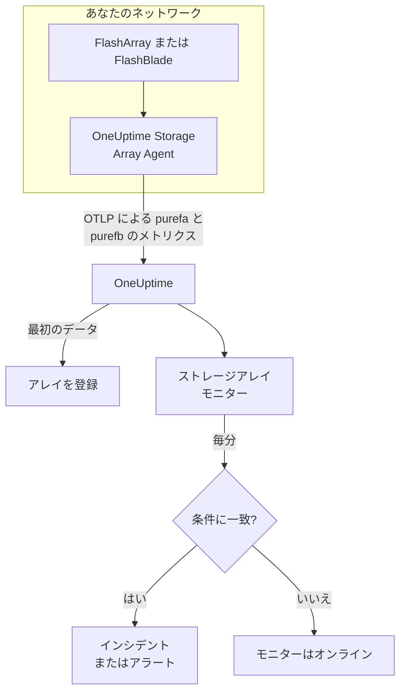

# ストレージアレイ モニター

ストレージアレイ モニターは 1 つのストレージアレイを監視し、アレイ自体がアラートを上げたとき、容量が足りなくなったとき、遅くなったとき、ハードウェアやホストのパスを失ったとき、レプリケーションが遅れたときに知らせます。Pure Storage FlashArray、Pure Storage FlashBlade、NetApp ONTAP (Amazon FSx for NetApp ONTAP を含む) に対応し、OneUptime Storage Array Agent が収集するメトリクスを読み取ります。Pure の `purefa_*` と `purefb_*` のシリーズ、そして NetApp Harvest が ONTAP クラスターから読み取る `netapp_*` のシリーズです。

Dell PowerStore (`dell.powerstore`) にも、Dell の `powerstore_*` シリーズから対応します。

:::cards
- [モニターを作成する](#ストレージアレイ-モニターを作成する): ダッシュボードでの六つのステップ。
- [テンプレート](#組み込みのアラートテンプレート): 組み込みのアラート。ボリューム、ホスト、アプライアンス、コンポーネントごとに一つのインシデント。
- [Pure のシリーズの仕組み](#pure-のシリーズの形): 一つのメトリクス名に、多くの値。ONTAP のシリーズには [専用のセクション](#ontap-のシリーズの形) があります。
- [メトリクス](#収集されるメトリクス): モニターがアラートを出せるすべてのシリーズ。
:::

## 仕組み

OneUptime Storage Array Agent は、アレイの管理インターフェイスに到達できるマシンで動作します。読み取り専用の API トークンでアレイのメトリクスを読み取り、アレイの名前 `storage.array.name` とプラットフォーム `storage.system` のラベルを付けて、OTLP で OneUptime に送信します。最初のデータでアレイが登録されます。

Dell PowerMax にはエージェントが不要です。OneUptime のプローブが 5 分ごとに読み取り専用アカウントで Unisphere for PowerMax にログインし、Unisphere が管理するすべてのアレイを同じように送信します。アレイの名前は、変更するまで Symmetrix ID になります ([Dell PowerMax](/docs/telemetry/storage-arrays#dell-powermax))。

ストレージアレイ モニターは 1 つのアレイに結び付いています。毎分、そのアレイのメトリクスに対してクエリを実行し、結果を条件と比較します。



## 始める前に

- **Storage Array Agent をインストールします**。HTTPS でアレイに到達できる場所に、アレイの **readonly** ロールを持つユーザーの API トークンを使ってインストールします。[Storage Array Agent のガイド](/docs/telemetry/storage-arrays) では、ユーザー、トークン、インストールを、`ONEUPTIME_URL`、`ONEUPTIME_TELEMETRY_INGESTION_KEY`、`STORAGE_ARRAY_NAME`、アレイのアドレスとトークン (`PURE_FA_ENDPOINT` と `PURE_FA_API_TOKEN`、または `PURE_FB_ENDPOINT` と `PURE_FB_API_TOKEN`)、ONTAP ではクラスターのアドレスと読み取り専用の REST ユーザー (`NETAPP_ONTAP_ENDPOINT`、`NETAPP_ONTAP_USERNAME`、`NETAPP_ONTAP_PASSWORD`) とともに説明しています。
- **アレイが登録されていることを確認します。** 最初の読み取りから約 1 分後に、エージェントの `STORAGE_ARRAY_NAME` の名前で **製品 → インフラストラクチャ → ストレージアレイ → すべてのストレージアレイ** に表示されます。
- **Dell PowerMax の場合**、代わりにそのアレイを管理する Unisphere for PowerMax を **製品 → インフラストラクチャ → ストレージアレイ → 接続** で接続します。詳しくは [Dell PowerMax](/docs/telemetry/storage-arrays#dell-powermax) を参照してください。

## ストレージアレイ モニターを作成する

:::steps
### 新しいモニターを開始する

**モニター** に移動し、**モニターを作成** をクリックします。

### ストレージアレイを選ぶ

**モニターの種類** で **その他のモニターの種類** をクリックし、**インフラストラクチャ** の下の **ストレージアレイ** を選ぶか、検索ボックスに `storage` と入力します。**名前** を入力し (インシデントとアラートのタイトルに使われます)、**次へ** をクリックします。

### アレイを選ぶ

**Storage Array Monitor Configuration** で、**ストレージアレイ** からアレイを選びます。データを送信したことのあるアレイはすべて一覧にあります。アレイのプラットフォームによって、フォームが提示するメトリクスとテンプレートが決まります。選ぶと、フィールドの下の行にデータが届いているかどうかが表示されます。**ストレージアレイを追加** を押すと、キーが入力済みのセットアップ手順が開き、最初のデータを待ちます。

### 監視する内容を選ぶ

新しいモニターは **アラートの対象** の **Array Stopped Reporting** から始まります。ほかのものを監視するには、次のいずれかを使います。

- **変更**: 別の [テンプレート](#組み込みのアラートテンプレート) を選びます。テンプレートはメトリクス、ラベルフィルター、集計、時間範囲、しきい値を設定し、下の条件を自分のものに置き換えます。**時間範囲** は後からでも変更できます。
- **Custom Metric**（**その他の項目** 内）: **Storage Array Metric** から 1 つのメトリクスを選び、**集計** と **時間範囲** を設定します。[フィルター](#モニターの設定) で、1 つのボリューム、ホスト、Pod、コンポーネント、ファイルシステム、バケットに絞り込めます。
- **詳細**（**その他の項目** 内）: **メトリクスを選択** でクエリと数式を自分で組み立てます。たとえば使用済み容量は、`purefa_array_space_bytes` を `space=capacity` に絞り込んだものから、同じメトリクスを `space=empty` に絞り込んだものを引いて求めます。オブジェクトのラベルで **グループ化** すると、各オブジェクトを個別に判定できます。

### 条件を確認する

**条件** の各条件を開き、**メトリクス**、**集計**、**条件**、**しきい値** を確認します。テンプレートを使うと、これらは自動で入力されます。**Custom Metric** や **詳細** では、モニターは [デフォルトの条件](#デフォルトの条件) から始まります。これはメトリクスがデータを送らなくなったことしか検知しないため、自分のしきい値を設定してください。

### モニターを作成する

**モニターを作成** をクリックします。OneUptime がモニターのページを開き、毎分評価します。モニターが上げたインシデントとアラートは、アレイの **インシデント** と **アラート** のページにも一覧表示されます。
:::

> [!TIP]
> 複数のテンプレートを一度に設定するには、**製品 → インフラストラクチャ → ストレージアレイ** からアレイを開き、**推奨事項** に移動します。必要なテンプレートを選び、呼び出す相手を選ぶと、OneUptime がテンプレートごとに 1 つのモニターを作成します。

## モニターの設定

| フィールド | タブ | 動作 |
| --- | --- | --- |
| **ストレージアレイ** | すべて | 必須。すべてのクエリを `resource.storage.array.name` に限定するため、どちらも `vol-01` という名前のボリュームを持つ 2 つのアレイが混ざることはありません。 |
| **ボリューム** | Custom Metric、詳細 | 1 つのボリューム。FlashArray では `name` ラベルで指定します (`vol-db-01` など。Pod やボリュームグループ内のボリュームは `pod::volume` や `group/volume` という名前になります)。ONTAP では `volume` ラベルで指定し、このラベルは 2 つの SVM で同じになることがあります。 |
| **ホスト** | Custom Metric、詳細 | FlashArray のみ。アレイが認識している 1 つのホストを `host` ラベルで (`esxi-01` など)。 |
| **Pod** | Custom Metric、詳細 | FlashArray のみ。1 つの ActiveCluster または ActiveDR Pod を `name` ラベルで、レプリカリンクのシリーズでは `local_pod` で。 |
| **ハードウェアコンポーネント** | Custom Metric、詳細 | 1 つのハードウェアコンポーネント (`CH0.BAY1` や `CT0` など)。FlashArray では `component_name` ラベル、FlashBlade では `name`、ONTAP ではシリーズがそれを識別するラベル (`node`、`disk`、`shelf`、`port`)。 |
| **ファイルシステム** | Custom Metric、詳細 | FlashBlade のみ。`name` ラベルで 1 つのファイルシステム。 |
| **バケット** | Custom Metric、詳細 | FlashBlade のみ。`name` ラベルで 1 つのオブジェクトストアのバケット。 |
| **Storage Array Metric** | Custom Metric | [カタログ](#収集されるメトリクス) の 1 つのメトリクス。フォームはその意味を決めるラベルフィルターを追加し、説明するオブジェクトでグループ化するため、各ボリューム、ホスト、コンポーネントが個別に判定されます。 |
| **集計** | Custom Metric | サンプルの組み合わせ方: **平均**、**最大**、**最小**、**合計**、**カウント**。メトリクスの通常の集計から始まります。 |
| **時間範囲** | すべて | クエリが読み取る移動ウィンドウ。**Past 1 Minute** から **Past 365 Days** まで。新しいモニターは **過去 5 分** から、ファイルシステムやバケットのカスタムメトリクスは **過去 15 分** から始まります。テンプレートは独自の値を設定します。 |
| **メトリクスを選択** | 詳細 | クエリビルダー: **メトリクス**、**集計の基準**、**属性で絞り込み**、**グループ化**、さらにクエリを組み合わせる **メトリクスを追加** と **数式を追加**。 |

エージェントはアレイのエンドポイントを 60 秒ごとに、ボリューム、ホスト、Pod を 2 分ごとに読み取るため、5 分のウィンドウには必ずサンプルがあります。FlashBlade のファイルシステムとバケットは 5 分ごと (そのため 15 分)、FlashArray のディレクトリは 30 分ごとに読み取ります。ディレクトリのモニターには 60 分のウィンドウを指定してください。ONTAP では、Harvest がクラスターのパフォーマンスを毎分、構成、状態、EMS イベントを 3 分ごとに読み取るため、5 分のウィンドウには必ずサンプルがあります。

PowerStore は 5 分ごとに、そのクラスターの状態は 60 秒ごとに読み取ります。PowerStore のモニターには 15 分のウィンドウを設定してください。

## Pure のシリーズの形

Pure は **1 つの** メトリクス名に複数の値を載せ、ラベルで区別します。

- **`dimension`** (パフォーマンスのシリーズ)。`purefa_array_performance_latency_usec` は、読み取りレイテンシ (`usec_per_read_op`)、書き込みレイテンシ (`usec_per_write_op`)、ミラー書き込みのレイテンシ、そしてそれぞれの SAN、キュー、QoS、サービスの時間を持ちます。常に 1 つの `dimension` で絞り込んでください。これらをまたいで平均すると、200 µs の読み取りレイテンシとキューの値が混ざります。
- **`space`** (容量のシリーズ): `capacity`、`empty`、`snapshots`、`total_provisioned`、`total_physical`、`available_ratio` など。

いくつかのシリーズは状態を **ラベル** に持ち、値は常に 1 です。

| シリーズ | 状態のラベル | 1 シリーズの単位 |
| --- | --- | --- |
| `purefa_alerts_open` | `severity` (`summary`、`code`、`component_type` 付き) | オープンなアラート |
| `purefa_hw_component_status` | `component_status` | ハードウェアコンポーネント |
| `purefa_host_connectivity_info` | `status` (`details` 付き) | ホスト |
| `purefa_drive_capacity_bytes` | `component_status` (値はドライブの容量) | ドライブ |

悪い状態に絞り込んだシリーズは、何かがその状態にある間しか存在しないため、シリーズがないことは正常を意味します。だからこそ **0 を超える最大値で発火し、0 で回復する** という形が適しており、テンプレートもそのように作られています。回復の条件は、シリーズがないことをゼロとして数えます。シリーズがまったく残っていない場合、このようなテンプレートは同じウィンドウ内に `purefa_info`、`purefb_info`、または `powermax_array_info` が届いたときにだけ回復するので、報告を止めたアレイは何も閉じません。

PowerMax のシリーズはそれぞれ単一の値を持ち、その値にちなんだ名前が付いています。`powermax_array_response_time_usec` は `operation` で読み取りと書き込みを区別します。状態を表すシリーズも同様に、何か問題がある間だけ存在します。`powermax_alert_open` は Unisphere にオープンなアラートがある間、`powermax_director_offline` はディレクターがオンラインでない間、`powermax_port_offline` は誰かが利用しているポートがダウンしている間、`powermax_srdf_group_not_healthy` は SRDF グループが一時停止またはオフラインの間に存在します。

モニターのフィルターとグループ化のキーでは、エージェントの属性は `resource.` で始まり (`resource.storage.array.name`、`resource.storage.system`)、Pure 自身のラベルはそうではありません (`name`、`host`、`component_name`、`dimension`、`space`、`severity`)。PowerMax のラベルも同様です (`storage_group`、`volume`、`director`、`port_id`、`srdf_group`)。

## PowerStore のシリーズの形

Dell のエクスポーターはメトリクス名ごとに 1 つの値を書き込むため、PowerStore のシリーズにラベルフィルターは不要です。ラベルがオブジェクトを示します。`appliance_id` はアプライアンス、`name` はパーツ、ボリューム、ファイルシステム、`volume_id`、`fc_port_id`、`eth_port_id`、`nas_id`、`volume_group_id` はパフォーマンスシリーズのオブジェクトです。状態シリーズは正常な間は 1、それ以外は 0 なので、テンプレートは 1 未満で発火します。PowerStore 自身のアラートは syslog で届き、そのテンプレート (ログモニター) は下の表の後に記載しています。

## ONTAP のシリーズの形

NetApp Harvest は各シリーズに `netapp_<object>_<counter>` という名前を付け、オブジェクトをラベルで識別します。ボリュームは `volume` (その `svm` 内で)、アグリゲートは `aggr`、LUN は `lun` (その `volume` と `svm` 内で)、ノードは `node`、ディスクは `disk`、シェルフは `shelf`、SnapMirror 関係は `destination_location` です。レイテンシは 1 操作あたりのマイクロ秒、`_ops` は 1 秒あたりの操作数、`_data` は 1 秒あたりのバイト数です。

ONTAP の状態は 3 つの形で表されます。

| シリーズ | 状態 | 1 シリーズの単位 |
| --- | --- | --- |
| `netapp_*_new_status` | 1 は正常、オンライン、アップ、実行中、0 はそれ以外 | オブジェクト (ポーリングのたびに) |
| `netapp_health_*_alerts` | 値は 1。`severity` (`error` または `warning`) と理由をラベルに持ちます | 未解決の問題: 破損したディスク、シェルフの障害、パートナーをテイクオーバーできないノード、ダウンしたポート、システムヘルスアラート |
| `netapp_ems_events` | 値は 1。`message`、`severity`、イベントのパラメーターを持ちます | EMS イベント (それを収集した 1 回のポーリングの間だけ)。対になるイベントが解消されると、もう一度 0 としてエクスポートされます |

数値で表される状態は、ウィンドウ内のすべての読み取り値が 1 を下回ると発火し、読み取り値が再び 1 になると回復します。未解決の問題は、そのシリーズがある間は発火し、なくなると回復します。ただし `netapp_cluster_new_status` が届き続けている場合に限るため、停止したエージェントは何も閉じません。EMS イベントは 1 回の読み取りで発火し、テンプレートの 1 時間のウィンドウにある間は開いたままです。次のイベントがないまま 1 時間が過ぎると回復します。

## 組み込みのアラートテンプレート

OneUptime には 80 個のテンプレートがあり (FlashArray 用が 12 個、FlashBlade 用が 8 個、PowerStore 用が 16 個、ONTAP 用が 31 個、PowerMax 用が 13 個)、**アラートの対象** の一覧はアレイのプラットフォームに合うものを提示します。各テンプレートは完全なモニターを作ります。メトリクスのクエリ、そのラベルフィルター、オブジェクト自身のラベルによるグループ化、発火する条件と回復する条件です。しきい値は編集できる出発点です。

条件は、ウィンドウ内の **すべての** 値で条件が成り立つときだけ発火します。ただし ONTAP の EMS テンプレートは例外です。Harvest はイベントを 1 回のポーリングの間しかエクスポートしないため、読み取り値は 1 つで足ります。容量、レイテンシ、遅延、比率のしきい値で発火したモニターは、しきい値から 10% 離れて初めて回復するため、しきい値付近を行き来する値で状態がばたつくことはありません。アラート、ハードウェア、接続のテンプレートは、状態が 5 分間のウィンドウ全体で見えたときに発火し、状態が解消されてから約 5 分後に回復します。

### FlashArray

| テンプレート | カテゴリ | 重大度 | 監視対象 | 発火する条件 |
| --- | --- | --- | --- | --- |
| Array Stopped Reporting | 可用性 | 重大 | `purefa_info`、Count、過去 10 分 | ウィンドウ全体でデータがない — Storage Array Agent が停止した、OneUptime への経路を失った、トークンが取り消された、またはアレイがエージェントに応答しなくなった。データが再び届くと回復 |
| Critical Array Alert | アレイのヘルス | 重大 | `purefa_alerts_open` を `severity=critical` に絞り込み、`summary` ごとに Max、過去 5 分 | > 0 — アレイにオープンな重大アラートがある (故障したコンポーネント、容量の緊急事態、レプリケーションの失敗)。アラートごとに一つのインシデント。アラートが閉じると回復 |
| Warning Array Alert | アレイのヘルス | 警告 | `purefa_alerts_open` を `severity=warning` に絞り込み、`summary` ごとに Max、過去 5 分 | > 0 — アレイにオープンな警告アラートがある。アラートごとに一つのインシデント。アラートが閉じると回復 |
| Capacity Above 80% | 容量 | 警告 | `purefa_array_space_utilization`、Max、過去 15 分 | > 80 — Pure 自身の最初の容量しきい値。≤ 72 で回復 |
| Capacity Above 90% | 容量 | 重大 | `purefa_array_space_utilization`、Max、過去 5 分 | > 90 — アレイが書き込みを拒否する寸前。≤ 81 で回復 |
| High Read Latency | パフォーマンス | 警告 | `purefa_array_performance_latency_usec` を `dimension=usec_per_read_op` に絞り込み、Avg、過去 10 分 | > 5000 µs (5 ms) — FlashArray の読み取りは通常 1 ms を大きく下回る。≤ 4500 で回復 |
| High Write Latency | パフォーマンス | 警告 | `purefa_array_performance_latency_usec` を `dimension=usec_per_write_op` に絞り込み、Avg、過去 10 分 | > 5000 µs (5 ms)。≤ 4500 で回復 |
| Hardware Component Failed | ハードウェア | 重大 | `purefa_hw_component_status` を `component_status=critical` に絞り込み、`component_name` ごとに Max、過去 5 分 | > 0 — コントローラー、電源、ファン、ベイ、ポートが重大な状態で、冗長性が失われている。コンポーネントごとに一つのインシデント。ok を報告すると回復 |
| Hardware Component Degraded | ハードウェア | 警告 | `purefa_hw_component_status` を `component_status=degraded` に絞り込み、`component_name` ごとに Max、過去 5 分 | > 0 — コンポーネントが劣化している。コンポーネントごとに一つのインシデント。ok を報告すると回復 |
| Drive Failed | ハードウェア | 重大 | `purefa_drive_capacity_bytes` を `component_status=failed` に絞り込み、`component_name` ごとに Max、過去 5 分 | > 0 — DirectFlash モジュールまたは SSD が故障し、アレイが残りのドライブに再構築している。ドライブごとに一つのインシデント。交換されると回復 |
| Host Lost Redundant Paths | ホスト | 警告 | `purefa_host_connectivity_info` を `status=critical` に絞り込み、`host` ごとに Max、過去 5 分 | > 0 — ホストが一つのコントローラー経由でしかアレイに到達できない、またはまったく到達できない。コントローラーのフェイルオーバーでストレージがオフラインになる。ホストごとに一つのインシデント。パスが戻ると回復 |
| Replication Lag Above 1 Minute | レプリケーション | 警告 | `purefa_pod_replica_links_lag_max_msec`、`local_pod` ごとに Max、過去 10 分 | > 60000 ms (60 s) — 今フェイルオーバーすると、計画以上に最近の書き込みが失われる。Pod ごとに一つのインシデント。≤ 54000 で回復 |

### FlashBlade

| テンプレート | カテゴリ | 重大度 | 監視対象 | 発火する条件 |
| --- | --- | --- | --- | --- |
| Array Stopped Reporting | 可用性 | 重大 | `purefb_info`、Count、過去 10 分 | ウィンドウ全体でデータがない — エージェント、そのエクスポーター、または FlashBlade が応答しなくなった。データが再び届くと回復 |
| Critical Array Alert | アレイのヘルス | 重大 | `purefb_alerts_open` を `severity=critical` に絞り込み、`summary` ごとに Max、過去 5 分 | > 0 — FlashBlade にオープンな重大アラートがある。アラートごとに一つのインシデント。アラートが閉じると回復 |
| Warning Array Alert | アレイのヘルス | 警告 | `purefb_alerts_open` を `severity=warning` に絞り込み、`summary` ごとに Max、過去 5 分 | > 0 — FlashBlade にオープンな警告アラートがある。アラートごとに一つのインシデント。アラートが閉じると回復 |
| Capacity Above 80% | 容量 | 警告 | `purefb_array_space_utilization` を `type=array` に絞り込み、Max、過去 15 分 | > 80。≤ 72 で回復 |
| Capacity Above 90% | 容量 | 重大 | `purefb_array_space_utilization` を `type=array` に絞り込み、Max、過去 5 分 | > 90 — いっぱいになると、すべてのクライアントで書き込みが失敗する。≤ 81 で回復 |
| Hardware Component Unhealthy | ハードウェア | 重大 | `purefb_hardware_health`、`name` ごとに Min、過去 5 分 | < 1 — ブレード、ファブリックモジュール、電源、ファンが正常でない (未使用のスロットは 2 を報告する)。コンポーネントごとに一つのインシデント。≥ 1 で回復 |
| High Read Latency | パフォーマンス | 警告 | `purefb_array_performance_latency_usec` を `dimension=usec_per_read_op` と `protocol=all` に絞り込み、Avg、過去 10 分 | > 10000 µs (10 ms)、全プロトコル。≤ 9000 で回復 |
| File System Near Full | ファイルシステム | 警告 | `purefb_file_systems_space_bytes` を `space=available_ratio` に絞り込み、`name` ごとに Min、過去 15 分 | < 0.1 — ファイルシステムのプロビジョニング済みサイズの残りが 10% 未満。ファイルシステムごとに一つのインシデント。≥ 0.11 で回復 |

### PowerStore

| テンプレート | カテゴリ | 重大度 | 監視対象 | 発火する条件 |
| --- | --- | --- | --- | --- |
| Array Stopped Reporting | 可用性 | 重大 | `powerstore_cluster`、Count、過去 10 分 | ウィンドウ全体でデータがない — エージェント、Dell のエクスポーター、またはクラスターが応答しなくなった。データが再び届くと回復 |
| Capacity Above 80% | 容量 | 警告 | `powerstore_cap_physical_used_percent`、`appliance_id` ごとに Max、過去 15 分 | > 80 — アプライアンスの容量が埋まりつつある。≤ 72 で回復 |
| Capacity Above 90% | 容量 | 重大 | `powerstore_cap_physical_used_percent`、`appliance_id` ごとに Max、過去 15 分 | > 90 — アプライアンスが書き込みを拒否する寸前。≤ 81 で回復 |
| High Read Latency | パフォーマンス | 警告 | `powerstore_perf_avg_read_latency`、`appliance_id` ごとに Avg、過去 15 分 | > 5000 µs (5 ms)。≤ 4500 で回復 |
| High Write Latency | パフォーマンス | 警告 | `powerstore_perf_avg_write_latency`、`appliance_id` ごとに Avg、過去 15 分 | > 5000 µs (5 ms)。≤ 4500 で回復 |
| Drive Failed | ハードウェア | 重大 | `powerstore_hardware_Drive_state`、`name` ごとに Min、過去 10 分 | < 1 — ドライブが故障したか取り外された。≥ 1 で回復 |
| Node Unhealthy | ハードウェア | 重大 | `powerstore_hardware_node_state`、`name` ごとに Min、過去 10 分 | < 1 — ノードが Healthy ではない。≥ 1 で回復 |
| Power Supply Unhealthy | ハードウェア | 警告 | `powerstore_hardware_Power_Supply_state`、`name` ごとに Min、過去 10 分 | < 1 — 電源装置が故障したか電源を失った。≥ 1 で回復 |
| Fan Unhealthy | ハードウェア | 警告 | `powerstore_hardware_Fan_state`、`name` ごとに Min、過去 10 分 | < 1 — ファンが故障した。≥ 1 で回復 |
| Battery Unhealthy | ハードウェア | 警告 | `powerstore_hardware_Battery_state`、`name` ごとに Min、過去 10 分 | < 1 — バッテリーバックアップモジュールに障害が発生した。≥ 1 で回復 |
| Drive Wearing Out | ハードウェア | 警告 | `powerstore_wear_metrics_by_drive`、`name` ごとに Min、過去 15 分 | < 10 — ドライブの耐久性の残りが 10% 未満。≥ 11 で回復 |
| NAS Server Not Started | ファイルシステム | 警告 | `powerstore_nas_server_operational_status`、`name` ごとに Max、過去 10 分 | < 1 — NAS サーバーが停止しているか劣化している。≥ 1 で回復 |
| Volume Not Ready | アレイのヘルス | 警告 | `powerstore_volume_state`、`name` ごとに Max、過去 15 分 | < 1 — ボリュームがオフライン。≥ 1 で回復 |
| File System Near Full | ファイルシステム | 警告 | `powerstore_filesystem_logical_used_percent`、`name` ごとに Max、過去 15 分 | > 90 — ファイルシステムがほぼ満杯。≤ 81 で回復 |
| Cluster Not Configured | アレイのヘルス | 警告 | `powerstore_cluster`、Max、過去 10 分 | < 1 — クラスターが Configured ではない。≥ 1 で回復 |
| Metro Witness Not Connected | レプリケーション | 警告 | `powerstore_metro_witness_status`、`name` ごとに Min、過去 10 分 | > 0 — Metro Witness が接続されていない。再び OK になると回復 |

### syslog による PowerStore のアラート

PowerStore 自身のアラートはログとして届くため、そのテンプレートは **ログ** モニターで、アレイの **推奨事項** ページの **アレイのアラート** に表示されます。それぞれが PowerStore のアラートごとに一つのアラートを開き、`powerstore.resource.name` と `powerstore.alert.id` でグループ化し、PowerStore がそのアラートをクリアすると解決します:

| テンプレート | 重大度 | 開く行の内容 | 解決する行の内容 |
| --- | --- | --- | --- |
| Critical Array Alert | 重大 | `powerstore.alert.severity=Critical` | `powerstore.alert.state=Cleared` |
| Major Array Alert | 警告 | `powerstore.alert.severity=Major` | `powerstore.alert.state=Cleared` |
| Port Link Down | 警告 | `powerstore.event.code=0x00307404` | `powerstore.alert.state=Cleared` |

### ONTAP

| テンプレート | カテゴリ | 重大度 | 監視対象 | 発火する条件 |
| --- | --- | --- | --- | --- |
| Array Stopped Reporting | 可用性 | 重大 | `netapp_cluster_new_status`、Count、過去 10 分 | ウィンドウ全体でデータがない — エージェントか Harvest が停止した、またはクラスターが Harvest に応答しなくなった。データが再び届くと回復 |
| Cluster Not Healthy | アレイのヘルス | 警告 | `netapp_cluster_new_status`、Max、過去 10 分 | < 1 — ONTAP がクラスターを正常でないと報告している。≥ 1 で回復 |
| System Health Alert | アレイのヘルス | 警告 | `netapp_health_support_alerts`、`name` ごとに Max、過去 5 分 | > 0 — ONTAP のシステムヘルスモニターがアラートを上げた (シェルフへのパスの欠落、ノードの接続の問題)。アラートごとに一つのインシデント。ONTAP が解消すると回復 |
| Emergency EMS Event | アレイのヘルス | 重大 | `netapp_ems_events` を `severity=emergency` に絞り込み、`message` ごとに Max、過去 1 時間、いずれかの値 | > 0 — ONTAP が emergency のイベントを記録した。イベントごとに一つのインシデント。次のイベントがないまま 1 時間が過ぎると回復 |
| Alert EMS Event | アレイのヘルス | 重大 | `netapp_ems_events` を `severity=alert` に絞り込み、`message` ごとに Max、過去 1 時間、いずれかの値 | > 0 — ONTAP が alert のイベントを記録した (ファンの故障など)。次のイベントがないまま 1 時間が過ぎると回復 |
| Disk Out of Service | ハードウェア | 警告 | `netapp_ems_events` を `message=disk.outOfService` に絞り込み、`disk` ごとに Max、過去 1 時間、いずれかの値 | > 0 — ONTAP がディスクをサービスから外した。次のイベントがないまま 1 時間が過ぎると回復 |
| Node Panic | ハードウェア | 重大 | `netapp_ems_events` を `message=sk.panic` に絞り込み、`node` ごとに Max、過去 1 時間、いずれかの値 | > 0 — ノードがパニックを起こして再起動し、パートナーがそのストレージをテイクオーバーした。次のイベントがないまま 1 時間が過ぎると回復 |
| Aggregate Above 80% | 容量 | 警告 | `netapp_aggr_space_used_percent`、`aggr` ごとに Max、過去 15 分 | > 80。≤ 72 で回復 |
| Aggregate Above 90% | 容量 | 重大 | `netapp_aggr_space_used_percent`、`aggr` ごとに Max、過去 5 分 | > 90 — その上のボリュームはこれ以上拡張できない。≤ 81 で回復 |
| Volume Above 90% | 容量 | 警告 | `netapp_volume_size_used_percent`、`volume` と `svm` ごとに Max、過去 15 分 | > 90。≤ 81 で回復 |
| Volume Above 98% | 容量 | 重大 | `netapp_volume_size_used_percent`、`volume` と `svm` ごとに Max、過去 5 分 | > 98 — クライアントに容量不足のエラーが返り、その中の LUN がオフラインになることがある。≤ 88.2 で回復 |
| High Read Latency | パフォーマンス | 警告 | `netapp_cluster_read_latency`、Avg、過去 15 分 | > 10000 µs (10 ms)。≤ 9000 で回復 |
| High Write Latency | パフォーマンス | 警告 | `netapp_cluster_write_latency`、Avg、過去 15 分 | > 10000 µs (10 ms)。≤ 9000 で回復 |
| Volume Latency Above 20 ms | パフォーマンス | 警告 | `netapp_volume_read_latency`、`volume` と `svm` ごとに Avg、過去 15 分 | > 20000 µs。≤ 18000 で回復 |
| Node Not Healthy | ハードウェア | 重大 | `netapp_node_new_status`、`node` ごとに Max、過去 10 分 | < 1 — ONTAP がノードを正常でないと報告している。≥ 1 で回復 |
| Takeover Not Possible | ハードウェア | 重大 | `netapp_health_ha_alerts`、`node` ごとに Max、過去 5 分 | > 0 — ノードが HA パートナーをテイクオーバーできないため、障害が起きるとパートナーのストレージがオフラインになる。再びテイクオーバーできるようになると回復 |
| Disk Failed | ハードウェア | 重大 | `netapp_health_disk_alerts` を `container_type=broken` に絞り込み、`disk` ごとに Max、過去 5 分 | > 0 — ディスクが破損している。交換されると回復 |
| Shelf Fault | ハードウェア | 重大 | `netapp_health_shelf_alerts` を `severity=error` に絞り込み、`shelf` ごとに Max、過去 5 分 | > 0 — ONTAP がディスクシェルフのエラー (電源装置、モジュール、パス) を報告している。ONTAP が解消すると回復 |
| Node Fan Failed | ハードウェア | 警告 | `netapp_node_failed_fan`、`node` ごとに Max、過去 10 分 | > 0 個の故障したファン。≤ 0 で回復 |
| Node Power Supply Failed | ハードウェア | 重大 | `netapp_node_failed_power`、`node` ごとに Max、過去 10 分 | > 0 個の故障した電源装置。≤ 0 で回復 |
| Shelf Power Supply Failed | ハードウェア | 重大 | `netapp_shelf_psu_status`、`shelf` ごとに Max、過去 10 分 | < 1 — シェルフの電源装置が正常でない。≥ 1 で回復 |
| Shelf Fan Failed | ハードウェア | 警告 | `netapp_shelf_fan_status`、`shelf` ごとに Max、過去 10 分 | < 1 — シェルフのファンが正常でない。≥ 1 で回復 |
| Ethernet Port Down | ハードウェア | 警告 | `netapp_health_network_ethernet_port_alerts`、`port` と `node` ごとに Max、過去 5 分 | > 0 — 有効な Ethernet ポートがダウンしている。リンクが再びアップすると回復 |
| FC Port Link Failures | ハードウェア | 警告 | `netapp_fcp_link_failure`、`port` と `node` ごとに Max、過去 15 分 | > 0 — Fibre Channel ポートのリンクがウィンドウ内で障害を起こした。≤ 0 で回復 |
| SnapMirror Behind Schedule | レプリケーション | 警告 | `netapp_snapmirror_lag_time` を `netapp_snapmirror_schedule_seconds` で割った値、`destination_location` ごとに Max、過去 15 分 | > 1.5 — 関係がスケジュール間隔の 1.5 倍を超えて遅れている (1 時間ごとの関係なら 90 分)。≤ 1.35 で回復 |
| SnapMirror Relationship Unhealthy | レプリケーション | 重大 | `netapp_snapmirror_labels` を `healthy=false` に絞り込み、`destination_location` ごとに Max、過去 5 分 | > 0 — ONTAP が関係を異常と報告している。理由は `unhealthy_reason` ラベルにある。ONTAP が正常と報告すると回復 |
| SnapMirror Lag Above 1 Day | レプリケーション | 警告 | `netapp_snapmirror_lag_time`、`destination_location` ごとに Max、過去 15 分 | > 86400 s (スケジュールにかかわらず)。≤ 77760 で回復 |
| Aggregate Offline | 可用性 | 重大 | `netapp_aggr_new_status`、`aggr` ごとに Max、過去 10 分 | < 1 — アグリゲートがオンラインでないため、そのボリュームのどれにも到達できない。≥ 1 で回復 |
| Volume Offline | 可用性 | 警告 | `netapp_volume_new_status`、`volume` と `svm` ごとに Max、過去 10 分 | < 1 — ボリュームがオンラインでない。≥ 1 で回復 |
| LUN Offline | 可用性 | 重大 | `netapp_lun_new_status`、`lun`、`volume`、`svm` ごとに Max、過去 10 分 | < 1 — LUN がオンラインでなく、ホストはそのディスクを失っている。≥ 1 で回復 |
| SVM Stopped | 可用性 | 警告 | `netapp_svm_labels` を `state=stopped` と `type=data` に絞り込み、`svm` ごとに Max、過去 10 分 | > 0 — データ SVM が停止している。再び実行されると回復。ONTAP が自身のために保持する SVM は監視されない |

### PowerMax

| テンプレート | カテゴリ | 重大度 | 監視対象 | 発火する条件 |
| --- | --- | --- | --- | --- |
| Array Stopped Reporting | 可用性 | 重大 | `powermax_array_info`、Count、過去 10 分 | ウィンドウ全体でデータがない — プローブがアレイの収集を停止した。接続が失敗している (**接続** の下にあるそのページに理由が表示される)、プローブが切断されている、または Unisphere がアレイを管理しなくなった。データが再び届くと回復 |
| Critical Unisphere Alert | アレイのヘルス | 重大 | `powermax_alert_open` を `severity=critical` に絞り込み、`description` ごとに Max、過去 10 分 | > 0 — Unisphere に、アレイについて重大度 Critical または Fatal のオープンなアラートがある。アラートごとに一つのインシデント。Unisphere でアラートが確認またはクリアされると回復 |
| Warning Unisphere Alert | アレイのヘルス | 警告 | `powermax_alert_open` を `severity=warning` に絞り込み、`description` ごとに Max、過去 10 分 | > 0 — Unisphere に重大度 Warning または Minor のオープンなアラートがある。アラートごとに一つのインシデント。アラートが確認またはクリアされると回復 |
| Performance Collection Off | アレイのヘルス | 警告 | `powermax_array_performance_collection`、Min、過去 15 分 | < 1 — Unisphere がアレイの 5 分間隔のパフォーマンスを収集していないため、レスポンスタイム、IOPS、スループットのグラフもアラートもない。≥ 1 で回復 |
| Storage Resource Pool Above 80% | 容量 | 警告 | `powermax_srp_capacity_used_percent`、`srp` ごとに Max、過去 15 分 | > 80 — プールがいっぱいになると、そのストレージグループは新しい書き込みを受け付けなくなる。プールごとに一つのインシデント。≤ 72 で回復 |
| Storage Resource Pool Above 90% | 容量 | 重大 | `powermax_srp_capacity_used_percent`、`srp` ごとに Max、過去 15 分 | > 90 — いっぱいになった時点で、そのストレージグループへの書き込みが失敗する。プールごとに一つのインシデント。≤ 81 で回復 |
| Storage Group Response Time Above 5 ms | パフォーマンス | 警告 | `powermax_storage_group_response_time_usec`、`storage_group` ごとに Avg、過去 15 分 | > 5000 µs (5 ms) — PowerMax の応答は通常、ミリ秒を大きく下回る。ストレージグループごとに一つのインシデント。≤ 4500 で回復 |
| High Read Response Time | パフォーマンス | 警告 | `powermax_array_response_time_usec` を `operation=read` に絞り込み、Avg、過去 15 分 | > 3000 µs (3 ms)。≤ 2700 で回復 |
| High Write Response Time | パフォーマンス | 警告 | `powermax_array_response_time_usec` を `operation=write` に絞り込み、Avg、過去 15 分 | > 3000 µs (3 ms) — 同期 SRDF では、すべての書き込みにリモートアレイとの往復が加わる。≤ 2700 で回復 |
| Director Not Online | ハードウェア | 重大 | `powermax_director_offline`、`component` ごとに Max、過去 10 分 | > 0 — ディレクターがオンラインでなく、アレイはほかのディレクターで動作している。ディレクターごとに一つのインシデント。再びオンラインになると回復 |
| Port Down | ハードウェア | 警告 | `powermax_port_offline`、`component` ごとに Max、過去 10 分 | > 0 — ポートグループ、マスキングビュー、または SRDF グループに属するポートが稼働していない。ポートごとに一つのインシデント。再び稼働すると回復 |
| SRDF Group Suspended or Offline | レプリケーション | 重大 | `powermax_srdf_group_not_healthy`、`srdf_group` ごとに Max、過去 10 分 | > 0 — グループのリンクがオフライン、またはペアが一時停止・分割・フェイルオーバーの状態で、リモートコピーが最新に保たれていない。グループごとに一つのインシデント。再び同期すると回復 |
| SRDF/A Lag Above 2 Minutes | レプリケーション | 警告 | `powermax_srdf_group_lag_seconds`、`srdf_group` ごとに Avg、過去 15 分 | > 120 (2 分) — 今フェイルオーバーすると、計画以上に最近の書き込みが失われる。グループごとに一つのインシデント。≤ 108 で回復 |

**重大度** はピッカーが表示するラベルです。テンプレートが作成するインシデントとアラートは、プロジェクトで最も重大なインシデントとアラートの重大度から始まります。条件の中で変更してください。

- **Array Stopped Reporting** は、プラットフォームの識別シリーズを数えます (`purefa_info` または `purefb_info`。エージェントが読み取るすべてのエンドポイントが読み取りのたびにエクスポートします。または `powermax_array_info`。PowerMax の収集のたびに書き込まれます)。データが途絶えると、ほかのテンプレートは比較するものがなくなって最後のステータスを保ったままになるため、それを知らせてくれるのはこのテンプレートです。
- **オープンなアラートとハードウェアの状態は Max を使います**。アラートがオープンな間、またはコンポーネントがその状態にある間しか存在しないシリーズなので、状態が 5 分間のウィンドウ全体で見えた時点でしきい値を超えます。
- **オブジェクトごとのテンプレートは、すべてオブジェクト自身のラベルでグループ化します** (`summary`、`component_name`、`host`、`local_pod`、`name`、PowerMax では `description`、`component`、`srp`、`srdf_group`、`storage_group`)。そのため、影響を受けたオブジェクトごとに一つのインシデントが発火し、インシデントはそのオブジェクトの名前を示します。
- **レイテンシのテンプレートは Avg を使います**。アレイ自身による操作あたりの平均値の Avg です。容量のテンプレートは、アレイ自身の使用率の **Max** を使います。レイテンシはマイクロ秒、容量はパーセントに固定されています。
- **Hardware Component Unhealthy はコンポーネントごとに Min を使います**。正常なときは 1、そうでないときは 0 に下がります。

FlashArray には、ボリュームごとのレイテンシのテンプレートはありません。適切なしきい値はワークロードによって異なるためです。カタログから `name` でグループ化して作成してください。容量の予測にはしきい値ではなく増加の傾向が必要で、ドライブの摩耗にはアラートを出せるシリーズがありません。

## 収集されるメトリクス

エージェントはアレイがエクスポートするすべてを、プローブは PowerMax から読み取るすべてを、同じ単位で送信します (Unisphere のミリ秒はマイクロ秒に、MB/秒はバイト/秒に換算)。以下のシリーズは、モニターのフォームが提示するカタログです。どの値もアレイ自身が計算したゲージで、レイテンシは操作あたりのマイクロ秒、スループットは 1 秒あたりの値なので、レートの計算は不要です。**フィルター** は、その行が示す意味をシリーズに与えるラベルフィルターで、フォームが自動で適用します。

### アレイのヘルス

| メトリクス | フィルター | プラットフォーム | 単位 | 説明 |
| --- | --- | --- | --- | --- |
| `purefa_alerts_open` | — | FlashArray | `count` | アレイのオープンなアラートごとに 1 シリーズ (値は 1)。ラベルは `severity` (`critical`、`warning`、`info`、`hidden`)、`category`、`code`、`component_type`、`summary` |
| `purefb_alerts_open` | — | FlashBlade | `count` | FlashBlade のオープンなアラートごとに 1 シリーズ (値は 1)。ラベルは `severity` (`info`、`warning`、`critical`)、`code`、`component_name`、`component_type`、`summary`、`kburl` (Pure のナレッジベースの記事) |
| `powerstore_cluster` | — | PowerStore | `count` | PowerStore クラスターが Configured (構成済みでサービス中) の間は 1、それ以外の状態 (Configuring、Expanding、Removing、Clustering_Failed、Unconfigured) では 0 です。 |
| `netapp_cluster_new_status` | — | ONTAP | — | ONTAP がクラスターを正常と報告している間は 1。エージェントがまだクラスターを読み取っていることを示すシリーズでもあります |
| `netapp_cluster_subsystem_outstanding_alerts` | — | ONTAP | `count` | ONTAP の各ヘルスサブシステムで開いているアラート (`subsystem` ごと) |
| `netapp_health_support_alerts` | — | ONTAP | `count` | ONTAP のシステムヘルスモニターが開いているアラートごとに 1 シリーズ (開いている間) |
| `netapp_ems_events` | — | ONTAP | `count` | EMS イベントごとに 1 シリーズ (それを収集したポーリングの間だけ)。対になるイベントが解消されると、もう一度 0 としてエクスポートされます |
| `powermax_alert_open` | — | PowerMax | `count` | Unisphere がアレイについて開いているアラートごとに 1 シリーズ (値は 1)。確認済みでなく、クリアされておらず、Minor 以上のものが対象です。severity ラベルは critical (Critical と Fatal) または warning (Warning と Minor) で、alert_type、object、description ラベルが内容を示します。Unisphere でアラートを確認すると、シリーズは消えます |
| `powermax_array_health_score` | — | PowerMax | `score` | Unisphere によるアレイのヘルススコア (0～100)。health_metric ごとに、全体と、評価する各領域 (容量、構成、パフォーマンス、サービスレベル準拠) の値があります |
| `powermax_array_performance_collection` | — | PowerMax | `count` | Unisphere がアレイの 5 分間隔のパフォーマンスデータを収集している間は 1、収集していない間は 0。オフの場合も OneUptime はアレイのインベントリとアラートを一覧表示しますが、パフォーマンスのグラフは描画しません。Unisphere の Settings > Performance > System Registrations でオンにしてください |

### 容量

| メトリクス | フィルター | プラットフォーム | 単位 | 説明 |
| --- | --- | --- | --- | --- |
| `purefa_array_space_utilization` | — | FlashArray | `%` | アレイの使用可能な容量のうち使用中の割合。Pure 自身が 80%、90%、100% で容量アラートを上げます |
| `purefa_array_space_bytes` | `space=capacity` | FlashArray | `bytes` | アレイの使用可能な容量 |
| `purefa_array_space_bytes` | `space=empty` | FlashArray | `bytes` | 未使用の容量。傾向を追うと、アレイがいっぱいになる時期を予測できます |
| `purefa_array_space_bytes` | `space=snapshots` | FlashArray | `bytes` | スナップショットだけが占める物理容量。急に増えたときは、たいてい保護グループが計画より多くのスナップショットを保持しています |
| `purefa_array_space_data_reduction_ratio` | — | FlashArray | `ratio` | アレイ全体の重複排除と圧縮 (例: 4.2:1 なら 4.2)。下がり続けるときは、新しいデータがうまく削減されていません |
| `purefb_array_space_utilization` | `type=array` | FlashBlade | `%` | FlashBlade の使用可能な容量のうち使用中の割合 |
| `purefb_array_space_bytes` | `type=array`、`space=empty` | FlashBlade | `bytes` | FlashBlade の未使用の容量 |
| `purefb_array_space_data_reduction_ratio` | `type=array` | FlashBlade | `ratio` | FlashBlade 全体のデータ削減 |
| `powerstore_cap_physical_used_percent` | — | PowerStore | `%` | 各アプライアンスの物理容量のうち使用中の割合 (パーセント) です。物理使用量を物理容量の合計で割ったもので、PowerStore の日次の容量集計に基づきます。PowerStore は 70% から独自の容量アラートを発生させます。appliance_id でグループ化してください。 |
| `powerstore_cap_last_physical_total` | — | PowerStore | `bytes` | 各アプライアンスの使用可能な物理容量 (バイト) です。 |
| `powerstore_cap_last_physical_used` | — | PowerStore | `bytes` | 各アプライアンスが使用する物理容量 (バイト) で、重複排除と圧縮の後の値です。傾向を追って、アプライアンスが満杯になる時期を予測してください。 |
| `powerstore_cap_last_logical_provisioned` | — | PowerStore | `bytes` | 各アプライアンスでプロビジョニングされた論理容量 (バイト) です。そこにあるすべてのボリューム、ファイルシステム、vVol のサイズの合計で、物理容量を大きく上回ることがあります。 |
| `powerstore_cap_last_logical_used` | — | PowerStore | `bytes` | ホストが各アプライアンスに書き込んだデータ (バイト) で、重複排除と圧縮の前の値です。 |
| `powerstore_cap_last_data_reduction` | — | PowerStore | `ratio` | 各アプライアンスでの重複排除と圧縮の効果で、たとえば 3.4:1 なら 3.4 です。継続的な低下は、新しく書き込まれたデータが削減されにくい (暗号化済みまたは圧縮済みのデータ) ことを意味します。 |
| `powerstore_cap_last_efficiency_ratio` | — | PowerStore | `ratio` | 各アプライアンスの全体的な効率です。データ削減に、スナップショットとシンプロビジョニングによる節約を合わせたものです。 |
| `netapp_aggr_space_used_percent` | — | ONTAP | `%` | 各アグリゲートの使用可能な領域のうち使用中の割合。`aggr` でグループ化します |
| `netapp_aggr_space_total` | — | ONTAP | `bytes` | 各アグリゲートの使用可能な領域。クラスターの容量はその合計です |
| `netapp_aggr_space_used` | — | ONTAP | `bytes` | 各アグリゲートで使用中または予約済みの領域 |
| `netapp_aggr_space_available` | — | ONTAP | `bytes` | 各アグリゲートに残っている領域。傾向を追うと、満杯になる時期を予測できます |
| `netapp_aggr_inode_used_percent` | — | ONTAP | `%` | 各アグリゲートのファイル (inode) のうち使用中の割合 |
| `netapp_aggr_new_status` | — | ONTAP | — | アグリゲートがオンラインの間は 1 |
| `netapp_aggr_logical_used_wo_snapshots_flexclones` | — | ONTAP | `bytes` | ストレージ効率がなかった場合に各アグリゲートのデータが占める量 (スナップショットと FlexClone を除く) |
| `netapp_aggr_physical_used_wo_snapshots_flexclones` | — | ONTAP | `bytes` | ストレージ効率の適用後に各アグリゲートのデータがディスク上で占める量 |
| `powermax_array_capacity_used_percent` | — | PowerMax | `%` | アレイのストレージリソースプール全体での、使用可能な容量のうち使用中の割合 (%) |
| `powermax_array_capacity_usable_bytes` | — | PowerMax | `bytes` | Unisphere が報告するアレイの使用可能な容量 (バイト) |
| `powermax_array_capacity_used_bytes` | — | PowerMax | `bytes` | アレイの使用可能な容量のうち使用中の容量 (バイト) |
| `powermax_array_capacity_subscribed_bytes` | — | PowerMax | `bytes` | アレイ上のすべてのシンボリュームの容量 (バイト)。ホストに約束した容量で、使用可能な容量を超えることがあります |
| `powermax_array_data_reduction_ratio` | — | PowerMax | `ratio` | ホストが書き込んだデータが、圧縮と重複排除の後に占める領域の何倍あるか (Unisphere の報告値) |
| `powermax_srp_capacity_used_percent` | — | PowerMax | `%` | srp ラベルごとの、各ストレージリソースプールの使用可能な容量のうち使用中の割合 (%)。プールがいっぱいになると、そのプール内のすべてのストレージグループで新しい書き込みを受け付けなくなります |
| `powermax_srp_capacity_used_bytes` | — | PowerMax | `bytes` | srp ラベルごとの、各ストレージリソースプールで使用中の使用可能な容量 (バイト) |

### パフォーマンス

| メトリクス | フィルター | プラットフォーム | 単位 | 説明 |
| --- | --- | --- | --- | --- |
| `purefa_array_performance_latency_usec` | `dimension=usec_per_read_op` | FlashArray | `µs` | ホストから見た読み取りの平均レイテンシ。FlashArray の読み取りは通常 1 ms を大きく下回ります |
| `purefa_array_performance_latency_usec` | `dimension=usec_per_write_op` | FlashArray | `µs` | ホストから見た書き込みの平均レイテンシ |
| `purefa_array_performance_latency_usec` | `dimension=usec_per_mirrored_write_op` | FlashArray | `µs` | ストレッチされた ActiveCluster Pod への書き込みの平均レイテンシ (パートナーアレイとの往復を含む) |
| `purefa_array_performance_latency_usec` | `dimension=san_usec_per_read_op` | FlashArray | `µs` | 読み取りが SAN で費やす時間。SAN のレイテンシが高くサービスのレイテンシが低い場合は、ファブリックかホストが原因です |
| `purefa_array_performance_throughput_iops` | `dimension=reads_per_sec` | FlashArray | `ops/s` | 1 秒あたりの読み取り操作数 |
| `purefa_array_performance_throughput_iops` | `dimension=writes_per_sec` | FlashArray | `ops/s` | 1 秒あたりの書き込み操作数 |
| `purefa_array_performance_bandwidth_bytes` | `dimension=read_bytes_per_sec` | FlashArray | `bytes/s` | 1 秒あたりの読み取りバイト数 |
| `purefa_array_performance_bandwidth_bytes` | `dimension=write_bytes_per_sec` | FlashArray | `bytes/s` | 1 秒あたりの書き込みバイト数 |
| `purefa_array_performance_queue_depth_ops` | — | FlashArray | `ops` | アレイ上のキューにある操作。レイテンシの上昇とともにキューが伸びるときは、ホストがアレイの処理能力を超えて送信しています |
| `purefa_array_performance_average_bytes` | `dimension=bytes_per_op` | FlashArray | `bytes` | 操作の平均サイズ。大きな I/O は、何も問題がなくてもレイテンシを上げます |
| `purefb_array_performance_latency_usec` | `dimension=usec_per_read_op`、`protocol=all` | FlashBlade | `µs` | 全プロトコルの読み取りの平均レイテンシ |
| `purefb_array_performance_latency_usec` | `dimension=usec_per_write_op`、`protocol=all` | FlashBlade | `µs` | 全プロトコルの書き込みの平均レイテンシ |
| `purefb_array_performance_throughput_iops` | `dimension=reads_per_sec`、`protocol=all` | FlashBlade | `ops/s` | 全プロトコルの 1 秒あたりの読み取り操作数 |
| `purefb_array_performance_throughput_iops` | `dimension=writes_per_sec`、`protocol=all` | FlashBlade | `ops/s` | 全プロトコルの 1 秒あたりの書き込み操作数 |
| `purefb_array_performance_bandwidth_bytes` | `dimension=read_bytes_per_sec`、`protocol=all` | FlashBlade | `bytes/s` | 全プロトコルの 1 秒あたりの読み取りバイト数 |
| `purefb_array_performance_bandwidth_bytes` | `dimension=write_bytes_per_sec`、`protocol=all` | FlashBlade | `bytes/s` | 全プロトコルの 1 秒あたりの書き込みバイト数 |
| `powerstore_perf_avg_read_latency` | — | PowerStore | `µs` | 各アプライアンスでの読み取りの平均レイテンシ (マイクロ秒) で、PowerStore の最新の 5 分間サンプルに基づきます。PowerStore の読み取りは通常 1 ms を大きく下回って完了します。 |
| `powerstore_perf_avg_write_latency` | — | PowerStore | `µs` | 各アプライアンスでの書き込みの平均レイテンシ (マイクロ秒) です。 |
| `powerstore_perf_avg_read_iops` | — | PowerStore | `ops/s` | 各アプライアンスでの 1 秒あたりの読み取り操作数です。 |
| `powerstore_perf_avg_write_iops` | — | PowerStore | `ops/s` | 各アプライアンスでの 1 秒あたりの書き込み操作数です。 |
| `powerstore_perf_avg_read_bandwidth` | — | PowerStore | `bytes/s` | 各アプライアンスでの 1 秒あたりの読み取りバイト数です。 |
| `powerstore_perf_avg_write_bandwidth` | — | PowerStore | `bytes/s` | 各アプライアンスでの 1 秒あたりの書き込みバイト数です。 |
| `powerstore_perf_avg_io_workload_cpu_utilization` | — | PowerStore | `%` | 各アプライアンスがストレージ I/O に割り当てている CPU コアのうち、ビジーな割合 (パーセント) です。高い値が続く場合、アプライアンスは処理できる負荷の上限に近づいています。 |
| `netapp_cluster_read_latency` | — | ONTAP | `µs` | クラスター全体の読み取りの平均レイテンシ |
| `netapp_cluster_write_latency` | — | ONTAP | `µs` | クラスター全体の書き込みの平均レイテンシ |
| `netapp_cluster_read_ops` | — | ONTAP | `ops/s` | クラスター全体の 1 秒あたりの読み取り操作数 |
| `netapp_cluster_write_ops` | — | ONTAP | `ops/s` | クラスター全体の 1 秒あたりの書き込み操作数 |
| `netapp_cluster_total_ops` | — | ONTAP | `ops/s` | クラスター全体の 1 秒あたりのすべての操作数 (メタデータを含む) |
| `netapp_cluster_read_data` | — | ONTAP | `bytes/s` | クラスター全体の 1 秒あたりの読み取りバイト数 |
| `netapp_cluster_write_data` | — | ONTAP | `bytes/s` | クラスター全体の 1 秒あたりの書き込みバイト数 |
| `netapp_aggr_read_latency` | — | ONTAP | `µs` | 各アグリゲートでの読み取りの平均レイテンシ |
| `netapp_aggr_write_latency` | — | ONTAP | `µs` | 各アグリゲートでの書き込みの平均レイテンシ |
| `netapp_aggr_read_ops` | — | ONTAP | `ops/s` | 各アグリゲートの 1 秒あたりの読み取り操作数 |
| `netapp_aggr_write_ops` | — | ONTAP | `ops/s` | 各アグリゲートの 1 秒あたりの書き込み操作数 |
| `netapp_svm_vol_read_latency` | — | ONTAP | `µs` | 各 SVM のボリュームでの読み取りの平均レイテンシ |
| `netapp_svm_vol_write_latency` | — | ONTAP | `µs` | 各 SVM のボリュームでの書き込みの平均レイテンシ |
| `netapp_svm_vol_read_ops` | — | ONTAP | `ops/s` | 各 SVM のボリュームの 1 秒あたりの読み取り操作数 |
| `netapp_svm_vol_write_ops` | — | ONTAP | `ops/s` | 各 SVM のボリュームの 1 秒あたりの書き込み操作数 |
| `netapp_svm_vol_read_data` | — | ONTAP | `bytes/s` | 各 SVM のボリュームから 1 秒あたりに読み取られたバイト数 |
| `netapp_svm_vol_write_data` | — | ONTAP | `bytes/s` | 各 SVM のボリュームに 1 秒あたりに書き込まれたバイト数 |
| `powermax_array_response_time_usec` | `operation=read` | PowerMax | `µs` | アレイでのホストの読み取りにかかる平均時間 (マイクロ秒)。Unisphere の直近 5 分間隔の値です (operation read) |
| `powermax_array_response_time_usec` | `operation=write` | PowerMax | `µs` | アレイでのホストの書き込みにかかる平均時間 (マイクロ秒)。Unisphere の直近 5 分間隔の値です (operation write) |
| `powermax_array_read_iops` | — | PowerMax | `ops/s` | アレイでの 1 秒あたりのホスト読み取り数。Unisphere のホスト IO 数に読み取りの割合を掛けた値です |
| `powermax_array_write_iops` | — | PowerMax | `ops/s` | アレイでの 1 秒あたりのホスト書き込み数。Unisphere のホスト IO 数に書き込みの割合を掛けた値です |
| `powermax_array_read_throughput_bytes` | — | PowerMax | `bytes/s` | ホストがアレイから読み取る 1 秒あたりのバイト数 |
| `powermax_array_write_throughput_bytes` | — | PowerMax | `bytes/s` | ホストがアレイに書き込む 1 秒あたりのバイト数 |
| `powermax_array_cache_hit_percent` | — | PowerMax | `%` | アレイがキャッシュから応答したホスト I/O の割合 (%) |
| `powermax_array_write_pending_percent` | — | PowerMax | `%` | アレイのキャッシュのうち、まだドライブにデステージされていない書き込みを保持している割合 (%)。アレイの上限に近づくと、ホストの書き込みが遅くなります |
| `powermax_array_frontend_busy_percent` | — | PowerMax | `%` | ホストを処理するディレクターのビジー率 (%) |
| `powermax_array_backend_busy_percent` | — | PowerMax | `%` | ドライブを処理するディレクターのビジー率 (%) |
| `powermax_array_srdf_busy_percent` | — | PowerMax | `%` | 他のアレイへ複製するディレクターのビジー率 (%) |
| `powermax_srp_response_time_usec` | — | PowerMax | `µs` | srp ラベルごとの、各ストレージリソースプールで I/O にかかる平均時間 (マイクロ秒) |

### ボリューム

| メトリクス | フィルター | プラットフォーム | 単位 | 説明 |
| --- | --- | --- | --- | --- |
| `purefa_volume_performance_latency_usec` | `dimension=usec_per_read_op` | FlashArray | `µs` | 各ボリュームの読み取りの平均レイテンシ。`name` でグループ化します |
| `purefa_volume_performance_latency_usec` | `dimension=usec_per_write_op` | FlashArray | `µs` | 各ボリュームの書き込みの平均レイテンシ |
| `purefa_volume_performance_throughput_iops` | `dimension=reads_per_sec` | FlashArray | `ops/s` | 各ボリュームの 1 秒あたりの読み取り操作数 |
| `purefa_volume_performance_throughput_iops` | `dimension=writes_per_sec` | FlashArray | `ops/s` | 各ボリュームの 1 秒あたりの書き込み操作数 |
| `purefa_volume_performance_bandwidth_bytes` | `dimension=read_bytes_per_sec` | FlashArray | `bytes/s` | 各ボリュームから 1 秒あたりに読み取られたバイト数 |
| `purefa_volume_performance_bandwidth_bytes` | `dimension=write_bytes_per_sec` | FlashArray | `bytes/s` | 各ボリュームに 1 秒あたりに書き込まれたバイト数 |
| `purefa_volume_space_bytes` | `space=total_provisioned` | FlashArray | `bytes` | ホストから見た各ボリュームのサイズ |
| `purefa_volume_space_bytes` | `space=total_physical` | FlashArray | `bytes` | データ削減後に各ボリュームが使う物理容量 |
| `purefa_volume_space_data_reduction_ratio` | — | FlashArray | `ratio` | 各ボリュームのデータ削減率 |
| `powerstore_volume_state` | — | PowerStore | `count` | ボリュームが Ready の間は 1、Initializing、Offline、または破棄中の間は 0 です。ホストが到達できないボリュームを見つけるには name でグループ化してください。 |
| `powerstore_volume_size` | — | PowerStore | `bytes` | ホストから見た各ボリュームのサイズ (バイト) です。 |
| `powerstore_volume_logical_used` | — | PowerStore | `bytes` | ホストが各ボリュームに書き込んだデータ (バイト) で、重複排除と圧縮の前の値です。 |
| `powerstore_metricVolume_avg_read_latency` | — | PowerStore | `µs` | 各ボリュームの平均読み取りレイテンシ (マイクロ秒) です。遅いボリュームを見つけるには、ボリューム名を持つ volume_id でグループ化してください。 |
| `powerstore_metricVolume_avg_write_latency` | — | PowerStore | `µs` | 各ボリュームの平均書き込みレイテンシ (マイクロ秒) です。 |
| `powerstore_metricVolume_avg_read_iops` | — | PowerStore | `ops/s` | 各ボリュームの 1 秒あたりの読み取り操作数です。 |
| `powerstore_metricVolume_avg_write_iops` | — | PowerStore | `ops/s` | 各ボリュームの 1 秒あたりの書き込み操作数です。 |
| `powerstore_metricVolume_avg_read_bandwidth` | — | PowerStore | `bytes/s` | 各ボリュームからの 1 秒あたりの読み取りバイト数です。 |
| `powerstore_metricVolume_avg_write_bandwidth` | — | PowerStore | `bytes/s` | 各ボリュームへの 1 秒あたりの書き込みバイト数です。 |
| `powerstore_volumegroup_logical_provisioned` | — | PowerStore | `bytes` | 各ボリュームグループのボリュームにプロビジョニングされた容量 (バイト) です。name でグループ化してください。 |
| `powerstore_volumegroup_logical_used` | — | PowerStore | `bytes` | ホストが各ボリュームグループのボリュームに書き込んだデータ (バイト) で、重複排除と圧縮の前の値です。 |
| `powerstore_metricVg_avg_read_latency` | — | PowerStore | `µs` | 各ボリュームグループのボリューム全体での平均読み取りレイテンシ (マイクロ秒) です。グループ名を持つ volume_group_id でグループ化してください。 |
| `powerstore_metricVg_avg_write_latency` | — | PowerStore | `µs` | 各ボリュームグループのボリューム全体での平均書き込みレイテンシ (マイクロ秒) です。 |
| `powerstore_metricVg_avg_total_iops` | — | PowerStore | `ops/s` | 各ボリュームグループのボリューム全体での 1 秒あたりの読み取り・書き込み操作数です。 |
| `netapp_svm_new_status` | — | ONTAP | — | SVM が実行中の間は 1。`svm` でグループ化します |
| `netapp_svm_labels` | `state=stopped`、`type=data` | ONTAP | — | 停止しているデータ SVM ごとに 1 シリーズ |
| `netapp_volume_size_used_percent` | — | ONTAP | `%` | `volume show` が報告する、各ボリュームの領域のうち使用中の割合。`volume` と `svm` でグループ化します |
| `netapp_volume_size_total` | — | ONTAP | `bytes` | 各ボリュームの使用可能なサイズ (スナップショットリザーブを除く) |
| `netapp_volume_size_used` | — | ONTAP | `bytes` | 各ボリュームで使用中の領域 |
| `netapp_volume_size_available` | — | ONTAP | `bytes` | 各ボリュームに残っている領域 |
| `netapp_volume_snapshots_size_used` | — | ONTAP | `bytes` | 各ボリュームのスナップショットが使用している領域 |
| `netapp_volume_inode_used_percent` | — | ONTAP | `%` | 各ボリュームのファイル (inode) のうち使用中の割合 |
| `netapp_volume_sis_total_saved_percent` | — | ONTAP | `%` | 各ボリュームのデータのうち、重複排除と圧縮で削減された割合 |
| `netapp_volume_new_status` | — | ONTAP | — | ボリュームがオンラインの間は 1 |
| `netapp_volume_read_latency` | — | ONTAP | `µs` | 各ボリュームでの読み取りの平均レイテンシ |
| `netapp_volume_write_latency` | — | ONTAP | `µs` | 各ボリュームでの書き込みの平均レイテンシ |
| `netapp_volume_read_ops` | — | ONTAP | `ops/s` | 各ボリュームの 1 秒あたりの読み取り操作数 |
| `netapp_volume_write_ops` | — | ONTAP | `ops/s` | 各ボリュームの 1 秒あたりの書き込み操作数 |
| `netapp_volume_read_data` | — | ONTAP | `bytes/s` | 各ボリュームから 1 秒あたりに読み取られたバイト数 |
| `netapp_volume_write_data` | — | ONTAP | `bytes/s` | 各ボリュームに 1 秒あたりに書き込まれたバイト数 |
| `netapp_lun_size_used_percent` | — | ONTAP | `%` | 各 LUN のサイズのうちホストが書き込んだ割合 |
| `netapp_lun_size` | — | ONTAP | `bytes` | 各 LUN がホストに提示するサイズ |
| `netapp_lun_size_used` | — | ONTAP | `bytes` | 各 LUN がボリューム内で使用している領域 |
| `netapp_lun_new_status` | — | ONTAP | — | LUN がオンラインの間は 1 |
| `netapp_lun_avg_read_latency` | — | ONTAP | `µs` | 各 LUN での読み取りの平均レイテンシ |
| `netapp_lun_avg_write_latency` | — | ONTAP | `µs` | 各 LUN での書き込みの平均レイテンシ |
| `netapp_lun_read_ops` | — | ONTAP | `ops/s` | 各 LUN の 1 秒あたりの読み取り操作数 |
| `netapp_lun_write_ops` | — | ONTAP | `ops/s` | 各 LUN の 1 秒あたりの書き込み操作数 |
| `netapp_lun_read_data` | — | ONTAP | `bytes/s` | 各 LUN から 1 秒あたりに読み取られたバイト数 |
| `netapp_lun_write_data` | — | ONTAP | `bytes/s` | 各 LUN に 1 秒あたりに書き込まれたバイト数 |
| `powermax_storage_group_response_time_usec` | — | PowerMax | `µs` | storage_group ラベルごとの、各ストレージグループで I/O にかかる平均時間 (マイクロ秒)。Unisphere の直近 5 分間隔の値です |
| `powermax_storage_group_read_response_time_usec` | — | PowerMax | `µs` | storage_group ラベルごとの、各ストレージグループで読み取りにかかる平均時間 (マイクロ秒) |
| `powermax_storage_group_write_response_time_usec` | — | PowerMax | `µs` | storage_group ラベルごとの、各ストレージグループで書き込みにかかる平均時間 (マイクロ秒) |
| `powermax_storage_group_iops` | — | PowerMax | `ops/s` | storage_group ラベルごとの、各ストレージグループの 1 秒あたりのホスト I/O 数 |
| `powermax_storage_group_throughput_bytes` | — | PowerMax | `bytes/s` | storage_group ラベルごとの、各ストレージグループでホストが読み書きする 1 秒あたりのバイト数 |
| `powermax_storage_group_used_bytes` | — | PowerMax | `bytes` | storage_group ラベルごとの、各ストレージグループのボリュームが使用している容量 (バイト) |
| `powermax_storage_group_host_io_limit_exceeded_percent` | — | PowerMax | `%` | 各ストレージグループがホスト I/O 制限によって抑えられていた時間の、間隔に占める割合 (%)。制限が設定されたストレージグループのみが報告します |
| `powermax_storage_group_realtime_read_response_time_usec` | — | PowerMax | `µs` | Unisphere でリアルタイム収集に登録されたストレージグループの読み取りレスポンスタイム (マイクロ秒、5 秒ごと)。アレイあたり最大 100 個のストレージグループを登録できます |
| `powermax_storage_group_realtime_write_response_time_usec` | — | PowerMax | `µs` | Unisphere でリアルタイム収集に登録されたストレージグループの書き込みレスポンスタイム (マイクロ秒、5 秒ごと) |
| `powermax_storage_group_realtime_iops` | — | PowerMax | `ops/s` | リアルタイム収集に登録されたストレージグループの 1 秒あたりのホスト I/O 数 (5 秒ごと) |
| `powermax_storage_group_realtime_throughput_bytes` | — | PowerMax | `bytes/s` | リアルタイム収集に登録されたストレージグループの 1 秒あたりのバイト数 (5 秒ごと) |
| `powermax_volume_response_time_usec` | — | PowerMax | `µs` | volume ラベルごとの、各ボリュームで I/O にかかる平均時間 (マイクロ秒)。Unisphere は、リアルタイム収集に登録されたストレージグループのボリュームについてのみ報告します |
| `powermax_volume_iops` | — | PowerMax | `ops/s` | volume ラベルごとの、各ボリュームの 1 秒あたりのホスト I/O 数。リアルタイム収集に登録されたストレージグループのボリュームが対象です |
| `powermax_volume_used_bytes` | — | PowerMax | `bytes` | volume ラベルごとの、各ボリュームが使用している容量 (バイト) |

### ホスト

| メトリクス | フィルター | プラットフォーム | 単位 | 説明 |
| --- | --- | --- | --- | --- |
| `purefa_host_connectivity_info` | — | FlashArray | `count` | ホストごとに 1 シリーズ (値は 1)。接続のラベルは `status` (`healthy`、`critical`、`unused`) と `details` (`Redundant`、`Single Controller`、`None`、...) |
| `purefa_host_performance_latency_usec` | `dimension=usec_per_read_op` | FlashArray | `µs` | 各ホストから見た読み取りの平均レイテンシ。`host` でグループ化します |
| `purefa_host_performance_latency_usec` | `dimension=usec_per_write_op` | FlashArray | `µs` | 各ホストから見た書き込みの平均レイテンシ |
| `purefa_host_performance_throughput_iops` | `dimension=reads_per_sec` | FlashArray | `ops/s` | 各ホストの 1 秒あたりの読み取り操作数 |
| `purefa_host_performance_throughput_iops` | `dimension=writes_per_sec` | FlashArray | `ops/s` | 各ホストの 1 秒あたりの書き込み操作数 |

### レプリケーション

| メトリクス | フィルター | プラットフォーム | 単位 | 説明 |
| --- | --- | --- | --- | --- |
| `purefa_pod_replica_links_lag_max_msec` | — | FlashArray | `ms` | 各 Pod レプリカリンク (ActiveDR / 非同期) の最大のレプリケーション遅延。ラベルは `local_pod`、`remote_pod`、`remote`、`direction`、`status`。`local_pod` でグループ化します |
| `purefa_pod_replica_links_lag_average_msec` | — | FlashArray | `ms` | 各 Pod レプリカリンクの平均のレプリケーション遅延 |
| `purefa_pod_performance_replication_bandwidth_bytes` | `direction=total` | FlashArray | `bytes/s` | 各 Pod のレプリケーショントラフィック。ラベルは `direction` と `dimension` |
| `purefa_pod_performance_latency_usec` | `dimension=usec_per_mirrored_write_op` | FlashArray | `µs` | 各 ActiveCluster Pod のミラー書き込みの平均レイテンシ |
| `powerstore_metro_witness_status` | — | PowerStore | `count` | 各 Metro Witness の状態です: 0 OK、1 一部接続、2 切断、3 削除中、4 初期化中。0 を超えると、Metro セッションが自動でフェイルオーバーしない可能性があります。 |
| `netapp_snapmirror_lag_time` | — | ONTAP | `s` | 各 SnapMirror 関係のデスティネーションがソースからどれだけ遅れているか |
| `netapp_snapmirror_schedule_seconds` | — | ONTAP | `s` | 各関係のスケジュールが転送する間隔。エージェントがスケジュールの名前から書き込みます |
| `netapp_snapmirror_last_transfer_duration` | — | ONTAP | `s` | 各関係の前回の転送にかかった時間 |
| `netapp_snapmirror_last_transfer_size` | — | ONTAP | `bytes` | 各関係の前回の転送で送られた量 |
| `netapp_snapmirror_update_failed_count` | — | ONTAP | `count` | 各関係の失敗した更新の数。増える一方です |
| `netapp_snapmirror_labels` | `healthy=false` | ONTAP | — | ONTAP が異常と報告する関係ごとに 1 シリーズ。理由は `unhealthy_reason` にあります |
| `powermax_srdf_group_not_healthy` | — | PowerMax | `count` | リンクがオフライン、またはペアが一時停止・パーティション化・分割・フェイルオーバー・無効の状態にある SRDF グループごとに 1 シリーズ (値は 1)。srdf_group、state、remote_symmetrix_id ラベル付きです。グループが複製している間、シリーズはありません |
| `powermax_srdf_group_lag_seconds` | — | PowerMax | `s` | srdf_group ラベルごとの、各非同期 SRDF グループのリモートコピーの遅れ (秒)。今フェイルオーバーすると、その時間分の書き込みが失われます |
| `powermax_srdf_group_throughput_bytes` | — | PowerMax | `bytes/s` | srdf_group ラベルごとの、各 SRDF グループがリモートアレイに送信する 1 秒あたりのバイト数 |
| `powermax_srdf_group_response_time_usec` | — | PowerMax | `µs` | srdf_group ラベルごとの、各 SRDF グループで複製された書き込みがリモートアレイに届くまでの平均時間 (マイクロ秒) |

### ハードウェア

| メトリクス | フィルター | プラットフォーム | 単位 | 説明 |
| --- | --- | --- | --- | --- |
| `purefa_hw_component_status` | — | FlashArray | `count` | ハードウェアコンポーネントごとに 1 シリーズ (値は 1)。シャーシ、コントローラー、ドライブと NVRAM のベイ、電源、ファン、温度センサー、Ethernet と Fibre Channel のポートが対象で、ラベルは `component_status` (`ok`、`critical`、`degraded`、`device_off`、`identifying`、`not_installed`、`unknown`) |
| `purefa_hw_component_temperature_celsius` | — | FlashArray | `°C` | 各センサーの温度。`component_name` でグループ化します |
| `purefa_drive_capacity_bytes` | — | FlashArray | `bytes` | 各ドライブの物理容量。ラベルは `component_status` (`healthy`、`failed`、`missing`、`recovering`、`unhealthy`、`empty`、...) と種類 |
| `purefa_network_interface_performance_errors` | `dimension=total_errors_per_sec` | FlashArray | `errors/s` | 各 Ethernet と Fibre Channel のインターフェイスでの 1 秒あたりのエラー数。エラーが続くときは、たいていケーブル、光モジュール、スイッチポートの不良です |
| `purefb_hardware_health` | — | FlashBlade | — | 各ハードウェアコンポーネント (ブレード、ファブリックモジュール、電源、ファン、...) の状態: 1 = 正常、2 = 未使用、0 = 異常。`name` ごとに最小値を取ります |
| `powerstore_hardware_node_state` | — | PowerStore | `count` | アプライアンスのノードが Healthy の間は 1、それ以外の状態では 0 です。その状態は state ラベルが示します (Failed、Disconnected、Initializing...)。name と appliance_id でグループ化してください。 |
| `powerstore_hardware_Drive_state` | — | PowerStore | `count` | ドライブが Healthy の間は 1、故障した、取り外された、または準備ができていないときは 0 です。ドライブごとに一つのインシデントを発生させるには name でグループ化してください。 |
| `powerstore_wear_metrics_by_drive` | — | PowerStore | `%` | 各ドライブの書き込み耐久性の残りの割合 (パーセント) です。0 に近いドライブは寿命の終わりが近いため、交換を計画してください。 |
| `powerstore_hardware_Fan_state` | — | PowerStore | `count` | ノードのファンモジュールが Healthy の間は 1、故障したか取り外されたときは 0 です。 |
| `powerstore_hardware_Power_Supply_state` | — | PowerStore | `count` | ノードの電源装置が Healthy の間は 1、故障した、入力電源を失った、または切断されたときは 0 です。 |
| `powerstore_hardware_Battery_state` | — | PowerStore | `count` | ノードのバッテリーバックアップモジュールが Healthy の間は 1、障害が発生したか切断されたときは 0 です。 |
| `powerstore_fc_port_is_link_up` | — | PowerStore | `count` | ファイバーチャネルポートのリンクがアップの間は 1、ダウンの間は 0 です。何もケーブル接続されていないポートは常にダウンです。ポート名を持つ fc_port_id でグループ化してください。 |
| `powerstore_eth_port_is_link_up` | — | PowerStore | `count` | Ethernet ポートのリンクがアップの間は 1、ダウンの間は 0 です。ポート名を持つ eth_port_id でグループ化してください。 |
| `powerstore_metricFcPort_avg_read_latency` | — | PowerStore | `µs` | 各ファイバーチャネルポートを通る読み取りの平均レイテンシ (マイクロ秒) です。 |
| `powerstore_metricFcPort_avg_write_latency` | — | PowerStore | `µs` | 各ファイバーチャネルポートを通る書き込みの平均レイテンシ (マイクロ秒) です。 |
| `powerstore_metricFcPort_avg_total_iops` | — | PowerStore | `ops/s` | 各ファイバーチャネルポートを通る 1 秒あたりの読み取り・書き込み操作数です。 |
| `powerstore_metricFcPort_avg_total_bandwidth` | — | PowerStore | `bytes/s` | 各ファイバーチャネルポートを通る 1 秒あたりの読み取り・書き込みバイト数です。 |
| `powerstore_metricFcPort_avg_invalid_crc_count_ps` | — | PowerStore | `errors/s` | 各ファイバーチャネルポートで 1 秒あたりに受信した、CRC が無効なフレームの数です。エラーが続く場合、通常はケーブル、光モジュール、またはスイッチポートの不良です。 |
| `powerstore_metricFcPort_avg_link_failure_count_ps` | — | PowerStore | `errors/s` | 各ファイバーチャネルポートでの 1 秒あたりのリンク障害数です。1 件でもあれば、ポートのケーブル、光モジュール、スイッチを確認する価値があります。 |
| `powerstore_metricEthPort_avg_bytes_rx_ps` | — | PowerStore | `bytes/s` | 各 Ethernet ポートでの 1 秒あたりの受信バイト数です。 |
| `powerstore_metricEthPort_avg_bytes_tx_ps` | — | PowerStore | `bytes/s` | 各 Ethernet ポートでの 1 秒あたりの送信バイト数です。 |
| `powerstore_metricEthPort_avg_pkt_rx_crc_error_ps` | — | PowerStore | `errors/s` | 各 Ethernet ポートで 1 秒あたりに受信した、CRC エラーのあるパケットの数です。エラーが続く場合、通常はケーブル、光モジュール、またはスイッチポートの不良です。 |
| `netapp_node_new_status` | — | ONTAP | — | ONTAP がノードを正常と報告している間は 1。`node` でグループ化します |
| `netapp_node_avg_processor_busy` | — | ONTAP | `%` | 各ノードのプロセッサーの使用状況 |
| `netapp_node_failed_fan` | — | ONTAP | `count` | 各ノードの故障したファン |
| `netapp_node_failed_power` | — | ONTAP | `count` | 各ノードの故障した電源装置 |
| `netapp_node_uptime` | — | ONTAP | `s` | 各ノードの稼働時間。下がった場合は再起動かギブバックです |
| `netapp_disk_new_status` | — | ONTAP | — | ディスクが停止を報告していない間は 1。`disk` でグループ化します |
| `netapp_health_disk_alerts` | — | ONTAP | `count` | ONTAP が破損または未割り当てと報告するディスクごとに 1 シリーズ (その状態の間) |
| `netapp_shelf_new_status` | — | ONTAP | — | ディスクシェルフがオンラインの間は 1 |
| `netapp_health_shelf_alerts` | — | ONTAP | `count` | ONTAP がディスクシェルフで報告する障害ごとに 1 シリーズ (続いている間) |
| `netapp_shelf_psu_status` | — | ONTAP | — | シェルフの電源装置が正常な間は 1 |
| `netapp_shelf_fan_status` | — | ONTAP | — | シェルフのファンが正常な間は 1 |
| `netapp_shelf_temperature_status` | — | ONTAP | — | シェルフの温度センサーがしきい値の範囲内にある間は 1 |
| `netapp_shelf_temperature_reading` | — | ONTAP | `°C` | 各シェルフ温度センサーの測定値 |
| `netapp_environment_sensor_status` | — | ONTAP | — | ノードの環境センサーがしきい値の範囲内にある間は 1 |
| `netapp_health_node_alerts` | — | ONTAP | `count` | ONTAP が異常と報告するノードごとに 1 シリーズ (その間) |
| `netapp_health_ha_alerts` | — | ONTAP | `count` | HA パートナーをテイクオーバーできないノードごとに 1 シリーズ (できない間) |
| `netapp_net_port_status` | — | ONTAP | — | Ethernet ポートのリンクがアップの間は 1 |
| `netapp_health_network_ethernet_port_alerts` | — | ONTAP | `count` | ダウンしている有効な Ethernet ポートごとに 1 シリーズ (ダウンしている間) |
| `netapp_nic_rx_bytes` | — | ONTAP | `bytes/s` | 各 Ethernet ポートが 1 秒あたりに受信するバイト数 |
| `netapp_nic_tx_bytes` | — | ONTAP | `bytes/s` | 各 Ethernet ポートが 1 秒あたりに送信するバイト数 |
| `netapp_nic_util_percent` | — | ONTAP | `%` | 各 Ethernet ポートの速度のうち使用中の割合 |
| `netapp_nic_rx_total_errors` | — | ONTAP | `count` | 各 Ethernet ポートが直近 1 分間に数えた受信エラー |
| `netapp_fcp_read_data` | — | ONTAP | `bytes/s` | 各 Fibre Channel ポートを通じて 1 秒あたりに読み取られたバイト数 |
| `netapp_fcp_write_data` | — | ONTAP | `bytes/s` | 各 Fibre Channel ポートを通じて 1 秒あたりに書き込まれたバイト数 |
| `netapp_fcp_util_percent` | — | ONTAP | `%` | 各 Fibre Channel ポートの速度のうち使用中の割合 |
| `netapp_fcp_link_failure` | — | ONTAP | `count` | 各 Fibre Channel ポートが直近 1 分間に数えたリンク障害 |
| `powermax_director_offline` | — | PowerMax | `count` | オンラインでないディレクターごとに 1 シリーズ (値は 1)。director、role、status ラベル付きです。すべてのディレクターがオンラインの間、シリーズはありません |
| `powermax_director_busy_percent` | — | PowerMax | `%` | component ラベル (FA-1D など) ごとの、各ディレクターのビジー率 (%) |
| `powermax_port_offline` | — | PowerMax | `count` | ホストまたは SRDF を処理している (ポートグループ、マスキングビュー、または SRDF グループに属する) のに稼働していないポートごとに 1 シリーズ (値は 1)。component、protocol、status ラベル付きです。誰も使っていないポートは、意図的にオフにしている可能性があるため除外されます |
| `powermax_port_busy_percent` | — | PowerMax | `%` | component ラベル (FA-1D:4 など) ごとの、各ポートのビジー率 (%) |
| `powermax_port_read_throughput_bytes` | — | PowerMax | `bytes/s` | component ラベルごとの、各ポートを通じて読み取られる 1 秒あたりのバイト数 |
| `powermax_port_rx_power_milliwatts` | — | PowerMax | `mW` | component ラベルごとの、各光ポートが受信する光パワー (ミリワット)。値が下がっている場合は、光モジュールまたはケーブルが劣化しています。Unisphere 10.3 以降が必要です |

### ファイルシステム

| メトリクス | フィルター | プラットフォーム | 単位 | 説明 |
| --- | --- | --- | --- | --- |
| `purefb_file_systems_performance_latency_usec` | `dimension=usec_per_read_op` | FlashBlade | `µs` | 各ファイルシステムの読み取りの平均レイテンシ。`name` でグループ化します |
| `purefb_file_systems_performance_latency_usec` | `dimension=usec_per_write_op` | FlashBlade | `µs` | 各ファイルシステムの書き込みの平均レイテンシ |
| `purefb_file_systems_space_bytes` | `space=total_physical` | FlashBlade | `bytes` | 各ファイルシステムが使う物理容量 |
| `purefb_file_systems_space_bytes` | `space=available_ratio` | FlashBlade | `ratio` | 各ファイルシステムのプロビジョニング済みサイズのうち、まだ空いている割合 (0 から 1)。0 に近いときは、クォータがいっぱいになりかけています |
| `powerstore_nas_server_operational_status` | — | PowerStore | `count` | NAS サーバーが Started の間は 1、Stopped、Starting、Stopping、フェイルオーバー済み、または Degraded (バックアップノードなしで稼働中) の間は 0 です。name でグループ化してください。 |
| `powerstore_metricNas_avg_read_latency` | — | PowerStore | `µs` | 各 NAS サーバーが処理する読み取りの平均レイテンシ (マイクロ秒) です。サーバー名を持つ nas_id でグループ化してください。 |
| `powerstore_metricNas_avg_write_latency` | — | PowerStore | `µs` | 各 NAS サーバーが処理する書き込みの平均レイテンシ (マイクロ秒) です。 |
| `powerstore_metricNas_avg_total_iops` | — | PowerStore | `ops/s` | 各 NAS サーバーが処理する 1 秒あたりの読み取り・書き込み操作数です。 |
| `powerstore_filesystem_logical_used_percent` | — | PowerStore | `%` | 各ファイルシステムのサイズのうち使用中の割合 (パーセント) です。論理使用量をプロビジョニング済みサイズで割ったものです。name でグループ化してください。 |
| `powerstore_filesystem_logical_provisioned` | — | PowerStore | `bytes` | クライアントから見た各ファイルシステムのサイズ (バイト) です。 |
| `powerstore_filesystem_logical_used` | — | PowerStore | `bytes` | クライアントが各ファイルシステムに書き込んだデータ (バイト) です。 |
| `powerstore_metricFilesystem_avg_read_latency` | — | PowerStore | `µs` | 各ファイルシステムからの読み取りの平均レイテンシ (マイクロ秒) です。name でグループ化してください。 |
| `powerstore_metricFilesystem_avg_write_latency` | — | PowerStore | `µs` | 各ファイルシステムへの書き込みの平均レイテンシ (マイクロ秒) です。 |
| `powerstore_metricFilesystem_avg_read_iops` | — | PowerStore | `ops/s` | 各ファイルシステムの 1 秒あたりの読み取り操作数です。 |
| `powerstore_metricFilesystem_avg_write_iops` | — | PowerStore | `ops/s` | 各ファイルシステムの 1 秒あたりの書き込み操作数です。 |

### バケット

| メトリクス | フィルター | プラットフォーム | 単位 | 説明 |
| --- | --- | --- | --- | --- |
| `purefb_buckets_performance_latency_usec` | `dimension=usec_per_read_op` | FlashBlade | `µs` | 各バケットの読み取りの平均レイテンシ。`name` でグループ化します |
| `purefb_buckets_space_bytes` | `space=total_physical` | FlashBlade | `bytes` | 各バケットが使う物理容量 |
| `purefb_buckets_object_count` | — | FlashBlade | `count` | 各バケットのオブジェクト数 |

## 監視条件

条件は、モニターのクエリや数式の 1 つをしきい値と比較します。ストレージアレイ モニターの条件には **フィルタータイプ** はなく、どのルールも次のフィールドでメトリクスの値を確認します。

| フィールド | 動作 |
| --- | --- |
| **メトリクス** | 確認するクエリまたは数式 (変数名で指定)。 |
| **集計** | ウィンドウ内の値を一つの答えにする方法: **平均**、**合計**、**最大値**、**最小値**、**すべての値** (ウィンドウ全体ですべての値が一致する必要があります)、**いずれかの値** (一つで十分です)。 |
| **条件** | **より大きい**、**より小さい**、**以上**、**以下**、**等しい**、**等しくない**、または異常の条件: **異常に高い**、**異常に低い**、**異常**。**データなし** はウィンドウ内でクエリが何も返さなかったとき、**データあり** は何か返したときに一致します。 **上回る見込み** と **下回る見込み** は、ウィンドウ内のメトリクスの傾向が **予測期間** の終わりまでにしきい値を越えるときに一致します。 |
| **しきい値** | 比較する値。メトリクスに単位があるときは、横に単位の一覧が表示されます。異常の条件では表示されません。 |
| **感度** | 異常の条件のみ。**低** (4σ)、**中** (3σ、デフォルト)、**高** (2σ)。 |
| **ベースラインウィンドウ** | 異常の条件のみ。14 日 (デフォルト)、28 日、60 日、90 日の履歴。 |
| **データがない場合** | **その他の項目** の中にあります。ウィンドウにサンプルがないときの動作: **Ignore** (デフォルト)、**Treat As Zero**、**トリガー**。 |

異常の条件は、各値をベースラインの同じ曜日の同じ時間帯と比較します。ベースラインウィンドウに十分な履歴がたまるまでは "Learning" の状態にとどまり、何も上げません。 このモニターはクエリを属性でフィルターするため、各クエリ、およびグループ化したクエリの各系列は、メトリクスの保持期間までさかのぼって自身の履歴と比較します。保持期間が 2 週間未満の場合、合計、カウント、ヒストグラムに対するクエリはずっとこの状態のままで、それ以外はメトリクスのすべての系列と比較します。ヒストグラムのパーセンタイルは常にこの状態のままです。

最初に使える条件の例:

- **ボリュームが遅い:** `purefa_volume_performance_latency_usec` を `dimension=usec_per_read_op` に絞り込み、平均、`name` でグループ化、**より大きい** `2000`、過去 10 分。
- **アレイがいっぱいになりつつある:** `purefa_array_space_utilization`、最大、**より大きい** `85`、過去 15 分。
- **ホストが一つのコントローラーで動いている:** `purefa_host_connectivity_info` を `status=critical` に絞り込み、最大、`host` でグループ化、**より大きい** `0`。
- **FlashBlade のファイルシステムがほぼいっぱい:** `purefb_file_systems_space_bytes` を `space=available_ratio` に絞り込み、最小、`name` でグループ化、**より小さい** `0.05`。

### デフォルトの条件

テンプレートから作らないモニターは、二つの条件から始まります。

| 順序 | 条件 | 一致するとき | 結果 |
| --- | --- | --- | --- |
| 1 | _モニター名_ がオフラインか確認 | 最初のクエリにウィンドウ全体でデータがない | モニターを **オフライン** にし、インシデント "_モニター名_ がオフラインです" を宣言します。モニターが回復すると自動で解決します。 |
| 2 | _モニター名_ がオンラインか確認 | 最初のクエリにデータがある | モニターを **稼働中** にします。 |

> [!IMPORTANT]
> `0` という値もデータです。再起動やエラーのように 0 であることが多いメトリクスで、モニターがオフラインになることはありません。値でアラートを出すには、テンプレートから始めるか、しきい値付きの条件を追加してください。データがまったく届かず、どの条件にも一致しない間、モニターはステータスを保ち、未解決のインシデントも開いたままです。沈黙は回復ではありません。OneUptime 自体がデータを受信していなかった時間は、データなしとは見なされません。その時間を含むウィンドウのチェックは代わりに待機します。詳しくは [OneUptime がデータを受信していないとき](/docs/monitor/when-oneuptime-is-not-receiving) を参照してください。

## Terraform

[OneUptime の Terraform プロバイダー](/docs/terraform/monitor-steps) は、ストレージアレイ モニターのステップの設定を `storage_array_monitor` 属性で扱います。これは `storageArrayMonitor` 設定 (`arrayIdentifier`、`storageSystem`、`resourceFilters`、`metricViewConfig`、`rollingTime`) の生の JSON で、`jsonencode()` で書きます。

```hcl title="main.tf"
monitor_steps = [{
  storage_array_monitor = jsonencode({
    arrayIdentifier = "my-storage-array"
    storageSystem   = "purestorage.flasharray"
    resourceFilters = {}
    rollingTime     = "Past 15 Minutes"
    metricViewConfig = {
      queryConfigs = [{
        metricAliasData = { metricVariable = "capacity_used_percent", title = "Capacity Used", description = "", legend = "" }
        metricQueryData = {
          filterData = {
            metricName     = "purefa_array_space_utilization"
            attributes     = {}
            aggegationType = "Max"
            aggregateBy    = {}
          }
        }
      }]
      formulaConfigs = []
    }
  })
  criteria = [ /* ... */ ]
}]
```

`arrayIdentifier` はアレイの `storage.array.name` (エージェントを起動したときの `STORAGE_ARRAY_NAME`) で、OneUptime の ID ではありません。`storageSystem` は `purestorage.flasharray`、`purestorage.flashblade`、または `netapp.ontap` です。これによって、フォームが表示するカタログとテンプレート、そしてボリュームやハードウェアのフィルターがどのラベルを読むかが決まります。

## トラブルシューティング

:::details アレイが「ストレージアレイ」の一覧にない
アレイはエージェントのデータから自動で登録されます。エージェントが動作してデータを送信していること ([Storage Array Agent のガイド](/docs/telemetry/storage-arrays) を参照) と、`STORAGE_ARRAY_NAME` が設定されていることを確認してください。
:::

:::details アラートやハードウェアのテンプレートがまったく発火しない
それは正常な状態です。`purefa_alerts_open`、`purefa_hw_component_status`、`purefa_drive_capacity_bytes`、`purefa_host_connectivity_info` は状態をラベルに持ち、悪い状態に絞り込んだシリーズ (`severity=critical`、`component_status=failed`) は、何かがその状態にある間しか存在しません。テンプレートの背後にあるシリーズを見るには、**メトリクス** ページでフィルターなしでそのクエリを実行してください。
:::

:::details レイテンシのモニターの値がおかしい
Pure は読み取り、書き込み、ミラー書き込み、SAN、キュー、QoS の値を一つのメトリクス名に載せ、`dimension` ラベルだけで区別しています。`dimension` のフィルターがないクエリは、それらをまとめて平均してしまいます。テンプレートやフォームのカタログと同じように、一つの dimension で絞り込んでください。ボリュームごとやホストごとのシリーズは `usec_per_read_op`、`usec_per_write_op`、`usec_per_mirrored_write_op` だけを残します。エージェントはシリーズを節約するために残りを破棄し、アレイ全体の `purefa_array_performance_latency_usec` だけがすべてを残します。
:::

:::details EMS イベントの ONTAP テンプレートがまったく発火しない
EMS テンプレートは、その種類のイベントがウィンドウ内にある間しか発火しません。Harvest はイベントを、それを収集したポーリングで 1 回だけエクスポートします。エージェントの Harvest が `Ems` コレクターを実行していること (同梱のままなら実行します) と、そのイベントが Harvest の既定の一覧に含まれていることを確認してください。`sk.panic`、`disk.outOfService`、alert と emergency のイベントは含まれています。続いている ONTAP の障害 (破損したディスク、シェルフのエラー、パートナーをテイクオーバーできないノード) は、未解決の問題のテンプレートでも監視され、そのテンプレートは ONTAP が解消するまで開いたままです。
:::

:::details 1 分のウィンドウにデータが表示されない
エージェントはボリューム、ホスト、Pod を 2 分ごと、FlashBlade のファイルシステムとバケットを 5 分ごと、FlashArray のディレクトリを 30 分ごとに読み取るため、1 分のウィンドウにはサンプルがないことがあります。5 分以上を使ってください。ファイルシステムとバケットには 15 分、ディレクトリには 60 分です。
:::

:::details PowerMax のモニターにデータが表示されない
プローブは PowerMax を 5 分ごとに読み取るため、10 分以上のウィンドウを使ってください。レスポンスタイム、IOPS、スループットには Unisphere のパフォーマンス収集が必要で、これは **Performance Collection Off** テンプレートが監視しています。ボリュームの値には、そのストレージグループが Unisphere でリアルタイム用に登録されている必要があります。**製品 → インフラストラクチャ → ストレージアレイ → 接続** の下にある接続のページに、直近の収集で読み取れなかったものが表示されます。
:::

:::details ボリュームごとではなく、アレイ全体で一度だけインシデントが発火する
クエリをオブジェクトのラベルでグループ化してください。ボリューム、Pod、ディレクトリ、ファイルシステム、バケットには `name`、ホストには `host`、FlashArray のハードウェアには `component_name`、PowerMax では `storage_group`、`volume`、`component`、または `srdf_group` を使います。Pure と PowerMax のラベルには接頭辞がないため、`resource.name` は何にも一致しません。
:::

## 次のステップ

:::cards
- [ストレージアレイ エージェント](/docs/telemetry/storage-arrays): メトリクスを送信するエージェントをインストールします。
- [Ceph モニター](/docs/monitor/ceph-monitor): Ceph ストレージクラスター向けの同じ種類のモニター。
- [メトリクス モニター](/docs/monitor/metrics-monitor): どのソースのどのメトリクスでもアラートを出します。
- [インシデント 概要](/docs/incidents/index): 条件がインシデントを宣言した後に起きること。
:::
