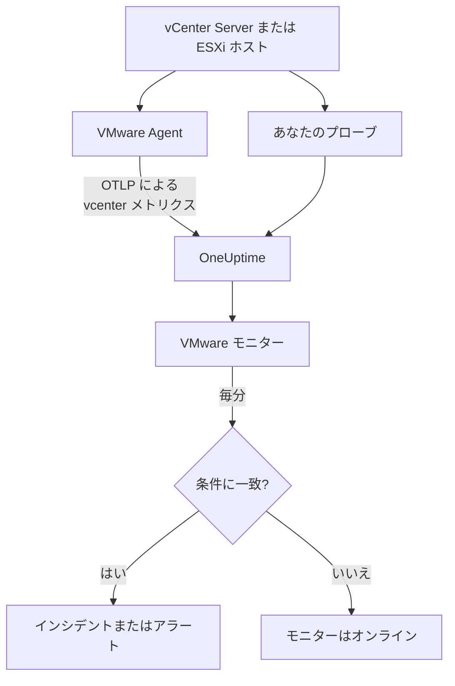

# VMware モニター

VMware モニターは 1 つの vCenter (データセンター、クラスター、ESXi ホスト、仮想マシン、データストア、リソースプール、vSAN) を監視し、ホストが飽和したとき、VM の CPU やメモリが不足したとき、データストアがいっぱいになったとき、vSphere がアラームを上げたときに知らせます。OneUptime VMware Agent が収集する `vcenter.*` メトリクス、またはエージェントなしでプローブが収集するメトリクスを読み取ります。

:::cards
- [モニターを作成する](#vmware-モニターを作成する): ダッシュボードでの六つのステップ。
- [テンプレート](#組み込みのアラートテンプレート): 二十三個の組み込みアラート。ホスト、VM、データストアごとに一つのインシデント。
- [識別属性](#識別属性): 1 つのホスト、VM、データストアを対象にする方法。
- [メトリクス](#収集されるメトリクス): モニターがアラートを出せるすべての `vcenter.*` シリーズ。
:::

## 仕組み

メトリクスは vCenter の API から、読み取り専用のアカウントで、次の二つの方法のいずれかで読み取られます。

- **VMware Agent**: `vcenter` レシーバーを持つ OpenTelemetry Collector で、vCenter に到達できるマシンで実行します。[VMware エージェント](/docs/telemetry/vmware) を参照してください。
- **プローブ**: 何もインストールする必要はありません。OneUptime で vCenter を接続し、そこに到達できるプローブを選びます。[エージェントなしの VMware](/docs/telemetry/vmware-agentless) を参照してください。

どちらも収集間隔 (デフォルトは 2 分) ごとに同じシリーズを送信し、vCenter の名前 `vmware.vcenter.name` を付けます。vCenter は 1 つの vSphere エンドポイントで、vCenter Server またはスタンドアロンの ESXi ホストです。VMware モニターは 1 つの vCenter に結び付いています。毎分、その vCenter のメトリクスに対してクエリを実行し、結果を条件と比較します。



## 始める前に

- **vCenter のメトリクスを収集します**。[VMware Agent](/docs/telemetry/vmware) を使うか、[エージェントなしで](/docs/telemetry/vmware-agentless) 収集します。どちらも、最上位の vCenter オブジェクトで **Read-Only** ロールを持ち、**Propagate to children** にチェックを入れた vSphere ユーザーを使います。エージェントは `ONEUPTIME_URL`、`ONEUPTIME_TELEMETRY_INGESTION_KEY`、`VMWARE_VCENTER_NAME`、`VCENTER_ENDPOINT`、`VCENTER_USERNAME`、`VCENTER_PASSWORD` を読み取ります。
- **vCenter が登録されていることを確認します。** **製品 → インフラストラクチャ → VMware → すべての vCenter** に表示されます。エージェント経由の場合は、最初の完全な収集の後に `VMWARE_VCENTER_NAME` の名前で、エージェントなしの場合は接続した時点から表示されます。

## VMware モニターを作成する

:::steps
### 新しいモニターを開始する

**モニター** に移動し、**モニターを作成** をクリックします。

### VMware を選ぶ

**モニターの種類** で **その他のモニターの種類** をクリックし、**インフラストラクチャ** の下の **VMware** を選ぶか、検索ボックスに `vmware` と入力します。**名前** を入力し (インシデントとアラートのタイトルに使われます)、**次へ** をクリックします。

### vCenter を選ぶ

**VMware モニターの設定** で、**vCenter** から vCenter を選びます。データを送信したことのある vCenter、またはエージェントなしで接続した vCenter はすべて一覧にあります。

### 監視する内容を選ぶ

三つのタブから一つを選びます。

- **Quick Setup**: [テンプレート](#組み込みのアラートテンプレート) をクリックします。テンプレートはメトリクス、属性フィルター、集計、時間範囲、グループ化、しきい値を設定し、下の条件を自分のものに置き換えます。**時間範囲** は後からでも変更できます。
- **Custom Metric**: **VMware メトリクス** から 1 つのメトリクスを選び、**集計** と **時間範囲** を設定します。フォームはメトリクスが説明するオブジェクトでグループ化するため、各ホスト、VM、データストアが個別に判定されます。[フィルター](#モニターの設定) で、1 つのデータセンター、クラスター、ホスト、VM、データストア、リソースプールに絞り込めます。
- **詳細**: **メトリクスを選択** でクエリと数式を自分で組み立て、`disk_state`、`power_state`、`status` などの属性でフィルターをかけます。[識別属性](#識別属性) で **グループ化** すると、各オブジェクトを個別に判定できます。

### 条件を確認する

**モニター条件** の各条件を開き、**メトリクス**、**集計**、**条件**、**しきい値** を確認します。テンプレートを使うと、これらは自動で入力されます。**Custom Metric** や **詳細** では、モニターは [デフォルトの条件](#デフォルトの条件) から始まります。これはメトリクスがゼロに落ちたことしか検知しないため、自分のしきい値を設定してください。

### モニターを作成する

**モニターを作成** をクリックします。OneUptime がモニターのページを開き、毎分評価します。モニターが上げたインシデントとアラートは、vCenter の **インシデント** と **アラート** のページにも一覧表示されます。
:::

> [!TIP]
> 複数のテンプレートを一度に設定するには、**製品 → インフラストラクチャ → VMware** から vCenter を開き、**推奨事項** に移動します。必要なテンプレートを選び、呼び出す相手を選ぶと、OneUptime がテンプレートごとに 1 つのモニターを作成します。

## モニターの設定

| フィールド | タブ | 動作 |
| --- | --- | --- |
| **vCenter** | すべて | 必須。すべてのクエリを `resource.vmware.vcenter.name` に限定します。 |
| **データセンター** | Custom Metric、詳細 | 任意。1 つのデータセンター: `resource.vcenter.datacenter.name`。すべてのシリーズがこれを持ちます。 |
| **クラスター** | Custom Metric、詳細 | 任意。1 つのクラスター: `resource.vcenter.cluster.name`。クラスター自身のシリーズと、その中のホスト、VM、リソースプールのシリーズに一致します。スタンドアロンの ESXi ホストにはクラスターがありません。 |
| **ESXi ホスト** | Custom Metric、詳細 | 任意。1 つの ESXi ホスト: `resource.vcenter.host.name`。ホスト自身のシリーズ **と**、そのホストで動くすべての VM のシリーズに一致します。VM はホストの名前を持つためです。 |
| **仮想マシン** | Custom Metric、詳細 | 任意。1 つの VM: `resource.vcenter.vm.name`。VM の名前は一意とは限りません。2 つの VM が同じ名前を持つときは、ホストかクラスターを加えてください。 |
| **データストア** | Custom Metric、詳細 | 任意。1 つのデータストア: `resource.vcenter.datastore.name`。 |
| **リソースプールのパス** | Custom Metric、詳細 | 任意。インベントリのパス (`/DC/host/Cluster/Resources/pool`) で 1 つのリソースプール: `resource.vcenter.resource_pool.inventory_path`。プールの名前は親の中でしか一意でないため、パスを使います。 |
| **VMware メトリクス** | Custom Metric | [カタログ](#収集されるメトリクス) の 1 つのメトリクス。 |
| **集計** | Custom Metric | サンプルの組み合わせ方: **平均**、**最大**、**最小**、**合計**、**カウント**。メトリクスの通常の集計から始まります。 |
| **時間範囲** | すべて | クエリが読み取る移動ウィンドウ。**Past 1 Minute** から **Past 365 Days** まで。新しいモニターは **過去 5 分** から始まり、テンプレートは独自の値を設定します。 |
| **メトリクスを選択** | 詳細 | クエリビルダー: **メトリクス**、**集計の基準**、**属性で絞り込み**、**グループ化**、さらにクエリを組み合わせる **メトリクスを追加** と **数式を追加**。 |

vCenter は収集間隔 (デフォルトは 2 分) ごとに 1 回読み取られるため、1 分のウィンドウにはサンプルがまったくないことがあります。ウィンドウは 5 分以上にし、大きなインベントリのために収集間隔を延ばした場合はさらに長くしてください。

## 識別属性

`vcenter` レシーバーは vSphere オブジェクトごとに 1 つの OpenTelemetry リソースを送信し、**リソース属性** で名前を付けます。シリーズがどの属性を持つかで、どの種類のオブジェクトを表しているかがわかります。

| vSphere オブジェクト | 識別のリソース属性 |
| --- | --- |
| データセンター | `vcenter.datacenter.name` |
| クラスター | `vcenter.datacenter.name`、`vcenter.cluster.name` |
| ESXi ホスト | `vcenter.datacenter.name`、`vcenter.host.name` (クラスターに属するときは + `vcenter.cluster.name`) |
| 仮想マシン | `vcenter.datacenter.name`、`vcenter.host.name`、`vcenter.vm.name`、`vcenter.vm.id` (+ `vcenter.cluster.name`、`vcenter.resource_pool.*` または `vcenter.virtual_app.*`) |
| VM テンプレート | `vcenter.datacenter.name`、`vcenter.host.name`、`vcenter.vm_template.name`、`vcenter.vm_template.id` |
| データストア | `vcenter.datacenter.name`、`vcenter.datastore.name` |
| リソースプール | `vcenter.datacenter.name`、`vcenter.resource_pool.name`、`vcenter.resource_pool.inventory_path` (+ `vcenter.cluster.name` または `vcenter.host.name`) |

モニターのフィルターとグループ化のキーでは、リソース属性は `resource.` で始まり (`resource.vcenter.host.name`)、データポイントの属性はそうではありません (`disk_state`、`power_state`、`status`、`effective`、`direction`、`object`、`type`)。ブール値の `effective` 属性はテキストの `"true"` または `"false"` として保存されるため、テキストでフィルターしてください。1 つのオブジェクトを対象にするには識別属性でフィルターし、各オブジェクトを個別に判定するには識別属性でグループ化します。

## 組み込みのアラートテンプレート

OneUptime には VMware のよくある問題向けに 23 個のテンプレートがあり、**Quick Setup** はそのすべてを提示します。各テンプレートは完全なモニターを作ります。メトリクスのクエリ、その属性フィルター、オブジェクト自身の識別属性によるグループ化、発火する条件と回復する条件です。しきい値は編集できる出発点です。

テンプレートは、表に別の記載がない限り過去 5 分を読み取ります。条件は、ウィンドウ内のすべての分で条件が成り立つときだけ発火し、しきい値の条件はしきい値から 10% 離れたところで回復するため、しきい値付近を行き来する値で状態がばたつくことはありません。

| テンプレート | カテゴリ | 重大度 | 監視対象 | 発火する条件 | 回復する条件 |
| --- | --- | --- | --- | --- | --- |
| Host CPU Saturation | ホスト | 警告 | `vcenter.host.cpu.utilization`、`resource.vcenter.host.name` ごとに Avg | 90% を超える: ホスト上のすべての VM がコアを奪い合い、CPU レディ時間が発生する | 81% 以下 |
| Host Memory Saturation | ホスト | 警告 | `vcenter.host.memory.utilization`、ホストごとに Avg | 90% を超える: ホストがバルーニング、圧縮、スワップでメモリを取り戻し始める | 81% 以下 |
| Host Disk Latency High | ホスト | 警告 | `vcenter.host.disk.latency.max`、ホストごとに Max | 50 ms を超える: そのパスにディスクがあるすべての VM がストレージを待つ。パフォーマンスカウンターのレベル 3 が必要 | 45 ms 以下 |
| Host Network Packet Errors | ホスト | 警告 | `vcenter.host.network.packet.error.rate`、ホストごとに Max | 0 を超える: ほぼ必ずケーブル、SFP、スイッチポートの故障 | 0 に戻る |
| Host Network Packet Drops | ホスト | 警告 | `vcenter.host.network.packet.drop.rate`、ホストごとに Max | 0 を超える: アップリンクの過負荷、または NIC のリングバッファのあふれ | 0 に戻る |
| VM CPU Saturation | 仮想マシン | 警告 | `vcenter.vm.cpu.utilization`、`resource.vcenter.vm.name` ごとに Avg、**過去 15 分** | VM の vCPU の 90% を超える状態が 15 分間ずっと続く: VM は割り当てられた分を使ってよいため、ずっと下がらない VM だけを呼び出す | 81% 以下 |
| VM CPU Ready Contention | 仮想マシン | 警告 | `vcenter.vm.cpu.readiness`、VM ごとに Avg | 10% を超える: VM は実行可能だったが、ホストに割り当てられる物理コアがなかった。ゲストの内部からは見えない | 9% 以下 |
| VM Memory Saturation | 仮想マシン | 警告 | `vcenter.vm.memory.utilization`、VM ごとに Avg | メモリの 90% を超える: ゲストがページングを始める寸前 | 81% 以下 |
| VM Memory Ballooning | 仮想マシン | 警告 | `vcenter.vm.memory.ballooned`、VM ごとに Max | 0 を超える: ホストのメモリが不足し、このゲストからメモリを取り戻している | 0 に戻る |
| VM Memory Swapping | 仮想マシン | 重大 | `vcenter.vm.memory.swapped`、VM ごとに Max | 0 を超える: ホストが VM のメモリをスワップしている。バルーニングと圧縮の後の最後の手段 | 0 に戻る |
| VM Disk Latency High | 仮想マシン | 警告 | `vcenter.vm.disk.latency.max`、VM ごとに Max | 50 ms を超える: ゲスト内のアプリケーションで I/O がタイムアウトする | 45 ms 以下 |
| VM Disk Usage High | 仮想マシン | 警告 | `vcenter.vm.disk.utilization`、VM ごとに Avg | プロビジョニングしたストレージの 90% を超えて使用: シンプロビジョニングの VM が全サイズを確保しようとしている | 81% 以下 |
| Datastore Capacity Warning | データストア | 警告 | `vcenter.datastore.disk.utilization`、`resource.vcenter.datastore.name` ごとに Avg | 80% を超える: シンディスクとスナップショットが残りをすぐに使い切るため、早めの警告 | 72% 以下 |
| Datastore Capacity Critical | データストア | 重大 | `vcenter.datastore.disk.utilization`、データストアごとに Avg | 90% を超える: いっぱいになったデータストアは、そこにディスクを持つすべての VM を一時停止させる | 81% 以下 |
| Cluster Host Not Effective | クラスター | 重大 | `vcenter.cluster.host.count` を `effective = false` に絞り込み、`resource.vcenter.cluster.name` ごとに Max | 0 を超える: ホストがメンテナンスモード、切断、応答なしのいずれかで、クラスターが想定より少ない容量で動いている | 0 に戻る |
| Datacenter Hosts Unhealthy | データセンター | 重大 | `vcenter.datacenter.host.count` を `status = red` に絞り込み、`resource.vcenter.datacenter.name` ごとに Max | 0 を超える: ホストに重大なアラームがある (ハードウェアセンサー、ストレージパスの喪失、HA エージェントのエラーなど) | 0 に戻る |
| Datacenter Hosts Degraded | データセンター | 警告 | `vcenter.datacenter.host.count` を `status = yellow` に絞り込み、データセンターごとに Max | 0 を超える: ホストに警告のアラームがある | 0 に戻る |
| Datacenter Hosts Powered Off | データセンター | 警告 | `vcenter.datacenter.host.count` を `power_state = off` に絞り込み、データセンターごとに Max | 0 を超える: ホストの電源が切れている (クラッシュ、電源の喪失、DPM によるスタンバイ) | 0 に戻る |
| Datacenter VMs Unhealthy | データセンター | 警告 | `vcenter.datacenter.vm.count` を `status = red` に絞り込み、データセンターごとに Max | 0 を超える: VM に重大なアラームがある (HA の再起動の失敗、データストアの喪失、Tools のハートビートの喪失など) | 0 に戻る |
| Datacenter Clusters Unhealthy | データセンター | 重大 | `vcenter.datacenter.cluster.count` を `status = red` に絞り込み、データセンターごとに Max | 0 を超える: クラスターに重大なアラームがある (HA フェイルオーバーのリソース不足、HA 選出の失敗、vSAN の重大なヘルスチェックなど) | 0 に戻る |
| vSAN Latency High | vSAN | 警告 | `vcenter.cluster.vsan.latency.avg`、クラスターごとに Avg | 20 000 µs (20 ms) を超える: vSAN データストア上のすべての VM でストレージが遅くなる。vSAN のないクラスターでは発火しない | 18 000 µs 以下 |
| vSAN Congestion | vSAN | 警告 | `vcenter.cluster.vsan.congestions`、クラスターごとに Max | 0 を超える: ディスクグループが追いつかず、vSAN がクライアントの I/O を遅くしている | 0 に戻る |
| Resource Pool Memory Swapped | クラスター | 警告 | `vcenter.resource_pool.memory.swapped`、`resource.vcenter.resource_pool.inventory_path` ごとに Max | 0 を超える: プールの VM がホストのスワップからメモリを得ている。たいていはプールのメモリの制限やシェアが低すぎるため | 0 に戻る |

**重大度** はピッカーが表示するラベルです。テンプレートが作成するインシデントとアラートは、プロジェクトで最も重大なインシデントとアラートの重大度から始まります。条件の中で変更してください。

- **使用率のテンプレートは Avg を使います:** レシーバーは各オブジェクトについて 0 から 100 の実際のパーセンテージを報告するため、1 分間の平均が持続的な使用率になります。
- **レイテンシのテンプレートは Max を使います:** メトリクスはすでにオブジェクトのディスク全体で最悪のレイテンシなので、最も高いサンプルが正直な値です。
- **件数と状態のテンプレートは Max を使います**。状態を示す 1 回の収集で発火します。パケットエラー、バルーニング、スワップ、赤と黄色のステータス、有効でないホスト、輻輳が対象です。
- **すべてのテンプレートは、オブジェクト自身の識別属性でグループ化します**。そのため、影響を受けたオブジェクトごとに一つのインシデントが発火し、インシデントはそのオブジェクトの名前を示します。
- **しきい値は単位に固定されています** (`%`、`ms`、`us`)。そのため、グラフがどの単位で表示しても意味が変わりません。

## 収集されるメトリクス

以下のメトリクスは、モニターのフォームが提示するカタログです。単位はレシーバー自身のもので、`MHz`、`%`、`MiBy` (メビバイト)、`By` (バイト)、`KiBy`、`ms`、`us` (マイクロ秒)、`{KiBy/s}`、`By/s`、そして件数です。_デフォルトでオフ_ と記載されたメトリクスは、エージェントの `otel-collector-config.yaml` でオンにするまで収集されません。同梱の設定では、すでに `vcenter.host.memory.capacity` がオンになっています。

### データセンター

| メトリクス | 単位 | 説明 |
| --- | --- | --- |
| `vcenter.datacenter.cluster.count` | `{clusters}` | データセンター内のクラスター。`status` (`red` / `yellow` / `green` / `gray`) ごとに分かれます。合計すると総数になります。`status = red` で絞り込むと、重大なアラームのあるクラスターがわかります |
| `vcenter.datacenter.cpu.limit` | `MHz` | すべての ESXi ホストにわたって、データセンターで利用できる CPU の合計 |
| `vcenter.datacenter.datastore.count` | `{datastores}` | データセンター内のデータストア |
| `vcenter.datacenter.disk.space` | `By` | データセンター全体のデータストアの容量。`disk_state` (`used` / `available`) ごとに分かれます。used ÷ (used + available) がデータセンター全体のストレージ使用率です |
| `vcenter.datacenter.host.count` | `{hosts}` | データセンター内の ESXi ホスト。`status` と `power_state` (`on` / `off` / `standby` / `unknown`) ごとに分かれます。`status = red` または `power_state = off` で絞り込みます |
| `vcenter.datacenter.memory.limit` | `By` | すべての ESXi ホストにわたって、データセンターで利用できる物理メモリの合計 |
| `vcenter.datacenter.vm.count` | `{virtual_machines}` | データセンター内の仮想マシン。`status` と `power_state` (`on` / `off` / `suspended` / `unknown`) ごとに分かれます。`power_state = on` で絞り込むと、実行中の VM がわかります |

### クラスター

| メトリクス | 単位 | 説明 |
| --- | --- | --- |
| `vcenter.cluster.cpu.effective` | `MHz` | クラスターが実際にスケジュールできる CPU。メンテナンスモードや応答のないホストは除きます。`vcenter.cluster.cpu.limit` と比べると、停止中の容量がわかります |
| `vcenter.cluster.cpu.limit` | `MHz` | ホストの状態にかかわらず、クラスター内のすべての ESXi ホストの CPU の合計 |
| `vcenter.cluster.host.count` | `{hosts}` | クラスター内の ESXi ホスト。`effective` (`"true"` / `"false"`) ごとに分かれます。メンテナンスモード、切断、応答なしの間、ホストは有効ではありません |
| `vcenter.cluster.memory.effective` | `By` | クラスターが実際に VM に割り当てられるメモリ。メンテナンスモードや応答のないホストと、ESXi 自身の予約メモリは除きます |
| `vcenter.cluster.memory.limit` | `By` | クラスター内のすべての ESXi ホストの物理メモリの合計 |
| `vcenter.cluster.vm.count` | `{virtual_machines}` | クラスター内の仮想マシン。`power_state` ごとに分かれます。合計すると総数になります。`power_state = on` で絞り込むと、実行中の VM がわかります |
| `vcenter.cluster.vm_template.count` | `{virtual_machine_templates}` | クラスター内の仮想マシンのテンプレート |

### ホスト (ESXi)

| メトリクス | 単位 | 説明 |
| --- | --- | --- |
| `vcenter.host.cpu.capacity` | `MHz` | ESXi ホストの CPU の総容量 (コア数 × クロック)。`vcenter.host.cpu.usage` の分母です |
| `vcenter.host.cpu.reserved` | `MHz` | 仮想マシンのために予約された CPU。`cpu_reservation_type` (`total` / `used`) ごとに分かれます。`used` が `total` に近づくと、新しい予約はアドミッションコントロールで失敗します |
| `vcenter.host.cpu.usage` | `MHz` | すべての VM とハイパーバイザー自身が、ホスト上で現在消費している CPU |
| `vcenter.host.cpu.utilization` | `%` | ホストの CPU 使用率。容量に対するパーセンテージ (0–100) |
| `vcenter.host.disk.latency.avg` | `ms` | ディスクの平均レイテンシ (デバイス + カーネルの時間)。`direction` (`read` / `write`) と `object` (ディスクデバイス) ごとに分かれます。パフォーマンスカウンターのレベル 2 が必要です |
| `vcenter.host.disk.latency.max` | `ms` | 直近 20 s の間隔で、ホストが使うすべてのディスクで観測された最大のレイテンシ (`object` ごと)。パフォーマンスカウンターのレベル 3 が必要です |
| `vcenter.host.disk.throughput` | `{KiBy/s}` | ホストのディスクから読み取った、またはディスクに書き込んだ 1 秒あたりのキロバイト数。`direction` と `object` ごとです。パフォーマンスカウンターのレベル 4 が必要です |
| `vcenter.host.memory.active` | `MiBy` | ホスト上の電源オンの VM が実際に触れているメモリ。_デフォルトでオフ_: エージェントの設定で `vcenter.host.memory.active` をオンにしてください |
| `vcenter.host.memory.ballooned` | `MiBy` | バルーンドライバーがホストの VM から回収したゲストメモリ。0 を超えると、ホストのメモリが逼迫しています。_デフォルトでオフ_ |
| `vcenter.host.memory.capacity` | `MiBy` | ホストの物理メモリの合計。`vcenter.host.memory.usage` の分母です。アップストリームではデフォルトでオフですが、同梱のエージェント設定でオンになっています |
| `vcenter.host.memory.granted` | `MiBy` | ホスト上の電源オンの VM に割り当てられたマシンメモリ。_デフォルトでオフ_ |
| `vcenter.host.memory.usage` | `MiBy` | ハイパーバイザー自身のオーバーヘッドを含め、ホスト上で現在消費しているメモリ |
| `vcenter.host.memory.utilization` | `%` | ホストのメモリ使用率。物理容量に対するパーセンテージ (0–100) |
| `vcenter.host.network.packet.drop.rate` | `{packets/s}` | 各物理 NIC で破棄された 1 秒あたりのパケット数。`direction` (`transmitted` / `received`) と `object` (例: `vmnic0`) ごとです。アップリンクの過負荷か、故障しかけている NIC を示します |
| `vcenter.host.network.packet.error.rate` | `{errors/s}` | ホストの物理 NIC での 1 秒あたりのパケットエラー数。`direction` と `object` ごとです。ほぼ必ずケーブル、SFP、スイッチポートの故障です |
| `vcenter.host.network.packet.rate` | `{packets/s}` | 各物理 NIC で送受信された 1 秒あたりのパケット数。`direction` と `object` ごとです |
| `vcenter.host.network.throughput` | `{KiBy/s}` | ホストが送受信した 1 秒あたりのキロバイト数。`direction` と `object` ごとです |
| `vcenter.host.network.usage` | `{KiBy/s}` | ホストの NIC 全体での送信と受信を合わせたレート (`object` ごと) |

### 仮想マシン

| メトリクス | 単位 | 説明 |
| --- | --- | --- |
| `vcenter.vm.cpu.readiness` | `%` | VM が実行可能だったのに物理 CPU にスケジュールできなかった時間の割合 (CPU レディ)。5% を超えるとゲストの動作が鈍く感じられ、10% を超えるとホストが過負荷です。電源オンの VM のみ |
| `vcenter.vm.cpu.time` | `%` | VM の vCPU が各状態で過ごした時間。`cpu_state` (`idle` / `ready` / `wait`) と `object` (vCPU) ごとです。_デフォルトでオフ_: `vcenter.vm.cpu.time` をオンにしてください |
| `vcenter.vm.cpu.usage` | `MHz` | VM が消費した CPU。電源オンの VM のみ。これがあるかどうかで、OneUptime は VM の電源状態を推定します |
| `vcenter.vm.cpu.utilization` | `%` | VM の CPU 使用率。設定された vCPU に対するパーセンテージ (0–100)。電源オンの VM のみ |
| `vcenter.vm.disk.latency.avg` | `ms` | ディスクの平均レイテンシ。`direction` (`read` / `write`)、`disk_type` (`virtual` / `physical`)、`object` (仮想ディスク) ごとです。パフォーマンスカウンターのレベル 2 が必要です |
| `vcenter.vm.disk.latency.max` | `ms` | 20 s の間隔で、VM がいずれかのディスクで観測した最大の合計レイテンシ (デバイス + カーネルの時間)。`object` ごとです |
| `vcenter.vm.disk.throughput` | `{KiBy/s}` | VM のディスクから読み取った、またはディスクに書き込んだ 1 秒あたりのキロバイト数。`direction` と `object` ごとです。パフォーマンスカウンターのレベル 2 が必要です |
| `vcenter.vm.disk.usage` | `By` | VM のファイルが使うデータストアの容量。`disk_state` (`used` / `available`) ごとに分かれます。VM テンプレートについても送信されます。使用済みサイズは `disk_state = used` で絞り込みます |
| `vcenter.vm.disk.utilization` | `%` | VM のプロビジョニングしたストレージのうち、データストア上で使用済みの割合 (0–100)。100% に近づいたシンプロビジョニングの VM は、全サイズを確保しようとしています |
| `vcenter.vm.memory.ballooned` | `MiBy` | バルーンドライバー (VMware Tools) が VM から回収したゲストメモリ。0 を超えると、ESXi ホストのメモリが不足しています |
| `vcenter.vm.memory.granted` | `MiBy` | ホストが VM に割り当てたマシンメモリ。_デフォルトでオフ_: `vcenter.vm.memory.granted` をオンにしてください |
| `vcenter.vm.memory.swapped` | `MiBy` | ホストのスワップファイルから VM に割り当てられたメモリ。バルーニングと圧縮の後の最後の手段で、0 を超える値は、VM が RAM の代わりにディスクのレイテンシを払っていることを意味します |
| `vcenter.vm.memory.swapped_ssd` | `KiBy` | ホストのフラッシュのスワップキャッシュにスワップされた VM のメモリ。スワップファイルほど痛手ではありませんが、メモリの逼迫に変わりはありません |
| `vcenter.vm.memory.usage` | `MiBy` | VM のゲストが実際に使っているメモリ。電源オンと電源オフの VM の両方で送信されます (オフのときは 0) |
| `vcenter.vm.memory.utilization` | `%` | VM のメモリ使用率。設定されたメモリに対するパーセンテージ (0–100) |
| `vcenter.vm.network.broadcast.packet.rate` | `{packets/s}` | vNIC ごとの 1 秒あたりのブロードキャストパケット数。`direction` と `object` ごとです。_デフォルトでオフ_ |
| `vcenter.vm.network.multicast.packet.rate` | `{packets/s}` | vNIC ごとの 1 秒あたりのマルチキャストパケット数。`direction` と `object` ごとです。_デフォルトでオフ_ |
| `vcenter.vm.network.packet.drop.rate` | `{packets/s}` | 各 vNIC が破棄した 1 秒あたりのパケット数。`direction` と `object` ごとです。受信側での破棄は、たいていゲストがリングバッファを十分に速く処理できていないことを意味します |
| `vcenter.vm.network.packet.rate` | `{packets/s}` | 各 vNIC が送受信した 1 秒あたりのパケット数。`direction` と `object` ごとです |
| `vcenter.vm.network.throughput` | `By/s` | VM のネットワークで送受信された 1 秒あたりのバイト数。`direction` と `object` ごとです |
| `vcenter.vm.network.usage` | `{KiBy/s}` | VM の送信と受信を合わせたレート (`object` ごと) |

### データストア

| メトリクス | 単位 | 説明 |
| --- | --- | --- |
| `vcenter.datastore.disk.usage` | `By` | データストアの容量。`disk_state` (`used` / `available`) ごとに分かれます。used + available がデータストアの容量です |
| `vcenter.datastore.disk.utilization` | `%` | データストアの容量のうち使用中の割合 (0–100)。いっぱいになったデータストアは、そこに書き込むすべての VM を一時停止させるため、100% になるずっと前にアラートを出してください |

### リソースプール

| メトリクス | 単位 | 説明 |
| --- | --- | --- |
| `vcenter.resource_pool.cpu.shares` | `{shares}` | プールに設定された CPU のシェア。親が競合しているときの、兄弟のプールに対する相対的な優先度です |
| `vcenter.resource_pool.cpu.usage` | `MHz` | プール (と子プール) 内のすべての VM が消費した CPU |
| `vcenter.resource_pool.memory.ballooned` | `MiBy` | プール内のすべての VM からバルーンドライバーが回収したメモリ |
| `vcenter.resource_pool.memory.granted` | `MiBy` | プールの VM に割り当てられたホストのメモリ。`type` (`private` / `shared`。共有ページは透過的ページ共有で重複排除されます) ごとに分かれます |
| `vcenter.resource_pool.memory.shares` | `{shares}` | プールに設定されたメモリのシェア |
| `vcenter.resource_pool.memory.swapped` | `MiBy` | ESXi ホストのスワップ領域からプールの VM に割り当てられたメモリ。0 を超える値は、プール内の少なくとも 1 つの VM がホストによってスワップされていることを意味します |
| `vcenter.resource_pool.memory.usage` | `MiBy` | プールが使うメモリ。最近のコレクターのビルドでは `type` (`guest` / `host` / `overhead`) ごとに分かれ、古いビルドは種類のない 1 つのシリーズを送信します。`type = guest` で絞り込みます |

### vSAN

vSAN のあるクラスター、その中のホスト、vSAN データストア上の VM についてだけ送信されます。レイテンシは **マイクロ秒** (`us`) で、ホストや VM のミリ秒のレイテンシとは異なります。

| メトリクス | 単位 | 説明 |
| --- | --- | --- |
| `vcenter.cluster.vsan.congestions` | `{congestions/s}` | クラスター内の各 vSAN クライアントからの I/O に対して発生した 1 秒あたりの輻輳イベント数。vSAN 自身のバックプレッシャーのシグナルです |
| `vcenter.cluster.vsan.latency.avg` | `us` | クラスターが vSAN ストレージにアクセスするときの平均レイテンシ。`type` (`read` / `write`) ごとです。20 000 µs = 20 ms |
| `vcenter.cluster.vsan.operations` | `{operations/s}` | クラスター全体での 1 秒あたりの vSAN の I/O 操作数。`type` (`read` / `write` / `unmap`) ごとです |
| `vcenter.cluster.vsan.throughput` | `By/s` | クラスターの vSAN のスループット。`direction` (`read` / `write`) ごとです |
| `vcenter.host.vsan.cache.hit_rate` | `%` | 直近 5 min の間隔で、ホストの vSAN の読み取り I/O のうちローカルのクライアントキャッシュから処理された割合。下がっているときは、読み取りが容量層に届いています |
| `vcenter.host.vsan.congestions` | `{congestions/s}` | ホストからの vSAN の I/O に対して発生した 1 秒あたりの輻輳イベント数 |
| `vcenter.host.vsan.latency.avg` | `us` | ホストが vSAN ストレージにアクセスするときの平均レイテンシ。`type` ごとです |
| `vcenter.host.vsan.operations` | `{operations/s}` | ホストが発行した 1 秒あたりの vSAN の I/O 操作数。`type` ごとです |
| `vcenter.host.vsan.throughput` | `By/s` | ホストの vSAN のスループット。`direction` ごとです |
| `vcenter.vm.vsan.latency.avg` | `us` | VM が vSAN ストレージにアクセスするときの平均レイテンシ。`type` ごとです |
| `vcenter.vm.vsan.operations` | `{operations/s}` | VM が発行した 1 秒あたりの vSAN の I/O 操作数。`type` ごとです |
| `vcenter.vm.vsan.throughput` | `By/s` | VM の vSAN のスループット。`direction` ごとです |

> [!NOTE]
> VM の電源状態はメトリクスではありません。レシーバーは電源オンの VM についてだけ `vcenter.vm.cpu.*` を送信するため、OneUptime は、VM のメモリとディスクのデータと同じ収集で CPU のデータが届いたかどうかで **電源オン** と **電源オフ** を区別します。結果は vCenter の **仮想マシン** ページに表示されます。電源オフのホストや実行中の VM の数でアラートを出すには、`power_state` 属性を使います。対象は `vcenter.datacenter.host.count`、`vcenter.datacenter.vm.count`、`vcenter.cluster.vm.count` です。

## 監視条件

条件は、モニターのクエリや数式の 1 つをしきい値と比較します。VMware モニターの条件には **フィルタータイプ** はなく、どのルールも次のフィールドでメトリクスの値を確認します。

| フィールド | 動作 |
| --- | --- |
| **メトリクス** | 確認するクエリまたは数式 (変数名で指定)。 |
| **集計** | ウィンドウ内の値を一つの答えにする方法: **平均**、**合計**、**Maximum Value**、**Minimum Value**、**All Values** (すべての値が一致する必要があります)、**Any Value** (一つで十分です)。 |
| **条件** | **Greater Than**、**Less Than**、**Greater Than Or Equal To**、**Less Than Or Equal To**、**Equal To**、または異常の条件: **Anomalously High**、**Anomalously Low**、**Anomalous**。 |
| **しきい値** | 比較する値。メトリクスに単位があるときは、横に単位の一覧が表示されます。異常の条件では表示されません。 |
| **感度** | 異常の条件のみ。**低** (4σ)、**中** (3σ、デフォルト)、**高** (2σ)。 |
| **ベースラインウィンドウ** | 異常の条件のみ。14 日 (デフォルト)、28 日、60 日、90 日の履歴。 |
| **データがない場合** | **その他の項目** の中にあります。ウィンドウにサンプルがないときの動作: **Ignore** (デフォルト)、**Treat As Zero**、**トリガー**。 |

異常の条件は、各値をベースラインの同じ曜日の同じ時間帯と比較します。ベースラインウィンドウに十分な履歴がたまるまでは "Learning" の状態にとどまり、何も上げません。

最初に使える条件の例:

- **ホストが飽和している:** `vcenter.host.cpu.utilization`、平均、`resource.vcenter.host.name` でグループ化、**Greater Than** `90`、過去 5 分。
- **データストアがいっぱいになりつつある:** `vcenter.datastore.disk.utilization`、平均、`resource.vcenter.datastore.name` でグループ化、**Greater Than** `80`。
- **クラスターがホストを失った:** `vcenter.cluster.host.count` を `effective = false` に絞り込み、最大、`resource.vcenter.cluster.name` でグループ化、**Greater Than** `0`。
- **実行中の VM が想定より少ない:** `vcenter.cluster.vm.count` を `power_state = on` と `resource.vcenter.cluster.name = Production` に絞り込み、合計、**Less Than** 想定している数。
- **VM がホストにスワップされている:** `vcenter.vm.memory.swapped`、最大、`resource.vcenter.vm.name` でグループ化、**Greater Than** `0`。

### デフォルトの条件

テンプレートから作らないモニターは、二つの条件から始まります。

| 順序 | 条件 | 一致するとき | 結果 |
| --- | --- | --- | --- |
| 1 | Check if _monitor name_ is offline | 最初のクエリのいずれかの値が `0` | モニターを **オフライン** にし、インシデント "_monitor name_ is offline" を宣言します。モニターが回復すると自動で解決します。 |
| 2 | Check if _monitor name_ is online | いずれかの値が `0` を超える | モニターを **稼働中** にします。 |

> [!IMPORTANT]
> 無音はどちらの条件にも一致しません。データの送信を止めた vCenter は、モニターを元の状態のままにします。データが止まったことを知るには、条件で **データがない場合** を **トリガー** に設定してください。OneUptime 自体が受信していなかった時間は、データがないとはみなされません。その時間を含むウィンドウのチェックは、[OneUptime がデータを受信していないとき](/docs/monitor/when-oneuptime-is-not-receiving) で説明しているとおり、代わりに待機します。

## Terraform

[OneUptime の Terraform プロバイダー](/docs/terraform/monitor-steps) は、VMware モニターのステップの設定を `vmware_monitor` 属性で扱います。これは `vmwareMonitor` 設定 (`vcenterIdentifier`、`resourceFilters`、`metricViewConfig`、`rollingTime`) の生の JSON で、`jsonencode()` で書きます。

```hcl title="main.tf"
monitor_steps = [{
  vmware_monitor = jsonencode({
    vcenterIdentifier = "prod-vcenter"
    resourceFilters   = { clusterName = "Production" }
    rollingTime       = "Past 5 Minutes"
    metricViewConfig = {
      queryConfigs = [{
        metricAliasData = { metricVariable = "host_cpu", title = "Host CPU", description = "", legend = "" }
        metricQueryData = {
          filterData = {
            metricName     = "vcenter.host.cpu.utilization"
            attributes     = {}
            aggegationType = "Avg"
            aggregateBy    = {}
          }
          groupByAttributeKeys = ["resource.vcenter.host.name"]
        }
      }]
      formulaConfigs = []
    }
  })
  criteria = [ /* ... */ ]
}]
```

`vcenterIdentifier` は vCenter の `vmware.vcenter.name` (エージェントを起動したときの `VMWARE_VCENTER_NAME`) で、OneUptime の ID ではありません。

## トラブルシューティング

:::details vCenter が「vCenter」の一覧にない
エージェントが収集する vCenter は、エージェントのデータから自動で登録されます。エージェントが動作してデータを送信していること ([インストールの確認](/docs/telemetry/vmware#インストールを確認する) を参照)、`VMWARE_VCENTER_NAME` が設定されていること、収集間隔が一度経過したことを確認してください。インベントリの最初の完全な走査が終わるまで、何も送信されません。
:::

:::details ホストにはメトリクスがあるが、VM、データストア、クラスターにはない
読み取り専用の vSphere ユーザーが、**Propagate to children** なしでロールを付与されたか、vCenter のルートより下のオブジェクトでロールを付与されています。ユーザーから見えないオブジェクトは、単にメトリクスに含まれません。最上位の vCenter オブジェクトで、伝播にチェックを入れて権限を設定してください。
:::

:::details Host CPU Saturation がまったく発火しない
テンプレートは `vcenter.host.cpu.utilization` を `resource.vcenter.host.name` ごとに平均するため、各ホストが個別にチェックされます。自分でクエリを作った場合は、`resource.` 接頭辞の付いた識別属性でグループ化してください。接頭辞のない `vcenter.host.name` は何にも一致せず、すべてのホストをまたいだ平均はアイドルのホストに引き下げられます。
:::

:::details vSAN のテンプレートがまったく発火しない
`vcenter.cluster.vsan.*`、`vcenter.host.vsan.*`、`vcenter.vm.vsan.*` は、vSAN のあるクラスター、その中のホスト、vSAN データストア上の VM についてだけ送信されます。vSAN がなければシリーズは存在せず、テンプレートは発火しません。
:::

:::details effective で絞り込んだ条件が何にも一致しない
レシーバーのブール値の `effective` 属性は、テキストの `"true"` または `"false"` として保存されます。ブール値ではなく、テキストでフィルターしてください。
:::

:::details ディスクのレイテンシやスループットのメトリクスがない
`vcenter.host.disk.latency.avg` と `vcenter.vm.disk.*` には vCenter の統計レベル 2、`vcenter.host.disk.latency.max` にはレベル 3、`vcenter.host.disk.throughput` にはレベル 4 が必要です。_vCenter → Configure → General → Statistics_ で、5 分間隔の統計レベルを上げてください。
:::

:::details 1 分のウィンドウにデータが表示されない
vCenter は収集間隔 (デフォルトは 2 分で、大きなインベントリではもっと長いことが多い) ごとに 1 回読み取られるため、1 分のウィンドウにはサンプルがないことがあります。5 分以上を使ってください。
:::

## 次のステップ

:::cards
- [VMware エージェント](/docs/telemetry/vmware): vCenter から収集するエージェントをインストールします。
- [エージェントなしの VMware](/docs/telemetry/vmware-agentless): 代わりにプローブに収集させます。
- [Proxmox モニター](/docs/monitor/proxmox-monitor): Proxmox VE 向けの同じ種類のモニター。
- [インシデント 概要](/docs/incidents/index): 条件がインシデントを宣言した後に起きること。
:::
