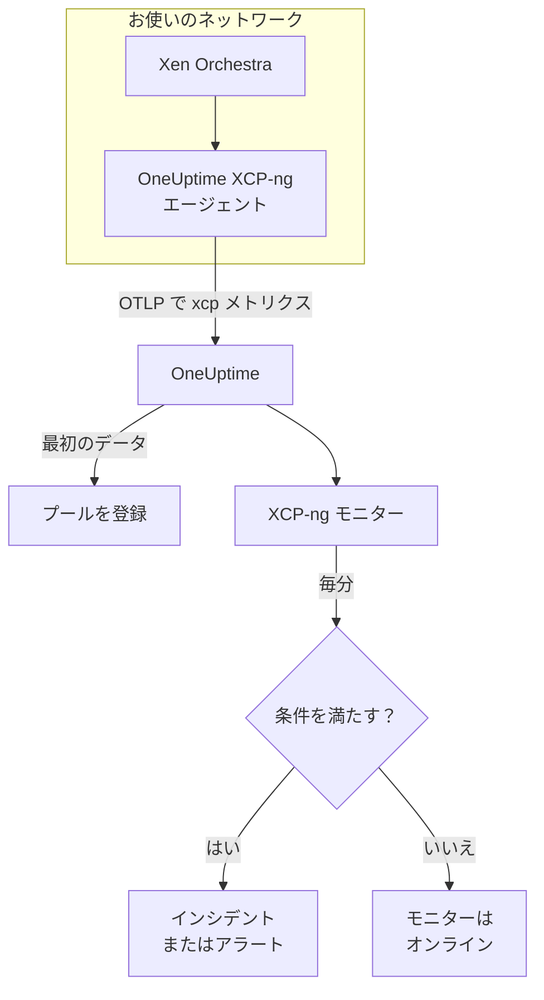

# XCP-ng モニター

XCP-ng モニターは 1 つの XCP-ng プール (そのホスト、VM、ストレージリポジトリ、仮想ディスク) を監視し、Xen Orchestra がプールを見失ったとき、ホストがオフラインになったか無効のままのとき、実行中だった VM が停止したか CPU 不足になったとき、ストレージリポジトリがいっぱいになるか遅くなったときに知らせます。OneUptime の XCP-ng エージェントが収集する Xen Orchestra の OpenMetrics プラグインの `xcp_*` 系列と、OneUptime がそこから導き出すヘルスの系列を読み取るため、外部から何かを調べることはありません。

:::cards
- [モニターを作成する](#xcp-ng-モニターを作成する): ダッシュボードでの 6 つのステップ。
- [テンプレート](#既製のアラートテンプレート): ホスト、VM、ストレージリポジトリごとに 1 件のインシデントを作る 10 個の既製アラート。
- [リソースの識別](#リソースの識別): 1 つのホスト、VM、ストレージリポジトリを対象にする方法。
- [メトリクス](#収集されるメトリクス): モニターがアラートを出せるすべての系列。
:::

## 仕組み

OneUptime の XCP-ng エージェントは、Xen Orchestra に到達できるマシン上で動作します。60 秒ごとに Xen Orchestra の OpenMetrics プラグインを読み取り (プラグインは Xen Orchestra が管理するすべてのプールのすべてのホストを読み取ります)、プールごとに 1 つのリソースとして、プールの UUID `xcp_ng.pool.id` を付けて OTLP で系列を OneUptime に送ります。最初のデータで各プールが登録されます。

XCP-ng モニターは 1 つのプールに結び付きます。毎分、そのプールのメトリクスに対してクエリを実行し、結果を条件と比較します。



## 始める前に

- **XCP-ng エージェントをインストールします**。Xen Orchestra に到達できる場所に、Xen Orchestra の OpenMetrics プラグインのシークレットを使って入れてください。[XCP-ng エージェントのガイド](/docs/telemetry/xcp-ng) で、プラグイン、Xen Orchestra の証明書、インストールを説明しています。
- **プールが登録されていることを確認します。** 最初のスクレイプから約 1 分後に、Xen Orchestra での名前で **製品 → インフラストラクチャ → XCP-ng → すべてのプール** に表示されます。

## XCP-ng モニターを作成する

:::steps
### 新しいモニターを始める

**モニター** に移動し、**モニターを作成** をクリックします。

### XCP-ng を選ぶ

**モニターの種類** で **その他のモニターの種類** をクリックし、**インフラストラクチャ** の下の **XCP-ng** を選ぶか、検索ボックスに `xcp` と入力します。**名前** を入力し（インシデントとアラートのタイトルに使われます）、**次へ** をクリックします。

### プールを選ぶ

**XCP-ng モニターの設定** で、**XCP-ng プール** からプールを選びます。データを送信したすべてのプールが一覧に表示されます。選ぶと、フィールドの下の行にデータが届いているかどうかが表示されます。**XCP-ng プールを追加** を押すと、キーが入力済みのセットアップ手順が開き、最初のデータを待ちます。

### 監視する対象を選ぶ

新しいモニターは **アラートの対象** の **Pool Disconnected** から始まります。ほかのものを監視するには、次のいずれかを使います。

- **変更** – 別の [テンプレート](#既製のアラートテンプレート) を選びます。メトリクス、フィルター、集計、時間範囲、しきい値が設定され、下の条件がテンプレートのものに置き換わります。**時間範囲** は引き続き変更できます。
- **Custom Metric**（**その他の項目** 内） – **XCP-ng メトリクス** からメトリクスを 1 つ選び、**集計** と **時間範囲** を設定します。[フィルター](#モニター設定) で、オブジェクトの種類や 1 つのオブジェクトに絞り込めます。
- **詳細**（**その他の項目** 内） – **メトリクスを選択** でクエリと数式を自分で作成します。たとえば `xcp_sr_physical_usage_bytes / xcp_sr_physical_size_bytes` からストレージリポジトリの使用率を求めます。**グループ化** に `xcp_ng.id` を指定すると、オブジェクトを 1 つずつ判定できます。

### 条件を確認する

**条件** の各条件を開き、**メトリクス**、**集計**、**条件**、**しきい値** を確認します。テンプレートを使った場合は入力済みです。**Custom Metric** または **詳細** の場合、モニターは [デフォルトの条件](#デフォルトの条件) から始まり、これはメトリクスがデータを送らなくなったことしか検知しないので、独自のしきい値を設定してください。

### モニターを作成する

**モニターを作成** をクリックします。OneUptime がモニターのページを開き、毎分評価します。作成されたインシデントとアラートは、プールの **インシデント** と **アラート** のページにも表示されます。
:::

> [!TIP]
> 複数のテンプレートを一度に設定するには、**製品 → インフラストラクチャ → XCP-ng** からプールを開き、**推奨事項** に移動します。使うテンプレートと呼び出す相手を選ぶと、OneUptime がテンプレートごとに 1 つのモニターを作成します。

## モニター設定

| 項目 | タブ | 役割 |
| --- | --- | --- |
| **XCP-ng プール** | すべて | 必須。すべてのクエリをプールの UUID である `resource.xcp_ng.pool.id` に限定するため、同じ名前の 2 つのプールが混ざることはありません。 |
| **リソーススコープ** | Custom Metric、詳細 | 任意。**ホスト**、**VM**、**ストレージリポジトリ**、**仮想ディスク**、**XOSTOR**、**XCP-ng プール** のいずれかで、`xcp_ng.scope` との完全一致です。 |
| **UUID** | Custom Metric、詳細 | 任意。`xcp_ng.id` との完全一致で、Xen Orchestra に表示される 1 つのホスト、VM、ストレージリポジトリ、仮想ディスクの UUID です。スコープと組み合わせると 1 つのオブジェクトを対象にできます。 |
| **ホスト名** | Custom Metric、詳細 | 任意。Xen Orchestra の `host_name` ラベルとの完全一致で、ホスト自身の系列と、そのホスト上で動く VM の系列が対象です。 |
| **XCP-ng メトリクス** | Custom Metric | [カタログ](#収集されるメトリクス) のメトリクスを 1 つ選びます。 |
| **集計** | Custom Metric | サンプルの組み合わせ方：**平均**、**最大**、**最小**、**合計**、**カウント**。初期値はメトリクスの通常の集計です。 |
| **時間範囲** | すべて | クエリが読み取る移動ウィンドウで、**Past 1 Minute** から **Past 365 Days** まで。新しいモニターは **Past 1 Minute** から始まり、テンプレートは独自の値を設定します。 |
| **メトリクスを選択** | 詳細 | クエリビルダー：**メトリクス**、**集計の基準**、**属性で絞り込み**、**グループ化**、さらにクエリを組み合わせる **メトリクスを追加** と **数式を追加**。 |

エージェントは 60 秒ごとに Xen Orchestra を読み取り、Xen Orchestra は 60 秒の解像度でホストを読み取るため、1 分のウィンドウにはサンプルがおよそ 1 つしか入りません。テンプレートは 5 分以上を読み取ります。

## リソースの識別

Xen Orchestra は、ホストや VM を `uuid` ラベルで、ストレージリポジトリを `sr_uuid` で、仮想ディスクを `vdi_uuid` で識別します。OneUptime は届いたすべてのデータポイントに 2 つの属性を付けるため、どのラベルで識別されていても、1 つのフィルターでオブジェクトのすべての系列を読み取れます。テンプレートはこれらに依存しています。

| 属性 | 値 | VM の場合 |
| --- | --- | --- |
| `xcp_ng.scope` | `pool`、`host`、`vm`、`sr` (ストレージリポジトリ)、`vdi` (仮想ディスク)、`xostor` | `vm` |
| `xcp_ng.id` | オブジェクトの UUID (小文字)。ホストや VM の `uuid`、ストレージリポジトリや XOSTOR クラスターの `sr_uuid`、仮想ディスクの `vdi_uuid`、プール自身の系列ではプール自身の UUID | `5c6d7e8f-1a2b-4c3d-9e8f-0a1b2c3d4e5f` |

オブジェクトの種類で絞るには `xcp_ng.scope` で、1 つのオブジェクトには `xcp_ng.id` でフィルターし、オブジェクトを 1 つずつ判定するには `xcp_ng.id` でグループ化します。Xen Orchestra 自身のラベルは送られたままです。`host_name` はホストの系列ではホストを、VM の系列ではその VM のホストを表し、`vm_name`、`sr_name`、`vdi_name` がほかを表し、`power_state` と `enabled` は状態の系列でホストや VM の状態を表し、`is_control_domain` はコントロールドメインの VM の系列で `true` になります。

プール自体は系列が届くリソースなので、その属性はフィルターとグループ化のキーで `resource.` という接頭辞を付けて使います: `resource.xcp_ng.pool.id` (UUID)、`resource.xcp_ng.pool.name` (Xen Orchestra での名前)、`resource.xen_orchestra.name` (読み取り元の Xen Orchestra)。

## 既製のアラートテンプレート

**アラートの対象** の一覧には 12 個のテンプレートがあります。それぞれが完全なモニターを作ります。クエリ、属性フィルター、グループ化、発火する条件、回復する条件です。ほとんどは `xcp_ng.id` でグループ化するため、ホスト、VM、ストレージリポジトリごとに専用のインシデントとアラートが作られます。しきい値は出発点であり、編集できます。

条件はそのウィンドウのすべての分で成り立つ場合にのみ発火し、しきい値の条件はしきい値から 10% 離れたところで回復するため、境界付近を行き来する値でばたつくことはありません。0/1 の系列はもう一方の値で回復します。

| テンプレート | カテゴリ | 重大度 | 監視対象 | 発火する条件 | 回復する条件 |
| --- | --- | --- | --- | --- | --- |
| Pool Disconnected | 可用性 | 重大 | `xcp_pool_connected`、プール全体に対する Count、過去 10 分 | ウィンドウ全体でデータがない | データが再び届く |
| Host Offline | 可用性 | 重大 | `xcp_ng.host.running` (`xcp_ng.scope = host`)、`xcp_ng.id` ごとの Min、過去 5 分 | 1 未満 | 1 になる |
| HA Cannot Tolerate a Host Failure | 可用性 | 重大 | `xcp_ng.pool.ha.can_tolerate_host_failure` (`xcp_ng.scope = pool`)、プール全体に対する Max、過去 5 分 | 1 未満 | 1 になる |
| VM Stopped | VM | 警告 | `xcp_ng.vm.stopped_after_running` (`xcp_ng.scope = vm`)、`xcp_ng.id` ごとの Min、過去 5 分 | 0 を超える | 0 になる |
| VM Not Backed Up | VM | 警告 | `xcp_ng.vm.backup_overdue` (`xcp_ng.scope = vm`)、`xcp_ng.id` ごとの Min、過去 10 分 | 0 を超える | 0 になる |
| Storage Repository Near Full | ストレージ | 重大 | `xcp_sr_physical_usage_bytes` ÷ `xcp_sr_physical_size_bytes` × 100 (`xcp_ng.scope = sr`、どちらも 合計)、`xcp_ng.id` ごと、過去 5 分 | 90% を超える | 81% 以下 |
| Host Disabled | ホスト | 警告 | `xcp_ng.host.enabled` (`xcp_ng.scope = host`)、`xcp_ng.id` ごとの Max、過去 30 分 | 1 未満 | 1 になる |
| Host Restarted | ホスト | 警告 | `xcp_host_uptime_seconds` と `xcp_ng.host.running` (`xcp_ng.scope = host`)、`xcp_ng.id` ごとの Min、過去 5 分 | `xcp_host_uptime_seconds` が 900 (15 分) 未満で、かつ `xcp_ng.host.running` が 1 | `xcp_host_uptime_seconds` が 990 以上、または `xcp_ng.host.running` が 0 |
| High Host CPU Usage | ホスト | 警告 | `xcp_host_cpu_average` (`xcp_ng.scope = host`)、`xcp_ng.id` ごとの Avg、過去 10 分 | 0.9 を超える（ホストの CPU の 90%） | 0.81 以下 |
| High Host Memory Usage | ホスト | 警告 | (`xcp_host_memory_total_bytes` − `xcp_host_memory_free_bytes`) ÷ `xcp_host_memory_total_bytes` × 100 (`xcp_ng.scope = host`、どちらも 合計)、`xcp_ng.id` ごと、過去 10 分 | 95% を超える | 85.5% 以下 |
| VM Starved of CPU | VM | 警告 | `xcp_vm_runstate_full_contention` (`xcp_ng.scope = vm`)、`xcp_ng.id` ごとの Avg、過去 15 分 | 0.1 を超える（時間の 10%） | 0.09 以下 |
| Storage Repository Slow | ストレージ | 警告 | `xcp_host_disk_latency_seconds` (`xcp_ng.scope = host`)、`sr` ごとの Avg、過去 15 分 | 0.05 を超える（50 ms） | 0.045 以下 |

**重大度** は選択リストに表示されるラベルです。テンプレートが作成するインシデントとアラートは、プロジェクトで最も重大なインシデントとアラートの重大度から始まります。条件で変更してください。

- **Pool Disconnected** は、`xcp_pool_connected` が 10 分間届かなくなると発火します。Xen Orchestra はプールに接続している間はスクレイプのたびにこれを送り、プールのマスターを見失うと 0 を送るのではなく送るのをやめます。Xen Orchestra、そのプラグイン、XCP-ng エージェントが停止したときや、エージェントが OneUptime への経路を失ったときにも止まります。系列が戻ると解決します。データが止まると、ほかのテンプレートには比較するものがなく最後のステータスのままになるため、それを知らせるのはこのテンプレートです。
- **Host Offline** は `xcp_ng.host.running` を読み取ります。これは OneUptime が `xcp_host_status` から導き出すもので、Xen Orchestra がホストを Halted と報告している間、またはプールマスターがホストとの連絡を失って状態が Unknown の間は 0 です。HA がほかの場所で再起動しない限り、そのホストで動いていた VM も停止しています。
- **HA Cannot Tolerate a Host Failure** は `xcp_ng.pool.ha.can_tolerate_host_failure` を読み取ります。XAPI から直接読み取る場合は HA 自身のプランで、オーバーコミットしているか、許容するよう設定されたホスト障害数より少ない数しかカバーしていない状態です。プランを報告しない REST API を持つ Xen Orchestra 経由で読み取る場合は、VM を再起動できる稼働中かつ有効なホストが 2 台未満の状態で、ホスト 2 台の HA プールでは 1 台を無効にするだけで該当します。HA がオフの間は発火しません。
- **VM Stopped** は `xcp_ng.vm.stopped_after_running` を読み取ります。過去 24 時間に実行されていた VM が Halted または Paused の間は 1 です。1 日を超えて電源が切られている VM は意図して切られたものと見なされてアラートを出さなくなり、一時停止した VM はアラートを出さず、コントロールドメインと VM テンプレートは除外されます。
- **VM Not Backed Up** は、Xen Orchestra のバックアップログから求めた `xcp_ng.vm.backup_overdue` を読み取ります。スケジュール済みのバックアップジョブに含まれる VM が、間隔 (ジョブのスケジュールの 2 回の実行の間で最も長い間隔) とその 4 分の 1 (少なくとも 1 時間) の間に成功したバックアップがない間は 1 です。毎晩のジョブの VM は 30 時間後に発火し、どのスケジュール済みジョブにも含まれない VM は発火しません。
- **Host Disabled** は、30 分間無効のままのホストで発火します。メンテナンスモード中か、退避によって無効のまま残されたホストです。XAPI はそこで VM を起動せず、HA はそこにフェイルオーバーできません。30 分あれば、計画された再起動や更新で呼び出しが発生することはありません。
- **Host Restarted** は、稼働中でありながら起動から 15 分未満のホストで発火します。再起動したか、クラッシュして復帰したホストです。ホストの稼働時間が 16.5 分（しきい値から 10% 先）に達すると解決します。停止しているホストでは、代わりに **Host Offline** が発火します。
- **比率の数式** は両辺の **合計** を取ります。どちらも同じスクレイプから得られるため、結果は正しいパーセントになります。一部の ISO ライブラリやリムーバブルメディアのようにサイズ 0 を報告するストレージリポジトリでは発火しません。
- **VM Starved of CPU** は完全な競合を読み取ります。VM のすべての vCPU が実行可能な状態で物理 CPU を待っていた時間の割合です。そのホストでは実行可能な vCPU が CPU スレッドより多いため、VM は自身の CPU 使用率から想像されるより遅く動きます。
- **Storage Repository Slow** は `sr` でグループ化します。これはホストのすべてのディスク系列にある、Xen Orchestra のストレージリポジトリの短い ID です。そのため各ストレージリポジトリに 1 件のインシデントが作られ、そのレイテンシーは読み書きするホスト全体で平均されます。

**HA Cannot Tolerate a Host Failure** と **VM Not Backed Up** は、プローブによるプールの読み取りが加える系列を読むため、プローブから接続したプールが必要です。XCP-ng エージェントが読むプラグインは HA の状態もバックアップも報告しません。プローブが読み取るプールでは、クラッシュした VM や HA が失ったホストなどの XAPI メッセージやアラームと、失敗したバックアップジョブについてもアラートを出せます。[エージェントなしの XCP-ng](/docs/telemetry/xcp-ng-agentless) の説明どおり、プールの **推奨事項** からそれらのテンプレートをオンにしてください。

## 収集されるメトリクス

エージェントは Xen Orchestra の OpenMetrics プラグインのすべての系列を 60 秒ごとに読み取ります。以下の系列は、モニターのフォームが提供するカタログです。Xen Orchestra は XAPI の KiB、MiB/s、マイクロ秒をすでにバイト、1 秒あたりのバイト、秒に変換しています。`_total` という名前でカウンターとして型付けされた 8 つの系列には 1 秒あたりのレートが入っており、[XCP-ng エージェントのガイド](/docs/telemetry/xcp-ng#エージェントが収集するもの) で説明するとおり、OneUptime はそれらを本来のレートとして保存します。`xcp_ng.*` 系列は OneUptime 独自のものです。4 つは届いた Xen Orchestra の状態の系列から、6 つはプローブがメトリクス以外に読み取る内容から導き出され、後者は XCP-ng エージェントだけが読み取るプールにはありません。

### 可用性

| メトリクス | 単位 | 説明 |
| --- | --- | --- |
| `xcp_pool_connected` | — | Xen Orchestra がプールに接続している間は 1。Xen Orchestra はプールを見失うと 0 を送るのではなく送るのをやめるため、これが止まることを監視します。 |
| `xcp_ng.host.running` | — | Xen Orchestra がホストを Running と報告している間は 1、Halted または状態が Unknown の間は 0。OneUptime がホストの状態から導き出します。 |
| `xcp_ng.host.enabled` | — | ホストが有効な間は 1、メンテナンスモード中や退避中で XAPI がそこで VM を起動しない間は 0。OneUptime がホストの状態から導き出します。 |
| `xcp_ng.vm.running` | — | VM が Running の間は 1、Halted、Paused、Suspended の間は 0。コントロールドメインは除外されます。OneUptime が VM の状態から導き出します。 |
| `xcp_ng.vm.stopped_after_running` | — | 過去 24 時間に実行されていた VM が Halted または Paused の間は 1、それ以外は 0。1 日だれも実行を見ていない VM は意図して電源を切ったものと見なされ、一時停止した VM は数えません。OneUptime が導き出します。 |
| `xcp_ng.pool.ha.enabled` | — | プールの高可用性がオンの間は 1、それ以外は 0。プローブが Xen Orchestra の REST API 経由、または XAPI から直接読み取ります。XCP-ng エージェントは読み取りません。 |
| `xcp_ng.pool.ha.can_tolerate_host_failure` | — | HA がオンの間、ホスト障害にまだ耐えられる間は 1、耐えられなくなると 0。XAPI から直接読み取る場合は HA 自身のプラン、プランを報告しない Xen Orchestra 経由の場合は、障害の起きたホスト以外に稼働中で有効なホストがあるかどうか。OneUptime が算出します。 |
| `xcp_ng.pool.ha.host_failures_to_tolerate` | — | HA が許容するよう設定されたホスト障害数。XAPI から直接読み取る場合のみ。Xen Orchestra の REST API は報告しません。 |
| `xcp_ng.pool.ha.plan_exists_for` | — | 保護対象のすべての VM を再起動したうえで、HA プランがあと何台のホスト障害に耐えられるか。XAPI から直接読み取る場合のみ。 |
| `xcp_host_status` | count | 実行中かどうかにかかわらず、すべてのホストで常に 1。ホストの状態は `power_state` (Running、Halted、Unknown) と `enabled` のラベルにあります。 |
| `xcp_vm_status` | count | コントロールドメインと VM テンプレートを除くすべての VM で常に 1。VM の状態は `power_state` ラベル (Running、Halted、Paused、Suspended) にあります。 |
| `xcp_host_uptime_seconds` | seconds | ホストが起動してからの稼働時間。 |
| `xcp_vm_uptime_seconds` | seconds | 実行中の VM が起動してからの稼働時間。VM の実行中だけ報告されます。 |

### ホスト

| メトリクス | 単位 | 説明 |
| --- | --- | --- |
| `xcp_ng.host.missing_patches` | — | ホストに不足しているパッチの数 (Xen Orchestra が最後に一覧した数、6 時間ごとに確認)。 |
| `xcp_host_cpu_average` | ratio | ホストの CPU 使用率をコア全体で平均したもの (0 から 1 の比率)。 |
| `xcp_host_cpu_core_usage` | ratio | ホスト上の 1 つの CPU スレッドの使用率 (0 から 1 の比率)。どのスレッドかは `core` ラベルでわかります。 |
| `xcp_host_load` | — | ホストで実行中または実行待ちの vCPU を物理 CPU 1 つあたりで表したもの。1 を超えると VM が CPU を待っています。 |
| `xcp_host_load_average` | — | ホストのコントロールドメイン (dom0) のロードアベレージ。 |
| `xcp_host_memory_total_bytes` | bytes | ホストの物理メモリ。 |
| `xcp_host_memory_free_bytes` | bytes | どの VM にも割り当てられていないホストのメモリ。`xcp_host_memory_total_bytes` と比べると、ホストの埋まり具合がわかります。 |
| `xcp_host_memory_reclaimed_bytes` | bytes | 動的メモリ制御がホストの VM から回収したメモリ。 |
| `xcp_host_memory_reclaimed_max_bytes` | bytes | 動的メモリ制御がホストの VM から回収できたメモリの最大量。 |
| `xcp_host_running_vcpus` | count | ホスト上で実行中の VM の vCPU の合計。 |
| `xcp_host_power_consumption_watts` | W | DCMI センサーから読み取ったホストの消費電力。Xen Orchestra が代わりに IPMI で読み取る場合は、その値をプールなしで送るため、エージェントはそれを保持しません。各 VM の推定シェアは保持されます。 |

### VM

| メトリクス | 単位 | 説明 |
| --- | --- | --- |
| `xcp_ng.vm.backup_overdue` | — | Xen Orchestra のスケジュール済みバックアップジョブに含まれる VM について、ジョブの間隔とその 4 分の 1 (最低 1 時間) の間に成功したバックアップがない間は 1、それ以外は 0。OneUptime がバックアップログから算出します。 |
| `xcp_vm_cpu_usage` | ratio | VM の CPU 使用率を vCPU 全体で平均したもの (0 から 1 の比率)。 |
| `xcp_vm_cpu_core_usage` | ratio | 1 つの vCPU の使用率 (0 から 1 の比率)。どの vCPU かは `core` ラベルでわかります。 |
| `xcp_vm_runstate_full_contention` | ratio | VM のすべての vCPU が実行可能な状態で物理 CPU を待っていた時間の割合 (0 から 1)。値が高いと、VM は隣の VM のせいで CPU 不足になっています。 |
| `xcp_vm_runstate_partial_contention` | ratio | VM の一部の vCPU が物理 CPU を待ち、残りがブロックされていた時間の割合 (0 から 1)。 |
| `xcp_vm_runstate_concurrency_hazard` | ratio | VM の一部の vCPU が実行され、ほかが物理 CPU を待っていた時間の割合 (0 から 1)。 |
| `xcp_vm_runstate_fullrun` | ratio | VM のすべての vCPU が実行されていた時間の割合 (0 から 1)。 |
| `xcp_vm_runstate_partial_run` | ratio | VM の一部の vCPU が実行され、残りがブロックされていた時間の割合 (0 から 1)。 |
| `xcp_vm_runstate_blocked` | ratio | VM のすべての vCPU が、することがないか I/O 待ちでブロックされていた時間の割合 (0 から 1)。 |
| `xcp_vm_memory_bytes` | bytes | VM に割り当てられたメモリ。 |
| `xcp_vm_memory_target_bytes` | bytes | 動的メモリ制御が VM に割り当てようとしているメモリ。 |
| `xcp_vm_memory_internal_free_bytes` | bytes | ゲストが空きとして報告するメモリ。VM にゲストツールが必要です。 |
| `xcp_vm_power_consumption_watts` | W | ホストの消費電力のうち VM が占める割合を、CPU 負荷で分けて Xen Orchestra が推定したもの。VM の CPU の値が欠けていた場合、その `data_complete` ラベルは `false` になります。 |

### ストレージ

| メトリクス | 単位 | 説明 |
| --- | --- | --- |
| `xcp_sr_physical_size_bytes` | bytes | ストレージリポジトリの物理サイズ。一部の ISO ライブラリとリムーバブルメディアは 0 を報告します。 |
| `xcp_sr_physical_usage_bytes` | bytes | ストレージリポジトリで使用されている容量。サイズで割ると埋まり具合がわかります。 |
| `xcp_sr_virtual_size_bytes` | bytes | ストレージリポジトリ上のすべてのディスクの仮想サイズの合計。サイズを超えている場合、リポジトリは保持できる以上にシンプロビジョニングされています。 |
| `xcp_vdi_virtual_size_bytes` | bytes | VM から見た仮想ディスクのサイズ。 |
| `xcp_vdi_physical_usage_bytes` | bytes | 仮想ディスクがストレージリポジトリ上で占める容量。 |
| `xcp_host_disk_iops_read` | ops/s | ホストからストレージリポジトリへの 1 秒あたりの読み取り操作数。どのリポジトリかは `sr_name` ラベルでわかります。 |
| `xcp_host_disk_iops_write` | ops/s | ホストからストレージリポジトリへの 1 秒あたりの書き込み操作数。 |
| `xcp_host_disk_iops_total` | ops/s | ホストからストレージリポジトリへの 1 秒あたりの読み書き操作数。 |
| `xcp_host_disk_throughput_read_bytes` | bytes/s | ホストがストレージリポジトリから読み取る 1 秒あたりのバイト数。 |
| `xcp_host_disk_throughput_write_bytes` | bytes/s | ホストがストレージリポジトリに書き込む 1 秒あたりのバイト数。 |
| `xcp_host_disk_throughput_total_bytes` | bytes/s | ホストがストレージリポジトリと読み書きする 1 秒あたりのバイト数。 |
| `xcp_host_disk_read_latency_seconds` | seconds | ホストのストレージリポジトリからの読み取りにかかる時間。 |
| `xcp_host_disk_write_latency_seconds` | seconds | ホストのストレージリポジトリへの書き込みにかかる時間。 |
| `xcp_host_disk_latency_seconds` | seconds | ホストのストレージリポジトリでの読み書きにかかる時間。 |
| `xcp_host_disk_iowait` | ratio | ホストがストレージリポジトリを待っていた時間の割合 (0 から 1)。 |
| `xcp_vm_disk_read_bytes_total` | bytes/s | VM が自身のディスクの 1 つから読み取る 1 秒あたりのバイト数。どのディスクかは `device` ラベルでわかります。Xen Orchestra は `_total` と名付けてカウンターとして型付けしていますが、レートです。 |
| `xcp_vm_disk_write_bytes_total` | bytes/s | VM が自身のディスクの 1 つに書き込む 1 秒あたりのバイト数。Xen Orchestra は `_total` と名付けてカウンターとして型付けしていますが、レートです。 |
| `xcp_vm_disk_iops_read` | ops/s | VM のディスクでの 1 秒あたりの読み取り操作数。 |
| `xcp_vm_disk_iops_write` | ops/s | VM のディスクでの 1 秒あたりの書き込み操作数。 |
| `xcp_vm_disk_iops_total` | ops/s | VM のディスクでの 1 秒あたりの読み書き操作数。 |
| `xcp_vm_disk_throughput_read_bytes` | bytes/s | VM のディスクから読み取られる 1 秒あたりのバイト数。 |
| `xcp_vm_disk_throughput_write_bytes` | bytes/s | VM のディスクに書き込まれる 1 秒あたりのバイト数。 |
| `xcp_vm_disk_throughput_total_bytes` | bytes/s | VM のディスクで読み書きされる 1 秒あたりのバイト数。 |
| `xcp_vm_disk_read_latency_seconds` | seconds | VM のディスクからの読み取りにかかる時間。 |
| `xcp_vm_disk_write_latency_seconds` | seconds | VM のディスクへの書き込みにかかる時間。 |
| `xcp_vm_disk_latency_seconds` | seconds | VM のディスクでの読み書きにかかる平均時間。 |
| `xcp_vm_disk_iowait` | ratio | VM が自身のディスクの 1 つを待っていた時間の割合 (0 から 1)。 |
| `xcp_vm_disk_inflight` | count | VM のディスクで、まだ応答のない要求。 |
| `xcp_vm_disk_queue_size` | count | VM のディスクの要求キューの平均。 |

### ネットワーク

| メトリクス | 単位 | 説明 |
| --- | --- | --- |
| `xcp_host_network_receive_bytes_total` | bytes/s | ホストが 1 つの物理インターフェースで受信する 1 秒あたりのバイト数。どのインターフェースかは `interface` ラベルでわかります。Xen Orchestra は `_total` と名付けてカウンターとして型付けしていますが、レートです。 |
| `xcp_host_network_transmit_bytes_total` | bytes/s | ホストが 1 つの物理インターフェースで送信する 1 秒あたりのバイト数。Xen Orchestra は `_total` と名付けてカウンターとして型付けしていますが、レートです。 |
| `xcp_host_network_aggregated_receive_bytes` | bytes/s | ホストがすべての物理インターフェースで受信する 1 秒あたりのバイト数。 |
| `xcp_host_network_aggregated_transmit_bytes` | bytes/s | ホストがすべての物理インターフェースで送信する 1 秒あたりのバイト数。 |
| `xcp_vm_network_receive_bytes_total` | bytes/s | VM が自身のネットワークインターフェースの 1 つで受信する 1 秒あたりのバイト数。どのインターフェースかは `vif` ラベルでわかります。Xen Orchestra は `_total` と名付けてカウンターとして型付けしていますが、レートです。 |
| `xcp_vm_network_transmit_bytes_total` | bytes/s | VM が自身のネットワークインターフェースの 1 つで送信する 1 秒あたりのバイト数。Xen Orchestra は `_total` と名付けてカウンターとして型付けしていますが、レートです。 |
| `xcp_vm_network_receive_errors_total` | errors/s | VM のネットワークインターフェースの 1 つでの 1 秒あたりの受信エラー数。Xen Orchestra はカウンターとして型付けしていますが、レートです。 |
| `xcp_vm_network_transmit_errors_total` | errors/s | VM のネットワークインターフェースの 1 つでの 1 秒あたりの送信エラー数。Xen Orchestra はカウンターとして型付けしていますが、レートです。 |

### XOSTOR

XOSTOR (LINSTOR をベースにした Vates のレプリケーションストレージ) を実行しているプールでのみ送られます。

| メトリクス | 単位 | 説明 |
| --- | --- | --- |
| `xcp_xostor_up` | — | Xen Orchestra が XOSTOR クラスターのヘルスを読み取れたときは 1、読み取れなかったときは 0。 |
| `xcp_xostor_node_status` | count | XOSTOR クラスターのすべてのノードで常に 1。役割と状態は `role` と `state` のラベルにあります。 |
| `xcp_xostor_resource_total` | count | XOSTOR クラスターが定義する LINSTOR リソース。 |
| `xcp_xostor_resource_state_count` | count | 各ディスク状態にある XOSTOR クラスターのリソースレプリカ。どの状態かは `state` ラベルでわかります。 |
| `xcp_xostor_alarms_up` | — | Xen Orchestra が XOSTOR クラスターのアラームを読み取れたときは 1、読み取れなかったときは 0。 |
| `xcp_xostor_alarms_count` | count | XOSTOR のストレージリポジトリまたはそのホストで有効な XAPI のアラーム (`alarm_name` と `target_type` ごと)。発生していなければ存在しません。 |
| `xcp_xostor_smart_up` | — | Xen Orchestra が XOSTOR 用にホストの SMART データを読み取れたときは 1、読み取れなかったときは 0。 |
| `xcp_xostor_disk_smart_status` | count | XOSTOR ホストのすべてのディスクで常に 1。SMART のヘルスは `status` ラベルにあります。 |
| `xcp_xostor_updates_up` | — | ホストの XOSTOR の更新チェックが応答したときは 1、失敗したときは 0。 |
| `xcp_xostor_package_update_available` | count | ホストで更新を待っている XOSTOR パッケージごとに 1。どのパッケージかは `package` ラベルでわかります。 |

## 監視条件

条件は、モニターのクエリまたは数式の 1 つをしきい値と比較します。XCP-ng モニターの条件には **フィルタータイプ** がなく、すべてのルールが次の項目でメトリクスの値をチェックします。

| 項目 | 役割 |
| --- | --- |
| **メトリクス** | チェックするクエリまたは数式（変数名で指定）。 |
| **集計** | ウィンドウ内の値を 1 つの答えにする方法：**平均**、**合計**、**最大値**、**最小値**、**すべての値**（ウィンドウ全体ですべての値が一致する必要がある）、**いずれかの値**（1 つで十分）。 |
| **条件** | **より大きい**、**より小さい**、**以上**、**以下**、**等しい**、**等しくない**、または異常条件の **異常に高い**、**異常に低い**、**異常**。**データなし** はウィンドウ内でクエリが何も返さなかったとき、**データあり** は何か返したときに一致します。 **上回る見込み** と **下回る見込み** は、ウィンドウ内のメトリクスの傾向が **予測期間** の終わりまでにしきい値を越えるときに一致します。 |
| **しきい値** | 比較する値。メトリクスに単位がある場合は、横に単位の一覧が表示されます。異常条件では表示されません。 |
| **感度** | 異常条件のみ。**低**（4σ）、**中**（3σ、既定）、**高**（2σ）。 |
| **ベースラインウィンドウ** | 異常条件のみ。履歴 14 日（既定）、28 日、60 日、90 日。 |
| **データがない場合** | **その他の項目** の中にあります。ウィンドウにサンプルがないときの動作：**Ignore**（既定）、**Treat As Zero**、**トリガー**。 |

異常条件は、各値をベースラインの週の同じ時間帯と比較します。ベースラインウィンドウに十分な履歴がたまるまでは「Learning」状態のままで、何も作成しません。 このモニターはクエリを属性でフィルターするため、各クエリ、およびグループ化したクエリの各系列は、メトリクスの保持期間までさかのぼって自身の履歴と比較します。保持期間が 2 週間未満の場合、合計、カウント、ヒストグラムに対するクエリはずっとこの状態のままで、それ以外はメトリクスのすべての系列と比較します。ヒストグラムのパーセンタイルは常にこの状態のままです。

各条件には、一致したときの動作も指定します。モニターのステータスの変更、アラートの作成、インシデントの宣言です。条件は上から順にチェックされ、最初に一致したものが結果を決めます。

### デフォルトの条件

テンプレートから作らないモニターは、2 つの条件から始まります。

| 順序 | 条件 | 一致するとき | 結果 |
| --- | --- | --- | --- |
| 1 | _モニター名_ がオフラインか確認 | 最初のクエリにウィンドウ全体でデータがない | モニターを **オフライン** にし、インシデント「_モニター名_ がオフラインです」を宣言します。モニターが回復すると自動的に解決します。 |
| 2 | _モニター名_ がオンラインか確認 | 最初のクエリにデータがある | モニターを **稼働中** にします。 |

> [!IMPORTANT]
> `0` という値もデータです。VM のネットワークエラーのように 0 であることが多いメトリクスで、モニターがオフラインになることはありません。値でアラートを出すには、テンプレートから始めるか、しきい値付きの条件を追加してください。データがまったく届かず、どの条件にも一致しない間、モニターはステータスを保ち、未解決のインシデントも開いたままです。沈黙は回復ではありません。OneUptime 自体がデータを受信していなかった時間は、データなしとは見なされません。その時間を含むウィンドウのチェックは代わりに待機します。詳しくは [OneUptime がデータを受信していないとき](/docs/monitor/when-oneuptime-is-not-receiving) を参照してください。

## Terraform

[OneUptime の Terraform プロバイダー](/docs/terraform/monitor-steps) は、XCP-ng モニターのステップの設定を `xcp_ng_monitor` 属性で扱います。これは `xcpNgMonitor` 設定 (`poolIdentifier`、`resourceFilters`、`metricViewConfig`、`rollingTime`) の生の JSON で、`jsonencode()` で書きます。

```hcl title="main.tf"
monitor_steps = [{
  xcp_ng_monitor = jsonencode({
    poolIdentifier  = "b7569d99-30f8-178a-7d94-801de3e29b5b"
    resourceFilters = { scope = "host" }
    rollingTime     = "Past 10 Minutes"
    metricViewConfig = {
      queryConfigs = [{
        metricAliasData = { metricVariable = "host_cpu", title = "Host CPU", description = "", legend = "" }
        metricQueryData = {
          filterData = {
            metricName     = "xcp_host_cpu_average"
            attributes     = {}
            aggegationType = "Avg"
            aggregateBy    = {}
          }
          groupByAttributeKeys = ["xcp_ng.id"]
        }
      }]
      formulaConfigs = []
    }
  })
  criteria = [ /* ... */ ]
}]
```

`poolIdentifier` はプールの UUID で、プールの **設定** に表示される `xcp_ng.pool.id` です。OneUptime の ID ではありません。`resourceFilters` には、フォームで **リソーススコープ**、**UUID**、**ホスト名** と呼ばれる [フィルター](#モニター設定) が入ります: `scope` (`host`、`vm`、`sr`、`vdi`、`xostor`、`pool`)、`xcpNgId`、`hostName`。

## トラブルシューティング

:::details プールが XCP-ng プール の一覧にない
プールはエージェントのデータから自身を登録します。エージェントが動作してデータを送っていること ([XCP-ng エージェントのガイド](/docs/telemetry/xcp-ng) を参照) と、Xen Orchestra がプールに接続していることを確認してください。Xen Orchestra が報告しないプールは OneUptime に届きません。
:::

:::details Host Offline や VM Stopped が発火しない
これらは `xcp_ng.host.running` と `xcp_ng.vm.stopped_after_running` を読み取ります。OneUptime はこれらを `xcp_host_status` と `xcp_vm_status` から導き出します。どちらの状態の系列も Xen Orchestra 6.9 以降の OpenMetrics プラグインから届くため、古い Xen Orchestra はアップグレードしてください。**VM Stopped** は、過去 24 時間にだれも実行を見ていない VM や、一時停止した VM でも発火しません。
:::

:::details インシデントがホストごとではなくプール全体で 1 回だけ発火する
テンプレートと同じように、クエリを `xcp_ng.id` でグループ化してください。グループ化しないと、クエリはプールのすべてのホスト、VM、ストレージリポジトリを 1 つの系列として読み取り、その平均では問題のある 1 つが隠れてしまいます。
:::

:::details スループットのグラフが高すぎる、またはゼロを下回る
レートを含む 8 つの `_total` 系列は、Xen Orchestra が提供する値のまま、1 秒あたりのバイト数またはエラー数のゲージとして保存されます。**平均** や **最大** でそのまま読んでください。クエリビルダーの **1 秒あたりのレートに変換** はレートのレートを取ってしまいます。自分で構成したコレクターも、エージェントの `transform/xcp-ng-rates` プロセッサーと同じようにゲージに変換する必要があります。OneUptime も、まだカウンターとして届くものを変換します。
:::

:::details Pool Disconnected が 1 つの Xen Orchestra のすべてのプールで同時に発火する
エージェント、Xen Orchestra、その OpenMetrics プラグインのいずれかが停止したか、エージェントが OneUptime への経路を失いました。その Xen Orchestra のすべてのプールが同時に途絶えています。[XCP-ng エージェントのガイド](/docs/telemetry/xcp-ng#トラブルシューティング) で説明するとおり、エージェントの `troubleshoot.sh` が失敗している手順を示します。
:::

## 次のステップ

:::cards
- [XCP-ng エージェント](/docs/telemetry/xcp-ng): メトリクスを送るエージェントをインストールします。
- [Proxmox モニター](/docs/monitor/proxmox-monitor): Proxmox VE 向けの同じ種類のモニター。
- [VMware モニター](/docs/monitor/vmware-monitor): vSphere 向けの同じ種類のモニター。
- [インシデント 概要](/docs/incidents/index): 条件がインシデントを宣言した後に起こること。
:::
