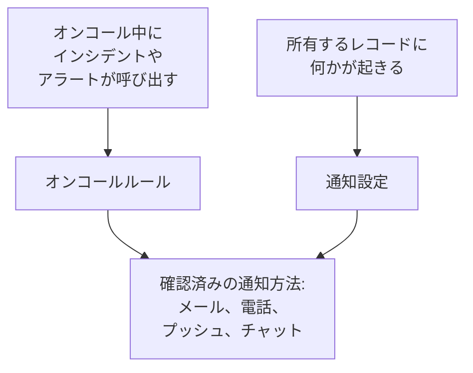

# OneUptime からの連絡の仕組み

OneUptime からの連絡には 2 つの経路があります。オンコール中にインシデントやアラートが発生するとあなたを呼び出し、あなたが所有するものの最新情報を届けます。たとえば、あなたのインシデントへのメモ、ステータスが変わったモニター、次のシフトです。どちらも、プロジェクトごとに **ユーザー設定** で管理する連絡先に届きます。このページでは、各要素がどう組み合わさるのか、どこにあるのか、最初に何が用意されているのかを説明します。

:::cards
- [3 つのページ、3 つの問い](#3-つのページ3-つの問い): 通知方法、オンコールルール、通知設定と、それぞれが決めること。
- [各ページの場所](#各ページの場所): ユーザー設定のページを、セクションごとに。
- [最初に用意されているもの](#最初に用意されているもの): 新しいメンバーが受け取る通知方法、ルール、設定。
- [一致するルールがないとき](#一致するルールがないとき): それでも呼び出しが届く仕組みと、誰に知らされるか。
:::

## 仕組み

- オンコールポリシーは、エスカレーションルールのいずれかがあなた、あなたが所属するチーム、またはあなたがオンコール中のスケジュールを指定すると、あなたを呼び出します。次に、あなたのオンコールルールが、OneUptime がどの通知方法を、どれだけ経ってから試すかを決めます。
- あなたが所有するレコードやあなたのシフトに何かが起きると、通知設定が、その最新情報をどのチャネルに送るかを決めます。
- どちらの場合も、OneUptime が使うのは、呼び出しや最新情報の発生元のプロジェクトで確認済みの通知方法だけです。

## 3 つのページ、3 つの問い

| ページ | 内容 | 答える問い |
| --- | --- | --- |
| **通知方法** | メールアドレス、電話番号、WhatsApp 番号、Telegram・Slack・Microsoft Teams のアカウント、プッシュデバイス、Webhook | OneUptime はどこで私に連絡できるか？ |
| **オンコールルール** | 呼び出しの種類と重大度ごとに、どの通知方法をどれだけ経ってから試すか | オンコール中、どのように呼び出されるか？ |
| **通知設定** | 所有するレコードやシフトについてのイベントごとに、どのチャネルを使うか | ほかに何を、どこで知らされるか？ |

これらは意図的に分かれています。 **通知設定** ですべてのチャネルをオンにしても呼び出されることはなく、確認していない通知方法は、ルールに何が書かれていても使われません。

> [!IMPORTANT]
> 通知方法、ルール、設定は 1 つのプロジェクトに属します。作業するすべてのプロジェクトで設定してください。 **ユーザー設定** には、常に今いるプロジェクトの設定が表示されます。

## 各ページの場所

上部バーの下にあるバーの右側から **ユーザー設定** を開きます。そのサイドメニューに、OneUptime があなたに連絡する方法に関するすべてがあります。

| セクション | ページ |
| --- | --- |
| **はじめに** | **セットアップチェックリスト** : まだ設定が必要なものを、重要な順に |
| **アラートと通知** | **通知方法**、 **オンコールルール**、 **通知設定**、そして最新情報を何通のメールにまとめるかを設定する **メール設定** |
| **オンコールログ** | **オンコールログ** : このプロジェクトであなたが呼び出されたすべての記録と、送信された内容 |
| **着信ポリシー** | **着信用の電話番号** : 着信ポリシーがあなたを呼び出す番号 |
| **カレンダー** | **カレンダーフィード** : カレンダーアプリに表示されるシフトと、開始前のリマインダー |
| **プロフィール** | **カスタムフィールド** : プロジェクトがメンバーに求める情報 |
| **ワークスペース** | **Slack** と **Microsoft Teams** : プロジェクトが接続した各ワークスペースでのあなた自身のアカウント |

**はじめに** と **アラートと通知** は開いた状態で、ほかのセクションは折りたたまれています。セクションのページにいるときは、そのセクションが自動的に開きます。 **ワークスペース** は、プロジェクトが Slack または Microsoft Teams を接続している場合にのみ表示されます。

プロジェクトの所有者と管理者も、あなたの設定を確認できます。 **ユーザー** であなたの行を開き、その **オンコール** セクションで **準備状況**、 **通知方法**、 **オンコールルール** を表示します。そこであなたの通知方法を追加することもできますが、コードはその通知方法自体に送られるため、確認できるのはあなただけです。

## 最初に用意されているもの

確認済みのサインイン用メールアドレスでプロジェクトに参加すると、呼び出しが必ず届くように、OneUptime が次のように設定します。

1. サインイン用のメールアドレスが、確認済みのメールの通知方法として追加されます。
2. **オンコールルール** の 4 つのタブのそれぞれで、すべての重大度について、呼び出されるとすぐにメールを送るルールが追加されます。
3. 所有するものやシフトについての一連の最新情報が、メールでオンになります。 [通知設定](/docs/notifications/notification-settings#新しいメンバーでオンになっているもの) を参照してください。

後から確認する通知方法にも同じルールが追加されます。すべての重大度に 1 つずつ、呼び出されるとすぐに送られるルールです。そのため、SMS 用の電話番号を確認すると、すべての呼び出しで SMS も届くようになります。SMS を重大な呼び出しだけに絞るには、ほかの重大度の SMS ルールを削除してください。 [個人のオンコールルール](/docs/notifications/on-call-rules#最初に用意されているルール) を参照してください。

## セットアップチェックリスト

**ユーザー設定 → セットアップチェックリスト** を開くと、 **セットアップのチェックリスト** が表示されます。OneUptime があなたに連絡するために必要なすべてを、重要な順に並べたものです。各ステップはそれを行うページにリンクしており、 **再確認** ですべてを読み直します。

| セクション | 確認する内容 |
| --- | --- |
| **連絡を受け取るために** | 通知方法があり、追加したすべての通知方法が確認済みで、そのうち少なくとも一つが、プロジェクトでオンになっているチャネルのものであること |
| **呼び出しの受け方** | **オンコールルール** の四つのタブのそれぞれで、すべての重大度にルールがあること |
| **最新情報の入手** | シフトの開始が知らされ、 **通知設定** でオンにしたすべてのチャネルに確認済みの通知方法があること |
| **あると便利** | 着信用の番号、Slack と Microsoft Teams のアカウント、カレンダーのリンク、プロフィールのフィールド |

プッシュは **最新情報の入手** では数えられません。必要なのはモバイルアプリだけで、新しいメンバーがプッシュで受け取る更新はすべてメールでも届くためです。

**あると便利** は進捗バーに数えられず、ほかの人にしか直せないステップも数えられません。上部の一文が状況をまとめます。

| 見出し | 意味 |
| --- | --- |
| **準備は完了です** | 呼び出しが届き、やるべきことは残っていません |
| **まだいくつか設定が必要です** | ルールのない重大度があるか、まだ終わっていないステップがあります |
| **まだ連絡を受け取れる方法がありません** | 使える通知方法がありません。どれも確認されていないか、確認済みのものがすべて、このプロジェクトでオフになっているチャネルのものです |
| **設定は完了しています。現在はオンコール担当ではありません** | ポリシーにあなたが指定される日に向けて、すべての準備ができています |

## 一致するルールがないとき

ルールのない種類と重大度で呼び出されることがあります。たとえば、あなたの参加後に追加された重大度です。その場合も OneUptime は、確認済みのものを使ってあなたを呼び出します。

1. 持っているすべての無料の通知方法: プッシュデバイス、メールアドレス、Slack、Microsoft Teams。
2. それらが一つもなければ、有料の通知方法を一つ、SMS、電話、WhatsApp、Telegram の順で。確認済みで、プロジェクトでオンになっているチャネルの最初のものです。
3. それもなければ、Webhook。

その旨のメールがあなたに届き、オンコールポリシーの所有者にも届きます。ポリシーに所有者がいない場合は、プロジェクトの所有者に届きます。確認済みのものが何もなければ呼び出しは配信できず、メールにはそのことが書かれます。これらのメールは呼び出しが続く間は抑えられるので、大量の呼び出しが大量のメールになることはありません。不足しているルールを追加するには、 [個人のオンコールルール](/docs/notifications/on-call-rules#重大度にルールがないとき) を参照してください。

## トラブルシューティング

:::details オンコール中だったのに、何も届かなかった
**ユーザー設定 → オンコールログ** を開きます。そのインシデントの行がなければ、オンコールポリシーはあなたを呼び出していません。エスカレーションルールと、誰がオンコールだったかを確認してください。ステータスが **エラー** の行では、 **ステータスメッセージを表示** に理由が表示されます。たとえば、プロジェクトがオフにしたチャネルです。次に、通知方法が確認済みであること、そして **セットアップのチェックリスト** の **連絡を受け取るために** に何も残っていないことを確認してください。
:::

:::details 頼んでいないレコードについてメールが届く
あなたは直接、またはチームを通じてそのレコードの所有者です。あるいは、そのレコードに所有者がおらず、あなたがプロジェクトの所有者です。 **ユーザー設定 → 通知設定** でそのイベントをオフにするか、 **ユーザー設定 → メール設定** で量を減らしてください。
:::

:::details 電話番号を追加したのに、ルールに入っていない
番号は確認されるとルールに加わります。その行の **確認** をクリックしてコードを入力してください。カードに追加ボタンがない場合、プロジェクトでそのチャネルがオフになっています。 [通知方法](/docs/notifications/notification-methods#プロジェクトでチャネルをオンにする) を参照してください。
:::

## 次のステップ

:::cards
- [通知方法](/docs/notifications/notification-methods): OneUptime があなたに連絡できる連絡先を追加して確認します。
- [個人のオンコールルール](/docs/notifications/on-call-rules): 各呼び出しがどの通知方法をいつ試すかを決めます。
- [通知設定](/docs/notifications/notification-settings): 知らされる最新情報と、そのチャネルを選びます。
- [エスカレーションルール](/docs/on-call/escalation-rules): オンコールポリシーが誰を呼び出すかを、レベルごとに決める仕組み。
:::
