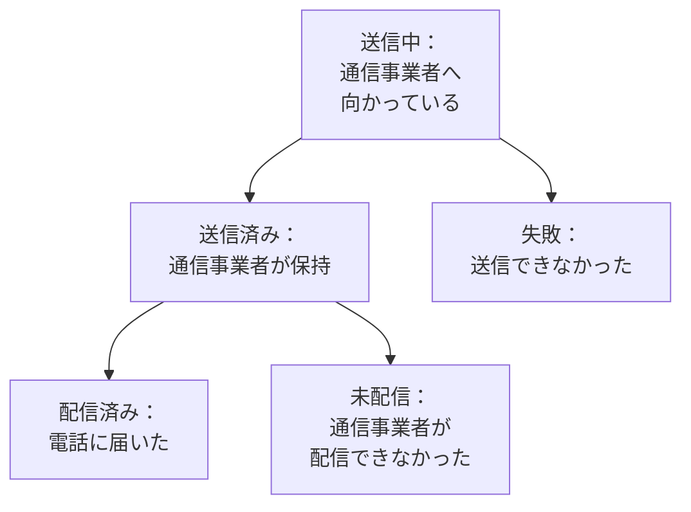

# 通知ログ

通知ログには、OneUptime がプロジェクトのために送信したすべてのメッセージが、チャネルごとのタブに一覧表示され、それぞれがどうなったか（送信されたか、届いたか、届かなかった場合はその理由）がわかります。**プロジェクト設定 → 通知 → 通知ログ** で開くか、インシデント、アラート、メンテナンスイベント、ステータスページ、オンコールポリシーの **通知ログ** で、それについて送信された内容を確認できます。

:::cards
- [ステータスの見方](#ステータスの見方): 色がメッセージの現在地を示し、ポイントすると意味が表示されます。
- [SMS](#sms): 通信事業者の報告に沿って、送信中、送信済み、配信済みと進みます。
- [通話](#通話): 発信中のあと、通話がどう終わったかが表示されます。
- [WhatsApp と Telegram](#whatsapp-と-telegram): 各アプリがメッセージを受け付けたあとに報告する内容です。
- [メール、プッシュ、Webhook、ワークスペース](#メールプッシュwebhookワークスペース): 成功、またはエラーとその理由です。
- [SMS が送信済みのままのとき](#sms-が送信済みのままのとき): 報告を返さない通信事業者と、届かない報告です。
:::

## ステータスの見方

各ステータスは色付きのラベルで、その色がメッセージの現在地を示します。

| 色 | メッセージの現在地 |
| --- | --- |
| グレー | 引き渡したが、まだ何も返ってきていない状態です（例: **送信中**）。 |
| 青 | プロバイダーが受け取り、どう終わったかをまだ報告していない状態です（例: SMS の **送信済み**、通話の **発信中**）。 |
| 緑 | 相手に届いた状態（例: **配信済み**）、またはこれが最後のステータスです。 |
| 黄 | 電話には届いたが誰も応答しなかった状態（例: **不在着信**）、または警告付きで送信された状態です。 |
| 赤 | 相手に届かなかった状態です（例: **未配信**、**失敗**、**エラー**、**残高不足**）。 |

ステータスをポイントするか、タップするか、Tab キーで移動すると、その意味と次に起こることが表示されます。行のメニューの **ステータスメッセージを表示** には、メッセージの ID や失敗の理由など、プロバイダーの応答が表示されます。各タブの **ステータス** フィルターには、そのタブに表示されうるすべてのステータスが、メッセージが通過する順に並びます。

## SMS

| ステータス | 意味 |
| --- | --- |
| **送信中** | OneUptime が SMS を Twilio に渡し、Twilio が通信事業者に送っています。 |
| **送信済み** | 通信事業者が SMS を受け付けました。通信事業者から報告が届くと **配信済み** または **未配信** に変わります。 |
| **配信済み** | SMS が電話に届いたことを通信事業者が確認しました。届いた SMS の最後のステータスです。 |
| **未配信** | 通信事業者は配信できませんでした。理由は **エラーコード** でわかります。`30003` は電源が切れているか圏外の電話、`30005` は存在しない番号、`30006` は固定電話、`30007` は通信事業者がフィルタリングしたメッセージです。 |
| **失敗** | Twilio は送信できませんでした。理由は **エラーコード** でわかります。 |
| **エラー** | 送信されませんでした。たとえば、プロジェクトで SMS がオフになっている、または Twilio が番号を拒否した場合です。理由は **ステータスメッセージを表示** でわかります。 |
| **残高不足** | 送信されませんでした。プロジェクトの残高が足りず、料金を払えませんでした。 |
| **成功** | OneUptime が配信状況を追跡する前に送信され、Twilio が受け付けたものです。 |

サーバー自身の SMS・通話ゲートウェイが受け付けた SMS は、緑の **送信済み** のままです。ゲートウェイは配信状況を報告しないため、これが最後のステータスです。

Twilio は変化があるたびに、SMS を送信したアカウントの認証トークンで署名して OneUptime に報告し、OneUptime は Twilio からでない報告をすべて拒否します。そのためには、Twilio があなたのサーバーに到達できる必要があります。詳しくは [Twilio 統合](/docs/self-hosted/twilio-integration) をご覧ください。

## 通話

| ステータス | 意味 |
| --- | --- |
| **発信中** | Twilio が通話を発信しました。Twilio が通話の終わり方を報告すると変わります。 |
| **成功** | 通話に応答があり、通話時間は **ステータスメッセージを表示** でわかります。サーバー自身の SMS・通話ゲートウェイが受け付けた通話は、ゲートウェイが受け付けた時点で **成功** になります。 |
| **不在着信** | 呼び出しましたが、誰も応答しませんでした。 |
| **取り込み中** | 話し中だったか、通話が拒否されました。 |
| **留守番電話** | オンコールの通話に留守番電話が応答しました。メッセージが残されたかどうかは **ステータスメッセージを表示** でわかります。 |
| **エラー** | 通話を発信または接続できませんでした。 |
| **残高不足** | 発信されませんでした。プロジェクトの残高が足りず、料金を払えませんでした。 |

## WhatsApp と Telegram

WhatsApp のメッセージは、OneUptime が引き渡している間は **キュー投入済み**、WhatsApp が受け付けると **送信済み**、電話に届くと **配信済み**、相手が既読通知を共有していれば開封されると **既読** になります。**失敗** は WhatsApp が配信できなかったメッセージ、**警告** は警告付きで送信されたメッセージです。WhatsApp が報告した内容は **ステータスメッセージを表示** でわかります。**エラー** と **残高不足** は、SMS と同じく送信されなかったことを意味します。

Telegram はメッセージを受け付けたあと何も報告しないため、Telegram のメッセージの **送信済み** は緑です。Telegram がチャットに投稿しており、これが最後のステータスです。

## メール、プッシュ、Webhook、ワークスペース

これらのタブには **成功** または **エラー** が表示されます。**成功** は最後のステータスです。メールサーバーがメールを受け付けた、プッシュサービスが通知を受け付けた、Webhook のアドレスがリクエストを受け取ったと応答した、またはワークスペースが求められた操作を行ったことを意味します。メールサーバーが受け付けたあとのメールを OneUptime は追跡しません。プッシュ通知は、配信されなかったと後でプッシュサービスが報告すると **エラー** に変わります。メッセージが **エラー** になった理由は **ステータスメッセージを表示** でわかり、**ワークスペース** タブでは **理由** でもわかります。

## SMS が送信済みのままのとき

**送信済み** は、通信事業者が SMS を保持していて、まだ報告を返していないことを意味します。多くの通信事業者は数秒から数分で報告しますが、報告しない事業者もあります。その場合は Twilio も SMS を `sent` のままにし（メッセージログでも確認できます）、OneUptime は届いたかどうかを知ることができません。

SMS が **送信中** のままなら、別の問題です。Twilio の報告が OneUptime に届いていません。Twilio があなたのサーバーに到達できるかを確認し、サーバーのログで `Twilio callback refused` で始まる行を探してください。詳しくは [Twilio 統合](/docs/self-hosted/twilio-integration) をご覧ください。

## 次のステップ

:::cards
- [Twilio 統合](/docs/self-hosted/twilio-integration): Twilio を接続し、配信の報告が OneUptime に届くようにします。
- [SMS・通話ゲートウェイ](/docs/self-hosted/sms-and-call-gateway): 独自のゲートウェイで SMS と通話を送信します。
- [通知配信メトリクス](/docs/self-hosted/notification-delivery-metrics): インストール全体で配信された件数を数えます。
:::
