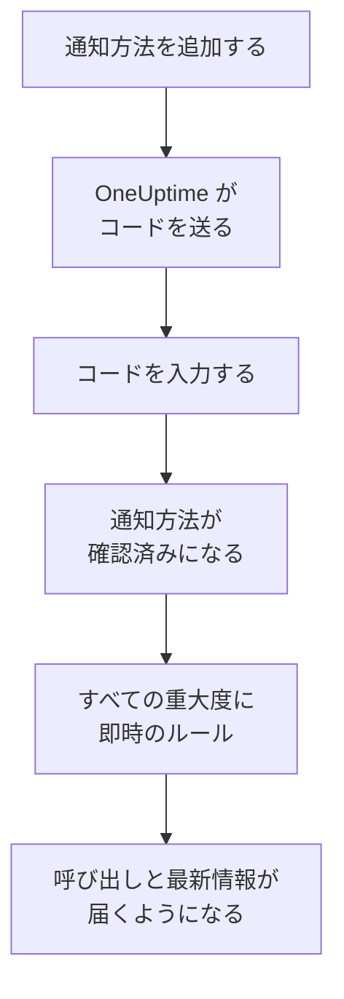

# 通知方法

通知方法とは、1 つのプロジェクトで OneUptime があなたに連絡できる連絡先のことです。メールアドレス、SMS や通話用の電話番号、WhatsApp 番号、Telegram アカウント、Slack または Microsoft Teams のアカウント、プッシュ通知を受け取るスマートフォンやブラウザー、または Webhook です。 **ユーザー設定 → 通知方法** で追加して確認すると、OneUptime はすぐにそれを呼び出しに使い始めます。

:::cards
- [通知方法を選ぶ](#通知方法を選ぶ): それぞれの通知方法に必要なものと、確認の方法。
- [通知方法を追加して確認する](#通知方法を追加して確認する): メール、SMS、通話、WhatsApp を 6 桁のコードで。
- [Webhook](#webhook): 呼び出しを独自のエンドポイントに、必要なら署名付きで送ります。
- [プロジェクトでチャネルをオンにする](#プロジェクトでチャネルをオンにする): SMS、通話、WhatsApp、Telegram が表示されない理由。
:::

## 通知方法が使われるまで



確認していない通知方法が使われることはありません。プッシュデバイス、Slack、Microsoft Teams、Webhook ではコードは不要です。デバイスの登録やアカウントのリンクで自分のものであることが証明され、Webhook には証明が要りません。通知方法を確認すると、その通知方法の [デフォルトのルール](/docs/notifications/on-call-rules#最初に用意されているルール) がすぐに追加されるため、新しい電話番号は、ルールを変更するまですべての重大度であなたを呼び出します。

## 通知方法を選ぶ

**通知方法** の各タブには、通知方法の種類ごとに 1 枚ずつ、カードがあります。

| カード | タブ | 追加するもの | 確認の方法 |
| --- | --- | --- | --- |
| **通知用メールアドレス** | **直接の連絡先** | メールアドレス | メールで届くコード |
| **電話番号 SMS 通知用** | **直接の連絡先** | 電話番号 | SMS で届くコード |
| **通話通知用の電話番号** | **直接の連絡先** | 電話番号 | 通話で読み上げられるコード。SMS 用に確認済みの番号なら不要 |
| **通知用 WhatsApp 番号** | **直接の連絡先** | WhatsApp 番号 | WhatsApp で届くコード |
| **通知用の Telegram アカウント** | **直接の連絡先** | あなたの Telegram アカウント | OneUptime ボットへのメッセージ |
| **通知用の Slack アカウント** | **ワークスペースアプリ** | あなたの Slack アカウント | プロジェクトのワークスペースにアカウントをリンクすること |
| **通知用の Microsoft Teams アカウント** | **ワークスペースアプリ** | あなたの Microsoft Teams アカウント | プロジェクトのワークスペースにアカウントをリンクすること |
| **プッシュ通知デバイス** | **プッシュ通知** | OneUptime On-Call アプリを入れたスマートフォン、またはブラウザー | デバイスの登録 |
| **通知用 Webhook** | **Webhook** | 独自の HTTPS エンドポイント | 不要 |

**ワークスペースアプリ** は、プロジェクトが Slack または Microsoft Teams を接続している場合にのみ表示され、接続したものだけが含まれます。SMS、通話、WhatsApp、Telegram はプロジェクト全体でオフにできます。 [プロジェクトでチャネルをオンにする](#プロジェクトでチャネルをオンにする) を参照してください。

## 通知方法を追加して確認する

メールアドレス、SMS 用の番号、通話用の番号、WhatsApp 番号は、6 桁のコードで確認します。

:::steps
### 通知方法を開く

**ユーザー設定 → 通知方法** に移動します。最初のタブは **直接の連絡先** です。

### 連絡先を追加する

通知方法のカードで、 **電話番号 SMS 通知用を追加** などの追加ボタンをクリックします。 **メール**、または `+11234567890` のような国際形式の **電話番号** を入力して保存します。

### コードを入力する

確認のダイアログが自動的に開き、コードの送信先と有効期限が表示されます。 **確認コード** にコードを入力し、 **確認** をクリックします。

### 行の表示を確かめる

行に **確認済み** と表示されます。ダイアログを早く閉じてしまった場合は、行の **確認** をクリックすると再び開きます。
:::

- コードの有効期間は 15 分です。5 回間違えるとコードは無効になり、新しいコードが必要です。
- ダイアログには **Send a new code** があり、通話用の番号では **Call me with a new code** があります。新しいコードは、前回から 1 分経つと要求できます。
- SMS 用に確認した番号は、通話用にも確認済みになります。 **通話通知用の電話番号** に追加する際にコードは不要で、SMS 用の番号を確認すると、その番号用に追加した通話用の番号も確認されます。
- サインイン用のメールアドレスは、プロジェクトに参加した日から、確認済みの状態で登録されています。

## Telegram をリンクする

:::steps
### アカウントを追加する

**通知用の Telegram アカウント** で **Telegram アカウントを追加** をクリックします。 **Telegram ハンドル (任意)** は自分用のラベルにすぎず、空のままでもかまいません。

### ボットにメッセージを送る

新しい行の **確認** をクリックします。 **Telegram アカウントを確認** ダイアログには、OneUptime ボットに連絡する方法が 3 つあります。スマートフォンで QR コードを読み取る、 **Telegram で開く** をクリックする、または Telegram でボットを検索し、ダイアログに表示される `/start` コマンドを送る、のいずれかです。

### 確定する

OneUptime に戻り、 **メッセージを送信しました — 確認してください:** をクリックします。ボットにメッセージが届くと、アカウントが確認済みになります。
:::

**コードをローテーション** は、まだ確認されていないアカウントの新しいコードを作成します。以前の QR コードと、開いたリンクは使えなくなります。セルフホストの OneUptime では、誰かがアカウントをリンクする前に、サーバーの管理者が Telegram ボットを接続します。

## Slack と Microsoft Teams

1. 自分のアカウントをプロジェクトのワークスペースにリンクします: **ユーザー設定 → ワークスペース → Slack**、または **Microsoft Teams**。 [Slack](/docs/workspace-connections/slack) と [Microsoft Teams](/docs/workspace-connections/microsoft-teams) を参照してください。
2. **ワークスペースアプリ** タブで、 **Slack アカウントを追加** または **Microsoft Teams アカウントを追加** をクリックします。アカウントは追加と同時に確認済みになります。
3. その行の **テストメッセージを送信** をクリックします。呼び出しは OneUptime アプリからのダイレクトメッセージとして届きます。

## プッシュ通知

**プッシュ通知** タブには、 **プッシュ通知デバイス** が一覧表示されます。

- **スマートフォン。** OneUptime On-Call アプリをインストールし、あなたの OneUptime に接続してサインインし、通知を許可します。スマートフォンが自動的にこの一覧に追加されます。 [アプリの概要](/docs/mobile-desktop-apps/index) を参照してください。
- **このブラウザー。** **デバイスを登録** をクリックし、 **デバイス名** を付けて、ブラウザーに求められたら通知を許可します。
- デバイスの行の **テスト通知** は、そのデバイスに今すぐプッシュを送ります。
- **重大アラート** は、スマートフォンへの呼び出しがマナーモードやおやすみモードでも鳴るかどうかを示します。これはアプリでオンにするもので、ここではオンにできず、ブラウザーではそもそもできません。 [重大なオンコールアラート](/docs/self-hosted/push-notifications#重大なオンコールアラート-サイレントモードを上書き) を参照してください。
- **通知を受信していません** と表示されたデバイスには何も送られません。そのスマートフォンでアプリを開くか、ブラウザーを再登録すると元に戻ります。

## Webhook

Webhook は、各呼び出しを JSON としてあなたの HTTPS エンドポイントに送信し、独自のツールで処理できるようにします。

:::steps
### Webhook を追加する

**Webhook** タブで **Webhookを追加** をクリックします。わかりやすい **名前**、 **Webhook URL**、 **署名シークレット（任意）** を入力します。

### テストを送信する

その行の **テストを送信** をクリックします。エンドポイントには、 `eventType` が `test` のイベントが届きます。

### 届く内容を確かめる

呼び出しは、以下のような JSON の `POST` です。10 秒以内に任意の `2xx` ステータスで応答してください。リダイレクトはたどられません。
:::

```json title="A page, as your endpoint receives it"
{
  "eventType": "on-call.incident.created",
  "timestamp": "2026-10-15T09:30:00.000Z",
  "projectId": "6a3f0d2e-1c4b-4e8a-9b7d-2f5c8e1a0b3c",
  "userId": "0c9e8d7f-6b5a-4c3d-8e2f-1a0b9c8d7e6f",
  "incident": {
    "id": "5b4a3c2d-1e0f-4a9b-8c7d-6e5f4a3b2c1d",
    "title": "Checkout API is down",
    "description": "Health check failed from 3 probes.",
    "incidentNumber": 42,
    "incidentNumberWithPrefix": "INC-42",
    "severity": "Critical Incident",
    "state": "Identified"
  },
  "onCallPolicyId": "7d6c5b4a-3e2f-4d1c-9b8a-7f6e5d4c3b2a",
  "onCallPolicyEscalationRuleId": "8e7d6c5b-4a3f-4e2d-8c1b-9a8f7e6d5c4b"
}
```

| `eventType` | 送信の対象 | レコードのキー |
| --- | --- | --- |
| `on-call.incident.created` | インシデント | `incident` |
| `on-call.alert.created` | アラート | `alert` |
| `on-call.incidentEpisode.created` | インシデントのエピソード | `incidentEpisode` |
| `on-call.alertEpisode.created` | アラートのエピソード | `alertEpisode` |

**通知設定** で Webhook に対してオンにした最新情報も、同じエンドポイントに届きます。 `eventType` にはその設定のイベントが、 `subject` と `message` には短い要約が入ります。

すべてのリクエストには、イベントの種類を示す `X-OneUptime-Event` が付きます。署名シークレットがある場合は `X-OneUptime-Signature` も付き、 `sha256=` の後に、未加工の本文の HMAC-SHA256 が 16 進数で続きます。リクエストを信頼する前に検証してください:

```javascript title="verify-signature.js"
const crypto = require("crypto");

// rawBody: the request body exactly as it arrived, before any JSON parsing.
function isFromOneUptime(rawBody, signatureHeader, secret) {
  const expected =
    "sha256=" + crypto.createHmac("sha256", secret).update(rawBody).digest("hex");
  const received = Buffer.from(signatureHeader || "");
  const wanted = Buffer.from(expected);
  return received.length === wanted.length && crypto.timingSafeEqual(received, wanted);
}
```

Webhook は確認が不要なため、追加するとすぐにルールが追加されます。プライベートアドレスや内部アドレスは、セルフホストのサーバーの管理者が許可しない限り拒否されます。 [プライベートネットワークへのアクセス](/docs/self-hosted/private-network-access#webhook-とワークフロー) を参照してください。

## プロジェクトでチャネルをオンにする

**SMS**、 **音声通話**、 **WhatsApp**、 **Telegram** は、メッセージごとに費用がかかるため、新しいプロジェクトではすべてオフで始まります。OneUptime Cloud ではプロジェクトの残高から支払われ、プロジェクトのデフォルトの Twilio アカウントがそれらを送る場合、SMS と通話は代わりにそのアカウントを経由します。メール、プッシュ、Slack、Microsoft Teams、Webhook は常にオンです。

チャネルがオフの間は、プロジェクトの誰もそのチャネルの通知方法を追加できません。カードに追加ボタンがなく、誰がオンにできるかが表示されます。オンにするのは、プロジェクトの所有者、 **請求管理者**、または **Manage Billing** の権限を持つ人で、 **プロジェクト設定 → 通知 → 通知設定** の **通知チャネル** カードで行います。プロジェクトの管理者にはできません。セルフホストの OneUptime では、SMS と通話には Twilio アカウントも必要で、Telegram にはサーバーの管理者が接続するボットが必要です。 [Twilio 統合](/docs/self-hosted/twilio-integration) を参照してください。

## 通知方法を削除する

通知方法の行の **削除** をクリックします。通知方法を削除すると、それを使うオンコールルールもすべて削除されるため、ダイアログはまずそれらのルールの数を示し、削除によってルールが一つもなくなる重大度を挙げます。

## トラブルシューティング

:::details カードに追加ボタンがない
そのチャネルは、このプロジェクトでオフになっています。カードには誰がオンにできるかが表示されます。 [プロジェクトでチャネルをオンにする](#プロジェクトでチャネルをオンにする) を参照してください。
:::

:::details コードが届かない
メールは数分かかることがあり、迷惑メールに振り分けられることもあります。SMS は 1 分ほどかかることがあります。1 分待ってから、ダイアログの **Send a new code** をクリックしてください。 **プロジェクト設定 → 通知 → 通知ログ** で、メッセージに何が起きたかを確認できます。
:::

:::details Slack アカウントを追加できない
先に **ユーザー設定 → ワークスペース → Slack** でアカウントをリンクしてから、もう一度 **Slack アカウントを追加** をクリックしてください。エラーのダイアログに、そこへ移動するボタンがあります。
:::

:::details スマートフォンにプッシュ通知が届かない
スマートフォンが **プッシュ通知デバイス** に表示されていることを確認し、 **テスト通知** を送ってください。 [FAQ とトラブルシューティング](/docs/mobile-desktop-apps/faq-troubleshooting#通知) を参照してください。
:::

## 次のステップ

:::cards
- [個人のオンコールルール](/docs/notifications/on-call-rules): 各呼び出しがどの通知方法をいつ試すかを決めます。
- [通知設定](/docs/notifications/notification-settings): 知らされる最新情報と、そのチャネルを選びます。
- [アプリの概要](/docs/mobile-desktop-apps/index): スマートフォンやデスクトップで呼び出しを受け取ります。
- [OneUptime からの連絡の仕組み](/docs/notifications/index): 通知方法、ルール、設定の関係。
:::
