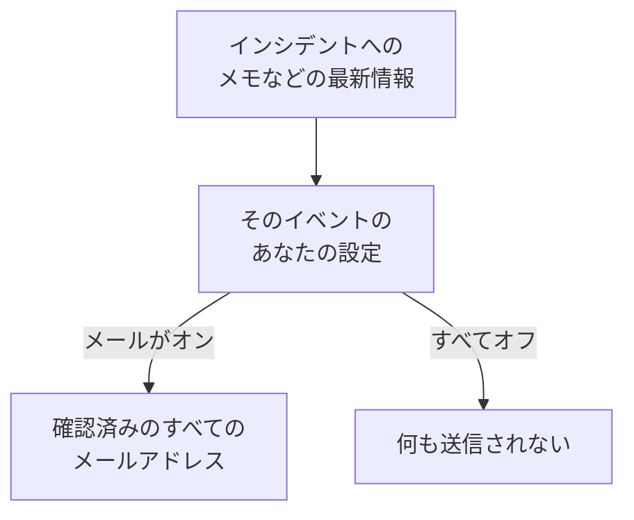

# 通知設定

通知設定は、インシデント、モニター、ステータスページなど、あなたが所有するレコードや、あなた自身のオンコールシフトについて、どの最新情報をどのチャネルで受け取るかを決めます。通知設定であなたが呼び出されることはありません。呼び出しはオンコールルールの役割です。 **ユーザー設定 → 通知設定** で、イベントとチャネルごとに 1 つのスイッチで設定します。

:::cards
- [設定の仕組み](#設定の仕組み): イベントとチャネルごとに 1 つのスイッチで、確認済みのすべての通知方法に送信。
- [設定を変更する](#設定を変更する): 3 回のクリックで、すぐに保存。
- [新しいメンバーでオンになっているもの](#新しいメンバーでオンになっているもの): デフォルトを、タブごとに。
- [メールを減らす](#メールを減らす): 集中した最新情報をまとめるか、定型のものを止めます。
:::

## 設定の仕組み

- 各行がイベントで、各列がチャネルです: メール、SMS、通話、プッシュ、WhatsApp、Telegram、Slack と Microsoft Teams、そして Webhook。Slack と Microsoft Teams は、プロジェクトが接続している場合にのみ列になります。
- オンになっているチャネルは、このプロジェクトでそのチャネルにある確認済みの通知方法の 1 つだけでなく、すべてに送信します。
- オンになっていても、確認済みの通知方法がないチャネルは何も送信しません。 **セットアップのチェックリスト** の **最新情報の入手** にそのことが表示されます。
- 最新情報はレコードの所有者に送られます。所有者として指定された人と、所有者チームのメンバーです。レコードに所有者がいない場合は、代わりにプロジェクトの所有者に送られます。所有者として追加されたことに関するイベントは、追加された人にだけ送られます。
- セキュリティケースには所有者がいません。新しいケースは、プロジェクトのケースを閲覧できる全員に、それぞれが選んだ優先度に応じて送られ、割り当てられたケースは、その割り当て先の人に送られます。 [セキュリティケース](/docs/telemetry/security-cases#通知) を参照してください。
- 所有者に送られるすべてのメールの末尾には、このページに戻る "Manage notification preferences" のリンクがあります。

## 設定を変更する

:::steps
### 設定を開く

**ユーザー設定 → 通知設定** に移動します。タブは **インシデント**、 **アラート**、 **監視**、 **ステータスページ**、 **定期メンテナンス**、 **オンコール**、 **セキュリティ** です。

### イベントを見つける

各タブには、 **インシデント** タブの **インシデントエピソード** のように、1 枚以上のカードがあります。各行がイベントで、いつ送信されるかの説明が付いています。

### チャネルをクリックする

チャネルの丸をクリックするとオンになり、もう一度クリックするとオフになります。チェックマークはオンを意味します。変更は自動的に保存されます。
:::

## 新しいメンバーでオンになっているもの

プロジェクトに参加すると、次のイベントがメールでオンになっています。それ以外はすべてオフで始まり、チャネルをオンにするまで何も送信しません。

| タブ | メールでオン | オンにするまでオフ |
| --- | --- | --- |
| **インシデント** | **インシデントが作成されました**、 **インシデントの状態が変更されました**、 **インシデントのリマインダー**、 **インシデントの SLA 違反**、 **インシデントエピソードが作成されました**、 **インシデントエピソードの状態が変更されました**、 **インシデントがインシデントエピソードに追加されました** | **インシデントのメモが投稿されました**、 **インシデントの所有者として追加されました**、 **インシデントに割り当てられました**、 **インシデントエピソードのメモが投稿されました**、 **インシデントエピソードの所有者として追加されました** |
| **アラート** | **アラートが作成されました**、 **アラートの状態が変更されました**、 **アラートのリマインダー**、 **アラートエピソードが作成されました**、 **アラートエピソードの状態が変更されました**、 **アラートがアラートエピソードに追加されました** | **アラートのメモが投稿されました**、 **アラートの所有者として追加されました**、 **アラートエピソードのメモが投稿されました**、 **アラートエピソードの所有者として追加されました** |
| **監視** | **モニターのプローブのステータスが変更されました**、 **モニターにアクティブなプローブがありません**、 **SLO のステータスが変わりました**、 **SLO の所有者として追加**、 **プローブのステータスが変更されました**、 **プローブの所有者として追加されました** | **モニターが作成されました**、 **モニターのステータスが変更されました**、 **モニターの所有者として追加されました**、 **AI エージェントのステータスが変更されました**、 **AI エージェントの所有者として追加されました** |
| **ステータスページ** | なし | **ステータスページが作成されました**、 **ステータスページのお知らせが投稿されました**、 **ステータスページの所有者として追加されました** |
| **定期メンテナンス** | **メンテナンスのリマインダー** | **メンテナンスイベントが作成されました**、 **メンテナンスの状態が変更されました**、 **メンテナンスのメモが投稿されました**、 **メンテナンスの所有者として追加されました** |
| **オンコール** | **オンコールが開始します**、 **次のオンコール担当はあなたです**、 **オンコールが終了します**、 **オンコールポリシーに追加されました**、 **オンコールポリシーから削除されました**、 **不在着信**、さらにプッシュでも: **オンコールシフト開始前**、 **今後のオンコールシフトが再割り当てされた** | なし |
| **セキュリティ** | プッシュでも: **新しいセキュリティケース** (高と重大のケース)、 **自分に割り当てられたセキュリティケース**、 **自分の承認を待つプレイブックのステップ**、 **セキュリティケースの対応目標**、 **自分に割り当てられたセキュリティケースのタスク**、 **ハントがセキュリティイベントを検出** | なし |

> [!IMPORTANT]
> **モニターのステータスが変更されました** は最初はオフです。所有するモニターがダウンしたときや復旧したときに知らせを受けるには、 **監視** タブでオンにしてください。

## あなたのシフト

**オンコール** タブは、あなたが所有するレコードではなく、あなた自身に関するものです。

- **オンコールが開始します**、 **次のオンコール担当はあなたです**、 **オンコールが終了します** は、あなたが入っているオンコールスケジュールでの順番に従います。
- **オンコールポリシーに追加されました** と **オンコールポリシーから削除されました** は、オンコールポリシーがあなたを指定し始めたとき、または指定しなくなったときに知らせます。
- **オンコールシフト開始前** は、 **ユーザー設定 → カレンダー → カレンダーフィード** で選んだタイミングでリマインダーを送り、 **今後のオンコールシフトが再割り当てされた** は、リマインダーを受けたシフトをほかの人が担当することになったときに知らせます。 [カレンダーフィード](/docs/on-call/calendar-feeds#リマインダーと再割り当ての通知) を参照してください。
- **着信ポリシー** カードの **不在着信** は、発信者が誰にもつながらなかったことを、着信ポリシーの所有者に知らせます。 [着信ポリシー](/docs/on-call/incoming-call-policy#不在着信) を参照してください。

## セキュリティケース

**セキュリティ** タブは、あなたが閲覧できるセキュリティケースに関するものです。

- **新しいセキュリティケース** の名前の下には優先度があります。これは、あなたに通知されるケースの最も低い優先度です。 **重大のみ**、 **中以上**、 **低以上**、 **すべてのケース** のいずれかを選ばない限り、 **高以上** になっています。
- **自分に割り当てられたセキュリティケース** は、あなたと、あなたが所属するチームに割り当てられたケースを対象にします。
- **自分の承認を待つプレイブックのステップ** は、あなたが承認できるケースで、プレイブックのステップを承認または拒否するよう求めます。

[セキュリティケース](/docs/telemetry/security-cases#通知) を参照してください。

## メールを減らす

これらのスイッチは、どの最新情報が届くかを決めるもので、それが何通のメールになるかを決めるものではありません。そのためには **ユーザー設定 → メール設定** に 2 枚のカードがあり、どちらもこのプロジェクトのあなただけに適用されます。

- **メールのまとめ** は、集中した最新情報を 1 通のメールにまとめます。最初のいくつかはこれまでどおり 1 通ずつ届き、残りは数分後にまとめて届きます。
- **定型メールを減らす** カードの **定型メールを減らす** ボタンは、メモ、新しい所有者、新しいモニターとステータスページ、エピソードへの追加、オンコールポリシーの変更に関するメールをオフにします。

[通知のまとめ](/docs/emails/notification-rollup) を参照してください。

## トラブルシューティング

:::details スイッチはオンなのに、何も届かない
**ユーザー設定 → 通知方法** で、そのチャネルに確認済みの通知方法があることを確認してください。SMS、通話、WhatsApp、Telegram では、プロジェクトでもそのチャネルがオンになっている必要があります。
:::

:::details モニターを所有しているのに、ダウンしても知らされない
**モニターのステータスが変更されました** は最初はオフです。 **監視** タブで、そのイベントのチャネルをオンにしてください。
:::

:::details すべてオフにしたのに、まだメールが届く
呼び出しはこれらのスイッチではなくオンコールルールに従います。また、サインイン、セキュリティ、請求に関するメールは、レコードの最新情報ではありません。設定はプロジェクトごとにあるため、メールの送信元のプロジェクトを確認してください。 [個人のオンコールルール](/docs/notifications/on-call-rules) を参照してください。
:::

## 次のステップ

:::cards
- [通知方法](/docs/notifications/notification-methods): 設定の送信先となる通知方法を追加します。
- [個人のオンコールルール](/docs/notifications/on-call-rules): 呼び出しがどのように届くかを決めます。
- [通知のまとめ](/docs/emails/notification-rollup): 集中時には、少なく、まとまったメールに。
- [OneUptime からの連絡の仕組み](/docs/notifications/index): 通知方法、ルール、設定の関係。
:::
