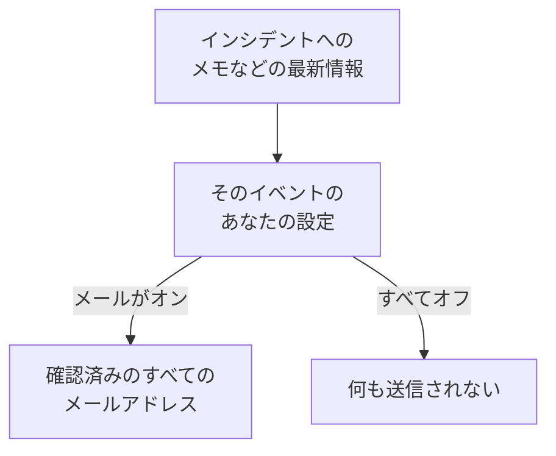

# 通知設定

通知設定は、インシデント、モニター、ステータスページなど、あなたが所有するレコードや、あなた自身のオンコールシフトについて、どの最新情報をどのチャネルで受け取るかを決めます。通知設定であなたが呼び出されることはありません。呼び出しはオンコールルールの役割です。 **ユーザー設定 → 通知設定** で、イベントとチャネルごとに 1 つのスイッチで設定します。

:::cards
- [設定の仕組み](#設定の仕組み): イベントとチャネルごとに 1 つのスイッチで、確認済みのすべての通知方法に送信。
- [設定を変更する](#設定を変更する): 3 回のクリックで、すぐに保存。
- [新しいメンバーでオンになっているもの](#新しいメンバーでオンになっているもの): デフォルトを、タブごとに。
- [メールを減らす](#メールを減らす): 集中した最新情報をまとめるか、定型のものを止めます。
:::

## 設定の仕組み

- 各行がイベントで、各列がチャネルです: メール、SMS、通話、プッシュ、WhatsApp、Telegram、Slack、Microsoft Teams、Mattermost、Webhook。Slack、Microsoft Teams、Mattermost は、プロジェクトが接続している場合にのみ列になります。まだセットアップしていないチャネルは列になりません。タブの上の **まだセットアップされていないチャネル** に、セットアップへのリンクとして表示されます。
- WhatsApp は Meta が承認したメッセージしか配信しません。OneUptime がそのメッセージを持っているのは、インシデント、アラート、エピソード、モニター、プローブ、AI エージェント、ステータスページ、メンテナンスイベント、ほとんどのシフトに関する更新です。SLO のステータス、不在着信、セキュリティケース、サービスの所有者になったことなど、その他の更新には WhatsApp のスイッチがなく、カードに WhatsApp を利用できないと表示されます。これらはほかのチャネルで届きます。
- オンになっているチャネルは、このプロジェクトでそのチャネルにある確認済みの通知方法の 1 つだけでなく、すべてに送信します。
- オンになっていても、確認済みの通知方法がないチャネルは何も送信しません。その列の名前の下には **セットアップ** と表示され、そのスイッチはオフにすることしかできません。 **セットアップのチェックリスト** の **最新情報の入手** にもそのことが表示されます。
- 最新情報はレコードの所有者に送られます。所有者として指定された人と、所有者チームのメンバーです。レコードに所有者がいない場合は、代わりにプロジェクト所有者に送られます。新しいインシデント、アラート、エピソードのオンコールの呼び出しがすでに届いている人には、作成の通知はもう一度は送られません。所有者として追加されたことに関するイベントは、追加された人にだけ送られます。レコードの所有者へ最新情報を送っている途中で OneUptime が止まった場合、まだ届いていなかった人には OneUptime が戻ったときに数分遅れで届き、誰にも 2 回届くことはありません。
- セキュリティケースには所有者がいません。新しいケースは、プロジェクトのケースを閲覧できる全員に、それぞれが選んだ優先度に応じて送られ、割り当てられたケースは、その割り当て先の人に送られます。 [セキュリティケース](/docs/telemetry/security-cases#通知) を参照してください。
- 所有者に送られるすべてのメールの末尾には、このページに戻る "Manage notification preferences" のリンクがあります。

## 設定を変更する

:::steps
### 設定を開く

**ユーザー設定 → 通知設定** に移動します。タブは **インシデント**、 **アラート**、 **監視**、 **ステータスページ**、 **定期メンテナンス**、 **オンコール**、 **セキュリティ** です。

### イベントを見つける

各タブには、 **インシデント** タブの **インシデントエピソード** のように、1 枚以上のカードがあります。各行がイベントで、いつ送信されるかの説明が付いています。カードの上には、そのタブのイベントのうちいくつが、どのチャネルで通知されるかが表示されます。

### チャネルをクリックする

チャネルのスイッチをクリックするとオンになり、もう一度クリックするとオフになります。カードの最初の行 **すべてのイベント** は、カードのすべてのイベントについてチャネルをオンまたはオフにします。変更はすぐに保存され、カードに **保存しました** と表示されます。
:::

## 新しいメンバーでオンになっているもの

プロジェクトに参加すると、次のイベントがメールでオンになっています。それ以外はすべてオフで始まり、チャネルをオンにするまで何も送信しません。

| タブ | メールでオン | オンにするまでオフ |
| --- | --- | --- |
| **インシデント** | **インシデントが作成されました**、 **インシデントの状態が変更されました**、 **インシデントのリマインダー**、 **インシデントの SLA 違反**、 **インシデントエピソードが作成されました**、 **インシデントエピソードの状態が変更されました**、 **インシデントがインシデントエピソードに追加されました** | **インシデントのメモが投稿されました**、 **インシデントの所有者として追加されました**、 **インシデントに割り当てられました**、 **インシデントエピソードのメモが投稿されました**、 **インシデントエピソードの所有者として追加されました** |
| **アラート** | **アラートが作成されました**、 **アラートの状態が変更されました**、 **アラートのリマインダー**、 **アラートエピソードが作成されました**、 **アラートエピソードの状態が変更されました**、 **アラートがアラートエピソードに追加されました** | **アラートのメモが投稿されました**、 **アラートの所有者として追加されました**、 **アラートエピソードのメモが投稿されました**、 **アラートエピソードの所有者として追加されました** |
| **監視** | **モニターのプローブのステータスが変更されました**、 **モニターにアクティブなプローブがありません**、 **SLO のステータスが変わりました**、 **SLO の所有者として追加**、 **自分に割り当てられた例外**、 **プローブのステータスが変更されました**、 **プローブの所有者として追加されました**、 **テーブルの所有者として追加されました**、 **パイプラインの所有者として追加されました**、 **サービスまたはインフラストラクチャの所有者として追加されました**、 **ダッシュボードの所有者として追加されました**、 **ワークフローの所有者として追加されました**、 **Runbook の所有者として追加されました**、 **モニターグループの所有者として追加されました**、 **Runner の所有者として追加されました** | **モニターが作成されました**、 **モニターのステータスが変更されました**、 **モニターの所有者として追加されました**、 **AI エージェントのステータスが変更されました**、 **AI エージェントの所有者として追加されました** |
| **ステータスページ** | **自分の公開メモが承認または却下された**、さらにプッシュでも: **自分の承認を待っている公開メモ** | **ステータスページが作成されました**、 **ステータスページのお知らせが投稿されました**、 **ステータスページの所有者として追加されました** |
| **定期メンテナンス** | **メンテナンスのリマインダー** | **メンテナンスイベントが作成されました**、 **メンテナンスの状態が変更されました**、 **メンテナンスのメモが投稿されました**、 **メンテナンスの所有者として追加されました** |
| **オンコール** | **オンコールが開始します**、 **次のオンコール担当はあなたです**、 **オンコールが終了します**、 **オンコールポリシーに追加されました**、 **オンコールポリシーから削除されました**、 **不在着信**、 **オンコールポリシーの所有者として追加されました**、 **オンコールスケジュールの所有者として追加されました**、 **着信ポリシーの所有者として追加されました**、さらにプッシュでも: **オンコールシフト開始前**、 **今後のオンコールシフトが再割り当てされた** | なし |
| **セキュリティ** | **データストアの所有者として追加されました**、さらにプッシュでも: **新しいセキュリティケース** (高と重大のケース)、 **自分に割り当てられたセキュリティケース**、 **自分の承認を待つプレイブックのステップ**、 **セキュリティケースの対応目標**、 **自分に割り当てられたセキュリティケースのタスク**、 **セキュリティケースのステップが維持されなくなった**、 **ハントがセキュリティイベントを検出** | なし |

> [!IMPORTANT]
> **モニターのステータスが変更されました** は最初はオフです。所有するモニターがダウンしたときや復旧したときに知らせを受けるには、 **監視** タブでオンにしてください。

**サービスまたはインフラストラクチャの所有者として追加されました** は **サービスとインフラストラクチャ** カードにあり、あなたが所有者になるすべてのサービス、RUM アプリケーション、データベース、キュー、ホスト、クラスター、クラウドリソース、その他のインフラストラクチャを 1 つのスイッチで扱います。メッセージには、どれのことかが書かれています。

**モニターグループの所有者として追加されました** は **モニター** カードに、**Runner の所有者として追加されました** は **ダッシュボードと自動化** カードにあり、誰かがあなたをモニターグループまたは Runner の所有者に追加したときに知らせます。

## あなたのシフト

**オンコール** タブは、あなた自身と、あなたが所有するオンコールのレコードに関するものです。

- **オンコールが開始します**、 **次のオンコール担当はあなたです**、 **オンコールが終了します** は、あなたが入っているオンコールスケジュールでの順番に従います。
- **オンコールポリシーに追加されました** と **オンコールポリシーから削除されました** は、オンコールポリシーがあなたを呼び出し始めたとき、または呼び出さなくなったときに知らせます。そのエスカレーションルールのいずれかがあなたを指定したときや指定しなくなったとき、プロジェクトに参加したとき、そのルールのいずれかが指定しているチームに参加したときや抜けたときです。参加や脱退は、ポリシーごとに 1 回、変わったルールをすべて挙げて知らせ、脱退は、そのポリシーのほかの何もあなたを呼び出さなくなったときにだけ知らせます。プロジェクトに参加する前と、プロジェクトから削除されたときには、何も送信されません。
- **オンコールシフト開始前** は、 **ユーザー設定 → プロフィールとカレンダー → カレンダーフィード** で選んだタイミングでリマインダーを送り、 **今後のオンコールシフトが再割り当てされた** は、リマインダーを受けたシフトをほかの人が担当することになったときに知らせます。 [カレンダーフィード](/docs/on-call/calendar-feeds#リマインダーと再割り当ての通知) を参照してください。
- **着信ポリシー** カードの **不在着信** は、発信者が誰にもつながらなかったことを、着信ポリシーの所有者に知らせます。 [着信ポリシー](/docs/on-call/incoming-call-policy#不在着信) を参照してください。
- **オンコールポリシーの所有者として追加されました**、 **オンコールスケジュールの所有者として追加されました**、 **着信ポリシーの所有者として追加されました** は、所有者ルールによって、またはその所有者ページで誰かによって、そのいずれかの所有者にされたときに知らせます。

## セキュリティケース

**セキュリティ** タブは、あなたが閲覧できるセキュリティケースに関するものです。

- **新しいセキュリティケース** の名前の下には優先度があります。これは、あなたに通知されるケースの最も低い優先度です。 **重大のみ**、 **中以上**、 **低以上**、 **すべてのケース** のいずれかを選ばない限り、 **高以上** になっています。
- **自分に割り当てられたセキュリティケース** は、あなたと、あなたが所属するチームに割り当てられたケースを対象にします。
- **自分の承認を待つプレイブックのステップ** は、あなたが承認できるケースで、プレイブックのステップを承認または拒否するよう求めます。

[セキュリティケース](/docs/telemetry/security-cases#通知) を参照してください。

## 公開メモの承認

**ステータスページ** タブの **公開メモの承認** カードは、承認を求めるプロジェクトで、公開前に承認を待つ公開メモについてのものです。

- **自分の承認を待っている公開メモ** は、公開メモやその編集が、あなたが名前で、またはチームを通じて承認するステップを待っていることを知らせます。自分が送ったメモや、自分が承認したステップより後のステップについて尋ねられることはありません。各ステップについて尋ねられるのは一度だけです。メモがそのステップに達したとき、またはメモが待っている間に承認ステップが変わったり、ステップが指名するチームに加わったりして、その承認者の一人になったときです。最初からメールとプッシュでオンになっていて、 **メールのまとめ** で止められることはありません。メモの読み手である顧客がそれを待っているからです。
- **自分の公開メモが承認または却下された** は、あなたが承認を依頼したメモが承認されて公開されたこと、または却下されたことを、理由とともに知らせます。最初からメールでオンになっています。

[公開メモの承認](/docs/incidents/notes-owners-and-feed#公開メモの承認) を参照してください。

## メールを減らす

これらのスイッチは、どの最新情報が届くかを決めるもので、それが何通のメールになるかを決めるものではありません。そのためには **ユーザー設定 → メール設定** に 2 枚のカードがあり、どちらもこのプロジェクトのあなただけに適用されます。

- **メールのまとめ** は、集中した最新情報を 1 通のメールにまとめます。最初のいくつかはこれまでどおり 1 通ずつ届き、残りは数分後にまとめて届きます。
- **定型メールを減らす** カードの **定型メールを減らす** ボタンは、メモ、新しい所有者、新しいモニターとステータスページ、エピソードへの追加、オンコールポリシーの変更に関するメールをオフにします。

[通知のまとめ](/docs/emails/notification-rollup) を参照してください。

## トラブルシューティング

:::details スイッチはオンなのに、何も届かない
**ユーザー設定 → 通知方法** で、そのチャネルに確認済みの通知方法があることを確認してください。SMS、通話、WhatsApp、Telegram では、プロジェクトでもそのチャネルがオンになっている必要があります。
:::

:::details 更新に WhatsApp のスイッチがない
WhatsApp は Meta が承認したメッセージしか配信しませんが、OneUptime にはその更新用のメッセージがないため、カードに WhatsApp を利用できないと表示されます。SMS やプッシュなど、別のチャネルを選んでください。
:::

:::details モニターを所有しているのに、ダウンしても知らされない
**モニターのステータスが変更されました** は最初はオフです。 **監視** タブで、そのイベントのチャネルをオンにしてください。
:::

:::details すべてオフにしたのに、まだメールが届く
呼び出しはこれらのスイッチではなくオンコールルールに従います。また、サインイン、セキュリティ、請求に関するメールは、レコードの最新情報ではありません。設定はプロジェクトごとにあるため、メールの送信元のプロジェクトを確認してください。 [私への連絡方法](/docs/notifications/on-call-rules) を参照してください。
:::

## 次のステップ

:::cards
- [通知方法](/docs/notifications/notification-methods): 設定の送信先となる通知方法を追加します。
- [私への連絡方法](/docs/notifications/on-call-rules): 呼び出しがどのように届くかを決めます。
- [通知のまとめ](/docs/emails/notification-rollup): 集中時には、少なく、まとまったメールに。
- [OneUptime からの連絡の仕組み](/docs/notifications/index): 通知方法、ルール、設定の関係。
:::
