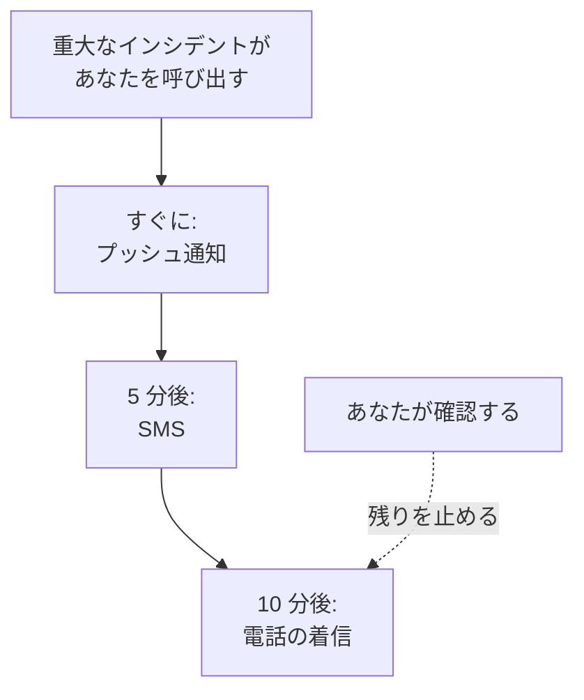

# 個人のオンコールルール

オンコールルールは、呼び出しがどのようにあなたに届くかを決めます。OneUptime があなたの通知方法のどれを、呼び出しの開始からどれだけ経って試すかです。呼び出しの種類ごとに独自のルールがあり、重大度ごとに 1 組ずつあるため、重大なインシデントではすぐに電話をかけ、低いアラートではメールを待つ、といったことができます。 **ユーザー設定 → オンコールルール** で設定します。

> [!NOTE]
> これらのルールはあなただけのものです。 **インシデント → ルール** と **アラート → ルール** にある **オンコールルール** は別物で、新しいインシデントやアラートがどのオンコールポリシーを実行するかを決めます。

:::cards
- [呼び出しが届くまで](#呼び出しが届くまで): 1 件の呼び出しに対するルールを、順を追って。
- [最初に用意されているルール](#最初に用意されているルール): 確認済みの各通知方法が追加するものと、その絞り込み方。
- [ルールを追加する](#ルールを追加する): 1 つの重大度に対する、通知方法と待ち時間。
- [プッシュのルール](#プッシュのルール): マナーモードでも鳴らし、誰かが確認するまで繰り返します。
:::

## 呼び出しが届くまで

オンコールポリシーは、エスカレーションルールのいずれかがあなた、あなたが所属するチーム、またはあなたがオンコール中のスケジュールを指定すると、あなたを呼び出します。次に OneUptime は、その呼び出しの種類と重大度に対するあなたのルールを順に処理します。各ルールは、呼び出しの開始から待ち時間が過ぎると、それぞれの通知方法で送信されます。どのメッセージからでも OneUptime 内でも、インシデントやアラートを確認すると、まだ送信されていないルールはすべて止まります。

ほとんどのメッセージから呼び出しを確認できます。メール、SMS、そして WhatsApp、Telegram、Slack、Microsoft Teams のメッセージには確認用のリンクがあり、電話では 1 を押すよう求められます。呼び出しに対応できない場合は、同じメッセージからエスカレーションでき、電話では 2 を押すよう求められます。ポリシーはすぐ次のレベルを呼び出し、あなたがこの件で再び呼び出されることはありません。詳しくは [呼び出しをエスカレーションする](/docs/on-call/escalation-rules#呼び出しをエスカレーションする) を参照してください。受けた呼び出しはそれぞれ **ユーザー設定 → オンコールログ** に記録され、 **タイムラインを表示** で、送信されたすべてのメッセージと、それが配信されたかどうかを確認できます。

## 4 つのタブ

**ユーザー設定 → オンコールルール** には、呼び出しの種類ごとにタブがあります。各タブには重大度ごとにカードがあり、プロジェクトが付けた名前と色で表示されます。

| タブ | 呼び出しの対象 | カードの対象 |
| --- | --- | --- |
| **インシデント** | インシデント | インシデントの重大度 |
| **インシデントエピソード** | インシデントをまとめたエピソード | インシデントの重大度 |
| **アラート** | アラート | アラートの重大度 |
| **アラートエピソード** | アラートをまとめたエピソード | アラートの重大度 |

エピソードは、含まれるインシデントやアラートとは別に、独自のオンコールポリシーを通じてあなたを呼び出すため、そのルールは専用のタブにあります。ページのアドレスは、 `/dashboard/{projectId}/user-settings/on-call-rules?type=alerts` のように開いているタブを示します。ほかの値は `incident-episodes` と `alert-episodes` で、 `type` がない場合は **インシデント** で開きます。

プロジェクトでアーカイブされた重大度は、ルールがある間は **アーカイブ済み** と表示されて他の重大度の後に並びます。その重大度が付いたままのインシデントやアラートは、これらのルールであなたを呼び出します。ルールの変更や削除はできますが、新しく追加することはできません。

## 最初に用意されているルール

確認したすべての通知方法に、すべてのタブのすべてのカードで、呼び出されるとすぐに送信されるルールが追加されます。サインイン用のメールアドレスには参加した日からこれらのルールがあるため、呼び出しは必ず届きます。SMS 用の電話番号を確認すると、すべての呼び出しで SMS も届くようになります。

これは安全な出発点ですが、たいていは多すぎます。各重大度に見合ったものに絞り込んでください。

| 重大度 | 妥当な組み合わせ |
| --- | --- |
| 重大 | すぐにプッシュ、5 分後に電話 |
| 高い | すぐにプッシュ、10 分後に SMS |
| 軽微または低い | すぐにメール |

あなた自身のルールには、通知を控える時間帯（クワイエットアワー）の設定はありません。低い重大度はメールにするか、 **通常** に設定したプッシュのルールにして、あなたを起こさないようにしてください。低い重大度の呼び出しを全員に対して勤務時間まで待たせるには、それを呼び出すオンコールルールを **勤務時間中のみ** に設定します。 [オンコールルール](/docs/alerts/settings#オンコールルール) を参照してください。

## ルールを追加する

:::steps
### カードを開く

**ユーザー設定 → オンコールルール** に移動し、呼び出しの種類のタブを開いて、重大度のカードを見つけます。

### 通知方法を選ぶ

**通知ルールを追加** をクリックします。 **通知方法** で、確認済みの通知方法を 1 つ選びます。確認していない通知方法は表示されません。

### プッシュの鳴り方を選ぶ

スマートフォンの場合は、 **プッシュ通知** で **重大アラート** または **通常** を選びます。どのプッシュデバイスでも、 **確認されるまで繰り返す** を選びます。 [プッシュのルール](#プッシュのルール) を参照してください。

### 待ち時間を設定する

**次の時間後に通知する** で、 **即時**、 **5 分**、 **10 分**、 **15 分**、 **30 分**、 **1 時間** のいずれかを選びます。その後、ダイアログで **通知ルールを追加** をクリックします。
:::

カードにはルールが待ち時間の順に表示され、それぞれに **通知方法** と **通知するまでの時間** が示されます。

## ルールを変更または削除する

- ルールの行の **編集** で待ち時間を変更します。ルールを別の通知方法に送るには、削除して新しいルールを追加してください。
- プッシュのルールでは、通知方法の下のラベルをクリックすると、 **重大アラート** と **通常** を切り替えたり、繰り返しの頻度を変えたりできます。変更はすぐに保存されます。
- **削除** は最初に確認を求め、その重大度にルールが残らなくなるかどうかを示します。ルールのない重大度は、確認済みの通知方法にフォールバックします。 [重大度にルールがないとき](#重大度にルールがないとき) を参照してください。

## プッシュのルール

スマートフォンを呼び出すルールは、そのプッシュの鳴り方を指定します。

| 選択肢 | スマートフォンの動作 |
| --- | --- |
| **重大アラート** | OneUptime On-Call アプリで Critical On-Call Alerts がオンになっていれば、マナーモードやおやすみモードでも鳴ります。新しいスマートフォンのルールはこれで始まります。 |
| **通常** | スマートフォンの音、マナーモード、おやすみモードの設定に従います。 |

プッシュのルールは、スマートフォンでもブラウザーでも、誰かが確認するまでプッシュを再送できます。 **繰り返さない**（デフォルト）、または **毎分**、 **2 分ごと**、 **3 分ごと**、 **5 分ごと**、 **10 分ごと**、 **15 分ごと**、 **30 分ごと** です。最大でさらに 10 回繰り返し、インシデント、アラート、エピソードが確認されるとすぐに止まります。 [重大なオンコールアラート](/docs/self-hosted/push-notifications#重大なオンコールアラート-サイレントモードを上書き) を参照してください。

## 重大度にルールがないとき

プロジェクトが後から追加した重大度には、数分以内に、そのタブであなたがすでに選んだ内容からルールが作られます。同じ通知方法を、同じ待ち時間で使います。そのタブにルールがなかった場合は、確認済みのメールアドレスに即時に送るルールが追加されます。

それでもルールが見つからない呼び出しは、確認済みの通知方法に送られ、そのことがメールで知らされます。 [一致するルールがないとき](/docs/notifications/index#一致するルールがないとき) を参照してください。

:::details 重大度を意図的にオフにする
API では、 `isOptOut` を設定し、通知方法を持たないオプトアウトのルールを保存できます。この場合、その呼び出しの種類と重大度ではまったく呼び出されず、フォールバックもしません。行には **ミュート - このルールの通知はオフになっています** と表示され、それを削除すると呼び出しが再びオンになります。そのタブのルールがすべてオプトアウトの場合、後から追加された重大度もミュートになります。
:::

:::details プロジェクト全体でフォールバックをオフにする
プロジェクトの所有者、または **Manage Billing** の権限を持つ人は、API でプロジェクトの `disableOnCallNotificationFallback` を設定できます。すると、ルールが見つからない呼び出しは配信されず、そのログには、ユーザーが **ユーザー設定 → オンコールルール** でルールを追加すべきだと記録されます。
:::

## チームメイトのルール

プロジェクトの所有者と管理者は、プロジェクトの誰についても同じページを表示して変更できます。 **ユーザー** でその人を開き、 **オンコール** セクションの **オンコールルール** を開きます。その隣の **準備状況** は、すべての重大度がその人に届くかどうかを示します。ほかの人があなたのルールを追加、変更、削除すると、そのことがメールで届き、各変更はプロジェクトの監査ログに記録されます。

## トラブルシューティング

:::details 重大な呼び出しでスマートフォンが鳴らなかった
ルールのプッシュが **通常** ではなく **重大アラート** であること、そして **ユーザー設定 → 通知方法** の **プッシュ通知** タブで、そのスマートフォンの **重大アラート** がオンになっていることを確認してください。
:::

:::details インシデントごとに 2 回呼び出される
確認済みの各通知方法には、すべての重大度に即時のルールがあります。不要なルールを削除するか、待ち時間を設定してください。エピソード内のインシデントは、2 つのポリシーを通じて、インシデントで 1 回、エピソードで 1 回あなたを呼び出すことがあります。
:::

:::details ルールは SMS なのにメールが届いた
その呼び出しの種類や重大度にルールが見つからず、無料の通知方法にフォールバックしました。正しいタブとカードにルールを追加してください。あるいは、そのメールはあなたが所有するレコードの最新情報で、それはルールではなく **通知設定** に従います。 **オンコールログ** には呼び出しだけが表示されます。
:::

## 次のステップ

:::cards
- [通知方法](/docs/notifications/notification-methods): ルールが使う通知方法を追加して確認します。
- [エスカレーションルール](/docs/on-call/escalation-rules): オンコールポリシーが人を呼び出す仕組みを、レベルごとに。
- [プッシュ通知](/docs/self-hosted/push-notifications): スマートフォンでの重大アラート、アラーム音、繰り返し。
- [OneUptime からの連絡の仕組み](/docs/notifications/index): 通知方法、ルール、設定の関係。
:::
