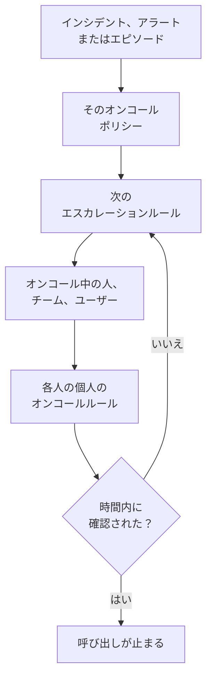

# オンコールの概要

オンコールは、OneUptime が時間を問わず人を問題に向かわせる仕組みです。インシデント、アラート、エピソードに対応者が必要になると、そのオンコールポリシーが誰かが確認するまでレベルごとに人を呼び出し、各人には本人が選んだ方法で連絡が届きます。プッシュ通知、SMS、電話、メール、チャットメッセージのいずれかです。このページでは、各要素がどう組み合わさり、それぞれがどこにあるかを説明します。

:::cards
- [呼び出しが人に届くまで](#呼び出しが人に届くまで): 新しいインシデントから、応答する人まで。
- [構成要素](#構成要素): ポリシー、エスカレーションルール、スケジュール、オーバーライド、個人のルール。
- [オンコールを設定する](#オンコールを設定する): 何もない状態から、呼び出されるチームまで 5 つのステップで。
- [オンコールの場所](#オンコールの場所): オンコールのメニューを、セクションごとに。
:::

## 呼び出しが人に届くまで

1. 新しいインシデント、アラート、エピソードは、作成されるとすぐにそのオンコールポリシーを実行します。対象は、そこで選ばれたポリシーと、オンコールルールが追加するポリシーです。各ポリシーは個別に実行されます。 **勤務時間中のみ** に設定したオンコールルールは、追加したポリシーを勤務時間が始まるまで待たせます。
2. ポリシーの最初のエスカレーションルールはすぐに呼び出します。対象は、そのスケジュールで今オンコール中の人、そのチームの全メンバー、そしてルールが指定するユーザーです。
3. そのうち誰かが不在なら、ユーザーオーバーライドがその人への呼び出しを代理の人に送るか、その人をスキップします。
4. 各人には、その人の個人のオンコールルールを通じて連絡が届きます。ルールは、どの通知方法を、どれだけ経ってから試すかを決めます。ルールのない呼び出しも、その人が確認済みにした通知方法で届きます。
5. ルールの待ち時間が切れる前に誰も確認しなければ、次のルールが呼び出します。最後のルールの後は、ポリシーが繰り返す設定なら最初からやり直し、そうでなければ止まります。

インシデント、アラート、エピソードを確認または解決すると、それに対してまだ呼び出しているすべてのポリシーが止まります。OneUptime は実行中のポリシーを毎分進め、各実行をルールごとに **実行ログ** に記録します。

呼び出しが初めて誰かに届くと、OneUptime はそれをインシデント、アラート、エピソードに `First Paged At` として記録します。測定値はこの時点から数えられます。 **呼び出し後の確認までの時間** は、呼び出された人が応答するまでにかかった時間を測るもので、誰かが呼び出されるまでの待ち時間は含みません。 [呼び出し後の確認までの時間](/docs/incidents/settings#呼び出し後の確認までの時間) を参照してください。

> [!NOTE]
> 確認済みまたは解決済みの状態で作成されたインシデント、アラート、エピソードは、どのポリシーも実行せず、そのフィードにその旨が表示されます。 [確認済みまたは解決済みの状態で作成](/docs/alerts/index#確認済みまたは解決済みの状態で作成) を参照してください。

## 構成要素

| 要素 | 決めること | 詳しく読む |
| --- | --- | --- |
| オンコールポリシー | インシデントやアラートについて、レベルごとに誰を呼び出すか | [オンコールポリシー](/docs/on-call/policies) |
| エスカレーションルール | ポリシーの一つのレベル: 誰を呼び出し、確認をどれだけ待つか | [エスカレーションルール](/docs/on-call/escalation-rules) |
| オンコールスケジュール | 人が交代で担当するなかで、その時々に誰がオンコールか | [オンコールスケジュール](/docs/on-call/schedules) |
| ユーザーオーバーライド | 誰かが不在の間、誰が代理を務めるか | [ユーザーオーバーライド](/docs/on-call/user-overrides) |
| 個人のオンコールルール | 一人の人にどう連絡するか: どの通知方法を、どれだけ経ってから | [個人のオンコールルール](/docs/notifications/on-call-rules) |
| 着信ポリシー | オンコール中の人に着信する電話番号 | [着信ポリシー](/docs/on-call/incoming-call-policy) |

ポリシー、エスカレーションルール、スケジュール、オーバーライドはプロジェクトに属し、 **オンコール** の下にあります。通知方法と個人のオンコールルールは各人に属し、 **ユーザー設定** の下にあります。管理者は誰かの設定を見ることはできますが、電話やメールを確認済みにできるのは本人だけです。 [OneUptime からの連絡の仕組み](/docs/notifications/index) を参照してください。

## オンコールを設定する

:::steps
### スケジュールを作る

**製品** メニューから **オンコール** を開き、 **オンコールスケジュール** に移動します。 **オンコールスケジュールを作成** をクリックして名前を付け、 **誰が交代で担当しますか？** で交代する順に人を選びます。 [オンコールスケジュール](/docs/on-call/schedules) を参照してください。

### ポリシーを作成する

**オンコールポリシー** に移動し、 **オンコールポリシーを作成** をクリックします。 **最初に誰に通知しますか？** でスケジュールを選びます。これがポリシーの最初のエスカレーションルール **Level 1** になり、確認を 30 分待ちます。

### 次のレベルを追加する

ポリシーの **エスカレーションルール** ページで、最初のレベル以降の各レベルについて **エスカレーションルールを追加** をクリックします。同じスケジュールのローテーションの次の人、チームリーダー、マネージャーなどです。 [エスカレーションルール](/docs/on-call/escalation-rules) を参照してください。

### ポリシーを自動で実行する

プロジェクトで最初のポリシーは、作成するときにこれを済ませられます。 **新しいインシデントとアラートのたびにトリガーする** をオンのままにしてください。ほかのポリシーでは、 **インシデント → ルール → オンコールルール** または **アラート → ルール → オンコールルール** に移動し、一致するインシデントやアラートに対してポリシーを実行するルールを追加します。たとえば、すべての重大なインシデントです。 [ポリシーを実行するもの](/docs/on-call/policies#ポリシーを実行するもの) を参照してください。

### 全員に連絡が届くか確認する

**オンコール → 準備状況** を開きます。ポリシーが呼び出せる全員が、 **準備完了**、 **セットアップが必要**、 **到達不能** のいずれかとして、足りないものとともに一覧表示されます。 [準備状況とレポート](/docs/on-call/readiness) を参照してください。
:::

> [!NOTE]
> OneUptime Cloud では、オンコールポリシーとエスカレーションルールはすべてのプランで使えます。オンコールスケジュール、ユーザーオーバーライド、実行ログ、オンコール時間のレポートには **Growth** プランが必要です。

## オンコールの場所

上部バーの **製品** メニューから **オンコール** を開きます。 `/dashboard/{projectId}/on-call-duty/policies` の **オンコールポリシー** が開き、残りはサイドメニューにあります。

| セクション | ページ |
| --- | --- |
| **ポリシー** | **オンコールポリシー** と **準備状況** : ポリシーが実際に連絡できる相手 |
| **スケジュール** | **オンコールスケジュール**、 **スケジュールタイムライン**、 **カレンダーフィード** |
| **着信** | **着信ポリシー** : オンコール中の人に着信する電話番号 |
| **詳細** | **ユーザーオーバーライド**、 **実行ログ**、 **アーカイブ済みポリシー** |
| **レポート** | **ユーザーのオンコール時間** : 各人がどれだけオンコールだったか |
| **ワークスペース** | **Slack** と **Microsoft Teams** : オンコールのイベントをチャネルに投稿するルール |
| **設定** | **カスタムフィールド**、 **ラベルルール**、 **所有者ルール** |
| **開発者** | **Terraform**、 **API**、 **AI アシスタント** : コードから設定するオンコール |

**ポリシー**、 **スケジュール**、 **着信** は開いています。ほかのセクションは折りたたまれた状態で始まり、そのページのいずれかを開いているときは自動で開きます。 **ワークスペース** には、プロジェクトが接続したチャットツールが表示され、接続がなければ **Slack または Teams を接続** が表示されます。

あなたがポリシーのオンコール担当のときは、右上のベルがそれを示します。クリックすると **マイオンコールポリシー** が開き、すべてのプロジェクトで担当しているすべてのポリシーと、直接指定されているのか、チーム経由か、スケジュール経由かがわかります。

## トラブルシューティング

:::details 新しいインシデントで誰も呼び出されなかった
インシデントの **オンコールの実行** ページを開きます。空なら、そのインシデントにはオンコールポリシーがありませんでした。インシデントで選ばれたポリシーがなく、一致するオンコールルールもなかったということです。 **Execution Completed - No One Notified** の実行は、すべてのエスカレーションルールを通っても誰も見つかりませんでした。たいていは、誰もオンコールでないスケジュールです。 [実行ログ](/docs/on-call/policies#実行ログ) を参照してください。 **待機中** の実行は、 **勤務時間中のみ** に設定したオンコールルールのために勤務時間を待っていて、勤務時間が始まるまで誰も呼び出しません。
:::

:::details 誰かが間違ったチャネルで呼び出された、またはまったく呼び出されなかった
**オンコール → 準備状況** を開き、その人の行の **カバー範囲** をクリックします。その人が確認済みにした通知方法と、ルールのないすべての重大度が表示されます。直せるのは本人だけで、 **ユーザー設定** で行います。同じページからセットアップのリマインダーを送ってください。 [準備状況とレポート](/docs/on-call/readiness) を参照してください。OneUptime Cloud では、不明な発信者をブロックする電話がページを鳴らさないことがあります。 [OneUptime の番号](/docs/on-call/phone-number-whitelist) を電話の許可リストに追加してください。
:::

:::details 休暇中の人がまだ呼び出される
**誰が不在ですか？** にその人を指定してユーザーオーバーライドを追加します。 **オンコール → 詳細 → ユーザーオーバーライド** で追加したものはすべてのポリシーに適用され、ポリシー自身の **ユーザーオーバーライド** ページで追加したものはそのポリシーにだけ適用されます。 [ユーザーオーバーライド](/docs/on-call/user-overrides) を参照してください。
:::

## 次のステップ

:::cards
- [オンコールポリシー](/docs/on-call/policies): ポリシーを作成し、何が実行するかを決め、何をしたかを確認します。
- [エスカレーションルール](/docs/on-call/escalation-rules): 誰かが応答するまで、レベルごとに人を呼び出します。
- [オンコールスケジュール](/docs/on-call/schedules): ローテーション、レイヤー、引き継ぎ。
- [OneUptime からの連絡の仕組み](/docs/notifications/index): 各人への連絡方法を決める通知方法とルール。
:::
