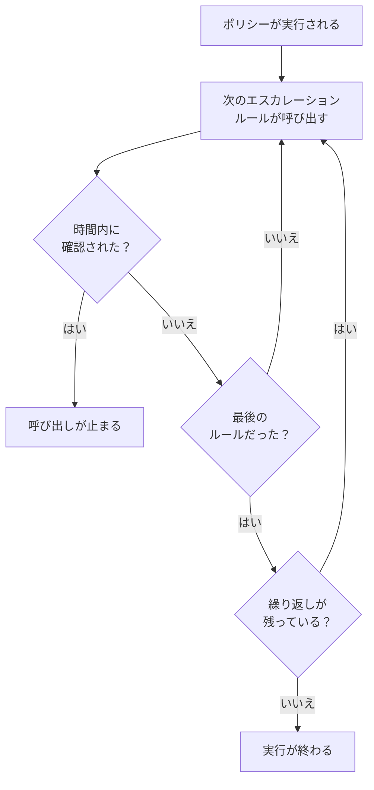

# オンコールポリシー

オンコールポリシーは、インシデントやアラートについて誰を呼び出すか、そして誰も確認しなければ次は誰かを決めます。そのエスカレーションルールがレベルとなり、ポリシーを使うインシデント、アラート、エピソードがそれを実行します。このページでは、ポリシーの作成、ポリシーを実行するもの、ポリシーのページに表示される内容、各実行の記録方法を説明します。

:::cards
- [ポリシーを作成する](#ポリシーを作成する): 名前と、最初に呼び出す相手。
- [ポリシーを実行するもの](#ポリシーを実行するもの): ルール、テンプレート、モニター、チャット、そしてあなた自身。
- [実行ログ](#実行ログ): すべての実行をルールごとに、そして止まった理由。
- [ポリシーをアーカイブまたは削除する](#ポリシーをアーカイブまたは削除する): ポリシーの運用を止めます。
:::

## ポリシーを作成する

:::steps
1. **オンコール → オンコールポリシー** に移動し、 **オンコールポリシーを作成** をクリックします。
2. **名前** を入力します。たとえば「決済プライマリ」です。
3. **最初に誰に通知しますか？** で **対応者を追加** をクリックし、最初に呼び出すオンコールスケジュール、チーム、ユーザーを選びます。
4. **オンコールポリシーを作成** をクリックします。ポリシーはその **エスカレーションルール** ページで開き、 **Level 1** がすでに用意されています。
:::

**最初に誰に通知しますか？** は省略でき、エスカレーションルールを追加できる人にだけ表示されます。空のままにすると、ルールができるまでポリシーは誰も呼び出しません。 **説明** と **ラベル** は **その他の項目** の下にあります。次のレベルを追加するには、 [エスカレーションルール](/docs/on-call/escalation-rules) を参照してください。

オンコールルールを追加できる人には、フォームで **新しいインシデントとアラートのたびにトリガーする** も尋ねられます。 **インシデント → ルール → オンコールルール** と **アラート → ルール → オンコールルール** にルールが 1 つずつ追加され、どちらもすべてに一致してこのポリシーを実行します。プロジェクトにオンコールポリシーもオンコールルールもない間に作る最初のポリシーでは最初からオンで、それ以降のポリシーではオフです。新しいインシデントとアラートのたびに二つのポリシーを実行するかどうかは、自分で決めることだからです。オフのままだと、ルール、モニター、または人が実行するまで、ポリシーは誰も呼び出しません。

代わりに、スマートフォンからテスト呼び出しまで順を追って設定するには、 **ガイド付きセットアップ** をクリックします。空の **オンコールポリシー** 一覧か、 **仕組み** にあります。 [電話、SMS、プッシュで呼び出しを受ける](/docs/guides/paging) を参照してください。

**オンコールポリシー** の一覧には、各ポリシーの **名前**、 **最初の呼び出し先**、 **説明**、 **ラベル**、 **所有者** が表示されます。 **最初の呼び出し先** は、ポリシーの最初のエスカレーションルールが呼び出す相手です。各スケジュールとそのスケジュールで今オンコール中の人、チーム、ユーザーが表示され、誰も呼び出さない場合は **エスカレーションルールなし** または **対応者なし** と表示されます。ポリシーを選択すると、 **ラベルを追加**、 **ラベルを削除**、 **所有者を追加**、 **所有者を削除**、 **アーカイブ**、 **JSON をエクスポート**、または削除を実行できます。 **JSON をインポート** はエクスポートからポリシーを作成します。エクスポートに含まれるのはポリシー自身の設定で、エスカレーションルールや所有者は含まれません。

## ポリシーを実行するもの

ポリシーは、何かが実行するまで誰も呼び出しません。インシデント、アラート、エピソードはどれも、作成されるとすぐに持っているポリシーを実行します。

| 何が | ポリシーの追加方法 | 詳しく読む |
| --- | --- | --- |
| レコード自体 | インシデントやアラートを作成するときの **オンコールポリシー** フィールド、インシデントテンプレート、またはモニターの条件にある **オンコール** の折りたたみ部分 | [インシデントの宣言](/docs/incidents/declaring-incidents) |
| オンコールルール | **インシデント → ルール → オンコールルール** と **アラート → ルール → オンコールルール** が、一致するすべてのルールのポリシーを追加します | [インシデントのオンコールルール](/docs/incidents/settings#インシデントのオンコールルール) |
| グループ化ルール | グループ化ルールは、エピソードを開くときに自身のポリシーを実行します | [アラートのエピソードとグループ化ルール](/docs/alerts/episodes) |
| 手動 | フィードの **アクション** メニュー、または Slack や Microsoft Teams のメッセージにある **オンコールポリシーを実行** | [インシデントのフィード](/docs/incidents/notes-owners-and-feed#インシデントのフィード) |
| チャットとワークフロー | Slack や Microsoft Teams の `/oneuptime page` と、ワークフローの **Page an On-Call Policy** ステップ | [Paging](/docs/workflows/components#paging) |

複数のルールが追加したポリシーも、実行されるのは一度です。重大度がそれだけでポリシーを実行することはありません。実行するのは、その重大度に一致するオンコールルールです。確認済みまたは解決済みの状態で作成されたインシデントやアラートは、どのポリシーも実行しません。 **勤務時間中のみ** に設定したオンコールルールは、追加したポリシーを勤務時間が始まるまで待たせます。

## ポリシーのページ

一覧からポリシーを開きます。そのサイドメニューに、ポリシーに関するすべてがあります。

| セクション | ページ |
| --- | --- |
| **基本** | **概要**、 **エスカレーションルール**、 **所有者** |
| **ログ** | **実行ログ** と **通知ログ** |
| **開発者** | **Terraform**、 **API**、 **CLI**、 **AI アシスタント** |
| **詳細** | **ユーザーオーバーライド**、 **カスタムフィールド**、 **設定**、 **監査ログ**、 **ポリシーを削除** |

**基本** は開いています。ほかのセクションは、クリックするまで折りたたまれています。

- **概要** には **オンコールポリシーの詳細** が表示され、続いて **ポリシーの概要** が表示されます。ポリシーのレベル数と対応者数、最後のレベルまでの時間、繰り返しの回数がわかります。 **対応者の準備状況** は、ポリシーが呼び出せる全員に今連絡が届くかどうかを示し、 **オンコールポリシーのフィード** は変更内容を一覧表示します。追加または削除されたユーザー、チーム、スケジュール、オーバーライド、引き継ぎです。 Slack、Microsoft Teams、Mattermost のルールはこれらをチャンネルに投稿し、引き継ぎは 1 行になります。 [オンコールのメッセージ](/docs/workspace-connections/slack#オンコールのメッセージ) を参照してください。
- **所有者** は、ポリシーに責任を持つユーザーとチームです。ポリシーが送った呼び出しで誰かのルールが見つからなかったり、配信できなかったりすると、所有者にメールが届きます。所有者のいないポリシーは、代わりにプロジェクト所有者にメールを送ります。
- **通知ログ** には、ポリシーが送ったすべてのメッセージが、チャネルごとのタブに一覧表示されます。
- **ユーザーオーバーライド** は、このポリシーだけで人の代理を設定します。 [ユーザーオーバーライド](/docs/on-call/user-overrides) を参照してください。
- **設定** には、 **オンコールポリシーをエクスポート** と、ポリシーをアーカイブするカードがあります。

**概要**の**このポリシーを起動するもの**には、オンコールルール、条件でポリシーを起動するモニター、ポリシーを起動するテンプレートとその他のルール、ワークフローが、それぞれリンク付きで一覧表示されます。オフになっているルールには**オフ**と表示されます。何もポリシーを起動しない場合はカードにそう表示されます。何かが起動するまで、ポリシーは誰も呼び出しません。ポリシーを削除またはアーカイブするときも、同じ内容が先に表示されます。開く権限のないものは件数だけが示され、名前は表示されません。

## ポリシーを繰り返す

最後のレベルの待ち時間が誰も確認しないまま切れると、ポリシーは繰り返す設定でない限り止まります。選ぶには、ポリシーの **エスカレーションルール** ページを開き、ルールの下にある **繰り返しポリシー** カードの **編集** をクリックします。 **繰り返しポリシーを編集** では **最後のレベルの後も誰も確認しない場合** の動作を選びます。

| 回答 | 動作 |
| --- | --- |
| **通知を停止** | 誰にも再度通知されないため、ポリシーは一度だけ実行されます。新しいポリシーはこの回答から始まります。 |
| **Level 1 からやり直す** | すべてのレベルに、順番にもう一度通知されます。 **あと何回？** で回数を指定します（1 回以上）。 |

あと 3 回やり直すポリシーは、レベルを合計 4 回たどります。どのレベルにも呼び出す相手がいなかった一巡は繰り返されません。もう一巡しても誰も呼び出さないため、ポリシーは止まります。カードの **最後のレベルの後** の行にポリシーの動作が表示され、 **概要** の **ポリシーの概要** にも同じことが文章で表示されます。

## 解決されなければ再通知する

確認すると、その後誰もインシデントやアラートを解決しなくても、ポリシーの通知は完全に止まります。代わりにポリシーに再通知させることもできます。ポリシーの **エスカレーションルール** ページを開き、下部の **その他の設定** を開いて、 **確認後のタイムアウト** カードの **編集** をクリックします。 **確認後のタイムアウトを編集** では **確認済みだが解決されていない場合** の動作を選びます。

| 回答 | 動作 |
| --- | --- |
| **再通知しない** | 確認すると、通知は完全に停止します。新しいポリシーはこの回答から始まります。 |
| **再通知する** | 確認した人と、現在のオンコール担当者を呼び出します。 **何分後？** で時間を指定します（5〜1440 分、最初は 30 分）。 |

分数は確認のたびに数え直され、1 つのポリシーが同じインシデント、アラート、エピソードについて再通知するのは最大 5 回です。再通知は、確認されたときに通知していたレベルから始まり、そのレベルの現在のオンコール担当者を呼び出し、最初の実行と同じようにレベルを進みます。インシデントやアラートは確認済みのままです。再通知はそれ自体が 1 つの実行で、フィードとポリシーの実行ログに表示され、その **ステータス** には「再通知（5 回中 1 回目）」と表示されます。

再通知された人は、そのメッセージから、またはインシデントやアラートのページの **もう一度確認** で確認でき、分数は数え直しになります。 **エスカレーションする** で次のレベルに渡せます。インシデントやアラートを解決または削除するか、ポリシーをアーカイブまたは削除するか、 **再通知しない** を選ぶと止まります。カードの **確認後** の行にポリシーの動作が表示され、 **その他の設定** には折りたたまれている間も分数が表示されます。 **概要** の **ポリシーの概要** と **エスカレーションの概要** にも同じことが文章で表示されます。

## 複数のポリシーが呼び出す場合

インシデント、アラート、エピソードは、それぞれのポリシーを別々に、同時に実行します。

- そのうち 2 つでオンコールの人が呼び出されるのは 1 回だけです。ポリシーのレベルが、別のポリシーがすでにその件で呼び出している人に達すると、そのポリシーはその人を重ねて呼び出しません。その実行ログにはその人が **すでに呼び出し済み** と表示され、インシデントのフィードと、ポリシーが Slack と Microsoft Teams に投稿するメッセージには、その人を呼び出しているポリシーの名前が示されます。それでもそのレベルは、呼び出した人がいるときと同じように、次のレベルに進む前に設定された分数だけ待ちます。その 1 回の呼び出しに応答すれば、両方のポリシーに応答したことになります。1 つのポリシーの中では、あるレベルが直接とチームやスケジュール経由で 2 回指定している人も、呼び出されるのは 1 回です。
- 人に直接送られた呼び出しも同じです。ポリシーのレベルが、Slack や Microsoft Teams からの呼び出し、またはワークフローの呼び出しブロックがすでにその件で呼び出している人に達すると、そのポリシーはその人を重ねて呼び出しません。その実行ログには、その呼び出しを送った人、またはワークフローの名前が示されます。ワークフローの呼び出しブロックも、ポリシーや別の呼び出しがすでに呼び出している人を重ねて呼び出しません。
- インシデントやアラートを確認すると、どこで確認しても (それについての呼び出し、インシデントやアラート自体のページ、モバイルアプリ、Slack や Microsoft Teams)、それに対して実行中のすべてのポリシーが 1 分以内に止まります。次のレベルは呼び出されず、まだ送信を待っている電話や SMS も送られません。すでに送られた通知はそのままです。

1 回しか呼び出されないからといって、呼び出しを逃す人はいません。その人の呼び出しは、応答がないまま終わることがあります。その人が呼び出しのメッセージの 1 つからエスカレーションした場合 (エスカレーションされるのはその呼び出しだけです)、呼び出しを送信できなかった場合、またはその呼び出しが止まった場合です。このときは、もう一方のポリシーまたはワークフローのブロックが 1 分以内に自らその人を呼び出します。すでに届いたものは送り直しません。インシデントのページやモバイルアプリの **エスカレーションする** は、両方をエスカレーションします。再通知、手動で開始したポリシー、Slack や Microsoft Teams から誰かが送った呼び出しは、別のポリシーが呼び出している人であっても、常に自分で担当者を呼び出します。オブザーバーへの呼び出しと対応者への呼び出しがまとめられることはありません。

確認された後も、呼び出した相手の誰かが応答するか解決されるまで続く呼び出しもあります。再通知、オブザーバーへの呼び出し、Slack や Microsoft Teams から誰かが人に送った呼び出し、手動で開始したポリシーです。

手動で開始したポリシーとは、 **オンコールポリシーを実行** で、またはそのポリシーを指定した Slack や Microsoft Teams からの呼び出しで開始したポリシーです。どの実行とも同じようにレベルごとに呼び出し、電話や繰り返しのプッシュ通知も含まれます。ほかの人がインシデントを確認しても止まりません。こうして、すでに誰かが対応しているインシデントに別のチームを呼び出せます。呼び出された人は、呼び出しのメッセージ、電話、SMS から、または自分でインシデントを確認して応答します。インシデントが確認済みになると、インシデントのページに **もう一度確認** が表示されます。 **エスカレーションする** で次のレベルに渡せます。解決済みのインシデント、アラート、エピソードでは何も開始されず、その理由が表示されます。ダッシュボードでは **オンコールポリシーを実行** がオフになり、理由が示されます。その通知には、誰がどのポリシーを開始したかと、Slack や Microsoft Teams からの呼び出しに添えられたメッセージが含まれます。

## ポリシーをテストする

ポリシーのエスカレーションルールにある **このポリシーをテスト** は、インシデントなしに、最初のレベルをテストとして呼び出します。どのメッセージにも TEST と表示され、ステータスページ、購読者、チャンネルには知らされません。 **すべてのエスカレーションレベルをたどる** をオンにすると、誰かが確認するまで、各レベルを最大 2 分間隔で順に呼び出します。送信する前に、テストが誰をどう呼び出すか、OneUptime Cloud でいくらかかるかがダイアログに表示されます。

テストが誰にも届かない間は、 **テスト呼び出しを送信** はオフのままです。呼び出す全員が、その重大度をオプトアウトしている、その重大度のルールも代わりの方法もない、または確認されていない方法かプロジェクトでオフにされた方法しかない場合です。理由はリストの下の行に表示されます。後のレベルにしか届かない場合は、その行から **すべてのエスカレーションレベルをたどる** をワンクリックでオンにできます。

呼び出された人は、テストのどのメッセージからでも確認できます。メール、SMS、チャットメッセージのリンク、通話中の 1、または 1.6.0 より新しいバージョンの OneUptime On-Call アプリのプッシュ通知です。ポリシーのテストは 5 分に 1 回まで、プロジェクトが送れるテストは 1 時間に 20 回までです。

### モニターで障害対応訓練を実行する

モニターの **ダウンしたとき** カードにある **障害対応訓練を実行** は、モニターの障害の 1 つ、つまり条件の 1 つが開くインシデントかアラート、またはそのようなアラートからアラートのインシデントルールが宣言するインシデントをリハーサルします。その障害で呼び出されるすべてのオンコールポリシーを、 **このポリシーをテスト** と同じようにそれぞれテストし、公開されることは何も起きません。インシデントやアラートは作成されず、ステータスページ、購読者、チャンネルにも知らされません。送信する前に、障害、各ポリシー、そのポリシーが今呼び出す人がダイアログに表示されます。宣言されるインシデントの場合は、ルールと、その前にアラートが開いたままになる時間も表示されます。訓練ではその待ち時間なしに、インシデントのポリシーをすぐにテストします。

訓練では各ポリシーの最初のレベルを呼び出します。 **その他の項目** で **すべてのエスカレーションレベルをたどる** をオンにすると、誰かが確認するまで、各ポリシーのレベルを最大 2 分間隔で順に呼び出します。このときダイアログには、各ポリシーが到達するすべてのレベルと、たどった場合の最大の費用が表示されます。最初のレベルの誰にも届かず、後のレベルなら届く場合は、一覧の下の行に **すべてのエスカレーションレベルをたどる** がワンクリックで表示されます。

それらのポリシーの中に、編集できないためにテストできないものがある間、または呼び出す人の誰にも届かない間は、 **障害対応訓練を開始** はオフのままです。訓練の各ポリシーはそれぞれ 1 回のテストとして数えられます。直近 5 分以内にテストしたポリシーがあると訓練全体が止まり、3 つのポリシーの訓練はプロジェクトの 1 時間 20 回のうち 3 回を使います。

ダイアログを閉じると、カードの **前回の障害対応訓練** に、モニターの前回の訓練がどの障害をリハーサルしたか、いつ誰が開始したか、そのテストのうちいくつが確認されたかが表示されます。 **詳細を表示** で各ポリシーのテストが表示されます。確認されたかどうか、誰が、どの手段で、どれだけ早く確認したかです。各テストはポリシーの実行ログに残り、そのモニターの障害対応訓練として示されます。訓練の結果は、モニターとそれらの実行ログをすべて読める人に表示されます。

## 実行ログ

ポリシーは実行されるたびに実行ログを書き込み、ログは実行の進行に合わせてステータスを移っていきます。

| ステータス | 意味 |
| --- | --- |
| **待機中** | **勤務時間中のみ** に設定したオンコールルールが、勤務時間が始まるまで実行を待たせています。呼び出しが始まる時刻を示し、それまでは誰も呼び出しません。その前にインシデントやアラートが確認または解決されれば、呼び出さずに終わります。待機中にインシデントやアラートが変わり、すぐに呼び出すオンコールルールに一致するようになれば、その時点で呼び出しを始めます。 |
| **予定**、 **開始** | 実行を準備しています。5 分経ってもこの状態のものは開始を終えられなかった実行で、 **実行中** に移り、開始が止まったところから呼び出します。この状態のままの直接呼び出しやテストの呼び出しは **エラー** として停止されます。 |
| **実行中** | 実行が呼び出しています。OneUptime は毎分これを進めます。データベースに届かなかったなど、一時的に失敗したステップは一分後に再試行され、続いて 2 分後と 4 分後、その後は 5 分ごとに再試行されます。 |
| **実行完了** | 誰かが確認した、インシデントやアラートが解決された、すべてのルールと繰り返しを使い切った、またはポリシーがアーカイブされた。 |
| **実行完了 - 誰にも通知されていません** | 実行がすべてのルールを通っても誰も呼び出さなかった。たいていは、誰もオンコールでないスケジュールか、対応者のいないレベルです。 |
| **エラー** | 実行に失敗しました。削除されたエスカレーションルールのように再試行では直せない失敗をしたステップがあるか、ステップが約 37 分のあいだに 10 回続けて失敗しました。 **ステータスメッセージを表示** で理由がわかります。 |

実行ログは 3 か所で確認できます。

- ポリシー自身の **実行ログ**。 **ログ** の下にあります。
- **オンコール → 詳細 → 実行ログ**。すべてのポリシーの実行が表示され、ワークフローやチャットからの直接の呼び出しは **直接呼び出し** として表示されます。
- インシデントまたはアラートの **オンコールの実行** ページ。

各行には、実行のきっかけ、日時、 **ステータス**、確認した人が表示されます。 **タイムラインを表示** をクリックすると **実行タイムライン** が開き、各エスカレーションルール、それが呼び出した人、経由したスケジュール、各呼び出しの結果がわかります。 **通知方法** には、電話、SMS、メール、プッシュ通知など、各呼び出しが届いた手段が表示されます。誰もオンコールでないスケジュールは、人の代わりに **オンコールの担当者はいませんでした** と表示します。誰も呼び出さなかったレベルは理由を示し、その下に **待たずに次へ進みました** と表示されます。ポリシーはそのレベルを待ちませんでした。別のポリシー、または直接送られた呼び出しがすでに呼び出していた人は **すでに呼び出し済み** と表示されます。詳しくは [複数のポリシーが呼び出す場合](#複数のポリシーが呼び出す場合) を参照してください。OneUptime Cloud では、実行ログには **Growth** プランが必要です。

## ポリシーをアーカイブまたは削除する

アーカイブすると、すべてを残したままポリシーの運用を止められます。ポリシーの **設定** を開いてアーカイブ用カードの **アーカイブ** をクリックするか、一覧でポリシーを選択して **アーカイブ** を選びます。

- アーカイブしたポリシーは誰も呼び出しません。それを使うインシデントやアラートはそのポリシーをスキップし、まだエスカレーション中の実行は次のステップで止まります。
- ポリシーは **オンコールポリシー** の一覧から **オンコール → 詳細 → アーカイブ済みポリシー** に移り、そこで **アーカイブ解除** をクリックすると運用に戻ります。

**詳細** の下にある **ポリシーを削除** は、ポリシーをそのエスカレーションルールとユーザーオーバーライドとともに削除します。一覧からの削除は、先に確認を求め、代わりにアーカイブすることを提案します。

## ポリシーを変更できる人

**プロジェクト所有者**、 **プロジェクト管理者**、 **プロジェクトメンバー**、 **オンコール管理者**、 **オンコールメンバー** はポリシーを作成、変更、削除でき、 **閲覧者** と **オンコール閲覧者** は閲覧できます。カスタムロールでの権限は **Create On-Call Policy**、 **Edit On-Call Policy**、 **Delete On-Call Policy**、 **Read On-Call Policy** で、一部のラベルに限定されたロールは、そのラベルが付いたポリシーにだけアクセスできます。OneUptime Cloud で所有者やカスタムフィールドを追加するには **Growth** プランが必要です。

## API と Terraform

オンコールポリシーは `/api/on-call-duty-policy` リソースで、Terraform では `oneuptime_on_call_policy` リソースです。

| 設定 | API フィールド |
| --- | --- |
| **名前** | `name` |
| **説明** | `description` |
| **最後のレベルの後も誰も確認しない場合** | `repeatPolicyIfNoOneAcknowledges` |
| **あと何回？** | `repeatPolicyIfNoOneAcknowledgesNoOfTimes` |
| **何分後？** | `acknowledgementTimeoutInMinutes` |
| アーカイブ済み | `isArchived` |

`repeatPolicyIfNoOneAcknowledges` は **通知を停止** なら `false`、 **Level 1 からやり直す** なら `true` です。 `true` のときは `repeatPolicyIfNoOneAcknowledgesNoOfTimes` を 1 以上の整数にする必要があり、OneUptime は `0` を拒否します。以前に `0` で保存されたポリシーは繰り返されず、ダッシュボードには **通知を停止** と表示されます。

`acknowledgementTimeoutInMinutes` は **再通知しない** なら `null`、 **再通知する** なら 5〜1440 の整数の分数です。それ以外の値は OneUptime が拒否します。

最初のレベルを持つポリシーを 1 回のリクエストで作成するには、 [API または Terraform でルールを作成する](/docs/on-call/escalation-rules#api-または-terraform-でルールを作成する) を参照してください。

## トラブルシューティング

:::details ポリシーは実行されたが、誰も呼び出されなかった
その実行には **実行完了 - 誰にも通知されていません** と表示されます。 **タイムラインを表示** を開いてください。 **オンコールの担当者はいませんでした** の行は空きのあるスケジュールを示し、 **スキップ済み** の行のステータスメッセージは理由を示します。たとえば、代理のいない不在者です。 **オンコール → 準備状況** で、連絡が届かなかった人がわかります。
:::

:::details 次のレベルが待ち時間の 1 分後に呼び出された
OneUptime は実行中のポリシーを 1 分に 1 回進めるため、レベルは待ち時間が切れた後の最初のチェックで呼び出されます。
:::

:::details 次のレベルが待たずにすぐ呼び出された
その前のレベルには呼び出す相手がいませんでした。対応者がいない、スケジュールに誰もオンコールでない、または連絡のつく人がいない場合です。誰も呼び出さないレベルには待ち時間がないため、ポリシーが到達した時点で次のレベルが呼び出されます。 **タイムラインを表示** で、そのレベルが誰も呼び出さなかった理由がわかります。
:::

:::details インシデントに、誰も呼び出さなかったポリシーが表示される
そのポリシーはアーカイブされています。アーカイブしたポリシーは、それを使うインシデントやアラートに残りますが誰も呼び出さず、その実行ログには実行されなかったことが記録されます。 **オンコール → 詳細 → アーカイブ済みポリシー** でアーカイブを解除してください。
:::

:::details 1 つのインシデントで同じ人が 2 回呼び出された
インシデントが実行する 2 つのポリシーでオンコールの人は、最初にその人に達したポリシーから 1 回だけ呼び出されます。ポリシーと、Slack、Microsoft Teams、ワークフローからの呼び出しの両方が届く人も同じです。2 つ目のポリシーもその人を呼び出すのは、それが再通知、手動で開始したポリシー、Slack や Microsoft Teams から送られた呼び出し、オブザーバーへの呼び出しのいずれかの場合 (これらは常に自分で担当者を呼び出します) と、2 つ目のポリシーが達する前に最初の呼び出しが終わっていた場合です。その人がエスカレーションした場合や、最初の呼び出しが止まっていた場合がこれにあたります。2 つ目の呼び出しの **タイムラインを表示** では、改めて呼び出されなかった人に **すでに呼び出し済み** と表示されます。
:::

:::details インシデントが確認された後もポリシーが呼び出し続けた
手動で開始したポリシーか、再通知です。呼び出した相手の誰かが応答するか、インシデントが解決されるまで続きます。 [複数のポリシーが呼び出す場合](#複数のポリシーが呼び出す場合) を参照してください。
:::

## 次のステップ

:::cards
- [エスカレーションルール](/docs/on-call/escalation-rules): ポリシーが呼び出すレベルと、各レベルの待ち時間を追加します。
- [ユーザーオーバーライド](/docs/on-call/user-overrides): 不在の間、誰かへの呼び出しを同僚に送ります。
- [準備状況とレポート](/docs/on-call/readiness): ポリシーが呼び出す全員に連絡が届くか確認します。
:::
