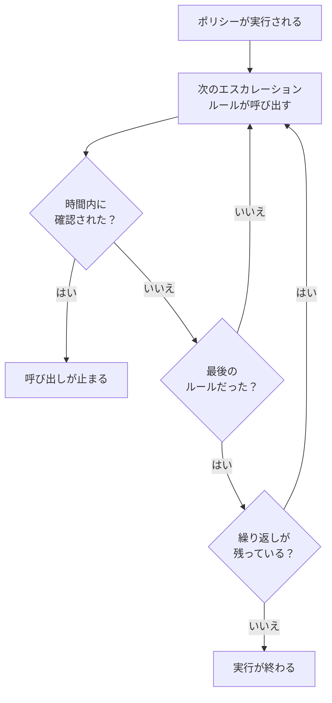

# オンコールポリシー

オンコールポリシーは、インシデントやアラートについて誰を呼び出すか、そして誰も確認しなければ次は誰かを決めます。そのエスカレーションルールがレベルとなり、ポリシーを使うインシデント、アラート、エピソードがそれを実行します。このページでは、ポリシーの作成、ポリシーを実行するもの、ポリシーのページに表示される内容、各実行の記録方法を説明します。

:::cards
- [ポリシーを作成する](#ポリシーを作成する): 名前と、最初に呼び出す相手。
- [ポリシーを実行するもの](#ポリシーを実行するもの): ルール、テンプレート、モニター、チャット、そしてあなた自身。
- [実行ログ](#実行ログ): すべての実行をルールごとに、そして止まった理由。
- [ポリシーをアーカイブまたは削除する](#ポリシーをアーカイブまたは削除する): ポリシーの運用を止めます。
:::

## ポリシーを作成する

:::steps
1. **オンコール → オンコールポリシー** に移動し、 **オンコールポリシーを作成** をクリックします。
2. **名前** を入力します。たとえば「決済プライマリ」です。
3. **最初に誰に通知しますか？** で **対応者を追加** をクリックし、最初に呼び出すオンコールスケジュール、チーム、ユーザーを選びます。
4. **オンコールポリシーを作成** をクリックします。ポリシーはその **エスカレーションルール** ページで開き、 **Level 1** がすでに用意されています。
:::

**最初に誰に通知しますか？** は省略でき、エスカレーションルールを追加できる人にだけ表示されます。空のままにすると、ルールができるまでポリシーは誰も呼び出しません。 **説明** と **ラベル** は **その他の項目** の下にあります。次のレベルを追加するには、 [エスカレーションルール](/docs/on-call/escalation-rules) を参照してください。

プロジェクトで最初のポリシーでは、フォームで **新しいインシデントとアラートのたびにトリガーする** も尋ねられます。最初はオンです。 **インシデント → ルール → オンコールルール** と **アラート → ルール → オンコールルール** にルールが 1 つずつ追加され、どちらもすべてに一致してこのポリシーを実行します。これを尋ねられるのはオンコールルールを追加できる人だけで、プロジェクトにオンコールポリシーもオンコールルールもない間に限られます。

**オンコールポリシー** の一覧には、各ポリシーの **名前**、 **説明**、 **ラベル**、 **所有者** が表示されます。ポリシーを選択すると、 **ラベルを追加**、 **ラベルを削除**、 **所有者を追加**、 **所有者を削除**、 **アーカイブ**、 **JSON をエクスポート**、または削除を実行できます。 **JSON をインポート** はエクスポートからポリシーを作成します。エクスポートに含まれるのはポリシー自身の設定で、エスカレーションルールや所有者は含まれません。

## ポリシーを実行するもの

ポリシーは、何かが実行するまで誰も呼び出しません。インシデント、アラート、エピソードはどれも、作成されるとすぐに持っているポリシーを実行します。

| 何が | ポリシーの追加方法 | 詳しく読む |
| --- | --- | --- |
| レコード自体 | インシデントやアラートを作成するときの **オンコールポリシー** フィールド、インシデントテンプレート、またはモニターの条件にある **オンコール** の折りたたみ部分 | [インシデントの宣言](/docs/incidents/declaring-incidents) |
| オンコールルール | **インシデント → ルール → オンコールルール** と **アラート → ルール → オンコールルール** が、一致するすべてのルールのポリシーを追加します | [インシデントのオンコールルール](/docs/incidents/settings#インシデントのオンコールルール) |
| グループ化ルール | グループ化ルールは、エピソードを開くときに自身のポリシーを実行します | [アラートのエピソードとグループ化ルール](/docs/alerts/episodes) |
| 手動 | フィードの **アクション** メニュー、または Slack や Microsoft Teams のメッセージにある **オンコールポリシーを実行** | [インシデントのフィード](/docs/incidents/notes-owners-and-feed#インシデントのフィード) |
| チャットとワークフロー | Slack や Microsoft Teams の `/oneuptime page` と、ワークフローの **Page an On-Call Policy** ステップ | [Paging](/docs/workflows/components#paging) |

複数のルールが追加したポリシーも、実行されるのは一度です。重大度がそれだけでポリシーを実行することはありません。実行するのは、その重大度に一致するオンコールルールです。確認済みまたは解決済みの状態で作成されたインシデントやアラートは、どのポリシーも実行しません。 **勤務時間中のみ** に設定したオンコールルールは、追加したポリシーを勤務時間が始まるまで待たせます。

## ポリシーのページ

一覧からポリシーを開きます。そのサイドメニューに、ポリシーに関するすべてがあります。

| セクション | ページ |
| --- | --- |
| **基本** | **概要**、 **エスカレーションルール**、 **所有者** |
| **ログ** | **実行ログ** と **通知ログ** |
| **開発者** | **Terraform**、 **API**、 **AI アシスタント** |
| **詳細** | **ユーザーオーバーライド**、 **カスタムフィールド**、 **設定**、 **監査ログ**、 **ポリシーを削除** |

**基本** は開いています。ほかのセクションは、クリックするまで折りたたまれています。

- **概要** には **オンコールポリシーの詳細** が表示され、続いて **ポリシーの概要** が表示されます。ポリシーのレベル数と対応者数、最後のレベルまでの時間、繰り返しの回数がわかります。 **対応者の準備状況** は、ポリシーが呼び出せる全員に今連絡が届くかどうかを示し、 **オンコールポリシーのフィード** は変更内容を一覧表示します。追加または削除されたユーザー、チーム、スケジュール、オーバーライド、引き継ぎです。
- **所有者** は、ポリシーに責任を持つユーザーとチームです。ポリシーが送った呼び出しで誰かのルールが見つからなかったり、配信できなかったりすると、所有者にメールが届きます。所有者のいないポリシーは、代わりにプロジェクトの所有者にメールを送ります。
- **通知ログ** には、ポリシーが送ったすべてのメッセージが、チャネルごとのタブに一覧表示されます。
- **ユーザーオーバーライド** は、このポリシーだけで人の代理を設定します。 [ユーザーオーバーライド](/docs/on-call/user-overrides) を参照してください。
- **設定** には、 **オンコールポリシーをエクスポート** と、ポリシーをアーカイブするカードがあります。

## ポリシーを繰り返す

最後のレベルの待ち時間が誰も確認しないまま切れると、ポリシーは繰り返す設定でない限り止まります。選ぶには、ポリシーの **エスカレーションルール** ページを開き、ルールの下にある **繰り返しポリシー** カードの **編集** をクリックします。 **繰り返しポリシーを編集** では **最後のレベルの後も誰も確認しない場合** の動作を選びます。

| 回答 | 動作 |
| --- | --- |
| **通知を停止** | 誰にも再度通知されないため、ポリシーは一度だけ実行されます。新しいポリシーはこの回答から始まります。 |
| **Level 1 からやり直す** | すべてのレベルに、順番にもう一度通知されます。 **あと何回？** で回数を指定します（1 回以上）。 |

あと 3 回やり直すポリシーは、レベルを合計 4 回たどります。カードの **最後のレベルの後** の行にポリシーの動作が表示され、 **概要** の **ポリシーの概要** にも同じことが文章で表示されます。

## 解決されなければ再通知する

確認すると、その後誰もインシデントやアラートを解決しなくても、ポリシーの通知は完全に止まります。代わりにポリシーに再通知させることもできます。ポリシーの **エスカレーションルール** ページを開き、下部の **その他の設定** を開いて、 **確認後のタイムアウト** カードの **編集** をクリックします。 **確認後のタイムアウトを編集** では **確認済みだが解決されていない場合** の動作を選びます。

| 回答 | 動作 |
| --- | --- |
| **再通知しない** | 確認すると、通知は完全に停止します。新しいポリシーはこの回答から始まります。 |
| **再通知する** | 確認した人と、現在のオンコール担当者を呼び出します。 **何分後？** で時間を指定します（5〜1440 分、最初は 30 分）。 |

分数は確認のたびに数え直され、1 つのポリシーが同じインシデント、アラート、エピソードについて再通知するのは最大 5 回です。再通知は、確認されたときに通知していたレベルから始まり、そのレベルの現在のオンコール担当者を呼び出し、最初の実行と同じようにレベルを進みます。インシデントやアラートは確認済みのままです。再通知はそれ自体が 1 つの実行で、フィードとポリシーの実行ログに表示され、その **ステータス** には「再通知（5 回中 1 回目）」と表示されます。

再通知された人は、そのメッセージから、またはインシデントやアラートのページの **もう一度確認** で確認でき、分数は数え直しになります。 **エスカレーションする** で次のレベルに渡せます。インシデントやアラートを解決または削除するか、ポリシーをアーカイブまたは削除するか、 **再通知しない** を選ぶと止まります。カードの **確認後** の行にポリシーの動作が表示され、 **その他の設定** には折りたたまれている間も分数が表示されます。 **概要** の **ポリシーの概要** と **エスカレーションの概要** にも同じことが文章で表示されます。

## 実行ログ

ポリシーは実行されるたびに実行ログを書き込み、ログは実行の進行に合わせてステータスを移っていきます。

| ステータス | 意味 |
| --- | --- |
| **待機中** | **勤務時間中のみ** に設定したオンコールルールが、勤務時間が始まるまで実行を待たせています。呼び出しが始まる時刻を示し、それまでは誰も呼び出しません。その前にインシデントやアラートが確認または解決されれば、呼び出さずに終わります。待機中にインシデントやアラートが変わり、すぐに呼び出すオンコールルールに一致するようになれば、その時点で呼び出しを始めます。 |
| **予定**、 **開始** | 実行を準備しています。5 分経ってもこの状態のものは **エラー** として停止されます。 |
| **Executing** | 実行が呼び出しています。OneUptime は毎分これを進めます。 |
| **Execution Completed** | 誰かが確認した、インシデントやアラートが解決された、すべてのルールと繰り返しを使い切った、またはポリシーがアーカイブされた。 |
| **Execution Completed - No One Notified** | 実行がすべてのルールを通っても誰も呼び出さなかった。たいていは、誰もオンコールでないスケジュールです。 |
| **エラー** | 実行に失敗しました。 **ステータスメッセージを表示** で理由がわかります。 |

実行ログは 3 か所で確認できます。

- ポリシー自身の **実行ログ**。 **ログ** の下にあります。
- **オンコール → 詳細 → 実行ログ**。すべてのポリシーの実行が表示され、ワークフローやチャットからの直接の呼び出しは **直接呼び出し** として表示されます。
- インシデントまたはアラートの **オンコールの実行** ページ。

各行には、実行のきっかけ、日時、 **ステータス**、確認した人が表示されます。 **タイムラインを表示** をクリックすると **実行タイムライン** が開き、各エスカレーションルール、それが呼び出した人、経由したスケジュール、各呼び出しの結果がわかります。誰もオンコールでないスケジュールは、人の代わりに **オンコールの担当者はいませんでした** と表示します。OneUptime Cloud では、実行ログには **Growth** プランが必要です。

## ポリシーをアーカイブまたは削除する

アーカイブすると、すべてを残したままポリシーの運用を止められます。ポリシーの **設定** を開いてアーカイブ用カードの **アーカイブ** をクリックするか、一覧でポリシーを選択して **アーカイブ** を選びます。

- アーカイブしたポリシーは誰も呼び出しません。それを使うインシデントやアラートはそのポリシーをスキップし、まだエスカレーション中の実行は次のステップで止まります。
- ポリシーは **オンコールポリシー** の一覧から **オンコール → 詳細 → アーカイブ済みポリシー** に移り、そこで **アーカイブ解除** をクリックすると運用に戻ります。

**詳細** の下にある **ポリシーを削除** は、ポリシーをそのエスカレーションルールとユーザーオーバーライドとともに削除します。一覧からの削除は、先に確認を求め、代わりにアーカイブすることを提案します。

## ポリシーを変更できる人

**プロジェクト所有者**、 **プロジェクト管理者**、 **プロジェクトメンバー**、 **オンコール管理者**、 **オンコールメンバー** はポリシーを作成、変更、削除でき、 **閲覧者** と **オンコール閲覧者** は閲覧できます。カスタムロールでの権限は **Create On-Call Duty Policy**、 **Edit On-Call Duty Policy**、 **Delete On-Call Duty Policy**、 **Read On-Call Duty Policy** で、一部のラベルに限定されたロールは、そのラベルが付いたポリシーにだけアクセスできます。OneUptime Cloud で所有者やカスタムフィールドを追加するには **Growth** プランが必要です。

## API と Terraform

オンコールポリシーは `/api/on-call-duty-policy` リソースで、Terraform では `oneuptime_on_call_policy` リソースです。

| 設定 | API フィールド |
| --- | --- |
| **名前** | `name` |
| **説明** | `description` |
| **最後のレベルの後も誰も確認しない場合** | `repeatPolicyIfNoOneAcknowledges` |
| **あと何回？** | `repeatPolicyIfNoOneAcknowledgesNoOfTimes` |
| **何分後？** | `acknowledgementTimeoutInMinutes` |
| アーカイブ済み | `isArchived` |

`repeatPolicyIfNoOneAcknowledges` は **通知を停止** なら `false`、 **Level 1 からやり直す** なら `true` です。 `true` のときは `repeatPolicyIfNoOneAcknowledgesNoOfTimes` を 1 以上の整数にする必要があり、OneUptime は `0` を拒否します。以前に `0` で保存されたポリシーは繰り返されず、ダッシュボードには **通知を停止** と表示されます。

`acknowledgementTimeoutInMinutes` は **再通知しない** なら `null`、 **再通知する** なら 5〜1440 の整数の分数です。それ以外の値は OneUptime が拒否します。

最初のレベルを持つポリシーを 1 回のリクエストで作成するには、 [API または Terraform でルールを作成する](/docs/on-call/escalation-rules#api-または-terraform-でルールを作成する) を参照してください。

## トラブルシューティング

:::details ポリシーは実行されたが、誰も呼び出されなかった
その実行には **Execution Completed - No One Notified** と表示されます。 **タイムラインを表示** を開いてください。 **オンコールの担当者はいませんでした** の行は空きのあるスケジュールを示し、 **スキップ済み** の行のステータスメッセージは理由を示します。たとえば、代理のいない不在者です。 **オンコール → 準備状況** で、連絡が届かなかった人がわかります。
:::

:::details 次のレベルが待ち時間の 1 分後に呼び出された
OneUptime は実行中のポリシーを 1 分に 1 回進めるため、レベルは待ち時間が切れた後の最初のチェックで呼び出されます。
:::

:::details インシデントに、誰も呼び出さなかったポリシーが表示される
そのポリシーはアーカイブされています。アーカイブしたポリシーは、それを使うインシデントやアラートに残りますが誰も呼び出さず、その実行ログには実行されなかったことが記録されます。 **オンコール → 詳細 → アーカイブ済みポリシー** でアーカイブを解除してください。
:::

## 次のステップ

:::cards
- [エスカレーションルール](/docs/on-call/escalation-rules): ポリシーが呼び出すレベルと、各レベルの待ち時間を追加します。
- [ユーザーオーバーライド](/docs/on-call/user-overrides): 不在の間、誰かへの呼び出しを同僚に送ります。
- [準備状況とレポート](/docs/on-call/readiness): ポリシーが呼び出す全員に連絡が届くか確認します。
:::
