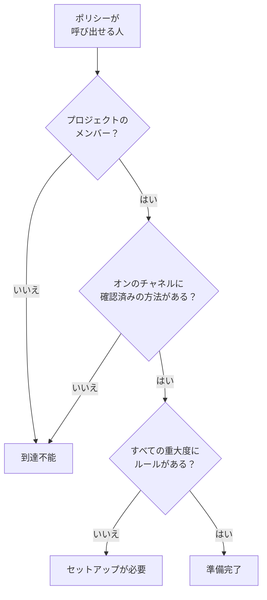

# 準備状況とレポート

準備状況は、インシデントより先にある問いに答えます。今何かが発生したら、オンコールポリシーが呼び出す全員に本当に連絡が届くでしょうか。プロジェクトのすべての対応者を一覧にし、誰が準備できていて誰ができていないかを示し、セットアップを終えるよう人にリマインドできます。さらに **ユーザーのオンコール時間** レポートで、各人がどれだけオンコールだったかがわかります。

:::cards
- [ステータスの決まり方](#ステータスの決まり方): 準備完了、セットアップが必要、到達不能と、その理由。
- [準備状況ページ](#準備状況ページ): プロジェクトのすべての対応者を一つのリストで。
- [セットアップを終えるようリマインドする](#セットアップを終えるようリマインドする): 足りないものを伝えるメール。
- [ユーザーのオンコール時間](#ユーザーのオンコール時間): 各人がどれだけオンコールだったか。
:::

## ステータスの決まり方

対応者とは、オンコールポリシーが呼び出せるすべての人です。エスカレーションルールで指定された人、ルールが呼び出すチームのメンバー、ルールが呼び出すスケジュールのレイヤーにいる人、そしてまだ終わっていないユーザーオーバーライドの代理の人が含まれます。どのポリシーも呼び出さないスケジュールは、誰も追加しません。

| ステータス | 意味 |
| --- | --- |
| **準備完了** | プロジェクトでオンになっているチャネルに確認済みの通知方法があり、オンコールルールのすべてのタブで、すべての重大度にルールがあります。 |
| **セットアップが必要** | 連絡は届きますが、ルールのない重大度があります。行にはその欠落の数が表示されます。 |
| **到達不能** | 何も届きません。確認済みの通知方法がない、確認済みの通知方法がすべてプロジェクトでオフのチャネルにある、またはプロジェクトのメンバーではない、のいずれかです。 |

欠落とは、インシデント、インシデントのエピソード、アラート、アラートのエピソードのいずれかのタブで、ルールのない重大度のことです。意図的に重大度をオフにするルールは欠落ではありません。欠落に当たった呼び出しも、プロジェクトがそのフォールバックをオフにしていない限り、確認済みの通知方法でその人に届きます。 [一致するルールがないとき](/docs/notifications/index#一致するルールがないとき) を参照してください。

## 準備状況ページ

**オンコール → 準備状況** を開きます。 **オンコールの準備状況** カードには、プロジェクトのいずれかのオンコールポリシーが連絡できる全員が、対応が必要な人から順に表示されます。プロジェクトの誰でも開けます。

リストの上のタイルは、 **対応者**、 **準備完了**、 **セットアップが必要**、 **到達不能** の数を示します。 **準備完了**、 **セットアップが必要**、 **到達不能** をクリックするとその対応者だけが表示され、もう一度クリックすると全員が表示されます。

| 列 | 表示内容 |
| --- | --- |
| **対応者** | その人と、そのメールアドレス。 |
| **ステータス** | **準備完了**、 **到達不能**、または欠落の数。 |
| **チーム** | エスカレーションルールを通じてその人を呼び出すチーム。 |
| **チャネル** | チャネルごとのセグメント。確認済みの通知方法なら塗りつぶし、まだ確認されていなければ中抜きです。 |
| **カバー範囲** | 全重大度のうち、すべてのタブでルールがある重大度の数。 |
| **経由** | ポリシーがその人に届く経路。 `Direct`、 `Team`、 `Schedule`、 `Override` のいずれかです。 |

行の **カバー範囲** をクリックすると、その人の通知方法、そのステータスである理由、そしてルールの有無を示す全重大度のグリッドが表示されます。じょうごのアイコンで、 **対応者**、 **ステータス**、 **チーム**、 **経由** によってリストを絞り込めます。結果は最大 1 分前のものの場合があります。 **更新** で改めて判定します。

## セットアップを終えるようリマインドする

通知方法とルールを追加して確認できるのは本人だけなので、本人に頼むのが解決策です。

:::steps
1. 準備状況ページで、リマインドする対応者にチェックを入れます。準備完了の対応者にはチェックを入れられません。リマインドすることがないからです。
2. **セットアップのリマインダーを送信** をクリックします。確認画面には、メールを送る相手全員の名前が表示されます。
3. 確定します。各人には、自分のセットアップに足りないものと、それを直すページへのリンクを記載したメールが 1 通届きます。
:::

その後、バナーに、送信、スキップ、失敗したリマインダーの数と、送信されなかったものそれぞれの理由が表示されます。同じ人へのリマインドは 24 時間に 1 回までで、1 回の操作でリマインドできるのは最大 250 人です。リマインダーを送るには **プロジェクト所有者**、 **プロジェクト管理者**、 **オンコール管理者** のいずれか、またはカスタムロールでの **Edit On-Call Duty Policy** が必要です。

## ほかのページでの準備状況

- ポリシーの **概要** では、 **対応者の準備状況** が、そのポリシーが呼び出せる人のうち対応が必要な全員を一覧表示し、 **再確認** で読み直します。自分の行には、それを直すページへのボタンがあります。ほかの人の行では、あなたのメールアプリでその人宛てのメールが、直し方を記載した状態で開きます。
- ポリシーの **エスカレーションルール** では、対応者の全員を呼び出せないレベルのカードにその旨が表示されます。 [エスカレーションの概要](/docs/on-call/escalation-rules#エスカレーションの概要) を参照してください。
- **ユーザー** でメンバーを開き、 **オンコール** セクションの **準備状況** を開くと、その人のステータス、通知方法、カバー範囲のグリッドが表示されます。
- 自分のセットアップは、 **ユーザー設定 → セットアップチェックリスト** が順に案内します。 [セットアップチェックリスト](/docs/notifications/index#セットアップチェックリスト) を参照してください。

## 準備状況の週次メール

OneUptime は週に 1 回、オンコールポリシーがあるすべてのプロジェクトを確認します。誰かが **到達不能** または **セットアップが必要** の場合、プロジェクトの所有者に 1 通のメールが届きます。メールはその人たちを、まったく呼び出せない人と、欠落はあるが連絡が届く人の二つのグループに分け、それぞれ最大 20 人まで、準備状況ページへのリンクとともに一覧表示します。

全員が準備完了の週には何も送られないので、このメールが届くのは必ず直すべきものがあるときです。まったく呼び出せない人がいる場合、件名は `[Action Required]` で始まります。

## ユーザーのオンコール時間

**オンコール → レポート → ユーザーのオンコール時間** は、選んだ期間に各人がどれだけオンコールだったかを表示します。最初は **過去 1 か月** です。

| 列 | 表示内容 |
| --- | --- |
| **ユーザー** | その人。 |
| **ユーザーがオンコールだった時間** | 期間内のオンコール時間を、時間と分で。 |

時間は、人がオンコールに入ったり外れたりするたびに記録されます。ルールが呼び出すスケジュールがその人に番を渡したとき、またはルールに直接かチーム経由で追加されたときから、引き継ぎまで、または外されるまでです。二つのポリシーで同時にオンコールだった時間は一度だけ数え、まだ続いている時間は現在までを数えます。

**スケジュールタイムライン** とカレンダーフィードは、過去のシフトを今日のローテーション設定のとおりに表示します。このレポートは発生時に記録されるので、公平性の確認やオンコール手当に使ってください。

> [!NOTE]
> OneUptime Cloud では、このレポートには **Growth** プランが必要で、終了から 200 日を超えた時間は削除されます。セルフホストのインストールでは、すべて保持されます。

## トラブルシューティング

:::details 確認済みの電話番号があるのに、到達不能になっている
その人の通知方法が、すべてプロジェクトでオフになっているチャネルにあるのかもしれません。新しいプロジェクトでは、SMS、電話、WhatsApp、Telegram は最初オフです。 [プロジェクトでチャネルをオンにする](/docs/notifications/notification-methods#プロジェクトでチャネルをオンにする) を参照してください。
:::

:::details リストに表示されない人がいる
リストには、オンコールポリシーが呼び出せる人だけが含まれます。招待を承諾していないチームメンバー、どのポリシーも呼び出さないスケジュールにいる人、オーバーライドが終わった代理の人は含まれません。
:::

:::details 所有者に週次メールが届かない
メールは、誰かが **到達不能** または **セットアップが必要** である週にだけ、プロジェクトの所有者にだけ送られます。
:::

## 次のステップ

:::cards
- [OneUptime からの連絡の仕組み](/docs/notifications/index): 各ステータスの背後にある通知方法、ルール、フォールバック。
- [通知方法](/docs/notifications/notification-methods): OneUptime が人に連絡する手段を追加して確認します。
- [個人のオンコールルール](/docs/notifications/on-call-rules): 重大度ごとに欠落を埋めます。
:::
