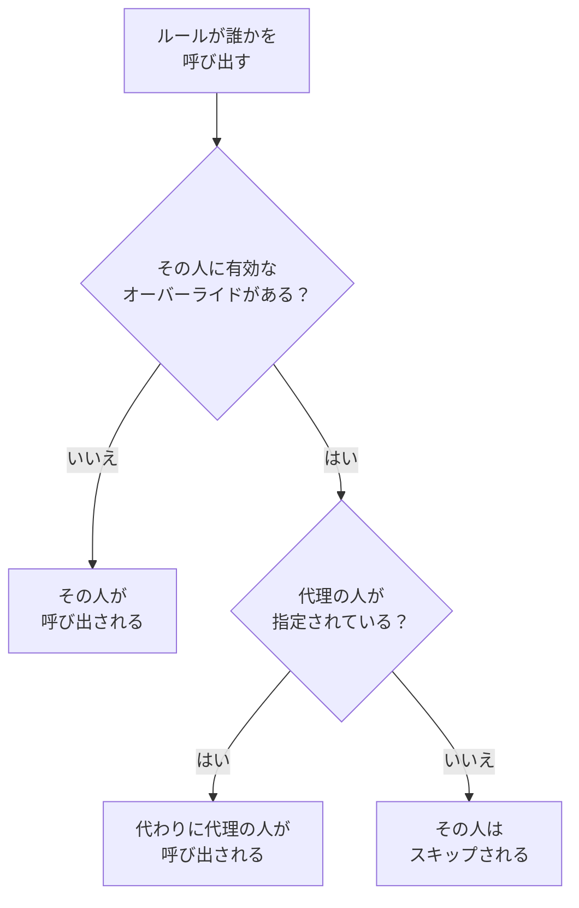

# ユーザーオーバーライド

ユーザーオーバーライドは、誰かが不在の間、その人に届くはずの呼び出しを、決まった期間だけ代理の人に送ります。代理の人が指定されていなければ、代わりにその人をスキップします。オンコールスケジュールでのその人の各番は、ローテーションの次の人に回ります。休暇、病欠、シフトの交換に使います。

:::cards
- [オーバーライドによる呼び出しの変化](#オーバーライドによる呼び出しの変化): 代わりに誰がいつ呼び出されるか。
- [オーバーライドを追加する](#オーバーライドを追加する): 誰が不在か、誰が代理か、いつからいつまでか。
- [すべてのポリシーか、一つか](#すべてのポリシーか一つか): オーバーライドを追加する場所と、どれが優先されるか。
- [その他の追加方法](#その他の追加方法): スケジュールから、そして今後のシフトから。
:::

## オーバーライドによる呼び出しの変化



オーバーライドが有効な間、つまり開始から終了まで:

- **誰が代理しますか？** に誰かが指定されていれば、その人が、不在の人へのすべての呼び出しを、オーバーライドが適用されるすべてのスケジュール、チーム、ルールから受け取ります。呼び出しは、代理の人自身の個人のオンコールルールを通じて届きます。
- 代理の人がいなければ、その人はスキップされます。オンコールスケジュールでは、その人の各番は、不在でないローテーションの次の人に回ります。レイヤーの全員が不在なら、その下のレイヤーが引き継ぎます。その人を直接、またはチーム経由で指定するルールはその人を呼び出さず、ポリシーの実行にはその人が不在であることと、いつまで不在かが表示されます。
- オーバーライドは連鎖しません。代理の人も不在の場合でも、代理している相手の分はその代理の人が呼び出されます。

オーバーライドが終わると、呼び出しはその人に戻ります。 **スケジュールタイムライン**、スケジュールのレイヤー、カレンダーフィードはどれも、代理された各シフトを誰が担当しているかを表示します。

## オーバーライドを追加する

:::steps
### オーバーライドを開く

すべてのオンコールポリシーで誰かの代理を設定するには **オンコール → 詳細 → ユーザーオーバーライド** に、そのポリシーだけで代理を設定するにはポリシー自身の **ユーザーオーバーライド** ページに移動します。このページは **詳細** の下にあります。 **ユーザーオーバーライドを追加** をクリックします。

### 不在の人を指定する

**誰が不在ですか？** には最初にあなたが入っています。自分の休みを登録するのが最もよくあるケースだからです。ほかの人の代理を手配するには、その人を選びます。

### 代理の人を指定する

その人をスキップするなら **誰が代理しますか？** を **ローテーションの次の人** のままにし、そうでなければすべての呼び出しを引き受ける同僚を選びます。不在の人は候補に表示されません。

### 時間を設定する

別の時刻を選ばない限り、 **開始** は現在です。 **終了** にその人が戻る時刻を設定します。開始より後でなければなりません。 **ユーザーオーバーライドを追加** をクリックします。
:::

各オーバーライドは 1 行で表示され、 **不在**、 **代理**、 **開始**、 **終了** の列があり、開始と終了で絞り込めます。スキップの場合、 **代理** には **ローテーションの次の人** と表示されます。オーバーライドは編集できません。削除して新しく追加するか、削除してその人を早めに戻してください。

## すべてのポリシーか、一つか

| 追加する場所 | カード | 適用範囲 |
| --- | --- | --- |
| **オンコール → 詳細 → ユーザーオーバーライド** | **グローバルなユーザーオーバーライド** | プロジェクト内のすべてのオンコールポリシー |
| ポリシーの **ユーザーオーバーライド** | **オンコールポリシーのユーザーオーバーライド** | そのポリシーだけ |

同じ人のオーバーライドが二つ重なる場合、グローバルなものよりポリシー自身のものが優先され、スキップよりも代理の人を指定したものが優先されます。ワークフローやチャットからの、ポリシーを通さない呼び出しは、グローバルなオーバーライドだけに従います。

## その他の追加方法

- スケジュールから: スケジュールの **レイヤー** ページでレイヤーを展開し、人の横にある **期日までスキップ…** をクリックします。その人が不在、ローテーションが代理という状態の同じフォームが、グローバルなオーバーライドとして開きます。 [誰かが不在のとき](/docs/on-call/schedules#誰かが不在のとき) を参照してください。
- 今後のシフトから: **ユーザー設定 → カレンダー → カレンダーフィード** で自分のシフトの **代理を依頼** をクリックすると、そのシフトの時間にあなたが不在という状態でフォームが開き、残りは **誰が代理しますか？** だけです。 [今後のシフトと代理](/docs/on-call/calendar-feeds#今後のシフトと代理) を参照してください。

誰かがプロジェクトを離れると、その人を指定していて、まだ終わっていないオーバーライドは、どちらの側であってもすべて削除されます。

## オーバーライドを追加できる人

**プロジェクト所有者**、 **プロジェクト管理者**、 **プロジェクトメンバー**、 **オンコール管理者**、 **オンコールメンバー** はオーバーライドを追加、削除でき、 **閲覧者** と **オンコール閲覧者** は閲覧できます。カスタムロールでの権限は **Create On-Call Duty Policy User Override**、 **Delete On-Call Duty Policy User Override**、 **Read On-Call Duty Policy User Override** です。 **スケジュールタイムライン** では、オーバーライドを閲覧できる人だけが、誰のシフトが代理されているかを確認できます。

OneUptime Cloud では、ユーザーオーバーライドには **Growth** プランが必要です。

## API

ユーザーオーバーライドは `/api/on-call-duty-policy-user-override` リソースです。

| フィールド | 内容 |
| --- | --- |
| `overrideUserId` | 不在の人。必須です。 |
| `routeAlertsToUserId` | 代理の人。省略すると、代わりにその人をスキップします。 |
| `startsAt`, `endsAt` | オーバーライドの開始と終了。どちらも必須で、終了は開始より後です。 |
| `onCallDutyPolicyId` | 適用するポリシー。グローバルなオーバーライドでは省略します。 |

```bash
curl -X POST https://oneuptime.com/api/on-call-duty-policy-user-override \
  -H "apikey: $ONEUPTIME_API_KEY" \
  -H "Content-Type: application/json" \
  -d '{
    "data": {
      "projectId": "<project-id>",
      "overrideUserId": "<away-user-id>",
      "routeAlertsToUserId": "<cover-user-id>",
      "startsAt": "2026-12-22T09:00:00Z",
      "endsAt": "2027-01-05T09:00:00Z"
    }
  }'
```

不在の人と代理の人が同じオーバーライドは拒否されます。開始前に終了するオーバーライドも同様です。

## トラブルシューティング

:::details 休暇中の人がそれでも呼び出された
オーバーライドを追加した場所を確認してください。ポリシーの **ユーザーオーバーライド** ページで追加したものはそのポリシーだけに適用され、ほかのポリシーは引き続きその人を呼び出します。すべてのポリシーに適用するには **オンコール → 詳細 → ユーザーオーバーライド** で追加してください。 **開始** と **終了** も確認してください。時刻はあなたのタイムゾーンで表示されます。
:::

:::details 代理の人も呼び出されなかった
代理の人には、その人自身の個人のオンコールルールと確認済みの通知方法を通じて連絡が届きます。 **オンコール → 準備状況** でその人を確認し、ポリシーの **実行ログ** で実行を確認してください。
:::

:::details オーバーライドを追加できない
追加には上記のいずれかのロールが必要で、OneUptime Cloud では **Growth** プランも必要です。
:::

## 次のステップ

:::cards
- [オンコールスケジュール](/docs/on-call/schedules): ローテーション、レイヤー、レイヤー内での誰かのスキップ。
- [スケジュールタイムライン](/docs/on-call/schedule-timeline): すべてのスケジュールで代理されたシフトを確認します。
- [カレンダーフィード](/docs/on-call/calendar-feeds): 自分のシフトの代理を依頼します。
:::
