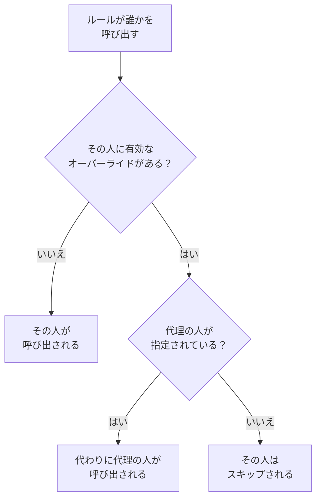

# ユーザーオーバーライド

ユーザーオーバーライドは、誰かが不在の間、その人に届くはずの呼び出しを、決まった期間だけ代理の人に送ります。代理の人が指定されていなければ、代わりにその人をスキップします。オンコールスケジュールでのその人の各番は、ローテーションの次の人に回ります。休暇、病欠、シフトの交換に使います。

:::cards
- [オーバーライドによる呼び出しの変化](#オーバーライドによる呼び出しの変化): 代わりに誰がいつ呼び出されるか。
- [オーバーライドを追加する](#オーバーライドを追加する): 誰が不在か、誰が代理か、いつからいつまでか。
- [オーバーライドを編集する](#オーバーライドを編集する): 誰が代理するか、またはいつ開始・終了するかを変えます。
- [すべてのポリシーか、一つか](#すべてのポリシーか一つか): オーバーライドを追加する場所と、どれが優先されるか。
- [その他の追加方法](#その他の追加方法): スケジュールから、そして今後のシフトから。
:::

## オーバーライドによる呼び出しの変化



オーバーライドが有効な間、つまり開始から終了まで:

- **誰が代理しますか？** に誰かが指定されていれば、その人が、不在の人へのすべての呼び出しを、オーバーライドが適用されるすべてのスケジュール、チーム、ルールから受け取ります。呼び出しは、代理の人自身の私への連絡方法を通じて届きます。
- 代理の人がいなければ、その人はスキップされます。オンコールスケジュールでは、その人の各番は、不在でないローテーションの次の人に回ります。レイヤーの全員が不在なら、その下のレイヤーが引き継ぎます。その人を直接、またはチーム経由で指定するルールはその人を呼び出さず、ポリシーの実行にはその人が不在であることと、いつまで不在かが表示されます。
- オーバーライドは連鎖しません。代理の人も不在の場合でも、代理している相手の分はその代理の人が呼び出されます。

オーバーライドが終わると、呼び出しはその人に戻ります。 **スケジュールタイムライン**、スケジュールのレイヤー、カレンダーフィードはどれも、代理された各シフトを誰が担当しているかを表示します。

## オーバーライドを追加する

:::steps
### オーバーライドを開く

すべてのオンコールポリシーで誰かの代理を設定するには **オンコール → 詳細 → ユーザーオーバーライド** に、そのポリシーだけで代理を設定するにはポリシー自身の **ユーザーオーバーライド** ページに移動します。このページは **詳細** の下にあります。 **ユーザーオーバーライドを追加** をクリックします。

### 不在の人を指定する

**誰が不在ですか？** には最初にあなたが入っています。自分の休みを登録するのが最もよくあるケースだからです。ほかの人の代理を手配するには、その人を選びます。

### 代理の人を指定する

その人をスキップするなら **誰が代理しますか？** を **ローテーションの次の人** のままにし、そうでなければすべての呼び出しを引き受ける同僚を選びます。不在の人は候補に表示されません。

### 時間を設定する

別の時刻を選ばない限り、 **開始** は現在です。 **終了** にその人が戻る時刻を設定します。開始より後でなければなりません。 **ユーザーオーバーライドを追加** をクリックします。
:::

各オーバーライドは 1 行で表示され、 **不在**、 **代理**、 **開始**、 **終了** の列があり、開始と終了で絞り込めます。スキップの場合、 **代理** には **ローテーションの次の人** と表示されます。

## オーバーライドを編集する

オーバーライドの行にある **編集** をクリックします。どちらの **ユーザーオーバーライド** ページでも、スケジュールの **レイヤー** ページにあるユーザーオーバーライドの一覧でも使えます。フォームは保存されたとおりのオーバーライドで開くので、変更して **変更を保存** をクリックします。

- **誰が代理しますか？** は、オーバーライドが終了するまで変更できます。代わりにその人をスキップするには、 **ローテーションの次の人** に戻します。
- **開始** は、オーバーライドが始まるまで動かせ、その後はそのままです。 **終了** は、オーバーライドが終わるまで動かせます。オーバーライドを早めに終えるには、現在時刻に設定します。どちらも過去には動かせません。
- **誰が不在ですか？** は変更できません。別の人については、新しいオーバーライドを追加してください。

終了したオーバーライドは変更できません。その **編集** はロックされ、理由が表示されます。

## すべてのポリシーか、一つか

| 追加する場所 | カード | 適用範囲 |
| --- | --- | --- |
| **オンコール → 詳細 → ユーザーオーバーライド** | **グローバルなユーザーオーバーライド** | プロジェクト内のすべてのオンコールポリシー |
| ポリシーの **ユーザーオーバーライド** | **オンコールポリシーのユーザーオーバーライド** | そのポリシーだけ |

同じ人のオーバーライド二つが、同じポリシー上で、または両方がグローバルな場合に重なることはできません。時刻を選んだ時点でフォームがそれを伝え、代わりにそちらを変更できる **そのオーバーライドを編集** を表示します。一方が終わると同時に次が始まるのは問題ありません。

ポリシー自身のオーバーライドは、同じ人のグローバルなオーバーライドと重なってもかまいません。そのポリシーでは、両方が適用される間はポリシー自身のものが使われ、フォームもそう伝えます。ワークフローやチャットからの、ポリシーを通さない呼び出しは、グローバルなオーバーライドだけに従います。

このルールより前から重なっているオーバーライドはそのまま残ります。両方に **重複** の印が付き、どちらが使われるかを示します。スキップより代理の人を指定したもの、次に先に開始するもの、次に先に追加されたものが使われます。

## その他の追加方法

- スケジュールから: スケジュールの **レイヤー** ページでレイヤーを展開し、人の横にある **期日までスキップ…** をクリックします。その人が不在、ローテーションが代理という状態の同じフォームが、グローバルなオーバーライドとして開きます。 [誰かが不在のとき](/docs/on-call/schedules#誰かが不在のとき) を参照してください。
- 今後のシフトから: **ユーザー設定 → カレンダー → カレンダーフィード** で自分のシフトの **代理を依頼** をクリックすると、そのシフトの時間にあなたが不在という状態でフォームが開き、残りは **誰が代理しますか？** だけです。 [今後のシフトと代理](/docs/on-call/calendar-feeds#今後のシフトと代理) を参照してください。

誰かがプロジェクトを離れると、その人を指定していて、まだ終わっていないオーバーライドは、どちらの側であってもすべて削除されます。

## オーバーライドを追加できる人

**プロジェクト所有者**、 **プロジェクト管理者**、 **プロジェクトメンバー**、 **オンコール管理者**、 **オンコールメンバー** はオーバーライドを追加、編集、削除でき、 **閲覧者** と **オンコール閲覧者** は閲覧できます。カスタムロールでの権限は **Create On-Call Policy User Override**、 **Edit On-Call Policy User Override**、 **Delete On-Call Policy User Override**、 **Read On-Call Policy User Override** です。 **スケジュールタイムライン** では、オーバーライドを閲覧できる人だけが、誰のシフトが代理されているかを確認できます。

ポリシーのオーバーライドは、そのポリシーのスコープに従います。チームに、所有するポリシーやチームのラベルに限定した **オンコールメンバー** を与えると、メンバーはそれらのポリシーでだけオーバーライドを追加、編集、削除できます。グローバルなオーバーライドは、ほかのチームのポリシーも含むすべてのポリシーに適用されるため、追加、編集、削除にはプロジェクト全体に対するオーバーライドの権限が必要です。それより狭い権限では、 **オンコール → 詳細 → ユーザーオーバーライド** の **ユーザーオーバーライドを追加**、 **編集**、 **削除** はロックされ、その理由が表示されます。スケジュールのレイヤーの **期日までスキップ…** と自分の今後のシフトの **代理を依頼** は、グローバルなオーバーライドを追加する代わりに、オーバーライドを追加できるポリシーを提示してポリシーごとに 1 つずつ追加し、モバイルアプリの代理も同様です。どのポリシーにも追加できない場合は、ロックされてその理由が表示されます。チームは各ポリシー自身の **ユーザーオーバーライド** ページでオーバーライドを追加します。API でも同じで、 `onCallDutyPolicyId` のないオーバーライドは、ラベルや所有ポリシーに限定された権限では拒否されます。

OneUptime Cloud では、ユーザーオーバーライドには **Growth** プランが必要です。

## API

ユーザーオーバーライドは `/api/on-call-duty-policy-user-override` リソースです。

| フィールド | 内容 |
| --- | --- |
| `overrideUserId` | 不在の人。必須です。 |
| `routeAlertsToUserId` | 代理の人。省略すると、代わりにその人をスキップします。 |
| `startsAt`, `endsAt` | オーバーライドの開始と終了。どちらも必須で、終了は開始より後です。 |
| `onCallDutyPolicyId` | 適用するポリシー。グローバルなオーバーライドでは省略します。 |

```bash
curl -X POST https://oneuptime.com/api/on-call-duty-policy-user-override \
  -H "apikey: $ONEUPTIME_API_KEY" \
  -H "Content-Type: application/json" \
  -d '{
    "data": {
      "projectId": "<project-id>",
      "overrideUserId": "<away-user-id>",
      "routeAlertsToUserId": "<cover-user-id>",
      "startsAt": "2026-12-22T09:00:00Z",
      "endsAt": "2027-01-05T09:00:00Z"
    }
  }'
```

不在の人と代理の人が同じオーバーライドは拒否されます。開始前に終了するオーバーライドも同様です。同じ人の別のオーバーライドと、同じポリシー上で、または両方がグローバルな場合に重なるオーバーライドも拒否され、拒否のメッセージには重なる相手のオーバーライドが示されます。

オーバーライドを変更するには、変更するフィールドを `data` に入れて `PUT /api/on-call-duty-policy-user-override/<override-id>` を送ります。変更できるのは `routeAlertsToUserId` 、 `startsAt` 、 `endsAt` で、代理の人を `null` にすると、代わりにその人がスキップされます。 `overrideUserId` と `onCallDutyPolicyId` は変更できません。終了したオーバーライドは変更できず、開始済みのオーバーライドの開始も変更できません。変更する時刻を過去に動かすこともできません。

## トラブルシューティング

:::details 休暇中の人がそれでも呼び出された
オーバーライドを追加した場所を確認してください。ポリシーの **ユーザーオーバーライド** ページで追加したものはそのポリシーだけに適用され、ほかのポリシーは引き続きその人を呼び出します。すべてのポリシーに適用するには **オンコール → 詳細 → ユーザーオーバーライド** で追加してください。 **開始** と **終了** も確認してください。時刻はあなたのタイムゾーンで表示されます。
:::

:::details 代理の人も呼び出されなかった
代理の人には、その人自身の私への連絡方法と確認済みの通知方法を通じて連絡が届きます。 **オンコール → 準備状況** でその人を確認し、ポリシーの **実行ログ** で実行を確認してください。
:::

:::details オーバーライドを追加できない
追加には上記のいずれかのロールが必要で、OneUptime Cloud では **Growth** プランも必要です。 グローバルなオーバーライドには、プロジェクト全体に対するロールが必要です。チームのロールが自分のポリシーや一部のラベルに限定されている場合は、そのポリシー自身の **ユーザーオーバーライド** ページでオーバーライドを追加してください。このとき **期日までスキップ…** と **代理を依頼** 、そしてモバイルアプリは、オーバーライドを追加できるポリシーだけを提示し、どのポリシーにも追加できない場合はロックされます。
:::

:::details 別のオーバーライドと重なるため保存できない
その人には、それらの時刻の一部にすでにオーバーライドがあります。同じポリシー上のもの、またはこれもグローバルな場合はグローバルなものです。代わりにそちらを変更するには、 **終了** の下にある **そのオーバーライドを編集** をクリックするか、重ならない時刻を選びます。
:::

## 次のステップ

:::cards
- [オンコールスケジュール](/docs/on-call/schedules): ローテーション、レイヤー、レイヤー内での誰かのスキップ。
- [スケジュールタイムライン](/docs/on-call/schedule-timeline): すべてのスケジュールで代理されたシフトを確認します。
- [カレンダーフィード](/docs/on-call/calendar-feeds): 自分のシフトの代理を依頼します。
:::
