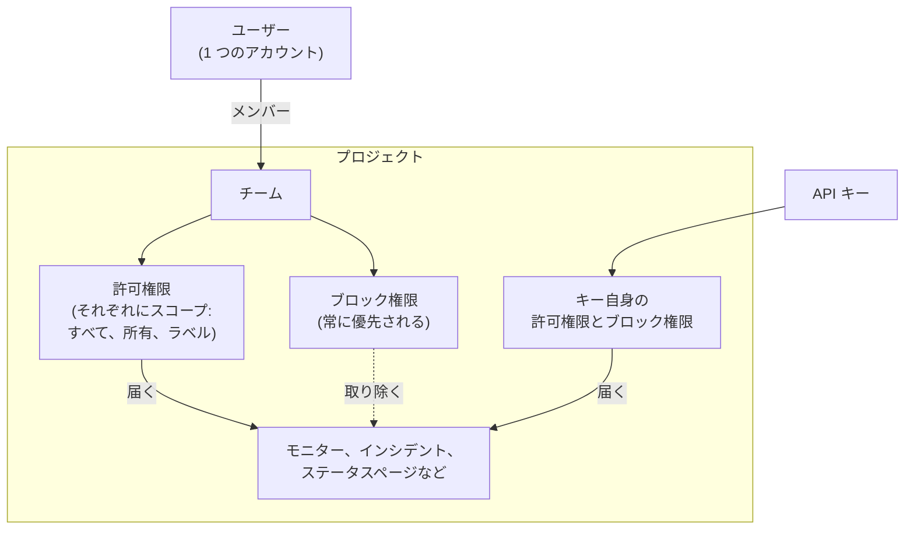
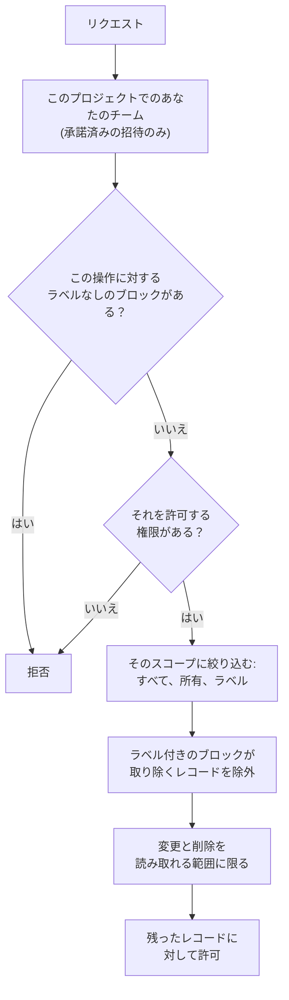

# ユーザー、チーム、権限

OneUptime のすべては**プロジェクト**の中にあります。そのプロジェクトで誰が何をできるかは、3 つの要素で決まります。プロジェクトにいる**ユーザー**、そのユーザーが所属する**チーム**、そしてそのチームに与えられた**権限**です。

> [!IMPORTANT]
> **ユーザーが権限を直接持つことはありません。** ユーザーのアクセス権は、そのプロジェクトで所属しているすべてのチームの権限の和集合です。誰かにできることを変えたいときは、チームへの所属を変えるか、そのチームの権限を変えます。

**オーナー**は別の考え方です。オーナーとは、特定のリソース（モニター、インシデント、ダッシュボードなど）に責任を持つ人のことです。オーナーには自分のリソースに関する通知が届き、権限は必要に応じて「自分が所有するものだけ」に絞り込めます。

## アクセスの仕組み

| 概念 | 内容 |
| --- | --- |
| ユーザー | 単一の OneUptime アカウント。ひとつのログインで、いくつものプロジェクトに参加できます。 |
| プロジェクト | テナントの境界。モニター、インシデント、チーム、データはすべて、ちょうどひとつのプロジェクトに属します。 |
| チーム | プロジェクト内の名前付きグループで、権限を保持します。 |
| チームメンバー | チームに招待され、承諾したユーザー。 |
| 権限 | 単一の機能（例: `CreateProjectMonitor`）、または多数をまとめたロール（例: `MonitorAdmin`）。 |
| スコープ | 許可権限が及ぶ範囲。すべてのリソース、所有しているものだけ、ラベルの付いたものだけ。 |
| オーナー | 特定のリソースの責任者として指定されたユーザーまたはチーム。 |
| ラベル | リソースに付けるタグ。権限の制限と整理に使います。 |

## ユーザー

ユーザーアカウントは OneUptime インスタンス全体で共通です。同じログインが、招待されたすべてのプロジェクトで機能します。

ユーザーがプロジェクトに「いる」のは、そのプロジェクト内の**少なくとも 1 つのチーム**のメンバーであるときです。「ユーザーをプロジェクトに追加する」という独立した手順はありません。誰かをプロジェクトに招待することは、チームに招待することです。

:::steps
1. **製品** メニューの **設定** にある **ユーザー** を開き、**ユーザーを招待** をクリックします。一覧には、プロジェクトの全員と招待の状況が表示されます。
2. **メール** を入力します。まだ OneUptime アカウントを持っていない人については **名前** も入力します。
3. 何ができるかを決める **チーム** を選び、**招待** をクリックします。
4. 招待された人は右上のベルから **プロジェクトへの招待** で承諾し、その時点からプロジェクトに参加します。
:::

- 招待は保留中のチームメンバーを作成します。ユーザーがプロジェクトメンバーとして数えられ、いずれかの権限を得るのは、**招待を承諾した後**です。
- **ユーザーを招待** は、プロジェクトのメンバーチーム（プロジェクト全体に対して `ProjectMember` を持つチームで、名前を変えていなければ **Members**）が選ばれた状態で始まります。別のチームを選ぶと、その人に与えるアクセスを増やしたり減らしたりできます。自分ではそのチームに招待できない場合（招待するとチームの権限をその人に渡すことになり、渡せるのは自分が持っている権限だけです）や、プロジェクトにそのようなチームがない場合は、何も選ばれていません。管理ダッシュボードでも、インスタンスの管理者がプロジェクトに誰かを追加するすべての場所で同じチームから始まります。プロジェクトの **ユーザーを招待**、1 人のユーザーや複数のユーザーをまとめて追加する **プロジェクトに追加**、そして[グローバル SSO プロバイダー](/docs/identity/global-sso)に関連付けられたプロジェクトです。
- プロジェクト内のすべてのチームからユーザーを外すと、次のリクエストから（サインイン中であっても）そのプロジェクトへのアクセス権がなくなります。アカウントとほかのプロジェクトには影響しません。その人はプロジェクトのオンコールスケジュール、エスカレーションルール、オーバーライドから外され、未解決のインシデントとエピソードのロールからも、リソースのオーナーからも外されます。解決済みのインシデントには、誰がオーナーで誰が対応したかの記録が残ります。
- プロジェクトを離れた人には、そのプロジェクトの通知が届かなくなります。その人自身のプロジェクト用の通知方法、通知ルール、通知設定は、最後のチームを離れたときに削除されます（メール、SMS、電話、WhatsApp、Telegram、プッシュ、Webhook、Slack、Microsoft Teams、メールのまとめと未送信のメール、着信用の番号、シフトのリマインダー）。再び参加した場合は既定の設定から始まります。その後もその人を指しているもの（着信ルールが呼び出すユーザーや、解決済みインシデントに残る所有者など）からは通知されません。プロジェクトのメンバーでない人には、プロジェクトに代わって何も送信されず、保留中の招待はまだメンバーシップではありません。これらの場所では名前の横に **メンバーではなくなりました** と表示されるので、別の人に置き換えてください。招待されてまだ承諾していない人には、代わりに **招待はまだ承諾されていません** と表示されます。オーバーライドが誰かの呼び出しをプロジェクトを離れた人に回している場合は、代わりにそのオーバーライドが代わりを務めている元の人が呼び出されます。離れると、その人がプロジェクトに接続した MCP クライアントも切断され、その人の個人用オンコールカレンダーのリンクはそれ以降空のカレンダーを表示します。OneUptime Cloud では、プロジェクトのシングルサインオンで戻ってくる人は、メールボックスから改めて確認します。
- プロジェクトが SSO を必須にしていて、ユーザーがまだ ID プロバイダーで認証していない場合、そのユーザーは未認可 SSO ユーザーとして扱われ、認証するまで何も見えません。[SSO](/docs/identity/sso) を参照してください。
- SCIM を設定すると、ID プロバイダーがユーザーとそのチーム所属を自動で作成、更新、削除できます。[SCIM](/docs/identity/scim) を参照してください。

## チーム

チームは権限が人に届く経路です。新しいプロジェクトは 3 つのチームから始まります。

| チーム | 保持する権限 | 編集可否 |
| --- | --- | --- |
| Owners | `ProjectOwner` | 不可。メンバーが常に最低ひとりいます。 |
| Admin | `ProjectAdmin` | 不可 |
| Members | `ProjectMember` | 可 — 出発点として用意されているので自由に変更してください |

**Owners** と **Admin** のチームは意図的にロックされています。権限は編集できず、チームの削除や名前変更もできません。これがプロジェクトを誤って締め出さないための仕組みです。Owners チームには常に最低 1 名のメンバーが必要です。

`ProjectOwner` は最上位のアクセス権で、請求、プロジェクトの削除、そして管理者にできることすべてを含みます。`ProjectAdmin` は請求とプロジェクト削除を除くすべてをカバーします。

プロジェクトの SMS、音声通話、WhatsApp、Telegram のオン・オフは、メッセージごとに費用がかかるため請求の扱いになります。これらのスイッチを **プロジェクト設定 > 通知 > 通知設定** で変更できるのは `ProjectOwner`、`BillingAdmin` ロール（**Billing Admin**）、`ManageProjectBilling` 権限（**Manage Billing**）だけで、`ProjectAdmin` は変更できません。

プロジェクトの前払い残高のチャージも請求の扱いになります。OneUptime Cloud では、SMS、音声通話、WhatsApp、Telegram は **プロジェクト設定 > 通知 > 通知設定** の残高から、AI は **プロジェクト設定 > AI > AI クレジット** の AI クレジットから支払われます。これらをチャージしたり **自動チャージ** を変更したりできるのは、プロジェクトのオーナーまたは **Manage Billing** を持つユーザーだけで、プロジェクト管理者はできません。残高不足を知らせるメッセージには誰が残高を追加できるかが書かれ、使える **残高をチャージ** ボタンやページへのリンクが表示されるのはその人たちだけです。

追加のチームはいくつでも作成できます。「フロントエンドオンコール」「サポート」「読み取り専用監査」など、それぞれに必要な権限を与えてください。OneUptime Cloud では、チームの作成とその権限の変更には Scale プランが必要です。

**チームの作成** では、名前と、チームのメンバーができることを決める **アクセス** を指定します。

| アクセス | チームのメンバーができること |
| --- | --- |
| プロジェクト管理者 | 設定を含め、プロジェクト内のあらゆるものを作成、変更、削除します。請求とプロジェクトの削除は含みません。 |
| プロジェクトメンバー | モニター、インシデント、ステータスページ、その他のプロジェクトのリソースを作成、変更、削除します。 |
| 閲覧者 | プロジェクト内のすべてを読み取り、何も変更しません。 |
| 権限は後で選択 | まだ何もできません。最初はこれが選ばれています。 |

:::steps
1. **製品** メニューの **設定** にある **チーム** を開き、**チームを作成** をクリックします。
2. チームの **名前** を入力し、**アクセス** を選びます。説明は **その他の項目** にあります。
3. チームを作成します。ロールを選んだチームは **メンバー** ページで開き、すぐに人を招待できます。**権限は後で選択** の場合は **権限** ページで開き、`IncidentMember` のようなより狭いロールや個別の権限を追加します。
:::

選んだロールは、チームができた時点で、プロジェクト内のすべてのリソースに対するチームの最初の権限になります。チームの権限ページで **ロールを追加** を使って追加した場合とまったく同じです。提示されるのは自分が持っているロールだけです。チームに招待した人は全員そのチームの権限を得るためです。また、チームを作成できてもチームができることを変更できない人には、この質問は表示されません。ロールを追加できなかった場合でもチームは作成され、一覧の上の通知からそのチームに移動できます。

場所: **チーム** からチームを開くと **メンバー** と **権限** に移動できます。**ブロック権限** は権限ページ下部の **その他の設定** にあり、折りたたまれた見出しにチームが持つ数が表示されます。

## 権限

権限は 1 つの機能です。配布方法は 2 通りあり、どちらもチームの **権限** タブにあります。

### ロール

ロールは製品領域全体を 3 つの水準のいずれかでまとめます。

- **Admin** — Member ができることに加えて、その領域固有の設定を扱います。たとえばインシデントとアラートの重大度と状態、モニターのステータス、メンテナンスの状態です。
- **Member** — 日常業務。その領域のリソースを、メモ、オーナー、テンプレートとともに作成、変更、削除します。ステータスページとオンコールでは、Member は Admin と同じことがすべてできます。
- **Viewer** — 読み取り専用。

`MonitorAdmin`、`IncidentMember`、`StatusPageViewer` などです。ほとんどの場合はロールが適切です。OneUptime に機能が追加されても、モニター関連の新しいテーブルは既存のモニターロールに追加されるため、こちらで新たに付与し直す必要がありません。

ワークフローと Runbook は例外です。どちらもプロジェクト内でコードを実行します（ワークフローはステップを、Runbook は Runner 上でスクリプトを実行します）。そのため `WorkflowMember` はワークフローとその実行を開いて手動で実行し、`RunbookMember` は Runbook とその実行を開いて実行します。実行の開始、ステップの完了またはスキップ、実行のキャンセルができます。どちらも実行するものを作成、変更、削除することはできず、それを構築するのは `WorkflowAdmin` と `RunbookAdmin` です。ロールが実行できるのは、そのスコープが届く Runbook だけです。たとえば一部のラベルに限定された `RunbookMember` は、そのラベルが付いた Runbook を実行します。[ワークフローの権限](/docs/workflows/configuration#権限) と [Runbook の権限](/docs/runbooks/configuration#権限) を参照してください。

領域のルール（ラベル、オーナー、オンコール、グループ化、リマインダーの各ルール）、カスタムフィールド、SLA、シークレットはプロジェクトの設定です。どの領域ロールを持っていても `ProjectAdmin` が必要です。API キー、チームとその権限、ラベル、SSO、ドメインも同じです。Settings ロールが扱うのはプロジェクトのサービス、プローブ、インフラ、インテグレーションであり、誰が何をできるかではありません。

請求には専用のロールが 3 つあります。`BillingViewer` はプロジェクトの請求情報（プランとサブスクリプション、請求書、使用量、残高、AI クレジット、支払い方法、請求先の連絡先情報）を読み取り、何も変更しません。`BillingMember` はさらに請求書をダウンロードし、請求先の連絡先情報を変更します。`BillingAdmin` は `BillingMember` ができることに加えて、SMS、電話、WhatsApp、Telegram のオンとオフを切り替えます。プラン、支払い方法、残高の変更と請求書の支払いには `ProjectOwner` または **Manage Billing** が必要です。請求ページではそれ以外の人に対してこれらのボタンがロックされ、誰が使えるかが表示されます。

{{PERMISSION_ROLE_COUNT}} 個すべてのロールは[権限リファレンス](/docs/permissions/reference)に掲載されています。

### 詳細権限

個々の機能も単独で割り当てられます。`CreateProjectMonitor`、`ReadProjectIncident`、`DeleteProjectStatusPage` のほか {{PERMISSION_TOTAL_COUNT}} 個があります。ロールでは広すぎて、ちょうど 1 つだけを渡したいときに使ってください。

変更や削除の権限が及ぶのは、読み取りもできる範囲だけです。対応する読み取り権限も一緒に付与してください。`ReadProjectIncident` がなければ、`EditProjectIncident` はどのインシデントも変更しません。インシデントのメモのように別のレコードを通じて読み取られるレコードには、その別のレコードを読み取る権限も必要です。インシデントを読み取る権限がなければ、`ReadIncidentInternalNote` はどのメモにも届きません。`CreateIncidentInternalNote` がメモを追加できるのも、読み取れるインシデントだけです。ロールには両方が最初から含まれています。

これらは API キーを作成するときに使うキーでもあり、API と Terraform プロバイダーが期待する値でもあります。

完全な一覧は[権限リファレンス](/docs/permissions/reference)にあります。

### 許可とブロック

各チームには 2 つのリストがあります。

- **権限**（許可） — このチームができること。
- **ブロック権限** — 許可リストの内容にかかわらず、このチームが決してできないこと。

どちらもチームの **権限** ページにあります。ブロックが必要なチームは少ないため、ブロック権限はページ下部の **その他の設定** に折りたたまれています。

> [!WARNING]
> **ブロックが常に優先されます。** ラベルなしのブロック項目は、その機能をチームから完全に取り上げます。ラベル付きのブロック項目は、そのラベルが付いたリソースに対してだけ取り上げます。「このチームはモニターを編集できるが、Production ラベルの付いたものは除く」といった設定に便利です。

同じ権限が両方のリストで同時に制限ラベルを持つことはできません。2 つ目は説明付きで拒否されます。

ユーザーの許可は所属するすべてのチームで合算されますが、ブロックはそのユーザーが行うすべての操作に適用されます。あるチームのラベルなしのブロックは、別のチームが許可していてもその機能を取り上げます。また、ブロック項目が何かを許可することはありません。想定よりアクセス権が少ない場合は所属する各チームのブロックを、多い場合は各チームの許可を確認してください。

### 状態を変更する

インシデント、アラート、アラートまたはインシデントのエピソード、計画メンテナンスは、状態タイムラインに新しい行が加わることで状態が変わります。モニターのステータスも同じです。**確認**、**解決**、**状態を変更**、**状態タイムライン** ページ、API、ワークフローはいずれもこの行を追加します。行の追加には、そのタイムライン自体の作成権限と、変更するレコードの読み取り権限が必要です。

| 状態を変更する対象 | 必要な権限 |
| --- | --- |
| インシデント | **Create Incident State Timeline** |
| アラート | **Create Alert State Timeline** |
| アラートエピソード | **Create Alert Episode State Timeline** |
| インシデントエピソード | **Create Incident Episode State Timeline** |
| 計画メンテナンス | **Create Scheduled Maintenance State Timeline** |
| モニター（そのステータス） | **Create Monitor Status Timeline** |

その後、レコードの新しい状態と、それに伴う値（エピソードが解決された日時や、メンテナンスが次に購読者へ通知する日時など）は OneUptime 自身が書き込みます。そのため、変更にレコードの編集権限は別途必要ありません。**Create Incident State Timeline** はあるが **Edit Incident** はないカスタムロールでも、インシデントの状態を変更できます。チームに状態を変更させたくない場合は、タイムラインの作成権限をブロックしてください。**Edit Incident** のブロックは状態の変更には影響しません。ラベル、オーナー、非公開レコードは、他の権限と同じように、状態を変更するレコードを通じてタイムラインの作成権限を絞り込みます。詳しくは下のスコープのルールを参照してください。

あなたの代わりに書き込まれるのは状態だけです。変更と一緒に投稿するメモはあなたとして投稿され、メモ自体の権限が必要です。詳しくは[状態の変更をステータスページの購読者に知らせる](/docs/incidents/states-and-severities#状態の変更をステータスページの購読者に知らせる)を参照してください。インシデントを宣言しながらそのアラートを確認するのに必要なものは、各アラートをそれぞれのページで確認する場合と同じです。各アラートを通じて絞り込まれる **Create Alert State Timeline** が必要で、**Edit Alert** は必要ありません。[宣言と同時にアラートを確認する](/docs/incidents/linked-alerts#宣言と同時にアラートを確認する)を参照してください。

## スコープ: 許可権限が及ぶ範囲

許可権限には、追加時に **スコープ** で選ぶスコープが必ず付きます。

| スコープ | 意味 |
| --- | --- |
| プロジェクト内のすべてのリソース | 既定値。権限は該当するすべてのリソースに適用されます。 |
| このチームまたはそのメンバーが所有 | 権限は、このチームまたは操作するユーザーがオーナーとして登録されているリソースにのみ適用されます。 |
| ラベルで制限 (詳細設定) | 権限は、選択したラベルのいずれかが付いたリソースにのみ適用されます。 |

**所有**は「自分のサービスは自分で見る」というモデルを作る最も簡単な方法です。チームに `MonitorAdmin` を所有スコープで与え、そのチームを担当モニターのオーナーにします。絞り込まれるのは実際にオーナーを持てるリソース（モニター、インシデント、ダッシュボード、サービスなど）だけです。プロジェクト設定（インシデント状態、ラベル、チーム自体）にはオーナーがないため、所有スコープのロールもそこでは通常どおり動作します。

**ラベル**は同じ考え方をより手動で行うものです。リソースにタグを付け、そのタグに限定した権限を付与します。

**プロジェクト全体に対する操作には、プロジェクト全体に届く権限が必要です。** ルールの **今すぐ実行** はルールをプロジェクトのすべてのリソースに適用し、ネットワークのサイト割り当て、デバイスラベル、自動インポートの各ルールではすべてのネットワークデバイスまたはスキャンに適用します。そのため、プロジェクト内のすべてのリソースをスコープとする権限が必要です。ラベルや所有リソースに限定した権限では足りず、実行で変更されるリソースに対するラベル付きのブロックがあると、その実行は拒否されます。実行すると、そのラベルが付いたリソースも変更されることになるからです。

一部のロールは定義上プロジェクト全体に及ぶもので、スコープをまったく提供しません。絞り込んでも意味がないからです。「Billing Admin、ただし自分が所有する請求のみ」は何も表していません。

{{PERMISSION_SCOPE_EXEMPT_ROLES}}

## オーナー

オーナーとは、特定のリソースに紐づくユーザーまたはチームです。運用対象を表すほとんどのリソース（モニター、インシデント、アラート、計画メンテナンス、オンコールポリシー、ダッシュボード、サービス、ステータスページ、ワークフロー、Runbook、SLO）には **所有者** タブがあります。

オーナーには 2 つの役割があります。

1. **通知。** リソースに何かが起きたとき（モニターがダウンした、インシデントが作成された、SLO がエラーバジェットを消費し始めた）に OneUptime が知らせる相手がオーナーです。
2. **アクセス（設定した場合）。** `Owned` 権限スコープ（所有）が照合する対象が所有関係です。本人がオーナーである場合、または所属するいずれかのチームがオーナーである場合に一致します。

所有関係だけでは何も付与されません。モニターのオーナーであっても、所属チームのいずれかがモニター権限も持っていなければ編集できません。所有関係はアクセスを絞り込むもので、広げることはありません。

リソースのオーナーは、そのリソースを通じて読み取られます。モニターやその他のリソースのオーナーを一覧表示、読み取り、追加、削除できるのは、そのリソースを読み取れる人だけです。オーナーに対する権限だけでは、読み取れないリソースのオーナーには届きません。

## ラベル

ラベルはリソースに付けるプロジェクト全体のタグです。用途は 2 つ。ダッシュボードでの絞り込みとグループ化、そして上で述べた権限の制限です。

ラベル制限は、リソースが権限のラベルのうち**少なくとも 1 つ**を持っていれば満たされます。ラベルがまったくないリソースは、ラベル制限付きの権限をいずれも満たしません。

インシデントのメモ、ステータスページのお知らせ、サービスに関する AI インサイトのように自身のラベルを持たないレコードは、それが属するレコード、またはそれが扱うレコードのラベルを引き継ぎます。ラベルで制限された権限は、それらのレコードのいずれかが権限のいずれかのラベルを持つときにそのレコードに届き、ラベル付きのブロックは、それらのいずれかがブロックされたラベルを持つときにそのレコードを取り除きます。これは読み取り・変更・削除のすべてに当てはまります。どのサービスにも関係しない AI インサイトのように、それらのどれにも関係しないレコードはプロジェクトのものです。ラベルによる制限はそれを絞り込まず、ラベル付きのブロックもそれを取り除きません。

場所: **プロジェクト設定 > 基本 > ラベル**。新しいラベルのフォームを開くと、ページの一覧にあるラベルがまだ使っていない色があらかじめ選ばれています。好みで別の色を選んでもかまいません。OneUptime Cloud では、ラベルの作成と変更には Growth プランが必要です。

## テレメトリー

ログ、トレース、メトリクス、例外、プロファイル、セッションリプレイは、それを送信したリソース（サービス、ホスト、Kubernetes クラスター、モニター、RUM アプリケーションなど）に属します。テレメトリーの権限は、そのスコープが及ぶ範囲まで読み取ります。

- **すべてのリソース**は、プロジェクト内のすべてのリソースのテレメトリーを読み取ります。
- **所有**は、あなたまたはあなたのチームのいずれかが所有するリソースのテレメトリーと、どのリソースも示さないテレメトリーを読み取ります。
- **ラベル**は、権限のラベルのいずれかが付いたリソースのテレメトリーを読み取ります。

テレメトリーの権限に対するラベル付きのブロックは、ほかに何を持っていても、そのラベルが付いたリソースのテレメトリーを除外します。これはテレメトリーを読み取るあらゆる場所に当てはまります。エクスプローラーとそのグラフ、フィルター、属性リスト、エクスポート、セッションリプレイ、そして AI アシスタントがあなたのために読み取る内容です。メトリクス名の一覧には、読み取りが許されたサービスが報告するメトリクスと、どのサービスも報告しないメトリクス（ホストやクラスターのメトリクスなど）が表示されます。ホストやクラスターなど、ほかの種類のリソースのテレメトリーも読み取れる場合は、すべてのメトリクス名が表示されます。

テレメトリーの削除も同じリソースに限られます。削除が届くのは、シグナルを読み取る権限と削除する権限の両方が届くリソースの行で、いずれかに対するラベル付きのブロックが除外するリソースは除かれます。また、削除は一度に 1 つのプロジェクトで行われます。

モニターのログ、SLO の履歴、ネットワークフロー、Kubernetes のコスト配分も同じように、それが属するモニター、SLO、ネットワークデバイス、クラスターを通じて読み取られます。所有とラベルは、あなたが読み取れるレコードの行に届き、ラベル付きのブロックはそのラベルを持つレコードの行を除外します。監査ログと脅威インテリジェンスの指標は、それを読み取れる人がプロジェクト全体にわたって読み取ります。

## API キー

API キーには権限がキー自体に直接与えられます。チームには属さず、チーム所属の影響も受けません。

- チームに与えるのと同じ詳細権限やロールを割り当てます。
- キーはチームと同じく**ブロック権限**と**ラベル制限**に対応しています。
- キーは所有スコープに対応して**いません**。所有関係はユーザーを基準に解決され、キーはユーザーではないため、必要なアクセス権は明示的に与えてください。

**キーの作成** では、名前とキーの **アクセス** を指定します。

| アクセス | キーができること |
| --- | --- |
| プロジェクト管理者 | 設定を含め、プロジェクト内のあらゆるものを作成、変更、削除します。請求とプロジェクトの削除は含みません。 |
| プロジェクトメンバー | プロジェクトメンバーと同じように、モニター、インシデント、ステータスページ、その他のプロジェクトのリソースを作成、変更、削除します。 |
| 閲覧者 | プロジェクト内のすべてを読み取り、何も変更しません。 |
| 権限は後で選択 | まだ何もできません。最初はこれが選ばれています。 |

:::steps
1. **プロジェクト設定 > 詳細 > API キー** を開き、**API キーを作成** をクリックします。OneUptime Cloud では、API キーには Growth プランが必要です。
2. キーの **名前** を入力し、**アクセス** を選びます。説明と有効期限は **その他の項目** にあります。別の日付を選ばない限り、キーは作成日の 1 年後に期限切れになり、折りたたまれたセクションにもそう表示されます。
3. キーを作成します。キーは自身のページで開き、そこでキーをコピーします。
:::

選んだロールは、キーができた時点でキーの最初の権限になります。キーのページで追加した場合とまったく同じです。提示されるのは自分が持っているロールだけです（キーに、それを渡す人が持つ以上の権限を与えることはできません）。また、キーを作成できてもキーができることを変更できない人には、この質問は表示されません。

キーのページでは、**ロールを追加** がチームの権限タブと同じ一覧からロールを追加し、**権限を追加**（カードの **⋯** メニュー内）が詳細権限を 1 つ追加します。**ブロック権限** はページ下部の **その他の設定** にあり、折りたたまれた見出しにキーが持つ数が表示されます。

> [!TIP]
> 各インテグレーションには専用のキーを、動作する範囲で最も狭い権限セットとともに発行してください。1 つを失効させても他に影響しません。

## OneUptime がリクエストの可否を判断する仕組み

ログイン済みユーザーの場合、順番は次のとおりです。

1. このプロジェクトでユーザーが所属するチームを見つける。承諾済みの招待のみを数えます。リクエストが届くのはこのプロジェクトのレコードだけです。別のプロジェクトのレコードは、ID で指定してもフィルターで指定しても、存在しないものとして扱われます。
2. それらのチームのすべての権限行を集める。許可とブロックのそれぞれに、ラベルとスコープが付いています。
3. まずブロックリストを確認する。対象テーブルがその操作に対して受け付ける権限のいずれかにラベルなしのブロックがあれば、どのチームのものであっても、その場でリクエストを拒否します。
4. 許可リストを確認する。対象テーブルがその操作に対して受け付ける権限が、少なくとも 1 つ必要です。運用リソース（モニター、インシデント、ダッシュボードなど）では、対応する **All Operational Resources** 権限（Create、Read、Edit、Delete）も数えられます。ただし、それ自体がブロックされている場合は除きます。
5. スコープを適用する。所有スコープの付与はクエリを所有リソースに絞り込み、ラベルスコープは一致するラベルに絞り込みます。同じ操作に対する他の付与がより広い場合は、広い方が優先されます。インシデントのメモのように自身のラベルを持たないレコードは、それが属するレコードのいずれかが付与のいずれかのラベルを持つときに、ラベルスコープの付与に一致します。ラベルに限定した **All Operational Resources** 権限も同じように絞り込みます。そのラベルのいずれかが付いた運用リソースに届き、同じラベルに限定したリソース自身の権限と同じ範囲になります。作成も同じように絞り込まれます。ラベルに限定したステータスページの作成権限は、そのラベルのいずれかが付いたステータスページだけを作成し、ラベルに限定したインシデントのメモの作成権限は、そのいずれかが付いたインシデントにだけメモを追加します。ただし、作成に対する別の権限がプロジェクト全体に届く場合は除きます。その範囲外の作成は、許可されたラベルを示すメッセージとともに拒否されます。所有スコープの作成権限では、モニターやステータスページのように独自のオーナーを持つリソースを作成できるのは人だけで、その人がオーナーになります。メモは、あなたまたはあなたのチームのいずれかがオーナーであるインシデントにだけ作成できます。レコードに付いているラベルの変更も同じように絞り込まれます。変更する権限がラベルに限定されている場合、ほかに変更する権限がプロジェクト全体に及んでいない限り、レコードはそのラベルの少なくとも 1 つを保ち、最後の 1 つを外す変更は許可されたラベルを示すメッセージとともに拒否されます。ある種類のレコードを作成する権限が自分の所有するものにしか及ばない場合、作成したレコードには何よりも先に自分が所有者として登録され、登録できなかった場合は作成が拒否され、何も残りません。
6. ラベルブロックを適用する。ラベル付きのブロックは、対象リソースがそのラベルを持っていればリクエストを拒否します。**All Operational Resources** 権限に対するラベル付きのブロックは、そのラベルが付いたリソースを、その権限が与える範囲から除外します。インシデントのメモやステータスページのお知らせのように、レコード自体にラベルがない場合、ラベル付きのブロックは、そのレコードが属するレコードにいずれかのラベルが付いていれば、そのレコードを読み取り・変更・削除の対象から除外します。ホームページのインシデントのように、すべてのプロジェクトのレコードを一度に表示する一覧では、各プロジェクトのレコードがそのプロジェクトでのあなたのブロックと付与によって絞り込まれます。作成権限に対するラベル付きのブロックは、そのラベルのいずれかが付いた新しいレコードを拒否し、自身のラベルを持たないレコードの場合は、そのラベルのいずれかが付いたレコードに属する新しいレコードを拒否します。変更する権限に対するラベル付きのブロックがあると、レコードにそのラベルのいずれかを付けることはできず、自身のラベルを持たないレコードの場合は、そのラベルのいずれかが付いたレコードを指すように変えることもできません。
7. 変更と削除を読み取れる範囲に限る。変更や削除は、変更の権限だけでなく読み取り権限によっても絞り込まれます。読み取れないレコード（自分のラベルやオーナーの範囲外、または読み取りに対するブロックが除外するラベルが付いたもの）は変更も削除もできず、ある種類のレコードの読み取りに対するラベルなしのブロックは、その変更と削除も取り除きます。インシデントのメモやステータスページのお知らせのように別のレコードを通じて読み取られるレコードには、読み取れるレコードを通じてしか届きません。インシデントを読み取る権限がなければ、メモの権限はどのメモにも届かず、インシデントの読み取りに対するラベル付きのブロックは、そのラベルが付いたインシデントのメモを除外します。また、インシデントを読み取る権限が所有スコープに限られている場合、メモの権限は、あなたまたはあなたのチームのいずれかがオーナーであるインシデントのメモにだけ届きます。こうしたレコードの作成も、読み取れるレコードの下に限られます。メモは読み取れるインシデントにだけ、お知らせは読み取れるステータスページにだけ（指定したすべてのページについて）作成でき、読み取れないレコードを指定すると、存在しないものとして拒否されます。変更も同じ規則に従います。お知らせを別のステータスページに載せるときのように、レコードを別のレコードの下に移す場合、移せるのは読み取れるレコードの下だけで、すでに属しているレコードはそのまま残ります。作成や変更で一覧として指定するレコード（インシデントのモニターやアラートのサービスなど）は、それを読み取る権限があればその権限の範囲に、また常にその読み取りに対するラベル付きのブロックの範囲に限られます。範囲外のレコードは存在しないものとして拒否され、すでに一覧にあるレコードはそのまま残ります。作成や変更が専用のフィールドで指定する 1 件のレコード（アラートのモニターやステータスページが表示するモニターなど）も同じ規則に従い、テンプレートが埋めるレコード（インシデントテンプレートがそれから宣言されたインシデントに加えるモニターやステータスページなど）も同様です。OneUptime のグローバルプローブと AI エージェントは、すべてのプロジェクトで引き続き使えます。ID で指定した 1 件のレコードの変更や削除が何にも届かなかった場合、読み取れないレコードであればレコードが存在しないものとして（`404`）応答し、読み取れても変更できないレコードであれば拒否します。ID で指定した 1 件のレコードの読み取りも、レコードが存在しないか読み取れない場合は同じく `404` で応答します。

レコードの各フィールドは、そのレコード自身の読み取り権限で読み取られます。別の種類のレコードの権限で開くことはありません。一部のフィールドは意図的に範囲を狭めています。シークレットは、それが属するレコードを編集または管理できる人だけが読み取れます。たとえば、モニターの受信リクエストキーと受信メールキー、サーバーエージェントキー、ワークフローの Webhook キーと受信メールキーです。セッションリプレイの録画を見るには、**List Session Replays** だけでなく **Watch Session Replays** が必要です。テレメトリーはシグナルごとに読み取られます。**Read Telemetry Service Log** はログを、**Read Telemetry Service Traces** はトレースを、**Read Telemetry Service Metrics** はメトリクス（メトリクスのグラフを含む）を読み取ります。

フィールドにも同じルールが適用されます。フィールドの権限にラベルなしのブロックがあるとそのフィールドは使えなくなり、運用リソースでは、対応する **All Operational Resources** 権限で、レコードを読み取りまたは変更できる人なら誰でも開けるフィールドをすべて開けます。ただし、シークレットキーのように意図的に範囲を狭めたフィールドは開けません。

認証情報を保持する設定は、それを読み取れる人だけが指定できます。作成や変更で SMTP サーバー、通話・SMS プロバイダー、Runbook の認証情報、SNMP の認証情報、ビデオ通話の接続、API キーを指定できるのは（たとえば、ステータスページがメールを送信する SMTP サーバーや、Runbook のステップが実行時に使う認証情報）、その種類の設定を読み取れる場合だけです。読み取れない設定は存在しないものとして拒否されますが、レコードがすでに指定している設定はそのまま残ります。通話・SMS プロバイダーで購入する番号を検索したり、所有している番号を一覧表示したりするにも、同じ読み取り権限が必要です。SSH コマンドを含む AI コマンドプランの承認には、OneUptime AI がその Runner の認証情報から選んだ Runbook の認証情報でコマンドが実行されるため、Runbook の認証情報の読み取り権限（**Read Runbook Credential**。Project Owners と Project Admins は持っています）が必要です。OneUptime AI が確認なしでコマンドを実行できるようにする自動修復ルールの保存（保存によってそれを有効にする場合、または許可リストのパターンや Runner を追加する場合）、SSH の認証情報を持つ Runner での **AI 修復コマンドを実行** のオン、OneUptime AI のコマンドを実行する Runner への SSH の認証情報の割り当ても同じです。ワークフローのステップは Project Admin として動作しますが、認証情報を保持する設定の読み取り権限を借りることは決してありません。そうした設定を指定することも、これらの変更を行うこともできず、それを読み取れる人が行う必要があります。

権限を持っているかを問うそれ以外のすべても、同じルールで決まります。SMS・通話・AI のクレジットの追加、請求書の支払い、通知ルールのテストといった単純な読み書きではない操作や、OneUptime が表示するボタンです。使えないボタンはロックされた状態で表示され、その理由を示します。所属するチームのブロックが理由の場合は、ブロックされている権限を示します。

ライブ更新も同じルールに従います。レコードが作成・変更・削除されると、OneUptime はそのレコードを読み取れる人の開いているページにだけ知らせ、それ以外の人には知らせません。読み取りを制限するものは、ライブ更新も同じように制限します。ラベル、オーナー、ラベル付きのブロック、非公開のインシデント、他の人の AI 会話です。変更によってレコードを読み取れなくなった場合 (非公開にされた場合など) も、開いているページに知らせが届き、そのレコードは表示されなくなります。権限の変更、ブロック、マスター管理者でなくなったことは、すぐに開いているページに反映されます。

ライブ更新は、それを開始したサインインとともに終了します。サインアウト、パスワードの変更、ブロックされた場合、開いているページのライブ更新はすぐに停止します。開いているページは 15 分ごとにサインインを更新し、ライブ更新を再開します。サインインを更新できない場合は、サインインページに移動します。SSO を必須にしているプロジェクトは、他のすべてと同様に、SSO でサインインしたページにのみライブ更新を送ります。

ログイン済みユーザーはさらに、自分のプロフィールや自分の通知ルールの読み取りといった小さな自動権限のセットを持ちます。これらは管理者権限ではなく、他人のデータを開くことはありません。

解決済みの権限はユーザーとプロジェクトごとにキャッシュされ、チーム所属やチーム権限が変わると更新されます。権限を変更してもユーザーにすぐ反映されない場合は、再読み込みしてもらってください。

## 設定例

**見るだけのチーム。** **アクセス** で **閲覧者** を選んでチームを作成します。一部の領域だけなら **権限は後で選択** を選び、見せたい領域の `*Viewer` ロールを追加します。

**自分のサービスを自分で管理するオンコール担当。** チームに `MonitorAdmin`、`IncidentMember`、`OnCallMember` を**所有**スコープで与え、担当するモニターのオーナーにそのチームを追加します。

**本番環境に触れさせない外部委託先。** チームに必要なロールを**すべて**スコープで与えたうえで、機微な機能に対する**ブロック権限**（チームの権限ページの **その他の設定** の下）を `Production` ラベル限定で追加します。

**デプロイを報告するだけの CI パイプライン。** **権限は後で選択** で API キーを作成し、そのページで必要な詳細権限だけを追加します。ロールは不要です。

**請求を変更させず、請求書も見せたくない人。** `ProjectAdmin` ではなく `ProjectMember` を付与してください。プロジェクト管理者はプラン、支払い方法、残高を変更できませんが、請求書の閲覧とダウンロードはできます。何も変更せずに請求ページを閲覧させたい場合は `BillingViewer` を付与してください。

アクセスが想定と違う場合:

:::details 見えるはずのもの、変更できるはずのものが見えない・変更できない
招待を承諾しているか確認してください。保留中のチームメンバーには権限がありません。次に、所属する各チームを開いてください。どのチームでもラベルなしのブロックがあればその機能は取り上げられ、**所有** スコープやラベルのスコープは、所有するリソースやラベルの付いたリソースにしか届きません。ロックされたボタンには、必要な権限、またはそれを拒否しているブロックが表示されます。
:::

:::details 想定より多くのことができる
アクセスは所属するすべてのチームの和集合なので、**Admin** と **Owners** を含め、各チームの許可を探してください。チームが何を許可していても 1 つの機能を取り上げるには、所属するチームのいずれかにブロック権限を追加します。
:::

## 次のステップ

:::cards
- [権限リファレンス](/docs/permissions/reference): OneUptime のソースコードから生成された、すべてのロールとすべての詳細権限。
- [SSO](/docs/identity/sso): ID プロバイダーでサインインできるようにします。
- [SCIM](/docs/identity/scim): ID プロバイダーからユーザーとチーム所属を作成します。
- [API リファレンス](/docs/api-reference/api-reference): API キーとその権限で API を呼び出します。
:::
