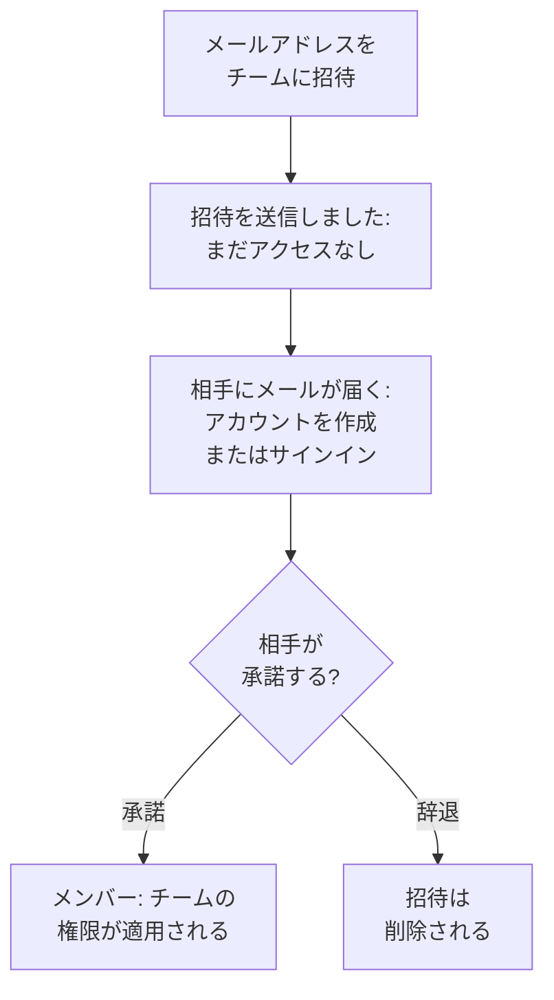

# メンバーの招待

ユーザーは招待によってプロジェクトに参加します。ユーザーのメールアドレスをチームに招待し、相手が承諾すると、それ以降はチームがその人にできることを決めます。このページでは、ユーザーの招待方法、招待された人に表示される内容、あとからアクセスを変更または終了する方法を説明します。

:::cards
- [ユーザーを招待する](#ユーザーを招待する): メールアドレスとチーム。
- [招待を承諾する](#招待を承諾する): 招待された人に表示される内容と操作。
- [ユーザーのチームを変更する](#ユーザーのチームを変更する): アクセスを増やす、または減らす。
- [ユーザーを削除する](#プロジェクトからユーザーを削除する): プロジェクトから外れると失うもの。
:::

## 招待の仕組み

- **チームが、その人にできることを決めます。** 個人に直接付与される権限はありません。その人ができるのは、所属するチームが許可することです。[ユーザー、チーム、権限](/docs/permissions/index) を参照してください。
- **承諾するまで何も付与されません。** 保留中の招待は **招待を送信しました** と表示され、プロジェクトへのアクセスは付与されません。
- **一度の承諾でプロジェクト全体が対象になります。** 招待を承諾すると、同じプロジェクトへのその人の他の招待もすべて承諾されます。あとから別のチームに追加したメンバーは、承諾の手順なしですぐにそのチームに入ります。

## 始める前に

- **招待できるロール。** Project Owner、Project Admin、または **Invite New Members** 権限を持つロール。招待するとそのチームのアクセスが付与されるため、自分自身がその権限を持っているチームにしか招待できません。ブロックが一つもない Project Admin は、この判定では Project Admin がすでにできることをすべて持っているものとして扱われます。**Members** や、より範囲の狭いロールを持つチームには招待できますが、Project Owner、課金の権限、**Delete Project**、**Edit Project**、**Edit Team**、**Invite New Members** を持つチームには招待できません。
- **OneUptime Cloud では、プランの空き。** プロジェクトのメンバーは、招待された時点から請求上のシートとして数えられます。Free プランで使えるのは一人分です。[請求と使用量](/docs/configuration/billing#プランとシート) を参照してください。
- **SCIM Push Groups を使っていないこと。** アイデンティティプロバイダーが SCIM Push Groups でプロジェクトのチームを管理している間は、ユーザーの招待と削除は OneUptime ではなくそちらで行います。

## ユーザーを招待する

:::steps
### ユーザーの一覧を開く

**製品 → 設定 → ユーザー** に移動します。**ユーザー** の一覧には、プロジェクトの全員、所属チーム、参加済みかどうかが表示されます。

### 招待ダイアログを開く

**ユーザーを招待** をクリックします。**新しいユーザーを招待** ダイアログが開きます。

### メールアドレスを入力する

**メール** にアドレスを入力します。そのアドレスを使う OneUptime アカウントがまだない場合は、ダイアログで **名前** も入力します。新しいアカウントはこの名前で作成されます。

### チームを選ぶ

**チーム** には、最初にプロジェクトのメンバー用チームが選ばれています。プロジェクト全体に Project Member を持つチーム、なければ Members という名前のチームです。より多くの、または少ないアクセスを与えるには、別のチームを選びます。プロジェクトにそのようなチームがない場合や、自分ではそのチームに招待できない場合、**チーム** は空のままです。

### 招待を送信する

**招待** をクリックします。OneUptime が招待をメールで送り、その人のページを開きます。招待が承諾されるまで、その人は **招待を送信しました** と表示されます。
:::

> [!TIP]
> 仕事に必要な最小のチームに招待しましょう。あとから別のチームに追加でき、参加するチームが増えるごとにできることが広がります。

## 招待を承諾する

招待メールにはプロジェクト名が記載されています。メール内のボタンは、OneUptime アカウントをまだ持っていない人には **Create Your Account**、持っている人には **Sign In to OneUptime** です。サインイン後、次のどちらかの場所で承諾します。

| 相手の状況 | 表示される内容 | クリックするもの |
| --- | --- | --- |
| まだどのプロジェクトにも参加していない | サインイン後に表示されるページ上の招待 | **承諾して参加** または **辞退** |
| すでに別のプロジェクトに参加している | 右上のベルにある保留中の招待。ベルから **プロジェクトへの招待** が開きます | **承諾** または **拒否** |

承諾するとすぐにプロジェクトに参加し、チームの権限と、すべてのメンバーに最初から用意されている通知設定が適用されます。[最初に用意されているもの](/docs/notifications/index#最初に用意されているもの) を参照してください。辞退すると招待は削除されるため、あとで参加するには新しい招待が必要です。

## プロジェクトのメンバーを確認する

**ユーザー** には、一人につき一行が表示されます。

| 列 | 表示される内容 |
| --- | --- |
| **ユーザー** | 名前とメールアドレス。 |
| **チーム** | 所属している、または招待されているプロジェクトのすべてのチーム。 |
| **ステータス** | 参加済みなら **メンバー**。まだ承諾していない他チームへの招待があれば、その数も表示されます。それまでは **招待を送信しました**。 |

**ユーザー**、**ステータス**、**チーム** で一覧を絞り込めます。行をクリックすると、その人のページが開きます。

| ページ | 用途 |
| --- | --- |
| **プロフィール** | 名前、メールアドレス、画像、ユーザー ID。 |
| **チーム** | 所属しているチーム。ここでチームを追加または削除します。 |
| **準備状況**、**通知方法**、**オンコールルール** | 呼び出せるかどうか、およびその方法。Project Owner、Project Admin、本人、および他の人の通知ルールを読める人に表示されます。[準備状況とレポート](/docs/on-call/readiness) を参照してください。 |
| **カスタムフィールド** | 人に関するプロジェクトのカスタムフィールド (ある場合)。 |
| **プロジェクトから削除** | その人をプロジェクトから外します。 |

## ユーザーのチームを変更する

:::steps
### チームのページを開く

**ユーザー** でその人をクリックし、**チーム** をクリックします。

### チームに追加する

**招待** をクリックし、**チーム** を選んで、ダイアログの **招待** をクリックします。メンバーはすぐに新しいチームに入ります。まだ参加していない人には招待がもう一通届き、どちらかを承諾すると両方が承諾されます。

### チームから外す

チームの行で **削除** をクリックします。それがその人が参加している最後のチームの場合、削除するとプロジェクトから外れます。その場合は、何かが変わる前にダイアログがそのことを伝えます。
:::

Owners チームには参加済みのメンバーが常に少なくとも一人残るため、プロジェクトが最後のオーナーを失うことはありません。

## プロジェクトからユーザーを削除する

**ユーザー** でその人の行メニュー **⋯** を開き、**プロジェクトから削除** をクリックします。または、その人を開いてサイドメニューで **プロジェクトから削除** を選びます。複数の人をまとめて削除するには、行を選択して選択項目を削除します。どの人も同じ方法で削除されます。

削除すると、その人はプロジェクトのすべてのチームから外れます。サインイン中でもすぐにアクセスを失い、プロジェクトのオンコールスケジュールとエスカレーションルールから外され、通知も届かなくなります。OneUptime アカウントは削除されず、もう一度招待できます。プロジェクトから外れると失うものは、[ユーザー、チーム、権限](/docs/permissions/index#ユーザー) にすべて記載されています。

## その他の参加方法

- **シングルサインオン。** プロジェクトのアイデンティティプロバイダーで初めてサインインした人は、プロバイダーが指定するチームに参加します。[SSO ユーザーのロールとチーム](/docs/identity/sso#sso-ユーザーのロールとチーム) を参照してください。
- **SCIM。** アイデンティティプロバイダーがユーザーを作成し、接続のデフォルトチームに追加します。[SCIM](/docs/identity/scim#プロジェクトのユーザーがプロビジョニングされる流れ) を参照してください。
- **Admin Dashboard。** セルフホストのインストールでは、マスター管理者がユーザーをプロジェクトに追加し、本人の代わりに招待を承諾できます。[ユーザー、チーム、権限](/docs/permissions/index#ユーザー) を参照してください。

## トラブルシューティング

:::details "This user has already been invited to this team"
その人はすでにそのチームに、メンバーとして、または未承諾の招待付きで所属しています。**ユーザー** でその人を開いてチームを確認するか、別のチームに招待してください。
:::

:::details "You have reached the user limit for the free plan"
OneUptime Cloud では、Free プランのプロジェクトに参加できるのは一人だけです。プランを変更してから、もう一度招待してください。[プランを変更する](/docs/configuration/billing#プランを変更する) を参照してください。
:::

:::details "Too many invitations were sent to this email address in the last hour"
同じアドレスには、プロジェクトとプライベートステータスページへの招待を合わせて、送り手にかかわらず一時間に 10 件まで送れます。一時間待ってから、もう一度招待してください。
:::

:::details 招待メールが届かない、またはリンクの有効期限が切れた
招待はメールに依存しません。招待したアドレスでサインアップするよう依頼してください。OneUptime がそのアドレスに、アカウント作成を完了するための新しいリンクをメールで送ります。すでにアカウントを持っている人は、サインインすると招待が待っています。
:::

:::details ユーザーを招待で、ユーザーは SCIM Push Groups で管理されていると表示される
アイデンティティプロバイダーがプロジェクトのチームを管理しています。ユーザーの招待や削除はアイデンティティプロバイダーで行うか、**プロジェクト設定 → セキュリティ → SCIM** で Push Groups をオフにして、ここで管理してください。
:::

## 次のステップ

:::cards
- [ユーザー、チーム、権限](/docs/permissions/index): 各チームにできることを決めます。
- [プロジェクト設定](/docs/configuration/project-settings): プロジェクト全体に適用されるすべての設定。
- [アカウント](/docs/introduction/your-account): サインイン、プロフィール、所属するプロジェクト。
- [SCIM](/docs/identity/scim): アイデンティティプロバイダーでユーザーとチームを管理します。
:::
